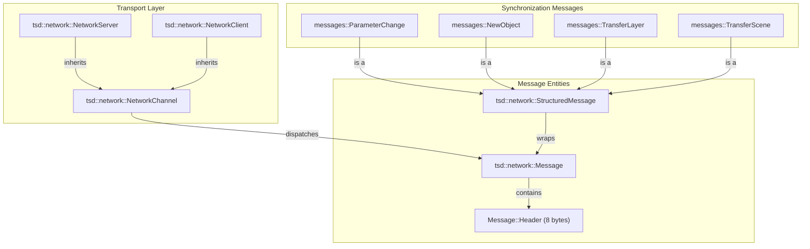
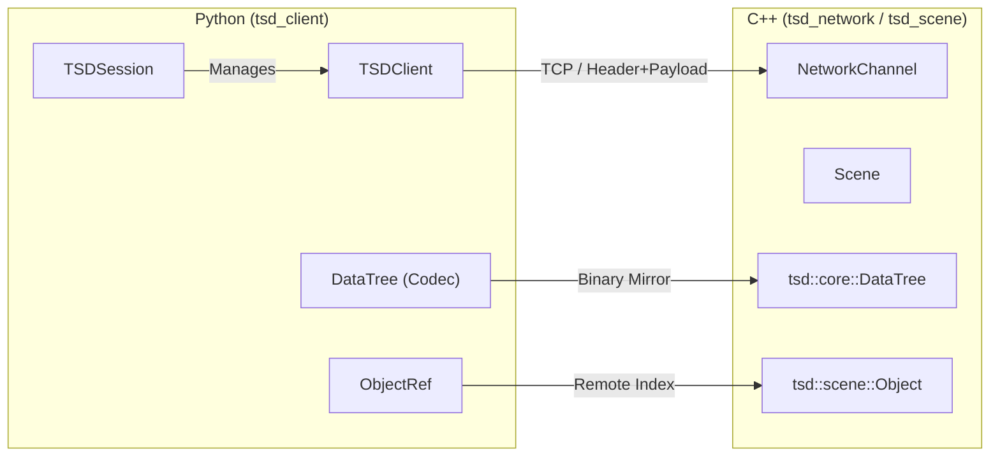

<!-- source: DeepWiki mcp.deepwiki.com · repo NVIDIA/VisRTX · page 8 Networking & Remote Rendering · fetched 2026-10-26 -->

# Networking & Remote Rendering

Relevant source files

The following files were used as context for generating this wiki page:

- [tsd/src/tsd/network/CMakeLists.txt](tsd/src/tsd/network/CMakeLists.txt)
- [tsd/src/tsd/network/Message.hpp](tsd/src/tsd/network/Message.hpp)
- [tsd/src/tsd/network/NetworkChannel.cpp](tsd/src/tsd/network/NetworkChannel.cpp)
- [tsd/src/tsd/network/NetworkChannel.hpp](tsd/src/tsd/network/NetworkChannel.hpp)
- [tsd/src/tsd/network/messages/NewObject.cpp](tsd/src/tsd/network/messages/NewObject.cpp)
- [tsd/src/tsd/network/messages/ParameterChange.cpp](tsd/src/tsd/network/messages/ParameterChange.cpp)
- [tsd/src/tsd/network/messages/ParameterChange.hpp](tsd/src/tsd/network/messages/ParameterChange.hpp)
- [tsd/src/tsd/network/messages/ParameterRemove.cpp](tsd/src/tsd/network/messages/ParameterRemove.cpp)
- [tsd/src/tsd/network/messages/RemoveObject.cpp](tsd/src/tsd/network/messages/RemoveObject.cpp)
- [tsd/src/tsd/network/messages/TransferArrayData.cpp](tsd/src/tsd/network/messages/TransferArrayData.cpp)
- [tsd/src/tsd/network/messages/TransferLayer.cpp](tsd/src/tsd/network/messages/TransferLayer.cpp)
- [tsd/src/tsd/network/messages/TransferLayer.hpp](tsd/src/tsd/network/messages/TransferLayer.hpp)
- [tsd/src/tsd/network/messages/TransferScene.cpp](tsd/src/tsd/network/messages/TransferScene.cpp)

The TSD framework provides a distributed rendering and scene synchronization system through the `tsd_network` library and its associated Python client. This system allows for real-time scene updates, remote rendering, and distributed visualization across clusters. The architecture is built on a custom messaging protocol over TCP, enabling seamless synchronization between C++ servers and various clients (C++ or Python).

## System Architecture

The networking system follows a client-server model where the **Server** typically hosts the rendering engine (e.g., VisRTX) and the **Client** (such as a Jupyter notebook or a remote UI) drives the scene state.

### Messaging Workflow
1.  **Transport**: Messages are framed with an 8-byte header (type and payload length) and sent via `boost::asio` [tsd/src/tsd/network/NetworkChannel.hpp:21-27]().
2.  **Serialization**: Structured data (objects, parameters, layers) is serialized into a `DataTree` using `tsd_io` utilities [tsd/src/tsd/network/Message.hpp:65-81]().
3.  **Synchronization**: The server uses an `UpdateDelegate` to listen for scene changes and broadcast them, or to apply incoming network messages to the local `tsd::scene::Scene` [tsd/src/tsd/network/messages/ParameterChange.cpp:50-76]().

### Code Entity Map: Networking Core
This diagram maps the high-level networking concepts to the specific C++ classes and message types found in the `tsd_network` library.

Sources: [tsd/src/tsd/network/NetworkChannel.hpp:28-144](), [tsd/src/tsd/network/Message.hpp:42-81](), [tsd/src/tsd/network/messages/ParameterChange.hpp:12-31]()

---

## Network Library & Server (tsd_network)

The `tsd_network` library implements the C++ backend for remote rendering. It defines the `NetworkChannel` base class, which manages a `boost::asio::io_context` and a dedicated IO thread for non-blocking communication [tsd/src/tsd/network/NetworkChannel.cpp:101-120]().

Key components include:
*   **`NetworkServer`**: Listens on a TCP port and accepts client connections [tsd/src/tsd/network/NetworkChannel.hpp:112-125]().
*   **Structured Messages**: Classes like `ParameterChange` and `NewObject` encapsulate the logic to convert scene modifications into `DataTree` payloads and re-apply them on the remote end [tsd/src/tsd/network/messages/NewObject.cpp:12-37]().
*   **Scene Transfer**: The `TransferScene` message allows a full state synchronization by serializing the entire `tsd::scene::Scene` [tsd/src/tsd/network/messages/TransferScene.cpp:12-22]().

For details on the protocol and server implementation, see [Network Library & Server (tsd_network)](#8.1).

**Sources:** [tsd/src/tsd/network/NetworkChannel.cpp:23-83](), [tsd/src/tsd/network/messages/ParameterChange.cpp:12-38](), [tsd/src/tsd/network/messages/TransferScene.cpp:12-42]()

---

## Python Client (tsd_client)

The `tsd_client` package is a Python implementation of the TSD networking protocol. it allows users to control a C++ render server from Python environments like Jupyter Notebooks.

### Code Entity Map: Python to C++ Bridge
This diagram shows how the Python client entities mirror the C++ TSD framework to maintain scene consistency across the network.

Key capabilities of the Python client:
*   **`TSDClient`**: Manages the socket connection and binary framing logic.
*   **`DataTree` Codec**: A pure Python implementation of the `tsd::core::DataTree` serialization, enabling the exchange of complex ANARI parameter types.
*   **Interactive Widgets**: Integration with `AnyWidget` for real-time frame display and UI controls (transfer functions, clip planes) within Jupyter.

For details on the Python API and Jupyter integration, see [Python Client (tsd_client)](#8.2).

**Sources:** [tsd/src/tsd/network/Message.hpp:65-81](), [tsd/src/tsd/network/messages/ParameterChange.cpp:58-76]() (Inferred from C++ message structures mirrored in Python).

---

## Summary of Message Types

The following table summarizes the primary message types used for scene synchronization:

| Message Class | Purpose | Key Data |
| :--- | :--- | :--- |
| `NewObject` | Registers a new object in the remote scene | Object type, ID, initial parameters |
| `RemoveObject` | Deletes an object by ID | Object type and Index |
| `ParameterChange` | Updates one or more parameters on an object | Object ID, Parameter names/values |
| `ParameterRemove` | Removes a parameter from an object | Object ID, Parameter name |
| `TransferLayer` | Syncs a specific scene graph layer | Layer name, hierarchy of nodes |
| `TransferScene` | Full scene state synchronization | All objects, layers, and (optionally) arrays |
| `TransferArrayData` | Sends raw binary data for large arrays | Array ID, byte buffer |

**Sources:** [tsd/src/tsd/network/CMakeLists.txt:9-15](), [tsd/src/tsd/network/messages/ParameterRemove.cpp:12-26](), [tsd/src/tsd/network/messages/TransferLayer.cpp:12-24]()

---

