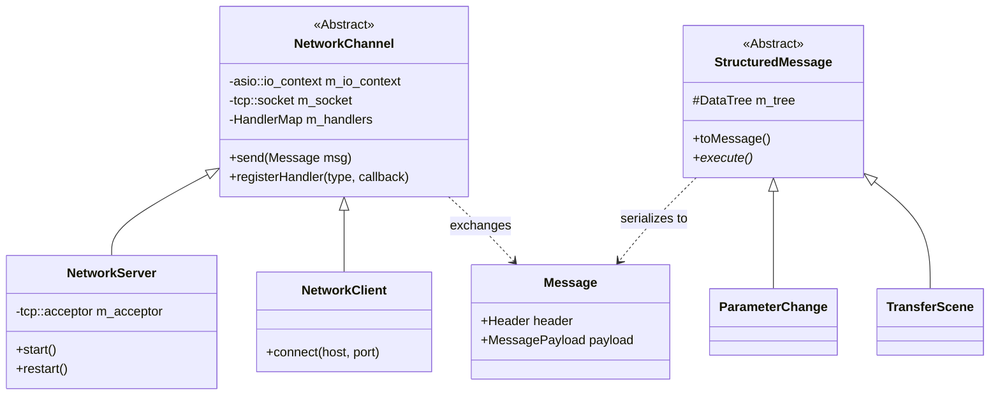
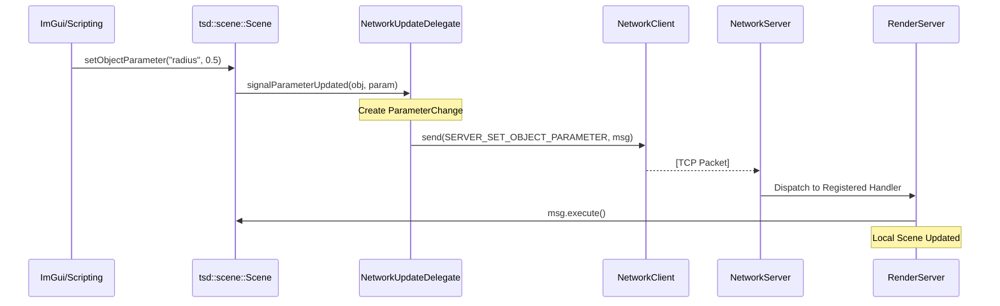

<!-- source: DeepWiki mcp.deepwiki.com · repo NVIDIA/VisRTX · page 8.1 Network Library & Server (tsd_network) · fetched 2026-10-26 -->

# Network Library & Server (tsd_network)

Relevant source files

The following files were used as context for generating this wiki page:

- [tsd/apps/interactive/network/CMakeLists.txt](tsd/apps/interactive/network/CMakeLists.txt)
- [tsd/apps/interactive/network/RenderSession.hpp](tsd/apps/interactive/network/RenderSession.hpp)
- [tsd/apps/interactive/network/client/NetworkUpdateDelegate.cpp](tsd/apps/interactive/network/client/NetworkUpdateDelegate.cpp)
- [tsd/apps/interactive/network/client/NetworkUpdateDelegate.hpp](tsd/apps/interactive/network/client/NetworkUpdateDelegate.hpp)
- [tsd/apps/interactive/network/client/RemoteViewport.cpp](tsd/apps/interactive/network/client/RemoteViewport.cpp)
- [tsd/apps/interactive/network/client/RemoteViewport.h](tsd/apps/interactive/network/client/RemoteViewport.h)
- [tsd/apps/interactive/network/client/tsdRemoteViewer.cpp](tsd/apps/interactive/network/client/tsdRemoteViewer.cpp)
- [tsd/apps/interactive/network/mpiServer/CMakeLists.txt](tsd/apps/interactive/network/mpiServer/CMakeLists.txt)
- [tsd/apps/interactive/network/mpiServer/DistributedRenderServer.cpp](tsd/apps/interactive/network/mpiServer/DistributedRenderServer.cpp)
- [tsd/apps/interactive/network/mpiServer/DistributedRenderServer.hpp](tsd/apps/interactive/network/mpiServer/DistributedRenderServer.hpp)
- [tsd/apps/interactive/network/mpiServer/mpiServer.cpp](tsd/apps/interactive/network/mpiServer/mpiServer.cpp)
- [tsd/apps/interactive/network/server/RenderServer.cpp](tsd/apps/interactive/network/server/RenderServer.cpp)
- [tsd/apps/interactive/network/server/RenderServer.hpp](tsd/apps/interactive/network/server/RenderServer.hpp)
- [tsd/src/tsd/network/CMakeLists.txt](tsd/src/tsd/network/CMakeLists.txt)
- [tsd/src/tsd/network/Message.hpp](tsd/src/tsd/network/Message.hpp)
- [tsd/src/tsd/network/NetworkChannel.cpp](tsd/src/tsd/network/NetworkChannel.cpp)
- [tsd/src/tsd/network/NetworkChannel.hpp](tsd/src/tsd/network/NetworkChannel.hpp)
- [tsd/src/tsd/network/messages/NewObject.cpp](tsd/src/tsd/network/messages/NewObject.cpp)
- [tsd/src/tsd/network/messages/ParameterChange.cpp](tsd/src/tsd/network/messages/ParameterChange.cpp)
- [tsd/src/tsd/network/messages/ParameterChange.hpp](tsd/src/tsd/network/messages/ParameterChange.hpp)
- [tsd/src/tsd/network/messages/ParameterRemove.cpp](tsd/src/tsd/network/messages/ParameterRemove.cpp)
- [tsd/src/tsd/network/messages/RemoveObject.cpp](tsd/src/tsd/network/messages/RemoveObject.cpp)
- [tsd/src/tsd/network/messages/TransferArrayData.cpp](tsd/src/tsd/network/messages/TransferArrayData.cpp)
- [tsd/src/tsd/network/messages/TransferLayer.cpp](tsd/src/tsd/network/messages/TransferLayer.cpp)
- [tsd/src/tsd/network/messages/TransferLayer.hpp](tsd/src/tsd/network/messages/TransferLayer.hpp)
- [tsd/src/tsd/network/messages/TransferScene.cpp](tsd/src/tsd/network/messages/TransferScene.cpp)
- [tsd/src/tsd/scene/UpdateDelegate.cpp](tsd/src/tsd/scene/UpdateDelegate.cpp)

The `tsd_network` library provides the foundational infrastructure for remote rendering and distributed scene synchronization within the TSD framework. It implements a framed TCP messaging protocol using **Boost.Asio**, a suite of structured message types for scene manipulation, and server-side components for executing render loops and broadcasting results to clients.

## Network Architecture & Messaging

The core of the networking system is built on a custom 8-byte framed protocol. Every message consists of a fixed-size header followed by a variable-length payload.

### NetworkChannel
`NetworkChannel` is the base class for both `NetworkClient` and `NetworkServer`. It manages an asynchronous I/O thread, a `boost::asio::io_context`, and a dispatch table (`HandlerMap`) that routes incoming messages to registered callbacks based on their type byte [tsd/src/tsd/network/NetworkChannel.hpp:28-100]().

*   **Framing**: The header contains a 1-byte `type` and a 4-byte `payload_length` [tsd/src/tsd/network/Message.hpp:44-48]().
*   **Asynchronous I/O**: It uses `asio::async_read` to first pull the 8-byte header and then the specific number of bytes for the payload [tsd/src/tsd/network/NetworkChannel.cpp:143-190]().
*   **Write Queue**: Outgoing messages are enqueued and written sequentially to ensure thread safety and message integrity [tsd/src/tsd/network/NetworkChannel.cpp:227-241]().

### Message Types
TSD uses two levels of messaging:
1.  **Raw Messages**: Simple byte buffers used for high-frequency data like framebuffers (`CLIENT_RECEIVE_FRAME_BUFFER_COLOR`) or simple signals like `PING` [tsd/src/tsd/network/Message.hpp:42-51]().
2.  **Structured Messages**: Classes inheriting from `StructuredMessage` that serialize complex C++ objects into a `tsd::core::DataTree` for transport [tsd/src/tsd/network/Message.hpp:65-81]().

| Message Class | Purpose | Source |
| :--- | :--- | :--- |
| `NewObject` | Notifies the peer to create a new scene object (Geometry, Material, etc.). | [tsd/src/tsd/network/messages/NewObject.cpp:11-14]() |
| `ParameterChange` | Updates one or more parameters on an existing object. | [tsd/src/tsd/network/messages/ParameterChange.cpp:12-38]() |
| `RemoveObject` | Deletes an object from the remote scene database. | [tsd/src/tsd/network/messages/RemoveObject.cpp:10-15]() |
| `TransferScene` | Full serialization of the entire `ObjectDB` for initial synchronization. | [tsd/src/tsd/network/messages/TransferScene.cpp:11-15]() |
| `TransferLayer` | Synchronizes the scene graph structure (Forest) and layer transforms. | [tsd/src/tsd/network/messages/TransferLayer.cpp:11-15]() |
| `TransferArrayData` | Sends raw binary data for `tsd::scene::Array` objects (e.g., vertex data). | [tsd/src/tsd/network/messages/TransferArrayData.cpp:10-14]() |
| `ParameterRemove` | Removes a specific parameter from an object. | [tsd/src/tsd/network/messages/ParameterRemove.cpp:11-14]() |

### Code Entity Map: Networking Core
The following diagram maps the high-level networking concepts to the specific C++ entities in the `tsd::network` namespace.

Title: Networking Core Class Relationships

Sources: [tsd/src/tsd/network/NetworkChannel.hpp:28-144](), [tsd/src/tsd/network/Message.hpp:42-81]()

---

## Scene Synchronization Protocol

TSD achieves live synchronization between a client (typically a UI) and a server (the renderer) via the `UpdateDelegate` system.

### NetworkUpdateDelegate
The `NetworkUpdateDelegate` is attached to the client-side `tsd::scene::Scene`. Whenever an object is modified, added, or removed in the local scene, the delegate intercepts the signal and transmits the corresponding `StructuredMessage` to the server [tsd/apps/interactive/network/client/NetworkUpdateDelegate.cpp:41-105]().

*   **Parameter Sync**: `signalParameterUpdated` creates a `ParameterChange` message [tsd/apps/interactive/network/client/NetworkUpdateDelegate.cpp:48-54]().
*   **Array Sync**: `signalArrayUnmapped` triggers a `TransferArrayData` message to sync modified GPU/CPU buffers [tsd/apps/interactive/network/client/NetworkUpdateDelegate.cpp:79-84]().
*   **Structure Sync**: `signalLayerStructureUpdated` sends a `TransferLayer` message to update the remote scene graph [tsd/apps/interactive/network/client/NetworkUpdateDelegate.cpp:120-126]().

### Data Flow: Client-to-Server Update
Title: Scene Update Propagation Flow

Sources: [tsd/apps/interactive/network/client/NetworkUpdateDelegate.cpp:48-54](), [tsd/apps/interactive/network/server/RenderServer.cpp:218-223](), [tsd/src/tsd/network/messages/ParameterChange.cpp:50-76]()

---

## Server Implementations

### RenderServer (Single Node)
The `RenderServer` class implements a standalone rendering service. It manages an `anari::Device`, a `RenderIndex`, and an `ImagePipeline` [tsd/apps/interactive/network/server/RenderServer.hpp:22-79]().

1.  **Initialization**: Loads the ANARI device (e.g., `visrtx`), sets up the default camera, and creates the `ImagePipeline` containing an `AnariSceneRenderPass` and a `CopyFromColorBufferPass` [tsd/apps/interactive/network/server/RenderServer.cpp:137-182]().
2.  **Loop**: Continuously checks for a `ServerMode`. In `RENDERING` mode, it executes the pipeline and sends the resulting color buffer to the client via `send_FrameBuffer()` [tsd/apps/interactive/network/server/RenderServer.cpp:48-98]().
3.  **Frame Configuration**: Responds to `SERVER_SET_FRAME_CONFIG` messages to resize the internal framebuffer to match the client's viewport [tsd/apps/interactive/network/server/RenderServer.cpp:218-223]().

### DistributedRenderServer (MPI)
The `DistributedRenderServer` extends this concept to multi-GPU/multi-node environments using MPI.

*   **Main Rank (0)**: Acts as the network gateway, communicating with the `NetworkClient`. It manages the `NetworkServer` instance and receives scene updates [tsd/apps/interactive/network/mpiServer/DistributedRenderServer.cpp:102-108]().
*   **Broadcast**: Scene updates and control states (like `ServerMode`) are broadcast from Rank 0 to all other ranks using `tsd::mpi::ReplicatedObject` [tsd/apps/interactive/network/mpiServer/DistributedRenderServer.cpp:118-130]().
*   **Parallel Rendering**: All ranks participate in the `renderFrame()` call, which typically involves an ANARI device configured for MPI (like `visrtx` in MPI mode) [tsd/apps/interactive/network/mpiServer/DistributedRenderServer.cpp:163-165]().

---

## Client Integration: RemoteViewport

The `RemoteViewport` is a specialized `BaseViewport` used in applications like `tsdRemoteViewer` [tsd/apps/interactive/network/client/RemoteViewport.h:23-83]().

*   **Frame Reception**: It registers a handler for `CLIENT_RECEIVE_FRAME_BUFFER_COLOR`. When a frame arrives, it is copied into a `pendingColorBuffer` and swapped into the `ImagePipeline` during the next UI update [tsd/apps/interactive/network/client/RemoteViewport.cpp:104-117]().
*   **Interaction**: Mouse inputs and camera manipulations are captured by the local `Manipulator` and sent to the server as `SERVER_SET_OBJECT_PARAMETER` updates for the camera object [tsd/apps/interactive/network/client/RemoteViewport.cpp:231-250]().
*   **Reshape**: When the UI window is resized, it sends a `SERVER_SET_FRAME_CONFIG` message to ensure the server renders at the correct aspect ratio and resolution [tsd/apps/interactive/network/client/RemoteViewport.cpp:191-218]().

### Summary of Key Classes
| Class | File | Responsibility |
| :--- | :--- | :--- |
| `NetworkChannel` | [tsd/src/tsd/network/NetworkChannel.hpp:28]() | Manages Boost.Asio socket and dispatching. |
| `NetworkUpdateDelegate` | [tsd/apps/interactive/network/client/NetworkUpdateDelegate.hpp:21]() | Translates scene changes to network messages. |
| `RenderServer` | [tsd/apps/interactive/network/server/RenderServer.hpp:22]() | Headless render loop and network message consumer. |
| `DistributedRenderServer` | [tsd/apps/interactive/network/mpiServer/DistributedRenderServer.hpp:25]() | MPI-aware render server for multi-GPU clusters. |
| `RemoteViewport` | [tsd/apps/interactive/network/client/RemoteViewport.h:23]() | UI component for displaying remote frames and sending input. |

Sources: [tsd/src/tsd/network/NetworkChannel.hpp:28-144](), [tsd/apps/interactive/network/server/RenderServer.cpp:25-110](), [tsd/apps/interactive/network/mpiServer/DistributedRenderServer.cpp:44-185](), [tsd/apps/interactive/network/client/RemoteViewport.cpp:20-136]()

---

