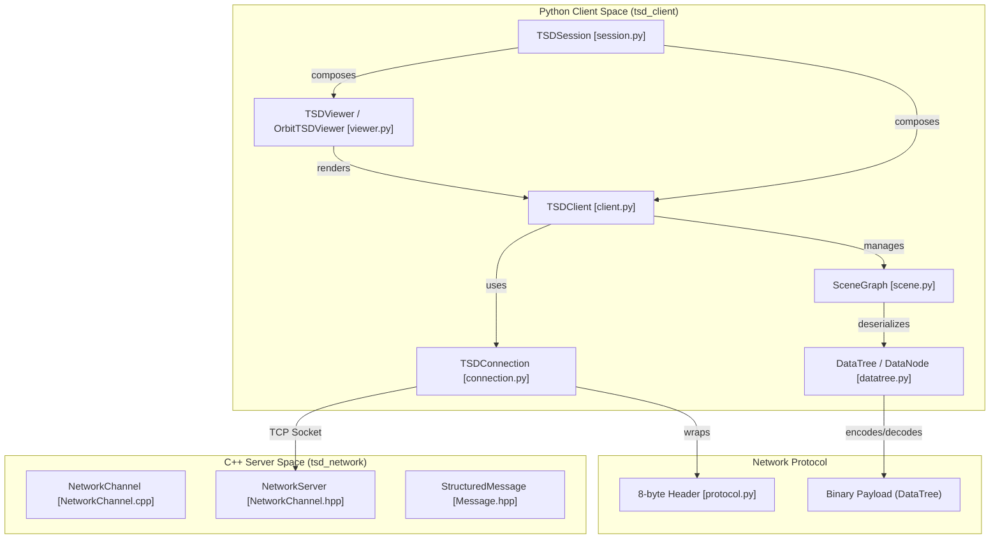
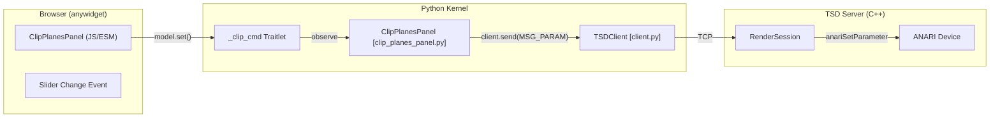

<!-- source: DeepWiki mcp.deepwiki.com · repo NVIDIA/VisRTX · page 8.2 Python Client (tsd_client) · fetched 2026-10-26 -->

# Python Client (tsd_client)

Relevant source files

The following files were used as context for generating this wiki page:

- [.gitignore](.gitignore)
- [tsd/python/README.md](tsd/python/README.md)
- [tsd/python/notebooks/TSDClient.ipynb](tsd/python/notebooks/TSDClient.ipynb)
- [tsd/python/pyproject.toml](tsd/python/pyproject.toml)
- [tsd/python/tsd_client/__init__.py](tsd/python/tsd_client/__init__.py)
- [tsd/python/tsd_client/anari_types.py](tsd/python/tsd_client/anari_types.py)
- [tsd/python/tsd_client/client.py](tsd/python/tsd_client/client.py)
- [tsd/python/tsd_client/connection.py](tsd/python/tsd_client/connection.py)
- [tsd/python/tsd_client/datatree.py](tsd/python/tsd_client/datatree.py)
- [tsd/python/tsd_client/panels/__init__.py](tsd/python/tsd_client/panels/__init__.py)
- [tsd/python/tsd_client/panels/clip_planes_panel.py](tsd/python/tsd_client/panels/clip_planes_panel.py)
- [tsd/src/tsd/network/Message.hpp](tsd/src/tsd/network/Message.hpp)
- [tsd/src/tsd/network/NetworkChannel.cpp](tsd/src/tsd/network/NetworkChannel.cpp)
- [tsd/src/tsd/network/NetworkChannel.hpp](tsd/src/tsd/network/NetworkChannel.hpp)

The `tsd_client` package is a Python implementation of the TSD (The Scientific Data) network protocol. It enables remote control, scene inspection, and interactive visualization of TSD-based render servers (such as `tsdViewer` or `SciVis Studio`) from Python environments and Jupyter notebooks.

## Architecture & Data Flow

The client is built on a layered architecture that mirrors the C++ `tsd_network` and `tsd_core` libraries. It handles binary framing, hierarchical data serialization (DataTree), and high-level scene graph management.

### System Entity Map

The following diagram maps Python class entities to their functional roles in the TSD ecosystem.

**TSD Client Entity Mapping**

Sources: [tsd/python/tsd_client/connection.py:27-37](), [tsd/python/tsd_client/client.py:27-38](), [tsd/python/tsd_client/scene.py:16-21](), [tsd/python/tsd_client/datatree.py:15-16](), [tsd/src/tsd/network/NetworkChannel.hpp:112-125](), [tsd/src/tsd/network/Message.hpp:42-51]().

---

## Connection & Protocol

The `TSDConnection` class manages the low-level TCP socket and implements the 8-byte framing protocol used by `tsd::network::NetworkChannel` [tsd/python/tsd_client/connection.py:7-10]().

### Wire Format
Every message consists of a fixed header followed by an optional payload [tsd/python/tsd_client/connection.py:165-172]():
*   **Header (8 bytes):** `uint8_t type` (1 byte) + `padding` (3 bytes) + `uint32_t payload_length` (4 bytes), all little-endian [tsd/python/tsd_client/protocol.py:20-21]().
*   **Payload:** Raw bytes of length `payload_length`.

### Implementation Details
*   **Background Receive:** A dedicated `tsd-recv` thread continuously reads from the socket and dispatches payloads to registered handlers [tsd/python/tsd_client/connection.py:113-116]().
*   **Handler Dispatch:** Users register callbacks for specific `MessageType` values using `register_handler(msg_type, callback)` [tsd/python/tsd_client/connection.py:151-153]().

Sources: [tsd/python/tsd_client/connection.py:27-220](), [tsd/python/tsd_client/protocol.py:1-21](), [tsd/src/tsd/network/NetworkChannel.cpp:143-160]().

---

## DataTree Binary Codec

The `DataTree` and `DataNode` classes in Python provide a 1:1 functional mirror of the C++ `tsd::core::DataTree` [tsd/python/tsd_client/datatree.py:15-16](). This is the primary mechanism for serializing complex scene updates and parameters.

### Serialization Logic
The codec handles ANARI-typed data, including scalars, vectors, matrices, and object references [tsd/python/tsd_client/anari_types.py:17-58]().

| Feature | Python Implementation | C++ Counterpart |
| :--- | :--- | :--- |
| **Node Structure** | Hierarchical `dict`-like `DataNode` | `tsd::core::DataNode` |
| **Type Support** | `anari_types.py` constants | `anari_enums.h` |
| **Binary Load** | `DataTree.from_bytes()` | `DataTree::load(vector<byte>)` |
| **Binary Save** | `DataTree.to_bytes()` | `DataTree::save(vector<byte>)` |

Sources: [tsd/python/tsd_client/datatree.py:1-100](), [tsd/python/tsd_client/anari_types.py:1-157](), [tsd/src/tsd/network/Message.hpp:116-128]().

---

## Scene Graph Management

The `TSDClient` class provides high-level abstractions for interacting with the remote scene [tsd/python/tsd_client/client.py:27-30]().

### SceneGraph & Object References
The `SceneGraph` class caches the state of the remote server, organized by ANARI object types (e.g., `ANARI_GEOMETRY`, `ANARI_VOLUME`) [tsd/python/tsd_client/scene.py:17-21]().
*   **ObjectRef:** A handle to a specific object in the server's `ObjectPool` [tsd/python/tsd_client/scene.py:18]().
*   **TransformRef:** Manages the 4x4 matrix associated with a scene graph node, allowing Python scripts to update positions, rotations, and scales [tsd/python/tsd_client/scene.py:19]().

### Key Functions
*   **`refresh_scene()`**: Sends `SERVER_REQUEST_SCENE` and waits for a `CLIENT_RECEIVE_SCENE` payload to rebuild the local cache [tsd/python/tsd_client/client.py:98-100]().
*   **`set_renderer_param()`**: Convenience method to update renderer settings (samples, denoising, etc.) without manually building a DataTree [tsd/python/tsd_client/client.py:180-212]().

Sources: [tsd/python/tsd_client/client.py:95-124](), [tsd/python/tsd_client/scene.py:1-200]().

---

## Jupyter Integration & UI Panels

The package includes `anywidget`-based components for interactive use in Jupyter notebooks [tsd/python/tsd_client/viewer.py:55-57]().

### TSDViewer
The `TSDViewer` provides a real-time viewport synchronized with the render server.
*   **Orbit Controls:** `OrbitTSDViewer` implements a camera controller that pushes new view matrices to the server during mouse interaction [tsd/python/tsd_client/viewer.py:57]().
*   **Animation:** Supports camera path interpolation and playback [tsd/python/tsd_client/viewer.py:60-62]().

### Interactive Panels
The `tsd_client.panels` subpackage provides several ImGui-like widgets built with web technologies (ESM/CSS) that communicate with the Python client [tsd/python/tsd_client/panels/__init__.py:12-16]().

*   **DataTreePanel:** A hierarchical inspector for the entire scene graph [tsd/python/tsd_client/panels/datatree_panel.py:14]().
*   **TransferFunctionPanel:** A graphical editor for 1D transfer functions (color/opacity maps) used in volume rendering [tsd/python/tsd_client/panels/transfer_function_panel.py:12]().
*   **ClipPlanesPanel:** Controls for X/Y/Z clipping ranges and arbitrary plane normals for volumes [tsd/python/tsd_client/panels/clip_planes_panel.py:13]().
*   **LightPanel:** Editor for light intensity, color, and direction [tsd/python/tsd_client/panels/light_panel.py:15]().

**UI to Code Data Flow**

Sources: [tsd/python/tsd_client/panels/clip_planes_panel.py:153-170](), [tsd/python/tsd_client/client.py:153-156](), [tsd/src/tsd/network/NetworkChannel.cpp:192-202]().

---

## TSDSession Convenience Wrapper

The `TSDSession` class simplifies the setup of a full interactive environment [tsd/python/tsd_client/session.py:63](). It instantiates the client, viewer, and panels in a single call, managing the connection lifecycle and cross-widget synchronization.

Sources: [tsd/python/tsd_client/session.py:1-116](), [tsd/python/tsd_client/__init__.py:63]().

---

