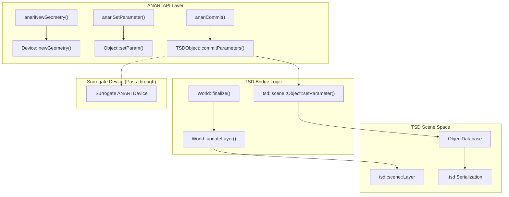
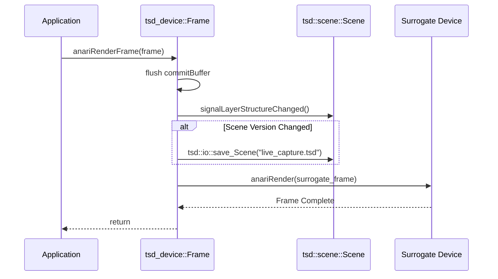

<!-- source: DeepWiki mcp.deepwiki.com · repo NVIDIA/VisRTX · page 9 ANARI-TSD Bridge Device · fetched 2026-10-26 -->

# ANARI-TSD Bridge Device

Relevant source files

The following files were used as context for generating this wiki page:

- [tsd/src/anari_tsd/Device.cpp](tsd/src/anari_tsd/Device.cpp)
- [tsd/src/anari_tsd/DeviceGlobalState.cpp](tsd/src/anari_tsd/DeviceGlobalState.cpp)
- [tsd/src/anari_tsd/DeviceGlobalState.h](tsd/src/anari_tsd/DeviceGlobalState.h)
- [tsd/src/anari_tsd/Frame.cpp](tsd/src/anari_tsd/Frame.cpp)
- [tsd/src/anari_tsd/Frame.h](tsd/src/anari_tsd/Frame.h)
- [tsd/src/anari_tsd/Library.cpp](tsd/src/anari_tsd/Library.cpp)
- [tsd/src/anari_tsd/Object.cpp](tsd/src/anari_tsd/Object.cpp)
- [tsd/src/anari_tsd/Object.h](tsd/src/anari_tsd/Object.h)
- [tsd/src/anari_tsd/World.cpp](tsd/src/anari_tsd/World.cpp)
- [tsd/src/anari_tsd/World.h](tsd/src/anari_tsd/World.h)
- [tsd/src/tsd/scene/AnariHandleCache.hpp](tsd/src/tsd/scene/AnariHandleCache.hpp)
- [tsd/src/tsd/scene/Object.hpp](tsd/src/tsd/scene/Object.hpp)
- [tsd/src/tsd/scene/Parameter.hpp](tsd/src/tsd/scene/Parameter.hpp)
- [tsd/src/tsd/scene/Scene.cpp](tsd/src/tsd/scene/Scene.cpp)
- [tsd/src/tsd/scene/Scene.hpp](tsd/src/tsd/scene/Scene.hpp)
- [tsd/src/tsd/scene/UpdateDelegate.hpp](tsd/src/tsd/scene/UpdateDelegate.hpp)
- [tsd/tests/test_Scene.cpp](tsd/tests/test_Scene.cpp)

The **ANARI-TSD Bridge Device** is a specialized ANARI implementation that acts as a transparent proxy and introspection layer. It mirrors the state of ANARI objects into a `tsd::scene::Scene` graph, allowing developers to inspect, debug, and serialize complex ANARI scenes using the TSD framework's tools.

## Overview and Purpose

The primary goal of the TSD device is to provide a "live view" of ANARI API calls. It translates ANARI objects (Geometries, Materials, Lights, etc.) into their equivalent TSD scene entities. This enables several unique workflows:
*   **Offline Inspection**: Capturing a snapshot of an application's ANARI state into a `.tsd` file for later analysis.
*   **Pass-through Rendering**: Forwarding calls to a "real" backend device (e.g., VisRTX) while maintaining a mirrored TSD scene.
*   **Live Capture**: Automatically exporting the scene state to `live_capture.tsd` whenever a frame is rendered.

Sources: [tsd/src/anari_tsd/Device.cpp:221-247](), [tsd/src/anari_tsd/Frame.cpp:127-134]()

---

## Device Modes

The bridge device operates in two distinct modes based on how it is initialized via the `scene` parameter.

### 1. Internal Scene (Pass-through Mode)
If no external scene is provided, the device creates an internal `tsd::scene::Scene` and loads a surrogate ANARI device (specified by the `ANARI_TSD_LIBRARY` environment variable, defaulting to `helide`).
*   **Data Flow**: API calls -> TSD Device -> TSD Scene + Surrogate ANARI Device.
*   **Rendering**: The `renderFrame` call is forwarded to the surrogate device, and frame buffers are mapped back to the user.
*   **Output**: Every `renderFrame` triggers a check to see if the scene has changed. If so, it exports the state to `live_capture.tsd`.

### 2. External Scene (Capture Mode)
Applications can pass an existing `tsd::scene::Scene` pointer to the device via `anariSetParameter(d, d, "scene", ANARI_VOID_P, &myScene)`.
*   **Data Flow**: API calls -> TSD Device -> Provided TSD Scene.
*   **Rendering**: In this mode, the device typically does not perform actual rendering; it is used purely to populate a scene graph owned by the host application (e.g., for a scene editor).

Sources: [tsd/src/anari_tsd/Device.cpp:221-247](), [tsd/src/anari_tsd/Frame.cpp:119-138]()

---

## Architecture and Data Flow

The device is built on the `helium` framework, mapping ANARI handles to C++ objects that wrap TSD entities.

### System Mapping: ANARI to TSD Entities

The following diagram shows how ANARI API calls are routed through the bridge classes into the TSD Scene database.

| ANARI Entity | Bridge Class | TSD Entity |
| :--- | :--- | :--- |
| `ANARI_GEOMETRY` | `tsd_device::TSDObject` | `tsd::scene::Geometry` |
| `ANARI_MATERIAL` | `tsd_device::TSDObject` | `tsd::scene::Material` |
| `ANARI_WORLD` | `tsd_device::World` | `tsd::scene::Layer` |
| `ANARI_ARRAY*` | `tsd_device::Array` | `tsd::scene::Array` |

**Data Flow Diagram**

Sources: [tsd/src/anari_tsd/Device.cpp:91-95](), [tsd/src/anari_tsd/Object.cpp:50-95](), [tsd/src/anari_tsd/World.cpp:64-90]()

---

## Implementation Details

### Object Translation (`TSDObject`)
The `TSDObject` class handles the heavy lifting of mirroring parameters. During `commitParameters()`, it iterates through all helium-stored parameters and applies them to the underlying `tsd::scene::Object`.

*   **Handle Mapping**: ANARI handles (like `ANARIMaterial`) are resolved to their corresponding `TSDObject` pointers. If a parameter is an object, the bridge finds the associated TSD object index and sets it as a TSD object-valued parameter.
*   **Naming**: Objects are automatically assigned names (e.g., `geometry0`, `material1`) to ensure they are identifiable in the serialized TSD file.

Sources: [tsd/src/anari_tsd/Object.cpp:50-107](), [tsd/src/anari_tsd/Object.cpp:111-149]()

### Scene Graph Synchronization (`World`)
In ANARI, a `World` contains arrays of surfaces, volumes, and lights. The bridge's `World` class translates these into a `tsd::scene::Layer`.

*   **Layer Management**: Each `ANARIWorld` creates a unique TSD Layer (e.g., `world0`).
*   **Structure**: The `World::updateLayer()` function clears the TSD layer and rebuilds the hierarchy using `insert_last_child`. Surfaces, volumes, and lights are grouped under a "zero-instance" node if they are added directly to the world without an explicit instance.
*   **Render Index**: In pass-through mode, the `World` acquires a `RenderIndexAllLayers` to synchronize the surrogate device's world state with the TSD scene.

Sources: [tsd/src/anari_tsd/World.cpp:8-22](), [tsd/src/anari_tsd/World.cpp:64-90]()

### Frame Execution and Capture
The `Frame::renderFrame()` method is the synchronization point for the device.

Sources: [tsd/src/anari_tsd/Frame.cpp:119-138]()

---

## Environment Variables and API

### Environment Variables
*   **`ANARI_TSD_LIBRARY`**: Defines which ANARI library to load as the surrogate backend (default: `helide`). This allows the bridge to wrap any existing ANARI device (e.g., `visrtx`, `gl`).

### API Access
While the device is typically loaded via `anariLoadLibrary("tsd")`, it can also be instantiated directly:
*   `anariNewTsdDevice()`: Standard entry point defined in the library.
*   **Properties**: The device responds to `anariGetProperty` for the `"tsd"` (bool) and `"extension"` (string list) queries.

Sources: [tsd/src/anari_tsd/Device.cpp:231-234](), [tsd/src/anari_tsd/Device.cpp:264-271](), [tsd/src/anari_tsd/Library.cpp:11-16]()

---

