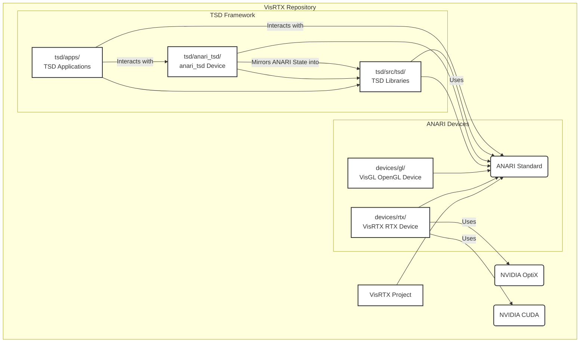
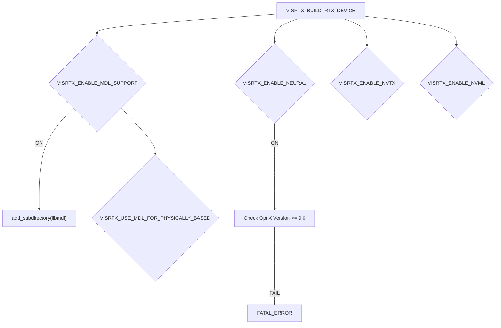
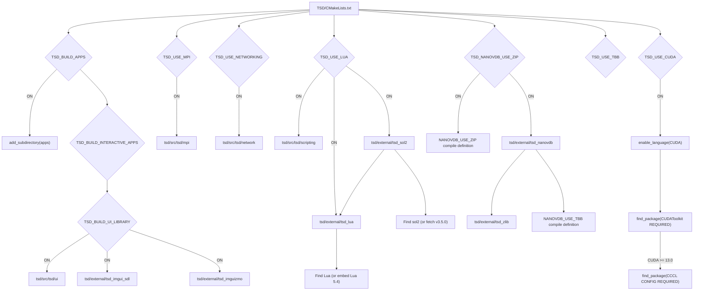
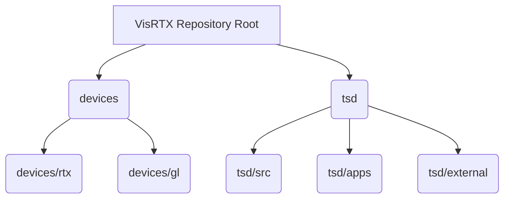
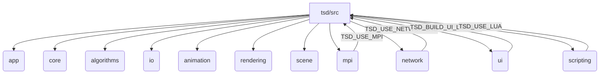
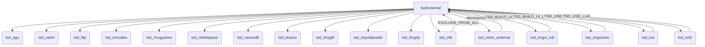
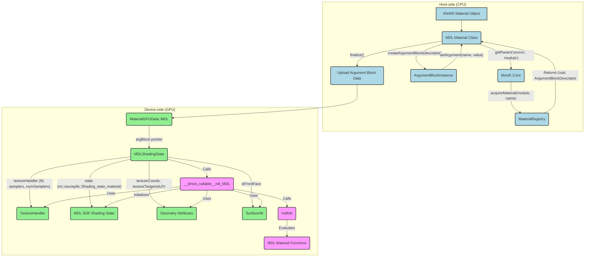
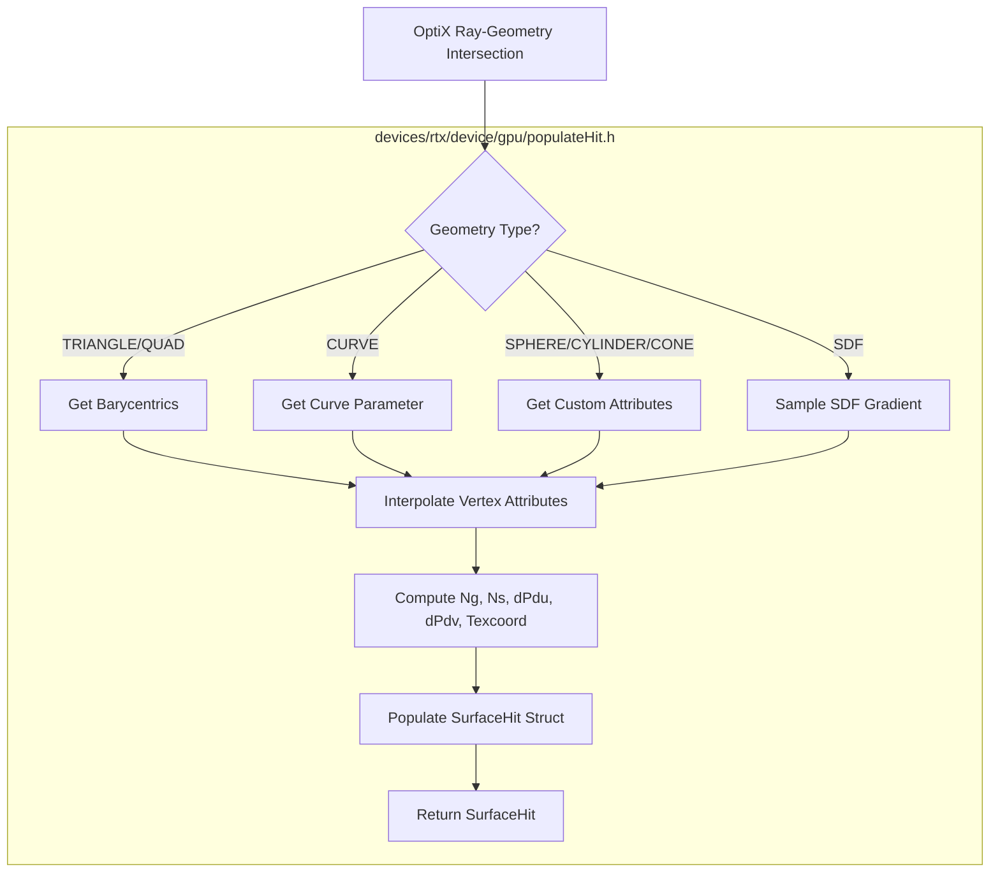
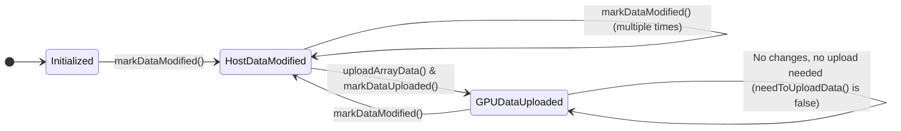

# Page: VisRTX & TSD Overview

# VisRTX & TSD Overview

<details>
<summary>Relevant source files</summary>

The following files were used as context for generating this wiki page:

- [AGENTS.md](AGENTS.md)
- [CMakeLists.txt](CMakeLists.txt)
- [README.md](README.md)
- [devices/gl/AGENTS.md](devices/gl/AGENTS.md)
- [devices/rtx/AGENTS.md](devices/rtx/AGENTS.md)
- [devices/rtx/CMakeLists.txt](devices/rtx/CMakeLists.txt)
- [tsd/AGENTS.md](tsd/AGENTS.md)
- [tsd/README.md](tsd/README.md)
- [tsd/src/tsd/README.md](tsd/src/tsd/README.md)
- [tsd/src/tsd/algorithms/README.md](tsd/src/tsd/algorithms/README.md)
- [tsd/src/tsd/scripting/README.md](tsd/src/tsd/scripting/README.md)

</details>


This page provides a high-level introduction to the VisRTX repository, outlining its primary components: the VisRTX ANARI device, the experimental OpenGL ANARI device, and the TSD (Testing Scene Description) framework. It describes their purpose, key dependencies, and how they interrelate. For detailed information on building, configuration, and specific architectural aspects, please refer to the linked child pages.

## VisRTX: ANARI Device Implementations

VisRTX is an experimental NVIDIA implementation of the [Khronos ANARI standard](https://www.khronos.org/anari) [README.md:5-6] focused on scientific visualization. The repository provides two ANARI device implementations:

*   **VisRTX RTX Device**: An OptiX-based GPU ray tracer [README.md:13] that leverages NVIDIA's RTX platform for high-fidelity rendering. It supports a wide range of ANARI extensions, including CUDA array/framebuffer interop, NanoVDB volumes, and MDL materials [AGENTS.md:85-86].
*   **VisRTX OpenGL Device (VisGL)**: An experimental OpenGL rasterizer [README.md:14] that provides a simpler, rasterization-based ANARI implementation. It supports basic rendering features like shadow mapping and ambient occlusion [AGENTS.md:87-88].

Both devices implement the ANARI C API and are designed to be loaded as shared libraries by any ANARI application [AGENTS.md:83-84].

For details on building and configuring these devices, see [Getting Started: Build & Configuration](#1.1). For an in-depth look at the RTX device architecture, refer to [VisRTX RTX Device](#2). The OpenGL device is covered in [OpenGL Device (VisGL)](#3).

Sources: [README.md:5-6](), [README.md:13-14](), [AGENTS.md:83-88]()

## TSD: The Scientific Data Framework

TSD ("Testing Scene Description") is an experimental C++17 scene graph and testing framework for ANARI devices [tsd/AGENTS.md:5]. It serves as a platform for exploring ANARI rendering capabilities, particularly for scalable scientific visualizations [README.md:8-9]. TSD is not intended as a production piece of software and does not guarantee API stability [tsd/README.md:17-18].

The TSD framework comprises a collection of libraries and applications:

*   **Core Libraries**: These include foundational utilities (`tsd_core`), an ANARI-like scene representation (`tsd_scene`), file I/O (`tsd_io`), rendering synchronization (`tsd_rendering`), and application glue (`tsd_app`) [AGENTS.md:94-100].
*   **Optional Libraries**: TSD offers optional components for UI (`tsd_ui_imgui`), distributed computing (`tsd_mpi`), networking (`tsd_network`), and Lua scripting (`tsd_lua`) [AGENTS.md:103-107].
*   **Applications**: A suite of interactive and headless applications, such as `tsdViewer` (an interactive scene viewer), `tsdRender` (a command-line renderer), and `tsdLua` (a Lua REPL for scripting) [AGENTS.md:110-114].

For a comprehensive overview of TSD's libraries and their functionalities, see [TSD Framework](#4). Details on file I/O and scene serialization are in [File I/O & Scene Serialization](#5), while interactive applications are covered in [Interactive Applications & UI Framework](#6). Command-line tools and scripting are detailed in [Command-Line Tools & Scripting](#7).

Sources: [README.md:8-9](), [tsd/README.md:17-18](), [tsd/AGENTS.md:5](), [AGENTS.md:94-114]()

## Key Dependencies

The VisRTX project relies on several core dependencies:

*   **ANARI-SDK**: The Khronos ANARI SDK is a fundamental requirement for both device implementations and the TSD framework [devices/rtx/CMakeLists.txt:72](), [tsd/AGENTS.md:23]().
*   **CUDA 12+**: Essential for the VisRTX RTX device, which is built on NVIDIA's CUDA platform [devices/rtx/CMakeLists.txt:73](), [AGENTS.md:25]().
*   **OptiX**: The NVIDIA OptiX ray tracing engine is the core technology behind the VisRTX RTX device [devices/rtx/CMakeLists.txt:97](), [AGENTS.md:25](). Specific OptiX versions (7.7, 8.0, 8.1, 9.0) can be selected during the build process [devices/rtx/CMakeLists.txt:78-90]().
*   **GLM**: The OpenGL Mathematics library is used for vector and matrix operations [devices/rtx/CMakeLists.txt:74]().

Optional dependencies enable additional features:

*   **MDL (Material Definition Language)**: Support for NVIDIA MDL materials can be enabled for the RTX device [devices/rtx/CMakeLists.txt:53-56](), [AGENTS.md:43]().
*   **Neural Graphics Primitives**: Requires OptiX 9.0+ and can be enabled for the RTX device [devices/rtx/CMakeLists.txt:58](), [devices/rtx/CMakeLists.txt:99-103](), [AGENTS.md:44]().
*   **NVTX**: NVIDIA Tools Extension for profiling instrumentation [devices/rtx/CMakeLists.txt:59](), [AGENTS.md:45]().
*   **MPI**: For distributed workflows within TSD [tsd/AGENTS.md:31](), [AGENTS.md:51]().
*   **Networking**: For client/server scene streaming in TSD [tsd/AGENTS.md:31](), [AGENTS.md:52]().
*   **Lua**: For scripting capabilities within TSD [tsd/AGENTS.md:31](), [AGENTS.md:53]().

For a detailed guide on building and configuring the project with these dependencies, see [Getting Started: Build & Configuration](#1.1).

Sources: [devices/rtx/CMakeLists.txt:53-59](), [devices/rtx/CMakeLists.txt:72-74](), [devices/rtx/CMakeLists.txt:78-90](), [devices/rtx/CMakeLists.txt:97](), [devices/rtx/CMakeLists.txt:99-103](), [tsd/AGENTS.md:23](), [tsd/AGENTS.md:31](), [AGENTS.md:25](), [AGENTS.md:43-45](), [AGENTS.md:51-53]()

## Component Relationships

The VisRTX repository is structured to allow for both integrated and standalone builds of its major components. The top-level `CMakeLists.txt` [CMakeLists.txt:41]() orchestrates the build process, allowing users to enable or disable the VisRTX RTX device, the VisGL OpenGL device, and the TSD framework [CMakeLists.txt:46-59]().

The ANARI devices (`devices/rtx` and `devices/gl`) are independent implementations of the ANARI standard. The TSD framework, while capable of standalone operation, is designed to interact with ANARI devices, including those provided by VisRTX.

The `anari_tsd` device [tsd/src/tsd/README.md:10] acts as a bridge, mirroring ANARI object state into a TSD scene [AGENTS.md:100]. This allows for offline inspection, serialization, and networking of ANARI scenes through the TSD framework.

The following diagram illustrates the high-level relationships between the main components:

### VisRTX Component Overview



Sources: [CMakeLists.txt:41](), [CMakeLists.txt:46-59](), [tsd/src/tsd/README.md:10](), [AGENTS.md:100]()

For a detailed breakdown of the repository's directory structure and how each component maps to build targets and CMake options, see [Repository Structure & Module Map](#1.2).

---

# Page: Getting Started: Build & Configuration

# Getting Started: Build & Configuration

<details>
<summary>Relevant source files</summary>

The following files were used as context for generating this wiki page:

- [.github/actions/build-anari-sdk/action.yml](.github/actions/build-anari-sdk/action.yml)
- [.github/actions/setup-cuda/action.yml](.github/actions/setup-cuda/action.yml)
- [.github/actions/setup-cuda/components.json](.github/actions/setup-cuda/components.json)
- [.github/actions/setup-cuda/scripts/install-cuda.ps1](.github/actions/setup-cuda/scripts/install-cuda.ps1)
- [.github/actions/setup-cuda/scripts/install-cuda.sh](.github/actions/setup-cuda/scripts/install-cuda.sh)
- [.github/scripts/cuda-version-manager.py](.github/scripts/cuda-version-manager.py)
- [.github/workflows/build-tsd.yml](.github/workflows/build-tsd.yml)
- [.github/workflows/build-visrtx.yml](.github/workflows/build-visrtx.yml)
- [CMakeLists.txt](CMakeLists.txt)
- [README.md](README.md)
- [devices/rtx/CMakeLists.txt](devices/rtx/CMakeLists.txt)
- [devices/rtx/cmake/EmbedPTX.cmake](devices/rtx/cmake/EmbedPTX.cmake)
- [devices/rtx/cmake/EmbedPTXRun.cmake](devices/rtx/cmake/EmbedPTXRun.cmake)
- [devices/rtx/cmake/FindOptiX.cmake](devices/rtx/cmake/FindOptiX.cmake)
- [devices/rtx/cmake/FindVisRTX.cmake](devices/rtx/cmake/FindVisRTX.cmake)
- [devices/rtx/cmake/appendSearchPaths.cmake](devices/rtx/cmake/appendSearchPaths.cmake)
- [devices/rtx/cmake/build_deps/CMakeLists.txt](devices/rtx/cmake/build_deps/CMakeLists.txt)
- [devices/rtx/cmake/build_deps/superbuild_macros.cmake](devices/rtx/cmake/build_deps/superbuild_macros.cmake)
- [devices/rtx/cmake/embed_resource.cmake](devices/rtx/cmake/embed_resource.cmake)
- [devices/rtx/libmdl/ArgumentBlockDescriptor.cpp](devices/rtx/libmdl/ArgumentBlockDescriptor.cpp)
- [devices/rtx/libmdl/ArgumentBlockDescriptor.h](devices/rtx/libmdl/ArgumentBlockDescriptor.h)
- [tsd/CMakeLists.txt](tsd/CMakeLists.txt)
- [tsd/cmake/build_deps/superbuild_macros.cmake](tsd/cmake/build_deps/superbuild_macros.cmake)
- [tsd/cmake/mark_cache_variables_as_advanced.cmake](tsd/cmake/mark_cache_variables_as_advanced.cmake)
- [tsd/external/CMakeLists.txt](tsd/external/CMakeLists.txt)
- [tsd/external/tsd_imguizmo/CMakeLists.txt](tsd/external/tsd_imguizmo/CMakeLists.txt)
- [tsd/external/tsd_imoguizmo/CMakeLists.txt](tsd/external/tsd_imoguizmo/CMakeLists.txt)
- [tsd/external/tsd_imoguizmo/imoguizmo.hpp](tsd/external/tsd_imoguizmo/imoguizmo.hpp)
- [tsd/external/tsd_lua/CMakeLists.txt](tsd/external/tsd_lua/CMakeLists.txt)
- [tsd/external/tsd_nanovdb/CMakeLists.txt](tsd/external/tsd_nanovdb/CMakeLists.txt)
- [tsd/external/tsd_sol2/CMakeLists.txt](tsd/external/tsd_sol2/CMakeLists.txt)
- [tsd/external/tsd_zlib/CMakeLists.txt](tsd/external/tsd_zlib/CMakeLists.txt)
- [tsd/src/tsd/CMakeLists.txt](tsd/src/tsd/CMakeLists.txt)
- [tsd/src/tsd/io/importers/import_NVDB.cpp](tsd/src/tsd/io/importers/import_NVDB.cpp)

</details>


This page provides a comprehensive guide to building the VisRTX project using CMake. It details the necessary dependencies, top-level configuration options for enabling or disabling specific components and features, and explains how to configure optional functionalities like MDL, Neural Graphics Primitives, NVTX profiling, MPI, networking, and Lua scripting.

## Building with CMake

The VisRTX project uses CMake for its build system. You can build the entire project from the root directory or build individual subprojects (VisRTX device, VisGL device, TSD framework) separately. Building from the root directory is generally recommended for a complete setup.

The core `CMakeLists.txt` [CMakeLists.txt:30-59]() in the repository root defines the main build options and includes subdirectories.

### Core Build Options

The following top-level CMake options control which major components of the VisRTX project are built:

| Option Name             | Description                                | Default Value |
| :---------------------- | :----------------------------------------- | :------------ |
| `VISRTX_BUILD_RTX_DEVICE` | Build the CUDA/OptiX-based ANARI device. | `ON`          |
| `VISRTX_BUILD_GL_DEVICE`  | Build the experimental OpenGL ANARI device. | `ON`          |
| `VISRTX_BUILD_TSD`        | Build the TSD (The Scientific Data) framework and its sample applications. | `OFF`         |

Sources: [CMakeLists.txt:47-53]()

### Step-by-Step Build Process

1.  **Clone the repository:**
    ```bash
    git clone https://github.com/NVIDIA/VisRTX.git
    cd VisRTX
    ```

2.  **Create a build directory:**
    ```bash
    mkdir build
    cd build
    ```

3.  **Configure with CMake:**
    Use `cmake` to configure the project. You can specify build options using the `-D` flag.

    ```bash
    cmake .. -DCMAKE_BUILD_TYPE=Release \
             -DVISRTX_BUILD_RTX_DEVICE=ON \
             -DVISRTX_BUILD_GL_DEVICE=ON \
             -DVISRTX_BUILD_TSD=ON \
             # Add other optional flags here
    ```
    The `CMAKE_BUILD_TYPE` is initialized to `Release` [CMakeLists.txt:34](). The `CMAKE_CXX_STANDARD` is set to `17` [CMakeLists.txt:35]().

4.  **Build the project:**
    ```bash
    cmake --build . --config Release --parallel
    ```

### Build System Overview

The build process is orchestrated by CMake. The root `CMakeLists.txt` [CMakeLists.txt:41]() defines the main project `VisRTX`. It then conditionally includes subdirectories based on the `VISRTX_BUILD_*` options.

#### Diagram: Top-Level CMake Build Flow

```mermaid
graph TD
    A["CMakeLists.txt (Root)"] --> B{{"option(VISRTX_BUILD_RTX_DEVICE)"}};
    A --> C{{"option(VISRTX_BUILD_GL_DEVICE)"}};
    A --> D{{"option(VISRTX_BUILD_TSD)"}};

    B -- "ON" --> B1["add_subdirectory(devices/rtx)"];
    C -- "ON" --> C1["add_subdirectory(devices/gl)"];
    D -- "ON" --> D1["add_subdirectory(tsd)"];

    B1 --> "devices/rtx/CMakeLists.txt";
    C1 --> "devices/gl/CMakeLists.txt";
    D1 --> "tsd/CMakeLists.txt";
```
Sources: [CMakeLists.txt:47-59]()

## Required Dependencies

VisRTX has several core dependencies that must be met for a successful build.

### CUDA Toolkit

CUDA Toolkit version 12 or higher is required. The build system explicitly checks for this requirement [devices/rtx/CMakeLists.txt:73](), [tsd/CMakeLists.txt:85]().

### NVIDIA OptiX SDK

The RTX device relies on NVIDIA OptiX. The build system fetches OptiX headers from GitHub based on the `OPTIX_FETCH_VERSION` CMake variable [devices/rtx/CMakeLists.txt:78-94]().
Currently supported versions are `7.7`, `8.0`, `8.1`, and `9.0`.
The `find_package(OptiX REQUIRED)` command [devices/rtx/CMakeLists.txt:97]() then locates the OptiX library.

### ANARI-SDK

The Khronos ANARI SDK is a fundamental dependency. The build system uses `find_package(anari 0.15.0 REQUIRED)` [devices/rtx/CMakeLists.txt:72](), [tsd/CMakeLists.txt:81]() to locate it. The ANARI SDK is often built as part of the CI process [build-visrtx.yml:43-48]().

### GLM (OpenGL Mathematics)

GLM is used for mathematical operations. It is found via `find_package(glm MODULE REQUIRED)` [devices/rtx/CMakeLists.txt:74]().

## Optional Features and Configuration

Many features in VisRTX and TSD can be enabled or disabled via CMake options.

### VisRTX RTX Device Specific Options

These options are defined in `devices/rtx/CMakeLists.txt` [devices/rtx/CMakeLists.txt:53-67]().

| Option Name                         | Description                                                              | Default Value |
| :---------------------------------- | :----------------------------------------------------------------------- | :------------ |
| `VISRTX_ENABLE_MDL_SUPPORT`         | Enables NVIDIA MDL (Material Definition Language) support for materials. | `OFF`         |
| `VISRTX_ENABLE_NEURAL`              | Enables Neural Graphics Primitives. Requires OptiX 9.0+.                 | `OFF`         |
| `VISRTX_ENABLE_NVTX`                | Enables NVTX profiling instrumentation.                                  | `OFF`         |
| `VISRTX_ENABLE_NVML`                | Enables NVML for runtime driver checks.                                  | `ON`          |
| `VISRTX_USE_MDL_FOR_PHYSICALLY_BASED` | Uses MDL for physically based materials if `VISRTX_ENABLE_MDL_SUPPORT` is ON. | `OFF`         |
| `VISRTX_ENABLE_HDRI_SAMPLING_DEBUG` | Enables possibly costly debug support for HDRI sampling.                 | `OFF`         |

**Neural Graphics Primitives (`VISRTX_ENABLE_NEURAL`)**: If enabled, the build system enforces that `OPTIX_FETCH_VERSION` must be `9.0` or higher [devices/rtx/CMakeLists.txt:101-103]().

#### Diagram: VisRTX RTX Device Feature Dependencies


Sources: [devices/rtx/CMakeLists.txt:53-67](), [devices/rtx/CMakeLists.txt:101-103](), [devices/rtx/CMakeLists.txt:109-111]()

### TSD Framework Specific Options

These options are defined in `tsd/CMakeLists.txt` [tsd/CMakeLists.txt:39-74]().

| Option Name                       | Description                                                              | Default Value |
| :-------------------------------- | :----------------------------------------------------------------------- | :------------ |
| `TSD_BUILD_APPS`                  | Build TSD sample applications.                                           | `ON`          |
| `TSD_BUILD_INTERACTIVE_APPS`      | Build interactive applications (depends on `TSD_BUILD_APPS`).            | `ON`          |
| `TSD_BUILD_UI_LIBRARY`            | Build the TSD ImGui UI library (depends on `TSD_BUILD_APPS` or `TSD_BUILD_INTERACTIVE_APPS`). | `ON`          |
| `TSD_USE_HDF5`                    | Support loading AMR grids from HDF5.                                     | `OFF`         |
| `TSD_USE_ASSIMP`                  | Support loading geometry with libassimp.                                 | `OFF`         |
| `TSD_USE_SDL3`                    | Use SDL3 interop in the render pipeline.                                 | `ON`          |
| `TSD_USE_TBB`                     | Use TBB (Threading Building Blocks) code paths.                          | `ON`          |
| `TSD_USE_USD`                     | Use OpenUSD where relevant.                                              | `OFF`         |
| `TSD_USE_TORCH`                   | Use PyTorch for importing neural geometries.                             | `OFF`         |
| `TSD_USE_VTK`                     | Use VTK for importing VTK file formats.                                  | `OFF`         |
| `TSD_USE_SILO`                    | Use Silo for importing Silo file formats.                                | `OFF`         |
| `TSD_USE_MPI`                     | Enable MPI support.                                                      | `OFF`         |
| `TSD_USE_NETWORKING`              | Enable networking support via Boost.Asio.                                | `OFF`         |
| `TSD_NANOVDB_SKIP_INVALID_VOLUMES` | Skip NanoVDB volumes with zero active voxels during import.              | `OFF`         |
| `TSD_NANOVDB_USE_ZIP`             | Enable zlib for NanoVDB importer to read ZIP-compressed `.nvdb` files.   | `ON`          |
| `TSD_USE_LUA`                     | Enable Lua scripting support.                                            | `ON`          |
| `TSD_USE_CUDA`                    | Use CUDA code paths where relevant (default `ON` on Linux/Windows, `OFF` on macOS). | `ON`          |

#### Diagram: TSD Framework Feature Dependencies


Sources: [tsd/CMakeLists.txt:39-74](), [tsd/src/tsd/CMakeLists.txt:13-25](), [tsd/external/CMakeLists.txt:20-30](), [tsd/external/tsd_lua/CMakeLists.txt:4-25](), [tsd/external/tsd_sol2/CMakeLists.txt:9-29](), [tsd/external/tsd_nanovdb/CMakeLists.txt:13-20](), [tsd/src/tsd/io/importers/import_NVDB.cpp:200-207]()

### Advanced CMake Variables

Many internal or less frequently changed CMake variables are marked as advanced using `mark_as_advanced()`. This hides them from typical CMake GUI views unless "Advanced" options are shown. The `tsd/cmake/mark_cache_variables_as_advanced.cmake` script [tsd/cmake/mark_cache_variables_as_advanced.cmake:19-38]() marks several categories of variables as advanced, including those related to Boost, CPM, Embree, FetchContent, HDF5, and Sol2.

---

# Page: Repository Structure & Module Map

# Repository Structure & Module Map

<details>
<summary>Relevant source files</summary>

The following files were used as context for generating this wiki page:

- [CMakeLists.txt](CMakeLists.txt)
- [README.md](README.md)
- [devices/rtx/CMakeLists.txt](devices/rtx/CMakeLists.txt)
- [devices/rtx/external/CMakeLists.txt](devices/rtx/external/CMakeLists.txt)
- [devices/rtx/external/fmtlib/CMakeLists.txt](devices/rtx/external/fmtlib/CMakeLists.txt)
- [devices/rtx/external/nonstd/CMakeLists.txt](devices/rtx/external/nonstd/CMakeLists.txt)
- [devices/rtx/external/stb_image/CMakeLists.txt](devices/rtx/external/stb_image/CMakeLists.txt)
- [tsd/CMakeLists.txt](tsd/CMakeLists.txt)
- [tsd/cmake/mark_cache_variables_as_advanced.cmake](tsd/cmake/mark_cache_variables_as_advanced.cmake)
- [tsd/external/CMakeLists.txt](tsd/external/CMakeLists.txt)
- [tsd/external/tsd_imguizmo/CMakeLists.txt](tsd/external/tsd_imguizmo/CMakeLists.txt)
- [tsd/external/tsd_imoguizmo/CMakeLists.txt](tsd/external/tsd_imoguizmo/CMakeLists.txt)
- [tsd/external/tsd_imoguizmo/imoguizmo.hpp](tsd/external/tsd_imoguizmo/imoguizmo.hpp)
- [tsd/external/tsd_lua/CMakeLists.txt](tsd/external/tsd_lua/CMakeLists.txt)
- [tsd/external/tsd_nanovdb/CMakeLists.txt](tsd/external/tsd_nanovdb/CMakeLists.txt)
- [tsd/external/tsd_sol2/CMakeLists.txt](tsd/external/tsd_sol2/CMakeLists.txt)
- [tsd/external/tsd_tinygltf/CMakeLists.txt](tsd/external/tsd_tinygltf/CMakeLists.txt)
- [tsd/external/tsd_tinygltf/include/tiny_gltf.h](tsd/external/tsd_tinygltf/include/tiny_gltf.h)
- [tsd/external/tsd_tinygltf/src/json.hpp](tsd/external/tsd_tinygltf/src/json.hpp)
- [tsd/external/tsd_tinygltf/src/tiny_gltf.cc](tsd/external/tsd_tinygltf/src/tiny_gltf.cc)
- [tsd/external/tsd_zlib/CMakeLists.txt](tsd/external/tsd_zlib/CMakeLists.txt)
- [tsd/src/tsd/CMakeLists.txt](tsd/src/tsd/CMakeLists.txt)
- [tsd/src/tsd/io/importers/import_NVDB.cpp](tsd/src/tsd/io/importers/import_NVDB.cpp)

</details>


This page details the top-level directory structure of the VisRTX repository, mapping each directory to its primary function, the libraries it builds, and the CMake flags that control its compilation. Understanding this layout is crucial for navigating the codebase, identifying relevant components, and configuring builds.

## Top-Level Directory Layout

The VisRTX repository is organized into several key directories, each serving a distinct purpose in the overall project.



Sources:
- [CMakeLists.txt:40-58]()
- [README.md:1-39]()

### `devices/`

This directory contains the ANARI device implementations.

Sources:
- [CMakeLists.txt:55]()
- [README.md:11-15]()

#### `devices/rtx/`

This subdirectory houses the VisRTX ANARI device, which is built on NVIDIA OptiX. It includes the core device implementation, shaders, and its own set of external dependencies.

| Component | Description | CMake Flag | Library Target |
| :-------- | :---------- | :--------- | :------------- |
| `device/` | Core VisRTX OptiX device implementation | `VISRTX_BUILD_RTX_DEVICE` (default: ON) | `visrtx_device` |
| `shaders/` | OptiX PTX shaders | N/A | N/A (embedded) |
| `external/` | Vendored dependencies specific to the RTX device | N/A | `visrtx_external` |
| `libmdl/` | NVIDIA MDL integration | `VISRTX_ENABLE_MDL_SUPPORT` (default: OFF) | `visrtx_libmdl` |
| `apps/` | Sample applications for the RTX device | N/A | N/A |

The `VISRTX_BUILD_RTX_DEVICE` option in the top-level `CMakeLists.txt` controls whether this device is built [CMakeLists.txt:52](). Within `devices/rtx/CMakeLists.txt`, additional options like `VISRTX_ENABLE_MDL_SUPPORT` [devices/rtx/CMakeLists.txt:54-57]() and `VISRTX_ENABLE_NEURAL` [devices/rtx/CMakeLists.txt:58]() control specific features.

Sources:
- [devices/rtx/CMakeLists.txt:54-112]()
- [CMakeLists.txt:52]()
- [README.md:13]()

#### `devices/gl/`

This directory contains the experimental OpenGL ANARI device implementation.

| Component | Description | CMake Flag | Library Target |
| :-------- | :---------- | :--------- | :------------- |
| `device/` | Core VisGL OpenGL device implementation | `VISRTX_BUILD_GL_DEVICE` (default: ON) | `visgl_device` |
| `apps/` | Sample applications for the GL device | N/A | N/A |

The `VISRTX_BUILD_GL_DEVICE` option in the top-level `CMakeLists.txt` controls whether this device is built [CMakeLists.txt:53]().

Sources:
- [CMakeLists.txt:53]()
- [README.md:14]()

### `tsd/`

This directory contains the TSD (The Scientific Data) framework, which provides a collection of C++ libraries, applications, and tools for scientific visualization.

Sources:
- [CMakeLists.txt:56-58]()
- [README.md:19-21]()

#### `tsd/src/`

This subdirectory contains the core TSD libraries. These libraries provide foundational utilities, scene management, rendering infrastructure, and algorithms.



| Component | Description | CMake Flag | Library Target |
| :-------- | :---------- | :--------- | :------------- |
| `app/` | Application utilities | N/A | `tsd_app` |
| `core/` | Foundational utilities (e.g., `Any`, `Token`, `ObjectPool`) | N/A | `tsd_core` |
| `algorithms/` | CPU/CUDA dual-backend algorithms | N/A | `tsd_algorithms` |
| `io/` | File I/O and scene importers/exporters | N/A | `tsd_io` |
| `animation/` | Animation system | N/A | `tsd_animation` |
| `rendering/` | Rendering infrastructure (e.g., `RenderIndex`, `ImagePipeline`) | N/A | `tsd_rendering` |
| `scene/` | Scene graph and object management | N/A | `tsd_scene` |
| `mpi/` | MPI support | `TSD_USE_MPI` (default: OFF) | `tsd_mpi` |
| `network/` | Networking support via Boost.Asio | `TSD_USE_NETWORKING` (default: OFF) | `tsd_network` |
| `ui/` | ImGui-based UI library | `TSD_BUILD_UI_LIBRARY` (default: ON if `TSD_BUILD_INTERACTIVE_APPS` is ON, else OFF) | `tsd_ui_imgui` |
| `scripting/` | Lua scripting API | `TSD_USE_LUA` (default: ON) | `tsd_lua` |

The `tsd/src/tsd/CMakeLists.txt` file orchestrates the building of these libraries, conditionally including some based on CMake flags [tsd/src/tsd/CMakeLists.txt:5-26]().

Sources:
- [tsd/src/tsd/CMakeLists.txt:5-26]()
- [tsd/CMakeLists.txt:39-73]()

#### `tsd/apps/`

This directory contains various applications and tools built on the TSD framework.

| Component | Description | CMake Flag |
| :-------- | :---------- | :---------- |
| `tsdViewer/` | Interactive scene viewer | `TSD_BUILD_APPS` (default: ON) |
| `tsdRender/` | Headless rendering tool | `TSD_BUILD_APPS` (default: ON) |
| `tsdOffline/` | CLI-driven headless renderer | `TSD_BUILD_APPS` (default: ON) |
| `tsdVolumeToNanoVDB/` | Volume conversion tool | `TSD_BUILD_APPS` (default: ON) |
| `tsdPrint/` | DataTree inspection tool | `TSD_BUILD_APPS` (default: ON) |
| `tsdLua/` | Lua REPL tool | `TSD_BUILD_APPS` (default: ON) |
| `SciVisStudio/` | Scientific visualization studio | `TSD_BUILD_APPS` (default: ON) |
| `demos/` | Various demonstration applications | `TSD_BUILD_APPS` (default: ON) |

The `TSD_BUILD_APPS` option in `tsd/CMakeLists.txt` controls whether these applications are built [tsd/CMakeLists.txt:39](). `TSD_BUILD_INTERACTIVE_APPS` further refines which applications are built [tsd/CMakeLists.txt:40-45]().

Sources:
- [tsd/CMakeLists.txt:39-45]()
- [tsd/CMakeLists.txt:100-102]()

#### `tsd/external/`

This directory contains vendored third-party dependencies used by the TSD framework. These are typically header-only libraries or small, self-contained projects.



| Component | Description | CMake Flag | Library Target |
| :-------- | :---------- | :--------- | :------------- |
| `tsd_agx/` | AGX library | N/A | `tsd_ext_agx` |
| `tsd_catch/` | Catch2 testing framework | N/A | `tsd_ext_catch` |
| `tsd_flip/` | FLIP library | N/A | `tsd_ext_flip` |
| `tsd_imnodes/` | ImNodes library | N/A | `tsd_ext_imnodes` |
| `tsd_imoguizmo/` | ImGuizmo library | N/A | `tsd_ext_imoguizmo` |
| `tsd_mikktspace/` | MikkTSpace library | N/A | `tsd_ext_mikktspace` |
| `tsd_nanovdb/` | NanoVDB library | N/A | `tsd_ext_nanovdb` |
| `tsd_tinyexr/` | TinyEXR library | N/A | `tsd_ext_tinyexr` |
| `tsd_tinygltf/` | TinyGLTF library | N/A | `tsd_ext_tinygltf` |
| `tsd_tinyobjloader/` | TinyObjLoader library | N/A | `tsd_ext_tinyobjloader` |
| `tsd_tinyply/` | TinyPLY library | N/A | `tsd_ext_tinyply` |
| `tsd_zlib/` | Zlib library | N/A | `tsd_ext_zlib` |
| `tsd_visrtx_external/` | External dependencies from `devices/rtx/external` | N/A | N/A |
| `tsd_imgui_sdl/` | ImGui SDL integration | `TSD_BUILD_UI_LIBRARY` | `tsd_ext_imgui_sdl` |
| `tsd_imguizmo/` | ImGuizmo library | `TSD_BUILD_UI_LIBRARY` | `tsd_ext_imguizmo` |
| `tsd_lua/` | Lua 5.4 embedding | `TSD_USE_LUA` | `tsd_ext_lua` |
| `tsd_sol2/` | Sol2 Lua bindings | `TSD_USE_LUA` | `tsd_ext_sol2` |

Many of these external dependencies are conditionally included or configured based on TSD-specific CMake flags. For example, `tsd_nanovdb` can be configured to use `zlib` via `TSD_NANOVDB_USE_ZIP` [tsd/external/tsd_nanovdb/CMakeLists.txt:13-20](), and `tsd_sol2` and `tsd_lua` are included if `TSD_USE_LUA` is enabled [tsd/external/CMakeLists.txt:27-30]().

Sources:
- [tsd/external/CMakeLists.txt:4-30]()
- [tsd/external/tsd_nanovdb/CMakeLists.txt:13-20]()
- [tsd/external/tsd_lua/CMakeLists.txt:4-79]()
- [tsd/external/tsd_sol2/CMakeLists.txt:4-32]()
- [tsd/external/tsd_tinygltf/CMakeLists.txt:4-11]()
- [tsd/src/tsd/io/importers/import_NVDB.cpp:200-206]()

## Build Control Flags

The following table summarizes the primary CMake options that control which parts of the VisRTX repository are built. These flags are typically set when configuring the project with CMake.

| CMake Flag | Description | Default Value | Controlled Directory/Component |
| :--------- | :---------- | :------------ | :----------------------------- |
| `VISRTX_BUILD_RTX_DEVICE` | Build the CUDA/OptiX ANARI device. | ON | `devices/rtx/` |
| `VISRTX_BUILD_GL_DEVICE` | Build the OpenGL ANARI device. | ON | `devices/gl/` |
| `VISRTX_BUILD_TSD` | Build TSD sample applications and libraries. | OFF | `tsd/` |
| `VISRTX_ENABLE_MDL_SUPPORT` | Enable NVIDIA MDL support for VisRTX materials. | OFF | `devices/rtx/libmdl/` |
| `VISRTX_ENABLE_NEURAL` | Enable Neural Graphics Primitives support in VisRTX (requires OptiX 9.0+). | OFF | `devices/rtx/` |
| `TSD_BUILD_APPS` | Build TSD applications (e.g., `tsdViewer`, `tsdRender`). | ON | `tsd/apps/` |
| `TSD_BUILD_INTERACTIVE_APPS` | Build interactive TSD applications. | ON (if `TSD_BUILD_APPS` is ON) | `tsd/apps/` (subset) |
| `TSD_BUILD_UI_LIBRARY` | Build the TSD ImGui UI library. | ON (if `TSD_BUILD_INTERACTIVE_APPS` is ON, else OFF) | `tsd/src/tsd/ui/` |
| `TSD_USE_HDF5` | Support loading AMR grids from HDF5. | OFF | `tsd/src/tsd/io/` |
| `TSD_USE_ASSIMP` | Support loading geometry with libassimp. | OFF | `tsd/src/tsd/io/` |
| `TSD_USE_SDL3` | Use SDL3 interop in the render pipeline. | ON | `tsd/src/tsd/rendering/` |
| `TSD_USE_TBB` | Use TBB code paths where relevant. | ON | `tsd/src/tsd/algorithms/`, `tsd/external/tsd_nanovdb/` |
| `TSD_USE_USD` | Use OpenUSD where relevant. | OFF | `tsd/src/tsd/io/` |
| `TSD_USE_TORCH` | Use PyTorch for importing neural geometries. | OFF | `tsd/src/tsd/io/` |
| `TSD_USE_VTK` | Use VTK for importing VTK file formats. | OFF | `tsd/src/tsd/io/` |
| `TSD_USE_SILO` | Use Silo for importing Silo file formats. | OFF | `tsd/src/tsd/io/` |
| `TSD_USE_MPI` | Enable MPI support. | OFF | `tsd/src/tsd/mpi/` |
| `TSD_USE_NETWORKING` | Enable networking support via Boost.Asio. | OFF | `tsd/src/tsd/network/` |
| `TSD_NANOVDB_SKIP_INVALID_VOLUMES` | Skip NanoVDB volumes with zero active voxels. | OFF | `tsd/src/tsd/io/importers/` |
| `TSD_NANOVDB_USE_ZIP` | Enable zlib for NanoVDB importer to read ZIP-compressed .nvdb files. | ON | `tsd/external/tsd_nanovdb/` |
| `TSD_USE_LUA` | Enable Lua scripting support. | ON | `tsd/src/tsd/scripting/`, `tsd/external/tsd_lua/`, `tsd/external/tsd_sol2/` |
| `TSD_USE_CUDA` | Use CUDA code paths where relevant (disabled on macOS). | ON | `tsd/src/tsd/algorithms/`, `tsd/src/tsd/rendering/` |

Sources:
- [CMakeLists.txt:47-53]()
- [devices/rtx/CMakeLists.txt:54-65]()
- [tsd/CMakeLists.txt:39-73]()
- [tsd/src/tsd/io/importers/import_NVDB.cpp:85-90]()
- [tsd/external/tsd_nanovdb/CMakeLists.txt:13-20]()

---

# Page: VisRTX RTX Device

# VisRTX RTX Device

<details>
<summary>Relevant source files</summary>

The following files were used as context for generating this wiki page:

- [devices/rtx/device/CMakeLists.txt](devices/rtx/device/CMakeLists.txt)
- [devices/rtx/device/VisRTXDevice.cpp](devices/rtx/device/VisRTXDevice.cpp)
- [devices/rtx/device/gpu/gpu_objects.h](devices/rtx/device/gpu/gpu_objects.h)
- [devices/rtx/device/optix_visrtx.h](devices/rtx/device/optix_visrtx.h)
- [devices/rtx/device/renderer/Quality.cpp](devices/rtx/device/renderer/Quality.cpp)
- [devices/rtx/device/renderer/Quality.h](devices/rtx/device/renderer/Quality.h)
- [devices/rtx/device/renderer/Renderer.cpp](devices/rtx/device/renderer/Renderer.cpp)
- [devices/rtx/device/renderer/Renderer.h](devices/rtx/device/renderer/Renderer.h)
- [devices/rtx/device/visrtx_device.json](devices/rtx/device/visrtx_device.json)
- [devices/rtx/device/visrtx_renderer_debug.json](devices/rtx/device/visrtx_renderer_debug.json)
- [devices/rtx/device/visrtx_renderer_default.json](devices/rtx/device/visrtx_renderer_default.json)
- [devices/rtx/device/visrtx_renderer_fast.json](devices/rtx/device/visrtx_renderer_fast.json)
- [devices/rtx/device/visrtx_renderer_interactive.json](devices/rtx/device/visrtx_renderer_interactive.json)
- [devices/rtx/device/visrtx_renderer_quality.json](devices/rtx/device/visrtx_renderer_quality.json)

</details>


The VisRTX RTX Device is an ANARI device implementation built on NVIDIA OptiX, designed for high-performance, GPU-accelerated rendering. It leverages the power of NVIDIA RTX GPUs to provide advanced rendering capabilities, including physically based materials, complex geometries, and volume rendering. This page provides a high-level overview of its architecture and features, with links to more detailed child pages.

The device adheres to the ANARI API specification, providing a standardized interface for scene description and rendering. It supports a wide range of ANARI extensions, enabling advanced features such as compressed textures, various camera models, diverse light types, and specialized spatial fields [devices/rtx/device/visrtx_device.json:5-61]().

## Device Initialization & ANARI API Layer

The core of the VisRTX device is managed by the `VisRTXDevice` class [devices/rtx/device/VisRTXDevice.cpp:43-886](). This class is responsible for setting up the CUDA and OptiX contexts, managing device-global state, and providing factory methods for creating ANARI objects like cameras, geometries, materials, and renderers [devices/rtx/device/VisRTXDevice.cpp:130-300](). It also handles the construction of the OptiX Shader Binding Table (SBT) and the embedding of PTX (Parallel Thread Execution) code via `EmbedPTX.cmake`. The device's capabilities and supported extensions are defined in `visrtx_device.json`, which is used to generate ANARI query information. For details, see [Device Initialization & ANARI API Layer](#2.1).

Sources:
- [devices/rtx/device/VisRTXDevice.cpp:43-886]()
- [devices/rtx/device/VisRTXDevice.cpp:130-300]()
- [devices/rtx/device/visrtx_device.json:5-61]()

## GPU Rendering Pipeline & Renderers

The VisRTX device implements a sophisticated GPU rendering pipeline, supporting four distinct renderer modes: "Quality", "Interactive", "Fast", and "Debug" [devices/rtx/device/renderer/Renderer.cpp:114-129](). Each renderer offers a different balance of visual fidelity and performance. For instance, the "Quality" renderer [devices/rtx/device/renderer/Quality.h:38-51]() employs a path-tracing loop implemented in `Quality_ptx.cu` for high-fidelity results, while "Interactive" and "Fast" prioritize responsiveness. The rendering process involves various OptiX program types, including `__raygen__`, `__closesthit__`, `__anyhit__`, and `__miss__` programs, which define how rays are generated, intersect with geometry, and behave when no intersection occurs [devices/rtx/device/renderer/Renderer.h:49-52](). The pipeline also incorporates features like shadow transmittance, ambient occlusion, and utilizes Halton/PCG random number generators for stochastic sampling. For details, see [GPU Rendering Pipeline & Renderers](#2.2).

### Renderer Modes

The VisRTX device provides several renderer types, each optimized for different use cases:

| Renderer Type | Description | Key Parameters |
| :------------ | :---------- | :------------- |
| `quality`     | High-fidelity path tracing with advanced lighting and material interactions. | `maxRayDepth`, `maxTransparencyDepth`, `pixelSamples`, `denoise`, `fireflyFilter` [devices/rtx/device/visrtx_renderer_quality.json]() |
| `interactive` | Optimized for interactive performance, often using simplified lighting models and fewer samples. | `ambientSamples`, `ambientOcclusionDistance`, `lightFalloff`, `volumeSamplingRate` [devices/rtx/device/visrtx_renderer_interactive.json]() |
| `fast`        | Fastest rendering mode, typically for quick previews or simple scenes. | `fixedAmbientLighting`, `ambientSamples`, `aoBlend` [devices/rtx/device/visrtx_renderer_fast.json]() |
| `debug`       | Provides various visualization modes for debugging scene properties like normals, depth, or IDs. | `method` (e.g., "normals", "depth", "primID") [devices/rtx/device/visrtx_renderer_debug.json]() |
| `default`     | An alias for the `interactive` renderer. [devices/rtx/device/visrtx_renderer_default.json]() | Same as `interactive` |

Sources:
- [devices/rtx/device/renderer/Renderer.cpp:114-129]()
- [devices/rtx/device/renderer/Quality.h:38-51]()
- [devices/rtx/device/renderer/Renderer.h:49-52]()
- [devices/rtx/device/visrtx_renderer_quality.json]()
- [devices/rtx/device/visrtx_renderer_interactive.json]()
- [devices/rtx/device/visrtx_renderer_fast.json]()
- [devices/rtx/device/visrtx_renderer_debug.json]()
- [devices/rtx/device/visrtx_renderer_default.json]()

## Material System

The material system in VisRTX supports three primary material models: "Matte", "PhysicallyBased" (PBR), and "MDL" (Material Definition Language) [devices/rtx/device/material/Material.cpp:40-50](). These models are defined by `ShadingState` structs and interact with a direct-callable material interface for evaluating properties like tint, opacity, emission, and surface shading. The MDL backend, when enabled, utilizes `libmdl::Core` and `ArgumentBlockDescriptor` for advanced material definitions. The `evalMaterialParameters` helper function is crucial for parameter evaluation. For details, see [Material System](#2.3).

Sources:
- [devices/rtx/device/material/Material.cpp:40-50]()

## Geometry, Spatial Fields & Volume Rendering

VisRTX supports a diverse set of geometry types, including "triangle", "sphere", "cylinder", "cone", "curve", "quad", "SDF" (Signed Distance Fields), and "neural" geometries [devices/rtx/device/gpu/gpu_objects.h:124-135](). The `populateHit` pipeline is responsible for processing ray-geometry intersections. The device also handles various spatial field types, such as "StructuredRegular", "StructuredRectilinear", "NvdbRegular", "NvdbRectilinear", and "CustomField" [devices/rtx/device/spatial_field/SpatialField.cpp:40-50](). Volume rendering is achieved through techniques like delta tracking and ratio tracking, often utilizing space-skipping `UniformGrid` structures and `TransferFunction1D` for mapping data values to visual properties. For details, see [Geometry, Spatial Fields & Volume Rendering](#2.4).

Sources:
- [devices/rtx/device/gpu/gpu_objects.h:124-135]()
- [devices/rtx/device/spatial_field/SpatialField.cpp:40-50]()

## Frame, Denoiser & Samplers

The `Frame` object is central to managing rendering output, handling accumulation, channel mapping, and supporting CUDA buffer extensions (`NV_FRAME_BUFFERS_CUDA`). VisRTX integrates the OptiX AI denoiser to improve image quality by removing noise from rendered frames. The device also provides various image sampler types, including `Image1D`, `Image2D`, `Image3D`, `CompressedImage2D`, `Primitive`, and `Transform` samplers, for accessing texture data. GPU memory management for these samplers and other data is often handled by the `UploadableArray` pattern. For details, see [Frame, Denoiser & Samplers](#2.5).

Sources:
- [devices/rtx/device/gpu/gpu_objects.h:286-290]()
- [devices/rtx/device/array/UploadableArray.h]()
- [devices/rtx/device/frame/Frame.cu]()
- [devices/rtx/device/frame/Denoiser.cu]()

---

# Page: Device Initialization & ANARI API Layer

# Device Initialization & ANARI API Layer

<details>
<summary>Relevant source files</summary>

The following files were used as context for generating this wiki page:

- [devices/rtx/apps/tests/api/CMakeLists.txt](devices/rtx/apps/tests/api/CMakeLists.txt)
- [devices/rtx/apps/tests/api/TestDeviceInit.cpp](devices/rtx/apps/tests/api/TestDeviceInit.cpp)
- [devices/rtx/apps/tests/api/TestMultiThreadedObjectCreation.cpp](devices/rtx/apps/tests/api/TestMultiThreadedObjectCreation.cpp)
- [devices/rtx/apps/tools/visrtxCompileShaders/CMakeLists.txt](devices/rtx/apps/tools/visrtxCompileShaders/CMakeLists.txt)
- [devices/rtx/apps/tools/visrtxCompileShaders/main.cpp](devices/rtx/apps/tools/visrtxCompileShaders/main.cpp)
- [devices/rtx/cmake/EmbedPTX.cmake](devices/rtx/cmake/EmbedPTX.cmake)
- [devices/rtx/cmake/EmbedPTXRun.cmake](devices/rtx/cmake/EmbedPTXRun.cmake)
- [devices/rtx/cmake/FindOptiX.cmake](devices/rtx/cmake/FindOptiX.cmake)
- [devices/rtx/cmake/FindVisRTX.cmake](devices/rtx/cmake/FindVisRTX.cmake)
- [devices/rtx/cmake/appendSearchPaths.cmake](devices/rtx/cmake/appendSearchPaths.cmake)
- [devices/rtx/cmake/embed_resource.cmake](devices/rtx/cmake/embed_resource.cmake)
- [devices/rtx/device/CMakeLists.txt](devices/rtx/device/CMakeLists.txt)
- [devices/rtx/device/VisRTXDevice.cpp](devices/rtx/device/VisRTXDevice.cpp)
- [devices/rtx/device/VisRTXLibrary.cpp](devices/rtx/device/VisRTXLibrary.cpp)
- [devices/rtx/device/gpu/gpu_objects.h](devices/rtx/device/gpu/gpu_objects.h)
- [devices/rtx/device/include/anari/ext/visrtx/makeVisRTXDevice.h](devices/rtx/device/include/anari/ext/visrtx/makeVisRTXDevice.h)
- [devices/rtx/device/optix_visrtx.h](devices/rtx/device/optix_visrtx.h)
- [devices/rtx/device/renderer/Renderer.cpp](devices/rtx/device/renderer/Renderer.cpp)
- [devices/rtx/device/renderer/Renderer.h](devices/rtx/device/renderer/Renderer.h)
- [devices/rtx/device/visrtx_device.json](devices/rtx/device/visrtx_device.json)
- [devices/rtx/libmdl/ArgumentBlockDescriptor.cpp](devices/rtx/libmdl/ArgumentBlockDescriptor.cpp)
- [devices/rtx/libmdl/ArgumentBlockDescriptor.h](devices/rtx/libmdl/ArgumentBlockDescriptor.h)
- [devices/rtx/libmdl/CMakeLists.txt](devices/rtx/libmdl/CMakeLists.txt)

</details>


This page details the initialization process of the VisRTX ANARI device, focusing on the `VisRTXDevice` class. It covers the setup of the CUDA and OptiX contexts, the factory methods for creating ANARI objects, the role of `DeviceGlobalState`, the construction of the Shader Binding Table (SBT), the embedding of PTX code using `EmbedPTX.cmake`, and the generation of ANARI query information from `visrtx_device.json`.

## VisRTXDevice Class

The `VisRTXDevice` class [devices/rtx/device/VisRTXDevice.cpp]() is the central entry point for the VisRTX ANARI device. It inherits from `helium::BaseDevice` and implements the ANARI device API. Its primary responsibilities include:
*   Managing the lifecycle of the CUDA and OptiX contexts.
*   Providing factory methods for creating all ANARI objects (e.g., cameras, geometries, materials, renderers).
*   Maintaining the `DeviceGlobalState`, which holds global device-side data and resources.
*   Handling ANARI API calls for object creation, parameter setting, and rendering.

### CUDA and OptiX Context Setup

The `VisRTXDevice` initializes the necessary CUDA and OptiX contexts upon its first use, typically when an ANARI object is created or an array is mapped [devices/rtx/device/VisRTXDevice.cpp:113-117](). This lazy initialization ensures that GPU resources are only allocated when needed.

The `initDevice()` method [devices/rtx/device/VisRTXDevice.cpp:113-117]() performs the following key steps:
1.  **CUDA Device Selection**: It selects an appropriate CUDA device.
2.  **CUDA Context Creation**: A CUDA context is created for the selected device.
3.  **OptiX Context Creation**: An OptiX context is created, linked to the CUDA context. This context is the foundation for all OptiX operations, including module compilation, pipeline creation, and ray tracing.
4.  **OptiX Module Compilation**: All necessary PTX modules (e.g., raygen, miss, hitgroup programs) are compiled into OptiX modules. These modules contain the GPU kernels that perform the actual rendering.

### DeviceGlobalState

The `DeviceGlobalState` [devices/rtx/device/optix_visrtx.h:38]() is a critical structure that encapsulates all global state required by the VisRTX device on the GPU. It is passed to various GPU kernels and objects to provide access to shared resources. Key components of `DeviceGlobalState` include:
*   OptiX context and device pointers.
*   Pointers to global GPU data structures, such as the `FrameGPUData` [devices/rtx/device/gpu/gpu_objects.h:56]().
*   References to `DeviceObjectArray` instances [devices/rtx/device/optix_visrtx.h:36]() for managing device-side object data.
*   A `DeferredArrayUploadBuffer` [devices/rtx/device/optix_visrtx.h:35]() for efficient data transfers to the GPU.

```mermaid
graph TD
    A[VisRTXDevice] --> B{initDevice()};
    B --> C[CUDA Context Setup];
    B --> D[OptiX Context Setup];
    B --> E[OptiX Module Compilation];
    B --> F[DeviceGlobalState Initialization];
    F --> G[OptixDeviceContext];
    F --> H[cudaStream_t];
    F --> I[DeviceObjectArray<T>];
    F --> J[DeferredArrayUploadBuffer];
    F --> K[FrameGPUData];
    C --> F;
    D --> F;
    E --> F;
```
**Diagram: VisRTXDevice Initialization Flow**

Sources:
*   [devices/rtx/device/VisRTXDevice.cpp:113-117]()
*   [devices/rtx/device/optix_visrtx.h:35-38]()
*   [devices/rtx/device/gpu/gpu_objects.h:56]()

## Object Factory Methods

The `VisRTXDevice` provides factory methods for creating ANARI objects. These methods instantiate the corresponding C++ objects on the host side and manage their lifecycle. Each factory method typically takes a `subtype` string, allowing for different implementations of the same ANARI object type (e.g., "perspective" or "orthographic" cameras).

Examples of factory methods include:
*   `newArray1D()`, `newArray2D()`, `newArray3D()`: For creating 1D, 2D, and 3D arrays, respectively. `ObjectArray` is used for arrays of ANARI objects [devices/rtx/device/VisRTXDevice.cpp:148-150]().
*   `newCamera(const char *subtype)`: Creates a `Camera` object based on the specified subtype [devices/rtx/device/VisRTXDevice.cpp:200-206]().
*   `newFrame()`: Creates a `Frame` object [devices/rtx/device/VisRTXDevice.cpp:208-214]().
*   `newGeometry(const char *subtype)`: Creates a `Geometry` object [devices/rtx/device/VisRTXDevice.cpp:216-222]().
*   `newMaterial(const char *subtype)`: Creates a `Material` object [devices/rtx/device/VisRTXDevice.cpp:250-256]().
*   `newRenderer(const char *subtype)`: Creates a `Renderer` object [devices/rtx/device/VisRTXDevice.cpp:264-270](). The `Renderer::createInstance` static method [devices/rtx/device/renderer/Renderer.cpp:97-129]() handles the specific renderer subtype instantiation (e.g., "fast", "quality", "interactive", "debug").

```mermaid
graph TD
    A[VisRTXDevice] --> B[newArray1D(subtype)];
    A --> C[newCamera(subtype)];
    A --> D[newFrame()];
    A --> E[newGeometry(subtype)];
    A --> F[newMaterial(subtype)];
    A --> G[newRenderer(subtype)];

    B --> B1[Array1D];
    B --> B2[ObjectArray];
    C --> C1[PerspectiveCamera];
    C --> C2[OrthographicCamera];
    E --> E1[TriangleGeometry];
    E --> E2[SphereGeometry];
    F --> F1[MatteMaterial];
    F --> F2[PhysicallyBasedMaterial];
    G --> G1[FastRenderer];
    G --> G2[QualityRenderer];
    G --> G3[InteractiveRenderer];
    G --> G4[DebugRenderer];
```
**Diagram: ANARI Object Factory Methods**

Sources:
*   [devices/rtx/device/VisRTXDevice.cpp:148-150]()
*   [devices/rtx/device/VisRTXDevice.cpp:200-206]()
*   [devices/rtx/device/VisRTXDevice.cpp:208-214]()
*   [devices/rtx/device/VisRTXDevice.cpp:216-222]()
*   [devices/rtx/device/VisRTXDevice.cpp:250-256]()
*   [devices/rtx/device/VisRTXDevice.cpp:264-270]()
*   [devices/rtx/device/renderer/Renderer.cpp:97-129]()

## Shader Binding Table (SBT) Construction

The Shader Binding Table (SBT) is a core OptiX concept that links host-side data with device-side ray tracing programs. Each `Renderer` object [devices/rtx/device/renderer/Renderer.h:107]() in VisRTX manages its own OptiX pipeline and SBT.

The `Renderer::initOptixPipeline()` method [devices/rtx/device/renderer/Renderer.cpp:119]() (private, not directly shown in provided snippet but implied by `m_pipeline` and `m_sbt` members) is responsible for:
1.  **Program Group Creation**: Creating `OptixProgramGroup` objects for ray generation, miss, and hitgroup programs. These program groups encapsulate the compiled PTX code for specific ray tracing stages.
    *   Raygen programs are defined by the `raygenSbtNames()` method (not explicitly shown for `Renderer` but implied by `m_raygenPGs` [devices/rtx/device/renderer/Renderer.h:109]()).
    *   Miss programs are defined by `missSbtNames()` [devices/rtx/device/renderer/Renderer.h:65]().
    *   Hitgroup programs are defined by `hitgroupSbtNames()` [devices/rtx/device/renderer/Renderer.h:62]().
2.  **SBT Record Population**: Populating `SbtRecord` structures [devices/rtx/device/renderer/Renderer.cpp:58-75]() with the program group headers and any associated data.
3.  **SBT Buffer Upload**: Uploading these records to device memory (e.g., `m_raygenRecordsBuffer`, `m_missRecordsBuffer`, `m_hitgroupRecordsBuffer`, `m_materialRecordsBuffer` [devices/rtx/device/renderer/Renderer.h:111-114]()).
4.  **OptiX SBT Setup**: Configuring the `OptixShaderBindingTable` structure [devices/rtx/device/renderer/Renderer.h:115]() with pointers to these device buffers.

The `Renderer` class also defines `HitgroupFunctionNames` [devices/rtx/device/renderer/Renderer.h:48-52]() and `SbtRecord` templates [devices/rtx/device/renderer/Renderer.cpp:58-75]() to facilitate SBT construction.

```mermaid
graph TD
    A[Renderer Object] --> B[initOptixPipeline()];
    B --> C[Create Raygen Program Groups];
    B --> D[Create Miss Program Groups];
    B --> E[Create Hitgroup Program Groups];
    B --> F[Populate SBT Records];
    F --> F1[RaygenRecord];
    F --> F2[MissRecord];
    F --> F3[HitgroupRecord];
    F --> F4[MaterialRecord];
    B --> G[Upload SBT Records to Device Memory];
    G --> G1[m_raygenRecordsBuffer];
    G --> G2[m_missRecordsBuffer];
    G --> G3[m_hitgroupRecordsBuffer];
    G --> G4[m_materialRecordsBuffer];
    B --> H[Configure OptixShaderBindingTable];
```
**Diagram: Shader Binding Table Construction**

Sources:
*   [devices/rtx/device/renderer/Renderer.h:107-115]()
*   [devices/rtx/device/renderer/Renderer.h:48-52]()
*   [devices/rtx/device/renderer/Renderer.h:62-65]()
*   [devices/rtx/device/renderer/Renderer.cpp:58-75]()

## PTX Embedding via EmbedPTX.cmake

VisRTX uses a CMake mechanism to embed compiled PTX code directly into the device library. This avoids runtime PTX compilation and simplifies deployment. The `EmbedPTX.cmake` module [devices/rtx/cmake/EmbedPTX.cmake]() is responsible for this process.

The `EmbedPTX` function [devices/rtx/cmake/EmbedPTX.cmake:32]() takes an input object library (containing compiled CUDA/OptiX code) and generates a C++ header file. This header file contains the PTX code as a C-style string literal. This generated header is then included and compiled into the main `anari_library_visrtx` target [devices/rtx/device/CMakeLists.txt:106]().

The `visrtxCompileShaders` tool [devices/rtx/apps/tools/visrtxCompileShaders/CMakeLists.txt:31]() is an example of an executable that links against `anari_library_visrtx` and `anari::anari_static`, implying it uses the embedded PTX.

```mermaid
graph TD
    A[CUDA/OptiX Source Files (.cu)] --> B[CUDA Compiler (nvcc)];
    B --> C[Object Library (e.g., .obj, .o) with PTX];
    C --> D[EmbedPTX.cmake];
    D --> E[Generated C++ Header (.h) with embedded PTX string];
    E --> F[VisRTX Device Library (anari_library_visrtx)];
    F --> G[OptiX Runtime (loads PTX from string)];
```
**Diagram: PTX Embedding Workflow**

Sources:
*   [devices/rtx/cmake/EmbedPTX.cmake:32]()
*   [devices/rtx/device/CMakeLists.txt:106]()
*   [devices/rtx/apps/tools/visrtxCompileShaders/CMakeLists.txt:31]()

## ANARI Query Generation from visrtx_device.json

The capabilities and supported objects of the VisRTX device are declared in the `visrtx_device.json` file [devices/rtx/device/visrtx_device.json](). This JSON file serves as a descriptor for the ANARI API layer.

The `visrtx_device.json` specifies:
*   **Device Information**: `name` and `type` [devices/rtx/device/visrtx_device.json:3-4]().
*   **Dependencies**: A list of ANARI extensions and core modules that VisRTX supports [devices/rtx/device/visrtx_device.json:5-61](). This includes standard ANARI extensions (e.g., `khr_camera_perspective`, `khr_geometry_triangle`) and VisRTX-specific extensions (e.g., `visrtx_geometry_sdf`, `visrtx_renderer_quality`).
*   **Conditional Features**: Some dependencies are conditional on CMake build flags, such as `VISRTX_ENABLE_MDL_SUPPORT` for MDL materials [devices/rtx/device/visrtx_device.json:48]() and `VISRTX_ENABLE_NEURAL` for neural geometry [devices/rtx/device/visrtx_device.json:49]().

During the build process, this JSON file is used to generate the ANARI query functions (`query_object_types`, `query_object_info`, `query_param_info`, `query_extensions`) [devices/rtx/device/VisRTXDevice.cpp:91-106]() that the ANARI frontend uses to discover the device's capabilities. This allows applications to dynamically query what object types, parameters, and extensions the VisRTX device supports.

Sources:
*   [devices/rtx/device/visrtx_device.json:3-61]()
*   [devices/rtx/device/VisRTXDevice.cpp:91-106]()

---

# Page: GPU Rendering Pipeline & Renderers

# GPU Rendering Pipeline & Renderers

<details>
<summary>Relevant source files</summary>

The following files were used as context for generating this wiki page:

- [devices/rtx/device/gpu/cameraCreateRay.h](devices/rtx/device/gpu/cameraCreateRay.h)
- [devices/rtx/device/gpu/computeAO.h](devices/rtx/device/gpu/computeAO.h)
- [devices/rtx/device/gpu/createScreenSample.h](devices/rtx/device/gpu/createScreenSample.h)
- [devices/rtx/device/gpu/evalShading.h](devices/rtx/device/gpu/evalShading.h)
- [devices/rtx/device/gpu/gpu_math.h](devices/rtx/device/gpu/gpu_math.h)
- [devices/rtx/device/gpu/gpu_util.h](devices/rtx/device/gpu/gpu_util.h)
- [devices/rtx/device/gpu/halton.h](devices/rtx/device/gpu/halton.h)
- [devices/rtx/device/gpu/pcg.h](devices/rtx/device/gpu/pcg.h)
- [devices/rtx/device/gpu/renderer/raygen_helpers.h](devices/rtx/device/gpu/renderer/raygen_helpers.h)
- [devices/rtx/device/gpu/renderer/shadowTransmittance.h](devices/rtx/device/gpu/renderer/shadowTransmittance.h)
- [devices/rtx/device/gpu/sampleLight.h](devices/rtx/device/gpu/sampleLight.h)
- [devices/rtx/device/gpu/shadingState.h](devices/rtx/device/gpu/shadingState.h)
- [devices/rtx/device/gpu/volumeIntegrationDetail.h](devices/rtx/device/gpu/volumeIntegrationDetail.h)
- [devices/rtx/device/light/sampling/CDF.cu](devices/rtx/device/light/sampling/CDF.cu)
- [devices/rtx/device/material/shaders/MDLShader_ptx.cu](devices/rtx/device/material/shaders/MDLShader_ptx.cu)
- [devices/rtx/device/material/shaders/MatteShader_ptx.cu](devices/rtx/device/material/shaders/MatteShader_ptx.cu)
- [devices/rtx/device/material/shaders/PhysicallyBasedShader_ptx.cu](devices/rtx/device/material/shaders/PhysicallyBasedShader_ptx.cu)
- [devices/rtx/device/renderer/Debug_ptx.cu](devices/rtx/device/renderer/Debug_ptx.cu)
- [devices/rtx/device/renderer/Fast.cpp](devices/rtx/device/renderer/Fast.cpp)
- [devices/rtx/device/renderer/Fast.h](devices/rtx/device/renderer/Fast.h)
- [devices/rtx/device/renderer/Fast_ptx.cu](devices/rtx/device/renderer/Fast_ptx.cu)
- [devices/rtx/device/renderer/Interactive_ptx.cu](devices/rtx/device/renderer/Interactive_ptx.cu)
- [devices/rtx/device/renderer/Quality.cpp](devices/rtx/device/renderer/Quality.cpp)
- [devices/rtx/device/renderer/Quality.h](devices/rtx/device/renderer/Quality.h)
- [devices/rtx/device/renderer/Quality_ptx.cu](devices/rtx/device/renderer/Quality_ptx.cu)
- [devices/rtx/device/renderer/Test_ptx.cu](devices/rtx/device/renderer/Test_ptx.cu)
- [devices/rtx/device/visrtx_renderer_debug.json](devices/rtx/device/visrtx_renderer_debug.json)
- [devices/rtx/device/visrtx_renderer_default.json](devices/rtx/device/visrtx_renderer_default.json)
- [devices/rtx/device/visrtx_renderer_fast.json](devices/rtx/device/visrtx_renderer_fast.json)
- [devices/rtx/device/visrtx_renderer_interactive.json](devices/rtx/device/visrtx_renderer_interactive.json)
- [devices/rtx/device/visrtx_renderer_quality.json](devices/rtx/device/visrtx_renderer_quality.json)

</details>


This page details the GPU rendering pipeline within the VisRTX ANARI device, focusing on the different renderer modes and their underlying OptiX implementations. It covers the core path-tracing loop, shading policies, OptiX program types, and random number generation.

## Renderer Modes

VisRTX provides four distinct renderer modes, each optimized for different use cases:

*   **Quality**: A full path-tracing renderer designed for high-fidelity, physically accurate images. It supports multiple bounces, global illumination, and advanced material properties.
*   **Interactive**: A simplified renderer that prioritizes real-time feedback. It uses a single-bounce direct lighting model with ambient occlusion and limited reflection.
*   **Fast**: An even more aggressive approximation, typically for very rapid previews.
*   **Debug**: A renderer primarily used for visualizing various rendering parameters like primitive IDs, normals, or UV coordinates, aiding in debugging and development.

These modes are configured via ANARI renderer parameters, which are then translated into GPU-side `FrameGPUData` structures [devices/rtx/device/gpu/gpu_objects.h]().

## Quality Renderer: Path-Tracing Loop

The `Quality` renderer implements a full path-tracing algorithm. The core logic resides in the `__raygen__` program within `Quality_ptx.cu` [devices/rtx/device/renderer/Quality_ptx.cu]().

The path-tracing loop iteratively traces rays, accumulating radiance from light sources and bounces. Key aspects include:

*   **Ray Generation**: For each pixel, `createScreenSample` [devices/rtx/device/gpu/createScreenSample.h]() generates a primary ray. The `makePrimaryRay` function [devices/rtx/device/renderer/raygen_helpers.h:85]() handles anti-aliasing by generating multiple samples per pixel over time.
*   **Transparency Traversal**: The `renderPixel<ShadingPolicy>` template function [devices/rtx/device/gpu/renderer/raygen_helpers.h:76-200]() manages the transparency traversal loop. It iteratively intersects surfaces and volumes along the ray path.
*   **Volume Integration**: `rayMarchAllVolumes` [devices/rtx/device/gpu/renderer/raygen_helpers.h:128]() is called to integrate contributions from participating media along the ray segment.
*   **Surface Shading**: When a surface is hit, `ShadingPolicy::shadeSurface` is invoked. For the `Quality` renderer, this involves:
    *   Sampling lights using `sampleLights` [devices/rtx/device/renderer/Quality_ptx.cu:129-170]() and `sampleLightsVolume` [devices/rtx/device/renderer/Quality_ptx.cu:172-203]().
    *   Calculating direct illumination.
    *   Generating a `NextRay` [devices/rtx/device/gpu/shadingState.h:59-65]() for indirect illumination (reflection or transmission) using `materialNextRay` [devices/rtx/device/gpu/evalShading.h]().
*   **Russian Roulette**: `shouldTerminatePath` [devices/rtx/device/renderer/Quality_ptx.cu:102-127]() probabilistically terminates paths to reduce computation for low-contributing rays, especially for volumes (`RUSSIAN_ROULETTE_START_DEPTH_VOLUME`) and surfaces (`RUSSIAN_ROULETTE_START_DEPTH`).
*   **Accumulation**: The `accumPixelSample` function [devices/rtx/device/renderer/Quality_ptx.cu:83-91]() accumulates the computed color, opacity, albedo, and normal for the current pixel.

### Path-Tracing Loop Diagram

```mermaid
graph TD
    A[__raygen__ (Quality_ptx.cu)] --> B{Loop: numIterations};
    B --> C[createScreenSample];
    C --> D[makePrimaryRay];
    D --> E[applyCuttingPlane];
    E --> F{Loop: luminance(remainingT) > OPACITY_THRESHOLD};
    F --> G[intersectSurface];
    F --> H[rayMarchAllVolumes];
    G -- "Surface Hit" --> I{MaterialShadingState init};
    H -- "Volume Hit" --> J[Accumulate Volume Contribution];
    I --> K[ShadingPolicy::shadeSurface];
    K --> L[materialNextRay];
    L -- "Next Ray" --> M[Trace Next Ray];
    M --> F;
    K -- "Reflected/Emitted Radiance" --> N[Accumulate Surface Contribution];
    N --> F;
    F -- "Loop End" --> O[accumPixelSample];
    O --> P[Output Framebuffer];

    subgraph ShadingPolicy::shadeSurface
        K --> K1[sampleLights];
        K --> K2[Direct Illumination];
        K --> K3[materialEvaluateEmission];
    end

    subgraph Volume Integration
        H --> H1[rayMarchAllVolumes];
        H1 --> H2[classifySample];
        H1 --> H3[opacityToExtinction];
        H1 --> H4[applyShadowRussianRoulette];
    end

    subgraph Random Number Generation
        C --> R1[Halton Sequence];
        D --> R2[PCG RNG];
        K1 --> R2;
        L --> R2;
        H4 --> R2;
    end

    style A fill:#ace,stroke:#333,stroke-width:2px
    style B fill:#ace,stroke:#333,stroke-width:2px
    style F fill:#ace,stroke:#333,stroke-width2px
    style O fill:#ace,stroke:#333,stroke-width:2px
```
Sources: [devices/rtx/device/renderer/Quality_ptx.cu](), [devices/rtx/device/gpu/createScreenSample.h](), [devices/rtx/device/gpu/renderer/raygen_helpers.h:76-200](), [devices/rtx/device/gpu/shadingState.h:59-65](), [devices/rtx/device/gpu/evalShading.h](), [devices/rtx/device/renderer/Quality_ptx.cu:102-127](), [devices/rtx/device/renderer/Quality_ptx.cu:83-91]()

## `renderPixel<ShadingPolicy>` Template

The `renderPixel` function [devices/rtx/device/gpu/renderer/raygen_helpers.h:76-200]() is a templated rendering loop that abstracts the shading logic. It takes a `ShadingPolicy` as a template parameter, allowing different renderers to plug in their specific shading implementations.

A `ShadingPolicy` must implement the static `VISRTX_DEVICE vec3 shadeSurface(...)` method, which returns the reflected and emitted radiance from a surface hit. The `renderPixel` loop handles the ray traversal, volume integration, and accumulation of results.

### `ShadingPolicy` Implementations

*   **Quality Renderer**: The `Quality_ptx.cu` file implements the full path-tracing logic within its `__raygen__` program, which implicitly defines the shading behavior for the `Quality` renderer.
*   **Interactive Renderer**: `Interactive_ptx.cu` [devices/rtx/device/renderer/Interactive_ptx.cu:68-161]() defines `InteractiveShadingPolicy`, which implements a simplified `shadeSurface` method. This policy calculates direct lighting, ambient occlusion, and a single indirect reflection bounce.
*   **Fast Renderer**: `Fast_ptx.cu` [devices/rtx/device/renderer/Fast_ptx.cu]() likely contains an even simpler shading policy, focusing on speed over accuracy.
*   **Debug Renderer**: `Debug_ptx.cu` [devices/rtx/device/renderer/Debug_ptx.cu:54-66]() defines `BaseColorShadingPolicy` for basic lighting, but its primary shading logic is within `handleSurfaceHit` [devices/rtx/device/renderer/Debug_ptx.cu:69-163]() and `handleVolumeHit` [devices/rtx/device/renderer/Debug_ptx.cu:165-203]() to visualize debug information.

Sources: [devices/rtx/device/gpu/renderer/raygen_helpers.h:76-200](), [devices/rtx/device/renderer/Interactive_ptx.cu:68-161](), [devices/rtx/device/renderer/Fast_ptx.cu](), [devices/rtx/device/renderer/Debug_ptx.cu:54-66](), [devices/rtx/device/renderer/Debug_ptx.cu:69-163](), [devices/rtx/device/renderer/Debug_ptx.cu:165-203]()

## OptiX Program Types

VisRTX leverages NVIDIA OptiX for ray tracing. The rendering pipeline utilizes several OptiX program types:

*   **`__raygen__`**: The entry point for ray generation. For example, `__raygen__` in `Quality_ptx.cu` [devices/rtx/device/renderer/Quality_ptx.cu:225]() initiates the path-tracing process for each pixel.
*   **`__closesthit__`**: Executed when a ray successfully intersects a primitive and is the closest hit found so far.
    *   In the `Quality` renderer, the `__closesthit__` program is typically a no-op, as the shading logic is handled within the `__raygen__` loop via `intersectSurface` [devices/rtx/device/gpu/renderer/raygen_helpers.h:114]().
    *   For shadow rays, `__closesthit__shadow` [devices/rtx/device/renderer/Interactive_ptx.cu:165-168]() is a no-op, as shadow accumulation happens in `__anyhit__`.
    *   In the `Debug` renderer, `__closesthit__` [devices/rtx/device/renderer/Debug_ptx.cu:205-217]() calls `handleSurfaceHit` or `handleVolumeHit` based on the ray type.
*   **`__anyhit__`**: Executed when a ray intersects *any* primitive, regardless of whether it's the closest. This is primarily used for alpha-blended transparency and shadow rays.
    *   For shadow rays, `__anyhit__shadow` [devices/rtx/device/renderer/Interactive_ptx.cu:175-203]() accumulates transmittance. If the material is fully opaque or the accumulated transmittance falls below a threshold, `optixTerminateRay()` is called.
*   **`__miss__`**: Executed when a ray does not intersect any geometry in the scene.
    *   In `Quality_ptx.cu` [devices/rtx/device/renderer/Quality_ptx.cu:220-223](), `__miss__` is a no-op, as background light is sampled directly in the `__raygen__` loop.
    *   `__miss__shadow` [devices/rtx/device/renderer/Interactive_ptx.cu:170-173]() is also a no-op.

Sources: [devices/rtx/device/renderer/Quality_ptx.cu:225](), [devices/rtx/device/gpu/renderer/raygen_helpers.h:114](), [devices/rtx/device/renderer/Interactive_ptx.cu:165-168](), [devices/rtx/device/renderer/Debug_ptx.cu:205-217](), [devices/rtx/device/renderer/Interactive_ptx.cu:175-203](), [devices/rtx/device/renderer/Quality_ptx.cu:220-223](), [devices/rtx/device/renderer/Interactive_ptx.cu:170-173]()

## Shadow Transmittance and Ambient Occlusion

### Shadow Transmittance

Shadows in VisRTX account for both surface and volumetric attenuation.

*   **Surface Shadow Transmittance**: `surfaceShadowTransmittance` [devices/rtx/device/gpu/renderer/shadowTransmittance.h]() calculates the color-tinted transmittance through surfaces. This is used in the `Quality` renderer to accurately model colored shadows. The `shadowBlocking` function [devices/rtx/device/renderer/Quality_ptx.cu:93-100]() computes the per-channel surface shadow blocking based on material opacity and transmission.
*   **Volume Shadow Opacity**: `volumeShadowOpacity` [devices/rtx/device/gpu/renderer/raygen_helpers.h:58-63]() calculates the scalar opacity contributed by participating media along a shadow ray.
*   **Combined Attenuation**: In the `Interactive` renderer, the total attenuation for a light sample is the product of `surfaceTransmittance` and `volumeTransmittance` [devices/rtx/device/renderer/Interactive_ptx.cu:111-112]().
*   **Shadow Russian Roulette**: For volumes, `applyShadowRussianRoulette` [devices/rtx/device/gpu/volumeIntegrationDetail.h:127-155]() is used to probabilistically terminate shadow rays, improving performance for dim rays.

### Ambient Occlusion

Ambient occlusion (AO) is supported in the `Interactive` renderer to provide a sense of depth and contact.

*   `computeAO` [devices/rtx/device/gpu/computeAO.h]() calculates the ambient occlusion factor.
*   The `InteractiveShadingPolicy` [devices/rtx/device/renderer/Interactive_ptx.cu:76-88]() uses `computeAO` with a specified number of `aoSamples` and an `occlusionDistance`. It passes `surfaceShadowOcclusion` [devices/rtx/device/renderer/Interactive_ptx.cu:60-64]() as a callback to account for surface transparency in AO calculations.

Sources: [devices/rtx/device/gpu/renderer/shadowTransmittance.h](), [devices/rtx/device/renderer/Quality_ptx.cu:93-100](), [devices/rtx/device/gpu/renderer/raygen_helpers.h:58-63](), [devices/rtx/device/renderer/Interactive_ptx.cu:111-112](), [devices/rtx/device/gpu/volumeIntegrationDetail.h:127-155](), [devices/rtx/device/gpu/computeAO.h](), [devices/rtx/device/renderer/Interactive_ptx.cu:76-88](), [devices/rtx/device/renderer/Interactive_ptx.cu:60-64]()

## Random Number Generators

VisRTX employs two primary random number generators on the GPU:

*   **Halton Sequence**: Used for generating quasi-random numbers for screen samples, ensuring a more even distribution of samples across pixels over time. The `halton.h` [devices/rtx/device/gpu/halton.h]() header defines the Halton sequence implementation.
*   **PCG (Permuted Congruential Generator)**: A fast and robust pseudo-random number generator used for various stochastic sampling tasks within the path-tracing loop, such as light sampling (`sampleLights` [devices/rtx/device/renderer/Quality_ptx.cu:129-170]()), material sampling (`materialNextRay` [devices/rtx/device/gpu/evalShading.h]()), and Russian Roulette (`shouldTerminatePath` [devices/rtx/device/renderer/Quality_ptx.cu:102-127]()). The `pcg.h` [devices/rtx/device/gpu/pcg.h]() header provides the PCG implementation.

The `ScreenSample` struct [devices/rtx/device/gpu/createScreenSample.h]() contains a `RandState` member (`ss.rs`) which holds the state for the PCG generator, initialized per-pixel.

Sources: [devices/rtx/device/gpu/halton.h](), [devices/rtx/device/renderer/Quality_ptx.cu:129-170](), [devices/rtx/device/gpu/evalShading.h](), [devices/rtx/device/renderer/Quality_ptx.cu:102-127](), [devices/rtx/device/gpu/pcg.h](), [devices/rtx/device/gpu/createScreenSample.h]()

## Material Shading State

The `MaterialShadingState` struct [devices/rtx/device/gpu/shadingState.h:143-156]() is a union that holds the specific shading parameters for different material models (Matte, PhysicallyBased, MDL). This allows for a unified interface to material properties while supporting diverse shading behaviors.

*   **`MatteShadingState`**: Contains `baseColor`, `normal`, and `opacity` [devices/rtx/device/gpu/shadingState.h:68-72](). The `MatteShader_ptx.cu` [devices/rtx/device/material/shaders/MatteShader_ptx.cu]() implements its direct callable functions.
*   **`PhysicallyBasedShadingState`**: A comprehensive struct for PBR materials, including `baseColor`, `metallic`, `roughness`, `transmission`, `eta`, `emission`, and various clearcoat/iridescence parameters [devices/rtx/device/gpu/shadingState.h:76-105](). The `PhysicallyBasedShader_ptx.cu` [devices/rtx/device/material/shaders/PhysicallyBasedShader_ptx.cu]() implements its shading logic.
*   **`MDLShadingState`**: Used when NVIDIA Material Definition Language (MDL) materials are enabled. It contains pointers to the MDL argument block, shading state, texture handler, and resource data [devices/rtx/device/gpu/shadingState.h:122-140](). The `MDLShader_ptx.cu` [devices/rtx/device/material/shaders/MDLShader_ptx.cu]() provides the direct callable functions for MDL materials.

The `materialInitShading` function [devices/rtx/device/gpu/evalShading.h]() initializes the appropriate `MaterialShadingState` based on the material type.

Sources: [devices/rtx/device/gpu/shadingState.h:143-156](), [devices/rtx/device/gpu/shadingState.h:68-72](), [devices/rtx/device/material/shaders/MatteShader_ptx.cu](), [devices/rtx/device/gpu/shadingState.h:76-105](), [devices/rtx/device/material/shaders/PhysicallyBasedShader_ptx.cu](), [devices/rtx/device/gpu/shadingState.h:122-140](), [devices/rtx/device/material/shaders/MDLShader_ptx.cu](), [devices/rtx/device/gpu/evalShading.h]()

## Renderer Configuration

The `FrameGPUData` struct [devices/rtx/device/gpu/gpu_objects.h]() contains a `renderer` member, which is a `RendererGPUData` struct. This struct holds parameters specific to the active renderer, such as `numIterations`, `ambientIntensity`, `ambientColor`, `occlusionDistance`, and a union `params` for renderer-specific settings (e.g., `interactive` for `InteractiveRendererParams` or `debug` for `DebugRendererParams`).

The `visrtx_renderer_quality.json`, `visrtx_renderer_interactive.json`, `visrtx_renderer_fast.json`, and `visrtx_renderer_debug.json` files define the ANARI parameters for each renderer mode.

Sources: [devices/rtx/device/gpu/gpu_objects.h](), [devices/rtx/device/visrtx_renderer_quality.json](), [devices/rtx/device/visrtx_renderer_interactive.json](), [devices/rtx/device/visrtx_renderer_fast.json](), [devices/rtx/device/visrtx_renderer_debug.json]()

---

# Page: Material System

# Material System

<details>
<summary>Relevant source files</summary>

The following files were used as context for generating this wiki page:

- [devices/rtx/device/gpu/evalMaterialParameters.h](devices/rtx/device/gpu/evalMaterialParameters.h)
- [devices/rtx/device/gpu/gpu_decl.h](devices/rtx/device/gpu/gpu_decl.h)
- [devices/rtx/device/gpu/gpu_math.h](devices/rtx/device/gpu/gpu_math.h)
- [devices/rtx/device/gpu/gpu_util.h](devices/rtx/device/gpu/gpu_util.h)
- [devices/rtx/device/gpu/shadingState.h](devices/rtx/device/gpu/shadingState.h)
- [devices/rtx/device/gpu/shading_api.h](devices/rtx/device/gpu/shading_api.h)
- [devices/rtx/device/material/MDL.cpp](devices/rtx/device/material/MDL.cpp)
- [devices/rtx/device/material/MDL.h](devices/rtx/device/material/MDL.h)
- [devices/rtx/device/material/Material.h](devices/rtx/device/material/Material.h)
- [devices/rtx/device/material/Matte.cpp](devices/rtx/device/material/Matte.cpp)
- [devices/rtx/device/material/Matte.h](devices/rtx/device/material/Matte.h)
- [devices/rtx/device/material/PBR.cpp](devices/rtx/device/material/PBR.cpp)
- [devices/rtx/device/material/PBR.h](devices/rtx/device/material/PBR.h)
- [devices/rtx/device/material/shaders/MDLShader_ptx.cu](devices/rtx/device/material/shaders/MDLShader_ptx.cu)
- [devices/rtx/device/material/shaders/MatteShader_ptx.cu](devices/rtx/device/material/shaders/MatteShader_ptx.cu)
- [devices/rtx/device/material/shaders/PhysicallyBasedShader_ptx.cu](devices/rtx/device/material/shaders/PhysicallyBasedShader_ptx.cu)
- [devices/rtx/device/renderer/Quality_ptx.cu](devices/rtx/device/renderer/Quality_ptx.cu)
- [devices/rtx/libmdl/Core.cpp](devices/rtx/libmdl/Core.cpp)
- [devices/rtx/libmdl/Core.h](devices/rtx/libmdl/Core.h)
- [devices/rtx/libmdl/MDLBackendConfig.h](devices/rtx/libmdl/MDLBackendConfig.h)
- [devices/rtx/libmdl/types.h](devices/rtx/libmdl/types.h)
- [tsd/scripts/init.lua](tsd/scripts/init.lua)
- [tsd/src/tsd/core/CMakeLists.txt](tsd/src/tsd/core/CMakeLists.txt)
- [tsd/src/tsd/ui/imgui/ExtensionManager.cpp](tsd/src/tsd/ui/imgui/ExtensionManager.cpp)
- [tsd/src/tsd/ui/imgui/ExtensionManager.h](tsd/src/tsd/ui/imgui/ExtensionManager.h)

</details>


The VisRTX material system defines how surfaces interact with light, determining their visual appearance. It supports three primary material models: Matte, Physically Based Rendering (PBR), and Material Definition Language (MDL). This page details these models, the underlying GPU-side `ShadingState` structures, the direct-callable interface for material evaluation, the MDL backend, and helper functions for parameter evaluation.

## Material Models

VisRTX implements three distinct material models, each with its own set of properties and shading characteristics.

### Matte Material

The Matte material model represents a perfectly diffuse surface, scattering light equally in all directions. It is characterized by a `baseColor` and `opacity`.

**GPU-side Structure:**
The `MatteShadingState` struct [devices/rtx/device/gpu/shadingState.h:68-73]() holds the necessary parameters for Matte materials on the GPU:
```c++
struct MatteShadingState
{
  vec3 baseColor;
  vec3 normal;
  float opacity;
};
```
- `baseColor`: The diffuse color of the material.
- `normal`: The surface normal at the hit point.
- `opacity`: The transparency of the material.

**Implementation:**
The `Matte` class [devices/rtx/device/material/Matte.h]() in the host-side code manages the parameters for Matte materials. Its `commitParameters()` method processes ANARI parameters like `baseColor`, `opacity`, `alphaMode`, and `alphaCutoff`. The `gpuData()` method [devices/rtx/device/material/Matte.cpp:50-60]() then populates the `MaterialGPUData` structure for transfer to the device.

The device-side shading logic for Matte materials is found in `MatteShader_ptx.cu` [devices/rtx/device/material/shaders/MatteShader_ptx.cu]().

Sources:
* [devices/rtx/device/gpu/shadingState.h:68-73]()
* [devices/rtx/device/material/Matte.h]()
* [devices/rtx/device/material/Matte.cpp:50-60]()
* [devices/rtx/device/material/shaders/MatteShader_ptx.cu]()

### Physically Based (PBR) Material

The Physically Based material model provides a more realistic representation of surfaces by adhering to physical laws of light interaction. It supports a wide range of material properties, including metallic, roughness, transmission, and various advanced effects like clearcoat, sheen, and iridescence.

**GPU-side Structure:**
The `PhysicallyBasedShadingState` struct [devices/rtx/device/gpu/shadingState.h:76-105]() contains the extensive set of parameters for PBR materials:
```c++
struct PhysicallyBasedShadingState
{
  vec3 baseColor;
  vec3 normal;
  float opacity;
  float metallic;
  float roughness;
  float transmission;
  float eta; // Refraction ratio n1/n2
  vec3 emission;
  float occlusion;
  float specular;
  vec3 specularColor;
  uint32_t useSpecular;
  float clearcoat;
  float clearcoatRoughness;
  vec3 clearcoatNormal;
  float thickness;
  float attenuationDistance;
  vec3 attenuationColor;
  vec3 sheenColor;
  float sheenRoughness;
  float iridescence;
  float iridescenceIor;
  float iridescenceThickness;
};
```
These parameters control properties such as:
- `baseColor`: The primary color of the surface.
- `metallic`: How metallic the surface is (0.0 for dielectric, 1.0 for metallic).
- `roughness`: The microsurface roughness, affecting specular reflection.
- `transmission`: How much light passes through the surface.
- `eta`: Index of refraction.
- `emission`: Emitted light from the surface.
- `clearcoat`, `sheen`, `iridescence`: Parameters for advanced layered material effects.

**Implementation:**
The `PBR` class [devices/rtx/device/material/PBR.h]() handles the host-side management of PBR material parameters. Its `commitParameters()` method [devices/rtx/device/material/PBR.cpp:60-148]() retrieves various ANARI parameters, including `baseColor`, `opacity`, `metallic`, `roughness`, `normal`, `emissive`, `occlusion`, `specular`, `specularColor`, `clearcoat`, `clearcoatRoughness`, `clearcoatNormal`, `transmission`, `ior`, `thickness`, `attenuationDistance`, `attenuationColor`, `sheenColor`, `sheenRoughness`, `iridescence`, `iridescenceIor`, `iridescenceThickness`, `alphaCutoff`, and `alphaMode`.

The `gpuData()` method [devices/rtx/device/material/PBR.cpp:150-184]() then populates the `MaterialGPUData` structure, including sampler indices for texture-based parameters.

The device-side shading logic for PBR materials is implemented in `PhysicallyBasedShader_ptx.cu` [devices/rtx/device/material/shaders/PhysicallyBasedShader_ptx.cu](). This shader includes helper functions for applying normal maps (`applyNormalMap`, `sampleNormalMap`), computing volume transmission (`computeVolumeTransmission`, `computeTransmissionFilter`), and various microfacet BRDF terms like `smithLambdaGGX`, `smithG2GGX`, `smithG1GGX`, `ggxD`, `sampleGGXVNDF`, `charlieD`, `charlieV`, and thin-film Fresnel calculations (`fresnel0ToIor`, `iorToFresnel0`).

Sources:
* [devices/rtx/device/gpu/shadingState.h:76-105]()
* [devices/rtx/device/material/PBR.h]()
* [devices/rtx/device/material/PBR.cpp:60-148]()
* [devices/rtx/device/material/PBR.cpp:150-184]()
* [devices/rtx/device/material/shaders/PhysicallyBasedShader_ptx.cu]()

### Material Definition Language (MDL)

The MDL material model allows for complex, physically accurate materials defined using NVIDIA's Material Definition Language. This provides a highly flexible and extensible way to describe material properties.

**GPU-side Structure:**
The `MDLShadingState` struct [devices/rtx/device/gpu/shadingState.h:122-140]() is used for MDL materials on the GPU:
```c++
struct alignas(8) MDLShadingState
{
  const char *argBlock;
  ShadingStateMaterial state;
  TextureHandler textureHandler;
  ResourceData resData;
  glm::vec4 textureResults[libmdl::kNumTextureResults];
  glm::vec3 textureCoords[libmdl::kNumTextureSpaces];
  glm::vec3 textureTangentsU[libmdl::kNumTextureSpaces];
  glm::vec3 textureTangentsV[libmdl::kNumTextureSpaces];
  bool isFrontFace;
};
```
- `argBlock`: Pointer to the argument block containing material parameters.
- `state`: An `mi::neuraylib::Shading_state_material` object, which is the core MDL shading state.
- `textureHandler`: A `TextureHandler` struct [devices/rtx/device/gpu/shadingState.h:113-117]() that provides access to textures and samplers.
- `resData`: An `mi::neuraylib::Resource_data` object, used by MDL for resource management.
- `textureResults`, `textureCoords`, `textureTangentsU`, `textureTangentsV`: Arrays for texture data and tangent frames, sized according to `libmdl::kNumTextureResults` and `libmdl::kNumTextureSpaces` [devices/rtx/libmdl/MDLBackendConfig.h]().
- `isFrontFace`: Boolean indicating if the hit is on the front face of the geometry.

**Implementation:**
The `MDL` class [devices/rtx/device/material/MDL.h]() manages MDL materials on the host. Its `commitParameters()` method [devices/rtx/device/material/MDL.cpp:90-94]() stores parameters, and `finalize()` [devices/rtx/device/material/MDL.cpp:99-112]() synchronizes the material source and parameters.

The `syncSource()` method [devices/rtx/device/material/MDL.cpp:114-182]() handles loading MDL modules and materials. It uses `libmdl::parseMaterialSourceName` [devices/rtx/libmdl/helpers.h]() to extract module and material names, then `materialRegistry.acquireMaterial` [devices/rtx/device/mdl/MaterialRegistry.h]() to obtain a `libmdl::Uuid` and `libmdl::ArgumentBlockDescriptor`. If successful, it releases any previous material and creates a new `libmdl::ArgumentBlockInstance`. It also acquires samplers for textures defined in the MDL material.

The `syncParameters()` method [devices/rtx/device/material/MDL.cpp:184-210]() updates the `ArgumentBlockInstance` with values from ANARI parameters.

The device-side shading logic for MDL materials is in `MDLShader_ptx.cu` [devices/rtx/device/material/shaders/MDLShader_ptx.cu](). This file defines the direct-callable functions for MDL materials, including `mdlInit`, `mdlBsdf_sample`, `mdlBsdf_evaluate`, `mdlBsdf_pdf`, `mdl_isThinWalled`, `mdlTint`, `mdlOpacity`, `mdlTransmission`, `mdlEmission_evaluate`, and `mdlEmissionIntensity`.

Sources:
* [devices/rtx/device/gpu/shadingState.h:122-140]()
* [devices/rtx/device/gpu/shadingState.h:113-117]()
* [devices/rtx/libmdl/MDLBackendConfig.h]()
* [devices/rtx/device/material/MDL.h]()
* [devices/rtx/device/material/MDL.cpp:90-94]()
* [devices/rtx/device/material/MDL.cpp:99-112]()
* [devices/rtx/device/material/MDL.cpp:114-182]()
* [devices/rtx/libmdl/helpers.h]()
* [devices/rtx/device/mdl/MaterialRegistry.h]()
* [devices/rtx/device/material/MDL.cpp:184-210]()
* [devices/rtx/device/material/shaders/MDLShader_ptx.cu]()

## ShadingState Structs

The `MaterialShadingState` union [devices/rtx/device/gpu/shadingState.h:142-156]() is a central component, allowing the GPU to store and access the specific shading state for any of the supported material types.

```c++
struct MaterialShadingState
{
  unsigned int callableBaseIndex{~0u};

  union
  {
    MatteShadingState matte;
    PhysicallyBasedShadingState physicallyBased;
#ifdef USE_MDL
    MDLShadingState mdl;
#endif
  } data;

  VISRTX_DEVICE MaterialShadingState() = default;
};
```
- `callableBaseIndex`: An index used to dispatch to the correct direct-callable functions for the material type. This is set to `SbtCallableEntryPoints::MATTE`, `SbtCallableEntryPoints::PBR`, or `SbtCallableEntryPoints::MDL` [devices/rtx/device/gpu/sbt.h]().
- `data`: A union holding the specific shading state struct (`MatteShadingState`, `PhysicallyBasedShadingState`, or `MDLShadingState`) for the active material.

Sources:
* [devices/rtx/device/gpu/shadingState.h:142-156]()
* [devices/rtx/device/gpu/sbt.h]()

## Direct-Callable Material Interface

Materials in VisRTX expose a set of direct-callable functions on the GPU, allowing the ray tracing pipeline to interact with them uniformly regardless of their underlying model. These functions are defined with the `VISRTX_CALLABLE` macro [devices/rtx/device/gpu/gpu_decl.h]() and are invoked via OptiX direct callables.

The core functions are:
- `__direct_callable__init`: Initializes the material's shading state at a given hit point.
  - For Matte: `__direct_callable__init(MatteShadingState *shadingState, const FrameGPUData *fd, const SurfaceHit *hit, const MaterialGPUData::Matte *md)` [devices/rtx/device/material/shaders/MatteShader_ptx.cu:39-57]()
  - For PBR: `__direct_callable__init(PhysicallyBasedShadingState *shadingState, const FrameGPUData *fd, const SurfaceHit *hit, const MaterialGPUData::PhysicallyBased *md)` [devices/rtx/device/material/shaders/PhysicallyBasedShader_ptx.cu:300-330]()
  - For MDL: `__direct_callable__init(MDLShadingState *shadingState, const FrameGPUData *fd, const SurfaceHit *hit, const MaterialGPUData::MDL *md)` [devices/rtx/device/material/shaders/MDLShader_ptx.cu:83-154]()
- `evaluateTint`: Returns the base color or tint of the material.
  - For Matte: `__direct_callable__evaluateTint(const MatteShadingState *shadingState)` [devices/rtx/device/material/shaders/MatteShader_ptx.cu:66-69]()
  - For PBR: `__direct_callable__evaluateTint(const PhysicallyBasedShadingState *shadingState)` [devices/rtx/device/material/shaders/PhysicallyBasedShader_ptx.cu:332-335]()
  - For MDL: `__direct_callable__evaluateTint(const MDLShadingState *shadingState)` [devices/rtx/device/material/shaders/MDLShader_ptx.cu:200-203]()
- `evaluateOpacity`: Returns the opacity of the material.
  - For Matte: `__direct_callable__evaluateOpacity(const MatteShadingState *shadingState)` [devices/rtx/device/material/shaders/MatteShader_ptx.cu:72-75]()
  - For PBR: `__direct_callable__evaluateOpacity(const PhysicallyBasedShadingState *shadingState)` [devices/rtx/device/material/shaders/PhysicallyBasedShader_ptx.cu:338-341]()
  - For MDL: `__direct_callable__evaluateOpacity(const MDLShadingState *shadingState)` [devices/rtx/device/material/shaders/MDLShader_ptx.cu:206-209]()
- `evaluateEmission`: Returns the emitted light from the material.
  - For Matte: `__direct_callable__evaluateEmission(const MatteShadingState *shadingState, const vec3 *outgoingDir)` [devices/rtx/device/material/shaders/MatteShader_ptx.cu:78-82]()
  - For PBR: `__direct_callable__evaluateEmission(const PhysicallyBasedShadingState *shadingState, const vec3 *outgoingDir)` [devices/rtx/device/material/shaders/PhysicallyBasedShader_ptx.cu:344-347]()
  - For MDL: `__direct_callable__evaluateEmission(const MDLShadingState *shadingState, const vec3 *outgoingDir)` [devices/rtx/device/material/shaders/MDLShader_ptx.cu:212-215]()
- `shadeSurface`: Calculates the surface shading for a given light sample.
  - For Matte: `__direct_callable__shadeSurface(const MatteShadingState *shadingState, const SurfaceHit *hit, const LightSample *lightSample, const vec3 *outgoingDir)` [devices/rtx/device/material/shaders/MatteShader_ptx.cu:98-107]()
  - For PBR: `__direct_callable__shadeSurface(const PhysicallyBasedShadingState *shadingState, const SurfaceHit *hit, const LightSample *lightSample, const vec3 *outgoingDir)` [devices/rtx/device/material/shaders/PhysicallyBasedShader_ptx.cu:350-359]()
  - For MDL: `__direct_callable__shadeSurface(const MDLShadingState *shadingState, const SurfaceHit *hit, const LightSample *lightSample, const vec3 *outgoingDir)` [devices/rtx/device/material/shaders/MDLShader_ptx.cu:158-176]()
- `nextRay`: Determines the direction and contribution weight of the next ray to be traced from the surface.
  - For Matte: `__direct_callable__nextRay(const MatteShadingState *, const Ray *, RandState *)` [devices/rtx/device/material/shaders/MatteShader_ptx.cu:59-62]()
  - For PBR: `__direct_callable__nextRay(const PhysicallyBasedShadingState *shadingState, const Ray *ray, RandState *rs)` [devices/rtx/device/material/shaders/PhysicallyBasedShader_ptx.cu:362-400]()
  - For MDL: `__direct_callable__nextRay(const MDLShadingState *shadingState, const Ray *ray, RandState *rs)` [devices/rtx/device/material/shaders/MDLShader_ptx.cu:179-197]()

The `NextRay` struct [devices/rtx/device/gpu/shadingState.h:59-64]() describes the result of `nextRay` calls:
```c++
struct NextRay
{
  vec3 direction;
  vec3 contributionWeight;
  uint32_t flags{NEXT_RAY_NONE};
};
```
- `direction`: The direction of the new ray.
- `contributionWeight`: The color contribution of the new ray.
- `flags`: Additional flags, e.g., `NEXT_RAY_CONTINUES_THROUGH_SURFACE` [devices/rtx/device/gpu/shadingState.h:54-57]() if the ray passes through the material.

**Diagram: Material Direct-Callable Interface**

```mermaid
graph TD
    subgraph "OptiX Ray Tracing Pipeline"
        A[Ray Hit Surface] --> B{Material Type?};
    end

    subgraph "Material Direct-Callable Interface"
        B -- "Matte" --> C1(__direct_callable__init_Matte);
        B -- "PBR" --> C2(__direct_callable__init_PBR);
        B -- "MDL" --> C3(__direct_callable__init_MDL);

        C1 --> D1(MatteShadingState);
        C2 --> D2(PhysicallyBasedShadingState);
        C3 --> D3(MDLShadingState);

        D1 -- "Evaluate" --> E1(__direct_callable__evaluateTint_Matte);
        D1 -- "Evaluate" --> E2(__direct_callable__evaluateOpacity_Matte);
        D1 -- "Evaluate" --> E3(__direct_callable__evaluateEmission_Matte);
        D1 -- "Shade" --> E4(__direct_callable__shadeSurface_Matte);
        D1 -- "Next Ray" --> E5(__direct_callable__nextRay_Matte);

        D2 -- "Evaluate" --> F1(__direct_callable__evaluateTint_PBR);
        D2 -- "Evaluate" --> F2(__direct_callable__evaluateOpacity_PBR);
        D2 -- "Evaluate" --> F3(__direct_callable__evaluateEmission_PBR);
        D2 -- "Shade" --> F4(__direct_callable__shadeSurface_PBR);
        D2 -- "Next Ray" --> F5(__direct_callable__nextRay_PBR);

        D3 -- "Evaluate" --> G1(__direct_callable__evaluateTint_MDL);
        D3 -- "Evaluate" --> G2(__direct_callable__evaluateOpacity_MDL);
        D3 -- "Evaluate" --> G3(__direct_callable__evaluateEmission_MDL);
        D3 -- "Shade" --> G4(__direct_callable__shadeSurface_MDL);
        D3 -- "Next Ray" --> G5(__direct_callable__nextRay_MDL);
    end

    E5 --> H(NextRay);
    F5 --> H;
    G5 --> H;
    H --> I[Continue Ray Tracing];

    style C1 fill:#f9f,stroke:#333,stroke-width:2px
    style C2 fill:#f9f,stroke:#333,stroke-width:2px
    style C3 fill:#f9f,stroke:#333,stroke-width:2px
    style E1 fill:#f9f,stroke:#333,stroke-width:2px
    style E2 fill:#f9f,stroke:#333,stroke-width:2px
    style E3 fill:#f9f,stroke:#333,stroke-width:2px
    style E4 fill:#f9f,stroke:#333,stroke-width:2px
    style E5 fill:#f9f,stroke:#333,stroke-width:2px
    style F1 fill:#f9f,stroke:#333,stroke-width:2px
    style F2 fill:#f9f,stroke:#333,stroke-width:2px
    style F3 fill:#f9f,stroke:#333,stroke-width:2px
    style F4 fill:#f9f,stroke:#333,stroke-width:2px
    style F5 fill:#f9f,stroke:#333,stroke-width:2px
    style G1 fill:#f9f,stroke:#333,stroke-width:2px
    style G2 fill:#f9f,stroke:#333,stroke-width:2px
    style G3 fill:#f9f,stroke:#333,stroke-width:2px
    style G4 fill:#f9f,stroke:#333,stroke-width:2px
    style G5 fill:#f9f,stroke:#333,stroke-width:2px
```


Sources:
* [devices/rtx/device/gpu/gpu_decl.h]()
* [devices/rtx/device/material/shaders/MatteShader_ptx.cu:39-57]()
* [devices/rtx/device/material/shaders/PhysicallyBasedShader_ptx.cu:300-330]()
* [devices/rtx/device/material/shaders/MDLShader_ptx.cu:83-154]()
* [devices/rtx/device/material/shaders/MatteShader_ptx.cu:66-69]()
* [devices/rtx/device/material/shaders/PhysicallyBasedShader_ptx.cu:332-335]()
* [devices/rtx/device/material/shaders/MDLShader_ptx.cu:200-203]()
* [devices/rtx/device/material/shaders/MatteShader_ptx.cu:72-75]()
* [devices/rtx/device/material/shaders/PhysicallyBasedShader_ptx.cu:338-341]()
* [devices/rtx/device/material/shaders/MDLShader_ptx.cu:206-209]()
* [devices/rtx/device/material/shaders/MatteShader_ptx.cu:78-82]()
* [devices/rtx/device/material/shaders/PhysicallyBasedShader_ptx.cu:344-347]()
* [devices/rtx/device/material/shaders/MDLShader_ptx.cu:212-215]()
* [devices/rtx/device/material/shaders/MatteShader_ptx.cu:98-107]()
* [devices/rtx/device/material/shaders/PhysicallyBasedShader_ptx.cu:350-359]()
* [devices/rtx/device/material/shaders/MDLShader_ptx.cu:158-176]()
* [devices/rtx/device/material/shaders/MatteShader_ptx.cu:59-62]()
* [devices/rtx/device/material/shaders/PhysicallyBasedShader_ptx.cu:362-400]()
* [devices/rtx/device/material/shaders/MDLShader_ptx.cu:179-197]()
* [devices/rtx/device/gpu/shadingState.h:59-64]()
* [devices/rtx/device/gpu/shadingState.h:54-57]()

## MDL Backend

The MDL backend in VisRTX leverages the NVIDIA MDL SDK to compile and execute MDL materials on the GPU.

**`libmdl::Core`:**
The `libmdl::Core` class [devices/rtx/libmdl/Core.h]() is the primary interface to the MDL SDK. It handles:
- Loading the `libmdl_sdk` library [devices/rtx/libmdl/Core.cpp:85-104]().
- Initializing the `mi::neuraylib::INeuray` instance [devices/rtx/libmdl/Core.cpp:107-124]().
- Configuring MDL system and user paths [devices/rtx/libmdl/Core.cpp:128-131]().
- Loading necessary plugins like `nv_openimageio` and `dds` [devices/rtx/libmdl/Core.cpp:145-156]().
- Managing the global scope and execution context [devices/rtx/libmdl/Core.cpp:169-194]().

**`ArgumentBlockDescriptor`:**
The `libmdl::ArgumentBlockDescriptor` [devices/rtx/libmdl/ArgumentBlockDescriptor.h]() describes the parameters of an MDL material. It is used by the `MaterialRegistry` to compile and manage MDL materials. When a material is acquired, an `ArgumentBlockDescriptor` is returned, which is then used to create an `ArgumentBlockInstance` [devices/rtx/libmdl/ArgumentBlockInstance.h]() for a specific material instance.

**Diagram: MDL Material Data Flow**


Sources:
* [devices/rtx/libmdl/Core.h]()
* [devices/rtx/libmdl/Core.cpp:85-104]()
* [devices/rtx/libmdl/Core.cpp:107-124]()
* [devices/rtx/libmdl/Core.cpp:128-131]()
* [devices/rtx/libmdl/Core.cpp:145-156]()
* [devices/rtx/libmdl/Core.cpp:169-194]()
* [devices/rtx/libmdl/ArgumentBlockDescriptor.h]()
* [devices/rtx/libmdl/ArgumentBlockInstance.h]()

## `evalMaterialParameters` Helper

The `evalMaterialParameters` helper function (defined in `gpu/evalMaterialParameters.h` [devices/rtx/device/gpu/evalMaterialParameters.h]()) is a utility used on the GPU to evaluate material parameters, which can be either a constant value or sampled from a texture.

```c++
template <typename T>
VISRTX_DEVICE T getMaterialParameter(
    const FrameGPUData &fd, const MaterialParameter<T> &param, const SurfaceHit &hit)
{
  if (param.samplerIdx != ~visrtx::DeviceObjectIndex{0}) {
    return evaluateSampler(fd, param.samplerIdx, hit);
  } else if (param.attribute != MaterialAttribute::NONE) {
    return readAttributeValue(param.attribute, hit);
  }
  return param.value;
}
```
This function takes a `MaterialParameter` struct (which encapsulates a value, a sampler index, and an attribute) and a `SurfaceHit`. It checks:
1. If a sampler is provided (`param.samplerIdx != ~visrtx::DeviceObjectIndex{0}`), it calls `evaluateSampler` [devices/rtx/device/gpu/shading_api.h]() to get the value from the texture.
2. If an attribute is specified (`param.attribute != MaterialAttribute::NONE`), it calls `readAttributeValue` [devices/rtx/device/gpu/shading_api.h]() to get the value from the geometry attributes.
3. Otherwise, it returns the constant `param.value`.

This mechanism allows materials to dynamically fetch properties from textures or geometry attributes, enabling complex and varied appearances.

Sources:
* [devices/rtx/device/gpu/evalMaterialParameters.h]()
* [devices/rtx/device/gpu/shading_api.h]()

---

# Page: Geometry, Spatial Fields & Volume Rendering

# Geometry, Spatial Fields & Volume Rendering

<details>
<summary>Relevant source files</summary>

The following files were used as context for generating this wiki page:

- [devices/rtx/README.md](devices/rtx/README.md)
- [devices/rtx/device/geometry/Geometry.cpp](devices/rtx/device/geometry/Geometry.cpp)
- [devices/rtx/device/geometry/Intersectors_ptx.cu](devices/rtx/device/geometry/Intersectors_ptx.cu)
- [devices/rtx/device/geometry/SDF.cpp](devices/rtx/device/geometry/SDF.cpp)
- [devices/rtx/device/geometry/SDF.h](devices/rtx/device/geometry/SDF.h)
- [devices/rtx/device/gpu/gpu_sdf.h](devices/rtx/device/gpu/gpu_sdf.h)
- [devices/rtx/device/gpu/intersectRay.h](devices/rtx/device/gpu/intersectRay.h)
- [devices/rtx/device/gpu/populateHit.h](devices/rtx/device/gpu/populateHit.h)
- [devices/rtx/device/gpu/sbt.h](devices/rtx/device/gpu/sbt.h)
- [devices/rtx/device/gpu/uniformGrid.h](devices/rtx/device/gpu/uniformGrid.h)
- [devices/rtx/device/gpu/volumeIntegration.h](devices/rtx/device/gpu/volumeIntegration.h)
- [devices/rtx/device/include/anari/ext/visrtx/visrtx_extensions.h](devices/rtx/device/include/anari/ext/visrtx/visrtx_extensions.h)
- [devices/rtx/device/spatial_field/CustomFieldSampler_ptx.cu](devices/rtx/device/spatial_field/CustomFieldSampler_ptx.cu)
- [devices/rtx/device/spatial_field/NvdbRectilinearField.cpp](devices/rtx/device/spatial_field/NvdbRectilinearField.cpp)
- [devices/rtx/device/spatial_field/NvdbRectilinearField.h](devices/rtx/device/spatial_field/NvdbRectilinearField.h)
- [devices/rtx/device/spatial_field/NvdbRectilinearSamplerInline.h](devices/rtx/device/spatial_field/NvdbRectilinearSamplerInline.h)
- [devices/rtx/device/spatial_field/NvdbRectilinearSampler_ptx.cu](devices/rtx/device/spatial_field/NvdbRectilinearSampler_ptx.cu)
- [devices/rtx/device/spatial_field/NvdbRegularField.cpp](devices/rtx/device/spatial_field/NvdbRegularField.cpp)
- [devices/rtx/device/spatial_field/NvdbRegularField.h](devices/rtx/device/spatial_field/NvdbRegularField.h)
- [devices/rtx/device/spatial_field/NvdbRegularSamplerInline.h](devices/rtx/device/spatial_field/NvdbRegularSamplerInline.h)
- [devices/rtx/device/spatial_field/NvdbRegularSampler_ptx.cu](devices/rtx/device/spatial_field/NvdbRegularSampler_ptx.cu)
- [devices/rtx/device/spatial_field/SpatialField.cpp](devices/rtx/device/spatial_field/SpatialField.cpp)
- [devices/rtx/device/spatial_field/StructuredRectilinearField.cpp](devices/rtx/device/spatial_field/StructuredRectilinearField.cpp)
- [devices/rtx/device/spatial_field/StructuredRectilinearSamplerInline.h](devices/rtx/device/spatial_field/StructuredRectilinearSamplerInline.h)
- [devices/rtx/device/spatial_field/StructuredRectilinearSampler_ptx.cu](devices/rtx/device/spatial_field/StructuredRectilinearSampler_ptx.cu)
- [devices/rtx/device/spatial_field/StructuredRegularField.cpp](devices/rtx/device/spatial_field/StructuredRegularField.cpp)
- [devices/rtx/device/spatial_field/StructuredRegularField.h](devices/rtx/device/spatial_field/StructuredRegularField.h)
- [devices/rtx/device/spatial_field/StructuredRegularSampler_ptx.cu](devices/rtx/device/spatial_field/StructuredRegularSampler_ptx.cu)
- [devices/rtx/device/spatial_field/space_skipping/UniformGrid.cu](devices/rtx/device/spatial_field/space_skipping/UniformGrid.cu)
- [devices/rtx/device/spatial_field/space_skipping/UniformGrid.h](devices/rtx/device/spatial_field/space_skipping/UniformGrid.h)
- [devices/rtx/device/spatial_field/space_skipping/UniformGridAccessors.h](devices/rtx/device/spatial_field/space_skipping/UniformGridAccessors.h)
- [devices/rtx/device/surface/Surface.cpp](devices/rtx/device/surface/Surface.cpp)
- [devices/rtx/device/visrtx_geometry_sdf.json](devices/rtx/device/visrtx_geometry_sdf.json)
- [devices/rtx/device/volume/TransferFunction1D.cpp](devices/rtx/device/volume/TransferFunction1D.cpp)
- [devices/rtx/device/volume/Volume.cpp](devices/rtx/device/volume/Volume.cpp)
- [devices/rtx/device/world/Group.cpp](devices/rtx/device/world/Group.cpp)
- [devices/rtx/device/world/Group.h](devices/rtx/device/world/Group.h)
- [devices/rtx/device/world/World.cpp](devices/rtx/device/world/World.cpp)
- [devices/rtx/device/world/World.h](devices/rtx/device/world/World.h)

</details>


This page details the geometry types supported by the VisRTX ANARI device, the `populateHit` pipeline for surface intersections, the various spatial field types available for volumetric data, the space-skipping `UniformGrid` optimization, the volume integration techniques (delta tracking and ratio tracking), and the `TransferFunction1D` for mapping field values to optical properties.

## Geometry Types

VisRTX supports a variety of geometry types, each with specific OptiX intersectors and data structures. These geometries are processed by the `populateHit` pipeline to determine surface properties at the intersection point.

The supported geometry types include:

*   **Triangle Mesh (`ANARI_GEOMETRY_TRIANGLE`):** Defined by vertices and optional indices. Barycentric coordinates are used to interpolate vertex attributes.
    *   `GeometryType::TRIANGLE` [devices/rtx/device/gpu/populateHit.h:125]()
*   **Sphere (`ANARI_GEOMETRY_SPHERE`):** Defined by a center and radius.
    *   `GeometryType::SPHERE` [devices/rtx/device/gpu/populateHit.h:134]()
*   **Cylinder (`ANARI_GEOMETRY_CYLINDER`):** Defined by two endpoints and a radius.
    *   `GeometryType::CYLINDER` [devices/rtx/device/gpu/populateHit.h:135]()
*   **Cone (`ANARI_GEOMETRY_CONE`):** Defined by two endpoints and two radii.
    *   `GeometryType::CONE` [devices/rtx/device/gpu/populateHit.h:136]()
*   **Curve (`ANARI_GEOMETRY_CURVE`):** Supports various curve types (e.g., linear, cubic B-spline) with associated radii.
    *   `GeometryType::CURVE` [devices/rtx/device/gpu/populateHit.h:131]()
*   **Quad (`ANARI_GEOMETRY_QUAD`):** A planar quadrilateral.
    *   `GeometryType::QUAD` [devices/rtx/device/gpu/populateHit.h:126]()
*   **Signed Distance Field (SDF):** Implicit surfaces defined by a function that returns the shortest distance to the surface from any given point.
    *   `GeometryType::SDF` [devices/rtx/device/geometry/SDF.h:19]()
    *   The `SDF` class [devices/rtx/device/geometry/SDF.cpp:36]() manages the SDF data and its GPU representation.
    *   The `gpu_sdf.h` [devices/rtx/device/gpu/gpu_sdf.h:34]() header defines the GPU-side data structures and sampling functions for SDFs.
    *   Intersectors for SDFs are defined in `Intersectors_ptx.cu` [devices/rtx/device/geometry/Intersectors_ptx.cu:100]().
*   **Neural Geometry:** (Not explicitly detailed in provided files, but mentioned in `visrtx_geometry_sdf.json` as `ANARI_GEOMETRY_NEURAL`). This likely refers to geometries represented or sampled by neural networks.

### `populateHit` Pipeline

The `populateHit` function [devices/rtx/device/gpu/populateHit.h:209]() is a crucial GPU-side function responsible for computing detailed surface intersection information (`SurfaceHit`) after an OptiX ray-geometry intersection. This function is templated to handle different geometry types and calculates:

*   **Geometric Normal (`Ng`):** The true geometric normal of the surface.
*   **Shading Normal (`Ns`):** The normal used for shading, which can be interpolated from vertex normals or derived from the geometric normal.
*   **Tangent Space (`dPdu`, `dPdv`):** Basis vectors for the tangent space, used for normal mapping and anisotropic shading.
*   **Texture Coordinates (`texcoord`):** Interpolated texture coordinates.
*   **Primitive ID (`primID`):** The index of the intersected primitive.
*   **Object ID (`objID`):** The index of the intersected object within the GAS (Geometry Acceleration Structure).
*   **Instance ID (`instID`):** The index of the intersected instance within the IAS (Instance Acceleration Structure).

The `populateHit` function uses `optixGetTriangleBarycentrics()` [devices/rtx/device/gpu/populateHit.h:127]() for triangles and quads, `optixGetCurveParameter()` [devices/rtx/device/gpu/populateHit.h:132]() for curves, and custom attributes for spheres, cylinders, and cones to determine UV coordinates. For SDFs, the normal is derived from the gradient of the signed distance function.


**Diagram: `populateHit` Pipeline**
Sources: [devices/rtx/device/gpu/populateHit.h:125-250]()

## Spatial Fields & Volume Rendering

VisRTX provides robust support for volumetric data rendering through various spatial field types and advanced volume integration techniques.

### Spatial Field Types

Spatial fields represent the underlying data of a volume. VisRTX supports several types:

1.  **StructuredRegular (`ANARI_SPATIAL_FIELD_STRUCTURED_REGULAR`):**
    *   Represents a 3D grid with uniform spacing.
    *   Parameters: `data` (3D array), `origin`, `spacing`, `filter`, `dataCentering`.
    *   The `StructuredRegularField` class [devices/rtx/device/spatial_field/StructuredRegularField.h]() manages this type.
    *   The `VISRTX_SPATIAL_FIELD_DATA_CENTERING` extension [devices/rtx/README.md:78]() allows specifying if data is node-centered or cell-centered.
    *   The `StructuredRegularSampler_ptx.cu` [devices/rtx/device/spatial_field/StructuredRegularSampler_ptx.cu]() defines the GPU sampling logic.

2.  **StructuredRectilinear (`VISRTX_SPATIAL_FIELD_STRUCTURED_RECTILINEAR`):**
    *   An extension to ANARI, supporting non-uniform spacing along axes.
    *   Parameters: `data` (3D array), `coordsX`, `coordsY`, `coordsZ` (1D coordinate arrays), `filter`, `dataCentering`.
    *   The `StructuredRectilinearField` class [devices/rtx/device/spatial_field/StructuredRectilinearField.h]() handles this field type.
    *   The `StructuredRectilinearSampler_ptx.cu` [devices/rtx/device/spatial_field/StructuredRectilinearSampler_ptx.cu]() implements the GPU sampling.
    *   Described in `README.md` [devices/rtx/README.md:105]().

3.  **NvdbRegular (`ANARI_SPATIAL_FIELD_NANOVDB`):**
    *   Supports OpenVDB's NanoVDB format for sparse, hierarchical volumetric data.
    *   Parameters: `data` (serialized NanoVDB grid data), `filter`, `dataCentering`.
    *   The `NvdbRegularField` class [devices/rtx/device/spatial_field/NvdbRegularField.h]() manages NanoVDB grids.
    *   It automatically detects the grid type (Fp4, Fp8, Fp16, FpN, Float) and dispatches to the appropriate sampler.
    *   Sampling is implemented in `NvdbRegularSampler_ptx.cu` [devices/rtx/device/spatial_field/NvdbRegularSampler_ptx.cu]() and `NvdbRegularSamplerInline.h` [devices/rtx/device/spatial_field/NvdbRegularSamplerInline.h]().

4.  **NvdbRectilinear (`VISRTX_SPATIAL_FIELD_NANOVDB_RECTILINEAR`):**
    *   An extension to ANARI, combining NanoVDB with rectilinear coordinate transforms.
    *   Parameters: `gridData` (serialized NanoVDB grid data), `coordsX`, `coordsY`, `coordsZ` (1D coordinate arrays), `filter`, `dataCentering`.
    *   The `NvdbRectilinearField` class [devices/rtx/device/spatial_field/NvdbRectilinearField.h]() handles this.
    *   Sampling is in `NvdbRectilinearSampler_ptx.cu` [devices/rtx/device/spatial_field/NvdbRectilinearSampler_ptx.cu]() and `NvdbRectilinearSamplerInline.h` [devices/rtx/device/spatial_field/NvdbRectilinearSamplerInline.h]().
    *   Described in `README.md` [devices/rtx/README.md:123]().

5.  **CustomField:**
    *   Allows users to define their own spatial field sampling logic.
    *   The `CustomFieldSampler_ptx.cu` [devices/rtx/device/spatial_field/CustomFieldSampler_ptx.cu]() provides the framework for integrating custom samplers.
    *   Users can define `VISRTX_CUSTOM_FIELD_DATA_HEADER` and `VISRTX_CUSTOM_SAMPLERS_HEADER` to provide their data structures and sampling functions.
    *   The `__direct_callable__sampleCustom` function [devices/rtx/device/spatial_field/CustomFieldSampler_ptx.cu:62]() dispatches to the user-provided sampling logic.

All spatial fields can define a `roi` (region of interest) parameter (`VISRTX_SPATIAL_FIELD_REGION_OF_INTEREST` extension) [devices/rtx/README.md:94]() to clip the field to a specific bounding box.

### Space-Skipping with `UniformGrid`

To optimize volume rendering, VisRTX employs a space-skipping technique using a `UniformGrid` [devices/rtx/device/spatial_field/space_skipping/UniformGrid.h](). This grid divides the volume into macrocells and precomputes value and opacity ranges for each macrocell.

*   **Macrocells:** The volume is subdivided into a uniform grid of macrocells, typically `8x8x8` voxels (`MACROCELL_SIZE = 8`) [devices/rtx/device/spatial_field/space_skipping/UniformGrid.h:39]().
*   **`computeValueRanges`:** For each macrocell, the minimum and maximum field values (`box1`) are computed and stored in `m_valueRanges` [devices/rtx/device/spatial_field/space_skipping/UniformGrid.cu:88](). This is done on the GPU using `computeValueRangesGPU` [devices/rtx/device/spatial_field/space_skipping/UniformGrid.cu:41](), which iterates over the voxels within each macrocell (with a 1-voxel margin for trilinear interpolation).
*   **`computeOpacityBounds`:** After the `TransferFunction1D` is finalized, the minimum and maximum opacity values (`float2`) for each macrocell are computed and stored in `m_opacityBounds` [devices/rtx/device/spatial_field/space_skipping/UniformGrid.h:60](). This uses `computeOpacityBoundsGPU` [devices/rtx/device/spatial_field/space_skipping/UniformGrid.cu:41]() to sample the transfer function texture over the value range of each macrocell.
*   **Ray Traversal:** During ray traversal, if a ray passes through a macrocell with zero maximum opacity, it can be skipped, significantly accelerating rendering of sparse volumes.

```mermaid
graph TD
    A[SpatialField Object] --> B{UniformGrid::init};
    B --> C[Divide Volume into Macrocells];
    C --> D[UniformGrid::computeValueRanges];
    D --> E[GPU Kernel: computeValueRangesGPU];
    E --> F[Store per-Macrocell Value Ranges (min/max)];
    F --> G[TransferFunction1D::finalize];
    G --> H[UniformGrid::computeOpacityBounds];
    H --> I[GPU Kernel: computeOpacityBoundsGPU];
    I --> J[Store per-Macrocell Opacity Bounds (min/max)];
    J --> K[Volume Rendering: Ray Traversal];
    K --> L{Ray enters Macrocell?};
    L -- Yes --> M{Check Opacity Bounds};
    M -- Max Opacity == 0 --> N[Skip Macrocell];
    M -- Max Opacity > 0 --> O[Process Macrocell (e.g., Woodcock tracking)];

    subgraph UniformGrid [devices/rtx/device/spatial_field/space_skipping/UniformGrid.h]
        B; C; D; E; F; H; I; J;
    end
    subgraph TransferFunction1D [devices/rtx/device/volume/TransferFunction1D.cpp]
        G;
    end
```
**Diagram: UniformGrid Space-Skipping Pipeline**
Sources: [devices/rtx/device/spatial_field/space_skipping/UniformGrid.h:39-64](), [devices/rtx/device/spatial_field/space_skipping/UniformGrid.cu:41-138](), [devices/rtx/device/volume/TransferFunction1D.cpp:92]()

### Volume Integration

VisRTX implements two primary volume integration techniques:

1.  **Delta Tracking (Woodcock Tracking):**
    *   Used for stochastic sampling of scattering events within a volume.
    *   The `sampleDistanceVolume` function [devices/rtx/device/gpu/volumeIntegration.h:67]() dispatches to per-sampler Woodcock bodies.
    *   The `sampleDistanceAllVolumes` template function [devices/rtx/device/gpu/volumeIntegration.h:202]() iterates through intersected volume segments, calling the appropriate sampler.
    *   Implemented in `volumeIntegrationDetail.h` (not fully provided, but referenced).
    *   The `VISRTX_DEFINE_NVDB_WOODCOCK_CALLABLES` macro [devices/rtx/device/spatial_field/NvdbRegularSampler_ptx.cu:116]() and `VISRTX_DEFINE_NVDB_RECT_WOODCOCK_CALLABLES` macro [devices/rtx/device/spatial_field/NvdbRectilinearSampler_ptx.cu:121]() define the direct-callable entry points for Woodcock tracking for NanoVDB fields.

2.  **Ratio Tracking:**
    *   A variance reduction technique for estimating transmittance.
    *   The `ratioTrackTransmittanceVolume` function [devices/rtx/device/gpu/volumeIntegration.h:86]() dispatches to per-sampler ratio tracking bodies.
    *   The `woodcockRatioTrackTransmittance` function (referenced in `CustomFieldSampler_ptx.cu` [devices/rtx/device/spatial_field/CustomFieldSampler_ptx.cu:137]()) is part of the implementation.

3.  **Ray Marching:**
    *   A deterministic method for integrating optical properties along a ray.
    *   The `rayMarchVolume` function [devices/rtx/device/gpu/volumeIntegration.h:98]() dispatches to per-sampler ray marching bodies.
    *   The `rayMarchAllVolumes` template function [devices/rtx/device/gpu/volumeIntegration.h:140]() iterates through volume segments, accumulating color and opacity.
    *   The `latticeRayMarchVolume` function (referenced in `CustomFieldSampler_ptx.cu` [devices/rtx/device/spatial_field/CustomFieldSampler_ptx.cu:166]()) is part of the implementation.

These integration methods utilize OptiX direct-callables, where `optixDirectCall` [devices/rtx/device/gpu/volumeIntegration.h:76]() is used to invoke specific sampler entry points (e.g., `SpatialFieldSamplerEntryPoints::SampleDistance`) [devices/rtx/device/gpu/sbt.h:60]().

### `TransferFunction1D`

The `TransferFunction1D` class [devices/rtx/device/volume/TransferFunction1D.cpp:37]() maps scalar field values to optical properties (color and opacity) for volume rendering.

*   **Parameters:**
    *   `color` (`Array1D` or `FLOAT32_VEC3`/`FLOAT32_VEC4`): Defines the color mapping.
    *   `opacity` (`Array1D` or `float`): Defines the opacity mapping.
    *   `value` (`SpatialField`): The spatial field providing the scalar values.
    *   `valueRange` (`FLOAT32_VEC2`/`BOX1`): The range of field values to map.
    *   `unitDistance` (`float`): The distance over which the opacity is defined.
*   **`discritizeTFData()`:** This method [devices/rtx/device/volume/TransferFunction1D.cpp:119]() samples the input `color` and `opacity` arrays (or uses uniform values) to create a discrete 1D texture (`m_tf`) [devices/rtx/device/volume/TransferFunction1D.cpp:121()] of `vec4` (RGBA) values. It handles interpolation and combines color and opacity.
*   **`createTFTexture()`:** This function [devices/rtx/device/volume/TransferFunction1D.cpp:170]() uploads the discretized transfer function data to a CUDA texture object (`m_textureObject`) [devices/rtx/device/volume/TransferFunction1D.cpp:91](), which is then used by the GPU for sampling.
*   **`gpuData()`:** Returns a `VolumeGPUData` struct [devices/rtx/device/volume/TransferFunction1D.cpp:102]() containing the texture object, value range, unit distance, and a reference to the associated spatial field.

```mermaid
graph TD
    A[ANARI Volume Object] --> B{TransferFunction1D::commitParameters};
    B --> C[Get "color" (Array1D/vec3/vec4)];
    B --> D[Get "opacity" (Array1D/float)];
    B --> E[Get "value" (SpatialField)];
    B --> F[Get "valueRange" (box1)];
    B --> G[Get "unitDistance" (float)];
    G --> H{TransferFunction1D::finalize};
    H --> I[Check for valid SpatialField];
    I -- Valid --> J[TransferFunction1D::discritizeTFData];
    J --> K[Interpolate Color/Opacity Arrays];
    K --> L[Combine into discrete vec4 array (m_tf)];
    L --> M[TransferFunction1D::createTFTexture];
    M --> N[Upload m_tf to CUDA Texture Object (m_textureObject)];
    N --> O[SpatialField::computeOpacityBounds];
    O --> P[UniformGrid::computeOpacityBounds];
    P --> Q[VolumeGPUData::tf1d.tfTex];
    Q --> R[GPU Volume Integration];

    subgraph TransferFunction1D [devices/rtx/device/volume/TransferFunction1D.cpp]
        B; C; D; E; F; G; H; I; J; K; L; M; N; O; Q;
    end
    subgraph UniformGrid [devices/rtx/device/spatial_field/space_skipping/UniformGrid.h]
        P;
    end
```
**Diagram: TransferFunction1D Pipeline**
Sources: [devices/rtx/device/volume/TransferFunction1D.cpp:37-185](), [devices/rtx/device/spatial_field/space_skipping/UniformGrid.h:60]()

Sources:
*   [devices/rtx/device/gpu/populateHit.h:125-250]()
*   [devices/rtx/device/gpu/volumeIntegration.h:67-217]()
*   [devices/rtx/device/gpu/sbt.h:60]()
*   [devices/rtx/device/spatial_field/space_skipping/UniformGrid.h:39-64]()
*   [devices/rtx/device/spatial_field/space_skipping/UniformGrid.cu:41-138]()
*   [devices/rtx/device/spatial_field/NvdbRegularSampler_ptx.cu:116]()
*   [devices/rtx/device/spatial_field/NvdbRectilinearSampler_ptx.cu:121]()
*   [devices/rtx/device/spatial_field/CustomFieldSampler_ptx.cu:62-166]()
*   [devices/rtx/device/volume/TransferFunction1D.cpp:37-185]()
*   [devices/rtx/device/spatial_field/StructuredRegularField.h]()
*   [devices/rtx/device/spatial_field/StructuredRectilinearField.h]()
*   [devices/rtx/device/spatial_field/NvdbRegularField.h]()
*   [devices/rtx/device/spatial_field/NvdbRectilinearField.h]()
*   [devices/rtx/device/geometry/SDF.h:19]()
*   [devices/rtx/device/geometry/SDF.cpp:36]()
*   [devices/rtx/device/gpu/gpu_sdf.h:34]()
*   [devices/rtx/device/geometry/Intersectors_ptx.cu:100]()
*   [devices/rtx/README.md:78]()
*   [devices/rtx/README.md:94]()
*   [devices/rtx/README.md:105]()
*   [devices/rtx/README.md:123]()
*   [devices/rtx/device/spatial_field/StructuredRegularSampler_ptx.cu]()
*   [devices/rtx/device/spatial_field/StructuredRectilinearSampler_ptx.cu]()
*   [devices/rtx/device/spatial_field/NvdbRegularSamplerInline.h]()
*   [devices/rtx/device/spatial_field/NvdbRectilinearSamplerInline.h]()

---

# Page: Frame, Denoiser & Samplers

# Frame, Denoiser & Samplers

<details>
<summary>Relevant source files</summary>

The following files were used as context for generating this wiki page:

- [devices/rtx/device/array/Array1D.cpp](devices/rtx/device/array/Array1D.cpp)
- [devices/rtx/device/array/UploadableArray.cpp](devices/rtx/device/array/UploadableArray.cpp)
- [devices/rtx/device/array/UploadableArray.h](devices/rtx/device/array/UploadableArray.h)
- [devices/rtx/device/frame/Denoiser.cu](devices/rtx/device/frame/Denoiser.cu)
- [devices/rtx/device/frame/Denoiser.h](devices/rtx/device/frame/Denoiser.h)
- [devices/rtx/device/frame/Frame.cu](devices/rtx/device/frame/Frame.cu)
- [devices/rtx/device/frame/Frame.h](devices/rtx/device/frame/Frame.h)
- [devices/rtx/device/light/HDRI.cpp](devices/rtx/device/light/HDRI.cpp)
- [devices/rtx/device/light/HDRI.h](devices/rtx/device/light/HDRI.h)
- [devices/rtx/device/sampler/CompressedImage2D.cpp](devices/rtx/device/sampler/CompressedImage2D.cpp)
- [devices/rtx/device/sampler/CompressedImage2D.h](devices/rtx/device/sampler/CompressedImage2D.h)
- [devices/rtx/device/sampler/Image1D.cpp](devices/rtx/device/sampler/Image1D.cpp)
- [devices/rtx/device/sampler/Image1D.h](devices/rtx/device/sampler/Image1D.h)
- [devices/rtx/device/sampler/Image2D.cpp](devices/rtx/device/sampler/Image2D.cpp)
- [devices/rtx/device/sampler/Image2D.h](devices/rtx/device/sampler/Image2D.h)
- [devices/rtx/device/sampler/Image3D.cpp](devices/rtx/device/sampler/Image3D.cpp)
- [devices/rtx/device/sampler/Image3D.h](devices/rtx/device/sampler/Image3D.h)

</details>


This page details the `Frame` object, which manages rendering output, accumulation, and channel mapping. It also covers the integration of the OptiX AI denoiser, various image sampler types (`Image1D`, `Image2D`, `Image3D`, `CompressedImage2D`, `Primitive`, `Transform`), and the `UploadableArray` GPU memory management pattern.

## Frame Object

The `Frame` object [devices/rtx/device/frame/Frame.h:48-48]() in VisRTX is responsible for managing the rendered output, including pixel buffers, accumulation buffers, and handling post-processing steps like denoising and background compositing. It inherits from `helium::BaseFrame` and `DeviceObject<FrameGPUData>`, providing both ANARI frame functionality and GPU data management.

### Frame Lifecycle and Parameters

The `Frame` object's lifecycle involves parameter commitment, finalization, rendering, and mapping/unmapping channels.
Key parameters include:
*   `channel.color`: Specifies the format for the color buffer (e.g., `ANARI_FLOAT32_VEC4`, `ANARI_UFIXED8_RGBA_SRGB`). [devices/rtx/device/frame/Frame.h:105-105]()
*   `channel.depth`: Specifies the format for the depth buffer. [devices/rtx/device/frame/Frame.h:106-106]()
*   `channel.primID`, `channel.objID`, `channel.instID`: Formats for primitive, object, and instance ID buffers, respectively. [devices/rtx/device/frame/Frame.h:107-109]()
*   `channel.albedo`, `channel.normal`: Formats for albedo and normal buffers, used by the denoiser. [devices/rtx/device/frame/Frame.h:110-111]()
*   `denoiser.enabled`: Boolean to enable/disable the OptiX denoiser. [devices/rtx/device/frame/Frame.h:96-96]()
*   `denoiser.temporal`: Boolean to enable temporal denoising.
*   `denoiser.hdr`: Boolean to enable HDR denoising.
*   `denoiser.blend`: Float value for denoiser blend.
*   `denoiser.inputAlbedo`, `denoiser.inputNormal`: Booleans to control if albedo and normal buffers are used by the denoiser. [devices/rtx/device/frame/Frame.h:97-98]()

The `commitParameters()` method [devices/rtx/device/frame/Frame.h:62-62]() reads these parameters and updates the internal state. `finalize()` [devices/rtx/device/frame/Frame.h:63-63]() prepares the frame for rendering, including allocating necessary GPU buffers.

### Accumulation and Checkerboarding

The `Frame` object supports accumulation rendering, where multiple samples are rendered and averaged over time to reduce noise. The `frameID` parameter tracks the current accumulation frame. [devices/rtx/device/frame/Frame.cu:55-55]()
Checkerboarding is used to distribute rendering work across frames, where only a subset of pixels are rendered in each frame. The `resolveSample()` kernel [devices/rtx/device/frame/Frame.cu:53-73]() determines the source pixel and divisor for accumulation based on the current `frameID` and `checkerboardID`.

The `checkAccumulationReset()` method [devices/rtx/device/frame/Frame.h:87-87]() determines if the accumulation buffers need to be reset, for example, when camera or renderer parameters change.

### Channel Mapping and CUDA Buffer Extensions

The `Frame` object provides methods to map various output channels (`color`, `depth`, `primID`, `objID`, `instID`, `albedo`, `normal`) for host or device access. [devices/rtx/device/frame/Frame.h:67-81]()
The `mapColorBuffer()` [devices/rtx/device/frame/Frame.h:74-74]() and other `map*Buffer()` methods return a pointer to the requested buffer, optionally on the GPU.

VisRTX leverages the `NV_FRAME_BUFFERS_CUDA` extension for direct CUDA buffer access, allowing efficient data transfer and interoperability with other CUDA-based components. The `HostDeviceArray` and `DeviceBuffer` classes manage these GPU memory allocations.

### Background Compositing

After rendering, the `compositeBackground()` kernel [devices/rtx/device/frame/Frame.cu:146-208]() composites the rendered image with a background. The background can be a solid color or a texture, specified by the `RendererGPUData::backgroundMode` and `RendererGPUData::background` fields. [devices/rtx/device/frame/Frame.cu:186-191]() It also handles linear to sRGB conversion and packing for `ANARI_UFIXED8_RGBA_SRGB` and `ANARI_UINT` formats.

#### Frame Object Data Flow
```mermaid
graph TD
    subgraph "Host (CPU)"
        A[Frame::commitParameters()] --> B{Parameters Changed?}
        B -- Yes --> C[Frame::checkAccumulationReset()]
        C --> D[Frame::newFrame()]
        D --> E[Frame::renderFrame()]
        E --> F[Frame::map()]
        F --> G[Frame::unmap()]
    end

    subgraph "Device (GPU)"
        H[Renderer::render()] --> I[Accumulation Buffers]
        I --> J[prepareDenoiseInputs Kernel]
        J --> K[Denoiser::launch()]
        K --> L[Denoiser Output Buffer]
        L --> M[compositeBackground Kernel]
        M --> N[Output Pixel Buffer]
    end

    E -- Calls --> H
    J -- Input --> I
    K -- Input --> J
    K -- Output --> L
    M -- Input --> L
    M -- Output --> N
    F -- Accesses --> N
```
Sources:
* [devices/rtx/device/frame/Frame.cu:53-73]()
* [devices/rtx/device/frame/Frame.cu:146-208]()
* [devices/rtx/device/frame/Frame.cu:186-191]()
* [devices/rtx/device/frame/Frame.h:48-48]()
* [devices/rtx/device/frame/Frame.h:62-62]()
* [devices/rtx/device/frame/Frame.h:63-63]()
* [devices/rtx/device/frame/Frame.h:67-81]()
* [devices/rtx/device/frame/Frame.h:74-74]()
* [devices/rtx/device/frame/Frame.h:87-87]()
* [devices/rtx/device/frame/Frame.h:96-96]()
* [devices/rtx/device/frame/Frame.h:97-98]()
* [devices/rtx/device/frame/Frame.h:105-105]()
* [devices/rtx/device/frame/Frame.h:106-106]()
* [devices/rtx/device/frame/Frame.h:107-109]()
* [devices/rtx/device/frame/Frame.h:110-111]()

## OptiX AI Denoiser Integration

VisRTX integrates the NVIDIA OptiX AI denoiser to reduce noise in rendered images. The `Denoiser` class [devices/rtx/device/frame/Denoiser.h:39-40]() encapsulates the OptiX denoiser functionality.

### Denoiser Setup and Usage

The `Denoiser::setup()` method [devices/rtx/device/frame/Denoiser.cu:52-110]() initializes the OptiX denoiser, allocating necessary state and scratch buffers on the GPU. It takes the frame size, output buffer, ANARI pixel format, and input buffers (color, albedo, normal) as arguments.
The `init()` method [devices/rtx/device/frame/Denoiser.cu:182-208]() creates the `OptixDenoiser` object, configuring it based on whether albedo and normal buffers are provided. It uses `OPTIX_DENOISER_MODEL_KIND_AOV`. [devices/rtx/device/frame/Denoiser.cu:204-204]()

Before denoising, the `prepareDenoiseInputs()` kernel [devices/rtx/device/frame/Frame.cu:76-117]() processes the accumulated color, albedo, and normal buffers. It divides accumulated values by the `divisor` (number of samples) and normalizes normals. It also applies an inverse tonemap if `fireflyFilter` is enabled.
The `Denoiser::launch()` method [devices/rtx/device/frame/Denoiser.cu:118-136]() invokes `optixDenoiserInvoke()` [devices/rtx/device/frame/Denoiser.cu:123-134]() to perform the denoising operation on the GPU.

After denoising, `Denoiser::convertOutput()` [devices/rtx/device/frame/Denoiser.cu:138-163]() converts the denoised output to the requested ANARI format (e.g., `ANARI_UFIXED8_RGBA_SRGB`) using `thrust::transform` for parallel processing on the GPU. [devices/rtx/device/frame/Denoiser.cu:148-161]()

#### Denoiser Integration Diagram
```mermaid
graph TD
    A[Frame::renderFrame()] --> B{Denoiser Enabled?}
    B -- Yes --> C[launchPrepareDenoiseInputs Kernel]
    C --> D[Denoiser::setup()]
    D --> E[Denoiser::launch()]
    E --> F[Denoiser::convertOutput()]
    F --> G[launchCompositeBackground Kernel]
    B -- No --> G
    G --> H[Output Frame]

    subgraph "Denoiser Internals"
        D_init[Denoiser::init()] --> D_create[optixDenoiserCreate()]
        D_setup[optixDenoiserSetup()]
        D_invoke[optixDenoiserInvoke()]
        D_transform[thrust::transform]
    end

    D --> D_init
    D --> D_setup
    E --> D_invoke
    F --> D_transform

    C -- Reads --> "Accumulated Color, Albedo, Normal Buffers"
    C -- Writes --> "Denoise Input Buffers (Color, Albedo, Normal)"
    E -- Reads --> "Denoise Input Buffers"
    E -- Writes --> "Denoised Output Buffer (m_pixelBuffer)"
    F -- Reads --> "Denoised Output Buffer"
    F -- Writes --> "m_uintPixels (if format != ANARI_FLOAT32_VEC4)"
    G -- Reads --> "Denoised Output Buffer / m_uintPixels"
    G -- Writes --> "Final Output Frame"
```
Sources:
* [devices/rtx/device/frame/Denoiser.cu:52-110]()
* [devices/rtx/device/frame/Denoiser.cu:118-136]()
* [devices/rtx/device/frame/Denoiser.cu:123-134]()
* [devices/rtx/device/frame/Denoiser.cu:138-163]()
* [devices/rtx/device/frame/Denoiser.cu:148-161]()
* [devices/rtx/device/frame/Denoiser.cu:182-208]()
* [devices/rtx/device/frame/Denoiser.cu:204-204]()
* [devices/rtx/device/frame/Denoiser.h:39-40]()
* [devices/rtx/device/frame/Frame.cu:76-117]()

## Image Sampler Types

VisRTX provides several sampler types for accessing image data on the GPU, including `Image1D`, `Image2D`, `Image3D`, `CompressedImage2D`, `Primitive`, and `Transform`. These samplers are used to define how textures and other data are sampled in shaders.

All image samplers (`Image1D`, `Image2D`, `Image3D`, `CompressedImage2D`) manage `cudaTextureObject_t` and `cudaArray_t` for efficient GPU texture access. They handle parameter commitment for filtering (`linear`, `nearest`) and wrapping modes (`clampToEdge`, `repeat`, `mirrorRepeat`).

### Image1D

The `Image1D` class [devices/rtx/device/sampler/Image1D.h:40-41]() samples a 1D array. It takes an `Array1D` object as its `image` parameter.
*   `commitParameters()`: Sets `filter` and `wrapMode`. [devices/rtx/device/sampler/Image1D.cpp:46-48]()
*   `finalize()`: Acquires a `cudaArray_t` from the `Array1D` and creates `cudaTextureObject_t` for both filtered (`m_texture`) and nearest-neighbor (`m_texels`) sampling. [devices/rtx/device/sampler/Image1D.cpp:73-85]()
*   `gpuData()`: Returns `SamplerGPUData` with `SamplerType::TEXTURE1D` and the texture objects. [devices/rtx/device/sampler/Image1D.cpp:103-108]()

Sources:
* [devices/rtx/device/sampler/Image1D.cpp:46-48]()
* [devices/rtx/device/sampler/Image1D.cpp:73-85]()
* [devices/rtx/device/sampler/Image1D.cpp:103-108]()
* [devices/rtx/device/sampler/Image1D.h:40-41]()

### Image2D

The `Image2D` class [devices/rtx/device/sampler/Image2D.h:40-41]() samples a 2D array. It takes an `Array2D` object as its `image` parameter.
*   `commitParameters()`: Sets `filter`, `wrapMode1`, and `wrapMode2`. [devices/rtx/device/sampler/Image2D.cpp:46-49]()
*   `finalize()`: Acquires a `cudaArray_t` from the `Array2D` and creates `cudaTextureObject_t` for both filtered (`m_texture`) and nearest-neighbor (`m_texels`) sampling. [devices/rtx/device/sampler/Image2D.cpp:75-86]()
*   `gpuData()`: Returns `SamplerGPUData` with `SamplerType::TEXTURE2D` and the texture objects, along with image size and inverse size. [devices/rtx/device/sampler/Image2D.cpp:107-115]()

Sources:
* [devices/rtx/device/sampler/Image2D.cpp:46-49]()
* [devices/rtx/device/sampler/Image2D.cpp:75-86]()
* [devices/rtx/device/sampler/Image2D.cpp:107-115]()
* [devices/rtx/device/sampler/Image2D.h:40-41]()

### Image3D

The `Image3D` class [devices/rtx/device/sampler/Image3D.h:40-41]() samples a 3D array. It takes an `Array3D` object as its `image` parameter.
*   `commitParameters()`: Sets `filter`, `wrapMode1`, `wrapMode2`, and `wrapMode3`. [devices/rtx/device/sampler/Image3D.cpp:50-54]()
*   `finalize()`: Acquires a `cudaArray_t` from the `Array3D` and creates `cudaTextureObject_t` for both filtered (`m_texture`) and nearest-neighbor (`m_texels`) sampling. [devices/rtx/device/sampler/Image3D.cpp:71-91]()
*   `gpuData()`: Returns `SamplerGPUData` with `SamplerType::TEXTURE3D` and the texture objects, along with image size and inverse size. [devices/rtx/device/sampler/Image3D.cpp:126-134]()

Sources:
* [devices/rtx/device/sampler/Image3D.cpp:50-54]()
* [devices/rtx/device/sampler/Image3D.cpp:71-91]()
* [devices/rtx/device/sampler/Image3D.cpp:126-134]()
* [devices/rtx/device/sampler/Image3D.h:40-41]()

### CompressedImage2D

The `CompressedImage2D` class handles sampling of compressed 2D image data, typically used for HDRI backgrounds.
*   It uses `CudaImageTexture` to manage the compressed image data and its corresponding `cudaTextureObject_t`.
*   `commitParameters()`: Reads `image` (an `Array2D` of `ANARI_UFIXED8_RGBA_BC1` or `ANARI_UFIXED8_RGBA_BC3`), `filter`, `wrapMode1`, `wrapMode2`. [devices/rtx/device/sampler/CompressedImage2D.cpp:46-50]()
*   `finalize()`: Creates the `CudaImageTexture` from the input `Array2D`. [devices/rtx/device/sampler/CompressedImage2D.cpp:69-70]()
*   `gpuData()`: Returns `SamplerGPUData` with `SamplerType::COMPRESSED_TEXTURE2D` and the texture object. [devices/rtx/device/sampler/CompressedImage2D.cpp:90-95]()

Sources:
* [devices/rtx/device/sampler/CompressedImage2D.cpp:46-50]()
* [devices/rtx/device/sampler/CompressedImage2D.cpp:69-70]()
* [devices/rtx/device/sampler/CompressedImage2D.cpp:90-95]()

### Primitive Sampler

The `Primitive` sampler is used to sample attributes directly from geometry primitives.
*   It takes an `attribute` parameter (e.g., `color`, `opacity`, `radiance`) and a `value` parameter (an `Array1D` or `Array2D`).
*   `gpuData()`: Returns `SamplerGPUData` with `SamplerType::PRIMITIVE` and the `attribute` and `value` array data. [devices/rtx/device/sampler/Primitive.cpp:100-106]()

Sources:
* [devices/rtx/device/sampler/Primitive.cpp:100-106]()

### Transform Sampler

The `Transform` sampler applies a transformation matrix to the sampled coordinates.
*   It takes an `in` sampler and a `transform` matrix.
*   `gpuData()`: Returns `SamplerGPUData` with `SamplerType::TRANSFORM` and the `in` sampler's GPU data and the transformation matrix. [devices/rtx/device/sampler/Transform.cpp:70-75]()

Sources:
* [devices/rtx/device/sampler/Transform.cpp:70-75]()

## UploadableArray GPU Memory Management

The `UploadableArray` class [devices/rtx/device/array/UploadableArray.h:40-41]() is a base class for arrays that manage data on both host and device, and need to track when data has been modified and needs to be uploaded to the GPU. It inherits from `helium::BaseArray`.

### Key Features

*   `markDataModified()`: Updates a timestamp (`m_lastDataModified`) to indicate that the host-side data has changed. [devices/rtx/device/array/UploadableArray.cpp:43-45]()
*   `lastDataModified()`: Returns the timestamp of the last data modification. [devices/rtx/device/array/UploadableArray.cpp:47-50]()
*   `markDataUploaded()`: Updates a timestamp (`m_lastDataUploaded`) to indicate that the data has been successfully uploaded to the GPU. [devices/rtx/device/array/UploadableArray.cpp:52-55]()
*   `lastDataUploaded()`: Returns the timestamp of the last data upload. [devices/rtx/device/array/UploadableArray.cpp:57-60]()
*   `needToUploadData()`: Returns `true` if `m_lastDataModified` is more recent than `m_lastDataUploaded`, indicating that the GPU data is out of sync with the host data. [devices/rtx/device/array/UploadableArray.cpp:62-65]()
*   `uploadArrayData()`: A pure virtual function that derived classes must implement to perform the actual data transfer to the GPU. [devices/rtx/device/array/UploadableArray.h:45-45]()

This pattern ensures that GPU memory transfers only occur when necessary, optimizing performance by avoiding redundant uploads.

#### UploadableArray State Transitions

Sources:
* [devices/rtx/device/array/UploadableArray.cpp:43-45]()
* [devices/rtx/device/array/UploadableArray.cpp:47-50]()
* [devices/rtx/device/array/UploadableArray.cpp:52-55]()
* [devices/rtx/device/array/UploadableArray.cpp:57-60]()
* [devices/rtx/device/array/UploadableArray.cpp:62-65]()
* [devices/rtx/device/array/UploadableArray.h:40-41]()
* [devices/rtx/device/array/UploadableArray.h:45-45]()

---

# Page: OpenGL Device (VisGL)

# OpenGL Device (VisGL)

<details>
<summary>Relevant source files</summary>

The following files were used as context for generating this wiki page:

- [devices/gl/CMakeLists.txt](devices/gl/CMakeLists.txt)
- [devices/gl/generated/VisGLDeviceFactories.cpp](devices/gl/generated/VisGLDeviceFactories.cpp)
- [devices/gl/generated/VisGLObjects.cpp](devices/gl/generated/VisGLObjects.cpp)
- [devices/gl/generated/VisGLObjects.h](devices/gl/generated/VisGLObjects.h)
- [devices/gl/src/VisGLDeviceObject.cpp](devices/gl/src/VisGLDeviceObject.cpp)
- [devices/gl/src/VisGLDeviceObject.h](devices/gl/src/VisGLDeviceObject.h)
- [devices/gl/src/VisGLFrameObject.cpp](devices/gl/src/VisGLFrameObject.cpp)
- [devices/gl/src/VisGLFrameObject.h](devices/gl/src/VisGLFrameObject.h)
- [devices/gl/src/VisGLSpecializations.h](devices/gl/src/VisGLSpecializations.h)
- [devices/gl/src/VisGLVolumeTransferFunction1DObject.cpp](devices/gl/src/VisGLVolumeTransferFunction1DObject.cpp)
- [devices/gl/src/VisGLWorldObject.h](devices/gl/src/VisGLWorldObject.h)
- [devices/gl/src/math_util.h](devices/gl/src/math_util.h)
- [devices/gl/src/shader_blocks.h](devices/gl/src/shader_blocks.h)

</details>


This section provides a high-level overview of the experimental OpenGL ANARI device implementation within the VisRTX codebase, known as the VisGL device. It details its core architecture, the types of ANARI objects it supports, its unique shader generation approach, and highlights distinctions from the RTX device. For in-depth details on architecture and individual object implementations, links to child pages are provided.

---

## Overview

The VisGL device is an **experimental OpenGL-based ANARI device** within the VisRTX repository designed to leverage OpenGL rendering capabilities for scientific visualization and scene rendering. Unlike the RTX device which is built on NVIDIA OptiX and CUDA for GPU ray tracing, VisGL implements rendering and scene management as OpenGL abstractions, focusing on rasterization and shader-based rendering within an OpenGL context.

The device is designed to be modular and extensible, supporting a broad set of ANARI objects such as cameras, geometries, materials, lights, samplers, volumes, frames, groups, and worlds. Shaders for materials and scene components are generated and managed dynamically based on the scene configuration.

Being experimental, this device demonstrates an alternative rendering backend within VisRTX that complements the ray-tracer based RTX device by targeting OpenGL rasterization pipelines and supporting different hardware/platform constraints.

---

## Device Architecture

The core of the VisGL device is the `VisGLDevice` class which manages the OpenGL context, rendering state, and the lifecycle of ANARI objects. The device supports multiple OpenGL context backends including EGL, GLX, and WGL for cross-platform compatibility.

Object management is handled through subclasses of the generic `VisGLDeviceObject` base, representing individual ANARI object types (e.g. cameras, geometries, materials). These objects interact closely with OpenGL buffer objects, shader programs, and texture resources.

Shader management employs a custom system `AppendableShader` that generates and composes GLSL shaders at runtime from segments, supporting flexible shading models. OpenGL buffer objects are used heavily, with thread-safe abstractions (`ConcurrentArray`, `StorageBuffer`) to manage uniform buffers, SSBOs, transforms, and materials.

The device's capabilities and supported extensions are described in `visgl_device.json`, feeding into code generation for frontend ANARI code related to object factories and parameter handling.

For a comprehensive breakdown covering the device internals, context abstraction, concurrency mechanisms, shader building, and the capability descriptor, see the child page:

- [VisGL Device Architecture](#3.1)

---

## Supported ANARI Object Types

VisGL supports a wide range of ANARI object types tailored for scientific visualization, including:

- **Cameras:** Perspective and orthographic camera models.
- **Geometries:** Triangle mesh, sphere, and cylinder primitives.
- **Materials:** Matte and physically-based rendering (PBR) materials.
- **Lights:** Directional, point, and spot lights.
- **Samplers:** 1D, 2D, 3D image samplers, compressed image samplers, transform samplers, and primitive samplers.
- **Volumes:** 1D transfer function volumes.
- **Frames:** Render targets managing color and depth buffers, multisampling, and shader-based resolve passes.
- **Groups & Worlds:** Scene graph container objects supporting instances, surfaces, volumes, and lights.
- **Renderers:** Default renderer object controlling render passes.

Factory functions to create these ANARI objects are implemented using a generated `VisGLDeviceFactories.cpp` and `VisGLObjects.cpp` codebase linking object types to their constructors and parameter packs dynamically.

For detailed information on each ANARI object implementation, the shader interactions, and OpenGL resource management per object type, consult the child page:

- [VisGL Object Implementations](#3.2)

---

## Shader Generation & Rendering

The VisGL device employs a **segmented shader generation approach** that builds reusable GLSL shader segments for different materials, geometries, and lighting combinations. It uses a system of `AppendableShader` objects that dynamically compose GLSL code from modular blocks.

Shader source snippets include preambles defining uniform buffers for scene transforms, lights, materials, and shadow data. Support for occlusion and shadow mapping is integrated with dedicated compute shader and fragment shader snippets.

Render passes involve managing multisampled framebuffer objects, color and depth targets, and resolve shaders to produce final output. The `Frame` object encapsulates these OpenGL resources and rendering commands.

This approach contrasts with the RTX device’s OptiX-based ray tracing pipeline; VisGL's rendering is driven by rasterization and multi-pass shader programs within the OpenGL pipeline.

---

## Differences from the RTX Device

| Aspect                | VisGL Device                                        | RTX Device                                      |
|-----------------------|----------------------------------------------------|------------------------------------------------|
| **Rendering API**     | OpenGL (EGL/GLX/WGL contexts), rasterization based | OptiX and CUDA, ray-tracing based               |
| **Shader System**     | Modular GLSL segment composition via `AppendableShader` | CUDA PTX raygen, closest-hit, miss programs    |
| **Primary Focus**     | Experimental rasterization pipeline for ANARI       | Production-quality GPU ray tracing with OptiX  |
| **Object Handling**   | Uses OpenGL buffer objects, UBOs, SSBOs, textures  | Uses CUDA device memory, OptiX SBT and acceleration structures |
| **Context Management**| Abstracted via platform-specific context backends  | CUDA context and OptiX context                   |
| **Supported Primitives** | Triangle, sphere, cylinder with custom materials  | Triangle, sphere, cylinder, cone, curve, SDF, neural |
| **Extensions**        | Supports compressed texture formats and OpenGL extensions | Supports advanced volumetric, neural fields, and MDL materials |
| **Use Cases**         | Platform-flexible, rasterization fallback, experimental visualization | High-quality scientific path tracing and ray tracing |

---

## Relationship and Flow

To understand the relationship between user-facing ANARI concepts and VisGL's internal code entities, here is a summary mapping:

```mermaid
flowchart TD
    ANARI_Device["ANARI Device 'VisGL'"] -->|manages| VisGLDevice["visgl::Object<Device> (VisGLDevice)"]
    VisGLDevice -->|creates| VisGLObjects["Generated VisGLObject classes"]
    VisGLObjects -->|include| CameraPerspective["VisGLCameraPerspectiveObject"]
    VisGLObjects -->|include| GeometrySphere["VisGLGeometrySphereObject"]
    VisGLObjects -->|include| MaterialPBR["VisGLMaterialPbrObject"]
    VisGLObjects -->|include| LightPoint["VisGLLightPointObject"]
    VisGLObjects -->|include| SamplerImage2D["VisGLSamplerImage2DObject"]
    VisGLObjects -->|include| VolumeTransferFn1D["VisGLVolumeTransferFunction1DObject"]
    VisGLObjects -->|include| Frame["VisGLFrameObject"]
    Frame -->|manages| FBOs["OpenGL Framebuffer Objects (FBOs)"]
    VisGLDevice -->|manages| OpenGLContext["OpenGL Context (EGL/GLX/WGL)"] 
```

---

## Summary and Next Steps

The VisGL device presents an alternative rendering backend under VisRTX emphasizing OpenGL rasterization, dynamically generated shaders, and a modular ANARI object system compatible with many scientific visualization use cases. 

While experimental and having a different rendering paradigm than the ray tracing RTX device, it shares many core design philosophies such as object lifetime management, parameter passing, and extensibility via code generation.

For detailed exploration of the architectural components and OpenGL device internals, please refer to:

- [VisGL Device Architecture](#3.1)

For usage and implementation details of individual ANARI objects and their OpenGL resource/shader interplay, see:

- [VisGL Object Implementations](#3.2)

---

## References and Sources

- `devices/gl/CMakeLists.txt:30-196` (device build and configuration)
- `devices/gl/src/VisGLDeviceObject.cpp:32-200` (VisGLDevice class, context init, extension querying)
- `devices/gl/src/VisGLDeviceObject.h:141-175` (`Object<Device>` class)
- `devices/gl/generated/VisGLObjects.cpp:30-258` (generated ANARI object implementations)
- `devices/gl/generated/VisGLDeviceFactories.cpp:30-120` (object factories and constructors)
- `devices/gl/src/shader_blocks.h:30-210` (shader preambles and GLSL blocks)
- `devices/gl/src/VisGLFrameObject.cpp:1-240` (frame object managing OpenGL framebuffers and resolve shaders)
- `devices/gl/src/VisGLSpecializations.h:30-60` (includes all VisGL object headers and class specializations)
- `devices/gl/src/VisGLVolumeTransferFunction1DObject.cpp:30-218` (volume transfer function object and shader updates)
- `devices/gl/src/math_util.h:30-200` (math utilities used by shader computations)

---

This overview is curated for engineers and developers delving into the VisRTX codebase to understand the VisGL device's design, supported features, and its role within the broader ANARI ecosystem of VisRTX.

---

# Page: VisGL Device Architecture

# VisGL Device Architecture

<details>
<summary>Relevant source files</summary>

The following files were used as context for generating this wiki page:

- [devices/gl/CMakeLists.txt](devices/gl/CMakeLists.txt)
- [devices/gl/generated/VisGLDeviceFactories.cpp](devices/gl/generated/VisGLDeviceFactories.cpp)
- [devices/gl/generated/VisGLObjects.cpp](devices/gl/generated/VisGLObjects.cpp)
- [devices/gl/generated/VisGLObjects.h](devices/gl/generated/VisGLObjects.h)
- [devices/gl/generated/VisGLParameter.h](devices/gl/generated/VisGLParameter.h)
- [devices/gl/generated/VisGLString.cpp](devices/gl/generated/VisGLString.cpp)
- [devices/gl/generated/VisGLString.h](devices/gl/generated/VisGLString.h)
- [devices/gl/src/AppendableShader.h](devices/gl/src/AppendableShader.h)
- [devices/gl/src/ConcurrentArray.h](devices/gl/src/ConcurrentArray.h)
- [devices/gl/src/DrawCommand.h](devices/gl/src/DrawCommand.h)
- [devices/gl/src/MaterialMacros.h](devices/gl/src/MaterialMacros.h)
- [devices/gl/src/VisGLArrayObjects.cpp](devices/gl/src/VisGLArrayObjects.cpp)
- [devices/gl/src/VisGLArrayObjects.h](devices/gl/src/VisGLArrayObjects.h)
- [devices/gl/src/VisGLCameraPerspectiveObject.h](devices/gl/src/VisGLCameraPerspectiveObject.h)
- [devices/gl/src/VisGLDevice.cpp](devices/gl/src/VisGLDevice.cpp)
- [devices/gl/src/VisGLDevice.h](devices/gl/src/VisGLDevice.h)
- [devices/gl/src/VisGLObject.h](devices/gl/src/VisGLObject.h)
- [devices/gl/src/VisGLSamplerCompressedImage2DObject.cpp](devices/gl/src/VisGLSamplerCompressedImage2DObject.cpp)
- [devices/gl/src/VisGLSamplerPrimitiveObject.cpp](devices/gl/src/VisGLSamplerPrimitiveObject.cpp)
- [devices/gl/src/VisGLSamplerTransformObject.cpp](devices/gl/src/VisGLSamplerTransformObject.cpp)
- [devices/gl/src/VisGLSpecializations.h](devices/gl/src/VisGLSpecializations.h)
- [devices/gl/src/VisGLVolumeTransferFunction1DObject.cpp](devices/gl/src/VisGLVolumeTransferFunction1DObject.cpp)
- [devices/gl/src/anari2gl_types.h](devices/gl/src/anari2gl_types.h)
- [devices/gl/src/glad/include/glad/gl.h](devices/gl/src/glad/include/glad/gl.h)
- [devices/gl/src/glad/src/gl.c](devices/gl/src/glad/src/gl.c)
- [devices/gl/src/glx/glx_context.h](devices/gl/src/glx/glx_context.h)
- [devices/gl/src/ogl.h](devices/gl/src/ogl.h)
- [devices/gl/visgl_device.json](devices/gl/visgl_device.json)

</details>


This page details the architecture of the VisGL ANARI device, an experimental OpenGL-based implementation within VisRTX. It covers the core `VisGLDevice` class, the `VisGLDeviceObject`, the automatically generated code for `VisGLObjects` and `VisGLDeviceFactories`, `VisGLSpecializations`, the abstraction layer for OpenGL contexts (EGL/GLX/WGL), the `ConcurrentArray` data structure, the `AppendableShader` class, and the `visgl_device.json` capability descriptor.

## VisGLDevice Class

The `VisGLDevice` class [devices/gl/src/VisGLDevice.h:71-204]() serves as the primary entry point for the ANARI API within the VisGL device. It inherits from `anari::DeviceImpl` and implements all the necessary ANARI object creation, parameter management, and frame rendering functions. This class manages the lifecycle of all ANARI objects created within the VisGL device.

Key responsibilities of `VisGLDevice` include:
*   **Object Creation**: Methods like `newArray1D`, `newLight`, `newCamera`, `newGeometry`, `newMaterial`, `newGroup`, `newInstance`, `newWorld`, `newFrame`, and `newRenderer` are responsible for instantiating the appropriate `VisGLObject` subclasses based on the requested ANARI object type and subtype. [devices/gl/src/VisGLDevice.h:74-201]()
*   **Parameter Management**: It provides `setParameter`, `unsetParameter`, `unsetAllParameters`, `mapParameterArray*D`, and `unmapParameterArray` methods to handle parameter manipulation on ANARI objects. [devices/gl/src/VisGLDevice.h:149-178]()
*   **Object Lifetime**: `retain` and `release` methods manage the reference counts of ANARI objects, including internal references. [devices/gl/src/VisGLDevice.h:218-250]()
*   **Frame Management**: `newFrame`, `frameBufferMap`, `frameBufferUnmap`, `renderFrame`, `frameReady`, and `discardFrame` handle the rendering pipeline and framebuffer access. [devices/gl/src/VisGLDevice.h:187-203]()
*   **Query Functions**: `getObjectSubtypes`, `getObjectInfo`, and `getParameterInfo` provide introspection capabilities based on the `visgl_device.json` descriptor. [devices/gl/src/VisGLDevice.h:129-139]()

The `VisGLDevice` also holds a `VisGLDeviceObject` instance (`deviceObject`) [devices/gl/src/VisGLDevice.h:209](), which stores device-specific parameters like status callbacks and OpenGL context information.

Sources:
*   [devices/gl/src/VisGLDevice.h:71-204]()
*   [devices/gl/src/VisGLDevice.cpp:45-250]()

## VisGLDeviceObject and VisGLObject Hierarchy

The `VisGLDeviceObject` is a specialized `ObjectBase` that represents the ANARI device itself. It holds parameters specific to the device, such as the OpenGL API to use (`glAPI`), debug flags (`glDebug`), and external EGL context pointers (`EGLDisplay`, `EGlContext`). [devices/gl/generated/VisGLObjects.h:44-67]()

All ANARI objects within the VisGL device inherit from `ObjectBase` [devices/gl/src/VisGLObject.h:61-151](). This base class provides fundamental functionality for reference counting (`refcount`), parameter management (`set`, `unset`, `unsetAll`, `mapParameter*D`, `unmapParameter`), and object lifecycle (`retain`, `release`, `retainInternal`, `releaseInternal`). Each concrete ANARI object type (e.g., `VisGLGeometryTriangleObject`, `VisGLMaterialMatteObject`) then inherits from `ObjectBase` and implements its specific OpenGL rendering logic.

The `ObjectBase` uses a combined reference count (`refcount`) [devices/gl/src/VisGLObject.h:66]() where the lower 32 bits track public ANARI references and the upper 32 bits track internal references. When both counts drop to zero, the object is deleted. [devices/gl/src/VisGLObject.h:83-101]()

```mermaid
classDiagram
    direction LR
    class "anari::DeviceImpl" as ANARIDeviceImpl
    class "visgl::VisGLDevice" as VisGLDevice
    class "visgl::ObjectBase" as ObjectBase
    class "visgl::VisGLDeviceObject" as VisGLDeviceObject
    class "visgl::ArrayObjectBase" as ArrayObjectBase
    class "visgl::ObjectArray1D" as ObjectArray1D
    class "visgl::DataArray1D" as DataArray1D
    class "visgl::FrameObjectBase" as FrameObjectBase
    class "visgl::SurfaceObjectBase" as SurfaceObjectBase
    class "visgl::GeometryObjectBase" as GeometryObjectBase
    class "visgl::MaterialObjectBase" as MaterialObjectBase
    class "visgl::CameraObjectBase" as CameraObjectBase
    class "visgl::LightObjectBase" as LightObjectBase
    class "visgl::SamplerObjectBase" as SamplerObjectBase
    class "visgl::SpatialFieldObjectBase" as SpatialFieldObjectBase
    class "visgl::VolumeObjectBase" as VolumeObjectBase
    class "visgl::GroupObjectBase" as GroupObjectBase
    class "visgl::InstanceObjectBase" as InstanceObjectBase
    class "visgl::WorldObjectBase" as WorldObjectBase
    class "visgl::RendererObjectBase" as RendererObjectBase

    ANARIDeviceImpl <|-- VisGLDevice : implements
    ObjectBase <|-- VisGLDeviceObject : inherits
    ObjectBase <|-- ArrayObjectBase : inherits
    ObjectBase <|-- FrameObjectBase : inherits
    ObjectBase <|-- SurfaceObjectBase : inherits
    ObjectBase <|-- GeometryObjectBase : inherits
    ObjectBase <|-- MaterialObjectBase : inherits
    ObjectBase <|-- CameraObjectBase : inherits
    ObjectBase <|-- LightObjectBase : inherits
    ObjectBase <|-- SamplerObjectBase : inherits
    ObjectBase <|-- SpatialFieldObjectBase : inherits
    ObjectBase <|-- VolumeObjectBase : inherits
    ObjectBase <|-- GroupObjectBase : inherits
    ObjectBase <|-- InstanceObjectBase : inherits
    ObjectBase <|-- WorldObjectBase : inherits
    ObjectBase <|-- RendererObjectBase : inherits

    ArrayObjectBase <|-- ObjectArray1D : inherits
    ArrayObjectBase <|-- DataArray1D : inherits

    VisGLDevice "1" -- "1" VisGLDeviceObject : has
    VisGLDevice "1" -- "*" ObjectBase : manages
```
Diagram: VisGL Object Hierarchy

Sources:
*   [devices/gl/src/VisGLDevice.h:209]()
*   [devices/gl/src/VisGLObject.h:61-151]()
*   [devices/gl/generated/VisGLObjects.h:44-67]()

## Generated VisGLObjects and VisGLDeviceFactories Code

The VisGL device leverages code generation to create boilerplate for ANARI object types and their parameters. This is driven by the `visgl_device.json` descriptor.

*   **`VisGLObjects.h` / `VisGLObjects.cpp`**: These files [devices/gl/generated/VisGLObjects.h]() [devices/gl/generated/VisGLObjects.cpp]() contain C++ classes for each ANARI object type (e.g., `Device`, `Array1D`, `Frame`, `GeometryTriangle`, `MaterialMatte`). Each class inherits from `ParameterPack` [devices/gl/generated/VisGLObjects.h:35]() and defines `Parameter<ANARIDataType>` members for all supported parameters of that object type. The `set` and `unset` methods are implemented to manage these parameters. The `param_hash` function [devices/gl/generated/VisGLObjects.cpp:34]() is used for efficient lookup of parameter names.
*   **`VisGLDeviceFactories.cpp`**: This file contains factory functions for creating `VisGLObject` instances. For example, `VisGLDevice::newCamera` [devices/gl/src/VisGLDevice.cpp:260-270]() uses a switch statement to call the appropriate factory function based on the `type` string. These factory functions instantiate the concrete `VisGLObject` subclasses.
*   **`VisGLString.h` / `VisGLString.cpp`**: These files [devices/gl/generated/VisGLString.h]() [devices/gl/generated/VisGLString.cpp]() define string enums and a `parameter_string_hash` function for efficient lookup of ANARI parameter strings. This is used internally by the generated parameter handling code.

This code generation simplifies the implementation of the ANARI API by automating the creation of parameter storage and dispatch logic. The `anari_generate_frontend` and `anari_generate_queries` CMake functions [devices/gl/CMakeLists.txt:53-62, 100-105]() are responsible for generating these files from `visgl_device.json`.

Sources:
*   [devices/gl/generated/VisGLObjects.h]()
*   [devices/gl/generated/VisGLObjects.cpp]()
*   [devices/gl/generated/VisGLString.h]()
*   [devices/gl/generated/VisGLString.cpp]()
*   [devices/gl/src/VisGLDevice.cpp:260-270]()
*   [devices/gl/CMakeLists.txt:53-62]()
*   [devices/gl/CMakeLists.txt:100-105]()

## VisGLSpecializations

The `VisGLSpecializations.h` header [devices/gl/src/VisGLSpecializations.h]() acts as a central point for including all concrete `VisGLObject` implementations. This allows the `VisGLDevice` to instantiate the correct object types without needing to include each specific header individually. It includes headers for various ANARI object types like `VisGLArrayObjects.h`, `VisGLInstanceObject.h`, `VisGLGeometryTriangleObject.h`, `VisGLMaterialMatteObject.h`, etc.

Sources:
*   [devices/gl/src/VisGLSpecializations.h]()

## OpenGL Context Abstraction (EGL/GLX/WGL)

The VisGL device needs to interact with an OpenGL context, which varies depending on the operating system and display server. It provides an abstraction layer to handle EGL (Embedded-GL), GLX (OpenGL Extension to X Window System), and WGL (Windows GL) contexts.

*   **CMake Logic**: The `CMakeLists.txt` [devices/gl/CMakeLists.txt:130-183]() dynamically links against the appropriate OpenGL backend based on the platform and available libraries.
    *   **Windows**: Uses WGL. `src/wgl/wgl_context.cpp` is compiled, and `VISGL_USE_WGL` is defined. [devices/gl/CMakeLists.txt:130-142]()
    *   **Linux (EGL)**: If `OpenGL_EGL_FOUND` is true, `src/egl/egl_context.cpp` is compiled, and `VISGL_USE_EGL` is defined. [devices/gl/CMakeLists.txt:150-162]()
    *   **Linux (GLX)**: If `OpenGL_GLX_FOUND` and `X11_FOUND` are true, `src/glx/glx_context.cpp` is compiled, and `VISGL_USE_GLX` is defined. [devices/gl/CMakeLists.txt:164-183]()
*   **`ogl.h`**: This header [devices/gl/src/ogl.h]() likely provides a common interface or includes the necessary platform-specific OpenGL headers (e.g., `glad/gl.h` [devices/gl/src/glad/include/glad/gl.h]()) and context management functions.
*   **`glad`**: The `glad` library [devices/gl/src/glad/src/gl.c]() is used for loading OpenGL function pointers, ensuring compatibility across different OpenGL versions and drivers.

This modular approach allows the VisGL device to operate on various platforms with different OpenGL context management systems.

Sources:
*   [devices/gl/CMakeLists.txt:130-183]()
*   [devices/gl/src/ogl.h]()
*   [devices/gl/src/glad/include/glad/gl.h]()
*   [devices/gl/src/glad/src/gl.c]()

## ConcurrentArray

The `ConcurrentArray` class [devices/gl/src/ConcurrentArray.h:49-118]() is a thread-safe, dynamically growing array designed for scenarios where elements are added concurrently, but access to existing elements can happen without locking.

*   **Exponentially Growing Chunks**: It uses an array of `std::unique_ptr<T[]>` blocks [devices/gl/src/ConcurrentArray.h:54]() to store data. The size of these blocks grows exponentially, allowing for efficient allocation and reducing the frequency of reallocations.
*   **Atomic Element Count**: `std::atomic<uint64_t> elements` [devices/gl/src/ConcurrentArray.h:52]() tracks the total number of elements, enabling lock-free reads of the array size.
*   **Mutex for Add Operations**: A `std::mutex` [devices/gl/src/ConcurrentArray.h:55]() protects the `add()` operation, specifically when a new block needs to be allocated. This ensures that block allocation is thread-safe.
*   **Lock-Free Access**: The `operator[]` for accessing elements is lock-free, as it only involves calculating the block and index within that block. [devices/gl/src/ConcurrentArray.h:93-104]()
*   **Bit Manipulation for Indexing**: `msb`, `block`, and `index` helper functions [devices/gl/src/ConcurrentArray.h:57-86]() use bit manipulation to efficiently determine which block an element belongs to and its index within that block.

This data structure is particularly useful for managing collections of objects or data that are frequently added but rarely removed or resized, and where concurrent read access is important.

Sources:
*   [devices/gl/src/ConcurrentArray.h:49-118]()

## AppendableShader

The `AppendableShader` class [devices/gl/src/AppendableShader.h]() is designed to facilitate the dynamic construction of OpenGL Shading Language (GLSL) shaders. It allows different components of the rendering pipeline (e.g., geometry, material, sampler) to contribute snippets of GLSL code to a single shader program.

*   **Modular Shader Construction**: Instead of monolithic shaders, `AppendableShader` enables a modular approach where various parts of the ANARI scene graph can inject their GLSL code for vertex, fragment, and other shader stages.
*   **Dynamic Code Generation**: This is crucial for the VisGL device, as the exact shader logic depends on the combination of ANARI objects (e.g., geometry type, material type, sampler type) present in a scene.
*   **GLSL Type Mapping**: The `anari2gl_types.h` header [devices/gl/src/anari2gl_types.h]() provides utility functions like `gl_type` and `gl_format` to map ANARI data types to their corresponding OpenGL GLSL types and formats, which is essential for generating correct shader code.

Sources:
*   [devices/gl/src/AppendableShader.h]()
*   [devices/gl/src/anari2gl_types.h]()

## `visgl_device.json` Capability Descriptor

The `visgl_device.json` file [devices/gl/visgl_device.json]() is a JSON descriptor that defines the capabilities and supported object types and parameters of the VisGL ANARI device. It plays a crucial role in the code generation process.

*   **Device Information**: It specifies the device name ("VisGL") and type ("device"). [devices/gl/visgl_device.json:3-4]()
*   **Supported Extensions**: The `dependencies` array lists all ANARI extensions and custom VisGL extensions supported by the device. This includes core ANARI objects, various geometry types (triangle, sphere, cylinder), materials (matte, physically_based), lights (directional, point, spot), samplers (image1D/2D/3D, compressed), spatial fields, and volume transfer functions. [devices/gl/visgl_device.json:5-39]()
*   **Custom Extensions**: It defines VisGL-specific extensions like `visgl_gl_context_params`, `visgl_precision_params`, `visgl_shadow_map_params`, and `visgl_occlusion_params`, which expose device-specific parameters to the ANARI API. [devices/gl/visgl_device.json:35-38]()

This JSON file is parsed by the `anari_generate_frontend` and `anari_generate_queries` CMake functions [devices/gl/CMakeLists.txt:53-62, 100-105]() to automatically generate the `VisGLObjects.h`, `VisGLObjects.cpp`, `VisGLDeviceFactories.cpp`, and `VisGLString.h/cpp` files. This ensures that the C++ implementation accurately reflects the declared ANARI capabilities.

Sources:
*   [devices/gl/visgl_device.json]()
*   [devices/gl/CMakeLists.txt:53-62]()
*   [devices/gl/CMakeLists.txt:100-105]()

```mermaid
graph TD
    subgraph "Code Generation"
        A[visgl_device.json] --> B(anari_generate_frontend CMake)
        A --> C(anari_generate_queries CMake)
        B --> D[generated/VisGLObjects.h]
        B --> E[generated/VisGLObjects.cpp]
        B --> F[generated/VisGLString.h]
        B --> G[generated/VisGLString.cpp]
        C --> H[generated/VisGLDeviceFactories.cpp]
    end

    subgraph "VisGL Device Implementation"
        I[VisGLDevice.h] --> J[VisGLDevice.cpp]
        J --> D
        J --> E
        J --> F
        J --> G
        J --> H
        J --> K[VisGLSpecializations.h]
        K --> L[VisGLObject.h]
        L --> M[AppendableShader.h]
        L --> N[ConcurrentArray.h]
        J --> O[ogl.h]
        O --> P[glad/gl.h]
        O --> Q[wgl_context.h]
        O --> R[glx_context.h]
        O --> S[egl_context.h]
    end

    subgraph "OpenGL Context Backends"
        T[src/wgl/wgl_context.cpp]
        U[src/glx/glx_context.cpp]
        V[src/egl/egl_context.cpp]
        W[src/glad/src/gl.c]
    end

    J -- "Uses" --> T
    J -- "Uses" --> U
    J -- "Uses" --> V
    J -- "Uses" --> W

    style A fill:#f9f,stroke:#333,stroke-width:2px
    style B fill:#ccf,stroke:#333,stroke-width:2px
    style C fill:#ccf,stroke:#333,stroke-width:2px
    style D fill:#cfc,stroke:#333,stroke-width:2px
    style E fill:#cfc,stroke:#333,stroke-width:2px
    style F fill:#cfc,stroke:#333,stroke-width:2px
    style G fill:#cfc,stroke:#333,stroke-width:2px
    style H fill:#cfc,stroke:#333,stroke-width:2px
    style I fill:#f9f,stroke:#333,stroke-width:2px
    style J fill:#f9f,stroke:#333,stroke-width:2px
    style K fill:#f9f,stroke:#333,stroke-width:2px
    style L fill:#f9f,stroke:#333,stroke-width:2px
    style M fill:#f9f,stroke:#333,stroke-width:2px
    style N fill:#f9f,stroke:#333,stroke-width:2px
    style O fill:#f9f,stroke:#333,stroke-width:2px
    style P fill:#f9f,stroke:#333,stroke-width:2px
    style Q fill:#f9f,stroke:#333,stroke-width:2px
    style R fill:#f9f,stroke:#333,stroke-width:2px
    style S fill:#f9f,stroke:#333,stroke-width:2px
    style T fill:#f9f,stroke:#333,stroke-width:2px
    style U fill:#f9f,stroke:#333,stroke-width:2px
    style V fill:#f9f,stroke:#333,stroke-width:2px
    style W fill:#f9f,stroke:#333,stroke-width:2px
```
Diagram: VisGL Device Architecture Overview

---

# Page: VisGL Object Implementations

# VisGL Object Implementations

<details>
<summary>Relevant source files</summary>

The following files were used as context for generating this wiki page:

- [devices/gl/src/VisGLCameraOrthographicObject.cpp](devices/gl/src/VisGLCameraOrthographicObject.cpp)
- [devices/gl/src/VisGLCameraOrthographicObject.h](devices/gl/src/VisGLCameraOrthographicObject.h)
- [devices/gl/src/VisGLCameraPerspectiveObject.cpp](devices/gl/src/VisGLCameraPerspectiveObject.cpp)
- [devices/gl/src/VisGLDeviceObject.cpp](devices/gl/src/VisGLDeviceObject.cpp)
- [devices/gl/src/VisGLDeviceObject.h](devices/gl/src/VisGLDeviceObject.h)
- [devices/gl/src/VisGLFrameObject.cpp](devices/gl/src/VisGLFrameObject.cpp)
- [devices/gl/src/VisGLFrameObject.h](devices/gl/src/VisGLFrameObject.h)
- [devices/gl/src/VisGLGeometryCylinderObject.cpp](devices/gl/src/VisGLGeometryCylinderObject.cpp)
- [devices/gl/src/VisGLGeometrySphereObject.cpp](devices/gl/src/VisGLGeometrySphereObject.cpp)
- [devices/gl/src/VisGLGeometryTriangleObject.cpp](devices/gl/src/VisGLGeometryTriangleObject.cpp)
- [devices/gl/src/VisGLLightDirectionalObject.cpp](devices/gl/src/VisGLLightDirectionalObject.cpp)
- [devices/gl/src/VisGLLightDirectionalObject.h](devices/gl/src/VisGLLightDirectionalObject.h)
- [devices/gl/src/VisGLLightPointObject.cpp](devices/gl/src/VisGLLightPointObject.cpp)
- [devices/gl/src/VisGLLightPointObject.h](devices/gl/src/VisGLLightPointObject.h)
- [devices/gl/src/VisGLMaterialMatteObject.cpp](devices/gl/src/VisGLMaterialMatteObject.cpp)
- [devices/gl/src/VisGLMaterialPbrObject.cpp](devices/gl/src/VisGLMaterialPbrObject.cpp)
- [devices/gl/src/VisGLRendererDefaultObject.cpp](devices/gl/src/VisGLRendererDefaultObject.cpp)
- [devices/gl/src/VisGLSamplerImage1DObject.cpp](devices/gl/src/VisGLSamplerImage1DObject.cpp)
- [devices/gl/src/VisGLSamplerImage2DObject.cpp](devices/gl/src/VisGLSamplerImage2DObject.cpp)
- [devices/gl/src/VisGLSamplerImage3DObject.cpp](devices/gl/src/VisGLSamplerImage3DObject.cpp)
- [devices/gl/src/VisGLWorldObject.h](devices/gl/src/VisGLWorldObject.h)
- [devices/gl/src/math_util.h](devices/gl/src/math_util.h)
- [devices/gl/src/shader_blocks.h](devices/gl/src/shader_blocks.h)

</details>


This page details the implementation of various ANARI object types within the VisGL device. It covers how cameras, geometries, materials, lights, samplers, and volumes are handled, along with the overall frame and world pipeline. The VisGL device leverages OpenGL for rendering, and as such, many implementations involve GLSL shaders and OpenGL API calls.

## Cameras

VisGL supports both perspective and orthographic cameras, each with specific matrix calculations to define the view frustum and projection.

### Perspective Camera

The `Object<CameraPerspective>` class [devices/gl/src/VisGLCameraPerspectiveObject.cpp:42-45]() handles perspective camera properties.
Upon `commit()`, it retrieves parameters such as `position`, `direction`, `up` vectors, `imageRegion`, `fovy` (field of view in Y), and `aspect` ratio [devices/gl/src/VisGLCameraPerspectiveObject.cpp:54-60](). The `direction` vector is normalized [devices/gl/src/VisGLCameraPerspectiveObject.cpp:61]().

The `updateAt()` method is responsible for calculating the projection and view matrices. It first determines the `near` and `far` clipping planes based on the scene's bounding box and the camera's position and direction [devices/gl/src/VisGLCameraPerspectiveObject.cpp:66-69](). It then computes the `height` and `width` of the view frustum at the near plane [devices/gl/src/VisGLCameraPerspectiveObject.cpp:71-72]().
The `setFrustum()` and `setLookDirection()` utility functions (from `math_util.h`) are used to generate the projection and view matrices, respectively [devices/gl/src/VisGLCameraPerspectiveObject.cpp:81-88](). Inverse matrices are also calculated. These matrices, along with auxiliary camera data, are then stored in the device's `transforms` `StorageBuffer` [devices/gl/src/VisGLCameraPerspectiveObject.cpp:113-119]().

Sources:
- [devices/gl/src/VisGLCameraPerspectiveObject.cpp]()
- [devices/gl/src/VisGLCameraPerspectiveObject.h]()
- [devices/gl/src/math_util.h]()

### Orthographic Camera

The `Object<CameraOrthographic>` class [devices/gl/src/VisGLCameraOrthographicObject.cpp:42-45]() implements orthographic camera functionality.
Similar to the perspective camera, `commit()` retrieves `position`, `direction`, `up` vectors, `imageRegion`, `aspect` ratio, and `height` [devices/gl/src/VisGLCameraOrthographicObject.cpp:54-60](). The `direction` vector is normalized [devices/gl/src/VisGLCameraOrthographicObject.cpp:61]().

The `updateAt()` method calculates the orthographic projection and view matrices. It determines `near` and `far` planes based on the scene bounds [devices/gl/src/VisGLCameraOrthographicObject.cpp:66-70](). The `width` is derived from `height` and `aspect` [devices/gl/src/VisGLCameraOrthographicObject.cpp:72]().
The `setOrtho()` and `setLookDirection()` functions are used to create the orthographic projection and view matrices [devices/gl/src/VisGLCameraOrthographicObject.cpp:82-89](). Inverse matrices are also computed. These matrices and auxiliary data are stored in the device's `transforms` `StorageBuffer` [devices/gl/src/VisGLCameraOrthographicObject.cpp:113-119]().

Sources:
- [devices/gl/src/VisGLCameraOrthographicObject.cpp]()
- [devices/gl/src/VisGLCameraOrthographicObject.h]()
- [devices/gl/src/math_util.h]()

## Geometries

VisGL supports various geometry types, including triangles, spheres, and cylinders. These are typically rendered using OpenGL primitives.

### Triangle Geometry

The `Object<GeometryTriangle>` class [devices/gl/src/VisGLGeometryTriangleObject.cpp]() represents triangle meshes. It manages vertex positions, normals, colors, and indices.
The `commit()` method acquires `vertex.position`, `vertex.normal`, `vertex.color`, and `primitive.index` arrays [devices/gl/src/VisGLGeometryTriangleObject.cpp:40-43](). It also handles `attribute0` to `attribute3` arrays [devices/gl/src/VisGLGeometryTriangleObject.cpp:44-47]().
The `update()` method uploads vertex data to OpenGL Vertex Buffer Objects (VBOs) and index data to an Element Buffer Object (EBO) [devices/gl/src/VisGLGeometryTriangleObject.cpp:52-100](). It also sets up a Vertex Array Object (VAO) to define the layout of vertex attributes [devices/gl/src/VisGLGeometryTriangleObject.cpp:102-129]().

Sources:
- [devices/gl/src/VisGLGeometryTriangleObject.cpp]()

### Sphere Geometry

The `Object<GeometrySphere>` class [devices/gl/src/VisGLGeometrySphereObject.cpp]() handles sphere geometry.
In `commit()`, it acquires `vertex.position`, `vertex.radius`, `vertex.color`, and `primitive.index` arrays [devices/gl/src/VisGLGeometrySphereObject.cpp:40-43]().
The `update()` method uploads vertex data to VBOs and index data to an EBO, similar to triangle geometry [devices/gl/src/VisGLGeometrySphereObject.cpp:52-90](). It also configures the VAO for sphere attributes [devices/gl/src/VisGLGeometrySphereObject.cpp:92-119]().

Sources:
- [devices/gl/src/VisGLGeometrySphereObject.cpp]()

### Cylinder Geometry

The `Object<GeometryCylinder>` class [devices/gl/src/VisGLGeometryCylinderObject.cpp]() implements cylinder geometry.
Its `commit()` method acquires `vertex.position`, `vertex.radius`, `vertex.color`, and `primitive.index` arrays [devices/gl/src/VisGLGeometryCylinderObject.cpp:40-43]().
The `update()` method uploads vertex data to VBOs and index data to an EBO, and sets up the VAO for cylinder attributes [devices/gl/src/VisGLGeometryCylinderObject.cpp:52-90]().

Sources:
- [devices/gl/src/VisGLGeometryCylinderObject.cpp]()

## Materials

VisGL implements different material models, including matte and physically-based rendering (PBR).

### Matte Material

The `Object<MaterialMatte>` class [devices/gl/src/VisGLMaterialMatteObject.cpp:38-41]() represents a simple matte material.
In `commit()`, it allocates space in the device's `materials` `StorageBuffer` and retrieves `color` and `opacity` parameters [devices/gl/src/VisGLMaterialMatteObject.cpp:87-88]().
The `fragmentShaderDeclarations()` and `fragmentShaderMain()` methods generate GLSL code for the material's shading. The `matte_material_eval_block` [devices/gl/src/VisGLMaterialMatteObject.cpp:55-78]() defines the lighting calculation, which includes ambient and directional light contributions, and shadow sampling.

Sources:
- [devices/gl/src/VisGLMaterialMatteObject.cpp]()
- [devices/gl/src/shader_blocks.h]()

### Physically Based Rendering (PBR) Material

The `Object<MaterialPhysicallyBased>` class [devices/gl/src/VisGLMaterialPbrObject.cpp:38-41]() implements a PBR material model.
Its `commit()` method allocates space in the device's `materials` `StorageBuffer` and retrieves numerous PBR parameters such as `ior` (index of refraction), `baseColor`, `opacity`, `metallic`, `roughness`, `emissive`, `occlusion`, `specular`, `specularColor`, `clearcoat`, and `clearcoatRoughness` [devices/gl/src/VisGLMaterialPbrObject.cpp:119-134]().
The `pbr_material_eval_block` [devices/gl/src/VisGLMaterialPbrObject.cpp:47-102]() in `fragmentShaderMain()` contains the GLSL code for the PBR shading model, including Fresnel, D-G-F terms, and shadow sampling.

Sources:
- [devices/gl/src/VisGLMaterialPbrObject.cpp]()
- [devices/gl/src/shader_blocks.h]()

## Lights

VisGL supports various light types, each contributing to the scene's illumination.

### Directional Light

The `Object<LightDirectional>` class [devices/gl/src/VisGLLightDirectionalObject.cpp]() represents a directional light source.
In `commit()`, it retrieves the `direction` and `color` parameters [devices/gl/src/VisGLLightDirectionalObject.cpp:40-41](). It then stores these in the device's `lights` `StorageBuffer` [devices/gl/src/VisGLLightDirectionalObject.cpp:43-44]().
The `updateShadows()` method calculates shadow projection matrices for directional lights, which are used for shadow mapping [devices/gl/src/VisGLLightDirectionalObject.cpp:50-100]().

Sources:
- [devices/gl/src/VisGLLightDirectionalObject.cpp]()

### Point Light

The `Object<LightPoint>` class [devices/gl/src/VisGLLightPointObject.cpp]() implements point light sources.
Its `commit()` method retrieves `position`, `color`, and `intensity` parameters [devices/gl/src/VisGLLightPointObject.cpp:40-42](). These are stored in the device's `lights` `StorageBuffer` [devices/gl/src/VisGLLightPointObject.cpp:44-45]().
The `updateShadows()` method calculates shadow projection matrices for point lights, typically for cube map shadows [devices/gl/src/VisGLLightPointObject.cpp:51-101]().

Sources:
- [devices/gl/src/VisGLLightPointObject.cpp]()

### Spot Light

The `Object<LightSpot>` class [devices/gl/src/VisGLLightSpotObject.cpp]() represents a spot light source.
In `commit()`, it retrieves `position`, `direction`, `color`, `intensity`, `openingAngle`, and `falloffAngle` [devices/gl/src/VisGLLightSpotObject.cpp:40-45](). These are stored in the device's `lights` `StorageBuffer` [devices/gl/src/VisGLLightSpotObject.cpp:47-48]().
The `updateShadows()` method calculates shadow projection matrices for spot lights [devices/gl/src/VisGLLightSpotObject.cpp:54-104]().

Sources:
- [devices/gl/src/VisGLLightSpotObject.cpp]()

## Samplers

Samplers in VisGL are used to sample data from arrays, often textures, and apply transformations.

### Image1D Sampler

The `Object<SamplerImage1D>` class [devices/gl/src/VisGLSamplerImage1DObject.cpp:38-41]() handles 1D image samplers.
It allocates space in the device's `transforms` `StorageBuffer` for `inTransform`, `outTransform`, `inOffset`, and `outOffset` [devices/gl/src/VisGLSamplerImage1DObject.cpp:41]().
The `update()` method sets these transformation matrices and offsets in the `transforms` buffer [devices/gl/src/VisGLSamplerImage1DObject.cpp:70-85](). It also configures the OpenGL sampler object with `filter` and `wrapMode1` parameters [devices/gl/src/VisGLSamplerImage1DObject.cpp:87-90]().
The `declare()` method generates GLSL code for sampling a 1D texture, including applying the input and output transformations [devices/gl/src/VisGLSamplerImage1DObject.cpp:125-153](). The `sample()` method generates the GLSL call to the sampling function [devices/gl/src/VisGLSamplerImage1DObject.cpp:212-218]().

Sources:
- [devices/gl/src/VisGLSamplerImage1DObject.cpp]()
- [devices/gl/src/shader_blocks.h]()

### Image2D Sampler

The `Object<SamplerImage2D>` class [devices/gl/src/VisGLSamplerImage2DObject.cpp:38-41]() manages 2D image samplers.
It allocates space in the device's `transforms` `StorageBuffer` for `inTransform`, `outTransform`, `inOffset`, and `outOffset` [devices/gl/src/VisGLSamplerImage2DObject.cpp:41]().
The `update()` method sets these transformation matrices and offsets [devices/gl/src/VisGLSamplerImage2DObject.cpp:83-99](). It also configures the OpenGL sampler object with `filter`, `wrapMode1`, and `wrapMode2` parameters [devices/gl/src/VisGLSamplerImage2DObject.cpp:101-104]().
The `declare()` method generates GLSL code for sampling a 2D texture, applying transformations [devices/gl/src/VisGLSamplerImage2DObject.cpp:125-158](). The `sample()` method generates the GLSL call to the sampling function [devices/gl/src/VisGLSamplerImage2DObject.cpp:186-192]().

Sources:
- [devices/gl/src/VisGLSamplerImage2DObject.cpp]()
- [devices/gl/src/shader_blocks.h]()

### Image3D Sampler

The `Object<SamplerImage3D>` class [devices/gl/src/VisGLSamplerImage3DObject.cpp:38-41]() handles 3D image samplers.
It allocates space in the device's `transforms` `StorageBuffer` for `inTransform`, `outTransform`, `inOffset`, and `outOffset` [devices/gl/src/VisGLSamplerImage3DObject.cpp:41]().
The `update()` method sets these transformation matrices and offsets [devices/gl/src/VisGLSamplerImage3DObject.cpp:72-87](). It also configures the OpenGL sampler object with `filter`, `wrapMode1`, `wrapMode2`, and `wrapMode3` parameters [devices/gl/src/VisGLSamplerImage3DObject.cpp:89-93]().
The `declare()` method generates GLSL code for sampling a 3D texture, applying transformations [devices/gl/src/VisGLSamplerImage3DObject.cpp:121-148](). The `sample()` method generates the GLSL call to the sampling function [devices/gl/src/VisGLSamplerImage3DObject.cpp:176-182]().

Sources:
- [devices/gl/src/VisGLSamplerImage3DObject.cpp]()
- [devices/gl/src/shader_blocks.h]()

### Compressed Image Samplers

VisGL supports various compressed image formats through extensions. The `VisGLDeviceObject.cpp` [devices/gl/src/VisGLDeviceObject.cpp:131-158]() checks for OpenGL extensions like `GL_EXT_texture_compression_s3tc`, `GL_ARB_texture_compression_rgtc`, `GL_ARB_texture_compression_bptc`, `GL_KHR_texture_compression_astc_ldr`, and `GL_ES_VERSION_3_2` to determine supported compressed formats (BC1-7, ASTC, ETC2, EAC). If an extension is available, the corresponding ANARI extension string is added to the device's capabilities.

Sources:
- [devices/gl/src/VisGLDeviceObject.cpp]()

### Primitive Sampler

The `Object<SamplerPrimitive>` class [devices/gl/src/VisGLSamplerPrimitiveObject.cpp]() samples primitive attributes.
In `commit()`, it acquires the `inAttribute` and `outAttribute` parameters [devices/gl/src/VisGLSamplerPrimitiveObject.cpp:39-40]().
The `declare()` method generates GLSL code to declare a function that returns the value of the specified `inAttribute` [devices/gl/src/VisGLSamplerPrimitiveObject.cpp:50-60](). The `sample()` method generates the GLSL call to this function [devices/gl/src/VisGLSamplerPrimitiveObject.cpp:70-74]().

Sources:
- [devices/gl/src/VisGLSamplerPrimitiveObject.cpp]()

### Transform Sampler

The `Object<SamplerTransform>` class [devices/gl/src/VisGLSamplerTransformObject.cpp]() applies a transformation matrix to an input attribute.
It allocates space in the device's `transforms` `StorageBuffer` for `inTransform` and `outTransform` [devices/gl/src/VisGLSamplerTransformObject.cpp:41]().
The `update()` method sets these transformation matrices [devices/gl/src/VisGLSamplerTransformObject.cpp:50-57]().
The `declare()` method generates GLSL code for a function that applies the `inTransform` and `outTransform` to the `inAttribute` [devices/gl/src/VisGLSamplerTransformObject.cpp:67-77](). The `sample()` method generates the GLSL call to this function [devices/gl/src/VisGLSamplerTransformObject.cpp:87-91]().

Sources:
- [devices/gl/src/VisGLSamplerTransformObject.cpp]()

## Volumes

VisGL supports volume rendering, primarily through transfer functions.

### TransferFunction1D

The `Object<VolumeTransferFunction1D>` class [devices/gl/src/VisGLVolumeTransferFunction1DObject.cpp]() implements 1D transfer functions.
In `commit()`, it acquires the `valueRange`, `color`, and `opacity` arrays [devices/gl/src/VisGLVolumeTransferFunction1DObject.cpp:40-42]().
The `update()` method uploads the color and opacity data to OpenGL 1D textures [devices/gl/src/VisGLVolumeTransferFunction1DObject.cpp:51-80](). It also configures the OpenGL sampler objects for these textures [devices/gl/src/VisGLVolumeTransferFunction1DObject.cpp:82-90]().
The `declare()` method generates GLSL code for a function that samples the transfer function based on a scalar value, returning a color and opacity [devices/gl/src/VisGLVolumeTransferFunction1DObject.cpp:100-110](). The `sample()` method generates the GLSL call to this function [devices/gl/src/VisGLVolumeTransferFunction1DObject.cpp:120-124]().

Sources:
- [devices/gl/src/VisGLVolumeTransferFunction1DObject.cpp]()

## Frame and World Pipeline

The VisGL rendering pipeline involves a `Frame` object that orchestrates the rendering process and a `World` object that collects scene data.

### Frame Object

The `Object<Frame>` class [devices/gl/src/VisGLFrameObject.h:43-113]() manages the rendering framebuffer, output channels, and the overall rendering process.
In `commit()`, it retrieves the frame `size`, `colorType`, and `depthType` [devices/gl/src/VisGLFrameObject.cpp:51-74](). If the configuration changes, it triggers a rebuild of OpenGL resources.
The `frame_allocate_objects()` function [devices/gl/src/VisGLFrameObject.cpp:140-205]() is responsible for allocating and configuring OpenGL framebuffers, render targets (color and depth textures), and pixel pack buffers. It also initializes a full-screen quad shader (`resolve_shader`) for resolving multisampled buffers [devices/gl/src/VisGLFrameObject.cpp:153-162]().
The `multisample_resolve_frag` shader [devices/gl/src/VisGLFrameObject.cpp:107-138]() performs multisample resolution and calculates linear depth.

The `renderFrame()` method (implemented in `VisGLFrameObject.cpp` but not fully shown in the provided snippet) would typically bind the framebuffer, clear buffers, iterate through surfaces, and draw them. After drawing, it would resolve the multisampled buffers to the final color and depth textures.

Sources:
- [devices/gl/src/VisGLFrameObject.cpp]()
- [devices/gl/src/VisGLFrameObject.h]()
- [devices/gl/src/shader_blocks.h]()

### World Object

The `Object<World>` class [devices/gl/src/VisGLWorldObject.h]() is responsible for collecting all renderable objects (surfaces, lights, cameras, volumes) from the ANARI scene graph and preparing them for rendering.
The `commit()` method (not shown in detail) would traverse the ANARI scene, identify active objects, and update their corresponding VisGL representations.
The `update()` method (not shown in detail) would then push updated data to the device's `StorageBuffer`s (e.g., `transforms`, `materials`, `lights`) and trigger any necessary OpenGL resource reallocations or shader recompilations.

The `CollectScene` class (a `std::unique_ptr` member of `Object<Frame>` [devices/gl/src/VisGLFrameObject.h:79]()) likely plays a role in gathering scene information for the frame.

Sources:
- [devices/gl/src/VisGLWorldObject.h]()
- [devices/gl/src/VisGLFrameObject.h]()

### Pipeline Overview

The VisGL rendering pipeline can be summarized as follows:

1.  **Device Initialization**: The `Object<Device>` initializes the OpenGL context, loads GLAD entry points, sets up debug callbacks, and initializes `StorageBuffer`s for transforms, materials, and lights [devices/gl/src/VisGLDeviceObject.cpp:113-214]().
2.  **Object Creation and Commit**: ANARI objects (cameras, geometries, materials, lights, samplers, volumes) are created and their parameters are committed. This involves acquiring ANARI arrays and setting up internal VisGL data structures.
3.  **World Update**: The `World` object collects all relevant scene data and updates the device's `StorageBuffer`s.
4.  **Frame Update**: The `Frame` object updates its internal state, including framebuffer dimensions and channel types. If necessary, it reallocates OpenGL resources.
5.  **Rendering (`renderFrame`)**:
    *   The `Frame` object binds its multisampled framebuffer.
    *   It clears color and depth buffers.
    *   It iterates through `Surface` objects (which combine geometry and material).
    *   For each `Surface`, it binds the appropriate VAO, material uniforms, and sampler textures.
    *   It draws the geometry using `glDrawElements()` or `glDrawArrays()`.
    *   After all surfaces are drawn, the multisampled color and depth buffers are resolved to single-sample textures using the `resolve_shader` [devices/gl/src/VisGLFrameObject.cpp:153-162]().
6.  **Mapping and Unmapping**: The `mapFrame()` and `unmapFrame()` methods allow the application to access the rendered color and depth data from the pixel pack buffers [devices/gl/src/VisGLFrameObject.cpp:81-84]().

The `StorageBuffer` class [devices/gl/src/VisGLDeviceObject.h:53-130]() is a key component for managing data on the GPU. It provides methods to `allocate()` and `set()` data, and `consume()` uploads the dirty data to an OpenGL Shader Storage Buffer Object (SSBO). This allows efficient updates of large data sets like transforms, materials, and lights.

The `shader_blocks.h` [devices/gl/src/shader_blocks.h]() file defines common GLSL uniform blocks and macros used across various shaders, such as `WorldBlock`, `TransformBlock`, `LightBlock`, `MaterialBlock`, and `UNPACK_LIGHT`.

### VisGL Object Implementation Diagram

```mermaid
graph TD
    subgraph "ANARI API Calls"
        A[anariNewCamera] --> B{Camera Type}
        A[anariNewGeometry] --> C{Geometry Type}
        A[anariNewMaterial] --> D{Material Type}
        A[anariNewLight] --> E{Light Type}
        A[anariNewSampler] --> F{Sampler Type}
        A[anariNewVolume] --> G{Volume Type}
        A[anariNewFrame] --> H[VisGL Frame Object]
        A[anariNewWorld] --> I[VisGL World Object]
    end

    subgraph "VisGL Object Implementations"
        B -- "Perspective" --> BP[Object<CameraPerspective>]
        B -- "Orthographic" --> BO[Object<CameraOrthographic>]

        C -- "Triangle" --> CT[Object<GeometryTriangle>]
        C -- "Sphere" --> CS[Object<GeometrySphere>]
        C -- "Cylinder" --> CC[Object<GeometryCylinder>]

        D -- "Matte" --> DM[Object<MaterialMatte>]
        D -- "PBR" --> DP[Object<MaterialPhysicallyBased>]

        E -- "Directional" --> ED[Object<LightDirectional>]
        E -- "Point" --> EP[Object<LightPoint>]
        E -- "Spot" --> ES[Object<LightSpot>]

        F -- "Image1D" --> FI1D[Object<SamplerImage1D>]
        F -- "Image2D" --> FI2D[Object<SamplerImage2D>]
        F -- "Image3D" --> FI3D[Object<SamplerImage3D>]
        F -- "Primitive" --> FP[Object<SamplerPrimitive>]
        F -- "Transform" --> FT[Object<SamplerTransform>]

        G -- "TransferFunction1D" --> GTF[Object<VolumeTransferFunction1D>]

        H --> H_commit[commit()]
        H --> H_render[renderFrame()]
        H --> H_map[mapFrame()]

        I --> I_commit[commit()]
        I --> I_update[update()]
    end

    subgraph "Shared VisGL Device Resources"
        J[Object<Device>]
        J -- "transforms: StorageBuffer<mat4>" --> BP, BO, FI1D, FI2D, FI3D, FT
        J -- "materials: StorageBuffer<vec4>" --> DM, DP
        J -- "lights: StorageBuffer<vec4>" --> ED, EP, ES
        J -- "gl: GladGLContext" --> CT, CS, CC, FI1D, FI2D, FI3D, GTF, H
        J -- "queue: queue_thread" --> FI1D, FI2D, FI3D, GTF, H
        J -- "shaders: ShaderCache" --> H
    end

    BP -- "updateAt()" --> J
    BO -- "updateAt()" --> J

    CT -- "update()" --> J
    CS -- "update()" --> J
    CC -- "update()" --> J

    DM -- "commit()" --> J
    DP -- "commit()" --> J

    ED -- "commit()" --> J
    EP -- "commit()" --> J
    ES -- "commit()" --> J

    FI1D -- "update()" --> J
    FI2D -- "update()" --> J
    FI3D -- "update()" --> J
    FT -- "update()" --> J

    GTF -- "update()" --> J

    H_commit --> J
    H_render --> J
    I_commit --> J
    I_update --> J

    style J fill:#f9f,stroke:#333,stroke-width:2px
    style H fill:#f9f,stroke:#333,stroke-width:2px
    style I fill:#f9f,stroke:#333,stroke-width:2px
```
Title: VisGL Object Implementation Flow

Sources:
- [devices/gl/src/VisGLDeviceObject.h]()
- [devices/gl/src/VisGLDeviceObject.cpp]()
- [devices/gl/src/VisGLFrameObject.h]()
- [devices/gl/src/VisGLFrameObject.cpp]()
- [devices/gl/src/VisGLWorldObject.h]()
- [devices/gl/src/VisGLCameraPerspectiveObject.cpp]()
- [devices/gl/src/VisGLCameraOrthographicObject.cpp]()
- [devices/gl/src/VisGLGeometryTriangleObject.cpp]()
- [devices/gl/src/VisGLGeometrySphereObject.cpp]()
- [devices/gl/src/VisGLGeometryCylinderObject.cpp]()
- [devices/gl/src/VisGLMaterialMatteObject.cpp]()
- [devices/gl/src/VisGLMaterialPbrObject.cpp]()
- [devices/gl/src/VisGLLightDirectionalObject.cpp]()
- [devices/gl/src/VisGLLightPointObject.cpp]()
- [devices/gl/src/VisGLLightSpotObject.cpp]()
- [devices/gl/src/VisGLSamplerImage1DObject.cpp]()
- [devices/gl/src/VisGLSamplerImage2DObject.cpp]()
- [devices/gl/src/VisGLSamplerImage3DObject.cpp]()
- [devices/gl/src/VisGLSamplerPrimitiveObject.cpp]()
- [devices/gl/src/VisGLSamplerTransformObject.cpp]()
- [devices/gl/src/VisGLVolumeTransferFunction1DObject.cpp]()
- [devices/gl/src/shader_blocks.h]()

### VisGL Rendering Pipeline

```mermaid
graph TD
    A[ANARI Application] --> B{anariRenderFrame()}
    B --> C[Object<Frame>::renderFrame()]

    subgraph "Frame Rendering Loop"
        C --> D[Bind Framebuffer (multifbo)]
        D --> E[Clear Color/Depth Buffers]
        E --> F{For each Surface in World}
        F --> G[Bind Geometry VAO/VBOs]
        F --> H[Bind Material Uniforms/Textures]
        F --> I[Set Light Uniforms (from LightBlock)]
        F --> J[Set Camera Uniforms (from TransformBlock)]
        F --> K[Draw Geometry (glDrawElements/Arrays)]
        K --> F
        F --> L[Unbind Framebuffer]
        L --> M[Resolve Multisampled Buffers (resolve_shader)]
        M --> N[Copy to Pixel Pack Buffers (colorbuffer, depthbuffer)]
    end

    N --> O{anariMapFrame()}
    O --> P[Return Pointer to Pixel Pack Buffer]
    P --> Q{Application Processes Frame Data}
    Q --> R{anariUnmapFrame()}
    R --> S[Unmap Pixel Pack Buffer]

    subgraph "Data Flow to GPU"
        T[ANARI Objects (CPU)] --> U[Object<Device>::transforms]
        T --> V[Object<Device>::materials]
        T --> W[Object<Device>::lights]
        U,V,W -- "StorageBuffer::consume()" --> X[OpenGL SSBOs (GPU)]
        T -- "Image/Volume Data" --> Y[OpenGL Textures (GPU)]
    end

    style A fill:#f9f,stroke:#333,stroke-width:2px
    style B fill:#f9f,stroke:#333,stroke-width:2px
    style C fill:#f9f,stroke:#333,stroke-width:2px
    style O fill:#f9f,stroke:#333,stroke-width:2px
    style Q fill:#f9f,stroke:#333,stroke-width:2px
    style R fill:#f9f,stroke:#333,stroke-width:2px
```
Title: VisGL Rendering Pipeline

Sources:
- [devices/gl/src/VisGLFrameObject.cpp]()
- [devices/gl/src/VisGLFrameObject.h]()
- [devices/gl/src/VisGLDeviceObject.h]()
- [devices/gl/src/shader_blocks.h]()

---

# Page: TSD Framework

# TSD Framework

<details>
<summary>Relevant source files</summary>

The following files were used as context for generating this wiki page:

- [tsd/CMakeLists.txt](tsd/CMakeLists.txt)
- [tsd/README.md](tsd/README.md)
- [tsd/cmake/mark_cache_variables_as_advanced.cmake](tsd/cmake/mark_cache_variables_as_advanced.cmake)
- [tsd/external/CMakeLists.txt](tsd/external/CMakeLists.txt)
- [tsd/external/tsd_imguizmo/CMakeLists.txt](tsd/external/tsd_imguizmo/CMakeLists.txt)
- [tsd/external/tsd_imoguizmo/CMakeLists.txt](tsd/external/tsd_imoguizmo/CMakeLists.txt)
- [tsd/external/tsd_imoguizmo/imoguizmo.hpp](tsd/external/tsd_imoguizmo/imoguizmo.hpp)
- [tsd/external/tsd_lua/CMakeLists.txt](tsd/external/tsd_lua/CMakeLists.txt)
- [tsd/external/tsd_nanovdb/CMakeLists.txt](tsd/external/tsd_nanovdb/CMakeLists.txt)
- [tsd/external/tsd_sol2/CMakeLists.txt](tsd/external/tsd_sol2/CMakeLists.txt)
- [tsd/external/tsd_zlib/CMakeLists.txt](tsd/external/tsd_zlib/CMakeLists.txt)
- [tsd/src/tsd/CMakeLists.txt](tsd/src/tsd/CMakeLists.txt)
- [tsd/src/tsd/README.md](tsd/src/tsd/README.md)
- [tsd/src/tsd/algorithms/README.md](tsd/src/tsd/algorithms/README.md)
- [tsd/src/tsd/io/importers/import_NVDB.cpp](tsd/src/tsd/io/importers/import_NVDB.cpp)
- [tsd/src/tsd/scripting/README.md](tsd/src/tsd/scripting/README.md)

</details>


The TSD (The Scientific Data) framework is a C++ library collection designed primarily for testing ANARI devices. It provides a comprehensive set of tools for scene description, manipulation, rendering, and interaction, closely mirroring the ANARI object hierarchy [tsd/README.md:28-31](). While not intended as a production-grade visualization or VFX pipeline, TSD serves as an educational platform for exploring 3D scene graph design and ANARI integration [tsd/README.md:4-19]().

The framework is organized into several core libraries, with additional optional components for specific functionalities like networking or scripting. This page provides a high-level overview of these libraries and their interrelationships. For detailed information on each component, please refer to the linked child pages.

## Design Philosophy

TSD's design emphasizes:
*   **ANARI Alignment**: The `tsd_scene` library, in particular, closely follows the ANARI object hierarchy, making it an ideal testbed for ANARI device development [tsd/README.md:28-31]().
*   **Modularity**: The framework is composed of distinct libraries, allowing for flexible integration and selective compilation of features [tsd/src/tsd/CMakeLists.txt:4-25]().
*   **Extensibility**: Many components are designed to be extensible, such as the `tsd_io` library with its various importers [tsd/src/tsd/README.md:14](), and the `tsd_ui_imgui` library with its plugin system [tsd/src/tsd/README.md:19]().
*   **Cross-Platform Support**: TSD is primarily tested on Linux but is designed to work on other platforms like macOS and Windows [tsd/README.md:33-34]().

## Library Collection

The TSD framework comprises several libraries, each serving a specific purpose. These libraries can be broadly categorized into core components and optional extensions.

### Core Libraries

These libraries are fundamental to the TSD framework and are always built [tsd/src/tsd/CMakeLists.txt:4-11]().

*   **Core Library (`tsd_core`)**: Provides foundational utilities for the entire framework. For details, see [Core Library (tsd_core)](#4.1).
*   **Scene Library (`tsd_scene`)**: Manages the core scene representation, including objects, parameters, and the scene graph. For details, see [Scene Library (tsd_scene)](#4.2).
*   **I/O Library (`tsd_io`)**: Handles file importing, procedural scene generation, and scene serialization. For details, see [File I/O & Scene Serialization](#5).
*   **Animation System (`tsd_animation`)**: Manages animation data and playback for scene parameters and transformations. For details, see [Animation System (tsd_animation)](#4.3).
*   **Rendering Library (`tsd_rendering`)**: Bridges TSD scenes to ANARI worlds and manages render passes. For details, see [Rendering Library (tsd_rendering)](#4.4).
*   **Algorithms Library (`tsd_algorithms`)**: Offers image-processing kernels with CPU and optional CUDA backends. For details, see [Algorithms Library (tsd_algorithms)](#4.5).
*   **Application Library (`tsd_app`)**: Provides application-facing glue for command-line parsing, ANARI device management, and offline rendering [tsd/src/tsd/README.md:13]().

### Optional Libraries

These libraries provide additional functionality and are built only if their respective CMake options are enabled [tsd/src/tsd/CMakeLists.txt:13-25]().

*   **MPI Library (`tsd_mpi`)**: Contains helper types for rank-replicated state in distributed workflows, enabled with `TSD_USE_MPI=ON` [tsd/src/tsd/README.md:17]().
*   **Networking Library (`tsd_network`)**: Provides Boost.Asio-based messaging and scene synchronization for client/server architectures, enabled with `TSD_USE_NETWORKING=ON` [tsd/src/tsd/README.md:18]().
*   **UI Library (`tsd_ui_imgui`)**: An ImGui-based UI framework for interactive applications, enabled with `TSD_BUILD_UI_LIBRARY=ON` [tsd/src/tsd/README.md:19]().
*   **Lua Scripting Library (`tsd_lua`)**: Offers Lua bindings and a scripting API for scene authoring and automation, enabled with `TSD_USE_LUA=ON` [tsd/src/tsd/README.md:20]().

## Library Composition

The TSD libraries are designed to compose together to form a complete scene description and visualization framework. The `tsd_core` library forms the base, providing fundamental data structures and utilities. On top of this, `tsd_scene` builds the core scene graph, which is then populated by `tsd_io` through various importers. `tsd_animation` adds dynamic behavior to scene elements. For visualization, `tsd_rendering` synchronizes the TSD scene with an ANARI device, and `tsd_algorithms` provides post-processing capabilities. Interactive applications leverage `tsd_ui_imgui` for user interfaces, while `tsd_network` and `tsd_lua` enable distributed and scriptable workflows, respectively.

The following diagram illustrates the dependencies and relationships between the main TSD libraries:

```mermaid
graph TD
    subgraph "TSD Framework"
        tsd_core["tsd_core (Foundational Utilities)"]
        tsd_scene["tsd_scene (Scene Graph)"]
        tsd_io["tsd_io (File I/O)"]
        tsd_animation["tsd_animation (Animation System)"]
        tsd_rendering["tsd_rendering (ANARI Synchronization)"]
        tsd_algorithms["tsd_algorithms (Image Processing)"]
        tsd_app["tsd_app (Application Glue)"]

        tsd_mpi["tsd_mpi (MPI Helpers)"]
        tsd_network["tsd_network (Networking)"]
        tsd_ui_imgui["tsd_ui_imgui (ImGui UI)"]
        tsd_lua["tsd_lua (Lua Scripting)"]

        tsd_core --> tsd_scene
        tsd_core --> tsd_io
        tsd_core --> tsd_animation
        tsd_core --> tsd_rendering
        tsd_core --> tsd_algorithms
        tsd_core --> tsd_app

        tsd_scene --> tsd_animation
        tsd_scene --> tsd_rendering
        tsd_scene --> tsd_io
        tsd_scene --> tsd_network
        tsd_scene --> tsd_lua

        tsd_io --> tsd_scene
        tsd_io --> tsd_core

        tsd_rendering --> tsd_algorithms
        tsd_rendering --> tsd_ui_imgui

        tsd_app --> tsd_io
        tsd_app --> tsd_rendering
        tsd_app --> tsd_scene

        tsd_mpi --> tsd_core
        tsd_network --> tsd_core
        tsd_network --> tsd_scene
        tsd_ui_imgui --> tsd_core
        tsd_ui_imgui --> tsd_scene
        tsd_ui_imgui --> tsd_rendering
        tsd_lua --> tsd_core
        tsd_lua --> tsd_scene
    end

    style tsd_core fill:#fff,stroke:#333,stroke-width:2px
    style tsd_scene fill:#fff,stroke:#333,stroke-width:2px
    style tsd_io fill:#fff,stroke:#333,stroke-width:2px
    style tsd_animation fill:#fff,stroke:#333,stroke-width:2px
    style tsd_rendering fill:#fff,stroke:#333,stroke-width:2px
    style tsd_algorithms fill:#fff,stroke:#333,stroke-width:2px
    style tsd_app fill:#fff,stroke:#333,stroke-width:2px
    style tsd_mpi fill:#eee,stroke:#666,stroke-width:1px
    style tsd_network fill:#eee,stroke:#666,stroke-width:1px
    style tsd_ui_imgui fill:#eee,stroke:#666,stroke-width:1px
    style tsd_lua fill:#eee,stroke:#666,stroke-width:1px
```
**Diagram 1: TSD Library Dependencies**
Sources: [tsd/src/tsd/CMakeLists.txt:4-25](), [tsd/src/tsd/README.md:10-20]()

### External Dependencies

TSD also integrates with several external libraries, some of which are vendored (e.g., `tsd_nanovdb`, `tsd_sol2`, `tsd_lua`, `tsd_zlib`) [tsd/external/CMakeLists.txt:4-15](), [tsd/external/tsd_nanovdb/CMakeLists.txt:1-20](), [tsd/external/tsd_sol2/CMakeLists.txt:1-32](), [tsd/external/tsd_lua/CMakeLists.txt:1-77](), [tsd/external/tsd_zlib/CMakeLists.txt:1-59](). Others are found via `find_package` (e.g., ANARI, CUDA, TBB, HDF5, ASSIMP, SDL3, USD, VTK, SILO, MPI, Boost.Asio) [tsd/CMakeLists.txt:53-67]().

For example, the `tsd_nanovdb` external library can optionally use `zlib` for reading compressed NanoVDB files, controlled by the `TSD_NANOVDB_USE_ZIP` CMake option [tsd/external/tsd_nanovdb/CMakeLists.txt:13-20](), [tsd/src/tsd/io/importers/import_NVDB.cpp:200-207](). Similarly, `tsd_lua` uses `sol2` for C++ bindings, which in turn depends on the Lua library [tsd/external/tsd_sol2/CMakeLists.txt:28-29]().

```mermaid
graph TD
    subgraph "TSD Libraries"
        tsd_io["tsd_io"]
        tsd_lua["tsd_lua"]
        tsd_ui_imgui["tsd_ui_imgui"]
    end

    subgraph "External Dependencies (Vendored)"
        tsd_nanovdb["tsd_nanovdb"]
        tsd_sol2["tsd_sol2"]
        tsd_ext_lua["tsd_ext_lua (Lua 5.4)"]
        tsd_zlib["tsd_zlib (zlib 1.3.1)"]
        tsd_imguizmo["tsd_imguizmo"]
        tsd_imoguizmo["tsd_imoguizmo"]
    end

    subgraph "External Dependencies (Found via find_package)"
        ANARI["ANARI SDK"]
        CUDA["CUDA Toolkit"]
        TBB["TBB"]
        HDF5["HDF5"]
        ASSIMP["ASSIMP"]
        SDL3["SDL3"]
        USD["OpenUSD"]
        VTK["VTK"]
        SILO["SILO"]
        MPI["MPI"]
        Boost_Asio["Boost.Asio"]
        Lua_System["Lua (System)"]
        ZLIB_System["ZLIB (System)"]
    end

    tsd_io --> tsd_nanovdb
    tsd_nanovdb --> tsd_zlib
    tsd_nanovdb --> TBB
    tsd_io --> HDF5
    tsd_io --> ASSIMP
    tsd_io --> USD
    tsd_io --> VTK
    tsd_io --> SILO

    tsd_lua --> tsd_sol2
    tsd_sol2 --> tsd_ext_lua
    tsd_sol2 --> Lua_System

    tsd_ui_imgui --> tsd_imguizmo
    tsd_ui_imgui --> tsd_imoguizmo
    tsd_ui_imgui --> SDL3

    tsd_ext_lua --> ZLIB_System

    tsd_core --> CUDA
    tsd_core --> TBB

    tsd_network --> Boost_Asio
    tsd_mpi --> MPI

    tsd_rendering --> ANARI

    style tsd_io fill:#fff,stroke:#333,stroke-width:2px
    style tsd_lua fill:#fff,stroke:#333,stroke-width:2px
    style tsd_ui_imgui fill:#fff,stroke:#333,stroke-width:2px

    style tsd_nanovdb fill:#eee,stroke:#666,stroke-width:1px
    style tsd_sol2 fill:#eee,stroke:#666,stroke-width:1px
    style tsd_ext_lua fill:#eee,stroke:#666,stroke-width:1px
    style tsd_zlib fill:#eee,stroke:#666,stroke-width:1px
    style tsd_imguizmo fill:#eee,stroke:#666,stroke-width:1px
    style tsd_imoguizmo fill:#eee,stroke:#666,stroke-width:1px

    style ANARI fill:#ddd,stroke:#999,stroke-width:1px
    style CUDA fill:#ddd,stroke:#999,stroke-width:1px
    style TBB fill:#ddd,stroke:#999,stroke-width:1px
    style HDF5 fill:#ddd,stroke:#999,stroke-width:1px
    style ASSIMP fill:#ddd,stroke:#999,stroke-width:1px
    style SDL3 fill:#ddd,stroke:#999,stroke-width:1px
    style USD fill:#ddd,stroke:#999,stroke-width:1px
    style VTK fill:#ddd,stroke:#999,stroke-width:1px
    style SILO fill:#ddd,stroke:#999,stroke-width:1px
    style MPI fill:#ddd,stroke:#999,stroke-width:1px
    style Boost_Asio fill:#ddd,stroke:#999,stroke-width:1px
    style Lua_System fill:#ddd,stroke:#999,stroke-width:1px
    style ZLIB_System fill:#ddd,stroke:#999,stroke-width:1px
```
**Diagram 2: TSD External Dependencies**
Sources: [tsd/CMakeLists.txt:53-67](), [tsd/external/CMakeLists.txt:4-30](), [tsd/external/tsd_nanovdb/CMakeLists.txt:1-20](), [tsd/external/tsd_sol2/CMakeLists.txt:1-32](), [tsd/external/tsd_lua/CMakeLists.txt:1-77](), [tsd/external/tsd_zlib/CMakeLists.txt:1-59]()

---

# Page: Core Library (tsd_core)

# Core Library (tsd_core)

<details>
<summary>Relevant source files</summary>

The following files were used as context for generating this wiki page:

- [devices/rtx/device/gpu/evalMaterialParameters.h](devices/rtx/device/gpu/evalMaterialParameters.h)
- [devices/rtx/libmdl/Core.cpp](devices/rtx/libmdl/Core.cpp)
- [devices/rtx/libmdl/Core.h](devices/rtx/libmdl/Core.h)
- [devices/rtx/libmdl/MDLBackendConfig.h](devices/rtx/libmdl/MDLBackendConfig.h)
- [tsd/apps/CMakeLists.txt](tsd/apps/CMakeLists.txt)
- [tsd/apps/tutorial/tsdTutorialForestDemo.cpp](tsd/apps/tutorial/tsdTutorialForestDemo.cpp)
- [tsd/src/tsd/animation/Binding.hpp](tsd/src/tsd/animation/Binding.hpp)
- [tsd/src/tsd/animation/Interpolation.hpp](tsd/src/tsd/animation/Interpolation.hpp)
- [tsd/src/tsd/animation/ObjectParameterBinding.cpp](tsd/src/tsd/animation/ObjectParameterBinding.cpp)
- [tsd/src/tsd/animation/ObjectParameterBinding.hpp](tsd/src/tsd/animation/ObjectParameterBinding.hpp)
- [tsd/src/tsd/animation/TransformBinding.cpp](tsd/src/tsd/animation/TransformBinding.cpp)
- [tsd/src/tsd/animation/TransformBinding.hpp](tsd/src/tsd/animation/TransformBinding.hpp)
- [tsd/src/tsd/core/Any.hpp](tsd/src/tsd/core/Any.hpp)
- [tsd/src/tsd/core/CMakeLists.txt](tsd/src/tsd/core/CMakeLists.txt)
- [tsd/src/tsd/core/ColorMapUtil.cpp](tsd/src/tsd/core/ColorMapUtil.cpp)
- [tsd/src/tsd/core/ColorMapUtil.hpp](tsd/src/tsd/core/ColorMapUtil.hpp)
- [tsd/src/tsd/core/DataStream.cpp](tsd/src/tsd/core/DataStream.cpp)
- [tsd/src/tsd/core/DataStream.hpp](tsd/src/tsd/core/DataStream.hpp)
- [tsd/src/tsd/core/DataTree.hpp](tsd/src/tsd/core/DataTree.hpp)
- [tsd/src/tsd/core/FlatMap.hpp](tsd/src/tsd/core/FlatMap.hpp)
- [tsd/src/tsd/core/Forest.hpp](tsd/src/tsd/core/Forest.hpp)
- [tsd/src/tsd/core/Logging.cpp](tsd/src/tsd/core/Logging.cpp)
- [tsd/src/tsd/core/Logging.hpp](tsd/src/tsd/core/Logging.hpp)
- [tsd/src/tsd/core/ObjectPool.hpp](tsd/src/tsd/core/ObjectPool.hpp)
- [tsd/src/tsd/core/TaskQueue.hpp](tsd/src/tsd/core/TaskQueue.hpp)
- [tsd/src/tsd/core/Timer.hpp](tsd/src/tsd/core/Timer.hpp)
- [tsd/src/tsd/core/Token.cpp](tsd/src/tsd/core/Token.cpp)
- [tsd/src/tsd/core/Token.hpp](tsd/src/tsd/core/Token.hpp)
- [tsd/src/tsd/core/TypeMacros.hpp](tsd/src/tsd/core/TypeMacros.hpp)
- [tsd/src/tsd/scene/LayerNodeData.hpp](tsd/src/tsd/scene/LayerNodeData.hpp)
- [tsd/tests/test_DataTree.cpp](tsd/tests/test_DataTree.cpp)
- [tsd/tests/test_Forest.cpp](tsd/tests/test_Forest.cpp)
- [tsd/tests/test_ObjectPool.cpp](tsd/tests/test_ObjectPool.cpp)

</details>


The `tsd_core` library provides foundational utilities and data structures that are essential across the entire TSD framework. It includes type-erasure containers, string interning, memory management, tree structures, serialization mechanisms, I/O operations, color mapping, logging, task management, and mathematical type aliases. This library forms the bedrock upon which other TSD modules are built.

## Any

The `tsd::core::Any` class is a type-erasure container designed to store values of any ANARI data type, including scalars, vectors, and strings. It uses fixed-size local storage for smaller types to avoid heap allocations, falling back to `std::string` for string types. This allows for flexible parameter passing and storage where the exact type is not known at compile time but needs to conform to ANARI's type system.

### Implementation Details

The `Any` class internally uses an `std::array<uint8_t, MAX_LOCAL_STORAGE>` for small value storage and an `std::string m_string` for string values [tsd/src/tsd/core/Any.hpp:88-90](). The `m_type` member stores the `anari::DataType` of the held value [tsd/src/tsd/core/Any.hpp:90]().

- **Constructors**: `Any` can be constructed from various C++ types (e.g., `int`, `float`, `std::string`) [tsd/src/tsd/core/Any.hpp:34-37]() or directly from an `anari::DataType` and a `void*` pointer [tsd/src/tsd/core/Any.hpp:39]().
- **Value Storage**: For non-string types, `std::memcpy` is used to copy the value into `m_storage` [tsd/src/tsd/core/Any.hpp:148-150](). For `ANARI_STRING`, the value is stored in `m_string` [tsd/src/tsd/core/Any.hpp:146]().
- **Accessors**:
    - `get<T>()`: Retrieves the stored value, performing a type check [tsd/src/tsd/core/Any.hpp:218-222]().
    - `is<T>()` / `is(anari::DataType t)`: Checks if the `Any` instance holds a specific type [tsd/src/tsd/core/Any.hpp:72-73, 270-281]().
    - `getString()`: Returns the stored string [tsd/src/tsd/core/Any.hpp:66]().
    - `data()`: Provides a raw `void*` pointer to the stored data [tsd/src/tsd/core/Any.hpp:251-259]().
- **Operators**: Overloaded `operator=` for assignment [tsd/src/tsd/core/Any.hpp:170-193]() and `operator==`/`operator!=` for comparison [tsd/src/tsd/core/Any.hpp:195-214]().

### Example Usage

```cpp
// Sources: [tsd/src/tsd/core/Any.hpp:26-27]()
tsd::core::Any a(ANARI_FLOAT32, &myFloat);
float v = a.get<float>();
a = std::string("hello");
bool isStr = a.is<std::string>();
```

Sources: [tsd/src/tsd/core/Any.hpp:1-295]()

## Token

The `tsd::core::Token` class implements a string interning mechanism. This means that for any given string, only one instance of that string is stored in memory, and all `Token` objects referring to that string share a pointer to that single instance. This is highly efficient for frequently used strings (e.g., parameter names) as it reduces memory consumption and allows for fast comparisons (pointer comparison instead of string comparison).

### Implementation Details

The `Token` class likely uses a global map or hash table to store unique strings and return references to them. When a `Token` is created from a `const char*` or `std::string`, it checks if the string already exists in the interned pool. If it does, it uses the existing entry; otherwise, it adds the new string to the pool.

Sources: [tsd/src/tsd/core/Token.cpp:1-10](), [tsd/src/tsd/core/Token.hpp:1-10]()

## ObjectPool

The `tsd::core::ObjectPool<T>` is a sparse object store that provides O(1) insertion and erasure of objects. It manages a contiguous block of memory (`std::vector<T> m_values`) and tracks occupied slots using a `std::vector<bool> m_slots`. When an object is erased, its index is added to a `m_freeIndices` stack for recycling, preventing memory fragmentation and reducing reallocations.

### Implementation Details

- **`m_values`**: `std::vector<T>` storing the actual objects [tsd/src/tsd/core/ObjectPool.hpp:71]().
- **`m_slots`**: `std::vector<bool>` indicating whether a slot at a given index is occupied [tsd/src/tsd/core/ObjectPool.hpp:72]().
- **`m_freeIndices`**: `std::vector<size_t>` storing indices of available (empty) slots [tsd/src/tsd/core/ObjectPool.hpp:73]().
- **`insert(T&& v)` / `emplace(Args&&... args)`**: Adds a new object. If `m_freeIndices` is not empty, it reuses a slot; otherwise, it appends to `m_values` [tsd/src/tsd/core/ObjectPool.hpp:217-237]().
- **`erase(size_t i)`**: Marks a slot as empty and adds its index to `m_freeIndices` [tsd/src/tsd/core/ObjectPool.hpp:240-250]().
- **`defragment()`**: Reorganizes the pool to remove empty slots, making it dense. This operation returns a `std::vector<ObjectPoolRemapping>` to update any external references to moved objects [tsd/src/tsd/core/ObjectPool.hpp:268-272]().
- **`ObjectPoolRef<T>`**: A nullable, safe reference to an object within the pool. It stores a pointer to the `ObjectPool` and the object's index. It validates slot occupancy on every dereference [tsd/src/tsd/core/ObjectPool.hpp:84-87]().

### ObjectPool Diagram

```mermaid
classDiagram
    class ObjectPool~T~ {
        -std::vector~T~ m_values
        -std::vector~bool~ m_slots
        -std::vector~size_t~ m_freeIndices
        +ObjectPoolRef~T~ insert(T&& v)
        +ObjectPoolRef~T~ emplace(Args&&... args)
        +bool erase(size_t i)
        +std::vector~ObjectPoolRemapping~ defragment()
        +ObjectPoolRef~T~ at(size_t i)
        +size_t size()
        +bool slot_empty(size_t i)
    }

    class ObjectPoolRef~T~ {
        -size_t m_idx
        -const ObjectPool~T~* m_iv
        +size_t index()
        +T* data()
        +bool valid()
        +operator bool()
    }

    ObjectPool~T~ "1" --o "0..*" ObjectPoolRef~T~ : "creates/manages"
    ObjectPoolRef~T~ "0..*" -- "1" ObjectPool~T~ : "references"
```

Sources: [tsd/src/tsd/core/ObjectPool.hpp:1-300](), [tsd/tests/test_ObjectPool.cpp:1-10]()

## Forest

The `tsd::core::Forest<T>` is a cycle-free tree container based on `stlab::forest`, backed by an `ObjectPool<ForestNode<T>>`. It allows for hierarchical organization of data, where each node (`ForestNode<T>`) holds a value of type `T` and maintains references to its parent, siblings, and children.

### Implementation Details

- **`ForestNode<T>`**: Represents a node in the tree. It stores the actual value (`m_value`), and `ObjectPoolRef`s to its `m_prev`, `m_children_begin`, `m_children_end`, `m_next`, and `m_parent` nodes [tsd/src/tsd/core/Forest.hpp:69-74](). It also holds a `m_self` reference to itself within the `ObjectPool` [tsd/src/tsd/core/Forest.hpp:75]().
- **`Forest<T>`**: The main container, which uses an `ObjectPool<ForestNode<T>> m_nodes` to store all nodes [tsd/src/tsd/core/Forest.hpp:201]().
- **Node Manipulation**:
    - `insert_first_child(NodeRef n, T&& v)` / `insert_last_child(NodeRef n, T&& v)`: Adds new child nodes [tsd/src/tsd/core/Forest.hpp:166-167]().
    - `erase(NodeRef n)` / `erase_subtree(NodeRef n)`: Removes nodes or entire subtrees [tsd/src/tsd/core/Forest.hpp:169-170]().
    - `copy_subtree(NodeRef source, NodeRef newParent)` / `move_subtree(NodeRef source, NodeRef newParent)`: Copies or moves subtrees within the forest [tsd/src/tsd/core/Forest.hpp:171-172]().
- **Traversal**: Provides `traverse` methods that accept `ForestVisitor` objects or lambda functions for depth-first traversal [tsd/src/tsd/core/Forest.hpp:181-193]().

### Forest Diagram

```mermaid
classDiagram
    class Forest~T~ {
        -ObjectPool~ForestNode~T~~ m_nodes
        -NodeRef m_root
        +NodeRef root()
        +NodeRef insert_last_child(NodeRef n, T&& v)
        +void erase_subtree(NodeRef n)
        +void traverse(NodeRef start, ForestVisitor~T~& visitor)
    }

    class ForestNode~T~ {
        -T m_value
        -Ref m_prev
        -Ref m_children_begin
        -Ref m_children_end
        -Ref m_next
        -Ref m_parent
        -Ref m_self
        -Forest~T~* m_forest
        +T& value()
        +Ref parent()
        +Ref sibling()
        +Ref insert_last_child(T&& v)
        +void erase_self()
    }

    class ObjectPoolRef~ForestNode~T~~ {
        +size_t index()
        +ForestNode~T~* data()
        +bool valid()
    }

    Forest~T~ "1" --o "0..*" ForestNode~T~ : "manages nodes"
    ForestNode~T~ "1" -- "0..1" ForestNode~T~ : "m_parent"
    ForestNode~T~ "1" -- "0..1" ForestNode~T~ : "m_prev"
    ForestNode~T~ "1" -- "0..1" ForestNode~T~ : "m_next"
    ForestNode~T~ "1" -- "0..1" ForestNode~T~ : "m_children_begin"
    ForestNode~T~ "1" -- "0..1" ForestNode~T~ : "m_children_end"
    ForestNode~T~ "1" -- "1" ObjectPoolRef~ForestNode~T~~ : "m_self"
    ObjectPoolRef~ForestNode~T~~ "0..*" -- "1" ForestNode~T~ : "references"
```

Sources: [tsd/src/tsd/core/Forest.hpp:1-295](), [tsd/tests/test_Forest.cpp:1-10]()

## FlatMap

The `tsd::core::FlatMap` is a utility that provides a map-like interface, likely implemented using sorted `std::vector`s for keys and values. This can offer better cache performance and smaller memory footprint compared to `std::map` for small to medium-sized collections, especially when insertions and deletions are less frequent than lookups.

Sources: [tsd/src/tsd/core/FlatMap.hpp:1-10]()

## DataTree/DataNode

The `tsd::core::DataTree` and `tsd::core::DataNode` classes provide a hierarchical serialization mechanism. A `DataTree` is a tree of `DataNode` instances, rooted at a single unnamed node. Each `DataNode` can hold an `Any` value and an ordered list of named child nodes. This structure is ideal for representing configuration, scene graphs, or any data that benefits from a hierarchical organization and needs to be serialized.

### Implementation Details

- **`DataNode`**:
    - Stores a `std::string name` and an `Any value` [tsd/src/tsd/core/DataTree.hpp:139-140]().
    - Can hold array data (`std::vector<uint8_t> arrayBytes`, `anari::DataType arrayType`) or external array data (`const void *externalArray`, `size_t externalArraySize`) [tsd/src/tsd/core/DataTree.hpp:141-144]().
    - Provides `operator[]` for convenient access to child nodes, creating them if they don't exist [tsd/src/tsd/core/DataTree.hpp:111]().
    - Methods for setting and getting values, including arrays and object indices [tsd/src/tsd/core/DataTree.hpp:53-95]().
    - `traverse()`: Allows depth-first traversal of the node's children [tsd/src/tsd/core/DataTree.hpp:119]().
- **`DataTree`**:
    - Manages the overall tree structure using a `Forest<std::unique_ptr<DataNode>> m_tree` [tsd/src/tsd/core/DataTree.hpp:201]().
    - Provides access to the `root()` node [tsd/src/tsd/core/DataTree.hpp:169-170]().
    - `save()` / `load()`: Methods for serializing the tree to a file or `std::vector<std::byte>` buffer, and deserializing from them [tsd/src/tsd/core/DataTree.hpp:182-185]().
    - `traverse()`: Allows traversal of the entire tree [tsd/src/tsd/core/DataTree.hpp:175-178]().

### DataTree/DataNode Diagram

```mermaid
classDiagram
    class DataTree {
        -Forest~std::unique_ptr~DataNode~~~ m_tree
        +DataNode& root()
        +bool save(const char* filename)
        +bool load(const std::vector~std::byte~& buffer)
        +void traverse(DataTreeVisitorEntryFunction&& onNodeEntry, ...)
    }

    class DataNode {
        -NodeData m_data
        +const std::string& name()
        +void setValue(const Any& v)
        +template~typename T~ T getValueAs()
        +DataNode& operator[](std::string_view childName)
        +DataNode& append(std::string_view newChildName)
        +size_t numChildren()
        +bool holdsArray()
    }

    class NodeData {
        Ref self
        std::string name
        Any value
        std::vector~uint8_t~ arrayBytes
        anari::DataType arrayType
        const void* externalArray
        size_t externalArraySize
    }

    class Any {
        -std::array~uint8_t, MAX_LOCAL_STORAGE~ m_storage
        -std::string m_string
        -anari::DataType m_type
        +template~typename T~ Any(T value)
        +template~typename T~ T get()
    }

    DataTree "1" --o "1" DataNode : "root()"
    DataNode "1" -- "0..*" DataNode : "children"
    DataNode "1" -- "1" NodeData : "contains"
    NodeData "1" -- "1" Any : "value"
    DataNode "1" -- "1" ForestNodeRef~std::unique_ptr~DataNode~~~ : "self"
```

Sources: [tsd/src/tsd/core/DataTree.hpp:1-274](), [tsd/tests/test_DataTree.cpp:1-237]()

## DataStream

The `tsd::core::DataStream` provides utilities for efficient binary serialization and deserialization of data to and from files or memory buffers. It includes `DataReader` and `DataWriter` classes for structured I/O. This is used by `DataTree` for its `save` and `load` operations.

### Implementation Details

- **`DataReader`**: Reads data from a buffer or file.
- **`DataWriter`**: Writes data to a buffer or file.
- These classes handle basic types, strings, and arrays, ensuring proper byte ordering and data integrity during serialization.

Sources: [tsd/src/tsd/core/DataStream.cpp:1-10](), [tsd/src/tsd/core/DataStream.hpp:1-10]()

## ColorMapUtil

The `tsd::core::ColorMapUtil` provides utilities for managing and generating color maps and transfer functions, which are crucial for scientific visualization.

### Implementation Details

- **`TransferFunction`**: A struct defining a transfer function with `colorPoints` (RGBA `float4`), `opacityPoints` (`float2`), and a `math::box1 range` [tsd/src/tsd/core/ColorMapUtil.hpp:26-31]().
- **`makeDefaultTransferFunction()`**: Creates a default transfer function, typically using the Viridis colormap and a linear opacity ramp [tsd/src/tsd/core/ColorMapUtil.cpp:60-73]().
- **`makeDefaultColorMap()`**: Generates a default color map as a `std::vector<math::float4>` [tsd/src/tsd/core/ColorMapUtil.cpp:75-80]().
- **`resampleArray<T>()`**: A templated utility to resample an array of values to a new size, performing linear interpolation [tsd/src/tsd/core/ColorMapUtil.hpp:66-82]().
- **`detail::interpolateColor()` / `detail::interpolateOpacity()`**: Internal helper functions for interpolating color and opacity values based on control points [tsd/src/tsd/core/ColorMapUtil.cpp:10-56]().
- **`colormap` namespace**: Contains predefined static `std::vector<float3>` colormaps like `jet`, `cool_to_warm`, `viridis`, `black_body`, `inferno`, `ice_fire`, and `grayscale` [tsd/src/tsd/core/ColorMapUtil.hpp:52-59, tsd/src/tsd/core/ColorMapUtil.cpp:88-160]().

### ColorMapUtil Diagram

```mermaid
classDiagram
    class ColorMapUtil {
        +static TransferFunction makeDefaultTransferFunction()
        +static std::vector~math::float4~ makeDefaultColorMap(size_t size)
        +template~typename T~ static std::vector~T~ resampleArray(const std::vector~T~& input, size_t newSize)
    }

    struct TransferFunction {
        std::vector~ColorPoint~ colorPoints
        std::vector~OpacityPoint~ opacityPoints
        math::box1 range
    }

    struct ColorPoint {
        float x
        float y
        float z
        float w
    }

    struct OpacityPoint {
        float x
        float y
    }

    namespace detail {
        +static math::float3 interpolateColor(const std::vector~ColorPoint~& controlPoints, float x)
        +static float interpolateOpacity(const std::vector~OpacityPoint~& controlPoints, float x)
    }

    namespace colormap {
        +static std::vector~float3~ jet
        +static std::vector~float3~ viridis
        +...
    }

    ColorMapUtil ..> TransferFunction
    TransferFunction *-- ColorPoint
    TransferFunction *-- OpacityPoint
    ColorMapUtil ..> detail
    ColorMapUtil ..> colormap
```

Sources: [tsd/src/tsd/core/ColorMapUtil.hpp:1-85](), [tsd/src/tsd/core/ColorMapUtil.cpp:1-167]()

## Logging

The `tsd::core::Logging` module provides a flexible logging system with different severity levels and the ability to set custom logging callbacks. It includes functions for status, error, warning, performance warning, info, and debug messages.

### Implementation Details

- **`LogLevel`**: An enum defining different logging severities (STATUS, ERROR, WARNING, PERF_WARNING, INFO, DEBUG) [tsd/src/tsd/core/Logging.hpp:1-10]().
- **`LoggingCallback`**: A `std::function` type that takes a `LogLevel` and a `std::string` message, allowing custom handling of log messages [tsd/src/tsd/core/Logging.hpp:12]().
- **`logStatus`, `logError`, `logWarning`, `logPerfWarning`, `logInfo`, `logDebug`**: Variadic functions for logging messages at specific levels [tsd/src/tsd/core/Logging.cpp:44-90]().
- **`setLoggingCallback(LoggingCallback cb)`**: Sets the global logging callback [tsd/src/tsd/core/Logging.cpp:92-95]().
- **`setLogToStdout(bool verbose)` / `setLogToStderr(bool verbose)`**: Convenience functions to direct log output to stdout or stderr, with an option for verbose (including DEBUG) output [tsd/src/tsd/core/Logging.cpp:97-111]().
- **`setNoLogging()`**: Disables all logging by clearing the callback [tsd/src/tsd/core/Logging.cpp:113-116]().
- **Timestamping**: Log messages are automatically prefixed with a timestamp indicating the time since the logger was initialized [tsd/src/tsd/core/Logging.cpp:37-38]().

Sources: [tsd/src/tsd/core/Logging.hpp:1-15](), [tsd/src/tsd/core/Logging.cpp:1-119]()

## TaskQueue

The `tsd::core::TaskQueue` provides a mechanism for managing and executing asynchronous tasks. It is likely used for background processing, parallel operations, or deferring work.

Sources: [tsd/src/tsd/core/TaskQueue.hpp:1-10]()

## Timer

The `tsd::core::Timer` class provides a simple utility for measuring elapsed time. It is used internally by the `Logging` module to timestamp log messages.

### Implementation Details

- Likely uses `std::chrono` for high-resolution time measurements.
- Provides `start()` and `end()` methods to mark time intervals and a way to retrieve the duration (e.g., `seconds()`) [tsd/src/tsd/core/Logging.cpp:37-38]().

Sources: [tsd/src/tsd/core/Timer.hpp:1-10](), [tsd/src/tsd/core/Logging.cpp:18-20]()

## TSDMath Type Aliases

The `tsd_core` library also defines various mathematical type aliases through `tsd/core/TSDMath.hpp`. These aliases typically map to types from the GLM (OpenGL Mathematics) library or custom vector/matrix types, providing a consistent mathematical interface across the TSD framework.

### Example Aliases

- `float2`, `float3`, `float4` for 2D, 3D, and 4D vectors of floats.
- `int2`, `int3`, `int4` for integer vectors.
- `mat4` for 4x4 matrices.
- `box1`, `box2`, `box3` for bounding boxes.

These aliases are used extensively throughout the codebase, for example, in `ColorMapUtil` for `ColorPoint` and `OpacityPoint` [tsd/src/tsd/core/ColorMapUtil.hpp:13-14]().

Sources: [tsd/src/tsd/core/TSDMath.hpp:1-10](), [tsd/src/tsd/core/ColorMapUtil.hpp:7]()

---

# Page: Scene Library (tsd_scene)

# Scene Library (tsd_scene)

<details>
<summary>Relevant source files</summary>

The following files were used as context for generating this wiki page:

- [tsd/src/tsd/scene/AnariHandleCache.hpp](tsd/src/tsd/scene/AnariHandleCache.hpp)
- [tsd/src/tsd/scene/AnyObjectUsePtr.hpp](tsd/src/tsd/scene/AnyObjectUsePtr.hpp)
- [tsd/src/tsd/scene/CMakeLists.txt](tsd/src/tsd/scene/CMakeLists.txt)
- [tsd/src/tsd/scene/Layer.hpp](tsd/src/tsd/scene/Layer.hpp)
- [tsd/src/tsd/scene/Object.cpp](tsd/src/tsd/scene/Object.cpp)
- [tsd/src/tsd/scene/Object.hpp](tsd/src/tsd/scene/Object.hpp)
- [tsd/src/tsd/scene/ObjectUsePtr.hpp](tsd/src/tsd/scene/ObjectUsePtr.hpp)
- [tsd/src/tsd/scene/Parameter.hpp](tsd/src/tsd/scene/Parameter.hpp)
- [tsd/src/tsd/scene/Scene.cpp](tsd/src/tsd/scene/Scene.cpp)
- [tsd/src/tsd/scene/Scene.hpp](tsd/src/tsd/scene/Scene.hpp)
- [tsd/src/tsd/scene/UpdateDelegate.hpp](tsd/src/tsd/scene/UpdateDelegate.hpp)
- [tsd/src/tsd/scene/objects/Array.cpp](tsd/src/tsd/scene/objects/Array.cpp)
- [tsd/src/tsd/scene/objects/Array.hpp](tsd/src/tsd/scene/objects/Array.hpp)
- [tsd/src/tsd/scene/objects/Camera.hpp](tsd/src/tsd/scene/objects/Camera.hpp)
- [tsd/src/tsd/scene/objects/Geometry.cpp](tsd/src/tsd/scene/objects/Geometry.cpp)
- [tsd/src/tsd/scene/objects/Geometry.hpp](tsd/src/tsd/scene/objects/Geometry.hpp)
- [tsd/tests/test_Array.cpp](tsd/tests/test_Array.cpp)
- [tsd/tests/test_Object.cpp](tsd/tests/test_Object.cpp)
- [tsd/tests/test_Scene.cpp](tsd/tests/test_Scene.cpp)

</details>


The `tsd_scene` library provides the core data structures and management logic for representing and manipulating a 3D scene within the TSD framework. It defines the `Scene` class, which acts as the central repository for all scene objects, manages their lifecycle, and provides mechanisms for scene graph organization, parameter management, and change notification.

## Scene Class

The `Scene` class [tsd/src/tsd/scene/Scene.hpp:95-97]() is the central container for all ANARI-typed objects, a named layer hierarchy, and animations. It serves as the main entry point for creating, retrieving, and removing scene content.

### Object Databases

The `Scene` class internally manages various types of objects through an `ObjectDatabase` [tsd/src/tsd/scene/Scene.hpp:54-70](). This database is a collection of `ObjectPool` instances, one for each ANARI object type. This structure provides canonical storage for all scene objects, indexed by their pool slot.

The `ObjectDatabase` contains pools for:
*   `Array` [tsd/src/tsd/scene/Scene.hpp:56]()
*   `Surface` [tsd/src/tsd/scene/Scene.hpp:57]()
*   `Geometry` [tsd/src/tsd/scene/Scene.hpp:58]()
*   `Material` [tsd/src/tsd/scene/Scene.hpp:59]()
*   `Sampler` [tsd/src/tsd/scene/Scene.hpp:60]()
*   `Volume` [tsd/src/tsd/scene/Scene.hpp:61]()
*   `SpatialField` [tsd/src/tsd/scene/Scene.hpp:62]()
*   `Light` [tsd/src/tsd/scene/Scene.hpp:63]()
*   `Camera` [tsd/src/tsd/scene/Scene.hpp:64]()
*   `Renderer` [tsd/src/tsd/scene/Scene.hpp:65]()

```mermaid
graph TD
    Scene -- "owns" --> ObjectDatabase
    ObjectDatabase -- "contains" --> ObjectPool_Array["ObjectPool<Array>"]
    ObjectDatabase -- "contains" --> ObjectPool_Surface["ObjectPool<Surface>"]
    ObjectDatabase -- "contains" --> ObjectPool_Geometry["ObjectPool<Geometry>"]
    ObjectDatabase -- "contains" --> ObjectPool_Material["ObjectPool<Material>"]
    ObjectDatabase -- "contains" --> ObjectPool_Sampler["ObjectPool<Sampler>"]
    ObjectDatabase -- "contains" --> ObjectPool_Volume["ObjectPool<Volume>"]
    ObjectDatabase -- "contains" --> ObjectPool_SpatialField["ObjectPool<SpatialField>"]
    ObjectDatabase -- "contains" --> ObjectPool_Light["ObjectPool<Light>"]
    ObjectDatabase -- "contains" --> ObjectPool_Camera["ObjectPool<Camera>"]
    ObjectDatabase -- "contains" --> ObjectPool_Renderer["ObjectPool<Renderer>"]
```
Title: Scene Object Database Structure
Sources: [tsd/src/tsd/scene/Scene.hpp:54-70]()

Objects can be created using `Scene::createObject<T>(Token subtype)` [tsd/src/tsd/scene/Scene.hpp:118-119]() or specific `createArray`, `createSurface`, `createRenderer` methods [tsd/src/tsd/scene/Scene.hpp:120-134](). Objects are retrieved using `Scene::getObject(size_t i)` or `Scene::getObject(anari::DataType type, size_t i)` [tsd/src/tsd/scene/Scene.hpp:137-138]().

### Object and Parameter Model

The `Object` class [tsd/src/tsd/scene/Object.hpp:67-75]() is the base class for all TSD scene objects. It manages a named parameter map, reference-counted use tracking, optional metadata tree, and change-version counters.

Key features of the `Object` class:
*   **Type and Subtype**: Each object has an `anari::DataType` [tsd/src/tsd/scene/Object.hpp:82]() and a `Token` subtype [tsd/src/tsd/scene/Object.hpp:83]() (e.g., `ANARI_GEOMETRY` with subtype `sphere` [tsd/src/tsd/scene/objects/Geometry.cpp:9-17]()).
*   **Parameters**: Objects can have named parameters, stored in a `FlatMap<Token, Parameter>` [tsd/src/tsd/scene/Object.hpp:69](). Parameters can be set using `setParameter` [tsd/src/tsd/scene/Object.hpp:123-125]() and retrieved using `parameter` [tsd/src/tsd/scene/Object.hpp:130-131]() or `parameterValueAs` [tsd/src/tsd/scene/Object.hpp:132-135]().
*   **Metadata**: Objects can store arbitrary metadata as a `DataTree` [tsd/src/tsd/scene/Object.hpp:198](). Metadata can be set using `setMetadataValue` or `setMetadataArray` [tsd/src/tsd/scene/Object.hpp:108-113]() and retrieved using `getMetadataValue` or `getMetadataArray` [tsd/src/tsd/scene/Object.hpp:104-107]().
*   **Use Counts**: Objects track their usage through different `UseKind` categories (APP, PARAMETER, LAYER, ANIM, INTERNAL) [tsd/src/tsd/scene/Object.hpp:71-72](). This is crucial for garbage collection and scene maintenance. `incUseCount` and `decUseCount` [tsd/src/tsd/scene/Object.hpp:92-93]() manage these counts.
*   **Change Tracking**: `ObjectVersion` counters track `lastParameterChange` and `lastMetadataChange` [tsd/src/tsd/scene/Object.hpp:209-210]().
*   **ANARI Object Creation**: `makeANARIObject` [tsd/src/tsd/scene/Object.hpp:155]() creates the corresponding ANARI object, and `updateANARIParameter` / `updateAllANARIParameters` [tsd/src/tsd/scene/Object.hpp:157-162]() update ANARI object parameters.

The `Parameter` class [tsd/src/tsd/scene/Parameter.hpp]() represents a single parameter of an `Object`. It holds an `Any` value, which is a type-erased storage for ANARI-typed values [tsd/src/tsd/core/Any.hpp]().

```mermaid
classDiagram
    class Object {
        +anari::DataType m_type
        +Token m_subtype
        +std::string m_name
        +ParameterMap m_parameters
        +UseCounts m_useCounts
        +DataTree m_metadata
        +ObjectVersion m_versions
        +type()
        +subtype()
        +index()
        +scene()
        +totalUseCount()
        +incUseCount(UseKind kind)
        +decUseCount(UseKind kind)
        +setName(const char* n)
        +setMetadataValue(std::string_view name, Any v)
        +setParameter(Token name, T value)
        +parameter(Token name)
        +makeANARIObject(anari::Device d)
        +updateANARIParameter(...)
        +setUpdateDelegate(BaseUpdateDelegate* ud)
    }

    class Parameter {
        +Token m_name
        +Any m_value
        +Token m_description
        +Token m_unit
        +std::vector<Token> m_stringValues
        +std::vector<Any> m_enumValues
        +value()
        +setValue(Any v)
        +setObserver(ParameterObserver* o)
    }

    class Any {
        +anari::DataType m_type
        +std::vector<uint8_t> m_data
        +is<T>()
        +get<T>()
        +set<T>(T v)
    }

    Object "1" *-- "0..*" Parameter : contains
    Parameter "1" *-- "1" Any : holds
    Object "1" *-- "0..1" DataTree : stores metadata
```
Title: Object and Parameter Model
Sources: [tsd/src/tsd/scene/Object.hpp:67-75](), [tsd/src/tsd/scene/Parameter.hpp](), [tsd/src/tsd/core/Any.hpp]()

### Layer and Forest Scene Graph

The `Scene` organizes objects into a hierarchical scene graph using `Layer` objects [tsd/src/tsd/scene/Layer.hpp]() and a `Forest` data structure [tsd/src/tsd/core/Forest.hpp](). Each `Layer` contains a `Forest` of `LayerNode`s, which can represent transformations, objects, or simple groups.

*   **`Layer`**: A named collection of scene nodes, allowing for modular organization and activation/deactivation [tsd/src/tsd/scene/Scene.hpp:165-182]().
*   **`LayerNode`**: A node in the scene graph, holding `LayerNodeData` [tsd/src/tsd/scene/Layer.hpp:100-101]().
*   **`LayerNodeData`**: Contains the actual data for a node, which can be a transform (`mat4`), an object reference (`Object*`), or a simple group [tsd/src/tsd/scene/Layer.hpp:103-105](). It also stores instance parameters [tsd/src/tsd/scene/Layer.hpp:106]().

The `Scene` provides methods to `insertChildNode`, `insertChildTransformNode`, `insertChildObjectNode` [tsd/src/tsd/scene/Scene.hpp:188-200]() to build the scene graph. It also supports cloning subtrees with `cloneLayerSubtree` [tsd/src/tsd/scene/Scene.hpp:210-211](), with an option to deep-clone referenced objects [tsd/src/tsd/scene/Scene.cpp:141-148]().

```mermaid
graph TD
    Scene -- "manages" --> LayerMap["LayerMap (FlatMap<Token, LayerState>)"]
    LayerMap -- "contains" --> LayerState
    LayerState -- "holds" --> LayerPtr["std::shared_ptr<Layer>"]
    Layer -- "contains" --> Forest_LayerNode["Forest<LayerNodeData>"]
    Forest_LayerNode -- "composed of" --> LayerNode
    LayerNode -- "holds" --> LayerNodeData

    LayerNodeData -- "can be" --> "Transform (mat4)"
    LayerNodeData -- "can be" --> "Object Reference (Object*)"
    LayerNodeData -- "can be" --> "Group"
    LayerNodeData -- "also has" --> "InstanceParameterMap"

    Object -- "referenced by" --> LayerNodeData
```
Title: Layer and Forest Scene Graph Structure
Sources: [tsd/src/tsd/scene/Scene.hpp:79-81](), [tsd/src/tsd/scene/Layer.hpp](), [tsd/src/tsd/core/Forest.hpp]()

### AnyObjectUsePtr Reference Counting

The `AnyObjectUsePtr` [tsd/src/tsd/scene/AnyObjectUsePtr.hpp:22-23]() is a type-erased owning pointer to any `Object` subclass. It automatically increments the object's use count (by default, `Object::UseKind::APP`) on assignment and decrements it on release [tsd/src/tsd/scene/AnyObjectUsePtr.hpp:68-74](). This mechanism helps the `Scene` track object references and manage their lifecycle, preventing premature deletion.

```cpp
// Example usage of AnyObjectUsePtr
auto geometry = scene.createObject<tsd::scene::Geometry>(tsd::scene::tokens::geometry::sphere);
tsd::scene::AnyObjectUsePtr<tsd::scene::Object::UseKind::APP> geomPtr(*geometry); // Increments APP use count
// ... use geomPtr ...
geomPtr.reset(); // Decrements APP use count
```
Sources: [tsd/src/tsd/scene/AnyObjectUsePtr.hpp:22-23](), [tsd/src/tsd/scene/AnyObjectUsePtr.hpp:68-74]()

### AnariHandleCache

The `AnariHandleCache` [tsd/src/tsd/scene/AnariHandleCache.hpp]() is used to cache ANARI handles for objects. When an `Object` needs to create or update its corresponding ANARI object (e.g., in `Object::makeANARIObject` or `Object::updateANARIParameter` [tsd/src/tsd/scene/Object.hpp:155-162]()), it can use this cache to avoid redundant ANARI object creation or handle lookups.

### UpdateDelegate Notification System

The `Scene` employs an `UpdateDelegate` system to notify interested parties about changes within the scene. The `MultiUpdateDelegate` [tsd/src/tsd/scene/UpdateDelegate.hpp:104-105]() acts as a root delegate that can fan out notifications to multiple child delegates.

*   **`BaseUpdateDelegate`**: An abstract interface for observers [tsd/src/tsd/scene/UpdateDelegate.hpp:33-59](). It defines virtual methods for various scene events, such as `signalObjectAdded`, `signalParameterUpdated`, `signalLayerStructureUpdated`, etc.
*   **`EmptyUpdateDelegate`**: A concrete implementation that silently discards all signals, useful as a placeholder [tsd/src/tsd/scene/UpdateDelegate.hpp:69-93]().
*   **`MultiUpdateDelegate`**: Owns a list of child delegates and dispatches all signals to them [tsd/src/tsd/scene/UpdateDelegate.hpp:104-105](). This allows multiple independent systems (e.g., rendering, networking) to observe the scene simultaneously.

Delegates can be added to the scene's `MultiUpdateDelegate` using `emplace<T>()` [tsd/src/tsd/scene/UpdateDelegate.hpp:146-151]().

```mermaid
classDiagram
    class Scene {
        +MultiUpdateDelegate m_updateDelegate
        +updateDelegate()
    }

    class MultiUpdateDelegate {
        +std::vector<std::unique_ptr<BaseUpdateDelegate>> m_delegates
        +emplace<T>(Args&&... args)
        +signalObjectAdded(const Object* o)
        +signalParameterUpdated(const Object* o, const Parameter* p)
        +signalLayerStructureUpdated(const Layer* l)
        -- other signal methods --
    }

    class BaseUpdateDelegate {
        <<abstract>>
        +signalObjectAdded(const Object* o)
        +signalParameterUpdated(const Object* o, const Parameter* p)
        +signalLayerStructureUpdated(const Layer* l)
        -- other pure virtual signal methods --
    }

    class EmptyUpdateDelegate {
        +signalObjectAdded(const Object* o)
        -- overrides all signal methods to do nothing --
    }

    Scene "1" *-- "1" MultiUpdateDelegate : owns
    MultiUpdateDelegate "1" *-- "0..*" BaseUpdateDelegate : contains
    BaseUpdateDelegate <|-- EmptyUpdateDelegate
    BaseUpdateDelegate <|-- MyCustomDelegate
```
Title: UpdateDelegate Notification System
Sources: [tsd/src/tsd/scene/UpdateDelegate.hpp:33-59](), [tsd/src/tsd/scene/UpdateDelegate.hpp:69-93](), [tsd/src/tsd/scene/UpdateDelegate.hpp:104-105]()

### Scene Maintenance (Defrag, Cleanup)

The `Scene` performs maintenance operations to ensure efficiency and correctness:
*   **Defragmentation**: The `Scene` registers a `DefragCallback` [tsd/src/tsd/scene/Scene.hpp:222-233]() to handle object index remapping when `ObjectPool`s are defragmented. This callback updates object references within `LayerNode`s and object parameters to reflect new indices.
*   **Cleanup**: When objects are removed or their use counts drop to zero, the `Scene` handles their proper destruction and removal from the `ObjectPool`s. The `Object::UseKind` system is central to this garbage collection. For example, `signalObjectParameterUseCountZero` and `signalObjectLayerUseCountZero` [tsd/src/tsd/scene/UpdateDelegate.hpp:82-83]() are part of this mechanism.

Sources: [tsd/src/tsd/scene/Scene.hpp:222-233](), [tsd/src/tsd/scene/UpdateDelegate.hpp:82-83]()

---

# Page: Animation System (tsd_animation)

# Animation System (tsd_animation)

<details>
<summary>Relevant source files</summary>

The following files were used as context for generating this wiki page:

- [tsd/scripts/test_lua_api.lua](tsd/scripts/test_lua_api.lua)
- [tsd/src/tsd/animation/Animation.cpp](tsd/src/tsd/animation/Animation.cpp)
- [tsd/src/tsd/animation/Animation.hpp](tsd/src/tsd/animation/Animation.hpp)
- [tsd/src/tsd/animation/AnimationManager.cpp](tsd/src/tsd/animation/AnimationManager.cpp)
- [tsd/src/tsd/animation/AnimationManager.hpp](tsd/src/tsd/animation/AnimationManager.hpp)
- [tsd/src/tsd/animation/Binding.hpp](tsd/src/tsd/animation/Binding.hpp)
- [tsd/src/tsd/animation/CMakeLists.txt](tsd/src/tsd/animation/CMakeLists.txt)
- [tsd/src/tsd/animation/FileBinding.hpp](tsd/src/tsd/animation/FileBinding.hpp)
- [tsd/src/tsd/animation/Interpolation.hpp](tsd/src/tsd/animation/Interpolation.hpp)
- [tsd/src/tsd/animation/ObjectParameterBinding.cpp](tsd/src/tsd/animation/ObjectParameterBinding.cpp)
- [tsd/src/tsd/animation/ObjectParameterBinding.hpp](tsd/src/tsd/animation/ObjectParameterBinding.hpp)
- [tsd/src/tsd/animation/README.md](tsd/src/tsd/animation/README.md)
- [tsd/src/tsd/animation/TransformBinding.cpp](tsd/src/tsd/animation/TransformBinding.cpp)
- [tsd/src/tsd/animation/TransformBinding.hpp](tsd/src/tsd/animation/TransformBinding.hpp)
- [tsd/src/tsd/core/Any.hpp](tsd/src/tsd/core/Any.hpp)
- [tsd/src/tsd/io/animation/SpatialFieldFileBinding.cpp](tsd/src/tsd/io/animation/SpatialFieldFileBinding.cpp)
- [tsd/src/tsd/io/animation/SpatialFieldFileBinding.hpp](tsd/src/tsd/io/animation/SpatialFieldFileBinding.hpp)
- [tsd/src/tsd/io/serialization.hpp](tsd/src/tsd/io/serialization.hpp)
- [tsd/src/tsd/io/serialization/serialization_datatree.cpp](tsd/src/tsd/io/serialization/serialization_datatree.cpp)
- [tsd/src/tsd/scripting/Sol2Helpers.hpp](tsd/src/tsd/scripting/Sol2Helpers.hpp)
- [tsd/src/tsd/scripting/bindings/ArrayHelpers.hpp](tsd/src/tsd/scripting/bindings/ArrayHelpers.hpp)
- [tsd/src/tsd/scripting/bindings/CoreBindings.cpp](tsd/src/tsd/scripting/bindings/CoreBindings.cpp)
- [tsd/src/tsd/scripting/bindings/ObjectBindings.cpp](tsd/src/tsd/scripting/bindings/ObjectBindings.cpp)
- [tsd/src/tsd/scripting/bindings/ParameterHelpers.cpp](tsd/src/tsd/scripting/bindings/ParameterHelpers.cpp)
- [tsd/src/tsd/ui/imgui/windows/Animations.cpp](tsd/src/tsd/ui/imgui/windows/Animations.cpp)
- [tsd/src/tsd/ui/imgui/windows/Animations.h](tsd/src/tsd/ui/imgui/windows/Animations.h)
- [tsd/src/tsd/ui/imgui/windows/Timeline.cpp](tsd/src/tsd/ui/imgui/windows/Timeline.cpp)
- [tsd/src/tsd/ui/imgui/windows/Timeline.h](tsd/src/tsd/ui/imgui/windows/Timeline.h)
- [tsd/tests/test_AnimationManager.cpp](tsd/tests/test_AnimationManager.cpp)

</details>


The `tsd_animation` library provides a robust and flexible system for animating scene parameters and object transformations over time. It includes core components for managing animations, defining various types of bindings to scene objects, and handling keyframe interpolation. This system is integrated with the `tsd_scene` library to directly manipulate scene objects and their parameters.

## Core Components

The animation system revolves around two main classes: `AnimationManager` and `Animation`.

### AnimationManager

The `AnimationManager` class [tsd/src/tsd/animation/AnimationManager.hpp:24-24]() is responsible for overseeing all active animations within a `tsd::scene::Scene` [tsd/src/tsd/animation/AnimationManager.hpp:27-27](). It provides functionalities for adding, removing, playing, pausing, and controlling the global animation time.

**Key Responsibilities:**
*   **Animation Lifecycle:** Manages the creation and destruction of `Animation` objects [tsd/src/tsd/animation/AnimationManager.hpp:30-30]().
*   **Global Time Control:** Maintains the current animation time, playback speed (FPS), and total animation frames [tsd/src/tsd/animation/AnimationManager.hpp:32-32]().
*   **Playback Control:** Offers methods to `play()` [tsd/src/tsd/animation/AnimationManager.hpp:40-40](), `stop()` [tsd/src/tsd/animation/AnimationManager.hpp:41-41](), and `setLoop()` [tsd/src/tsd/animation/AnimationManager.hpp:42-42]() animations.
*   **Update Mechanism:** The `update()` method [tsd/src/tsd/animation/AnimationManager.hpp:44-44]() is called periodically to advance the animation time and trigger updates on all managed `Animation` objects.
*   **Serialization:** Can be serialized to and deserialized from a `core::DataNode` [tsd/src/tsd/io/serialization.hpp:105-106]().

**Data Flow:**
1.  The `AnimationManager` is initialized with a `tsd::scene::Scene` instance [tsd/src/tsd/animation/AnimationManager.cpp:14-15]().
2.  `Animation` objects are added to the manager [tsd/src/tsd/animation/AnimationManager.hpp:46-46]().
3.  When `update()` is called [tsd/src/tsd/animation/AnimationManager.cpp:40-40](), it calculates the new animation time based on `m_fps` [tsd/src/tsd/animation/AnimationManager.cpp:46-46]() and `m_increment` [tsd/src/tsd/animation/AnimationManager.cpp:47-47]().
4.  It then iterates through all `Animation` objects and calls their `setAnimationTime()` method [tsd/src/tsd/animation/AnimationManager.cpp:54-54]().
5.  The `Timeline` UI window [tsd/src/tsd/ui/imgui/windows/Timeline.cpp:63-63]() interacts with the `AnimationManager` to control playback and display animation progress.

```mermaid
graph TD
    A[Application] --> B{AnimationManager};
    B -- "Manages" --> C[Animation];
    B -- "setAnimationTime(t)" --> C;
    C -- "Updates" --> D[Binding (ObjectParameterBinding, TransformBinding, CallbackBinding, FileBinding)];
    D -- "Applies changes to" --> E[tsd::scene::Object];
    E -- "Affects" --> F[Rendered Scene];

    subgraph UI
        G[Timeline Window] --> B;
        H[Animations Window] --> B;
    end
```
**Diagram: Animation System Overview**
Sources: [tsd/src/tsd/animation/AnimationManager.hpp:24-24](), [tsd/src/tsd/animation/AnimationManager.hpp:27-27](), [tsd/src/tsd/animation/AnimationManager.hpp:30-30](), [tsd/src/tsd/animation/AnimationManager.hpp:32-32](), [tsd/src/tsd/animation/AnimationManager.hpp:40-40](), [tsd/src/tsd/animation/AnimationManager.hpp:41-41](), [tsd/src/tsd/animation/AnimationManager.hpp:42-42](), [tsd/src/tsd/animation/AnimationManager.hpp:44-44](), [tsd/src/tsd/animation/AnimationManager.cpp:14-15](), [tsd/src/tsd/animation/AnimationManager.hpp:46-46](), [tsd/src/tsd/animation/AnimationManager.cpp:40-40](), [tsd/src/tsd/animation/AnimationManager.cpp:46-46](), [tsd/src/tsd/animation/AnimationManager.cpp:47-47](), [tsd/src/tsd/animation/AnimationManager.cpp:54-54](), [tsd/src/tsd/ui/imgui/windows/Timeline.cpp:63-63](), [tsd/src/tsd/io/serialization.hpp:105-106]()

### Animation

An `Animation` object [tsd/src/tsd/animation/Animation.hpp:32-32]() represents a named sequence of animated changes. It holds a collection of different `Binding` types that define what parameters or transformations are animated.

**Key Responsibilities:**
*   **Binding Container:** Stores `ObjectParameterBinding`, `TransformBinding`, `CallbackBinding`, and `FileBinding` objects [tsd/src/tsd/animation/Animation.hpp:112-115]().
*   **Time Evaluation:** When `setAnimationTime(float t)` is called [tsd/src/tsd/animation/Animation.hpp:44-44](), it iterates through all its bindings and triggers their `update(t)` method [tsd/src/tsd/animation/Animation.cpp:35-39]().
*   **Object Index Remapping:** Implements `updateObjectDefragmentedIndices()` [tsd/src/tsd/animation/Animation.hpp:45-45]() to handle changes in object indices due to scene defragmentation [tsd/src/tsd/animation/Animation.cpp:42-51]().
*   **Serialization:** Can be serialized to and deserialized from a `core::DataNode` [tsd/src/tsd/io/serialization.hpp:103-104]().

## Bindings

Bindings are the core mechanism for connecting animation data to scene objects. All binding types inherit from the `Binding` base class [tsd/src/tsd/animation/Binding.hpp:14-14]().

### Binding Base Class

The `Binding` base class [tsd/src/tsd/animation/Binding.hpp:14-14]() provides a common interface for all animation bindings. It holds a reference to the `tsd::scene::Scene` [tsd/src/tsd/animation/Binding.hpp:16-16]() and defines the `update()` [tsd/src/tsd/animation/Binding.hpp:18-18]() and `onDefragment()` [tsd/src/tsd/animation/Binding.hpp:19-19]() virtual methods.

### ObjectParameterBinding

The `ObjectParameterBinding` [tsd/src/tsd/animation/ObjectParameterBinding.hpp:31-31]() animates a single named parameter on a `tsd::scene::Object`. It stores keyframe values in an `AnyArray` [tsd/src/tsd/animation/ObjectParameterBinding.hpp:71-71]() and interpolates them based on a specified `InterpolationRule` [tsd/src/tsd/animation/ObjectParameterBinding.hpp:73-73]().

**Key Features:**
*   **Target Object:** Points to a `tsd::scene::Object` [tsd/src/tsd/animation/ObjectParameterBinding.hpp:68-68]() using an `AnyObjectUsePtr` [tsd/src/tsd/animation/ObjectParameterBinding.hpp:68-68]() to ensure robust referencing even after scene defragmentation.
*   **Parameter Name:** Identifies the parameter to animate using a `core::Token` [tsd/src/tsd/animation/ObjectParameterBinding.hpp:69-69]().
*   **Typed Keyframes:** Stores keyframe values in a `core::AnyArray` [tsd/src/tsd/animation/ObjectParameterBinding.hpp:71-71()], allowing for various ANARI data types (e.g., `ANARI_FLOAT32`, `ANARI_FLOAT32_VEC3`, `ANARI_OBJECT`) [tsd/src/tsd/animation/ObjectParameterBinding.cpp:30-45]().
*   **Time Base:** Keyframes are associated with specific time values stored in `m_timeBase` [tsd/src/tsd/animation/ObjectParameterBinding.hpp:72-72]().
*   **Interpolation:** Supports `STEP` and `LINEAR` interpolation for numeric types [tsd/src/tsd/animation/ObjectParameterBinding.cpp:93-128](). Object types use `STEP` interpolation [tsd/src/tsd/animation/ObjectParameterBinding.cpp:75-78]().
*   **Keyframe Management:** Provides `insertKeyframe()` [tsd/src/tsd/animation/ObjectParameterBinding.hpp:55-56]() and `removeKeyframe()` [tsd/src/tsd/animation/ObjectParameterBinding.hpp:57-57]() methods.

**Implementation Details:**
*   The `update()` method [tsd/src/tsd/animation/ObjectParameterBinding.cpp:131-148]() finds the relevant time sample using `findTimeSample()` [tsd/src/tsd/animation/Interpolation.hpp:29-29]() and then calls `interpolate()` [tsd/src/tsd/animation/ObjectParameterBinding.cpp:82-129]() to get the interpolated value.
*   The interpolated value is then applied to the target object's parameter using `setParameter()` or `setParameterObject()` [tsd/src/tsd/animation/ObjectParameterBinding.cpp:142-146]().
*   For object parameters, `m_objectRefs` [tsd/src/tsd/animation/ObjectParameterBinding.hpp:75-76]() stores `AnyObjectUsePtr`s to the actual objects, ensuring they remain valid even if the scene's object pool is defragmented [tsd/src/tsd/animation/ObjectParameterBinding.cpp:35-40]().

```mermaid
classDiagram
    class Binding {
        +Scene* m_scene
        +update(float t)
        +onDefragment(IndexRemapper& cb)
    }

    class ObjectParameterBinding {
        +AnyObjectUsePtr<Object::UseKind::ANIM> m_target
        +Token m_paramName
        +anari::DataType m_type
        +AnyArray m_data
        +vector<float> m_timeBase
        +InterpolationRule m_interp
        +vector<AnyObjectUsePtr<Object::UseKind::ANIM>> m_objectRefs
        +ObjectParameterBinding(...)
        +update(float t) override
        +insertKeyframe(float time, const T& value)
        +removeKeyframe(size_t i)
        +onDefragment(IndexRemapper& cb) override
        +toDataNode(DataNode& node)
        +fromDataNode(DataNode& node)
    }

    Binding <|-- ObjectParameterBinding
```
**Diagram: ObjectParameterBinding Class Diagram**
Sources: [tsd/src/tsd/animation/ObjectParameterBinding.hpp:31-31](), [tsd/src/tsd/animation/ObjectParameterBinding.hpp:68-68](), [tsd/src/tsd/animation/ObjectParameterBinding.hpp:69-69](), [tsd/src/tsd/animation/ObjectParameterBinding.hpp:71-71](), [tsd/src/tsd/animation/ObjectParameterBinding.hpp:73-73](), [tsd/src/tsd/animation/ObjectParameterBinding.cpp:30-45](), [tsd/src/tsd/animation/ObjectParameterBinding.hpp:72-72](), [tsd/src/tsd/animation/ObjectParameterBinding.cpp:93-128](), [tsd/src/tsd/animation/ObjectParameterBinding.cpp:75-78](), [tsd/src/tsd/animation/ObjectParameterBinding.hpp:55-56](), [tsd/src/tsd/animation/ObjectParameterBinding.hpp:57-57](), [tsd/src/tsd/animation/ObjectParameterBinding.cpp:131-148](), [tsd/src/tsd/animation/Interpolation.hpp:29-29](), [tsd/src/tsd/animation/ObjectParameterBinding.cpp:82-129](), [tsd/src/tsd/animation/ObjectParameterBinding.cpp:142-146](), [tsd/src/tsd/animation/ObjectParameterBinding.hpp:75-76](), [tsd/src/tsd/animation/ObjectParameterBinding.cpp:35-40]()

### TransformBinding

The `TransformBinding` [tsd/src/tsd/animation/TransformBinding.hpp:24-24]() animates the transformation (rotation, translation, scale) of a `tsd::scene::LayerNode` [tsd/src/tsd/animation/TransformBinding.hpp:27-27](). It uses quaternion spherical linear interpolation (SLERP) for rotations and linear interpolation for translation and scale.

**Key Features:**
*   **Target Node:** Animates a `tsd::scene::LayerNode` [tsd/src/tsd/animation/TransformBinding.hpp:27-27](), which represents an object in the scene graph.
*   **Keyframe Data:** Stores keyframes for rotation (quaternions), translation (float3), and scale (float3) [tsd/src/tsd/animation/TransformBinding.hpp:30-32]().
*   **Interpolation:**
    *   **Rotation:** Uses SLERP for smooth rotational transitions [tsd/src/tsd/animation/TransformBinding.cpp:100-100]().
    *   **Translation/Scale:** Uses linear interpolation [tsd/src/tsd/animation/TransformBinding.cpp:101-102]().
*   **Matrix Application:** The interpolated transformation is converted into a 4x4 matrix and applied to the target `LayerNode` [tsd/src/tsd/animation/TransformBinding.cpp:104-105]().

```mermaid
classDiagram
    class Binding {
        +Scene* m_scene
        +update(float t)
        +onDefragment(IndexRemapper& cb)
    }

    class TransformBinding {
        +LayerNodeRef m_target
        +vector<float> m_timeBase
        +vector<math::float4> m_rotation
        +vector<math::float3> m_translation
        +vector<math::float3> m_scale
        +TransformBinding(...)
        +update(float t) override
        +insertKeyframe(float time, const math::mat4& mat)
        +removeKeyframe(size_t i)
        +onDefragment(IndexRemapper& cb) override
        +toDataNode(DataNode& node)
        +fromDataNode(DataNode& node)
    }

    Binding <|-- TransformBinding
```
**Diagram: TransformBinding Class Diagram**
Sources: [tsd/src/tsd/animation/TransformBinding.hpp:24-24](), [tsd/src/tsd/animation/TransformBinding.hpp:27-27](), [tsd/src/tsd/animation/TransformBinding.hpp:30-32](), [tsd/src/tsd/animation/TransformBinding.cpp:100-100](), [tsd/src/tsd/animation/TransformBinding.cpp:101-102](), [tsd/src/tsd/animation/TransformBinding.cpp:104-105]()

### CallbackBinding

The `CallbackBinding` [tsd/src/tsd/animation/CallbackBinding.hpp:20-20]() allows custom logic to be executed at specific animation times. It holds a `std::function` [tsd/src/tsd/animation/CallbackBinding.hpp:23-23]() that is invoked during the `update()` call.

**Key Features:**
*   **Custom Logic:** Enables arbitrary code execution, useful for triggering events, loading data, or performing complex non-interpolated actions.
*   **Time-based Trigger:** The callback is invoked when the animation time reaches a keyframe's time.
*   **No Interpolation:** This binding type does not involve interpolation; it's purely event-driven.

### FileBinding

The `FileBinding` [tsd/src/tsd/animation/FileBinding.hpp:18-18]() is an abstract base class for bindings that load animation data from external files. It provides a mechanism for dynamically updating scene objects based on file contents over time.

**Key Features:**
*   **Abstract Interface:** Defines `update()` [tsd/src/tsd/animation/FileBinding.hpp:21-21]() and `addCallbackToAnimation()` [tsd/src/tsd/animation/FileBinding.hpp:22-22]() methods that concrete file bindings must implement.
*   **Dynamic Loading:** Designed for scenarios where animation data is too large to store in memory or needs to be streamed from disk.
*   **Type-erased Storage:** `Animation` stores `std::unique_ptr<FileBinding>` [tsd/src/tsd/animation/Animation.hpp:115-115](), allowing for different concrete file binding types.

#### SpatialFieldFileBinding

The `SpatialFieldFileBinding` [tsd/src/tsd/io/animation/SpatialFieldFileBinding.hpp:20-20]() is a concrete `FileBinding` that animates a `tsd::scene::SpatialField` [tsd/src/tsd/io/animation/SpatialFieldFileBinding.hpp:23-23()] by loading different spatial field files (e.g., NanoVDB, MHD) at specified time steps.

**Key Features:**
*   **Spatial Field Animation:** Changes the underlying data of a `SpatialField` object over time.
*   **File Sequence:** Expects a sequence of files, where each file corresponds to a specific time step.
*   **Importer Integration:** Uses `tsd::io::import_SpatialField()` [tsd/src/tsd/io/animation/SpatialFieldFileBinding.cpp:100-100]() to load the spatial field data.

#### EnSightFileBinding

The `EnSightFileBinding` [tsd/src/tsd/io/animation/EnSightFileBinding.hpp:20-20]() is another concrete `FileBinding` that animates a `tsd::scene::SpatialField` [tsd/src/tsd/io/animation/EnSightFileBinding.hpp:23-23()] by loading time-varying data from EnSight files.

**Key Features:**
*   **EnSight Data:** Specifically designed to handle the EnSight file format, common in scientific visualization.
*   **Time Steps:** Loads different time steps from an EnSight case file.
*   **Importer Integration:** Uses `tsd::io::import_EnSight()` [tsd/src/tsd/io/animation/EnSightFileBinding.cpp:100-100]() to load the EnSight data.

## InterpolationRule

The `InterpolationRule` enum [tsd/src/tsd/animation/Interpolation.hpp:16-20]() defines how keyframe values are interpolated between time steps.

*   `STEP`: The value remains constant until the next keyframe, then immediately jumps to the new value.
*   `LINEAR`: Values are linearly interpolated between keyframes. Applicable to numeric types.
*   `SLERP`: Spherical Linear Interpolation. Specifically used for quaternions in `TransformBinding` to ensure smooth rotational transitions.

The `findTimeSample()` function [tsd/src/tsd/animation/Interpolation.hpp:29-29]() is a utility that determines the `lo` and `hi` keyframe indices and the `alpha` interpolation factor for a given animation time `t`.

## AnyArray Keyframe Storage

`core::AnyArray` [tsd/src/tsd/core/AnyArray.hpp:20-20]() is a type-erased container used to store keyframe data for `ObjectParameterBinding`. It can hold arrays of any ANARI data type, including scalars, vectors, and object references.

**Key Features:**
*   **Type-erased Storage:** Stores data of various ANARI types without compile-time knowledge of the specific type.
*   **Dynamic Sizing:** Can be resized to accommodate different numbers of keyframes.
*   **Data Access:** Provides methods to access the raw data pointer (`data()`) [tsd/src/tsd/core/AnyArray.hpp:40-40]() and to cast it to a specific type (`dataAs<T>()`) [tsd/src/tsd/core/AnyArray.hpp:41-41]().
*   **Object References:** For ANARI object types, it stores object indices, and `ObjectParameterBinding` maintains `AnyObjectUsePtr`s to the actual objects [tsd/src/tsd/animation/ObjectParameterBinding.hpp:75-76]().

```mermaid
classDiagram
    class AnyArray {
        -anari::DataType m_type
        -size_t m_count
        -size_t m_capacity
        -void* m_data
        -bool m_isOwner
        +AnyArray(anari::DataType type, size_t count)
        +AnyArray(anari::DataType type, const void* data, size_t count)
        +data() const
        +dataAs<T>() const
        +type() const
        +count() const
        +reset()
    }

    class ObjectParameterBinding {
        +AnyArray m_data
        +anari::DataType m_type
        +vector<float> m_timeBase
        +InterpolationRule m_interp
        +vector<AnyObjectUsePtr<Object::UseKind::ANIM>> m_objectRefs
        --
        +update(float t)
        +insertKeyframe(float time, const T& value)
    }

    ObjectParameterBinding --> AnyArray : "stores keyframe data in"
```
**Diagram: AnyArray and ObjectParameterBinding**
Sources: [tsd/src/tsd/core/AnyArray.hpp:20-20](), [tsd/src/tsd/core/AnyArray.hpp:40-40](), [tsd/src/tsd/core/AnyArray.hpp:41-41](), [tsd/src/tsd/animation/ObjectParameterBinding.hpp:75-76]()

Sources: [tsd/src/tsd/animation/AnimationManager.hpp:24-24](), [tsd/src/tsd/animation/Animation.hpp:32-32](), [tsd/src/tsd/animation/Binding.hpp:14-14](), [tsd/src/tsd/animation/ObjectParameterBinding.hpp:31-31](), [tsd/src/tsd/animation/TransformBinding.hpp:24-24](), [tsd/src/tsd/animation/CallbackBinding.hpp:20-20](), [tsd/src/tsd/animation/FileBinding.hpp:18-18](), [tsd/src/tsd/io/animation/SpatialFieldFileBinding.hpp:20-20](), [tsd/src/tsd/io/animation/EnSightFileBinding.hpp:20-20](), [tsd/src/tsd/animation/Interpolation.hpp:16-20](), [tsd/src/tsd/core/AnyArray.hpp:20-20]()

---

# Page: Rendering Library (tsd_rendering)

# Rendering Library (tsd_rendering)

<details>
<summary>Relevant source files</summary>

The following files were used as context for generating this wiki page:

- [tsd/src/tsd/app/ANARIDeviceManager.cpp](tsd/src/tsd/app/ANARIDeviceManager.cpp)
- [tsd/src/tsd/app/ANARIDeviceManager.h](tsd/src/tsd/app/ANARIDeviceManager.h)
- [tsd/src/tsd/rendering/CMakeLists.txt](tsd/src/tsd/rendering/CMakeLists.txt)
- [tsd/src/tsd/rendering/index/RenderIndex.cpp](tsd/src/tsd/rendering/index/RenderIndex.cpp)
- [tsd/src/tsd/rendering/index/RenderIndex.hpp](tsd/src/tsd/rendering/index/RenderIndex.hpp)
- [tsd/src/tsd/rendering/index/RenderIndexAllLayers.cpp](tsd/src/tsd/rendering/index/RenderIndexAllLayers.cpp)
- [tsd/src/tsd/rendering/index/RenderIndexAllLayers.hpp](tsd/src/tsd/rendering/index/RenderIndexAllLayers.hpp)
- [tsd/src/tsd/rendering/index/RenderIndexFlatRegistry.cpp](tsd/src/tsd/rendering/index/RenderIndexFlatRegistry.cpp)
- [tsd/src/tsd/rendering/index/RenderIndexFlatRegistry.hpp](tsd/src/tsd/rendering/index/RenderIndexFlatRegistry.hpp)
- [tsd/src/tsd/rendering/index/RenderToAnariObjectsVisitor.hpp](tsd/src/tsd/rendering/index/RenderToAnariObjectsVisitor.hpp)
- [tsd/src/tsd/rendering/index/TransformsToAnariVisitor.hpp](tsd/src/tsd/rendering/index/TransformsToAnariVisitor.hpp)
- [tsd/src/tsd/rendering/pipeline/ImagePipeline.cpp](tsd/src/tsd/rendering/pipeline/ImagePipeline.cpp)
- [tsd/src/tsd/rendering/pipeline/ImagePipeline.h](tsd/src/tsd/rendering/pipeline/ImagePipeline.h)
- [tsd/src/tsd/rendering/pipeline/passes/AnariAxesRenderPass.cpp](tsd/src/tsd/rendering/pipeline/passes/AnariAxesRenderPass.cpp)
- [tsd/src/tsd/rendering/pipeline/passes/AnariAxesRenderPass.h](tsd/src/tsd/rendering/pipeline/passes/AnariAxesRenderPass.h)
- [tsd/src/tsd/rendering/pipeline/passes/AutoExposurePass.cpp](tsd/src/tsd/rendering/pipeline/passes/AutoExposurePass.cpp)
- [tsd/src/tsd/rendering/pipeline/passes/ClearBuffersPass.cpp](tsd/src/tsd/rendering/pipeline/passes/ClearBuffersPass.cpp)
- [tsd/src/tsd/rendering/pipeline/passes/ClearBuffersPass.h](tsd/src/tsd/rendering/pipeline/passes/ClearBuffersPass.h)
- [tsd/src/tsd/rendering/pipeline/passes/CopyFromColorBufferPass.hpp](tsd/src/tsd/rendering/pipeline/passes/CopyFromColorBufferPass.hpp)
- [tsd/src/tsd/rendering/pipeline/passes/CopyToColorBufferPass.hpp](tsd/src/tsd/rendering/pipeline/passes/CopyToColorBufferPass.hpp)
- [tsd/src/tsd/rendering/pipeline/passes/CopyToSDLTexturePass.cpp](tsd/src/tsd/rendering/pipeline/passes/CopyToSDLTexturePass.cpp)
- [tsd/src/tsd/rendering/pipeline/passes/CopyToSDLTexturePass.h](tsd/src/tsd/rendering/pipeline/passes/CopyToSDLTexturePass.h)
- [tsd/src/tsd/rendering/pipeline/passes/ImagePass.cpp](tsd/src/tsd/rendering/pipeline/passes/ImagePass.cpp)
- [tsd/src/tsd/rendering/pipeline/passes/ImagePass.h](tsd/src/tsd/rendering/pipeline/passes/ImagePass.h)
- [tsd/src/tsd/rendering/pipeline/passes/MultiDeviceSceneRenderPass.cpp](tsd/src/tsd/rendering/pipeline/passes/MultiDeviceSceneRenderPass.cpp)
- [tsd/src/tsd/rendering/pipeline/passes/MultiDeviceSceneRenderPass.h](tsd/src/tsd/rendering/pipeline/passes/MultiDeviceSceneRenderPass.h)
- [tsd/src/tsd/rendering/pipeline/passes/OutlineRenderPass.h](tsd/src/tsd/rendering/pipeline/passes/OutlineRenderPass.h)
- [tsd/src/tsd/rendering/pipeline/passes/OutputTransformPass.cpp](tsd/src/tsd/rendering/pipeline/passes/OutputTransformPass.cpp)
- [tsd/src/tsd/rendering/pipeline/passes/PickPass.h](tsd/src/tsd/rendering/pipeline/passes/PickPass.h)
- [tsd/src/tsd/rendering/pipeline/passes/SaveToFilePass.h](tsd/src/tsd/rendering/pipeline/passes/SaveToFilePass.h)
- [tsd/src/tsd/rendering/pipeline/passes/ToneMapPass.cpp](tsd/src/tsd/rendering/pipeline/passes/ToneMapPass.cpp)
- [tsd/src/tsd/rendering/pipeline/passes/ToneMapPass.h](tsd/src/tsd/rendering/pipeline/passes/ToneMapPass.h)
- [tsd/src/tsd/rendering/pipeline/passes/VisualizeAOVPass.cpp](tsd/src/tsd/rendering/pipeline/passes/VisualizeAOVPass.cpp)
- [tsd/src/tsd/rendering/pipeline/passes/VisualizeAOVPass.h](tsd/src/tsd/rendering/pipeline/passes/VisualizeAOVPass.h)
- [tsd/src/tsd/rendering/view/CameraPath.h](tsd/src/tsd/rendering/view/CameraPath.h)
- [tsd/src/tsd/rendering/view/Manipulator.hpp](tsd/src/tsd/rendering/view/Manipulator.hpp)
- [tsd/src/tsd/rendering/view/ManipulatorToTSD.cpp](tsd/src/tsd/rendering/view/ManipulatorToTSD.cpp)
- [tsd/src/tsd/ui/imgui/windows/CameraPoses.cpp](tsd/src/tsd/ui/imgui/windows/CameraPoses.cpp)
- [tsd/src/tsd/ui/imgui/windows/CameraPoses.h](tsd/src/tsd/ui/imgui/windows/CameraPoses.h)
- [tsd/src/tsd/ui/imgui/windows/MultiDeviceViewport.cpp](tsd/src/tsd/ui/imgui/windows/MultiDeviceViewport.cpp)
- [tsd/src/tsd/ui/imgui/windows/MultiDeviceViewport.h](tsd/src/tsd/ui/imgui/windows/MultiDeviceViewport.h)

</details>


The `tsd_rendering` library provides the core components for synchronizing `tsd::scene::Scene` objects with ANARI devices, rendering images, and managing camera views. It acts as a bridge between the abstract scene representation and the concrete ANARI rendering API, offering flexible mechanisms for scene traversal, object filtering, and image post-processing.

## RenderIndex

The `RenderIndex` (`tsd/src/tsd/rendering/index/RenderIndex.hpp`) is an abstract base class that serves as an `UpdateDelegate` for a `tsd::scene::Scene`. Its primary purpose is to translate mutations in the `Scene` (e.g., object additions, parameter updates, layer changes) into corresponding ANARI API calls on a specific `anari::Device`. Each `RenderIndex` instance is associated with a single ANARI device and maintains an `AnariHandleCache` (`tsd/src/tsd/scene/AnariHandleCache.hpp`) to store ANARI handles for `tsd::scene::Object` instances.

When a `RenderIndex` is created, it initializes an `anari::World` object (`m_world`) on its associated ANARI device. It also provides methods to retrieve ANARI `anari::Renderer` and `anari::Camera` objects from its cache.

The `populate()` method (`tsd/src/tsd/rendering/index/RenderIndex.cpp:89-112`) is crucial for bootstrapping or fully rebuilding the index from the current `Scene` snapshot. It iterates through all object types in the `Scene`'s `ObjectDB` and creates corresponding empty ANARI handles in the `AnariHandleCache`.

`RenderIndex` implements various `signal*` methods from `BaseUpdateDelegate` (`tsd/src/tsd/rendering/index/RenderIndex.hpp:58-74`) to react to scene changes:
*   `signalObjectAdded()`: Inserts an empty ANARI handle for the new object.
*   `signalParameterUpdated()`: Retrieves the ANARI object and calls `updateANARIParameter()` on the `tsd::scene::Object` to update the ANARI parameter, then commits the parameters.
*   `signalParameterRemoved()`: Unsets the ANARI parameter and commits.
*   `signalArrayMapped()` / `signalArrayUnmapped()`: Handles mapping/unmapping of ANARI arrays, and for object arrays, triggers `updateObjectArrayData()`.
*   `signalObjectRemoved()`: Removes the ANARI handle from the cache and triggers a world update.
*   `signalRemoveAllObjects()`: Clears all parameters from the ANARI world and clears the cache.
*   `signalInvalidateCachedObjects()`: Clears the cache, repopulates, and updates the world, effectively performing a full rebuild.

```mermaid
classDiagram
    direction LR
    class "tsd::scene::Scene" as Scene {
        +UpdateDelegate updateDelegate()
        +ObjectDB objectDB()
    }
    class "tsd::scene::UpdateDelegate" as UpdateDelegate {
        +signalObjectAdded(Object*)
        +signalParameterUpdated(Object*, Parameter*)
        +signalObjectRemoved(Object*)
        +...
    }
    class "tsd::rendering::RenderIndex" as RenderIndex {
        -AnariHandleCache m_cache
        -anari::World m_world
        +RenderIndex(Scene&, Token, anari::Device)
        +populate()
        +device(): anari::Device
        +world(): anari::World
        +signalObjectAdded(Object*) override
        +signalParameterUpdated(Object*, Parameter*) override
        +signalObjectRemoved(Object*) override
        +updateWorld()
    }
    class "tsd::scene::AnariHandleCache" as AnariHandleCache {
        +anari::Device device
        +getHandle(Object*, bool)
        +insertEmptyHandle(ANARIDataType)
        +removeHandle(Object*)
        +updateObjectArrayData(Array*)
    }
    class "tsd::rendering::RenderToAnariObjectsVisitor" as RenderToAnariObjectsVisitor {
        +operator()(const Layer::Node&, const Object*)
    }
    class "tsd::rendering::TransformsToAnariVisitor" as TransformsToAnariVisitor {
        +operator()(const Layer::Node&, const Object*)
    }

    Scene --> UpdateDelegate : "has a"
    UpdateDelegate <|-- RenderIndex : "inherits"
    RenderIndex --> AnariHandleCache : "uses"
    RenderIndex ..> RenderToAnariObjectsVisitor : "uses in subclasses"
    RenderIndex ..> TransformsToAnariVisitor : "uses in subclasses"
    RenderIndex --> "anari::Device" : "manages"
    RenderIndex --> "anari::World" : "manages"
```
**Diagram: RenderIndex Class Diagram**
Sources:
* `tsd/src/tsd/rendering/index/RenderIndex.hpp`
* `tsd/src/tsd/rendering/index/RenderIndex.cpp`
* `tsd/src/tsd/scene/AnariHandleCache.hpp`

## RenderIndexAllLayers vs RenderIndexFlatRegistry

The `tsd_rendering` library provides two concrete implementations of `RenderIndex`, each with a different strategy for mapping `tsd::scene::Layer` objects to ANARI instances:

### RenderIndexAllLayers

The `RenderIndexAllLayers` (`tsd/src/tsd/rendering/index/RenderIndexAllLayers.hpp`) implementation builds ANARI instances from one or more specified `Scene` layers. It supports:
*   **Per-layer inclusion lists**: The `setIncludedLayers()` method (`tsd/src/tsd/rendering/index/RenderIndexAllLayers.hpp:35-39`) allows specifying which layers should contribute to the ANARI world. If no custom layers are set, it defaults to the scene's active layers.
*   **Object filtering**: A `RenderIndexFilterFcn` (`tsd/src/tsd/rendering/index/RenderIndex.hpp:11`) can be set via `setFilterFunction()` (`tsd/src/tsd/rendering/index/RenderIndexAllLayers.hpp:46-49`) to selectively include/exclude objects based on custom criteria.
*   **Separate light gathering**: The constructor parameter `alwaysGatherAllLights` (`tsd/src/tsd/rendering/index/RenderIndexAllLayers.hpp:26-28`) allows lights from all layers to be included, even if only a subset of layers is specified for surfaces/volumes.

The core logic for updating the ANARI world resides in `updateWorld()` (`tsd/src/tsd/rendering/index/RenderIndexAllLayers.cpp:155-212`). This method iterates through the `m_includedLayers` (or all layers if `m_customIncludedLayers` is false) and calls `syncLayerInstances()` (`tsd/src/tsd/rendering/index/RenderIndexAllLayers.cpp:214-235`) for each layer. `syncLayerInstances()` uses `RenderToAnariObjectsVisitor` to create ANARI instances for objects within that layer and stores them in `m_instanceCache`. It also calls `syncLayerTransforms()` (`tsd/src/tsd/rendering/index/RenderIndexAllLayers.cpp:237-243`) to update instance transforms. Finally, all collected instances (including `m_externalInstances`) are set on the `anari::World`.

### RenderIndexFlatRegistry

The `RenderIndexFlatRegistry` (`tsd/src/tsd/rendering/index/RenderIndexFlatRegistry.hpp`) is a simpler implementation that treats all objects in the `Scene` as part of a single flat registry, regardless of their layer structure. It does not differentiate between layers for instance creation.

Its `updateWorld()` method (`tsd/src/tsd/rendering/index/RenderIndexFlatRegistry.cpp:39-60`) directly uses `RenderToAnariObjectsVisitor` to traverse the entire scene's object database and create ANARI instances for all objects, then sets these instances on the `anari::World`.

```mermaid
classDiagram
    direction LR
    class "tsd::rendering::RenderIndex" as RenderIndex {
        +virtual updateWorld()
        +virtual isFlat(): bool
    }
    class "tsd::rendering::RenderIndexAllLayers" as RenderIndexAllLayers {
        -std::vector<const Layer*> m_includedLayers
        -FlatMap<const Layer*, std::vector<anari::Instance>> m_instanceCache
        +updateWorld() override
        +syncLayerInstances(const Layer*, bool, uint8_t)
        +syncLayerTransforms(const Layer*)
        +isFlat(): bool
    }
    class "tsd::rendering::RenderIndexFlatRegistry" as RenderIndexFlatRegistry {
        -std::vector<anari::Instance> m_instances
        +updateWorld() override
        +isFlat(): bool
    }

    RenderIndex <|-- RenderIndexAllLayers : "inherits"
    RenderIndex <|-- RenderIndexFlatRegistry : "inherits"
```
**Diagram: RenderIndex Implementations**
Sources:
* `tsd/src/tsd/rendering/index/RenderIndexAllLayers.hpp`
* `tsd/src/tsd/rendering/index/RenderIndexAllLayers.cpp`
* `tsd/src/tsd/rendering/index/RenderIndexFlatRegistry.hpp`
* `tsd/src/tsd/rendering/index/RenderIndexFlatRegistry.cpp`

## RenderToAnariObjectsVisitor

The `RenderToAnariObjectsVisitor` (`tsd/src/tsd/rendering/index/RenderToAnariObjectsVisitor.hpp`) is a visitor pattern implementation used to traverse the `tsd::scene::Layer` hierarchy and create ANARI objects (specifically `anari::Instance` and `anari::Group`) from `tsd::scene::Object` instances.

It takes an `anari::Device`, an `AnariHandleCache`, a pointer to a vector of `anari::Instance` (to collect top-level instances), an object mask (to filter object types), and an optional `RenderIndexFilterFcn`.

The `operator()` overload (`tsd/src/tsd/rendering/index/RenderToAnariObjectsVisitor.hpp`) is called for each node in the layer traversal. It checks if the object should be included based on the object mask and filter function. If so, it retrieves or creates the ANARI object using the `AnariHandleCache`. For `ANARI_GROUP` objects, it recursively traverses children. For other object types, it creates an `anari::Instance` and sets its `group` and `transform` parameters.

Sources:
* `tsd/src/tsd/rendering/index/RenderToAnariObjectsVisitor.hpp`

## TransformsToAnariVisitor

The `TransformsToAnariVisitor` (`tsd/src/tsd/rendering/index/TransformsToAnariVisitor.hpp`) is another visitor used during layer traversal. Its sole purpose is to update the `transform` parameter of existing `anari::Instance` objects.

It takes an `anari::Device`, a pointer to an array of `anari::Instance` (which are assumed to be in the same order as the `tsd::scene::Object`s in the layer), and an optional `RenderIndexFilterFcn`.

The `operator()` overload (`tsd/src/tsd/rendering/index/TransformsToAnariVisitor.hpp`) is called for each node. It checks if the object is included by the filter and if its transform has changed. If so, it retrieves the corresponding `anari::Instance` from the provided array and updates its `transform` parameter using the `Layer::Node`'s `worldTransform()`.

Sources:
* `tsd/src/tsd/rendering/index/TransformsToAnariVisitor.hpp`

## ImagePipeline

The `ImagePipeline` (`tsd/src/tsd/rendering/pipeline/ImagePipeline.h`) is a composable chain of image processing passes. It manages a set of `ImageBuffers` and applies a sequence of `ImagePass` objects to render and post-process an image.

```mermaid
classDiagram
    direction LR
    class "tsd::rendering::ImagePipeline" as ImagePipeline {
        -ImageBuffers m_buffers
        -std::vector<std::unique_ptr<ImagePass>> m_passes
        -tsd::math::int2 m_size
        +ImagePipeline()
        +setDimensions(uint32_t, uint32_t)
        +render()
        +addPass(std::unique_ptr<ImagePass>)
        +getPass<T>()
        +getColorBuffer(): const uint32_t*
    }
    class "tsd::rendering::ImageBuffers" as ImageBuffers {
        +uint32_t* color
        +float* hdrColor
        +float* depth
        +uint32_t* instanceId
        +uint32_t* objectId
        +uint32_t* primitiveId
        +tsd::math::float3* albedo
        +tsd::math::float3* normal
        +float exposure
        +cudaStream_t stream
    }
    class "tsd::rendering::ImagePass" as ImagePass {
        +virtual name(): const char*
        +virtual render(ImageBuffers&, int)
        +setEnabled(bool)
        +isEnabled(): bool
        +setDimensions(uint32_t, uint32_t)
        +getDimensions(): tsd::math::int2
    }
    class "tsd::rendering::AnariSceneRenderPass" as AnariSceneRenderPass {
        +setCamera(size_t, anari::Camera)
        +setRenderer(size_t, anari::Renderer)
        +setWorld(size_t, anari::World)
        +render(ImageBuffers&, int) override
    }
    class "tsd::rendering::VisualizeAOVPass" as VisualizeAOVPass {
        +setAOVType(AOVType)
        +render(ImageBuffers&, int) override
    }
    class "tsd::rendering::ToneMapPass" as ToneMapPass {
        +render(ImageBuffers&, int) override
    }
    class "tsd::rendering::OutputTransformPass" as OutputTransformPass {
        +render(ImageBuffers&, int) override
    }
    class "tsd::rendering::CopyToSDLTexturePass" as CopyToSDLTexturePass {
        +render(ImageBuffers&, int) override
        +getTexture(): SDL_Texture*
    }
    class "tsd::rendering::ClearBuffersPass" as ClearBuffersPass {
        +render(ImageBuffers&, int) override
    }
    class "tsd::rendering::AutoExposurePass" as AutoExposurePass {
        +render(ImageBuffers&, int) override
    }
    class "tsd::rendering::AnariAxesRenderPass" as AnariAxesRenderPass {
        +render(ImageBuffers&, int) override
    }
    class "tsd::rendering::MultiDeviceSceneRenderPass" as MultiDeviceSceneRenderPass {
        +render(ImageBuffers&, int) override
    }
    class "tsd::rendering::OutlineRenderPass" as OutlineRenderPass {
        +render(ImageBuffers&, int) override
    }
    class "tsd::rendering::PickPass" as PickPass {
        +render(ImageBuffers&, int) override
    }
    class "tsd::rendering::SaveToFilePass" as SaveToFilePass {
        +render(ImageBuffers&, int) override
    }
    class "tsd::rendering::CopyFromColorBufferPass" as CopyFromColorBufferPass {
        +render(ImageBuffers&, int) override
    }
    class "tsd::rendering::CopyToColorBufferPass" as CopyToColorBufferPass {
        +render(ImageBuffers&, int) override
    }


    ImagePipeline *-- ImageBuffers : "manages"
    ImagePipeline *-- ImagePass : "aggregates"
    ImagePass <|-- AnariSceneRenderPass
    ImagePass <|-- VisualizeAOVPass
    ImagePass <|-- ToneMapPass
    ImagePass <|-- OutputTransformPass
    ImagePass <|-- CopyToSDLTexturePass
    ImagePass <|-- ClearBuffersPass
    ImagePass <|-- AutoExposurePass
    ImagePass <|-- AnariAxesRenderPass
    ImagePass <|-- MultiDeviceSceneRenderPass
    ImagePass <|-- OutlineRenderPass
    ImagePass <|-- PickPass
    ImagePass <|-- SaveToFilePass
    ImagePass <|-- CopyFromColorBufferPass
    ImagePass <|-- CopyToColorBufferPass
```
**Diagram: ImagePipeline and ImagePasses**
Sources:
* `tsd/src/tsd/rendering/pipeline/ImagePipeline.h`
* `tsd/src/tsd/rendering/pipeline/ImagePipeline.cpp`
* `tsd/src/tsd/rendering/pipeline/passes/AnariSceneRenderPass.cpp`
* `tsd/src/tsd/rendering/pipeline/passes/VisualizeAOVPass.h`
* `tsd/src/tsd/rendering/pipeline/passes/ToneMapPass.h`
* `tsd/src/tsd/rendering/pipeline/passes/OutputTransformPass.cpp`
* `tsd/src/tsd/rendering/pipeline/passes/CopyToSDLTexturePass.h`
* `tsd/src/tsd/rendering/pipeline/passes/ClearBuffersPass.h`
* `tsd/src/tsd/rendering/pipeline/passes/AutoExposurePass.cpp`
* `tsd/src/tsd/rendering/pipeline/passes/AnariAxesRenderPass.h`
* `tsd/src/tsd/rendering/pipeline/passes/MultiDeviceSceneRenderPass.h`
* `tsd/src/tsd/rendering/pipeline/passes/OutlineRenderPass.h`
* `tsd/src/tsd/rendering/pipeline/passes/PickPass.h`
* `tsd/src/tsd/rendering/pipeline/passes/SaveToFilePass.h`
* `tsd/src/tsd/rendering/pipeline/passes/CopyFromColorBufferPass.hpp`
* `tsd/src/tsd/rendering/pipeline/passes/CopyToColorBufferPass.hpp`

Key aspects:
*   **`setDimensions()`** (`tsd/src/tsd/rendering/pipeline/ImagePipeline.cpp:32-56`): Resizes all internal `ImageBuffers` and notifies all registered passes of the new dimensions.
*   **`render()`** (`tsd/src/tsd/rendering/pipeline/ImagePipeline.cpp:58-71`): Iterates through the `m_passes` vector, calling `render()` on each enabled pass. It also tracks timing for each pass.
*   **`addPass()` / `getPass()`**: Methods to add new `ImagePass` objects to the pipeline and retrieve existing ones by type.

### ImagePass

`ImagePass` (`tsd/src/tsd/rendering/pipeline/passes/ImagePass.h`) is the abstract base class for all processing stages in the `ImagePipeline`. Each pass implements a `render()` method that operates on the `ImageBuffers`.

Examples of `ImagePass` implementations:
*   **`AnariSceneRenderPass`**: Renders the ANARI scene into the `ImageBuffers`. In `MultiDeviceViewport` (`tsd/src/tsd/ui/imgui/windows/MultiDeviceViewport.cpp:156-158`), it's configured with multiple cameras, renderers, and worlds for multi-device rendering.
*   **`VisualizeAOVPass`** (`tsd/src/tsd/rendering/pipeline/passes/VisualizeAOVPass.cpp:36-104`): Visualizes various ANARI output variables (AOVs) like depth, albedo, normal, object ID, primitive ID, and instance ID. It uses algorithms from `tsd_algorithms` (CPU or CUDA backend).
*   **`ToneMapPass`** (`tsd/src/tsd/rendering/pipeline/passes/ToneMapPass.cpp`): Applies tone mapping algorithms (e.g., Reinhard, ACES, Hable) to HDR color data.
*   **`OutputTransformPass`** (`tsd/src/tsd/rendering/pipeline/passes/OutputTransformPass.cpp`): Applies gamma correction and packs the final image into a `uint32_t` buffer.
*   **`CopyToSDLTexturePass`** (`tsd/src/tsd/rendering/pipeline/passes/CopyToSDLTexturePass.cpp`): Copies the final color buffer to an SDL texture for display. It supports CUDA-GL interop for efficiency.
*   **`ClearBuffersPass`** (`tsd/src/tsd/rendering/pipeline/passes/ClearBuffersPass.cpp`): Clears various image buffers.
*   **`AutoExposurePass`** (`tsd/src/tsd/rendering/pipeline/passes/AutoExposurePass.cpp`): Computes an auto-exposure value based on the HDR color buffer.
*   **`AnariAxesRenderPass`** (`tsd/src/tsd/rendering/pipeline/passes/AnariAxesRenderPass.cpp`): Renders coordinate axes.
*   **`MultiDeviceSceneRenderPass`** (`tsd/src/tsd/rendering/pipeline/passes/MultiDeviceSceneRenderPass.cpp`): A specialized pass for rendering multiple ANARI scenes (e.g., one per device) and compositing their depth buffers.
*   **`OutlineRenderPass`** (`tsd/src/tsd/rendering/pipeline/passes/OutlineRenderPass.h`): Renders outlines around objects.
*   **`PickPass`** (`tsd/src/tsd/rendering/pipeline/passes/PickPass.h`): Performs object picking.
*   **`SaveToFilePass`** (`tsd/src/tsd/rendering/pipeline/passes/SaveToFilePass.h`): Saves the rendered image to a file.
*   **`CopyFromColorBufferPass`** (`tsd/src/tsd/rendering/pipeline/passes/CopyFromColorBufferPass.hpp`): Copies data from the color buffer to another buffer.
*   **`CopyToColorBufferPass`** (`tsd/src/tsd/rendering/pipeline/passes/CopyToColorBufferPass.hpp`): Copies data from another buffer to the color buffer.

### ImageBuffers

The `ImageBuffers` struct (`tsd/src/tsd/rendering/pipeline/ImagePipeline.h:20-30`) holds pointers to the raw pixel data for various image channels (color, HDR color, depth, object IDs, normals, albedo). It also includes a `cudaStream_t` (`tsd/src/tsd/rendering/pipeline/ImagePipeline.h:30`) for CUDA-accelerated operations if `ENABLE_CUDA` is defined. These buffers are allocated and managed by the `ImagePipeline` and passed to each `ImagePass` for processing.

Sources:
* `tsd/src/tsd/rendering/pipeline/ImagePipeline.h`
* `tsd/src/tsd/rendering/pipeline/ImagePipeline.cpp`
* `tsd/src/tsd/rendering/pipeline/passes/VisualizeAOVPass.cpp`
* `tsd/src/tsd/rendering/pipeline/passes/CopyToSDLTexturePass.cpp`

## ANARIDeviceManager

The `ANARIDeviceManager` (`tsd/src/tsd/app/ANARIDeviceManager.h`) is responsible for managing the lifecycle of ANARI devices and their associated `RenderIndex` instances. It handles loading ANARI libraries, creating devices, and reference-counting `RenderIndex` objects.

```mermaid
classDiagram
    direction LR
    class "tsd::app::ANARIDeviceManager" as ANARIDeviceManager {
        -std::map<anari::Device, LiveAnariIndex> m_rIdxs
        -std::map<std::string, anari::Device> m_loadedDevices
        -std::vector<std::string> m_libraryList
        -Settings m_settings
        +ANARIDeviceManager(const bool*)
        +loadDevice(const std::string&, const std::vector<DeviceInitParam>&)
        +acquireRenderIndex(Scene&, Token, anari::Device): RenderIndex*
        +releaseRenderIndex(Scene&, anari::Device)
        +releaseAllDevices()
        +setRenderIndexKind(RenderIndexKind)
        +renderIndexKind(): RenderIndexKind
    }
    class "tsd::app::ANARIDeviceManager::LiveAnariIndex" as LiveAnariIndex {
        +Scene* scene
        +int refCount
        +RenderIndex* idx
    }
    class "tsd::scene::Scene" as Scene
    class "tsd::rendering::RenderIndex" as RenderIndex
    class "tsd::rendering::RenderIndexAllLayers" as RenderIndexAllLayers
    class "tsd::rendering::RenderIndexFlatRegistry" as RenderIndexFlatRegistry

    ANARIDeviceManager *-- LiveAnariIndex : "manages"
    LiveAnariIndex --> Scene : "references"
    LiveAnariIndex --> RenderIndex : "references"
    ANARIDeviceManager --> RenderIndexAllLayers : "creates"
    ANARIDeviceManager --> RenderIndexFlatRegistry : "creates"
    ANARIDeviceManager --> "anari::Device" : "manages"
```
**Diagram: ANARIDeviceManager**
Sources:
* `tsd/src/tsd/app/ANARIDeviceManager.h`
* `tsd/src/tsd/app/ANARIDeviceManager.cpp`

Key functionalities:
*   **`loadDevice()`** (`tsd/src/tsd/app/ANARIDeviceManager.cpp:101-141`): Loads an ANARI library and creates a new ANARI device. It caches loaded devices and handles reference counting.
*   **`acquireRenderIndex()`** (`tsd/src/tsd/app/ANARIDeviceManager.cpp:153-186`): Retrieves or creates a `RenderIndex` for a given `Scene` and ANARI device. It uses a reference count (`LiveAnariIndex::refCount`) to manage the `RenderIndex` lifecycle. It instantiates either `RenderIndexAllLayers` or `RenderIndexFlatRegistry` based on the `m_settings.renderIndexKind` (`tsd/src/tsd/app/ANARIDeviceManager.h:75`).
*   **`releaseRenderIndex()`** (`tsd/src/tsd/app/ANARIDeviceManager.cpp:188-212`): Decrements the reference count for a `RenderIndex`. When the count reaches zero, the `RenderIndex` is removed from the `Scene`'s `UpdateDelegate` and destroyed.
*   **`releaseAllDevices()`** (`tsd/src/tsd/app/ANARIDeviceManager.cpp:214-228`): Releases all managed `RenderIndex` instances and ANARI devices.
*   **`setRenderIndexKind()`** (`tsd/src/tsd/app/ANARIDeviceManager.cpp:230-233`): Allows switching between `RenderIndexKind::ALL_LAYERS` and `RenderIndexKind::FLAT` strategies.

The `anariStatusFunc()` (`tsd/src/tsd/app/ANARIDeviceManager.cpp:15-42`) is a global callback function used by ANARI to report status messages, which are then routed to `tsd::core::logError`, `logWarning`, etc.

## Manipulator and CameraPath View Tools

The `tsd_rendering` library includes tools for camera manipulation and animation:

### Manipulator

The `Manipulator` class (`tsd/src/tsd/rendering/view/Manipulator.hpp`) provides functionality for interactive camera control. It supports different modes (e.g., Look, Inspect) and allows setting camera parameters like `at` (look-at point), `distance`, `azel` (azimuth/elevation angles), and `upAxis`. It's commonly used in interactive viewports to translate user input (mouse, keyboard) into camera movements.

The `ManipulatorToAnari` (`tsd/src/tsd/rendering/view/ManipulatorToAnari.hpp`) and `ManipulatorToTSD` (`tsd/src/tsd/rendering/view/ManipulatorToTSD.cpp`) utilities provide conversion functions to apply `Manipulator` settings to ANARI cameras or TSD `CameraPose` objects, respectively.

### CameraPath

The `CameraPath` struct (`tsd/src/tsd/rendering/view/CameraPath.h`) defines settings for camera path animation, including interpolation type (`LINEAR` or `SMOOTH`), `smoothness`, `framesPerSegment`, and `framesPerSecond`. This is used by the `CameraPoses` UI window (`tsd/src/tsd/ui/imgui/windows/CameraPoses.h`) to generate animated camera sequences.

The `CameraPoses` UI window (`tsd/src/tsd/ui/imgui/windows/CameraPoses.cpp`) allows users to save and manage camera poses, define turntable animations, and configure camera path interpolation settings for rendering animation sequences.

Sources:
* `tsd/src/tsd/rendering/view/Manipulator.hpp`
* `tsd/src/tsd/rendering/view/ManipulatorToAnari.hpp`
* `tsd/src/tsd/rendering/view/ManipulatorToTSD.cpp`
* `tsd/src/tsd/rendering/view/CameraPath.h`
* `tsd/src/tsd/ui/imgui/windows/CameraPoses.h`
* `tsd/src/tsd/ui/imgui/windows/CameraPoses.cpp`

---

# Page: Algorithms Library (tsd_algorithms)

# Algorithms Library (tsd_algorithms)

<details>
<summary>Relevant source files</summary>

The following files were used as context for generating this wiki page:

- [tsd/src/tsd/algorithms/CMakeLists.txt](tsd/src/tsd/algorithms/CMakeLists.txt)
- [tsd/src/tsd/algorithms/cpu/autoExposure.cpp](tsd/src/tsd/algorithms/cpu/autoExposure.cpp)
- [tsd/src/tsd/algorithms/cpu/autoExposure.hpp](tsd/src/tsd/algorithms/cpu/autoExposure.hpp)
- [tsd/src/tsd/algorithms/cpu/depthCompositeFrame.cpp](tsd/src/tsd/algorithms/cpu/depthCompositeFrame.cpp)
- [tsd/src/tsd/algorithms/cpu/depthCompositeFrame.hpp](tsd/src/tsd/algorithms/cpu/depthCompositeFrame.hpp)
- [tsd/src/tsd/algorithms/cpu/outline.cpp](tsd/src/tsd/algorithms/cpu/outline.cpp)
- [tsd/src/tsd/algorithms/cpu/outline.hpp](tsd/src/tsd/algorithms/cpu/outline.hpp)
- [tsd/src/tsd/algorithms/cuda/autoExposure.cu](tsd/src/tsd/algorithms/cuda/autoExposure.cu)
- [tsd/src/tsd/algorithms/cuda/autoExposure.hpp](tsd/src/tsd/algorithms/cuda/autoExposure.hpp)
- [tsd/src/tsd/algorithms/cuda/depthCompositeFrame.cu](tsd/src/tsd/algorithms/cuda/depthCompositeFrame.cu)
- [tsd/src/tsd/algorithms/cuda/depthCompositeFrame.hpp](tsd/src/tsd/algorithms/cuda/depthCompositeFrame.hpp)
- [tsd/src/tsd/algorithms/cuda/outline.cu](tsd/src/tsd/algorithms/cuda/outline.cu)
- [tsd/src/tsd/algorithms/cuda/outline.hpp](tsd/src/tsd/algorithms/cuda/outline.hpp)
- [tsd/src/tsd/algorithms/math/color.h](tsd/src/tsd/algorithms/math/color.h)
- [tsd/src/tsd/rendering/pipeline/passes/CopyFromColorBufferPass.cpp](tsd/src/tsd/rendering/pipeline/passes/CopyFromColorBufferPass.cpp)
- [tsd/src/tsd/rendering/pipeline/passes/CopyToColorBufferPass.cpp](tsd/src/tsd/rendering/pipeline/passes/CopyToColorBufferPass.cpp)
- [tsd/src/tsd/rendering/pipeline/passes/OutlineRenderPass.cpp](tsd/src/tsd/rendering/pipeline/passes/OutlineRenderPass.cpp)
- [tsd/src/tsd/rendering/pipeline/passes/PrimitiveOutlineRenderPass.cpp](tsd/src/tsd/rendering/pipeline/passes/PrimitiveOutlineRenderPass.cpp)
- [tsd/src/tsd/rendering/pipeline/passes/PrimitiveOutlineRenderPass.h](tsd/src/tsd/rendering/pipeline/passes/PrimitiveOutlineRenderPass.h)

</details>


The `tsd_algorithms` library provides a collection of image processing and computational algorithms with dual CPU and CUDA backends. This design allows for flexible deployment, leveraging GPU acceleration when available, or falling back to CPU execution. The library includes functionalities for tone mapping, auto-exposure, output transformations, AOV (Arbitrary Output Variable) visualization, outline rendering, depth compositing, and buffer manipulation.

Sources:
- [tsd/src/tsd/algorithms/CMakeLists.txt:1-56]()

## Architecture and Backend Selection

The `tsd_algorithms` library is built with a dual-backend approach, supporting both CPU and CUDA implementations for its algorithms. The CPU backend is always present, while the CUDA backend is conditionally compiled based on the `TSD_USE_CUDA` CMake option.

When `TSD_USE_CUDA` is enabled, the library links against `CUDA::cudart` and `Thrust::Thrust`, and defines `TSD_ALGORITHMS_HAS_CUDA`. This allows for runtime selection of the appropriate backend, typically by checking for the presence of a `cudaStream_t` in the `ImageBuffers` structure within the `tsd::rendering` pipeline.

The CPU implementations can optionally use Intel TBB for parallel execution if `TSD_USE_TBB` is enabled.

### Backend Selection Flow

```mermaid
graph TD
    A[Algorithm Call] --> B{CUDA Available?};
    B -- Yes --> C{cudaStream_t provided?};
    C -- Yes --> D[Execute CUDA Algorithm];
    C -- No --> E[Execute CPU Algorithm];
    B -- No --> E;
    E -- TBB Enabled? --> F{Execute CPU Algorithm with TBB};
    E -- No --> G{Execute CPU Algorithm Serially};
```

Sources:
- [tsd/src/tsd/algorithms/CMakeLists.txt:25-32]()
- [tsd/src/tsd/algorithms/CMakeLists.txt:34-56]()
- [tsd/src/tsd/rendering/pipeline/passes/OutlineRenderPass.cpp:32-37]()

## Algorithms

The `tsd_algorithms` library provides the following categories of algorithms:

### Tone Mapping

Tone mapping algorithms convert HDR (High Dynamic Range) color values to LDR (Low Dynamic Range) for display. The library supports several tone mapping operators:
*   `NONE`
*   `REINHARD`
*   `ACES`
*   `HABLE`
*   `KHRONOS_PBR_NEUTRAL`
*   `AGX`

These algorithms are implemented in `cpu/toneMap.cpp` and `cuda/toneMap.cu`.

Sources:
- [tsd/src/tsd/algorithms/CMakeLists.txt:10-11]()
- [tsd/src/tsd/algorithms/CMakeLists.txt:41-42]()

### Auto-Exposure

The auto-exposure algorithm calculates an appropriate exposure value for an image. It typically involves computing the sum of log-luminance values across the image to determine an average brightness.

The CUDA implementation `sumLogLuminance` uses `thrust::transform_reduce` to efficiently compute the sum of log-luminance values on the GPU. It takes `hdrColor` (a pointer to the HDR color buffer), `numSamples`, and `stride` as input, and returns a single `float` representing the sum. A `MIN_LUMINANCE` constant is used to avoid issues with zero or negative luminance values.

Sources:
- [tsd/src/tsd/algorithms/cpu/autoExposure.cpp]()
- [tsd/src/tsd/algorithms/cpu/autoExposure.hpp]()
- [tsd/src/tsd/algorithms/cuda/autoExposure.cu:1-43]()
- [tsd/src/tsd/algorithms/cuda/autoExposure.hpp]()
- [tsd/src/tsd/algorithms/CMakeLists.txt:11-12]()
- [tsd/src/tsd/algorithms/CMakeLists.txt:42-43]()

### Output Transform

Output transform algorithms apply gamma correction and pack color values into a `uint32_t` format suitable for display. These are implemented in `cpu/outputTransform.cpp` and `cuda/outputTransform.cu`.

Sources:
- [tsd/src/tsd/algorithms/CMakeLists.txt:12-13]()
- [tsd/src/tsd/algorithms/CMakeLists.txt:43-44]()

### AOV Visualization

AOV visualization algorithms convert various auxiliary buffers (like object ID, depth, normals) into visually interpretable color images.
*   **ID Pseudo-Color**: Assigns a unique color to each object ID.
*   **Depth Visualization**: Maps depth values to a grayscale or color gradient.
*   **Normals Visualization**: Maps normal vectors to RGB colors.
*   **Edges Visualization**: Detects and highlights edges based on depth or normal discontinuities.

These are implemented in `cpu/visualizeAOV.cpp` and `cuda/visualizeAOV.cu`.

Sources:
- [tsd/src/tsd/algorithms/CMakeLists.txt:13-14]()
- [tsd/src/tsd/algorithms/CMakeLists.txt:44-45]()

### Outline Rendering

Outline rendering highlights the boundaries of objects or primitives.

#### `outlineObject`

The `outlineObject` function highlights the edges of a selected object by blending an orange tint on pixels where the 3x3 neighborhood straddles the object boundary.

The CPU implementation `tsd::algorithms::cpu::outlineObject` iterates over each pixel. For each pixel, it checks its 3x3 neighborhood. If the neighborhood contains pixels belonging to the `outlineId` and pixels not belonging to it (i.e., `cnt > 1 && cnt < 8`), the pixel's color is blended with an orange tint.

The CUDA implementation `tsd::algorithms::cuda::outlineObject` uses `thrust::for_each` to parallelize this operation on the GPU. The core logic for determining if a pixel is an outline pixel and shading it is identical to the CPU version, but executed in parallel across CUDA threads.

```cpp
// CPU implementation snippet
void outlineObject(const uint32_t *objectId,
    uint32_t *color,
    uint32_t outlineId,
    uint32_t width,
    uint32_t height)
{
  detail::parallel_for(0u, width * height, [=](uint32_t i) {
    // ... calculate x, y ...
    int cnt = 0;
    for (unsigned fy = std::max(0u, y - 1); fy <= std::min(height - 1, y + 1); fy++) {
      for (unsigned fx = std::max(0u, x - 1); fx <= std::min(width - 1, x + 1); fx++) {
        size_t fi = fx + size_t(width) * fy;
        if (objectId[fi] == outlineId)
          cnt++;
      }
    }
    if (cnt > 1 && cnt < 8)
      color[i] = shadePixel(color[i], helium::cvt_color_to_uint32({1.f, 0.5f, 0.f, 1.f}));
  });
}
```

Sources:
- [tsd/src/tsd/algorithms/cpu/outline.hpp:12-17]()
- [tsd/src/tsd/algorithms/cpu/outline.cpp:37-61]()
- [tsd/src/tsd/algorithms/cuda/outline.hpp:11-16]()
- [tsd/src/tsd/algorithms/cuda/outline.cu:43-74]()
- [tsd/src/tsd/algorithms/CMakeLists.txt:14-15]()
- [tsd/src/tsd/algorithms/CMakeLists.txt:45-46]()
- [tsd/src/tsd/rendering/pipeline/passes/OutlineRenderPass.cpp:24-40]()

#### `outlinePrimitives`

The `outlinePrimitives` function highlights edges between neighboring primitive identities, where identity is defined by the pair (`objectId`, `primitiveId`). Background transitions are treated as silhouettes. The `thickness` parameter controls the radius of the neighborhood check.

The CPU implementation `tsd::algorithms::cpu::outlinePrimitives` iterates over each pixel. For each pixel, it checks a neighborhood defined by `radius`. It determines if the neighborhood contains pixels belonging to different primitive keys (a combination of `objectId` and `primitiveId`) or invalid primitives. If such a boundary is found, the pixel is shaded with the `outlineColor`.

The CUDA implementation `tsd::algorithms::cuda::outlinePrimitives` uses `thrust::for_each` for parallel execution on the GPU, applying the same logic as the CPU version.

```cpp
// CPU implementation snippet
void outlinePrimitives(const uint32_t *objectId,
    const uint32_t *primitiveId,
    uint32_t *color,
    uint32_t outlineColor,
    uint32_t thickness,
    uint32_t width,
    uint32_t height)
{
  const uint32_t radius = std::max(1u, thickness);
  detail::parallel_for(0u, width * height, [=](uint32_t i) {
    // ... calculate x, y ...
    bool sawValid = false;
    bool sawInvalid = false;
    bool sawDifferentValid = false;
    uint64_t firstValidKey = 0;

    for (unsigned fy = std::max(0u, y - radius); fy <= std::min(height - 1, y + radius) && !sawDifferentValid; fy++) {
      for (unsigned fx = std::max(0u, x - radius); fx <= std::min(width - 1, x + radius); fx++) {
        // ... check neighbor primitive keys ...
      }
    }
    if (sawValid && (sawInvalid || sawDifferentValid))
      color[i] = shadePixel(color[i], outlineColor);
  });
}
```

Sources:
- [tsd/src/tsd/algorithms/cpu/outline.hpp:20-28]()
- [tsd/src/tsd/algorithms/cpu/outline.cpp:64-111]()
- [tsd/src/tsd/algorithms/cuda/outline.hpp:24-32]()
- [tsd/src/tsd/algorithms/cuda/outline.cu:85-137]()
- [tsd/src/tsd/rendering/pipeline/passes/PrimitiveOutlineRenderPass.cpp:30-57]()

### Depth Compositing

Depth compositing combines multiple image layers based on their depth information. For each pixel, it compares the incoming depth with the current depth and updates the color, depth, and object ID buffers if the incoming pixel is closer.

The `depthCompositeFrame` function takes `outColor`, `outDepth`, `outObjectId` (output buffers), `inColor`, `inDepth`, `inObjectId` (input buffers), `pixelCount`, and a `firstPass` flag. If `firstPass` is true, all input pixels are written. Otherwise, only pixels with `currentDepth < incomingDepth` are written.

Sources:
- [tsd/src/tsd/algorithms/cpu/depthCompositeFrame.cpp:9-29]()
- [tsd/src/tsd/algorithms/cpu/depthCompositeFrame.hpp]()
- [tsd/src/tsd/algorithms/cuda/depthCompositeFrame.cu]()
- [tsd/src/tsd/algorithms/cuda/depthCompositeFrame.hpp]()
- [tsd/src/tsd/algorithms/CMakeLists.txt:17-18]()
- [tsd/src/tsd/algorithms/CMakeLists.txt:48-49]()

### Buffer Clear and Convert Operations

The library provides utilities for clearing image buffers and converting color buffer formats.
*   `clearBuffers.cpp`/`clearBuffers.cu`: Functions to clear color, depth, and other auxiliary buffers.
*   `convertColorBuffer.cpp`/`convertColorBuffer.cu`: Functions to convert color data between different formats (e.g., `float4` to `uint32_t`).

These operations are fundamental for managing image data within the rendering pipeline.

Sources:
- [tsd/src/tsd/algorithms/CMakeLists.txt:15-17]()
- [tsd/src/tsd/algorithms/CMakeLists.txt:46-48]()
- [tsd/src/tsd/rendering/pipeline/passes/CopyFromColorBufferPass.cpp:39-40]()
- [tsd/src/tsd/rendering/pipeline/passes/CopyToColorBufferPass.cpp:40-41]()

## Integration with `tsd::rendering`

The `tsd_algorithms` library is heavily utilized by the `tsd::rendering` library, particularly within its `ImagePipeline` and `ImagePass` system. For example, `OutlineRenderPass` and `PrimitiveOutlineRenderPass` directly call the `tsd::algorithms::cpu::outlineObject` and `tsd::algorithms::cuda::outlineObject` (or `outlinePrimitives`) functions based on whether a CUDA stream is available in the `ImageBuffers`.

### `OutlineRenderPass` Integration

```mermaid
graph TD
    A[OutlineRenderPass::render] --> B{ImageBuffers.stream exists?};
    B -- Yes --> C[tsd::algorithms::cuda::outlineObject];
    B -- No --> D[tsd::algorithms::cpu::outlineObject];
    C --> E[Update ImageBuffers.color];
    D --> E;
```

Sources:
- [tsd/src/tsd/rendering/pipeline/passes/OutlineRenderPass.cpp:24-40]()

### `PrimitiveOutlineRenderPass` Integration

```mermaid
graph TD
    A[PrimitiveOutlineRenderPass::render] --> B{ImageBuffers.stream exists?};
    B -- Yes --> C[tsd::algorithms::cuda::outlinePrimitives];
    B -- No --> D[tsd::algorithms::cpu::outlinePrimitives];
    C --> E[Update ImageBuffers.color];
    D --> E;
```

Sources:
- [tsd/src/tsd/rendering/pipeline/passes/PrimitiveOutlineRenderPass.cpp:30-57]()

## CMake Configuration

The `tsd_algorithms` library is configured via CMake.
*   It defines a static library target `tsd_algorithms`.
*   CPU source files are added directly.
*   If `TSD_USE_TBB` is enabled, TBB is found and linked, and `ENABLE_TBB` is defined.
*   If `TSD_USE_CUDA` is enabled, CUDA-specific sources (`.cu` files) are added, `CUDA::cudart` and `Thrust::Thrust` are linked, and `TSD_ALGORITHMS_HAS_CUDA` is defined. CUDA compilation options are also set.

Sources:
- [tsd/src/tsd/algorithms/CMakeLists.txt:1-56]()

---

# Page: File I/O & Scene Serialization

# File I/O & Scene Serialization

<details>
<summary>Relevant source files</summary>

The following files were used as context for generating this wiki page:

- [tsd/src/tsd/animation/Animation.cpp](tsd/src/tsd/animation/Animation.cpp)
- [tsd/src/tsd/animation/Animation.hpp](tsd/src/tsd/animation/Animation.hpp)
- [tsd/src/tsd/animation/CMakeLists.txt](tsd/src/tsd/animation/CMakeLists.txt)
- [tsd/src/tsd/app/Context.cpp](tsd/src/tsd/app/Context.cpp)
- [tsd/src/tsd/io/CMakeLists.txt](tsd/src/tsd/io/CMakeLists.txt)
- [tsd/src/tsd/io/importers.hpp](tsd/src/tsd/io/importers.hpp)
- [tsd/src/tsd/io/importers/import_file.cpp](tsd/src/tsd/io/importers/import_file.cpp)
- [tsd/src/tsd/io/importers/import_volume.cpp](tsd/src/tsd/io/importers/import_volume.cpp)
- [tsd/src/tsd/io/serialization.hpp](tsd/src/tsd/io/serialization.hpp)
- [tsd/src/tsd/io/serialization/serialization_datatree.cpp](tsd/src/tsd/io/serialization/serialization_datatree.cpp)
- [tsd/src/tsd/scripting/bindings/ArrayHelpers.hpp](tsd/src/tsd/scripting/bindings/ArrayHelpers.hpp)
- [tsd/src/tsd/scripting/bindings/CoreBindings.cpp](tsd/src/tsd/scripting/bindings/CoreBindings.cpp)
- [tsd/src/tsd/scripting/bindings/ObjectBindings.cpp](tsd/src/tsd/scripting/bindings/ObjectBindings.cpp)
- [tsd/src/tsd/ui/imgui/modals/ImportFileDialog.cpp](tsd/src/tsd/ui/imgui/modals/ImportFileDialog.cpp)
- [tsd/src/tsd/ui/imgui/windows/Timeline.cpp](tsd/src/tsd/ui/imgui/windows/Timeline.cpp)

</details>


This page provides a high-level overview of the `tsd_io` library, which handles file input/output, scene serialization and deserialization, procedural scene generation, and various export functionalities within the VisRTX codebase. It serves as a central hub for managing how scene data is loaded, saved, and generated.

The `tsd_io` library is structured into several key components:
*   **Importers**: For loading various 3D model, scientific data, and image formats into the `tsd::scene::Scene` graph.
*   **Serialization**: For saving and loading the entire scene or subsets of it using a custom DataTree-based format (`.tsd`).
*   **Procedural Generators**: For creating synthetic scene elements programmatically.
*   **Exporters**: For converting `tsd::scene::Scene` data into other formats, such as USD or NanoVDB.

For detailed information on specific importers, refer to the [Scene Importers](#5.1) child page. For in-depth coverage of scene serialization and export options, see the [Scene Serialization & Export](#5.2) child page.

## Importers

The `tsd_io` library includes a comprehensive set of importers for a wide range of file formats, enabling VisRTX to load diverse datasets. These importers convert external file data into `tsd::scene::Scene` objects, such as `Geometry`, `Material`, `Volume`, and `SpatialField`. The `import_file` function [tsd/src/tsd/io/importers/import_file.cpp:35-133]() acts as a dispatcher, selecting the appropriate importer based on the file type.

The `ImporterType` enum [tsd/src/tsd/io/importers.hpp:138-140]() defines the supported file formats. When loading a file, the system can automatically determine the importer type or it can be explicitly specified, for example, via command-line arguments [tsd/src/tsd/app/Context.cpp:49-122]() or through the UI [tsd/src/tsd/ui/imgui/modals/ImportFileDialog.cpp:28-57]().

### Importer Dispatch Diagram
```mermaid
graph TD
    A[User Action: Load File] --> B{File Extension / ImporterType?};
    B -- ".tsd" --> C[tsd::io::load_Scene];
    B -- ".gltf" --> D[tsd::io::import_GLTF];
    B -- ".usd" --> E[tsd::io::import_USD];
    B -- ".obj" --> F[tsd::io::import_OBJ];
    B -- ".ply" --> G[tsd::io::import_PLY];
    B -- ".vtu" --> H[tsd::io::import_VTU];
    B -- ".vti" --> I[tsd::io::import_VTI];
    B -- ".raw" --> J[tsd::io::import_RAW];
    B -- ".mhd" --> K[tsd::io::import_MHD];
    B -- ".nvdb" --> L[tsd::io::import_NVDB];
    B -- ".silo" --> M[tsd::io::import_SILO];
    B -- ".flash" --> N[tsd::io::import_FLASH];
    B -- "Other 3D" --> O[tsd::io::import_ASSIMP];
    B -- "HDRI" --> P[tsd::io::import_HDRI];
    B -- "Volume Animation" --> Q[tsd::io::import_volume_animation];
    B -- "Pointsbin Multifile" --> R[tsd::io::import_POINTSBIN];
    C --> S[tsd::scene::Scene];
    D --> S;
    E --> S;
    F --> S;
    G --> S;
    H --> S;
    I --> S;
    J --> S;
    K --> S;
    L --> S;
    M --> S;
    N --> S;
    O --> S;
    P --> S;
    Q --> S;
    R --> S;
```
Sources: [tsd/src/tsd/io/importers.hpp:138-140](), [tsd/src/tsd/io/importers/import_file.cpp:35-133](), [tsd/src/tsd/app/Context.cpp:49-122](), [tsd/src/tsd/ui/imgui/modals/ImportFileDialog.cpp:28-57]()

Many importers also support animation sequences, where a series of files can be loaded to represent a time-varying dataset. For example, `import_volume_animation` [tsd/src/tsd/io/importers.hpp:128-132]() handles sequences of spatial field files, creating a `Volume` for the first frame and registering a `SpatialFieldFileBinding` [tsd/src/tsd/io/animation/SpatialFieldFileBinding.hpp]() with the `AnimationManager` [tsd/src/tsd/animation/AnimationManager.hpp]() to load subsequent frames on demand [tsd/src/tsd/io/importers/import_volume.cpp:158-193]().

For details on specific file formats and their corresponding importers, see [Scene Importers](#5.1).

Sources: [tsd/src/tsd/io/importers.hpp:29-109](), [tsd/src/tsd/io/importers/import_file.cpp:35-133](), [tsd/src/tsd/io/importers/import_volume.cpp:66-96](), [tsd/src/tsd/io/importers/import_volume.cpp:158-193](), [tsd/src/tsd/animation/Animation.hpp:92-98]()

## Scene Serialization & Export

The `tsd_io` library provides robust mechanisms for saving and loading `tsd::scene::Scene` objects, as well as exporting scene data to other formats. The primary serialization format is a custom DataTree-based `.tsd` file.

### Scene Serialization (`.tsd` format)

The `save_Scene` [tsd/src/tsd/io/serialization.hpp:110-111]() and `load_Scene` [tsd/src/tsd/io/serialization.hpp:112-113]() functions are central to saving and loading entire scenes. These functions utilize the `tsd::core::DataTree` [tsd/src/tsd/core/DataTree.hpp]() structure to represent the scene hierarchy and object parameters. The serialization process converts `tsd::scene::Object` instances and their parameters into `DataNode`s [tsd/src/tsd/io/serialization/serialization_datatree.cpp:158-215](), including handling `Array` data [tsd/src/tsd/io/serialization/serialization_datatree.cpp:219-230]().

The `.tsd` format supports schema validation through `PayloadValidationResult` [tsd/src/tsd/io/serialization.hpp:58-74](), which checks for metadata, schema compatibility, and required nodes [tsd/src/tsd/io/serialization/serialization_datatree.cpp:71-133](). This ensures that loaded scenes conform to expected structures.

Additionally, specific subsets of the scene can be serialized, such as cameras and renderers, using `save_SceneCamerasAndRenderers` [tsd/src/tsd/io/serialization.hpp:117-118]() and `load_SceneCamerasAndRenderers` [tsd/src/tsd/io/serialization.hpp:119-120](). This is useful for preserving view configurations independently of the main scene data.

### Scene Serialization Process
```mermaid
graph TD
    A[tsd::scene::Scene] --> B{tsd::io::save_Scene};
    B --> C[tsd::core::DataTree];
    C --> D[File: .tsd];
    D --> E{tsd::io::load_Scene};
    E --> F[tsd::core::DataTree];
    F --> G[tsd::scene::Scene];

    subgraph Serialization
        B -- "objectToNode" --> C;
        C -- "parameterToNode" --> C;
        C -- "arrayToNode" --> C;
        C -- "animationToNode" --> C;
    end

    subgraph Deserialization
        E -- "nodeToObject" --> F;
        F -- "nodeToParameter" --> F;
        F -- "nodeToArray" --> F;
        F -- "nodeToAnimation" --> F;
    end

    H[tsd::animation::AnimationManager] -- "animationManagerToNode" --> C;
    F -- "nodeToAnimationManager" --> H;

    I[PayloadValidationResult] -- "validate_ScenePayload" --> E;
```
Sources: [tsd/src/tsd/io/serialization.hpp:110-120](), [tsd/src/tsd/io/serialization/serialization_datatree.cpp:158-230](), [tsd/src/tsd/io/serialization/serialization_datatree.cpp:71-133]()

### Export Paths

The `tsd_io` library also supports exporting scene data to other formats:
*   **USD Export**: `export_SceneToUSD` [tsd/src/tsd/io/serialization.hpp:130-131]() allows exporting the current scene to a Universal Scene Description (USD) file, including animation data if an `AnimationManager` is provided. This enables interoperability with other 3D applications and pipelines that support USD.
*   **NanoVDB Export**: `export_StructuredVolumeToNanoVDB` [tsd/src/tsd/io/serialization.hpp:132-139]() converts `SpatialField` objects, particularly structured volumes, into NanoVDB format. This function offers various quantization options (`VDBPrecision`) to control file size and precision.

For more detailed information on scene serialization, schema validation, and export options, refer to [Scene Serialization & Export](#5.2).

Sources: [tsd/src/tsd/io/serialization.hpp:130-139]()

## Procedural Generators

The `tsd_io` library includes a set of procedural functions for generating common scene elements programmatically. These generators are useful for creating test scenes, default environments, or simple geometric primitives without requiring external asset files. Examples include:
*   `generate_default_lights` [tsd/src/tsd/io/procedural.hpp:20-21](): Creates a standard set of lights for a scene.
*   `generate_hdri_dome` [tsd/src/tsd/io/procedural.hpp:22-23](): Generates an HDRI dome for image-based lighting.
*   `generate_material_orb` [tsd/src/tsd/io/procedural.hpp:24-25](): Creates a material test orb, often used for evaluating material properties.
*   `generate_randomSpheres` [tsd/src/tsd/io/procedural.hpp:28-29](): Populates a scene with randomly placed spheres.

These procedural generators are often used when no specific scene file is loaded, providing a default visual context [tsd/src/tsd/app/Context.cpp:177-181]().

Sources: [tsd/src/tsd/io/procedural.hpp:20-29](), [tsd/src/tsd/app/Context.cpp:177-181]()

---

# Page: Scene Importers

# Scene Importers

<details>
<summary>Relevant source files</summary>

The following files were used as context for generating this wiki page:

- [devices/rtx/device/geometry/ComputeTangent.cu](devices/rtx/device/geometry/ComputeTangent.cu)
- [tsd/CMakeLists.txt](tsd/CMakeLists.txt)
- [tsd/apps/interactive/mpiViewer/CMakeLists.txt](tsd/apps/interactive/mpiViewer/CMakeLists.txt)
- [tsd/apps/interactive/mpiViewer/DistributedSceneController.cpp](tsd/apps/interactive/mpiViewer/DistributedSceneController.cpp)
- [tsd/apps/interactive/mpiViewer/DistributedSceneController.h](tsd/apps/interactive/mpiViewer/DistributedSceneController.h)
- [tsd/cmake/mark_cache_variables_as_advanced.cmake](tsd/cmake/mark_cache_variables_as_advanced.cmake)
- [tsd/external/CMakeLists.txt](tsd/external/CMakeLists.txt)
- [tsd/external/tsd_imguizmo/CMakeLists.txt](tsd/external/tsd_imguizmo/CMakeLists.txt)
- [tsd/external/tsd_imoguizmo/CMakeLists.txt](tsd/external/tsd_imoguizmo/CMakeLists.txt)
- [tsd/external/tsd_imoguizmo/imoguizmo.hpp](tsd/external/tsd_imoguizmo/imoguizmo.hpp)
- [tsd/external/tsd_lua/CMakeLists.txt](tsd/external/tsd_lua/CMakeLists.txt)
- [tsd/external/tsd_nanovdb/CMakeLists.txt](tsd/external/tsd_nanovdb/CMakeLists.txt)
- [tsd/external/tsd_sol2/CMakeLists.txt](tsd/external/tsd_sol2/CMakeLists.txt)
- [tsd/external/tsd_zlib/CMakeLists.txt](tsd/external/tsd_zlib/CMakeLists.txt)
- [tsd/src/tsd/CMakeLists.txt](tsd/src/tsd/CMakeLists.txt)
- [tsd/src/tsd/app/Context.cpp](tsd/src/tsd/app/Context.cpp)
- [tsd/src/tsd/app/Context.h](tsd/src/tsd/app/Context.h)
- [tsd/src/tsd/core/algorithms/detail/vort_cuda.cu](tsd/src/tsd/core/algorithms/detail/vort_cuda.cu)
- [tsd/src/tsd/core/algorithms/vort.h](tsd/src/tsd/core/algorithms/vort.h)
- [tsd/src/tsd/core/algorithms/vort_cuda.h](tsd/src/tsd/core/algorithms/vort_cuda.h)
- [tsd/src/tsd/io/CMakeLists.txt](tsd/src/tsd/io/CMakeLists.txt)
- [tsd/src/tsd/io/animation/EnSightFileBinding.cpp](tsd/src/tsd/io/animation/EnSightFileBinding.cpp)
- [tsd/src/tsd/io/animation/EnSightFileBinding.hpp](tsd/src/tsd/io/animation/EnSightFileBinding.hpp)
- [tsd/src/tsd/io/importers.hpp](tsd/src/tsd/io/importers.hpp)
- [tsd/src/tsd/io/importers/detail/HDRImage.cpp](tsd/src/tsd/io/importers/detail/HDRImage.cpp)
- [tsd/src/tsd/io/importers/detail/ensight_io.cpp](tsd/src/tsd/io/importers/detail/ensight_io.cpp)
- [tsd/src/tsd/io/importers/detail/ensight_io.hpp](tsd/src/tsd/io/importers/detail/ensight_io.hpp)
- [tsd/src/tsd/io/importers/detail/importer_common.cpp](tsd/src/tsd/io/importers/detail/importer_common.cpp)
- [tsd/src/tsd/io/importers/detail/importer_common.hpp](tsd/src/tsd/io/importers/detail/importer_common.hpp)
- [tsd/src/tsd/io/importers/detail/pbrt/PbrtLexer.cpp](tsd/src/tsd/io/importers/detail/pbrt/PbrtLexer.cpp)
- [tsd/src/tsd/io/importers/detail/pbrt/PbrtLexer.hpp](tsd/src/tsd/io/importers/detail/pbrt/PbrtLexer.hpp)
- [tsd/src/tsd/io/importers/detail/pbrt/PbrtParser.cpp](tsd/src/tsd/io/importers/detail/pbrt/PbrtParser.cpp)
- [tsd/src/tsd/io/importers/detail/pbrt/PbrtParser.hpp](tsd/src/tsd/io/importers/detail/pbrt/PbrtParser.hpp)
- [tsd/src/tsd/io/importers/detail/pbrt/PbrtScene.cpp](tsd/src/tsd/io/importers/detail/pbrt/PbrtScene.cpp)
- [tsd/src/tsd/io/importers/detail/pbrt/PbrtScene.hpp](tsd/src/tsd/io/importers/detail/pbrt/PbrtScene.hpp)
- [tsd/src/tsd/io/importers/detail/usd/MaterialCommon.cpp](tsd/src/tsd/io/importers/detail/usd/MaterialCommon.cpp)
- [tsd/src/tsd/io/importers/detail/usd/MaterialCommon.h](tsd/src/tsd/io/importers/detail/usd/MaterialCommon.h)
- [tsd/src/tsd/io/importers/detail/usd/OmniPbrMaterial.cpp](tsd/src/tsd/io/importers/detail/usd/OmniPbrMaterial.cpp)
- [tsd/src/tsd/io/importers/detail/usd/OmniPbrMaterial.h](tsd/src/tsd/io/importers/detail/usd/OmniPbrMaterial.h)
- [tsd/src/tsd/io/importers/import_ASSIMP.cpp](tsd/src/tsd/io/importers/import_ASSIMP.cpp)
- [tsd/src/tsd/io/importers/import_ENSIGHT.cpp](tsd/src/tsd/io/importers/import_ENSIGHT.cpp)
- [tsd/src/tsd/io/importers/import_FLASH.cpp](tsd/src/tsd/io/importers/import_FLASH.cpp)
- [tsd/src/tsd/io/importers/import_GLTF.cpp](tsd/src/tsd/io/importers/import_GLTF.cpp)
- [tsd/src/tsd/io/importers/import_MHD.cpp](tsd/src/tsd/io/importers/import_MHD.cpp)
- [tsd/src/tsd/io/importers/import_NVDB.cpp](tsd/src/tsd/io/importers/import_NVDB.cpp)
- [tsd/src/tsd/io/importers/import_PBRT.cpp](tsd/src/tsd/io/importers/import_PBRT.cpp)
- [tsd/src/tsd/io/importers/import_PDB.cpp](tsd/src/tsd/io/importers/import_PDB.cpp)
- [tsd/src/tsd/io/importers/import_PLY.cpp](tsd/src/tsd/io/importers/import_PLY.cpp)
- [tsd/src/tsd/io/importers/import_RAW.cpp](tsd/src/tsd/io/importers/import_RAW.cpp)
- [tsd/src/tsd/io/importers/import_SILO.cpp](tsd/src/tsd/io/importers/import_SILO.cpp)
- [tsd/src/tsd/io/importers/import_SWC.cpp](tsd/src/tsd/io/importers/import_SWC.cpp)
- [tsd/src/tsd/io/importers/import_USD.cpp](tsd/src/tsd/io/importers/import_USD.cpp)
- [tsd/src/tsd/io/importers/import_VTI.cpp](tsd/src/tsd/io/importers/import_VTI.cpp)
- [tsd/src/tsd/io/importers/import_VTU.cpp](tsd/src/tsd/io/importers/import_VTU.cpp)
- [tsd/src/tsd/io/importers/import_file.cpp](tsd/src/tsd/io/importers/import_file.cpp)
- [tsd/src/tsd/io/importers/import_volume.cpp](tsd/src/tsd/io/importers/import_volume.cpp)
- [tsd/src/tsd/io/procedural.hpp](tsd/src/tsd/io/procedural.hpp)
- [tsd/src/tsd/io/procedural/computeVorticity.cpp](tsd/src/tsd/io/procedural/computeVorticity.cpp)
- [tsd/src/tsd/io/procedural/generate_sphereSetVolume.cpp](tsd/src/tsd/io/procedural/generate_sphereSetVolume.cpp)
- [tsd/src/tsd/io/usd/CaseFileFormat.cpp](tsd/src/tsd/io/usd/CaseFileFormat.cpp)
- [tsd/src/tsd/io/usd/CaseFileFormat.h](tsd/src/tsd/io/usd/CaseFileFormat.h)
- [tsd/src/tsd/ui/imgui/modals/ImportFileDialog.cpp](tsd/src/tsd/ui/imgui/modals/ImportFileDialog.cpp)

</details>


This page details the various file format importers integrated into the TSD framework, covering a wide range of data types from geometric models to scientific datasets and volumetric data. These importers are crucial for loading external assets into the `tsd::scene::Scene` object, which then can be rendered by ANARI devices like VisRTX. The `tsd::io` library [tsd/src/tsd/io/CMakeLists.txt:4-68]() is responsible for managing these importers.

## Universal Scene Description (USD) Importer

The USD importer [tsd/src/tsd/io/importers/import_USD.cpp]() allows loading scenes defined using NVIDIA's Universal Scene Description format. It supports various USD schema types, including `UsdGeomMesh`, `UsdLux` for lights, and materials defined via `OmniPBR` (MDL) and `UsdPreviewSurface`.

The importer leverages the `pxr` library for USD parsing. It iterates through the USD prims and converts them into corresponding TSD scene objects.

### Material Handling

The USD importer has specialized logic for handling materials:
- **`UsdPreviewSurface`**: This material is mapped to a `tsd::scene::Material` of type `physicallyBased` [tsd/src/tsd/io/importers/import_USD.cpp:109-156](). It extracts parameters like `diffuseColor` (mapped to `baseColor`), `emissiveColor`, `metallic`, `roughness`, `clearcoat`, `clearcoatRoughness`, `opacity`, and `ior`. Textures connected to these inputs are resolved using `materials::resolveTexturedInput` [tsd/src/tsd/io/importers/import_USD.cpp:133-134]().
- **`OmniPBR`**: The importer attempts to identify `OmniPBR` materials by checking for an "mdl" surface output and a shader with `subId` "OmniPBR" [tsd/src/tsd/io/importers/import_USD.cpp:182-193](). If found, it uses `materials::importOmniPBRMaterial` [tsd/src/tsd/io/importers/import_USD.cpp:189-190]() to import it.
- **Material Caching**: To avoid redundant material imports, a `MaterialCache` (`std::unordered_map<std::string, MaterialRef>`) is used, keyed by the USD prim path [tsd/src/tsd/io/importers/import_USD.cpp:159-160]().

### Geometry Handling

The importer supports various `UsdGeom` types:
- **`UsdGeomMesh`**: Converted to `tsd::scene::Geometry` of type `triangle`. It extracts `points`, `faceVertexCounts`, `faceVertexIndices`, `normals`, `primvars:st` (texture coordinates), and `primvars:displayColor` [tsd/src/tsd/io/importers/import_USD.cpp:205-300](). Tangents are computed using MikkTSpace if normals and texture coordinates are present [tsd/src/tsd/io/importers/import_USD.cpp:302-303]().
- **`UsdGeomSphere`, `UsdGeomCylinder`, `UsdGeomCone`, `UsdGeomCube`**: These are converted to their respective `tsd::scene::Geometry` types [tsd/src/tsd/io/importers/import_USD.cpp:310-360]().
- **`UsdGeomPoints`**: Converted to `tsd::scene::Geometry` of type `sphere` with `radius` and `color` attributes [tsd/src/tsd/io/importers/import_USD.cpp:362-380]().
- **`UsdGeomBasisCurves`**: Converted to `tsd::scene::Geometry` of type `curve` [tsd/src/tsd/io/importers/import_USD.cpp:382-400]().

### Light Handling

USD lights are imported as `tsd::scene::Light` objects:
- **`UsdLuxDistantLight`**: Mapped to `light::directional` [tsd/src/tsd/io/importers/import_USD.cpp:409-410]().
- **`UsdLuxSphereLight`**: Mapped to `light::point` [tsd/src/tsd/io/importers/import_USD.cpp:411-412]().
- **`UsdLuxRectLight`**: Mapped to `light::quad` [tsd/src/tsd/io/importers/import_USD.cpp:413-414]().
- **`UsdLuxDiskLight`**: Mapped to `light::disk` [tsd/src/tsd/io/importers/import_USD.cpp:415-416]().
- **`UsdLuxDomeLight`**: Mapped to `light::hdri` [tsd/src/tsd/io/importers/import_USD.cpp:417-418]().

### EnSight CaseFileFormat USD Plugin

The TSD framework includes a custom USD plugin, `CaseFileFormat`, which allows USD to directly read EnSight `.case` files [tsd/src/tsd/io/usd/CaseFileFormat.cpp](). This plugin registers itself with USD's `SdfFileFormat` system, enabling USD stages to open EnSight case files as if they were native USD assets. This is configured in `tsd/src/tsd/io/CMakeLists.txt` [tsd/src/tsd/io/CMakeLists.txt:139-167]().

```mermaid
graph TD
    A[USD File (.usd, .usda, .usdc)] --> B{pxr::UsdStage::Open}
    B --> C{Prim Traversal}
    C --> D{Material Prim}
    C --> E{Geometry Prim}
    C --> F{Light Prim}

    D --> D1{Is OmniPBR?}
    D1 -- Yes --> D2[materials::importOmniPBRMaterial]
    D1 -- No --> D3{Is UsdPreviewSurface?}
    D3 -- Yes --> D4[importUsdPreviewSurfaceMaterial]
    D3 -- No --> D5[Default Material]
    D2 --> D6[MaterialRef Cache]
    D4 --> D6
    D5 --> D6
    D6 --> G[tsd::scene::Material]

    E --> E1{UsdGeomMesh}
    E1 --> E2[tsd::scene::Geometry "triangle"]
    E2 --> E3[Extract points, indices, normals, UVs]
    E3 --> E4[Compute MikkTSpace Tangents]
    E4 --> H[tsd::scene::Geometry]

    E --> E5{UsdGeomSphere/Cylinder/Cone/Cube}
    E5 --> E6[tsd::scene::Geometry "sphere"/"cylinder"/"cone"/"cube"]
    E6 --> H

    E --> E7{UsdGeomPoints}
    E7 --> E8[tsd::scene::Geometry "sphere" (points)]
    E8 --> H

    E --> E9{UsdGeomBasisCurves}
    E9 --> E10[tsd::scene::Geometry "curve"]
    E10 --> H

    F --> F1{UsdLuxDistantLight}
    F1 --> F2[tsd::scene::Light "directional"]
    F2 --> I[tsd::scene::Light]

    F --> F3{UsdLuxSphereLight}
    F3 --> F4[tsd::scene::Light "point"]
    F4 --> I

    F --> F5{UsdLuxRectLight}
    F5 --> F6[tsd::scene::Light "quad"]
    F6 --> I

    F --> F7{UsdLuxDiskLight}
    F7 --> F8[tsd::scene::Light "disk"]
    F8 --> I

    F --> F9{UsdLuxDomeLight}
    F9 --> F10[tsd::scene::Light "hdri"]
    F10 --> I

    subgraph "TSD Scene"
        G
        H
        I
    end
```
**Diagram: USD Importer Data Flow**

Sources:
- [tsd/src/tsd/io/importers/import_USD.cpp]()
- [tsd/src/tsd/io/CMakeLists.txt:139-167]()

## glTF 2.0 Importer

The glTF 2.0 importer [tsd/src/tsd/io/importers/import_GLTF.cpp]() uses the `tiny_gltf` library to load glTF assets. It supports various glTF features, including PBR materials, textures, and geometry.

### Material Handling

glTF materials are primarily based on the `KHR_materials_pbrMetallicRoughness` extension, which is mapped to `tsd::scene::Material` of type `physicallyBased` [tsd/src/tsd/io/importers/import_GLTF.cpp:300-301]().
- **Base Color**: `baseColorFactor` and `baseColorTexture` are imported [tsd/src/tsd/io/importers/import_GLTF.cpp:304-310]().
- **Metallic/Roughness**: `metallicFactor`, `roughnessFactor`, and `metallicRoughnessTexture` are imported [tsd/src/tsd/io/importers/import_GLTF.cpp:311-317]().
- **Normal Map**: `normalTexture` is imported, with support for `scale` [tsd/src/tsd/io/importers/import_GLTF.cpp:318-324]().
- **Occlusion Map**: `occlusionTexture` is imported, with support for `strength` [tsd/src/tsd/io/importers/import_GLTF.cpp:325-331]().
- **Emissive**: `emissiveFactor` and `emissiveTexture` are imported [tsd/src/tsd/io/importers/import_GLTF.cpp:332-338]().
- **Alpha Mode**: `alphaMode` and `alphaCutoff` are supported [tsd/src/tsd/io/importers/import_GLTF.cpp:339-345]().
- **Double Sided**: `doubleSided` property is respected [tsd/src/tsd/io/importers/import_GLTF.cpp:346-347]().

### Texture Handling

Textures are imported using `importGLTFTexture` [tsd/src/tsd/io/importers/import_GLTF.cpp:104-222](). It handles various pixel types and converts them to ANARI `Array` objects. The `TextureCache` is used to avoid re-importing the same image data [tsd/src/tsd/io/importers/import_GLTF.cpp:138-139](). The `isLinear` and `flipNormalMapY` flags are used to correctly interpret texture data.

### Geometry Handling

glTF meshes are converted to `tsd::scene::Geometry` of type `triangle`. It extracts vertex attributes such as `POSITION`, `NORMAL`, `TEXCOORD_0`, `TEXCOORD_1`, and `COLOR_0` [tsd/src/tsd/io/importers/import_GLTF.cpp:400-440](). Tangents are computed using MikkTSpace if normals and texture coordinates are present [tsd/src/tsd/io/importers/import_GLTF.cpp:442-443]().

```mermaid
graph TD
    A[glTF File (.gltf, .glb)] --> B{tinygltf::TinyGLTF::LoadBinaryFromFile / LoadASCIIFromFile}
    B --> C{Model Traversal}
    C --> D{Material}
    C --> E{Mesh}

    D --> D1[PBR Metallic Roughness]
    D1 --> D2[Extract baseColorFactor, baseColorTexture]
    D2 --> D3[Extract metallicFactor, roughnessFactor, metallicRoughnessTexture]
    D3 --> D4[Extract normalTexture, occlusionTexture, emissiveFactor, emissiveTexture]
    D4 --> D5[Handle alphaMode, alphaCutoff, doubleSided]
    D5 --> F[tsd::scene::Material "physicallyBased"]

    E --> E1[Primitives]
    E1 --> E2[Extract POSITION, NORMAL, TEXCOORD_0/1, COLOR_0]
    E2 --> E3[Compute MikkTSpace Tangents]
    E3 --> G[tsd::scene::Geometry "triangle"]

    subgraph "Texture Import (importGLTFTexture)"
        H[Image Data] --> I{Texture Cache}
        I -- Miss --> J[Create tsd::scene::Array]
        J --> K[Set Array Data]
        K --> I -- Hit --> L[tsd::scene::Sampler "image2D"]
    end
    D2 & D3 & D4 --> H

    subgraph "TSD Scene"
        F
        G
        L
    end
```
**Diagram: glTF Importer Data Flow**

Sources:
- [tsd/src/tsd/io/importers/import_GLTF.cpp]()

## ASSIMP Importer

The ASSIMP importer [tsd/src/tsd/io/importers/import_ASSIMP.cpp]() utilizes the Open Asset Import Library (Assimp) to load a wide variety of 3D model formats. It converts Assimp's scene graph into TSD's scene graph.

- **Supported Formats**: Assimp supports numerous formats (e.g., FBX, DAE, 3DS, Blender, etc.).
- **Scene Graph Conversion**: The `processNode` function recursively traverses the Assimp scene graph, converting nodes to `tsd::scene::TransformNode` and meshes to `tsd::scene::Geometry` [tsd/src/tsd/io/importers/import_ASSIMP.cpp:100-101]().
- **Geometry**: Assimp meshes are converted to `tsd::scene::Geometry` of type `triangle`. It extracts positions, normals, texture coordinates, and colors [tsd/src/tsd/io/importers/import_ASSIMP.cpp:140-190]().
- **Materials**: Assimp materials are mapped to `tsd::scene::Material` of type `physicallyBased`. It extracts diffuse, specular, ambient, emissive colors, shininess, opacity, and various texture maps (diffuse, specular, ambient, emissive, normal, height, opacity) [tsd/src/tsd/io/importers/import_ASSIMP.cpp:200-300]().
- **Texture Cache**: Similar to glTF, a `TextureCache` is used to avoid redundant texture loading [tsd/src/tsd/io/importers/import_ASSIMP.cpp:200-201]().

Sources:
- [tsd/src/tsd/io/importers/import_ASSIMP.cpp]()
- [tsd/src/tsd/io/CMakeLists.txt:97-102]()

## PLY Importer

The PLY importer [tsd/src/tsd/io/importers/import_PLY.cpp]() uses `tinyply` to load Stanford Polygon Format files. It supports both ASCII and binary PLY files.

- **Geometry**: It primarily imports `vertex` and `face` elements. Vertex properties like `x, y, z` (positions), `nx, ny, nz` (normals), `s, t` (texture coordinates), and `red, green, blue, alpha` (colors) are extracted [tsd/src/tsd/io/importers/import_PLY.cpp:40-100]().
- **Triangle Mesh**: Faces are converted to triangle indices, forming a `tsd::scene::Geometry` of type `triangle` [tsd/src/tsd/io/importers/import_PLY.cpp:102-103]().
- **Point Cloud**: If no faces are present, it can import a point cloud as `tsd::scene::Geometry` of type `sphere` [tsd/src/tsd/io/importers/import_PLY.cpp:105-106]().

Sources:
- [tsd/src/tsd/io/importers/import_PLY.cpp]()

## PDB Importer

The PDB importer [tsd/src/tsd/io/importers/import_PDB.cpp]() loads Protein Data Bank files, typically used for molecular structures.

- **Molecular Visualization**: It parses atom records (`ATOM`, `HETATM`) and generates `tsd::scene::Geometry` of type `sphere` for atoms and `cylinder` for bonds [tsd/src/tsd/io/importers/import_PDB.cpp:30-150]().
- **Coloring**: Atoms are colored based on their element type using a predefined color map [tsd/src/tsd/io/importers/import_PDB.cpp:100-105]().
- **Bonds**: Bonds are inferred based on distance between atoms and rendered as cylinders [tsd/src/tsd/io/importers/import_PDB.cpp:120-140]().

Sources:
- [tsd/src/tsd/io/importers/import_PDB.cpp]()

## SWC Importer

The SWC importer [tsd/src/tsd/io/importers/import_SWC.cpp]() loads neuron morphology files in the SWC format.

- **Neuron Structures**: It parses SWC records, which define neuronal segments as cylinders with associated radii and types [tsd/src/tsd/io/importers/import_SWC.cpp:30-100]().
- **Geometry**: Each segment is converted into a `tsd::scene::Geometry` of type `cylinder` [tsd/src/tsd/io/importers/import_SWC.cpp:102-103]().
- **SWC_SDF Importer**: There's also an `import_SWC_SDF` [tsd/src/tsd/io/importers/import_SWC_SDF.cpp]() which generates a signed distance field (SDF) representation from SWC data, useful for volumetric rendering or implicit surface representations.

Sources:
- [tsd/src/tsd/io/importers/import_SWC.cpp]()
- [tsd/src/tsd/io/importers/import_SWC_SDF.cpp]()

## PBRT Importer

The PBRT importer [tsd/src/tsd/io/importers/import_PBRT.cpp]() parses scenes defined in the PBRT (Physically Based Renderer) file format. This importer leverages a custom lexer and parser (`PbrtLexer`, `PbrtParser`) to interpret the scene description.

- **Scene Elements**: It supports importing various PBRT scene elements, including cameras, lights, materials, and geometry [tsd/src/tsd/io/importers/import_PBRT.cpp:30-200]().
- **Geometry**: PBRT shapes like `trianglemesh`, `sphere`, `cylinder`, `disk`, `cone` are converted to corresponding `tsd::scene::Geometry` types [tsd/src/tsd/io/importers/import_PBRT.cpp:100-150]().
- **Materials**: PBRT materials are mapped to `tsd::scene::Material` objects, extracting properties like `Kd` (diffuse), `Ks` (specular), `Kr` (reflection), `Kt` (transmission), and `eta` (IOR) [tsd/src/tsd/io/importers/import_PBRT.cpp:160-190]().
- **Lights**: PBRT lights like `distant`, `point`, `spot`, `goniometric`, `infinite` are converted to `tsd::scene::Light` objects [tsd/src/tsd/io/importers/import_PBRT.cpp:200-230]().

Sources:
- [tsd/src/tsd/io/importers/import_PBRT.cpp]()
- [tsd/src/tsd/io/importers/detail/pbrt/PbrtLexer.cpp]()
- [tsd/src/tsd/io/importers/detail/pbrt/PbrtParser.cpp]()
- [tsd/src/tsd/io/importers/detail/pbrt/PbrtScene.cpp]()

## OBJ Importer

The OBJ importer [tsd/src/tsd/io/importers/import_OBJ.cpp]() uses `tinyobjloader` to load Wavefront OBJ files.

- **Geometry**: It imports vertex positions, normals, and texture coordinates, converting them into `tsd::scene::Geometry` of type `triangle` [tsd/src/tsd/io/importers/import_OBJ.cpp:30-100]().
- **Materials**: It supports basic OBJ materials defined in accompanying MTL files, mapping them to `tsd::scene::Material` of type `physicallyBased` [tsd/src/tsd/io/importers/import_OBJ.cpp:110-150]().

Sources:
- [tsd/src/tsd/io/importers/import_OBJ.cpp]()

## EnSight Importer

The EnSight importer [tsd/src/tsd/io/importers/import_ENSIGHT.cpp]() loads EnSight Gold and EnSight Case files, commonly used in CFD and CAE.

- **Case File Parsing**: It parses the `.case` file to understand the dataset structure, including geometry files, variable files, and timesteps [tsd/src/tsd/io/importers/detail/ensight_io.cpp:30-100]().
- **Geometry**: It reads geometry from `.geo` files, supporting various element types (triangles, quads, tetrahedra, etc.) and converting them to `tsd::scene::Geometry` of type `triangle` [tsd/src/tsd/io/importers/detail/ensight_io.cpp:110-200]().
- **Variables**: It reads nodal or cell-centered variables from `.var` files and attaches them as attributes to the geometry [tsd/src/tsd/io/importers/detail/ensight_io.cpp:210-300]().
- **Cut Planes**: Supports applying cut planes to filter geometry based on a user-defined plane [tsd/src/tsd/io/importers/import_ENSIGHT.cpp:28-62]().
- **Animation**: The importer can load a sequence of EnSight files as an animation using `EnSightFileBinding` [tsd/src/tsd/io/animation/EnSightFileBinding.cpp](), which dynamically loads data for different timesteps.

Sources:
- [tsd/src/tsd/io/importers/import_ENSIGHT.cpp]()
- [tsd/src/tsd/io/importers/detail/ensight_io.cpp]()
- [tsd/src/tsd/io/animation/EnSightFileBinding.cpp]()

## VTU/VTI (VTK) Importers

The VTK importers handle unstructured (`.vtu`) and structured (`.vti`) grid formats. These importers are enabled if `TSD_USE_VTK` is ON [tsd/src/tsd/io/CMakeLists.txt:172-178]().

- **VTU Importer**: `import_VTU` [tsd/src/tsd/io/importers/import_VTU.cpp]() loads unstructured grids. It extracts points, cell connectivity, and point/cell data arrays, converting them into `tsd::scene::Geometry` (triangle mesh) and `tsd::scene::SpatialField` objects [tsd/src/tsd/io/importers/import_VTU.cpp:30-150]().
- **VTI Importer**: `import_VTI` [tsd/src/tsd/io/importers/import_VTI.cpp]() loads structured grids (image data). It creates a `tsd::scene::SpatialField` of type `structuredRegular` or `structuredRectilinear` from the grid data [tsd/src/tsd/io/importers/import_VTI.cpp:30-100](). It can also extract additional fields from the VTI file and attach them to the volume [tsd/src/tsd/io/importers/import_volume.cpp:107-122]().

Sources:
- [tsd/src/tsd/io/importers/import_VTU.cpp]()
- [tsd/src/tsd/io/importers/import_VTI.cpp]()
- [tsd/src/tsd/io/CMakeLists.txt:172-178]()

## SILO Importer

The SILO importer [tsd/src/tsd/io/importers/import_SILO.cpp]() loads data from SILO files, a scientific data format. This importer is enabled if `TSD_USE_SILO` is ON [tsd/src/tsd/io/CMakeLists.txt:180-186]().

- **Structured/Unstructured Meshes**: It can read various mesh types (e.g., `DBmesh`, `DBucdmesh`) and extract nodal and cell-centered variables [tsd/src/tsd/io/importers/import_SILO.cpp:30-200]().
- **Spatial Fields**: It converts SILO meshes and variables into `tsd::scene::SpatialField` objects, which can then be used for volume rendering [tsd/src/tsd/io/importers/import_SILO.cpp:210-250]().

Sources:
- [tsd/src/tsd/io/importers/import_SILO.cpp]()
- [tsd/src/tsd/io/CMakeLists.txt:180-186]()

## FLASH (HDF5 AMR) Importer

The FLASH importer [tsd/src/tsd/io/importers/import_FLASH.cpp]() loads Adaptive Mesh Refinement (AMR) data from FLASH HDF5 files. This importer is enabled if `TSD_USE_HDF5` is ON [tsd/src/tsd/io/CMakeLists.txt:105-110]().

- **AMR Grid**: It reads the block-structured AMR data, including cell data and refinement levels [tsd/src/tsd/io/importers/import_FLASH.cpp:30-150]().
- **Spatial Field**: The AMR data is converted into a `tsd::scene::SpatialField` of type `structuredRegular` or `structuredRectilinear`, representing the volumetric data [tsd/src/tsd/io/importers/import_FLASH.cpp:160-200]().

Sources:
- [tsd/src/tsd/io/importers/import_FLASH.cpp]()
- [tsd/src/tsd/io/CMakeLists.txt:105-110]()

## NanoVDB Importer

The NanoVDB importer [tsd/src/tsd/io/importers/import_NVDB.cpp]() loads volumetric data stored in the NanoVDB format.

- **Sparse Volumes**: It reads `.nvdb` files, which contain sparse volumetric grids, and converts them into `tsd::scene::SpatialField` objects of type `nvdbRegular` or `nvdbRectilinear` [tsd/src/tsd/io/importers/import_NVDB.cpp:30-100]().
- **Zlib Compression**: Supports reading ZIP-compressed `.nvdb` files if `TSD_NANOVDB_USE_ZIP` is enabled [tsd/src/tsd/io/CMakeLists.txt:65-67]().
- **Invalid Volume Skipping**: Can skip NanoVDB volumes with zero active voxels if `TSD_NANOVDB_SKIP_INVALID_VOLUMES` is enabled [tsd/src/tsd/io/CMakeLists.txt:188-193]().

Sources:
- [tsd/src/tsd/io/importers/import_NVDB.cpp]()
- [tsd/src/tsd/io/CMakeLists.txt:65-67]()
- [tsd/src/tsd/io/CMakeLists.txt:188-193]()

## RAW/MHD Importers

These importers handle raw volumetric data and MetaImage (MHD) files.

- **RAW Importer**: `import_RAW` [tsd/src/tsd/io/importers/import_RAW.cpp]() loads raw binary volumetric data, requiring metadata (dimensions, voxel type) to be provided separately or inferred. It creates a `tsd::scene::SpatialField` of type `structuredRegular` [tsd/src/tsd/io/importers/import_RAW.cpp:30-100]().
- **MHD Importer**: `import_MHD` [tsd/src/tsd/io/importers/import_MHD.cpp]() parses MetaImage header files (`.mhd`), which contain metadata for a corresponding raw data file. It then loads the raw data and creates a `tsd::scene::SpatialField` of type `structuredRegular` [tsd/src/tsd/io/importers/import_MHD.cpp:30-150]().

Sources:
- [tsd/src/tsd/io/importers/import_RAW.cpp]()
- [tsd/src/tsd/io/importers/import_MHD.cpp]()

## HDRI Importer

The HDRI importer [tsd/src/tsd/io/importers/import_HDRI.cpp]() loads High Dynamic Range Image files, typically used for environment lighting.

- **Environment Map**: It loads `.hdr` or `.exr` files using `stb_image` and `tinyexr` respectively, and creates a `tsd::scene::Light` of type `hdri` [tsd/src/tsd/io/importers/import_HDRI.cpp:30-100]().
- **Image Data**: The image data is stored in a `tsd::scene::Array` and used as the texture for the HDRI light [tsd/src/tsd/io/importers/import_HDRI.cpp:110-120]().

Sources:
- [tsd/src/tsd/io/importers/import_HDRI.cpp]()
- [tsd/src/tsd/io/importers/detail/HDRImage.cpp]()

## E57XYZ Importer

The E57XYZ importer [tsd/src/tsd/io/importers/import_E57XYZ.cpp]() loads point cloud data from E57 files, specifically extracting XYZ coordinates.

- **Point Cloud**: It reads the E57 file and extracts point positions, converting them into `tsd::scene::Geometry` of type `sphere` (point cloud) [tsd/src/tsd/io/importers/import_E57XYZ.cpp:30-100]().

Sources:
- [tsd/src/tsd/io/importers/import_E57XYZ.cpp]()

## `importer_common` Shared Utilities

The `tsd::io::detail::importer_common` [tsd/src/tsd/io/importers/detail/importer_common.hpp]() provides a set of shared utilities used across various importers.

### `TextureCache`

- **Purpose**: Prevents redundant loading and processing of texture data. When an importer needs a texture, it first checks the `TextureCache` using a unique key (e.g., filename + linear/sRGB flag). If the texture is already loaded, the cached `tsd::scene::ArrayRef` is returned. Otherwise, the texture is loaded, converted to a `tsd::scene::Array`, and stored in the cache [tsd/src/tsd/io/importers/detail/importer_common.cpp:97-100]().
- **Implementation**: `std::unordered_map<std::string, tsd::scene::ArrayRef>` [tsd/src/tsd/io/importers/detail/importer_common.hpp:40]().

### DDS Decoder

- **Purpose**: Decodes DirectDraw Surface (DDS) texture files, which often contain compressed texture formats (e.g., BC1-BC7).
- **Implementation**: The `dds.h` [tsd/src/tsd/io/importers/detail/dds.h]() header defines the DDS file structure and helper functions like `getDxgiFormat` [tsd/src/tsd/io/importers/detail/importer_common.cpp:192](). The `importDdsTextureArray` function [tsd/src/tsd/io/importers/detail/importer_common.cpp:155-260]() reads the DDS header, determines the compressed format, and creates a `tsd::scene::Array` with the appropriate `ANARI_DATA_TYPE` (e.g., `ANARI_BC1_RGBA_SRGB`) and sets the `compressedFormat` metadata.

### MikkTSpace Tangents

- **Purpose**: Computes tangent vectors for meshes, which are essential for normal mapping and other advanced shading techniques. MikkTSpace is a robust algorithm for generating tangent spaces.
- **Integration**: The `computeMikkTSpaceTangents` function [tsd/src/tsd/io/importers/detail/importer_common.cpp:300-301]() is called by importers like USD and glTF when a mesh has normals and texture coordinates but no explicit tangents. It uses the `mikktspace` library [tsd/external/tsd_mikktspace/CMakeLists.txt]() to perform the computation.

### Transfer Function Parsers

- **Purpose**: Parses transfer function definitions, typically from `.xf` files, which define how scalar values are mapped to color and opacity for volume rendering.
- **Implementation**: The `importTransferFunction` function [tsd/src/tsd/io/importers/detail/importer_common.cpp:400-450]() reads a simple text-based format for color and opacity control points. These control points are then used to create a `tsd::core::TransferFunction` object. The `applyTransferFunction` helper [tsd/src/tsd/io/importers/import_volume.cpp:23-62]() then converts this into an ANARI `Array` for the volume's `color` parameter.

```mermaid
graph TD
    subgraph "importer_common Utilities"
        A[TextureCache] --> B{std::unordered_map<std::string, ArrayRef>}
        B --> C[Avoids duplicate texture loads]

        D[DDS Decoder] --> E[dds::DdsFile structure]
        E --> F[importDdsTextureArray]
        F --> G[Creates ANARI_COMPRESSED_IMAGE_2D Array]

        H[MikkTSpace Tangents] --> I[computeMikkTSpaceTangents]
        I --> J[Uses mikktspace library]
        J --> K[Adds "tangent" attribute to Geometry]

        L[Transfer Function Parsers] --> M[importTransferFunction]
        M --> N[Parses .xf files]
        N --> O[tsd::core::TransferFunction]
        O --> P[applyTransferFunction]
        P --> Q[Creates ANARI_FLOAT32_VEC4 Array for Volume "color"]
    end

    subgraph "Importers using common utilities"
        R[USD Importer] --> A & H
        S[glTF Importer] --> A & H
        T[ASSIMP Importer] --> A
        U[HDRI Importer] --> A
        V[Volume Importers] --> Q
    end
```
**Diagram: `importer_common` Utilities and Their Usage**

Sources:
- [tsd/src/tsd/io/importers/detail/importer_common.hpp]()
- [tsd/src/tsd/io/importers/detail/importer_common.cpp]()
- [tsd/src/tsd/io/importers/detail/dds.h]()
- [tsd/src/tsd/io/importers/import_volume.cpp:23-62]()
- [tsd/external/tsd_mikktspace/CMakeLists.txt]()

## General Importer Dispatch

The `tsd::io::import_file` function [tsd/src/tsd/io/importers/import_file.cpp:32-133]() acts as a central dispatcher for all file importers. It takes an `ImporterType` enum and a filename, then calls the appropriate specialized importer function. This allows for a unified interface for loading various file formats.

The `tsd::io::ImporterType` enum [tsd/src/tsd/io/importers.hpp:138-140]() lists all supported importer types, which are also exposed in the UI for interactive file loading [tsd/src/tsd/ui/imgui/modals/ImportFileDialog.cpp:27-57]().

Sources:
- [tsd/src/tsd/io/importers/import_file.cpp:32-133]()
- [tsd/src/tsd/io/importers.hpp:138-140]()
- [tsd/src/tsd/ui/imgui/modals/ImportFileDialog.cpp:27-57]()

---

# Page: Scene Serialization & Export

# Scene Serialization & Export

<details>
<summary>Relevant source files</summary>

The following files were used as context for generating this wiki page:

- [tsd/apps/tools/tsdVolumeToNanoVDB.cpp](tsd/apps/tools/tsdVolumeToNanoVDB.cpp)
- [tsd/python/merge_agx_timeseries.py](tsd/python/merge_agx_timeseries.py)
- [tsd/src/anari_tsd/Device.cpp](tsd/src/anari_tsd/Device.cpp)
- [tsd/src/anari_tsd/DeviceGlobalState.cpp](tsd/src/anari_tsd/DeviceGlobalState.cpp)
- [tsd/src/anari_tsd/DeviceGlobalState.h](tsd/src/anari_tsd/DeviceGlobalState.h)
- [tsd/src/anari_tsd/Frame.cpp](tsd/src/anari_tsd/Frame.cpp)
- [tsd/src/anari_tsd/Frame.h](tsd/src/anari_tsd/Frame.h)
- [tsd/src/anari_tsd/Library.cpp](tsd/src/anari_tsd/Library.cpp)
- [tsd/src/anari_tsd/Object.cpp](tsd/src/anari_tsd/Object.cpp)
- [tsd/src/anari_tsd/Object.h](tsd/src/anari_tsd/Object.h)
- [tsd/src/anari_tsd/World.cpp](tsd/src/anari_tsd/World.cpp)
- [tsd/src/anari_tsd/World.h](tsd/src/anari_tsd/World.h)
- [tsd/src/tsd/animation/Animation.cpp](tsd/src/tsd/animation/Animation.cpp)
- [tsd/src/tsd/animation/Animation.hpp](tsd/src/tsd/animation/Animation.hpp)
- [tsd/src/tsd/animation/CMakeLists.txt](tsd/src/tsd/animation/CMakeLists.txt)
- [tsd/src/tsd/io/importers/import_AGX.cpp](tsd/src/tsd/io/importers/import_AGX.cpp)
- [tsd/src/tsd/io/importers/import_AXYZ.cpp](tsd/src/tsd/io/importers/import_AXYZ.cpp)
- [tsd/src/tsd/io/importers/import_HSMESH.cpp](tsd/src/tsd/io/importers/import_HSMESH.cpp)
- [tsd/src/tsd/io/importers/import_POINTSBIN.cpp](tsd/src/tsd/io/importers/import_POINTSBIN.cpp)
- [tsd/src/tsd/io/importers/import_PT.cpp](tsd/src/tsd/io/importers/import_PT.cpp)
- [tsd/src/tsd/io/importers/import_SMESH.cpp](tsd/src/tsd/io/importers/import_SMESH.cpp)
- [tsd/src/tsd/io/importers/import_TRK.cpp](tsd/src/tsd/io/importers/import_TRK.cpp)
- [tsd/src/tsd/io/procedural/generate_material_orb.cpp](tsd/src/tsd/io/procedural/generate_material_orb.cpp)
- [tsd/src/tsd/io/serialization.hpp](tsd/src/tsd/io/serialization.hpp)
- [tsd/src/tsd/io/serialization/export_SceneToUSD.cpp](tsd/src/tsd/io/serialization/export_SceneToUSD.cpp)
- [tsd/src/tsd/io/serialization/export_StructuredVolumeToNanoVDB.cpp](tsd/src/tsd/io/serialization/export_StructuredVolumeToNanoVDB.cpp)
- [tsd/src/tsd/io/serialization/serialization_datatree.cpp](tsd/src/tsd/io/serialization/serialization_datatree.cpp)
- [tsd/src/tsd/scripting/bindings/ArrayHelpers.hpp](tsd/src/tsd/scripting/bindings/ArrayHelpers.hpp)
- [tsd/src/tsd/scripting/bindings/CoreBindings.cpp](tsd/src/tsd/scripting/bindings/CoreBindings.cpp)
- [tsd/src/tsd/scripting/bindings/ObjectBindings.cpp](tsd/src/tsd/scripting/bindings/ObjectBindings.cpp)
- [tsd/src/tsd/ui/imgui/modals/ExportNanoVDBFileDialog.cpp](tsd/src/tsd/ui/imgui/modals/ExportNanoVDBFileDialog.cpp)
- [tsd/src/tsd/ui/imgui/modals/ExportNanoVDBFileDialog.h](tsd/src/tsd/ui/imgui/modals/ExportNanoVDBFileDialog.h)
- [tsd/src/tsd/ui/imgui/windows/LayerTree.cpp](tsd/src/tsd/ui/imgui/windows/LayerTree.cpp)
- [tsd/src/tsd/ui/imgui/windows/LayerTree.h](tsd/src/tsd/ui/imgui/windows/LayerTree.h)
- [tsd/src/tsd/ui/imgui/windows/Timeline.cpp](tsd/src/tsd/ui/imgui/windows/Timeline.cpp)

</details>


This page details the mechanisms within the VisRTX codebase for serializing and exporting scene data. It covers the native `.tsd` format, which is based on the `DataTree` framework, including schema validation and partial scene saving/loading. Additionally, it describes export functionalities to Universal Scene Description (USD) and NanoVDB formats, and touches upon the ANARI-TSD device's live capture mode.

## TSD Scene Serialization (`save_Scene`/`load_Scene`)

The primary serialization format for VisRTX scenes is the `.tsd` format, which leverages the `tsd::core::DataTree` for hierarchical data representation. This format allows for comprehensive saving and loading of the entire scene, including objects, parameters, layers, and animations.

### DataTree Structure for Scenes

A `.tsd` scene file is essentially a `tsd::core::DataNode` hierarchy. The root node typically contains a "context" child node, which then holds the actual scene payload. Key components serialized include:

*   **`objectDB`**: Contains all scene objects (geometries, materials, cameras, lights, volumes, samplers, arrays) stored in `tsd::scene::ObjectPool`s. Each object is converted into a `DataNode` via `objectToNode()` [tsd/src/tsd/io/serialization/serialization_datatree.cpp:151-153]().
*   **`layers`**: The scene graph structure, represented by `tsd::scene::Layer` objects, is serialized. Each layer's nodes and their relationships are stored.
*   **`animations`**: `tsd::animation::Animation` objects and their associated `ObjectParameterBinding`, `TransformBinding`, and `FileBinding` instances are serialized.
*   **`cameraPoses`**: Saved camera viewpoints.

### Serialization Process

The `save_Scene()` function [tsd/src/tsd/io/serialization.hpp:111]() orchestrates the serialization of a `tsd::scene::Scene` into a `tsd::core::DataNode`.

1.  **Root Node Creation**: A `DataNode` is created to represent the scene.
2.  **Metadata**: Scene metadata, including schema (`tsd.scene.full`) and version, is written to the root node.
3.  **Object Database**: The `tsd::scene::ObjectDB` is iterated, and each object type (e.g., `geometries`, `materials`, `cameras`) is serialized into its own `DataNode` array within the `objectDB` node. The `objectPoolToNode()` template function [tsd/src/tsd/io/serialization/serialization_datatree.cpp:135-154]() handles this, converting each `tsd::scene::Object` into a `DataNode` using `objectToNode()` [tsd/src/tsd/io/serialization/serialization_datatree.cpp:152]().
    *   **Parameters**: Object parameters are serialized using `parameterToNode()` [tsd/src/tsd/io/serialization/serialization_datatree.cpp:158-177]().
    *   **Arrays**: `tsd::scene::Array` objects can be serialized directly or as proxies, depending on the `forceProxyArrays` flag [tsd/src/tsd/io/serialization.hpp:112]().
4.  **Layers**: Each `tsd::scene::Layer` is serialized into a `DataNode` using `layerToNode()` [tsd/src/tsd/io/serialization.hpp:98]().
5.  **Animations**: If an `AnimationManager` is provided, its animations are serialized using `animationManagerToNode()` [tsd/src/tsd/io/serialization.hpp:105]().
6.  **Camera Poses**: Saved camera poses are serialized using `cameraPoseToNode()` [tsd/src/tsd/io/serialization.hpp:93]().
7.  **File Output**: The resulting `DataNode` is then written to the specified file.

### Deserialization Process

The `load_Scene()` function [tsd/src/tsd/io/serialization.hpp:113]() reverses this process:

1.  **File Input**: The `.tsd` file is read into a `tsd::core::DataNode`.
2.  **Validation**: The `validate_ScenePayload()` function [tsd/src/tsd/io/serialization.hpp:114]() is called to check the integrity and schema compatibility of the loaded data.
3.  **Object Database**: `nodeToObject()` [tsd/src/tsd/io/serialization.hpp:87]() and `nodeToNewObject()` [tsd/src/tsd/io/serialization.hpp:89]() are used to reconstruct `tsd::scene::Object`s from their `DataNode` representations.
4.  **Layers**: `nodeToLayer()` [tsd/src/tsd/io/serialization.hpp:99]() reconstructs the scene layers.
5.  **Animations**: `nodeToAnimationManager()` [tsd/src/tsd/io/serialization.hpp:106]() reconstructs the animation state.
6.  **Camera Poses**: `nodeToCameraPose()` [tsd/src/tsd/io/serialization.hpp:94]() reconstructs camera poses.

### Schema Validation

The `PayloadValidationResult` struct [tsd/src/tsd/io/serialization.hpp:58-68]() is used to report the outcome of payload validation. The `validateScenePayloadImpl()` function [tsd/src/tsd/io/serialization/serialization_datatree.cpp:71-133]() performs checks against predefined schemas (`tsd.scene.full`, `tsd.scene.cameras-and-renderers`, etc. [tsd/src/tsd/io/serialization.hpp:38-42]()) and envelope versions.

**Payload Validation Flow**
```mermaid
graph TD
    A[Start Validation] --> B{Resolve Scene Payload Root};
    B --> C{Read DataTree Metadata};
    C --> D{Metadata Malformed?};
    D -- Yes --> E[Status: MalformedMetadata];
    D -- No --> F{Metadata Found?};
    F -- No --> G[Status: MissingMetadataAccepted];
    F -- Yes --> H{Check Envelope Version};
    H -- Mismatch --> I[Status: UnsupportedEnvelopeVersion];
    H -- Match --> J{Check Schema Compatibility};
    J -- Incompatible --> K[Status: IncompatibleSchema];
    J -- Unknown --> L[Status: UnknownSchema];
    J -- Compatible --> M{Check Schema Version};
    M -- Mismatch --> N[Status: UnsupportedSchemaVersion];
    M -- Match --> O{Check for Required Node: objectDB};
    O -- Missing --> P[Status: MissingRequiredNode];
    O -- Found --> Q[Status: Valid];
    E --> R[Return Result];
    G --> R;
    I --> R;
    K --> R;
    L --> R;
    N --> R;
    P --> R;
    Q --> R;
```
Sources:
- [tsd/src/tsd/io/serialization/serialization_datatree.cpp:71-133]()
- [tsd/src/tsd/io/serialization.hpp:58-68]()

### Saving/Loading Camera and Renderer Subsets

For scenarios where only camera and renderer configurations need to be persisted, the `save_SceneCamerasAndRenderers()` [tsd/src/tsd/io/serialization.hpp:116]() and `load_SceneCamerasAndRenderers()` [tsd/src/tsd/io/serialization.hpp:118]() functions are available. These functions use a specific schema (`tsd.scene.cameras-and-renderers` [tsd/src/tsd/io/serialization.hpp:39]()) to ensure only the relevant parts of the scene are serialized/deserialized.

Sources:
- [tsd/src/tsd/io/serialization/serialization_datatree.cpp]()
- [tsd/src/tsd/io/serialization.hpp]()

## Export to USD (`export_SceneToUSD`)

VisRTX provides functionality to export a `tsd::scene::Scene` to the Universal Scene Description (USD) format, enabling interoperability with other 3D applications and pipelines. The `export_SceneToUSD()` function [tsd/src/tsd/io/serialization.hpp:130]() handles this conversion.

### USD Export Process

The `export_SceneToUSD()` function [tsd/src/tsd/io/serialization/export_SceneToUSD.cpp:64-65]() performs the following steps:

1.  **Stage Creation**: A new USD stage is created.
2.  **Object Mapping**: A global map (`objectToUsdPathMap` [tsd/src/tsd/io/serialization/export_SceneToUSD.cpp:77]()) is used to track the USD paths for each `tsd::scene::Object` to ensure unique naming and proper referencing.
3.  **Scene Traversal**: The `tsd::scene::Scene` is traversed, and each object type is converted to its USD equivalent:
    *   **Cameras**: `tsd::scene::Camera` objects are converted to `pxr::usdGeom::Camera` primitives.
    *   **Geometries**: `tsd::scene::Geometry` objects (e.g., triangles, spheres) are converted to `pxr::usdGeom::Mesh` or other appropriate geometry primitives.
    *   **Materials**: `tsd::scene::Material` objects are converted to `pxr::usdShade::Material` and `pxr::usdShade::Shader` primitives, often using the `OmniPBR` schema.
    *   **Samplers**: `tsd::scene::Sampler` objects, especially image samplers, are converted into texture files (e.g., `.exr` for HDR, `.png` for LDR) and referenced in USD materials. The `tsdSamplerToFile()` function [tsd/src/tsd/io/serialization/export_SceneToUSD.cpp:128-219]() handles image conversion and saving.
    *   **Lights**: `tsd::scene::Light` objects are converted to `pxr::usdLux` primitives.
    *   **Transforms**: `tsd::scene::LayerNodeRef` transforms are applied to USD primitives using `pxr::usdGeom::XformOp`.
4.  **Animation Export**: If an `AnimationManager` is provided, animated properties are exported as time-sampled USD attributes.
5.  **File Output**: The populated USD stage is saved to the specified filename.

### Texture Handling

During USD export, image samplers are converted into separate texture files. The `tsdSamplerToFile()` function [tsd/src/tsd/io/serialization/export_SceneToUSD.cpp:128-219]() determines the appropriate image format (EXR for HDR, PNG for LDR) and saves the image data to a "textures" subdirectory. A queue (`textureWriteQueue` [tsd/src/tsd/io/serialization/export_SceneToUSD.cpp:83]()) is used to asynchronously write these texture files.

**USD Export Data Flow**
```mermaid
graph TD
    A[tsd::scene::Scene] --> B{export_SceneToUSD(scene, filename, ...)}
    B --> C[Create pxr::UsdStage]
    C --> D{Traverse Scene Layers and Objects}
    D --> E{Convert tsd::scene::Camera to pxr::usdGeom::Camera}
    D --> F{Convert tsd::scene::Geometry to pxr::usdGeom::Mesh}
    D --> G{Convert tsd::scene::Material to pxr::usdShade::Material/Shader}
    G --> H{Process tsd::scene::Sampler (Image)}
    H --> I[tsdSamplerToFile()]
    I --> J[Save Image as .exr/.png]
    D --> K{Convert tsd::scene::Light to pxr::usdLux}
    D --> L{Apply tsd::scene::LayerNodeRef Transforms to USD Primitives}
    B --> M{Process tsd::animation::AnimationManager (if present)}
    M --> N[Export Animated Properties as Time-Sampled Attributes]
    C --> O[Save pxr::UsdStage to filename]
    O --> P[USD File (.usd/.usdc)]
```
Sources:
- [tsd/src/tsd/io/serialization/export_SceneToUSD.cpp]()
- [tsd/src/tsd/io/serialization.hpp:130]()

## Export to NanoVDB (`export_StructuredVolumeToNanoVDB`)

VisRTX supports exporting `tsd::scene::SpatialField` objects, specifically structured volumes, to the NanoVDB format. This is particularly useful for efficient storage and rendering of volumetric data. The `export_StructuredVolumeToNanoVDB()` function [tsd/src/tsd/io/serialization.hpp:132-139]() handles this conversion.

### NanoVDB Export Process

The `export_StructuredVolumeToNanoVDB()` function [tsd/src/tsd/io/serialization/export_StructuredVolumeToNanoVDB.cpp]() takes a `tsd::scene::SpatialField` (which must be a structured regular or rectilinear volume) and converts its data into a NanoVDB grid.

Key parameters for the export include:

*   `spatialField`: The source `tsd::scene::SpatialField` object.
*   `outputFilename`: The path to the output `.vdb` file.
*   `useUndefinedValue`: A boolean indicating whether to use a specific `undefinedValue` to skip voxels.
*   `undefinedValue`: The float value to treat as undefined.
*   `precision`: The quantization precision for the NanoVDB grid, specified by `tsd::io::VDBPrecision` [tsd/src/tsd/io/serialization.hpp:26-33](). Options range from `Float32` (no quantization) to `Fp4` (4-bit fixed-point).
*   `enableDithering`: A boolean to enable dithering during quantization, which can improve visual quality at lower bit depths.

This functionality is also exposed via the `tsdVolumeToNanoVDB` command-line tool [tsd/apps/tools/tsdVolumeToNanoVDB.cpp]() and through the `ExportNanoVDBFileDialog` UI modal [tsd/src/tsd/ui/imgui/modals/ExportNanoVDBFileDialog.cpp]().

**NanoVDB Export Flow**
```mermaid
graph TD
    A[tsd::scene::SpatialField (StructuredVolume)] --> B{export_StructuredVolumeToNanoVDB()}
    B --> C{Determine Grid Type (Regular/Rectilinear)}
    C --> D{Apply Undefined Value Filtering (if enabled)}
    D --> E{Apply Quantization (VDBPrecision)}
    E --> F{Apply Dithering (if enabled)}
    F --> G[Create NanoVDB Grid]
    G --> H[Write NanoVDB Grid to .vdb file]
    H --> I[NanoVDB File (.vdb)]
```
Sources:
- [tsd/src/tsd/io/serialization/export_StructuredVolumeToNanoVDB.cpp]()
- [tsd/src/tsd/io/serialization.hpp:132-139]()
- [tsd/apps/tools/tsdVolumeToNanoVDB.cpp]()
- [tsd/src/tsd/ui/imgui/modals/ExportNanoVDBFileDialog.cpp]()

## ANARI-TSD Device Live Capture

The `anari_tsd` device acts as a bridge, mirroring ANARI object state into a TSD scene. It supports a "live capture" mode where the internal TSD scene state can be continuously saved to a `.tsd` file.

When the `anari_tsd` device is used, it can be configured to operate in a pass-through mode, where ANARI API calls are not only processed by the `anari_tsd` device but also forwarded to another underlying ANARI device (e.g., `visrtx`). In this mode, the `anari_tsd` device can also write out its internal scene representation to a file named `live_capture.tsd`. This allows for debugging, inspection, or later re-loading of the exact scene state that was passed through the ANARI API.

This feature is controlled by environment variables or device parameters that enable the `anari_tsd` device to write out the `live_capture.tsd` file, providing a snapshot of the ANARI scene graph as a `DataTree`.

Sources:
- [tsd/src/anari_tsd/Device.cpp]()
- [tsd/src/anari_tsd/Frame.cpp]()
- [tsd/src/anari_tsd/Object.cpp]()
- [tsd/src/anari_tsd/World.cpp]()

---

# Page: Interactive Applications & UI Framework

# Interactive Applications & UI Framework

<details>
<summary>Relevant source files</summary>

The following files were used as context for generating this wiki page:

- [tsd/apps/interactive/CMakeLists.txt](tsd/apps/interactive/CMakeLists.txt)
- [tsd/apps/interactive/demos/CMakeLists.txt](tsd/apps/interactive/demos/CMakeLists.txt)
- [tsd/apps/interactive/mpiViewer/DistributedViewport.cpp](tsd/apps/interactive/mpiViewer/DistributedViewport.cpp)
- [tsd/apps/interactive/mpiViewer/DistributedViewport.h](tsd/apps/interactive/mpiViewer/DistributedViewport.h)
- [tsd/apps/interactive/viewer/tsdViewer.cpp](tsd/apps/interactive/viewer/tsdViewer.cpp)
- [tsd/src/tsd/ui/imgui/Application.cpp](tsd/src/tsd/ui/imgui/Application.cpp)
- [tsd/src/tsd/ui/imgui/Application.h](tsd/src/tsd/ui/imgui/Application.h)
- [tsd/src/tsd/ui/imgui/CMakeLists.txt](tsd/src/tsd/ui/imgui/CMakeLists.txt)
- [tsd/src/tsd/ui/imgui/modals/AppSettingsDialog.cpp](tsd/src/tsd/ui/imgui/modals/AppSettingsDialog.cpp)
- [tsd/src/tsd/ui/imgui/modals/Modal.cpp](tsd/src/tsd/ui/imgui/modals/Modal.cpp)
- [tsd/src/tsd/ui/imgui/modals/Modal.h](tsd/src/tsd/ui/imgui/modals/Modal.h)
- [tsd/src/tsd/ui/imgui/windows/Window.cpp](tsd/src/tsd/ui/imgui/windows/Window.cpp)
- [tsd/src/tsd/ui/imgui/windows/Window.h](tsd/src/tsd/ui/imgui/windows/Window.h)

</details>


The TSD framework provides a robust, ImGui-based application layer designed for building high-performance interactive visualization tools. This layer abstracts the complexities of window management, event loops, and ANARI device lifecycles, allowing developers to focus on scene interaction and data analysis.

The framework supports a range of applications, from the general-purpose `tsdViewer` to specialized scientific visualization tools like `SciVis Studio`, as well as distributed viewers utilizing MPI for large-scale data.

### System Architecture Overview

The UI framework is built upon **SDL3** for windowing and input, with **Dear ImGui** providing the docking interface and widget system. The core of any interactive application is the `tsd::ui::imgui::Application` class, which manages the main loop and coordinates between the `tsd::app::Context` (data/scene state) and the various UI `Window` components.

#### Code Entity Map: UI Framework to Application
The following diagram illustrates how the abstract framework classes map to concrete application entities.

```mermaid
graph TD
    subgraph "Framework Core (tsd_ui_imgui)"
        App["tsd::ui::imgui::Application"]
        BaseWin["tsd::ui::imgui::Window"]
        BaseModal["tsd::ui::imgui::Modal"]
        AppCtx["tsd::app::Context"]
    end

    subgraph "Interactive Apps (tsd/apps/interactive)"
        TSDViewer["tsdViewer::Application"]
        SciVis["SciVisStudio::Application"]
        MPIViewer["tsd::mpi_viewer::DistributedViewport"]
    end

    App -->|manages| BaseWin
    App -->|owns| AppCtx
    TSDViewer --|> App
    SciVis --|> App
    MPIViewer --|> BaseWin
    
    BaseWin -->|buildUI()| ImGui["Dear ImGui Context"]
```
**Sources:** [tsd/src/tsd/ui/imgui/Application.h:56-214](), [tsd/src/tsd/ui/imgui/windows/Window.h:21-49](), [tsd/apps/interactive/viewer/tsdViewer.cpp:28-32]()

---

## 6.1 ImGui Application Framework (`tsd_ui_imgui`)
The `tsd_ui_imgui` library is the foundation for all interactive tools in the repository. It provides the `Application` base class which handles:
*   **Lifecycle Management**: Initialization of SDL3 and ImGui, the main rendering loop, and clean teardown [tsd/src/tsd/ui/imgui/Application.cpp:74-85]().
*   **Task Management**: A `TaskQueue` for offloading heavy operations (like file loading) to background threads, coupled with `BlockingTaskModal` to provide user feedback [tsd/src/tsd/ui/imgui/Application.h:191-237]().
*   **Persistence**: Automatic serialization of window layouts and application settings to `.tsd` or `.json` files [tsd/src/tsd/ui/imgui/Application.cpp:187-190]().
*   **Reusable Components**: A library of standard windows including `DatabaseEditor`, `LayerTree`, `TransferFunctionEditor`, and `Timeline` [tsd/src/tsd/ui/imgui/CMakeLists.txt:18-31]().

For details, see [ImGui Application Framework (tsd_ui_imgui)](#6.1).

**Sources:** [tsd/src/tsd/ui/imgui/Application.h:1-214](), [tsd/src/tsd/ui/imgui/Application.cpp:1-100]()

---

## 6.2 Viewport & ANARI Scene Rendering
The `Viewport` and `BaseViewport` classes serve as the primary visual interface to ANARI devices. They bridge the `tsd_rendering` library's `RenderIndex` with the UI.
*   **Device Integration**: Supports hot-switching between different ANARI libraries (e.g., switching from `visrtx` to `vortice`) [tsd/apps/interactive/viewer/tsdViewer.cpp:155-158]().
*   **Post-Processing**: Integrates the `ImagePipeline` for tone mapping, AOV visualization, and selection highlighting.
*   **Interaction**: Implements camera manipulators (arcball/fly) and gizmos for object transformation [tsd/src/tsd/ui/imgui/windows/Viewport.h]().

For details, see [Viewport & ANARI Scene Rendering](#6.2).

**Sources:** [tsd/src/tsd/ui/imgui/windows/BaseViewport.cpp:1-50](), [tsd/src/tsd/ui/imgui/windows/Viewport.cpp:1-100]()

---

## 6.3 tsdViewer: Interactive Scene Viewer
`tsdViewer` is the flagship general-purpose visualization application. It provides a comprehensive suite of tools for inspecting and rendering complex scenes.
*   **Layout**: Uses a default docking layout that organizes the `LayerTree`, `ObjectEditor`, and `Log` windows around a central `Viewport` [tsd/apps/interactive/viewer/tsdViewer.cpp:173-253]().
*   **Command Line**: Supports advanced loading flags for importers and secondary viewports for side-by-side comparison [tsd/src/tsd/ui/imgui/Application.cpp:199-214]().
*   **Workflow**: Includes session save/load functionality to preserve the state of the entire scene and UI [tsd/apps/interactive/viewer/tsdViewer.cpp:34-86]().

For details, see [tsdViewer: Interactive Scene Viewer](#6.3).

**Sources:** [tsd/apps/interactive/viewer/tsdViewer.cpp:1-260]()

---

## 6.4 SciVis Studio & Specialized Apps
The framework supports specialized applications tailored for specific workflows:
*   **SciVis Studio**: A project-oriented tool focused on high-end scientific visualization, featuring "Shots," "Datasets," and dedicated Light/Camera rig editors.
*   **Multi-Device Viewer**: A specialized viewer capable of compositing output from multiple ANARI devices simultaneously (e.g., combining a ray-traced background with a point-cloud foreground).
*   **MPI Distributed Viewer**: Built on `DistributedViewport` and `DistributedSceneController`, this application allows for interactive steering of large-scale simulations rendered across a cluster [tsd/apps/interactive/mpiViewer/DistributedViewport.h:26-37]().

### Code Entity Map: Distributed Rendering
This diagram shows the relationship between the UI and the MPI controller logic.

```mermaid
graph LR
    subgraph "UI Layer"
        DV["tsd::mpi_viewer::DistributedViewport"]
    end

    subgraph "Control Layer"
        DSC["DistributedSceneController"]
        DState["DistributedState"]
    end

    subgraph "ANARI Layer"
        ADevice["anari::Device (MPI)"]
        AFrame["anari::Frame"]
    end

    DV -->|updates| DSC
    DSC -->|writes to| DState
    DState -->|synchronizes| ADevice
    ADevice -->|renders to| AFrame
    AFrame -->|mapped to texture| DV
```
**Sources:** [tsd/apps/interactive/mpiViewer/DistributedViewport.cpp:127-167](), [tsd/apps/interactive/mpiViewer/DistributedViewport.h:54-68]()

For details, see [SciVis Studio & Other Interactive Apps](#6.4).

**Sources:** [tsd/apps/interactive/CMakeLists.txt:1-15](), [tsd/apps/interactive/demos/CMakeLists.txt:1-13]()

---

# Page: ImGui Application Framework (tsd_ui_imgui)

# ImGui Application Framework (tsd_ui_imgui)

<details>
<summary>Relevant source files</summary>

The following files were used as context for generating this wiki page:

- [tsd/apps/interactive/CMakeLists.txt](tsd/apps/interactive/CMakeLists.txt)
- [tsd/apps/interactive/demos/CMakeLists.txt](tsd/apps/interactive/demos/CMakeLists.txt)
- [tsd/apps/interactive/mpiViewer/DistributedViewport.cpp](tsd/apps/interactive/mpiViewer/DistributedViewport.cpp)
- [tsd/apps/interactive/mpiViewer/DistributedViewport.h](tsd/apps/interactive/mpiViewer/DistributedViewport.h)
- [tsd/apps/interactive/mpiViewer/mpiViewer.cpp](tsd/apps/interactive/mpiViewer/mpiViewer.cpp)
- [tsd/apps/interactive/viewer/tsdViewer.cpp](tsd/apps/interactive/viewer/tsdViewer.cpp)
- [tsd/apps/tools/tsdVolumeToNanoVDB.cpp](tsd/apps/tools/tsdVolumeToNanoVDB.cpp)
- [tsd/scripts/test_lua_api.lua](tsd/scripts/test_lua_api.lua)
- [tsd/src/tsd/animation/AnimationManager.cpp](tsd/src/tsd/animation/AnimationManager.cpp)
- [tsd/src/tsd/animation/AnimationManager.hpp](tsd/src/tsd/animation/AnimationManager.hpp)
- [tsd/src/tsd/animation/README.md](tsd/src/tsd/animation/README.md)
- [tsd/src/tsd/io/serialization/export_StructuredVolumeToNanoVDB.cpp](tsd/src/tsd/io/serialization/export_StructuredVolumeToNanoVDB.cpp)
- [tsd/src/tsd/rendering/view/CameraPath.h](tsd/src/tsd/rendering/view/CameraPath.h)
- [tsd/src/tsd/rendering/view/Manipulator.hpp](tsd/src/tsd/rendering/view/Manipulator.hpp)
- [tsd/src/tsd/rendering/view/ManipulatorToTSD.cpp](tsd/src/tsd/rendering/view/ManipulatorToTSD.cpp)
- [tsd/src/tsd/scripting/Sol2Helpers.hpp](tsd/src/tsd/scripting/Sol2Helpers.hpp)
- [tsd/src/tsd/scripting/bindings/ParameterHelpers.cpp](tsd/src/tsd/scripting/bindings/ParameterHelpers.cpp)
- [tsd/src/tsd/ui/imgui/Application.cpp](tsd/src/tsd/ui/imgui/Application.cpp)
- [tsd/src/tsd/ui/imgui/Application.h](tsd/src/tsd/ui/imgui/Application.h)
- [tsd/src/tsd/ui/imgui/ArrayPreview.cpp](tsd/src/tsd/ui/imgui/ArrayPreview.cpp)
- [tsd/src/tsd/ui/imgui/ArrayPreview.h](tsd/src/tsd/ui/imgui/ArrayPreview.h)
- [tsd/src/tsd/ui/imgui/CMakeLists.txt](tsd/src/tsd/ui/imgui/CMakeLists.txt)
- [tsd/src/tsd/ui/imgui/modals/AppSettingsDialog.cpp](tsd/src/tsd/ui/imgui/modals/AppSettingsDialog.cpp)
- [tsd/src/tsd/ui/imgui/modals/BlockingTaskModal.cpp](tsd/src/tsd/ui/imgui/modals/BlockingTaskModal.cpp)
- [tsd/src/tsd/ui/imgui/modals/BlockingTaskModal.h](tsd/src/tsd/ui/imgui/modals/BlockingTaskModal.h)
- [tsd/src/tsd/ui/imgui/modals/ExportNanoVDBFileDialog.cpp](tsd/src/tsd/ui/imgui/modals/ExportNanoVDBFileDialog.cpp)
- [tsd/src/tsd/ui/imgui/modals/ExportNanoVDBFileDialog.h](tsd/src/tsd/ui/imgui/modals/ExportNanoVDBFileDialog.h)
- [tsd/src/tsd/ui/imgui/modals/Modal.cpp](tsd/src/tsd/ui/imgui/modals/Modal.cpp)
- [tsd/src/tsd/ui/imgui/modals/Modal.h](tsd/src/tsd/ui/imgui/modals/Modal.h)
- [tsd/src/tsd/ui/imgui/modals/OfflineRenderModal.cpp](tsd/src/tsd/ui/imgui/modals/OfflineRenderModal.cpp)
- [tsd/src/tsd/ui/imgui/modals/OfflineRenderModal.h](tsd/src/tsd/ui/imgui/modals/OfflineRenderModal.h)
- [tsd/src/tsd/ui/imgui/tsd_ui_imgui.cpp](tsd/src/tsd/ui/imgui/tsd_ui_imgui.cpp)
- [tsd/src/tsd/ui/imgui/tsd_ui_imgui.h](tsd/src/tsd/ui/imgui/tsd_ui_imgui.h)
- [tsd/src/tsd/ui/imgui/windows/Animations.cpp](tsd/src/tsd/ui/imgui/windows/Animations.cpp)
- [tsd/src/tsd/ui/imgui/windows/Animations.h](tsd/src/tsd/ui/imgui/windows/Animations.h)
- [tsd/src/tsd/ui/imgui/windows/CameraPoses.cpp](tsd/src/tsd/ui/imgui/windows/CameraPoses.cpp)
- [tsd/src/tsd/ui/imgui/windows/CameraPoses.h](tsd/src/tsd/ui/imgui/windows/CameraPoses.h)
- [tsd/src/tsd/ui/imgui/windows/DatabaseEditor.cpp](tsd/src/tsd/ui/imgui/windows/DatabaseEditor.cpp)
- [tsd/src/tsd/ui/imgui/windows/IsosurfaceEditor.cpp](tsd/src/tsd/ui/imgui/windows/IsosurfaceEditor.cpp)
- [tsd/src/tsd/ui/imgui/windows/LayerTree.cpp](tsd/src/tsd/ui/imgui/windows/LayerTree.cpp)
- [tsd/src/tsd/ui/imgui/windows/LayerTree.h](tsd/src/tsd/ui/imgui/windows/LayerTree.h)
- [tsd/src/tsd/ui/imgui/windows/Log.cpp](tsd/src/tsd/ui/imgui/windows/Log.cpp)
- [tsd/src/tsd/ui/imgui/windows/Log.h](tsd/src/tsd/ui/imgui/windows/Log.h)
- [tsd/src/tsd/ui/imgui/windows/ObjectEditor.cpp](tsd/src/tsd/ui/imgui/windows/ObjectEditor.cpp)
- [tsd/src/tsd/ui/imgui/windows/Timeline.h](tsd/src/tsd/ui/imgui/windows/Timeline.h)
- [tsd/src/tsd/ui/imgui/windows/TransferFunctionEditor.cpp](tsd/src/tsd/ui/imgui/windows/TransferFunctionEditor.cpp)
- [tsd/src/tsd/ui/imgui/windows/TransferFunctionEditor.h](tsd/src/tsd/ui/imgui/windows/TransferFunctionEditor.h)
- [tsd/src/tsd/ui/imgui/windows/Window.cpp](tsd/src/tsd/ui/imgui/windows/Window.cpp)
- [tsd/src/tsd/ui/imgui/windows/Window.h](tsd/src/tsd/ui/imgui/windows/Window.h)
- [tsd/tests/test_AnimationManager.cpp](tsd/tests/test_AnimationManager.cpp)

</details>


The `tsd_ui_imgui` library provides a comprehensive framework for building interactive ANARI-based applications using Dear ImGui and SDL3. It abstracts window management, event handling, and complex UI components like transfer function editors and scene hierarchy trees.

## Application Architecture

The core of the framework is the `tsd::ui::imgui::Application` class. It manages the lifecycle of an SDL3 window and renderer, handles the ImGui docking environment, and orchestrates the interaction between the TSD scene and the user interface.

### Key Lifecycle Methods
*   **`run()`**: Initializes SDL, ImGui, and enters the main event loop [tsd/src/tsd/ui/imgui/Application.cpp:74-85]().
*   **`setupWindows()`**: A virtual method where applications define which UI windows (Viewports, Editors, etc.) should be instantiated [tsd/src/tsd/ui/imgui/Application.cpp:81]().
*   **`mainLoop()`**: Handles SDL events, frame timing, and triggers the UI rendering passes [tsd/src/tsd/ui/imgui/Application.cpp:181]().
*   **`teardown()`**: Cleans up resources, including stopping background tasks and destroying the SDL window [tsd/src/tsd/ui/imgui/Application.cpp:83-84]().

### Background Task Management
The application includes a `tsd::core::TaskQueue` [tsd/src/tsd/ui/imgui/Application.h:191]() to prevent UI blocking during heavy operations (like loading large scenes).
*   **`enqueueTask()`**: Submits a function to the background thread pool [tsd/src/tsd/ui/imgui/Application.h:219-222]().
*   **`showTaskModal()`**: Enqueues a task and immediately displays a `BlockingTaskModal` that prevents user interaction until the task completes [tsd/src/tsd/ui/imgui/Application.h:225-237]().

### Application Class Diagram
The following diagram illustrates the relationship between the `Application` base class and its core components.

"Application Component Relationships"
```mermaid
classDiagram
    class Application {
        -m_ctx: tsd::app::Context
        -m_jobs: tsd::core::TaskQueue
        -m_windows: vector~Window*~
        +run(width, height, name)
        +showTaskModal(func, text)
        +appContext() Context*
    }
    class AppImpl {
        +sdlWindow: SDL_Window*
        +sdlRenderer: SDL_Renderer*
        +windows: WindowArray
    }
    class Window {
        <<abstract>>
        #m_app: Application*
        +buildUI()*
    }
    class Modal {
        <<abstract>>
        +show()
        +hide()
    }
    Application *-- AppImpl : Pimpl
    Application *-- Window : owns
    Application *-- Modal : owns
    Window ..> Application : references
```
Sources: [tsd/src/tsd/ui/imgui/Application.h:56-215](), [tsd/src/tsd/ui/imgui/Application.cpp:31-48](), [tsd/src/tsd/ui/imgui/windows/Window.h:11-30]()

## Window and Modal System

All UI elements inherit from either `Window` or `Modal`.

### Window Base Class
The `Window` class represents a dockable ImGui window. Subclasses must implement `buildUI()` to define their contents [tsd/src/tsd/ui/imgui/windows/Window.h:23]().
*   **Visibility**: Windows can be shown or hidden via `show()` and `hide()` [tsd/src/tsd/ui/imgui/windows/Window.h:21-22]().
*   **Accessors**: Windows have access to the `appContext()` and `tsd::scene::Scene` through the parent `Application` pointer [tsd/src/tsd/ui/imgui/windows/Window.h:26-27]().

### Modal Base Class
Modals are specialized windows that typically overlay the entire application and focus user input.
*   **`BlockingTaskModal`**: Used for long-running operations like `populateScene` in `tsdViewer` [tsd/apps/interactive/viewer/tsdViewer.cpp:161]().
*   **`ImportFileDialog`**: Wraps SDL3's file dialogs to provide a TSD-specific import interface [tsd/src/tsd/ui/imgui/Application.cpp:165-168]().
*   **`ExportNanoVDBFileDialog`**: Provides configuration for volume quantization (Float32, Fp16, Fp8, etc.) before exporting to NanoVDB [tsd/src/tsd/ui/imgui/modals/ExportNanoVDBFileDialog.cpp:67-157]().

Sources: [tsd/src/tsd/ui/imgui/windows/Window.h:11-30](), [tsd/src/tsd/ui/imgui/modals/Modal.h:11-25](), [tsd/src/tsd/ui/imgui/modals/ExportNanoVDBFileDialog.cpp:67-157]()

## Reusable UI Windows

The framework provides several pre-built windows for scene management and editing:

| Window Class | Purpose | Key Functionality |
| :--- | :--- | :--- |
| `LayerTree` | Scene Hierarchy | Displays the `tsd::scene::Forest` structure; handles drag-and-drop, object visibility, and layer management [tsd/src/tsd/ui/imgui/windows/LayerTree.cpp:152-181](). |
| `DatabaseEditor` | Raw Object Access | Provides a flat list of all ANARI objects in the `ObjectDB` for direct editing [tsd/src/tsd/ui/imgui/windows/DatabaseEditor.cpp:1-50](). |
| `ObjectEditor` | Parameter Editing | Inspects and modifies ANARI parameters of the currently selected object [tsd/src/tsd/ui/imgui/windows/ObjectEditor.cpp:1-40](). |
| `TransferFunctionEditor` | Volume Shading | Interactive widget for editing color control points and opacity curves [tsd/src/tsd/ui/imgui/windows/TransferFunctionEditor.cpp:107-202](). |
| `Animations` | Animation Control | Playback controls (play/stop/fps) and listing of `AnimationManager` bindings [tsd/src/tsd/ui/imgui/windows/Animations.cpp:18-81](). |
| `CameraPoses` | View Management | Saves and interpolates between camera viewpoints (Turntable, Linear, Smooth) [tsd/src/tsd/ui/imgui/windows/CameraPoses.cpp:29-115](). |
| `Log` / `Terminal` | Diagnostics | Displays application logs and provides a command interface [tsd/src/tsd/ui/imgui/windows/Log.cpp:1-20](). |

### Transfer Function Editor Implementation
The `TransferFunctionEditor` manages a `SDL_Texture` to preview the resulting colormap [tsd/src/tsd/ui/imgui/windows/TransferFunctionEditor.cpp:49-51](). It uses `ImGui::InvisibleButton` and `ImDrawList` to create a custom interactive canvas where users can double-click to add points and drag to modify opacity/color [tsd/src/tsd/ui/imgui/windows/TransferFunctionEditor.cpp:153-215]().

Sources: [tsd/src/tsd/ui/imgui/windows/LayerTree.cpp:152-181](), [tsd/src/tsd/ui/imgui/windows/TransferFunctionEditor.cpp:107-215](), [tsd/src/tsd/ui/imgui/windows/CameraPoses.cpp:161-215]()

## Extension Manager (Plugin System)

When `TSD_USE_LUA` is enabled, the `ExtensionManager` allows the UI to be extended dynamically via Lua scripts [tsd/src/tsd/ui/imgui/Application.cpp:192-197]().

*   **Action Menus**: Extensions can register custom actions that appear in the application's main menu bar [tsd/src/tsd/ui/imgui/Application.h:131]().
*   **Integration**: The `Application` class calls `uiMainMenuBar_Lua()` to render these dynamic entries [tsd/src/tsd/ui/imgui/Application.h:128]().

Sources: [tsd/src/tsd/ui/imgui/Application.h:128-131](), [tsd/src/tsd/ui/imgui/Application.cpp:192-197]()

## Data Flow: Scene Selection to Editor

The following diagram traces how selecting a node in the `LayerTree` updates the `ObjectEditor`.

"Selection and Editor Data Flow"
```mermaid
sequenceDiagram
    participant LT as LayerTree
    participant AC as tsd::app::Context
    participant OE as ObjectEditor
    participant S as tsd::scene::Scene

    LT->>LT: buildUI_tree()
    Note over LT: User clicks node
    LT->>AC: setSelected(nodeRef)
    AC->>AC: m_selection changed
    
    OE->>OE: buildUI()
    OE->>AC: getFirstSelected()
    AC-->>OE: LayerNodeRef
    OE->>S: getObject(nodeRef->objectIndex)
    S-->>OE: tsd::scene::Object*
    OE->>OE: buildUI_parameters(object)
    Note over OE: Renders ImGui controls for ANARI params
```
Sources: [tsd/src/tsd/ui/imgui/windows/LayerTree.cpp:205-220](), [tsd/src/tsd/ui/imgui/windows/ObjectEditor.cpp:1-40](), [tsd/src/tsd/ui/imgui/tsd_ui_imgui.cpp:78-166]()

---

# Page: Viewport & ANARI Scene Rendering

# Viewport & ANARI Scene Rendering

<details>
<summary>Relevant source files</summary>

The following files were used as context for generating this wiki page:

- [tsd/src/tsd/app/ANARIDeviceManager.cpp](tsd/src/tsd/app/ANARIDeviceManager.cpp)
- [tsd/src/tsd/app/ANARIDeviceManager.h](tsd/src/tsd/app/ANARIDeviceManager.h)
- [tsd/src/tsd/rendering/CMakeLists.txt](tsd/src/tsd/rendering/CMakeLists.txt)
- [tsd/src/tsd/rendering/pipeline/ImagePipeline.h](tsd/src/tsd/rendering/pipeline/ImagePipeline.h)
- [tsd/src/tsd/rendering/pipeline/passes/AnariAxesRenderPass.cpp](tsd/src/tsd/rendering/pipeline/passes/AnariAxesRenderPass.cpp)
- [tsd/src/tsd/rendering/pipeline/passes/AnariAxesRenderPass.h](tsd/src/tsd/rendering/pipeline/passes/AnariAxesRenderPass.h)
- [tsd/src/tsd/rendering/pipeline/passes/AnariSceneRenderPass.cpp](tsd/src/tsd/rendering/pipeline/passes/AnariSceneRenderPass.cpp)
- [tsd/src/tsd/rendering/pipeline/passes/AnariSceneRenderPass.h](tsd/src/tsd/rendering/pipeline/passes/AnariSceneRenderPass.h)
- [tsd/src/tsd/rendering/pipeline/passes/CopyToSDLTexturePass.cpp](tsd/src/tsd/rendering/pipeline/passes/CopyToSDLTexturePass.cpp)
- [tsd/src/tsd/rendering/pipeline/passes/CopyToSDLTexturePass.h](tsd/src/tsd/rendering/pipeline/passes/CopyToSDLTexturePass.h)
- [tsd/src/tsd/rendering/pipeline/passes/OutlineRenderPass.h](tsd/src/tsd/rendering/pipeline/passes/OutlineRenderPass.h)
- [tsd/src/tsd/rendering/pipeline/passes/PickPass.h](tsd/src/tsd/rendering/pipeline/passes/PickPass.h)
- [tsd/src/tsd/rendering/pipeline/passes/SaveToFilePass.h](tsd/src/tsd/rendering/pipeline/passes/SaveToFilePass.h)
- [tsd/src/tsd/rendering/pipeline/passes/VisualizeAOVPass.cpp](tsd/src/tsd/rendering/pipeline/passes/VisualizeAOVPass.cpp)
- [tsd/src/tsd/rendering/pipeline/passes/VisualizeAOVPass.h](tsd/src/tsd/rendering/pipeline/passes/VisualizeAOVPass.h)
- [tsd/src/tsd/ui/imgui/windows/BaseViewport.cpp](tsd/src/tsd/ui/imgui/windows/BaseViewport.cpp)
- [tsd/src/tsd/ui/imgui/windows/BaseViewport.h](tsd/src/tsd/ui/imgui/windows/BaseViewport.h)
- [tsd/src/tsd/ui/imgui/windows/MultiDeviceViewport.cpp](tsd/src/tsd/ui/imgui/windows/MultiDeviceViewport.cpp)
- [tsd/src/tsd/ui/imgui/windows/MultiDeviceViewport.h](tsd/src/tsd/ui/imgui/windows/MultiDeviceViewport.h)
- [tsd/src/tsd/ui/imgui/windows/Viewport.cpp](tsd/src/tsd/ui/imgui/windows/Viewport.cpp)
- [tsd/src/tsd/ui/imgui/windows/Viewport.h](tsd/src/tsd/ui/imgui/windows/Viewport.h)

</details>


The Viewport system in TSD provides the interactive bridge between the ANARI rendering backend and the ImGui-based user interface. It manages the lifecycle of ANARI devices, synchronizes scene state via the `RenderIndex`, and orchestrates a multi-stage `ImagePipeline` for post-processing and display.

## Viewport Architecture

The viewport implementation is split into a base class providing common UI/interaction logic and a specialized class for ANARI-driven rendering.

*   **`BaseViewport`**: A base class for UI windows that require a 3D view. It manages the `ImagePipeline` lifecycle, camera manipulators (arcball), and common UI elements like the orientation widget and animation slider [tsd/src/tsd/ui/imgui/windows/BaseViewport.h:26-33]().
*   **`Viewport`**: The primary implementation that integrates with ANARI. It handles device loading, renderer selection, and populates the `ImagePipeline` with ANARI-specific passes [tsd/src/tsd/ui/imgui/windows/Viewport.h:36-54]().

### Viewport Entity Relationship
The following diagram illustrates how the Viewport class interacts with TSD core rendering entities and the ANARI API.

Title: Viewport and Rendering Entity Space
```mermaid
graph TD
    subgraph "UI Space (tsd::ui::imgui)"
        V["Viewport"] --> BV["BaseViewport"]
        V --> AP["Application Context"]
    end

    subgraph "Rendering Space (tsd::rendering)"
        V --> IP["ImagePipeline"]
        V --> RI["RenderIndex"]
        IP --> ASRP["AnariSceneRenderPass"]
        IP --> CTS["CopyToSDLTexturePass"]
        V --> MAN["Manipulator (Arcball)"]
    end

    subgraph "ANARI Space"
        ASRP --> AF["anari::Frame"]
        ASRP --> AC["anari::Camera"]
        ASRP --> AW["anari::World"]
        RI --> AD["anari::Device"]
    end

    V -- "acquires via" --> ADM["ANARIDeviceManager"]
```
Sources: [tsd/src/tsd/ui/imgui/windows/Viewport.h:36-151](), [tsd/src/tsd/ui/imgui/windows/BaseViewport.h:26-119](), [tsd/src/tsd/app/ANARIDeviceManager.h:35-57]()

## ANARI Device & RenderIndex Management

The `Viewport` class utilizes the `ANARIDeviceManager` to handle the complexity of loading ANARI libraries and maintaining synchronization between the TSD `Scene` and the ANARI `World`.

### Device Loading and Switching
When `setLibrary()` is called, the viewport tears down the existing device and requests a new one from the manager [tsd/src/tsd/ui/imgui/windows/Viewport.cpp:137-154]().
1.  **Library Loading**: Loads the specified library (e.g., "visrtx", "visgl") via `anari::loadLibrary` [tsd/src/tsd/app/ANARIDeviceManager.cpp:113-118]().
2.  **RenderIndex Acquisition**: The `ANARIDeviceManager` provides a `RenderIndex` (either `RenderIndexAllLayers` or `RenderIndexFlatRegistry`) which mirrors TSD scene objects into ANARI objects [tsd/src/tsd/app/ANARIDeviceManager.cpp:153-186]().
3.  **Renderer Setup**: The viewport either retrieves existing renderer objects from the scene or creates "standard" renderers for the specific device [tsd/src/tsd/ui/imgui/windows/Viewport.cpp:187-206]().

Sources: [tsd/src/tsd/ui/imgui/windows/Viewport.cpp:137-210](), [tsd/src/tsd/app/ANARIDeviceManager.cpp:101-141](), [tsd/src/tsd/app/ANARIDeviceManager.cpp:153-186]()

## The Image Pipeline

TSD uses a composable `ImagePipeline` consisting of multiple `ImagePass` stages. The `Viewport` populates this pipeline to handle the flow from raw ANARI rendering to the final SDL texture displayed in ImGui.

### Pipeline Stages
The `Viewport::imagePipeline_populate` function defines the order of operations [tsd/src/tsd/ui/imgui/windows/Viewport.cpp:430-460]():

| Pass Class | Responsibility |
| :--- | :--- |
| `AnariSceneRenderPass` | Triggers `anariRenderFrame` and retrieves color/depth/AOV buffers [tsd/src/tsd/rendering/pipeline/passes/AnariSceneRenderPass.h:21-44](). |
| `PickPass` | Handles GPU-side object picking using `objectId` channel [tsd/src/tsd/rendering/pipeline/passes/PickPass.h:12-15](). |
| `VisualizeAOVPass` | Overlays AOVs like Depth, Normals, or Albedo onto the color buffer [tsd/src/tsd/rendering/pipeline/passes/VisualizeAOVPass.cpp:36-104](). |
| `ToneMapPass` | Applies ACES, Reinhard, or other tone mapping operators [tsd/src/tsd/ui/imgui/windows/Viewport.h:140](). |
| `OutlinePass` | Renders selection outlines based on `objectId` [tsd/src/tsd/ui/imgui/windows/Viewport.h:143](). |
| `CopyToSDLTexturePass` | Copies the final GPU/CPU buffer to an `SDL_Texture` for ImGui display [tsd/src/tsd/rendering/pipeline/passes/CopyToSDLTexturePass.cpp:93-127](). |

### AnariSceneRenderPass Implementation
This pass is the core of the rendering loop. It manages an `anari::Frame` and handles the mapping of ANARI frame buffers to TSD `ImageBuffers` [tsd/src/tsd/rendering/pipeline/passes/AnariSceneRenderPass.cpp:45-59]().
*   **CUDA Interop**: If the device supports `ANARI_NV_FRAME_BUFFERS_CUDA`, the pass uses CUDA-mapped pointers to avoid host-device copies [tsd/src/tsd/rendering/pipeline/passes/AnariSceneRenderPass.cpp:23-41]().
*   **AOV Management**: Channels like `objectId`, `primitiveId`, and `instanceId` are enabled dynamically based on UI needs (e.g., picking or AOV visualization) [tsd/src/tsd/rendering/pipeline/passes/AnariSceneRenderPass.cpp:113-185]().

Sources: [tsd/src/tsd/ui/imgui/windows/Viewport.cpp:430-460](), [tsd/src/tsd/rendering/pipeline/passes/AnariSceneRenderPass.cpp:45-135](), [tsd/src/tsd/rendering/pipeline/passes/CopyToSDLTexturePass.cpp:93-127]()

## Interaction and Picking

### Camera Manipulation
The `BaseViewport` handles mouse and keyboard input to drive a `tsd::rendering::Manipulator` (Arcball) [tsd/src/tsd/ui/imgui/windows/BaseViewport.cpp:217-260](). The manipulator state is then synchronized back to the `anari::Camera` object [tsd/src/tsd/ui/imgui/windows/BaseViewport.cpp:129-141]().

### Picking Logic
Picking is performed by sampling the `objectId` channel from the `AnariSceneRenderPass` output.
1.  **Coordinate Mapping**: Screen-space mouse coordinates are mapped to the render resolution [tsd/src/tsd/ui/imgui/windows/Viewport.cpp:525-540]().
2.  **Pick Pass**: The `PickPass` retrieves the `uint32_t` ID at the specified coordinate from the GPU/Host buffer [tsd/src/tsd/ui/imgui/windows/Viewport.cpp:542-555]().
3.  **Selection**: The retrieved ID is used to look up the `AnyObject` in the `RenderIndex`, which is then set as the application's selection [tsd/src/tsd/ui/imgui/windows/Viewport.cpp:557-575]().

### Transformation Gizmos
The viewport integrates `ImGuizmo` to allow direct manipulation of object transforms in the 3D view [tsd/src/tsd/ui/imgui/windows/BaseViewport.cpp:167-203](). If a selected node has a transform, the `ui_gizmo()` function renders the translation/rotation/scale handles and updates the underlying TSD scene node [tsd/src/tsd/ui/imgui/windows/BaseViewport.cpp:65-72]().

Sources: [tsd/src/tsd/ui/imgui/windows/BaseViewport.cpp:217-260](), [tsd/src/tsd/ui/imgui/windows/Viewport.cpp:525-575](), [tsd/src/tsd/ui/imgui/windows/BaseViewport.cpp:167-211]()

## Multi-Device and Distributed Rendering

Beyond the standard `Viewport`, TSD provides specialized viewports for complex scenarios:
*   **`MultiDeviceViewport`**: Manages multiple ANARI devices simultaneously, often used for "tethered" rendering where each device handles a specific layer of the scene [tsd/src/tsd/ui/imgui/windows/MultiDeviceViewport.cpp:115-159](). It uses a `MultiDeviceSceneRenderPass` to composite depth-sorted results from all devices [tsd/src/tsd/ui/imgui/windows/MultiDeviceViewport.cpp:136-159]().

Title: Multi-Device Rendering Flow
```mermaid
sequenceDiagram
    participant V as MultiDeviceViewport
    participant ADM as ANARIDeviceManager
    participant D as anari::Device (N)
    participant RI as RenderIndexAllLayers
    participant P as MultiDeviceSceneRenderPass

    V->>ADM: acquireRenderIndex(Layer N)
    ADM->>D: newDevice()
    ADM->>RI: emplace(Device N)
    RI-->>V: RenderIndex (Layer N)
    V->>P: setWorld(Index N, World N)
    Note over P: Composites N Frames
    P-->>V: Final Composite Image
```
Sources: [tsd/src/tsd/ui/imgui/windows/MultiDeviceViewport.cpp:93-180](), [tsd/src/tsd/app/ANARIDeviceManager.cpp:153-186]()

---

# Page: tsdViewer: Interactive Scene Viewer

# tsdViewer: Interactive Scene Viewer

<details>
<summary>Relevant source files</summary>

The following files were used as context for generating this wiki page:

- [tsd/apps/interactive/demos/animatedParticles/SimulationControls.cpp](tsd/apps/interactive/demos/animatedParticles/SimulationControls.cpp)
- [tsd/apps/interactive/demos/animatedParticles/SimulationControls.h](tsd/apps/interactive/demos/animatedParticles/SimulationControls.h)
- [tsd/apps/interactive/demos/animatedParticles/tsdDemoAnimatedParticles.cpp](tsd/apps/interactive/demos/animatedParticles/tsdDemoAnimatedParticles.cpp)
- [tsd/apps/interactive/demos/animatedVolume/SolverControls.cpp](tsd/apps/interactive/demos/animatedVolume/SolverControls.cpp)
- [tsd/apps/interactive/demos/animatedVolume/SolverControls.h](tsd/apps/interactive/demos/animatedVolume/SolverControls.h)
- [tsd/apps/interactive/demos/animatedVolume/tsdDemoAnimatedVolume.cpp](tsd/apps/interactive/demos/animatedVolume/tsdDemoAnimatedVolume.cpp)
- [tsd/apps/interactive/demos/arrayInstancing/tsdDemoArrayInstancing.cpp](tsd/apps/interactive/demos/arrayInstancing/tsdDemoArrayInstancing.cpp)
- [tsd/apps/interactive/demos/manualAccumulationReset/tsdDemoAccumulationReset.cpp](tsd/apps/interactive/demos/manualAccumulationReset/tsdDemoAccumulationReset.cpp)
- [tsd/apps/interactive/demos/viskores/CMakeLists.txt](tsd/apps/interactive/demos/viskores/CMakeLists.txt)
- [tsd/apps/interactive/demos/viskores/tsdDemoViskores.cpp](tsd/apps/interactive/demos/viskores/tsdDemoViskores.cpp)
- [tsd/apps/interactive/viewer/CMakeLists.txt](tsd/apps/interactive/viewer/CMakeLists.txt)
- [tsd/apps/interactive/viewer/tsdViewer.cpp](tsd/apps/interactive/viewer/tsdViewer.cpp)
- [tsd/src/tsd/app/CMakeLists.txt](tsd/src/tsd/app/CMakeLists.txt)
- [tsd/src/tsd/ui/imgui/Application.cpp](tsd/src/tsd/ui/imgui/Application.cpp)
- [tsd/src/tsd/ui/imgui/Application.h](tsd/src/tsd/ui/imgui/Application.h)
- [tsd/src/tsd/ui/imgui/CMakeLists.txt](tsd/src/tsd/ui/imgui/CMakeLists.txt)
- [tsd/src/tsd/ui/imgui/modals/AppSettingsDialog.cpp](tsd/src/tsd/ui/imgui/modals/AppSettingsDialog.cpp)
- [tsd/src/tsd/ui/imgui/windows/Terminal.cpp](tsd/src/tsd/ui/imgui/windows/Terminal.cpp)
- [tsd/src/tsd/ui/imgui/windows/Terminal.h](tsd/src/tsd/ui/imgui/windows/Terminal.h)

</details>


The `tsdViewer` application is the primary interactive 3D scene viewer built on the TSD framework. It provides a comprehensive ImGui-based interface for loading, inspecting, and manipulating ANARI scenes, supporting advanced features like multi-viewport rendering, animation timeline control, and live object editing.

### Command-Line Usage and Options

`tsdViewer` leverages the `tsd::ui::imgui::Application` base class to handle command-line arguments and application lifecycle [tsd/apps/interactive/viewer/tsdViewer.cpp:28-31]().

| Flag | Description |
| :--- | :--- |
| `--noDefaultLayout` | Disables the hardcoded ImGui docking layout [tsd/src/tsd/ui/imgui/Application.cpp:205-206](). |
| `--secondaryView` / `-sv` | Specifies an ANARI library for a second viewport (e.g., for side-by-side comparison) [tsd/src/tsd/ui/imgui/Application.cpp:207-208](). |
| `--noDefaultRenderer` | Prevents the viewer from automatically creating a default renderer if none is found in the state file [tsd/src/tsd/ui/imgui/Application.cpp:209-210](). |
| `TSD_ANARI_LIBRARIES` | Environment variable used by the underlying `ANARIDeviceManager` to discover available ANARI backends. |

**Sources:** [tsd/src/tsd/ui/imgui/Application.cpp:199-214](), [tsd/apps/interactive/viewer/tsdViewer.cpp:124-125]()

---

### Window Architecture and Default Layout

The application initializes a suite of specialized windows that interact with the `tsd::app::Context` [tsd/apps/interactive/viewer/tsdViewer.cpp:92-121]().

#### Core Windows
*   **Viewport**: The primary rendering window. It uses a `tsd::rendering::view::Manipulator` for camera control [tsd/apps/interactive/viewer/tsdViewer.cpp:94-95]().
*   **LayerTree**: Displays the hierarchical scene graph (Layers and Nodes) [tsd/apps/interactive/viewer/tsdViewer.cpp:104]().
*   **DatabaseEditor**: Provides a raw view of all objects currently in the `tsd::scene::ObjectDB` [tsd/apps/interactive/viewer/tsdViewer.cpp:102]().
*   **ObjectEditor**: A context-sensitive editor for modifying parameters of the currently selected ANARI object [tsd/apps/interactive/viewer/tsdViewer.cpp:103]().
*   **Timeline & Animations**: Controls for playback and keyframe management [tsd/apps/interactive/viewer/tsdViewer.cpp:98-99]().
*   **Transfer Function Editor**: Specialized UI for editing 1D transfer functions used in volume rendering [tsd/apps/interactive/viewer/tsdViewer.cpp:105]().

#### Application Initialization Flow
The following diagram illustrates the startup sequence and data ownership between the Application and its UI components.

**tsdViewer Initialization Sequence**
```mermaid
sequenceDiagram
    participant M as main()
    participant A as tsd_viewer::Application
    participant C as tsd::app::Context
    participant W as WindowArray

    M->>A: run(width, height, name)
    A->>A: init(windowFlags)
    A->>A: setupWindows()
    activate A
    A->>C: appContext()
    A->>W: new Viewport(manipulator)
    A->>W: new LayerTree()
    A->>W: new DatabaseEditor()
    A->>A: showTaskModal(populateScene)
    deactivate A
    
    Note over A, C: populateScene lambda runs
    A->>C: setupSceneFromCommandLine()
    C->>C: Load Files / Procedurals
    A->>A: mainLoop()
```
**Sources:** [tsd/apps/interactive/viewer/tsdViewer.cpp:88-121](), [tsd/src/tsd/ui/imgui/Application.cpp:74-85]()

---

### Session Management: Save/Load State

`tsdViewer` supports saving and loading the entire application state into `.tsd` files. This includes not just the scene objects, but also UI settings, camera positions, and renderer configurations.

*   **Metadata Validation**: The viewer implements `validateApplicationStateMetadata` to ensure that loaded files match the `tsd.viewer.state` schema [tsd/apps/interactive/viewer/tsdViewer.cpp:42-86]().
*   **Default Lights**: If a scene is loaded without lights, the viewer automatically invokes `tsd::io::generate_default_lights` to ensure the scene is visible [tsd/apps/interactive/viewer/tsdViewer.cpp:140-145]().
*   **Global Settings**: Application-wide preferences (font scale, rounding, default libraries) are stored in a global configuration file determined by `globalApplicationSettingsFile()` [tsd/src/tsd/ui/imgui/Application.cpp:187-190]().

**Sources:** [tsd/apps/interactive/viewer/tsdViewer.cpp:34-86](), [tsd/src/tsd/ui/imgui/Application.h:135-146]()

---

### User Configuration and AppSettings

The `AppSettingsDialog` allows users to modify the runtime environment and offline rendering parameters.

| Category | Entities / Parameters Managed |
| :--- | :--- |
| **UI Config** | `fontScale`, `rounding` (ImGui style) [tsd/src/tsd/ui/imgui/modals/AppSettingsDialog.cpp:59-64]() |
| **Render Index** | `ALL_LAYERS` (Instancing support) vs `FLAT` [tsd/src/tsd/ui/imgui/modals/AppSettingsDialog.cpp:66-75]() |
| **Offline Render** | Output directory, prefix, resolution, and sample counts for `tsdRender` [tsd/src/tsd/ui/imgui/modals/AppSettingsDialog.cpp:86-123]() |
| **Animation** | `numFrames`, `startFrame`, `endFrame`, and `frameIncrement` [tsd/src/tsd/ui/imgui/modals/AppSettingsDialog.cpp:139-175]() |

**Sources:** [tsd/src/tsd/ui/imgui/modals/AppSettingsDialog.cpp:50-84](), [tsd/src/tsd/ui/imgui/modals/AppSettingsDialog.cpp:86-181]()

---

### Implementation Details: Data Flow

The relationship between the UI and the underlying ANARI/TSD data structures is managed through the `tsd::app::Context`.

**UI-to-Code Entity Mapping**
```mermaid
graph TD
    subgraph "UI Space (ImGui)"
        VP["Viewport Window"]
        LT["LayerTree Window"]
        OE["ObjectEditor Window"]
        AS["AppSettingsDialog"]
    end

    subgraph "Code Entity Space (tsd_scene / tsd_app)"
        CTX["tsd::app::Context"]
        SCENE["tsd::scene::Scene"]
        ODB["tsd::scene::ObjectDB"]
        MANIP["tsd::rendering::view::Manipulator"]
        ADM["tsd::app::ANARIDeviceManager"]
    end

    VP -- "Uses" --> MANIP
    LT -- "Views" --> SCENE
    OE -- "Edits" --> ODB
    AS -- "Configures" --> ADM
    CTX -- "Owns" --> SCENE
    CTX -- "Owns" --> ADM
    SCENE -- "Contains" --> ODB
```
**Sources:** [tsd/apps/interactive/viewer/tsdViewer.cpp:92-107](), [tsd/src/tsd/ui/imgui/Application.h:186-189](), [tsd/src/tsd/app/Context.cpp:9-11]()

### Interactive Demos
The repository includes several specialized versions of the viewer for demonstrating specific TSD features:
*   **animatedVolume**: Demonstrates CUDA/TSD interop using a Jacobi solver to update a `SpatialField` in real-time [tsd/apps/interactive/demos/animatedVolume/tsdDemoAnimatedVolume.cpp:66-80]().
*   **viskores**: A node-based editor integrated with the viewer for visual programming of ANARI scenes [tsd/apps/interactive/demos/viskores/tsdDemoViskores.cpp:76-77]().
*   **manualAccumulationReset**: Shows how to use `setCustomFrameParameter` to control ANARI accumulation versions [tsd/apps/interactive/demos/manualAccumulationReset/tsdDemoAccumulationReset.cpp:59-63]().

**Sources:** [tsd/apps/interactive/demos/animatedVolume/SolverControls.cpp:104-111](), [tsd/apps/interactive/demos/viskores/tsdDemoViskores.cpp:128-145](), [tsd/apps/interactive/demos/manualAccumulationReset/tsdDemoAccumulationReset.cpp:57-81]()

---

# Page: SciVis Studio & Other Interactive Apps

# SciVis Studio & Other Interactive Apps

<details>
<summary>Relevant source files</summary>

The following files were used as context for generating this wiki page:

- [tsd/apps/interactive/demos/animatedParticles/SimulationControls.cpp](tsd/apps/interactive/demos/animatedParticles/SimulationControls.cpp)
- [tsd/apps/interactive/demos/animatedParticles/SimulationControls.h](tsd/apps/interactive/demos/animatedParticles/SimulationControls.h)
- [tsd/apps/interactive/demos/animatedParticles/tsdDemoAnimatedParticles.cpp](tsd/apps/interactive/demos/animatedParticles/tsdDemoAnimatedParticles.cpp)
- [tsd/apps/interactive/demos/animatedVolume/SolverControls.cpp](tsd/apps/interactive/demos/animatedVolume/SolverControls.cpp)
- [tsd/apps/interactive/demos/animatedVolume/SolverControls.h](tsd/apps/interactive/demos/animatedVolume/SolverControls.h)
- [tsd/apps/interactive/demos/animatedVolume/tsdDemoAnimatedVolume.cpp](tsd/apps/interactive/demos/animatedVolume/tsdDemoAnimatedVolume.cpp)
- [tsd/apps/interactive/demos/arrayInstancing/tsdDemoArrayInstancing.cpp](tsd/apps/interactive/demos/arrayInstancing/tsdDemoArrayInstancing.cpp)
- [tsd/apps/interactive/demos/customField/CMakeLists.txt](tsd/apps/interactive/demos/customField/CMakeLists.txt)
- [tsd/apps/interactive/demos/customField/README.md](tsd/apps/interactive/demos/customField/README.md)
- [tsd/apps/interactive/demos/customField/WeightedPointsControls.cpp](tsd/apps/interactive/demos/customField/WeightedPointsControls.cpp)
- [tsd/apps/interactive/demos/customField/WeightedPointsControls.h](tsd/apps/interactive/demos/customField/WeightedPointsControls.h)
- [tsd/apps/interactive/demos/customField/WeightedPointsOctree.cpp](tsd/apps/interactive/demos/customField/WeightedPointsOctree.cpp)
- [tsd/apps/interactive/demos/customField/WeightedPointsOctree.h](tsd/apps/interactive/demos/customField/WeightedPointsOctree.h)
- [tsd/apps/interactive/demos/customField/fields/RegisterWeightedPointsField.cpp](tsd/apps/interactive/demos/customField/fields/RegisterWeightedPointsField.cpp)
- [tsd/apps/interactive/demos/customField/fields/WeightedPointsField.cpp](tsd/apps/interactive/demos/customField/fields/WeightedPointsField.cpp)
- [tsd/apps/interactive/demos/customField/fields/WeightedPointsField.h](tsd/apps/interactive/demos/customField/fields/WeightedPointsField.h)
- [tsd/apps/interactive/demos/customField/tsdDemoCustomField.cpp](tsd/apps/interactive/demos/customField/tsdDemoCustomField.cpp)
- [tsd/apps/interactive/demos/manualAccumulationReset/tsdDemoAccumulationReset.cpp](tsd/apps/interactive/demos/manualAccumulationReset/tsdDemoAccumulationReset.cpp)
- [tsd/apps/interactive/demos/viskores/CMakeLists.txt](tsd/apps/interactive/demos/viskores/CMakeLists.txt)
- [tsd/apps/interactive/demos/viskores/NodeEditor.cpp](tsd/apps/interactive/demos/viskores/NodeEditor.cpp)
- [tsd/apps/interactive/demos/viskores/NodeEditor.h](tsd/apps/interactive/demos/viskores/NodeEditor.h)
- [tsd/apps/interactive/demos/viskores/NodeInfoWindow.cpp](tsd/apps/interactive/demos/viskores/NodeInfoWindow.cpp)
- [tsd/apps/interactive/demos/viskores/NodeInfoWindow.h](tsd/apps/interactive/demos/viskores/NodeInfoWindow.h)
- [tsd/apps/interactive/demos/viskores/tsdDemoViskores.cpp](tsd/apps/interactive/demos/viskores/tsdDemoViskores.cpp)
- [tsd/apps/interactive/multiDeviceViewer/multiDeviceViewer.cpp](tsd/apps/interactive/multiDeviceViewer/multiDeviceViewer.cpp)
- [tsd/apps/interactive/scivisStudio/Dataset.h](tsd/apps/interactive/scivisStudio/Dataset.h)
- [tsd/apps/interactive/scivisStudio/Project.cpp](tsd/apps/interactive/scivisStudio/Project.cpp)
- [tsd/apps/interactive/scivisStudio/Project.h](tsd/apps/interactive/scivisStudio/Project.h)
- [tsd/apps/interactive/scivisStudio/ProjectContext.cpp](tsd/apps/interactive/scivisStudio/ProjectContext.cpp)
- [tsd/apps/interactive/scivisStudio/ProjectContext.h](tsd/apps/interactive/scivisStudio/ProjectContext.h)
- [tsd/apps/interactive/scivisStudio/ProjectSerialization.cpp](tsd/apps/interactive/scivisStudio/ProjectSerialization.cpp)
- [tsd/apps/interactive/scivisStudio/ProjectSerialization.h](tsd/apps/interactive/scivisStudio/ProjectSerialization.h)
- [tsd/apps/interactive/scivisStudio/Shot.h](tsd/apps/interactive/scivisStudio/Shot.h)
- [tsd/apps/interactive/scivisStudio/windows/CameraRigEditor.cpp](tsd/apps/interactive/scivisStudio/windows/CameraRigEditor.cpp)
- [tsd/apps/interactive/scivisStudio/windows/CameraRigEditor.h](tsd/apps/interactive/scivisStudio/windows/CameraRigEditor.h)
- [tsd/apps/interactive/scivisStudio/windows/LightRigEditor.cpp](tsd/apps/interactive/scivisStudio/windows/LightRigEditor.cpp)
- [tsd/apps/interactive/scivisStudio/windows/LightRigEditor.h](tsd/apps/interactive/scivisStudio/windows/LightRigEditor.h)
- [tsd/apps/interactive/scivisStudio/windows/ShotEditor.cpp](tsd/apps/interactive/scivisStudio/windows/ShotEditor.cpp)
- [tsd/external/tsd_imnodes/CMakeLists.txt](tsd/external/tsd_imnodes/CMakeLists.txt)
- [tsd/external/tsd_tinyobjloader/CMakeLists.txt](tsd/external/tsd_tinyobjloader/CMakeLists.txt)
- [tsd/external/tsd_tinyobjloader/tiny_obj_loader.h](tsd/external/tsd_tinyobjloader/tiny_obj_loader.h)
- [tsd/src/tsd/app/CMakeLists.txt](tsd/src/tsd/app/CMakeLists.txt)
- [tsd/tests/test_SciVisStudio.cpp](tsd/tests/test_SciVisStudio.cpp)

</details>


This page documents the high-level interactive applications built on the TSD framework, specifically focusing on **SciVis Studio** and its project-based workflow, specialized viewers for multi-device and distributed rendering, and a suite of technical demo applications.

## SciVis Studio

SciVis Studio is a project-oriented application designed for scientific visualization workflows. Unlike the general-purpose `tsdViewer`, it utilizes a structured data model consisting of **Projects**, **Shots**, and **Datasets**.

### Project Model & Context
The application state is managed by the `ProjectContext` class, which bridges the TSD `app::Context` with the specialized `Project` data structures [tsd/apps/interactive/scivisStudio/ProjectContext.h:22-98]().

*   **Project**: The top-level container holding metadata, lists of datasets, shots, and rigs [tsd/apps/interactive/scivisStudio/Project.h:80-100]().
*   **Dataset**: Represents source data (static or file-animated) and its corresponding scene graph representation in the "studio" layer [tsd/apps/interactive/scivisStudio/Dataset.h:35-55]().
*   **Shot**: A specific configuration of the scene, including active datasets, render settings, and bindings to camera and light rigs [tsd/apps/interactive/scivisStudio/Shot.h:30-50]().
*   **Rigs**: Collections of settings (CameraRig, LightRig) that can be shared across multiple shots [tsd/apps/interactive/scivisStudio/Project.h:45-75]().

### Project Serialization
Serialization is handled via `ProjectSerialization.h`, which converts the `Project` struct into a `tsd::core::DataTree` [tsd/apps/interactive/scivisStudio/ProjectSerialization.cpp:10-50](). This allows for human-readable and portable `.tsdproj` files.
*   `projectToNode()`: Serializes the project hierarchy [tsd/apps/interactive/scivisStudio/ProjectSerialization.cpp:150-200]().
*   `nodeToProject()`: Deserializes and validates the project structure [tsd/apps/interactive/scivisStudio/ProjectSerialization.cpp:300-350]().

### Specialized Editors
SciVis Studio provides dedicated UI windows for managing the project model:
*   **ShotEditor**: Manages the lifecycle of shots and their associations [tsd/apps/interactive/scivisStudio/windows/ShotEditor.cpp:10-100]().
*   **LightRigEditor**: Allows adding and configuring lights (Directional, Point, Quad, Spot, Ring) within a rig [tsd/apps/interactive/scivisStudio/windows/LightRigEditor.cpp:27-32](). It uses `resolveLightRigRoot` to manage light nodes in a dedicated "studio" layer [tsd/apps/interactive/scivisStudio/ProjectContext.cpp:164-180]().
*   **CameraRigEditor**: Provides tools for keyframing camera poses and setting interpolation modes (Hold, Linear, EaseIn, EaseOut, EaseOutIn) [tsd/apps/interactive/scivisStudio/windows/CameraRigEditor.cpp:22-37]().

### Data Flow: Project to Scene
SciVis Studio organizes the TSD scene into a reserved "studio" layer with sub-roots for organizational clarity.

| Root Node | Purpose |
| :--- | :--- |
| `datasets` | Contains the geometry/volume nodes for imported data [tsd/apps/interactive/scivisStudio/ProjectContext.cpp:108-111](). |
| `shots` | Stores shot-specific overrides and cameras [tsd/apps/interactive/scivisStudio/ProjectContext.cpp:113-116](). |
| `lightRigs` | Groups light objects associated with rigs [tsd/apps/interactive/scivisStudio/ProjectContext.cpp:118-121](). |

**Diagram: SciVis Studio Entity Relationships**
```mermaid
graph TD
    A["Project"] --> B["Dataset (Vector)"]
    A --> C["Shot (Vector)"]
    A --> D["CameraRig (Vector)"]
    A --> E["LightRig (Vector)"]
    
    C -->|binds| B
    C -->|uses| D
    C -->|uses| E
    
    PC["ProjectContext"] -->|manages| A
    PC -->|updates| SC["tsd::scene::Scene"]
    
    SC -->|Layer: 'studio'| L1["Datasets Root"]
    SC -->|Layer: 'studio'| L2["Shots Root"]
    SC -->|Layer: 'studio'| L3["LightRigs Root"]
```
Sources: [tsd/apps/interactive/scivisStudio/ProjectContext.cpp:47-121](), [tsd/apps/interactive/scivisStudio/Project.h:80-100](), [tsd/apps/interactive/scivisStudio/Shot.h:30-50]()

---

## Multi-Device & Distributed Viewers

### Multi-Device Viewer
The `multiDeviceViewer` application utilizes the `MultiDeviceViewport` to facilitate rendering across different ANARI devices simultaneously [tsd/apps/interactive/multiDeviceViewer/multiDeviceViewer.cpp:53-54](). 
*   **Functionality**: It allows users to compare renderers (e.g., "barney" vs "visrtx") or perform depth compositing between devices.
*   **Implementation**: It inherits from `tsd::ui::imgui::Application` and overrides `setupWindows()` to inject the multi-device capable viewport [tsd/apps/interactive/multiDeviceViewer/multiDeviceViewer.cpp:45-75]().

### Distributed Viewers
For large-scale datasets, TSD provides viewports capable of interacting with MPI-distributed renderers.
*   **DistributedViewport**: Handles the display of frames coming from a distributed cluster.
*   **DistributedSceneController**: Synchronizes scene changes across all MPI ranks using the `tsd_network` protocol.

---

## Demo Applications

TSD includes several specialized demos showcasing specific features or custom extensions.

### 1. Viskores Node Editor
A node-based visual programming interface for constructing ANARI scenes.
*   **Implementation**: Uses `ImNodes` for the UI and `viskores::graph::ExecutionGraph` for the backend logic [tsd/apps/interactive/demos/viskores/tsdDemoViskores.cpp:44-45]().
*   **Data Flow**: The graph execution generates ANARI instances which are then passed to the viewport via `setExternalInstances()` [tsd/apps/interactive/demos/viskores/tsdDemoViskores.cpp:139-141]().

### 2. Custom Field Demo (`tsdDemoCustomField`)
Demonstrates the registration and rendering of a non-standard ANARI spatial field.
*   **WeightedPointsField**: Implements a Gaussian-blob field using an octree for Level-of-Detail (LOD) far-field approximations [tsd/apps/interactive/demos/customField/WeightedPointsControls.cpp:146-151]().
*   **Controls**: The `WeightedPointsControls` window allows real-time adjustment of `sigma` (kernel width) and `cutoff` (LOD distance) [tsd/apps/interactive/demos/customField/WeightedPointsControls.cpp:66-80]().

### 3. Animated Volume Demo
Focuses on time-varying volumetric data.
*   **SolverControls**: Provides a UI to drive a simple Jacobi solver that updates a `structuredRegular` spatial field every frame [tsd/apps/interactive/demos/animatedVolume/tsdDemoAnimatedVolume.cpp:45-54]().
*   **Update Loop**: The application recomputes the field's value range and signals the scene for updates [tsd/apps/interactive/demos/animatedVolume/tsdDemoAnimatedVolume.cpp:94-97]().

### 4. Other Demos
*   **animatedParticles**: Showcases high-frequency updates to sphere geometry arrays.
*   **arrayInstancing**: Demonstrates efficient rendering of repeated geometry using ANARI instances and transform arrays.
*   **manualAccumulationReset**: Illustrates manual control over the ANARI frame accumulation buffer.

**Diagram: Demo Application Architecture**
```mermaid
graph LR
    subgraph "Application Layer"
        V["tsdDemoViskores"]
        CF["tsdDemoCustomField"]
        AV["tsdDemoAnimatedVolume"]
    end
    
    subgraph "Specialized Logic"
        VG["ExecutionGraph"]
        WPO["WeightedPointsOctree"]
        JC["Jacobi Solver"]
    end
    
    V --> VG
    CF --> WPO
    AV --> JC
    
    VG -->|ANARI Objects| TS["tsd::scene::Scene"]
    WPO -->|Custom SpatialField| TS
    JC -->|Data Updates| TS
    
    TS --> VP["Viewport Window"]
```
Sources: [tsd/apps/interactive/demos/viskores/tsdDemoViskores.cpp:128-145](), [tsd/apps/interactive/demos/customField/WeightedPointsControls.cpp:153-220](), [tsd/apps/interactive/demos/animatedVolume/tsdDemoAnimatedVolume.cpp:60-90]()

---

# Page: Command-Line Tools & Scripting

# Command-Line Tools & Scripting

<details>
<summary>Relevant source files</summary>

The following files were used as context for generating this wiki page:

- [tsd/apps/interactive/demos/README.md](tsd/apps/interactive/demos/README.md)
- [tsd/apps/interactive/demos/animatedParticles/README.md](tsd/apps/interactive/demos/animatedParticles/README.md)
- [tsd/apps/interactive/demos/animatedVolume/README.md](tsd/apps/interactive/demos/animatedVolume/README.md)
- [tsd/apps/interactive/demos/arrayInstancing/README.md](tsd/apps/interactive/demos/arrayInstancing/README.md)
- [tsd/apps/interactive/demos/manualAccumulationReset/README.md](tsd/apps/interactive/demos/manualAccumulationReset/README.md)
- [tsd/apps/interactive/demos/viskores/README.md](tsd/apps/interactive/demos/viskores/README.md)
- [tsd/apps/tools/CMakeLists.txt](tsd/apps/tools/CMakeLists.txt)
- [tsd/apps/tools/README.md](tsd/apps/tools/README.md)
- [tsd/apps/tools/tsdLua.cpp](tsd/apps/tools/tsdLua.cpp)
- [tsd/apps/tools/tsdOffline.cpp](tsd/apps/tools/tsdOffline.cpp)
- [tsd/src/anari_tsd/README.md](tsd/src/anari_tsd/README.md)
- [tsd/src/tsd/app/README.md](tsd/src/tsd/app/README.md)
- [tsd/src/tsd/scripting/CMakeLists.txt](tsd/src/tsd/scripting/CMakeLists.txt)
- [tsd/src/tsd/scripting/LuaBindings.cpp](tsd/src/tsd/scripting/LuaBindings.cpp)
- [tsd/src/tsd/scripting/LuaBindings.hpp](tsd/src/tsd/scripting/LuaBindings.hpp)
- [tsd/src/tsd/scripting/LuaContext.cpp](tsd/src/tsd/scripting/LuaContext.cpp)
- [tsd/src/tsd/scripting/LuaContext.hpp](tsd/src/tsd/scripting/LuaContext.hpp)
- [tsd/src/tsd/scripting/bindings/LayerBindings.cpp](tsd/src/tsd/scripting/bindings/LayerBindings.cpp)
- [tsd/src/tsd/scripting/bindings/MathBindings.cpp](tsd/src/tsd/scripting/bindings/MathBindings.cpp)
- [tsd/src/tsd/scripting/bindings/ObjectMethodBindings.hpp](tsd/src/tsd/scripting/bindings/ObjectMethodBindings.hpp)

</details>


The TSD framework provides a suite of headless utilities and a comprehensive Lua scripting API for automation, batch processing, and scene manipulation without a graphical user interface. These tools bridge the gap between interactive exploration in `tsdViewer` and large-scale rendering or data conversion workflows.

## Headless Rendering & Utility Tools

The `tsd/apps/tools` directory contains several standalone executables designed for specific technical tasks, ranging from scene inspection to high-quality offline rendering.

| Tool | Role | Primary Libraries |
| :--- | :--- | :--- |
| `tsdOffline` | General-purpose CLI renderer with full import/camera/light control. | `tsd_app`, `tsd_scene`, `tsd_io`, `tsd_rendering` |
| `tsdRender` | Renders frames from a saved `.tsd` state file, including animations. | `tsd_app`, `tsd_scene`, `tsd_io`, `tsd_rendering` |
| `tsdLua` | Scripting host and REPL for batch scene processing. | `tsd_lua`, `tsd_scene`, `tsd_io`, `tsd_rendering` |
| `tsdPrint` | Debugging tool to inspect the hierarchical `DataTree` of a `.tsd` file. | `tsd_core` |
| `tsdVolumeToNanoVDB` | Converts structured volumes (RAW, VTI, etc.) to NanoVDB with quantization. | `tsd_scene`, `tsd_io` |
| `obj2header` | Converts OBJ meshes into C++ headers for embedding geometry in code. | `tsd_core`, `tsd_io` |

### System Mapping: CLI Tools to Code Entities

The following diagram illustrates how the command-line tools interface with the core TSD libraries.

```mermaid
graph TD
    subgraph "CLI Tools Space"
        OFFLINE["tsdOffline.cpp"]
        RENDER["tsdRender.cpp"]
        LUA_TOOL["tsdLua.cpp"]
        VDB_TOOL["tsdVolumeToNanoVDB.cpp"]
    end

    subgraph "TSD Library Space"
        CORE["tsd_core (DataTree)"]
        SCENE["tsd_scene (Scene)"]
        IO["tsd_io (Importers)"]
        RENDERING["tsd_rendering (ImagePipeline)"]
        LUA_LIB["tsd_lua (LuaContext)"]
    end

    OFFLINE --> SCENE
    OFFLINE --> IO
    OFFLINE --> RENDERING
    
    RENDER --> CORE
    RENDER --> RENDERING
    
    LUA_TOOL --> LUA_LIB
    LUA_LIB --> SCENE
    
    VDB_TOOL --> IO
    VDB_TOOL --> SCENE
```
**Sources:** [tsd/apps/tools/CMakeLists.txt:1-53](), [tsd/apps/tools/README.md:1-15]()

For detailed command-line arguments and usage examples for each tool, see **[Headless Rendering Tools (#7.1)]**.

---

## Lua Scripting API

The `tsd_lua` library provides a high-level scripting interface built on top of [sol2](https://github.com/ThePhD/sol2). It allows users to automate complex scene setups, perform batch rendering, and extend the interactive applications via `init.lua` scripts.

### Core Scripting Components

*   **`LuaContext`**: The primary host class that manages the `sol::state`, handles script execution (`executeFile`, `executeString`), and manages search paths for Lua modules [tsd/src/tsd/scripting/LuaContext.hpp:34-79]().
*   **`LuaBindings`**: A collection of registration functions that expose TSD's C++ types to Lua. These are organized into modules: `Math`, `Object`, `Layer`, `IO`, and `Render` [tsd/src/tsd/scripting/LuaBindings.hpp:12-23]().
*   **`ObjectMethodBindings`**: A shared template that ensures all `tsd::scene::Object` methods (like `setParameter`, `setMetadata`, and `subtype`) are consistently available across different Lua types [tsd/src/tsd/scripting/bindings/ObjectMethodBindings.hpp:29-194]().

### API Space Mapping

The Lua API mirrors the C++ class hierarchy, providing a "Natural Language" style interface for scene construction.

```mermaid
graph LR
    subgraph "Lua Environment"
        TSD_NS["tsd namespace"]
        SCENE_VAR["scene (Global)"]
    end

    subgraph "C++ Entity Space"
        L_CTX["tsd::scripting::LuaContext"]
        C_SCENE["tsd::scene::Scene"]
        C_OBJ["tsd::scene::Object"]
        C_IO["tsd::io (Importers)"]
    end

    TSD_NS -- "manages" --> L_CTX
    SCENE_VAR -- "binds to" --> C_SCENE
    TSD_NS -- "tsd.io.importOBJ" --> C_IO
    SCENE_VAR -- "scene:newGeometry" --> C_OBJ
```
**Sources:** [tsd/src/tsd/scripting/LuaContext.cpp:164-186](), [tsd/src/tsd/scripting/LuaBindings.cpp:10-24](), [tsd/src/tsd/scripting/bindings/ObjectMethodBindings.hpp:55-128]()

### Scripting Example
The `tsdLua` tool provides a REPL and batch runner. A typical script might look like this:
```lua
local scene = tsd.Scene.new()
tsd.io.importOBJ(scene, "model.obj")
local device = tsd.render.loadDevice("visrtx")
local index = tsd.render.createRenderIndex(scene, device)
index:populate()
local pipeline = tsd.render.createPipeline(1920, 1080, device, index)
tsd.render.renderToFile(pipeline, 128, "output.png")
```
**Sources:** [tsd/apps/tools/tsdLua.cpp:31-42]()

For a full list of bound functions, math types, and extension patterns, see **[Lua Scripting API (#7.2)]**.

---

# Page: Headless Rendering Tools

# Headless Rendering Tools

<details>
<summary>Relevant source files</summary>

The following files were used as context for generating this wiki page:

- [tsd/apps/interactive/demos/README.md](tsd/apps/interactive/demos/README.md)
- [tsd/apps/interactive/demos/animatedParticles/README.md](tsd/apps/interactive/demos/animatedParticles/README.md)
- [tsd/apps/interactive/demos/animatedVolume/README.md](tsd/apps/interactive/demos/animatedVolume/README.md)
- [tsd/apps/interactive/demos/arrayInstancing/README.md](tsd/apps/interactive/demos/arrayInstancing/README.md)
- [tsd/apps/interactive/demos/manualAccumulationReset/README.md](tsd/apps/interactive/demos/manualAccumulationReset/README.md)
- [tsd/apps/interactive/demos/viskores/README.md](tsd/apps/interactive/demos/viskores/README.md)
- [tsd/apps/tools/CMakeLists.txt](tsd/apps/tools/CMakeLists.txt)
- [tsd/apps/tools/README.md](tsd/apps/tools/README.md)
- [tsd/apps/tools/tsdLua.cpp](tsd/apps/tools/tsdLua.cpp)
- [tsd/apps/tools/tsdOffline.cpp](tsd/apps/tools/tsdOffline.cpp)
- [tsd/apps/tools/tsdRender.cpp](tsd/apps/tools/tsdRender.cpp)
- [tsd/apps/tools/tsdVolumeToNanoVDB.cpp](tsd/apps/tools/tsdVolumeToNanoVDB.cpp)
- [tsd/apps/tutorial/tsdTutorialFlipDiff.cpp](tsd/apps/tutorial/tsdTutorialFlipDiff.cpp)
- [tsd/apps/tutorial/tsdTutorialLoadObj.cpp](tsd/apps/tutorial/tsdTutorialLoadObj.cpp)
- [tsd/apps/tutorial/tsdTutorialLoadUSD.cpp](tsd/apps/tutorial/tsdTutorialLoadUSD.cpp)
- [tsd/apps/tutorial/tsdTutorialMultiRender.cpp](tsd/apps/tutorial/tsdTutorialMultiRender.cpp)
- [tsd/apps/tutorial/tsdTutorialPipeline.cpp](tsd/apps/tutorial/tsdTutorialPipeline.cpp)
- [tsd/apps/tutorial/tsdTutorialRender.cpp](tsd/apps/tutorial/tsdTutorialRender.cpp)
- [tsd/src/anari_tsd/README.md](tsd/src/anari_tsd/README.md)
- [tsd/src/tsd/app/README.md](tsd/src/tsd/app/README.md)
- [tsd/src/tsd/app/renderAnimationSequence.cpp](tsd/src/tsd/app/renderAnimationSequence.cpp)
- [tsd/src/tsd/io/serialization/export_StructuredVolumeToNanoVDB.cpp](tsd/src/tsd/io/serialization/export_StructuredVolumeToNanoVDB.cpp)
- [tsd/src/tsd/ui/imgui/modals/ExportNanoVDBFileDialog.cpp](tsd/src/tsd/ui/imgui/modals/ExportNanoVDBFileDialog.cpp)
- [tsd/src/tsd/ui/imgui/modals/ExportNanoVDBFileDialog.h](tsd/src/tsd/ui/imgui/modals/ExportNanoVDBFileDialog.h)
- [tsd/src/tsd/ui/imgui/windows/LayerTree.cpp](tsd/src/tsd/ui/imgui/windows/LayerTree.cpp)
- [tsd/src/tsd/ui/imgui/windows/LayerTree.h](tsd/src/tsd/ui/imgui/windows/LayerTree.h)

</details>


The TSD framework provides a suite of command-line tools for high-performance, headless rendering and data processing. These tools leverage the `tsd_scene` and `tsd_rendering` libraries to execute complex visualization tasks without a graphical user interface, making them suitable for batch processing, cluster environments, and remote server execution.

## Tool Suite Overview

The headless tools are located in `tsd/apps/tools` and share a common dependency structure on `tsd_core`, `tsd_scene`, `tsd_io`, and `tsd_rendering` [tsd/apps/tools/CMakeLists.txt:1-53]().

| Tool | Purpose | Key Dependencies |
| :--- | :--- | :--- |
| `tsdRender` | Renders high-quality images/animations from `.tsd` state files. | `tsd_scene`, `tsd_rendering`, `tsd_io` |
| `tsdOffline` | CLI-driven renderer with manual control over imports and scene setup. | `tsd_app`, `tsd_scene`, `tsd_rendering` |
| `tsdVolumeToNanoVDB` | Converts structured volumes to quantized NanoVDB files. | `tsd_scene`, `tsd_io` |
| `tsdPrint` | Inspects the hierarchical structure of `.tsd` (DataTree) files. | `tsd_core` |

## State-Driven Rendering: tsdRender

`tsdRender` is the primary tool for reproducing scenes authored in interactive applications (like `tsdViewer` or `SciVis Studio`). It loads a `.tsd` state file, reconstructs the scene, and executes a rendering pipeline.

### Execution Pipeline
1.  **Context Initialization**: Loads the ANARI device specified in the settings and initializes the `tsd::scene::Scene` and `tsd::animation::AnimationManager` [tsd/apps/tools/tsdRender.cpp:47-113]().
2.  **State Loading**: Deserializes the `.tsd` file into a `tsd::core::DataTree` and populates the scene [tsd/apps/tools/tsdRender.cpp:128-168]().
3.  **Render Indexing**: Synchronizes the TSD scene objects with the ANARI device using `tsd::rendering::RenderIndexAllLayers` [tsd/apps/tools/tsdRender.cpp:170-180]().
4.  **Pipeline Construction**: Sets up a `tsd::rendering::ImagePipeline` including an `AnariSceneRenderPass` and optional `VisualizeAOVPass` [tsd/apps/tools/tsdRender.cpp:207-258]().
5.  **Rendering**: Iterates through camera poses or animation frames, accumulating samples and writing output files via `stb_image_write` [tsd/apps/tools/tsdRender.cpp:260-310]().

### Data Flow Diagram
This diagram illustrates how `tsdRender` bridges the gap between serialized state and the ANARI rendering backend.

Title: tsdRender Data Flow
```mermaid
graph TD
    subgraph "Input Space"
        TSD_FILE[".tsd State File"]
    end

    subgraph "TSD Logic Space"
        DT["tsd::core::DataTree"]
        SCENE["tsd::scene::Scene"]
        ANIM["tsd::animation::AnimationManager"]
        RI["tsd::rendering::RenderIndexAllLayers"]
    end

    subgraph "Rendering Space"
        PIPE["tsd::rendering::ImagePipeline"]
        ANARI["ANARI Device (e.g., VisRTX)"]
    end

    TSD_FILE -- "DataTree::load()" --> DT
    DT -- "tsd::io::load_Scene()" --> SCENE
    SCENE -- "UpdateDelegate" --> RI
    RI -- "anari::commitParameters()" --> ANARI
    PIPE -- "render()" --> ANARI
    ANIM -- "setAnimationFrame()" --> SCENE
```
Sources: [tsd/apps/tools/tsdRender.cpp:128-180](), [tsd/apps/tools/tsdRender.cpp:260-310]()

## CLI-Driven Rendering: tsdOffline

`tsdOffline` provides a flexible command-line interface for importing multiple data formats, setting up lighting, and configuring cameras without a pre-existing state file.

### Key Features
*   **Multi-Format Import**: Supports `-gltf`, `-obj`, `-usd`, `-volume`, and `-ply` via the `tsd_io` importers [tsd/apps/tools/tsdOffline.cpp:139-158]().
*   **Manual Camera Control**: Allows explicit setting of `--campos`, `--lookpos`, and `--upvec` [tsd/apps/tools/tsdOffline.cpp:94-98]().
*   **Headless Lighting**: Provides flags for `--bg-color`, `--ambient`, and `--dir-light` to inject light objects directly into the TSD scene [tsd/apps/tools/tsdOffline.cpp:102-113]().
*   **MPI Support**: When built with `TSD_USE_MPI`, ranks render interleaved subsets of animation frames for parallel batch processing [tsd/apps/tools/tsdOffline.cpp:131-137]().

Sources: [tsd/apps/tools/tsdOffline.cpp:78-178]()

## Animation Sequence Helper

The `renderAnimationSequence` function is a shared utility used by both headless and interactive tools to export high-quality image sequences.

### Implementation Details
The function encapsulates the entire lifecycle of an animation render [tsd/src/tsd/app/renderAnimationSequence.cpp:24-195]():
*   **Isolated Device**: It creates a fresh `anari::Device` specifically for the sequence to avoid state contamination from viewport rendering [tsd/src/tsd/app/renderAnimationSequence.cpp:48-64]().
*   **Pipeline Configuration**: Emplaces a `SaveToFilePass` into the `ImagePipeline` to handle disk I/O [tsd/src/tsd/app/renderAnimationSequence.cpp:128-130]().
*   **Frame Loop**: Iterates from `frameStart` to `frameEnd`. For each frame, it calls `animMgr.setAnimationFrame(frameIndex)`, which triggers the `UpdateDelegate` to synchronize the scene with ANARI before the pipeline executes `render()` [tsd/src/tsd/app/renderAnimationSequence.cpp:164-190]().

Sources: [tsd/src/tsd/app/renderAnimationSequence.cpp:24-195]()

## Volume Processing: tsdVolumeToNanoVDB

`tsdVolumeToNanoVDB` is a specialized utility for converting standard structured volume formats (RAW, VTI, MHD) into the NanoVDB format, which is optimized for GPU rendering in VisRTX.

### Technical Detail: Quantization
The tool supports several `tsd::io::VDBPrecision` levels to balance memory usage and visual fidelity [tsd/apps/tools/tsdVolumeToNanoVDB.cpp:82-106]():
*   **Float32**: No compression.
*   **Fp16 / Half**: 2:1 compression, standard for most scientific visualization.
*   **Fp8 / Fp4**: Significant compression (4:1 and 8:1) using fixed-point quantization.
*   **Dithering**: Can be enabled via `--dither` to reduce banding artifacts in low-precision modes [tsd/apps/tools/tsdVolumeToNanoVDB.cpp:107-108]().

The core logic resides in `tsd::io::export_StructuredVolumeToNanoVDB`, which is also exposed in the UI via `ExportNanoVDBFileDialog` [tsd/src/tsd/ui/imgui/modals/ExportNanoVDBFileDialog.cpp:146-153]().

### Code Entity Association
This diagram maps the CLI arguments to the internal C++ classes and functions.

Title: tsdVolumeToNanoVDB Entity Mapping
```mermaid
graph LR
    subgraph "CLI Arguments"
        ARG_IN["<input_volume>"]
        ARG_OUT["<output.vdb>"]
        ARG_PREC["--precision"]
        ARG_DITH["--dither"]
    end

    subgraph "Code Entities"
        FUNC_IMP["tsd::io::import_volume"]
        CLASS_SF["tsd::scene::SpatialField"]
        ENUM_PREC["tsd::io::VDBPrecision"]
        FUNC_EXP["tsd::io::export_StructuredVolumeToNanoVDB"]
    end

    ARG_IN --> FUNC_IMP
    FUNC_IMP --> CLASS_SF
    ARG_PREC --> ENUM_PREC
    CLASS_SF --> FUNC_EXP
    ARG_OUT --> FUNC_EXP
    ENUM_PREC --> FUNC_EXP
    ARG_DITH --> FUNC_EXP
```
Sources: [tsd/apps/tools/tsdVolumeToNanoVDB.cpp:39-169](), [tsd/src/tsd/ui/imgui/modals/ExportNanoVDBFileDialog.cpp:121-153]()

## Data Inspection: tsdPrint

`tsdPrint` is a diagnostic tool used to inspect the contents of `.tsd` files without loading the full rendering stack. It utilizes the `tsd::core::DataTree` and `tsd::core::DataNode` classes to traverse the hierarchical data.

### Functionality
*   **Hierarchy Printing**: Recursively prints the names and types of all nodes in the state file.
*   **Value Inspection**: Displays leaf node values (parameters, transforms, file paths).
*   **Metadata**: Shows scene versioning and object counts.

Sources: [tsd/apps/tools/tsdPrint.cpp:1-11](), [tsd/apps/tools/CMakeLists.txt:8-10]()

---

# Page: Lua Scripting API

# Lua Scripting API

<details>
<summary>Relevant source files</summary>

The following files were used as context for generating this wiki page:

- [tsd/apps/tools/CMakeLists.txt](tsd/apps/tools/CMakeLists.txt)
- [tsd/apps/tools/tsdLua.cpp](tsd/apps/tools/tsdLua.cpp)
- [tsd/apps/tools/tsdOffline.cpp](tsd/apps/tools/tsdOffline.cpp)
- [tsd/src/tsd/animation/Animation.cpp](tsd/src/tsd/animation/Animation.cpp)
- [tsd/src/tsd/animation/Animation.hpp](tsd/src/tsd/animation/Animation.hpp)
- [tsd/src/tsd/animation/CMakeLists.txt](tsd/src/tsd/animation/CMakeLists.txt)
- [tsd/src/tsd/io/serialization.hpp](tsd/src/tsd/io/serialization.hpp)
- [tsd/src/tsd/io/serialization/serialization_datatree.cpp](tsd/src/tsd/io/serialization/serialization_datatree.cpp)
- [tsd/src/tsd/scripting/CMakeLists.txt](tsd/src/tsd/scripting/CMakeLists.txt)
- [tsd/src/tsd/scripting/LuaBindings.cpp](tsd/src/tsd/scripting/LuaBindings.cpp)
- [tsd/src/tsd/scripting/LuaBindings.hpp](tsd/src/tsd/scripting/LuaBindings.hpp)
- [tsd/src/tsd/scripting/LuaContext.cpp](tsd/src/tsd/scripting/LuaContext.cpp)
- [tsd/src/tsd/scripting/LuaContext.hpp](tsd/src/tsd/scripting/LuaContext.hpp)
- [tsd/src/tsd/scripting/bindings/ArrayHelpers.hpp](tsd/src/tsd/scripting/bindings/ArrayHelpers.hpp)
- [tsd/src/tsd/scripting/bindings/CoreBindings.cpp](tsd/src/tsd/scripting/bindings/CoreBindings.cpp)
- [tsd/src/tsd/scripting/bindings/IOBindings.cpp](tsd/src/tsd/scripting/bindings/IOBindings.cpp)
- [tsd/src/tsd/scripting/bindings/LayerBindings.cpp](tsd/src/tsd/scripting/bindings/LayerBindings.cpp)
- [tsd/src/tsd/scripting/bindings/MathBindings.cpp](tsd/src/tsd/scripting/bindings/MathBindings.cpp)
- [tsd/src/tsd/scripting/bindings/ObjectBindings.cpp](tsd/src/tsd/scripting/bindings/ObjectBindings.cpp)
- [tsd/src/tsd/scripting/bindings/ObjectMethodBindings.hpp](tsd/src/tsd/scripting/bindings/ObjectMethodBindings.hpp)
- [tsd/src/tsd/scripting/bindings/RenderBindings.cpp](tsd/src/tsd/scripting/bindings/RenderBindings.cpp)
- [tsd/src/tsd/scripting/tsd.lua](tsd/src/tsd/scripting/tsd.lua)
- [tsd/src/tsd/ui/imgui/windows/Timeline.cpp](tsd/src/tsd/ui/imgui/windows/Timeline.cpp)

</details>


The TSD framework provides a comprehensive Lua scripting interface built on the `sol2` library. This API allows for scene manipulation, automation, procedural content generation, and custom tool development within the TSD ecosystem. The scripting system is primarily encapsulated in the `tsd_lua` library [tsd/src/tsd/scripting/CMakeLists.txt:4-19]().

## System Architecture

The scripting system is centered around the `LuaContext` class, which manages the lifetime of the Lua state and provides the interface for executing scripts and registering bindings.

### Data Flow and Integration

The Lua API bridges the high-level TSD C++ classes (Scene, Object, Layer, Animation) to the Lua environment.

Title: Lua Scripting Architecture and Data Flow
```mermaid
graph TD
    subgraph "C++ Space"
        A["LuaContext"] -- "manages" --> B["sol::state"]
        C["Scene / ObjectDB"] -- "wrapped by" --> D["CoreBindings"]
        E["AnimationManager"] -- "wrapped by" --> F["IOBindings"]
        G["RenderIndex / Pipeline"] -- "wrapped by" --> H["RenderBindings"]
    end

    subgraph "Lua Space"
        B -- "exposes" --> I["tsd table"]
        I --> J["tsd.scene"]
        I --> K["tsd.io"]
        I --> L["tsd.math"]
        I --> M["tsd.render"]
    end

    J -- "calls" --> C
    K -- "calls" --> E
    M -- "calls" --> G
```
Sources: [tsd/src/tsd/scripting/LuaContext.hpp](), [tsd/src/tsd/scripting/LuaBindings.cpp:15-35]().

## Key Components

### LuaContext
The `LuaContext` is the primary entry point for the scripting engine. It initializes the `sol::state` and invokes the registration of all binding modules [tsd/src/tsd/scripting/LuaContext.cpp:10-25]().

### Binding Modules
The API is organized into several functional modules:

| Module | Implementation File | Responsibility |
| :--- | :--- | :--- |
| **Core** | `CoreBindings.cpp` | `Token`, `Parameter`, and `Scene` management (creation of Geometries, Materials, etc.) [tsd/src/tsd/scripting/bindings/CoreBindings.cpp:134-180](). |
| **Object** | `ObjectBindings.cpp` | Specialized methods for `Geometry`, `Material`, `Light`, `Camera`, `Sampler`, `Surface`, `Volume`, and `SpatialField` [tsd/src/tsd/scripting/tsd.lua:178-235](). |
| **Math** | `MathBindings.cpp` | GLM-based types: `float2`, `float3`, `float4`, `mat3`, `mat4` [tsd/src/tsd/scripting/tsd.lua:10-60](). |
| **IO** | `IOBindings.cpp` | File importers (OBJ, GLTF, USD, etc.) and scene serialization [tsd/src/tsd/scripting/bindings/IOBindings.cpp:109-175](). |
| **Layer** | `LayerBindings.cpp` | Scene graph manipulation, `LayerNode` transforms, and parent-child relationships [tsd/src/tsd/scripting/tsd.lua:264-310](). |
| **Render** | `RenderBindings.cpp` | Interaction with `RenderIndex`, `ImagePipeline`, and frame capture [tsd/src/tsd/scripting/bindings/RenderBindings.cpp](). |

Sources: [tsd/src/tsd/scripting/CMakeLists.txt:8-19](), [tsd/src/tsd/scripting/tsd.lua:1-310]().

## Scripting API Details

### Object and Parameter Helpers
The `Object` base type in Lua provides methods for getting and setting parameters, which are internally mapped to TSD `Any` values.

*   **`Object:setParameter(name, value)`**: Automatically converts Lua types (numbers, strings, tables) to the appropriate ANARI/TSD type [tsd/src/tsd/scripting/tsd.lua:118-121]().
*   **`Object:setParameterArray(name, typeStr, data)`**: A powerful helper that creates a TSD `Array` object from a Lua table and binds it to the specified parameter in one call [tsd/src/tsd/scripting/tsd.lua:123-133]().

### IO and Procedural Generation
The `tsd.io` table exposes the full suite of TSD importers.

*   **`tsd.io.importOBJ(scene, anim, path)`**: Imports a Wavefront OBJ into the provided scene [tsd/src/tsd/scripting/bindings/IOBindings.cpp:110-124]().
*   **`tsd.io.saveScene(scene, path)`**: Serializes the current scene state to a `.tsd` file [tsd/src/tsd/scripting/bindings/IOBindings.cpp:218-222]().

Title: Scene Object Creation and Binding
```mermaid
sequenceDiagram
    participant L as Lua Script
    participant B as CoreBindings
    participant S as tsd::scene::Scene
    participant O as tsd::scene::Object

    L->>B: tsd.scene:createGeometry("sphere")
    B->>S: createObject<Geometry>("sphere")
    S-->>B: GeometryRef
    B-->>L: tsd.Geometry (userdata)
    L->>O: setParameter("radius", 0.5)
    O->>O: addParameter("radius")
    O->>O: p.setValue(0.5f)
```
Sources: [tsd/src/tsd/scripting/bindings/CoreBindings.cpp:170-171](), [tsd/src/tsd/scripting/tsd.lua:118-121]().

## Tooling and Stubs

### tsd.lua Annotated Stubs
To support IDE features like autocomplete and type checking (e.g., via LuaLS), the repository includes `tsd/src/tsd/scripting/tsd.lua`. This file contains `@meta` annotations that define the classes, methods, and type aliases available in the C++-provided `tsd` module [tsd/src/tsd/scripting/tsd.lua:1-10]().

### tsdLua REPL
The `tsdLua` tool is a standalone executable that provides a Read-Eval-Print Loop (REPL) for the TSD environment. It allows developers to interactively build scenes and test scripts [tsd/apps/tools/tsdLua.cpp](). It links against `tsd_lua`, `tsd_scene`, and `tsd_rendering` [tsd/apps/tools/CMakeLists.txt:27-36]().

### UI Integration (init.lua)
Applications like `tsdViewer` or `SciVis Studio` can look for an `init.lua` file in the working directory. This script can be used to register custom menu actions or automate the initial loading of datasets.

## Example Script: Procedural Spheres

```lua
-- Create a simple scene with procedurally generated spheres
local scene = tsd.scene.new()

for i = 1, 10 do
    local sphere = scene:createGeometry("sphere")
    sphere:setParameter("radius", math.random() * 0.5)
    
    local surface = scene:createSurface("sphere_" .. i, sphere, nil)
    
    -- Set position via layer node
    local node = scene:rootLayer():addChild("node_" .. i)
    node:setLocalTransform(tsd.mat4.identity:translate(tsd.float3.new(i, 0, 0)))
    node:addSurface(surface)
end

tsd.io.saveScene(scene, "procedural_spheres.tsd")
```
Sources: [tsd/src/tsd/scripting/tsd.lua:170-210](), [tsd/src/tsd/scripting/bindings/IOBindings.cpp:218-222]().

---

# Page: Networking & Remote Rendering

# Networking & Remote Rendering

<details>
<summary>Relevant source files</summary>

The following files were used as context for generating this wiki page:

- [tsd/src/tsd/network/CMakeLists.txt](tsd/src/tsd/network/CMakeLists.txt)
- [tsd/src/tsd/network/Message.hpp](tsd/src/tsd/network/Message.hpp)
- [tsd/src/tsd/network/NetworkChannel.cpp](tsd/src/tsd/network/NetworkChannel.cpp)
- [tsd/src/tsd/network/NetworkChannel.hpp](tsd/src/tsd/network/NetworkChannel.hpp)
- [tsd/src/tsd/network/messages/NewObject.cpp](tsd/src/tsd/network/messages/NewObject.cpp)
- [tsd/src/tsd/network/messages/ParameterChange.cpp](tsd/src/tsd/network/messages/ParameterChange.cpp)
- [tsd/src/tsd/network/messages/ParameterChange.hpp](tsd/src/tsd/network/messages/ParameterChange.hpp)
- [tsd/src/tsd/network/messages/ParameterRemove.cpp](tsd/src/tsd/network/messages/ParameterRemove.cpp)
- [tsd/src/tsd/network/messages/RemoveObject.cpp](tsd/src/tsd/network/messages/RemoveObject.cpp)
- [tsd/src/tsd/network/messages/TransferArrayData.cpp](tsd/src/tsd/network/messages/TransferArrayData.cpp)
- [tsd/src/tsd/network/messages/TransferLayer.cpp](tsd/src/tsd/network/messages/TransferLayer.cpp)
- [tsd/src/tsd/network/messages/TransferLayer.hpp](tsd/src/tsd/network/messages/TransferLayer.hpp)
- [tsd/src/tsd/network/messages/TransferScene.cpp](tsd/src/tsd/network/messages/TransferScene.cpp)

</details>


The TSD framework provides a distributed rendering and scene synchronization system through the `tsd_network` library and its associated Python client. This system allows for real-time scene updates, remote rendering, and distributed visualization across clusters. The architecture is built on a custom messaging protocol over TCP, enabling seamless synchronization between C++ servers and various clients (C++ or Python).

## System Architecture

The networking system follows a client-server model where the **Server** typically hosts the rendering engine (e.g., VisRTX) and the **Client** (such as a Jupyter notebook or a remote UI) drives the scene state.

### Messaging Workflow
1.  **Transport**: Messages are framed with an 8-byte header (type and payload length) and sent via `boost::asio` [tsd/src/tsd/network/NetworkChannel.hpp:21-27]().
2.  **Serialization**: Structured data (objects, parameters, layers) is serialized into a `DataTree` using `tsd_io` utilities [tsd/src/tsd/network/Message.hpp:65-81]().
3.  **Synchronization**: The server uses an `UpdateDelegate` to listen for scene changes and broadcast them, or to apply incoming network messages to the local `tsd::scene::Scene` [tsd/src/tsd/network/messages/ParameterChange.cpp:50-76]().

### Code Entity Map: Networking Core
This diagram maps the high-level networking concepts to the specific C++ classes and message types found in the `tsd_network` library.

```mermaid
graph TD
    subgraph "Transport Layer"
        NC["tsd::network::NetworkChannel"]
        NS["tsd::network::NetworkServer"]
        NCL["tsd::network::NetworkClient"]
    end

    subgraph "Message Entities"
        MSG["tsd::network::Message"]
        SM["tsd::network::StructuredMessage"]
        H["Message::Header (8 bytes)"]
    end

    subgraph "Synchronization Messages"
        PC["messages::ParameterChange"]
        NO["messages::NewObject"]
        TL["messages::TransferLayer"]
        TS["messages::TransferScene"]
    end

    NS -- "inherits" --> NC
    NCL -- "inherits" --> NC
    NC -- "dispatches" --> MSG
    MSG -- "contains" --> H
    SM -- "wraps" --> MSG
    
    PC -- "is a" --> SM
    NO -- "is a" --> SM
    TL -- "is a" --> SM
    TS -- "is a" --> SM
```
Sources: [tsd/src/tsd/network/NetworkChannel.hpp:28-144](), [tsd/src/tsd/network/Message.hpp:42-81](), [tsd/src/tsd/network/messages/ParameterChange.hpp:12-31]()

---

## Network Library & Server (tsd_network)

The `tsd_network` library implements the C++ backend for remote rendering. It defines the `NetworkChannel` base class, which manages a `boost::asio::io_context` and a dedicated IO thread for non-blocking communication [tsd/src/tsd/network/NetworkChannel.cpp:101-120]().

Key components include:
*   **`NetworkServer`**: Listens on a TCP port and accepts client connections [tsd/src/tsd/network/NetworkChannel.hpp:112-125]().
*   **Structured Messages**: Classes like `ParameterChange` and `NewObject` encapsulate the logic to convert scene modifications into `DataTree` payloads and re-apply them on the remote end [tsd/src/tsd/network/messages/NewObject.cpp:12-37]().
*   **Scene Transfer**: The `TransferScene` message allows a full state synchronization by serializing the entire `tsd::scene::Scene` [tsd/src/tsd/network/messages/TransferScene.cpp:12-22]().

For details on the protocol and server implementation, see [Network Library & Server (tsd_network)](#8.1).

**Sources:** [tsd/src/tsd/network/NetworkChannel.cpp:23-83](), [tsd/src/tsd/network/messages/ParameterChange.cpp:12-38](), [tsd/src/tsd/network/messages/TransferScene.cpp:12-42]()

---

## Python Client (tsd_client)

The `tsd_client` package is a Python implementation of the TSD networking protocol. it allows users to control a C++ render server from Python environments like Jupyter Notebooks.

### Code Entity Map: Python to C++ Bridge
This diagram shows how the Python client entities mirror the C++ TSD framework to maintain scene consistency across the network.

```mermaid
graph LR
    subgraph "Python (tsd_client)"
        PY_C["TSDClient"]
        PY_S["TSDSession"]
        PY_DT["DataTree (Codec)"]
        PY_OR["ObjectRef"]
    end

    subgraph "C++ (tsd_network / tsd_scene)"
        CPP_NC["NetworkChannel"]
        CPP_S["Scene"]
        CPP_DT["tsd::core::DataTree"]
        CPP_O["tsd::scene::Object"]
    end

    PY_C -- "TCP / Header+Payload" --> CPP_NC
    PY_DT -- "Binary Mirror" --> CPP_DT
    PY_OR -- "Remote Index" --> CPP_O
    PY_S -- "Manages" --> PY_C
```

Key capabilities of the Python client:
*   **`TSDClient`**: Manages the socket connection and binary framing logic.
*   **`DataTree` Codec**: A pure Python implementation of the `tsd::core::DataTree` serialization, enabling the exchange of complex ANARI parameter types.
*   **Interactive Widgets**: Integration with `AnyWidget` for real-time frame display and UI controls (transfer functions, clip planes) within Jupyter.

For details on the Python API and Jupyter integration, see [Python Client (tsd_client)](#8.2).

**Sources:** [tsd/src/tsd/network/Message.hpp:65-81](), [tsd/src/tsd/network/messages/ParameterChange.cpp:58-76]() (Inferred from C++ message structures mirrored in Python).

---

## Summary of Message Types

The following table summarizes the primary message types used for scene synchronization:

| Message Class | Purpose | Key Data |
| :--- | :--- | :--- |
| `NewObject` | Registers a new object in the remote scene | Object type, ID, initial parameters |
| `RemoveObject` | Deletes an object by ID | Object type and Index |
| `ParameterChange` | Updates one or more parameters on an object | Object ID, Parameter names/values |
| `ParameterRemove` | Removes a parameter from an object | Object ID, Parameter name |
| `TransferLayer` | Syncs a specific scene graph layer | Layer name, hierarchy of nodes |
| `TransferScene` | Full scene state synchronization | All objects, layers, and (optionally) arrays |
| `TransferArrayData` | Sends raw binary data for large arrays | Array ID, byte buffer |

**Sources:** [tsd/src/tsd/network/CMakeLists.txt:9-15](), [tsd/src/tsd/network/messages/ParameterRemove.cpp:12-26](), [tsd/src/tsd/network/messages/TransferLayer.cpp:12-24]()

---

# Page: Network Library & Server (tsd_network)

# Network Library & Server (tsd_network)

<details>
<summary>Relevant source files</summary>

The following files were used as context for generating this wiki page:

- [tsd/apps/interactive/network/CMakeLists.txt](tsd/apps/interactive/network/CMakeLists.txt)
- [tsd/apps/interactive/network/RenderSession.hpp](tsd/apps/interactive/network/RenderSession.hpp)
- [tsd/apps/interactive/network/client/NetworkUpdateDelegate.cpp](tsd/apps/interactive/network/client/NetworkUpdateDelegate.cpp)
- [tsd/apps/interactive/network/client/NetworkUpdateDelegate.hpp](tsd/apps/interactive/network/client/NetworkUpdateDelegate.hpp)
- [tsd/apps/interactive/network/client/RemoteViewport.cpp](tsd/apps/interactive/network/client/RemoteViewport.cpp)
- [tsd/apps/interactive/network/client/RemoteViewport.h](tsd/apps/interactive/network/client/RemoteViewport.h)
- [tsd/apps/interactive/network/client/tsdRemoteViewer.cpp](tsd/apps/interactive/network/client/tsdRemoteViewer.cpp)
- [tsd/apps/interactive/network/mpiServer/CMakeLists.txt](tsd/apps/interactive/network/mpiServer/CMakeLists.txt)
- [tsd/apps/interactive/network/mpiServer/DistributedRenderServer.cpp](tsd/apps/interactive/network/mpiServer/DistributedRenderServer.cpp)
- [tsd/apps/interactive/network/mpiServer/DistributedRenderServer.hpp](tsd/apps/interactive/network/mpiServer/DistributedRenderServer.hpp)
- [tsd/apps/interactive/network/mpiServer/mpiServer.cpp](tsd/apps/interactive/network/mpiServer/mpiServer.cpp)
- [tsd/apps/interactive/network/server/RenderServer.cpp](tsd/apps/interactive/network/server/RenderServer.cpp)
- [tsd/apps/interactive/network/server/RenderServer.hpp](tsd/apps/interactive/network/server/RenderServer.hpp)
- [tsd/src/tsd/network/CMakeLists.txt](tsd/src/tsd/network/CMakeLists.txt)
- [tsd/src/tsd/network/Message.hpp](tsd/src/tsd/network/Message.hpp)
- [tsd/src/tsd/network/NetworkChannel.cpp](tsd/src/tsd/network/NetworkChannel.cpp)
- [tsd/src/tsd/network/NetworkChannel.hpp](tsd/src/tsd/network/NetworkChannel.hpp)
- [tsd/src/tsd/network/messages/NewObject.cpp](tsd/src/tsd/network/messages/NewObject.cpp)
- [tsd/src/tsd/network/messages/ParameterChange.cpp](tsd/src/tsd/network/messages/ParameterChange.cpp)
- [tsd/src/tsd/network/messages/ParameterChange.hpp](tsd/src/tsd/network/messages/ParameterChange.hpp)
- [tsd/src/tsd/network/messages/ParameterRemove.cpp](tsd/src/tsd/network/messages/ParameterRemove.cpp)
- [tsd/src/tsd/network/messages/RemoveObject.cpp](tsd/src/tsd/network/messages/RemoveObject.cpp)
- [tsd/src/tsd/network/messages/TransferArrayData.cpp](tsd/src/tsd/network/messages/TransferArrayData.cpp)
- [tsd/src/tsd/network/messages/TransferLayer.cpp](tsd/src/tsd/network/messages/TransferLayer.cpp)
- [tsd/src/tsd/network/messages/TransferLayer.hpp](tsd/src/tsd/network/messages/TransferLayer.hpp)
- [tsd/src/tsd/network/messages/TransferScene.cpp](tsd/src/tsd/network/messages/TransferScene.cpp)
- [tsd/src/tsd/scene/UpdateDelegate.cpp](tsd/src/tsd/scene/UpdateDelegate.cpp)

</details>


The `tsd_network` library provides the foundational infrastructure for remote rendering and distributed scene synchronization within the TSD framework. It implements a framed TCP messaging protocol using **Boost.Asio**, a suite of structured message types for scene manipulation, and server-side components for executing render loops and broadcasting results to clients.

## Network Architecture & Messaging

The core of the networking system is built on a custom 8-byte framed protocol. Every message consists of a fixed-size header followed by a variable-length payload.

### NetworkChannel
`NetworkChannel` is the base class for both `NetworkClient` and `NetworkServer`. It manages an asynchronous I/O thread, a `boost::asio::io_context`, and a dispatch table (`HandlerMap`) that routes incoming messages to registered callbacks based on their type byte [tsd/src/tsd/network/NetworkChannel.hpp:28-100]().

*   **Framing**: The header contains a 1-byte `type` and a 4-byte `payload_length` [tsd/src/tsd/network/Message.hpp:44-48]().
*   **Asynchronous I/O**: It uses `asio::async_read` to first pull the 8-byte header and then the specific number of bytes for the payload [tsd/src/tsd/network/NetworkChannel.cpp:143-190]().
*   **Write Queue**: Outgoing messages are enqueued and written sequentially to ensure thread safety and message integrity [tsd/src/tsd/network/NetworkChannel.cpp:227-241]().

### Message Types
TSD uses two levels of messaging:
1.  **Raw Messages**: Simple byte buffers used for high-frequency data like framebuffers (`CLIENT_RECEIVE_FRAME_BUFFER_COLOR`) or simple signals like `PING` [tsd/src/tsd/network/Message.hpp:42-51]().
2.  **Structured Messages**: Classes inheriting from `StructuredMessage` that serialize complex C++ objects into a `tsd::core::DataTree` for transport [tsd/src/tsd/network/Message.hpp:65-81]().

| Message Class | Purpose | Source |
| :--- | :--- | :--- |
| `NewObject` | Notifies the peer to create a new scene object (Geometry, Material, etc.). | [tsd/src/tsd/network/messages/NewObject.cpp:11-14]() |
| `ParameterChange` | Updates one or more parameters on an existing object. | [tsd/src/tsd/network/messages/ParameterChange.cpp:12-38]() |
| `RemoveObject` | Deletes an object from the remote scene database. | [tsd/src/tsd/network/messages/RemoveObject.cpp:10-15]() |
| `TransferScene` | Full serialization of the entire `ObjectDB` for initial synchronization. | [tsd/src/tsd/network/messages/TransferScene.cpp:11-15]() |
| `TransferLayer` | Synchronizes the scene graph structure (Forest) and layer transforms. | [tsd/src/tsd/network/messages/TransferLayer.cpp:11-15]() |
| `TransferArrayData` | Sends raw binary data for `tsd::scene::Array` objects (e.g., vertex data). | [tsd/src/tsd/network/messages/TransferArrayData.cpp:10-14]() |
| `ParameterRemove` | Removes a specific parameter from an object. | [tsd/src/tsd/network/messages/ParameterRemove.cpp:11-14]() |

### Code Entity Map: Networking Core
The following diagram maps the high-level networking concepts to the specific C++ entities in the `tsd::network` namespace.

Title: Networking Core Class Relationships
```mermaid
classDiagram
    class NetworkChannel {
        <<Abstract>>
        -asio::io_context m_io_context
        -tcp::socket m_socket
        -HandlerMap m_handlers
        +send(Message msg)
        +registerHandler(type, callback)
    }
    class NetworkServer {
        -tcp::acceptor m_acceptor
        +start()
        +restart()
    }
    class NetworkClient {
        +connect(host, port)
    }
    class Message {
        +Header header
        +MessagePayload payload
    }
    class StructuredMessage {
        <<Abstract>>
        #DataTree m_tree
        +toMessage()
        +execute()*
    }

    NetworkChannel <|-- NetworkServer
    NetworkChannel <|-- NetworkClient
    NetworkChannel ..> Message : exchanges
    StructuredMessage ..> Message : serializes to
    StructuredMessage <|-- ParameterChange
    StructuredMessage <|-- TransferScene
```
Sources: [tsd/src/tsd/network/NetworkChannel.hpp:28-144](), [tsd/src/tsd/network/Message.hpp:42-81]()

---

## Scene Synchronization Protocol

TSD achieves live synchronization between a client (typically a UI) and a server (the renderer) via the `UpdateDelegate` system.

### NetworkUpdateDelegate
The `NetworkUpdateDelegate` is attached to the client-side `tsd::scene::Scene`. Whenever an object is modified, added, or removed in the local scene, the delegate intercepts the signal and transmits the corresponding `StructuredMessage` to the server [tsd/apps/interactive/network/client/NetworkUpdateDelegate.cpp:41-105]().

*   **Parameter Sync**: `signalParameterUpdated` creates a `ParameterChange` message [tsd/apps/interactive/network/client/NetworkUpdateDelegate.cpp:48-54]().
*   **Array Sync**: `signalArrayUnmapped` triggers a `TransferArrayData` message to sync modified GPU/CPU buffers [tsd/apps/interactive/network/client/NetworkUpdateDelegate.cpp:79-84]().
*   **Structure Sync**: `signalLayerStructureUpdated` sends a `TransferLayer` message to update the remote scene graph [tsd/apps/interactive/network/client/NetworkUpdateDelegate.cpp:120-126]().

### Data Flow: Client-to-Server Update
Title: Scene Update Propagation Flow
```mermaid
sequenceDiagram
    participant UI as ImGui/Scripting
    participant Scene as tsd::scene::Scene
    participant NUD as NetworkUpdateDelegate
    participant NC as NetworkClient
    participant NS as NetworkServer
    participant RS as RenderServer

    UI->>Scene: setObjectParameter("radius", 0.5)
    Scene->>NUD: signalParameterUpdated(obj, param)
    Note over NUD: Create ParameterChange
    NUD->>NC: send(SERVER_SET_OBJECT_PARAMETER, msg)
    NC-->>NS: [TCP Packet]
    NS->>RS: Dispatch to Registered Handler
    RS->>Scene: msg.execute()
    Note over RS: Local Scene Updated
```
Sources: [tsd/apps/interactive/network/client/NetworkUpdateDelegate.cpp:48-54](), [tsd/apps/interactive/network/server/RenderServer.cpp:218-223](), [tsd/src/tsd/network/messages/ParameterChange.cpp:50-76]()

---

## Server Implementations

### RenderServer (Single Node)
The `RenderServer` class implements a standalone rendering service. It manages an `anari::Device`, a `RenderIndex`, and an `ImagePipeline` [tsd/apps/interactive/network/server/RenderServer.hpp:22-79]().

1.  **Initialization**: Loads the ANARI device (e.g., `visrtx`), sets up the default camera, and creates the `ImagePipeline` containing an `AnariSceneRenderPass` and a `CopyFromColorBufferPass` [tsd/apps/interactive/network/server/RenderServer.cpp:137-182]().
2.  **Loop**: Continuously checks for a `ServerMode`. In `RENDERING` mode, it executes the pipeline and sends the resulting color buffer to the client via `send_FrameBuffer()` [tsd/apps/interactive/network/server/RenderServer.cpp:48-98]().
3.  **Frame Configuration**: Responds to `SERVER_SET_FRAME_CONFIG` messages to resize the internal framebuffer to match the client's viewport [tsd/apps/interactive/network/server/RenderServer.cpp:218-223]().

### DistributedRenderServer (MPI)
The `DistributedRenderServer` extends this concept to multi-GPU/multi-node environments using MPI.

*   **Main Rank (0)**: Acts as the network gateway, communicating with the `NetworkClient`. It manages the `NetworkServer` instance and receives scene updates [tsd/apps/interactive/network/mpiServer/DistributedRenderServer.cpp:102-108]().
*   **Broadcast**: Scene updates and control states (like `ServerMode`) are broadcast from Rank 0 to all other ranks using `tsd::mpi::ReplicatedObject` [tsd/apps/interactive/network/mpiServer/DistributedRenderServer.cpp:118-130]().
*   **Parallel Rendering**: All ranks participate in the `renderFrame()` call, which typically involves an ANARI device configured for MPI (like `visrtx` in MPI mode) [tsd/apps/interactive/network/mpiServer/DistributedRenderServer.cpp:163-165]().

---

## Client Integration: RemoteViewport

The `RemoteViewport` is a specialized `BaseViewport` used in applications like `tsdRemoteViewer` [tsd/apps/interactive/network/client/RemoteViewport.h:23-83]().

*   **Frame Reception**: It registers a handler for `CLIENT_RECEIVE_FRAME_BUFFER_COLOR`. When a frame arrives, it is copied into a `pendingColorBuffer` and swapped into the `ImagePipeline` during the next UI update [tsd/apps/interactive/network/client/RemoteViewport.cpp:104-117]().
*   **Interaction**: Mouse inputs and camera manipulations are captured by the local `Manipulator` and sent to the server as `SERVER_SET_OBJECT_PARAMETER` updates for the camera object [tsd/apps/interactive/network/client/RemoteViewport.cpp:231-250]().
*   **Reshape**: When the UI window is resized, it sends a `SERVER_SET_FRAME_CONFIG` message to ensure the server renders at the correct aspect ratio and resolution [tsd/apps/interactive/network/client/RemoteViewport.cpp:191-218]().

### Summary of Key Classes
| Class | File | Responsibility |
| :--- | :--- | :--- |
| `NetworkChannel` | [tsd/src/tsd/network/NetworkChannel.hpp:28]() | Manages Boost.Asio socket and dispatching. |
| `NetworkUpdateDelegate` | [tsd/apps/interactive/network/client/NetworkUpdateDelegate.hpp:21]() | Translates scene changes to network messages. |
| `RenderServer` | [tsd/apps/interactive/network/server/RenderServer.hpp:22]() | Headless render loop and network message consumer. |
| `DistributedRenderServer` | [tsd/apps/interactive/network/mpiServer/DistributedRenderServer.hpp:25]() | MPI-aware render server for multi-GPU clusters. |
| `RemoteViewport` | [tsd/apps/interactive/network/client/RemoteViewport.h:23]() | UI component for displaying remote frames and sending input. |

Sources: [tsd/src/tsd/network/NetworkChannel.hpp:28-144](), [tsd/apps/interactive/network/server/RenderServer.cpp:25-110](), [tsd/apps/interactive/network/mpiServer/DistributedRenderServer.cpp:44-185](), [tsd/apps/interactive/network/client/RemoteViewport.cpp:20-136]()

---

# Page: Python Client (tsd_client)

# Python Client (tsd_client)

<details>
<summary>Relevant source files</summary>

The following files were used as context for generating this wiki page:

- [.gitignore](.gitignore)
- [tsd/python/README.md](tsd/python/README.md)
- [tsd/python/notebooks/TSDClient.ipynb](tsd/python/notebooks/TSDClient.ipynb)
- [tsd/python/pyproject.toml](tsd/python/pyproject.toml)
- [tsd/python/tsd_client/__init__.py](tsd/python/tsd_client/__init__.py)
- [tsd/python/tsd_client/anari_types.py](tsd/python/tsd_client/anari_types.py)
- [tsd/python/tsd_client/client.py](tsd/python/tsd_client/client.py)
- [tsd/python/tsd_client/connection.py](tsd/python/tsd_client/connection.py)
- [tsd/python/tsd_client/datatree.py](tsd/python/tsd_client/datatree.py)
- [tsd/python/tsd_client/panels/__init__.py](tsd/python/tsd_client/panels/__init__.py)
- [tsd/python/tsd_client/panels/clip_planes_panel.py](tsd/python/tsd_client/panels/clip_planes_panel.py)
- [tsd/src/tsd/network/Message.hpp](tsd/src/tsd/network/Message.hpp)
- [tsd/src/tsd/network/NetworkChannel.cpp](tsd/src/tsd/network/NetworkChannel.cpp)
- [tsd/src/tsd/network/NetworkChannel.hpp](tsd/src/tsd/network/NetworkChannel.hpp)

</details>


The `tsd_client` package is a Python implementation of the TSD (The Scientific Data) network protocol. It enables remote control, scene inspection, and interactive visualization of TSD-based render servers (such as `tsdViewer` or `SciVis Studio`) from Python environments and Jupyter notebooks.

## Architecture & Data Flow

The client is built on a layered architecture that mirrors the C++ `tsd_network` and `tsd_core` libraries. It handles binary framing, hierarchical data serialization (DataTree), and high-level scene graph management.

### System Entity Map

The following diagram maps Python class entities to their functional roles in the TSD ecosystem.

**TSD Client Entity Mapping**
```mermaid
graph TD
    subgraph "Python Client Space (tsd_client)"
        TSDConn["TSDConnection [connection.py]"]
        TSDCli["TSDClient [client.py]"]
        DT["DataTree / DataNode [datatree.py]"]
        SG["SceneGraph [scene.py]"]
        Viewer["TSDViewer / OrbitTSDViewer [viewer.py]"]
        Session["TSDSession [session.py]"]
    end

    subgraph "Network Protocol"
        Frame["8-byte Header [protocol.py]"]
        Payload["Binary Payload (DataTree)"]
    end

    subgraph "C++ Server Space (tsd_network)"
        NetChan["NetworkChannel [NetworkChannel.cpp]"]
        NetSrv["NetworkServer [NetworkChannel.hpp]"]
        StructMsg["StructuredMessage [Message.hpp]"]
    end

    TSDConn -- "TCP Socket" --> NetSrv
    TSDCli -- "uses" --> TSDConn
    TSDCli -- "manages" --> SG
    SG -- "deserializes" --> DT
    DT -- "encodes/decodes" --> Payload
    TSDConn -- "wraps" --> Frame
    Viewer -- "renders" --> TSDCli
    Session -- "composes" --> Viewer
    Session -- "composes" --> TSDCli
```
Sources: [tsd/python/tsd_client/connection.py:27-37](), [tsd/python/tsd_client/client.py:27-38](), [tsd/python/tsd_client/scene.py:16-21](), [tsd/python/tsd_client/datatree.py:15-16](), [tsd/src/tsd/network/NetworkChannel.hpp:112-125](), [tsd/src/tsd/network/Message.hpp:42-51]().

---

## Connection & Protocol

The `TSDConnection` class manages the low-level TCP socket and implements the 8-byte framing protocol used by `tsd::network::NetworkChannel` [tsd/python/tsd_client/connection.py:7-10]().

### Wire Format
Every message consists of a fixed header followed by an optional payload [tsd/python/tsd_client/connection.py:165-172]():
*   **Header (8 bytes):** `uint8_t type` (1 byte) + `padding` (3 bytes) + `uint32_t payload_length` (4 bytes), all little-endian [tsd/python/tsd_client/protocol.py:20-21]().
*   **Payload:** Raw bytes of length `payload_length`.

### Implementation Details
*   **Background Receive:** A dedicated `tsd-recv` thread continuously reads from the socket and dispatches payloads to registered handlers [tsd/python/tsd_client/connection.py:113-116]().
*   **Handler Dispatch:** Users register callbacks for specific `MessageType` values using `register_handler(msg_type, callback)` [tsd/python/tsd_client/connection.py:151-153]().

Sources: [tsd/python/tsd_client/connection.py:27-220](), [tsd/python/tsd_client/protocol.py:1-21](), [tsd/src/tsd/network/NetworkChannel.cpp:143-160]().

---

## DataTree Binary Codec

The `DataTree` and `DataNode` classes in Python provide a 1:1 functional mirror of the C++ `tsd::core::DataTree` [tsd/python/tsd_client/datatree.py:15-16](). This is the primary mechanism for serializing complex scene updates and parameters.

### Serialization Logic
The codec handles ANARI-typed data, including scalars, vectors, matrices, and object references [tsd/python/tsd_client/anari_types.py:17-58]().

| Feature | Python Implementation | C++ Counterpart |
| :--- | :--- | :--- |
| **Node Structure** | Hierarchical `dict`-like `DataNode` | `tsd::core::DataNode` |
| **Type Support** | `anari_types.py` constants | `anari_enums.h` |
| **Binary Load** | `DataTree.from_bytes()` | `DataTree::load(vector<byte>)` |
| **Binary Save** | `DataTree.to_bytes()` | `DataTree::save(vector<byte>)` |

Sources: [tsd/python/tsd_client/datatree.py:1-100](), [tsd/python/tsd_client/anari_types.py:1-157](), [tsd/src/tsd/network/Message.hpp:116-128]().

---

## Scene Graph Management

The `TSDClient` class provides high-level abstractions for interacting with the remote scene [tsd/python/tsd_client/client.py:27-30]().

### SceneGraph & Object References
The `SceneGraph` class caches the state of the remote server, organized by ANARI object types (e.g., `ANARI_GEOMETRY`, `ANARI_VOLUME`) [tsd/python/tsd_client/scene.py:17-21]().
*   **ObjectRef:** A handle to a specific object in the server's `ObjectPool` [tsd/python/tsd_client/scene.py:18]().
*   **TransformRef:** Manages the 4x4 matrix associated with a scene graph node, allowing Python scripts to update positions, rotations, and scales [tsd/python/tsd_client/scene.py:19]().

### Key Functions
*   **`refresh_scene()`**: Sends `SERVER_REQUEST_SCENE` and waits for a `CLIENT_RECEIVE_SCENE` payload to rebuild the local cache [tsd/python/tsd_client/client.py:98-100]().
*   **`set_renderer_param()`**: Convenience method to update renderer settings (samples, denoising, etc.) without manually building a DataTree [tsd/python/tsd_client/client.py:180-212]().

Sources: [tsd/python/tsd_client/client.py:95-124](), [tsd/python/tsd_client/scene.py:1-200]().

---

## Jupyter Integration & UI Panels

The package includes `anywidget`-based components for interactive use in Jupyter notebooks [tsd/python/tsd_client/viewer.py:55-57]().

### TSDViewer
The `TSDViewer` provides a real-time viewport synchronized with the render server.
*   **Orbit Controls:** `OrbitTSDViewer` implements a camera controller that pushes new view matrices to the server during mouse interaction [tsd/python/tsd_client/viewer.py:57]().
*   **Animation:** Supports camera path interpolation and playback [tsd/python/tsd_client/viewer.py:60-62]().

### Interactive Panels
The `tsd_client.panels` subpackage provides several ImGui-like widgets built with web technologies (ESM/CSS) that communicate with the Python client [tsd/python/tsd_client/panels/__init__.py:12-16]().

*   **DataTreePanel:** A hierarchical inspector for the entire scene graph [tsd/python/tsd_client/panels/datatree_panel.py:14]().
*   **TransferFunctionPanel:** A graphical editor for 1D transfer functions (color/opacity maps) used in volume rendering [tsd/python/tsd_client/panels/transfer_function_panel.py:12]().
*   **ClipPlanesPanel:** Controls for X/Y/Z clipping ranges and arbitrary plane normals for volumes [tsd/python/tsd_client/panels/clip_planes_panel.py:13]().
*   **LightPanel:** Editor for light intensity, color, and direction [tsd/python/tsd_client/panels/light_panel.py:15]().

**UI to Code Data Flow**
```mermaid
graph LR
    subgraph "Browser (anywidget)"
        UI["ClipPlanesPanel (JS/ESM)"]
        Event["Slider Change Event"]
    end

    subgraph "Python Kernel"
        Trait["_clip_cmd Traitlet"]
        Panel["ClipPlanesPanel [clip_planes_panel.py]"]
        Client["TSDClient [client.py]"]
    end

    subgraph "TSD Server (C++)"
        Srv["RenderSession"]
        Anari["ANARI Device"]
    end

    UI -- "model.set()" --> Trait
    Trait -- "observe" --> Panel
    Panel -- "client.send(MSG_PARAM)" --> Client
    Client -- "TCP" --> Srv
    Srv -- "anariSetParameter" --> Anari
```
Sources: [tsd/python/tsd_client/panels/clip_planes_panel.py:153-170](), [tsd/python/tsd_client/client.py:153-156](), [tsd/src/tsd/network/NetworkChannel.cpp:192-202]().

---

## TSDSession Convenience Wrapper

The `TSDSession` class simplifies the setup of a full interactive environment [tsd/python/tsd_client/session.py:63](). It instantiates the client, viewer, and panels in a single call, managing the connection lifecycle and cross-widget synchronization.

Sources: [tsd/python/tsd_client/session.py:1-116](), [tsd/python/tsd_client/__init__.py:63]().

---

# Page: ANARI-TSD Bridge Device

# ANARI-TSD Bridge Device

<details>
<summary>Relevant source files</summary>

The following files were used as context for generating this wiki page:

- [tsd/src/anari_tsd/Device.cpp](tsd/src/anari_tsd/Device.cpp)
- [tsd/src/anari_tsd/DeviceGlobalState.cpp](tsd/src/anari_tsd/DeviceGlobalState.cpp)
- [tsd/src/anari_tsd/DeviceGlobalState.h](tsd/src/anari_tsd/DeviceGlobalState.h)
- [tsd/src/anari_tsd/Frame.cpp](tsd/src/anari_tsd/Frame.cpp)
- [tsd/src/anari_tsd/Frame.h](tsd/src/anari_tsd/Frame.h)
- [tsd/src/anari_tsd/Library.cpp](tsd/src/anari_tsd/Library.cpp)
- [tsd/src/anari_tsd/Object.cpp](tsd/src/anari_tsd/Object.cpp)
- [tsd/src/anari_tsd/Object.h](tsd/src/anari_tsd/Object.h)
- [tsd/src/anari_tsd/World.cpp](tsd/src/anari_tsd/World.cpp)
- [tsd/src/anari_tsd/World.h](tsd/src/anari_tsd/World.h)
- [tsd/src/tsd/scene/AnariHandleCache.hpp](tsd/src/tsd/scene/AnariHandleCache.hpp)
- [tsd/src/tsd/scene/Object.hpp](tsd/src/tsd/scene/Object.hpp)
- [tsd/src/tsd/scene/Parameter.hpp](tsd/src/tsd/scene/Parameter.hpp)
- [tsd/src/tsd/scene/Scene.cpp](tsd/src/tsd/scene/Scene.cpp)
- [tsd/src/tsd/scene/Scene.hpp](tsd/src/tsd/scene/Scene.hpp)
- [tsd/src/tsd/scene/UpdateDelegate.hpp](tsd/src/tsd/scene/UpdateDelegate.hpp)
- [tsd/tests/test_Scene.cpp](tsd/tests/test_Scene.cpp)

</details>


The **ANARI-TSD Bridge Device** is a specialized ANARI implementation that acts as a transparent proxy and introspection layer. It mirrors the state of ANARI objects into a `tsd::scene::Scene` graph, allowing developers to inspect, debug, and serialize complex ANARI scenes using the TSD framework's tools.

## Overview and Purpose

The primary goal of the TSD device is to provide a "live view" of ANARI API calls. It translates ANARI objects (Geometries, Materials, Lights, etc.) into their equivalent TSD scene entities. This enables several unique workflows:
*   **Offline Inspection**: Capturing a snapshot of an application's ANARI state into a `.tsd` file for later analysis.
*   **Pass-through Rendering**: Forwarding calls to a "real" backend device (e.g., VisRTX) while maintaining a mirrored TSD scene.
*   **Live Capture**: Automatically exporting the scene state to `live_capture.tsd` whenever a frame is rendered.

Sources: [tsd/src/anari_tsd/Device.cpp:221-247](), [tsd/src/anari_tsd/Frame.cpp:127-134]()

---

## Device Modes

The bridge device operates in two distinct modes based on how it is initialized via the `scene` parameter.

### 1. Internal Scene (Pass-through Mode)
If no external scene is provided, the device creates an internal `tsd::scene::Scene` and loads a surrogate ANARI device (specified by the `ANARI_TSD_LIBRARY` environment variable, defaulting to `helide`).
*   **Data Flow**: API calls -> TSD Device -> TSD Scene + Surrogate ANARI Device.
*   **Rendering**: The `renderFrame` call is forwarded to the surrogate device, and frame buffers are mapped back to the user.
*   **Output**: Every `renderFrame` triggers a check to see if the scene has changed. If so, it exports the state to `live_capture.tsd`.

### 2. External Scene (Capture Mode)
Applications can pass an existing `tsd::scene::Scene` pointer to the device via `anariSetParameter(d, d, "scene", ANARI_VOID_P, &myScene)`.
*   **Data Flow**: API calls -> TSD Device -> Provided TSD Scene.
*   **Rendering**: In this mode, the device typically does not perform actual rendering; it is used purely to populate a scene graph owned by the host application (e.g., for a scene editor).

Sources: [tsd/src/anari_tsd/Device.cpp:221-247](), [tsd/src/anari_tsd/Frame.cpp:119-138]()

---

## Architecture and Data Flow

The device is built on the `helium` framework, mapping ANARI handles to C++ objects that wrap TSD entities.

### System Mapping: ANARI to TSD Entities

The following diagram shows how ANARI API calls are routed through the bridge classes into the TSD Scene database.

| ANARI Entity | Bridge Class | TSD Entity |
| :--- | :--- | :--- |
| `ANARI_GEOMETRY` | `tsd_device::TSDObject` | `tsd::scene::Geometry` |
| `ANARI_MATERIAL` | `tsd_device::TSDObject` | `tsd::scene::Material` |
| `ANARI_WORLD` | `tsd_device::World` | `tsd::scene::Layer` |
| `ANARI_ARRAY*` | `tsd_device::Array` | `tsd::scene::Array` |

**Data Flow Diagram**
```mermaid
graph TD
    subgraph "ANARI API Layer"
        A["anariNewGeometry()"] --> B["Device::newGeometry()"]
        C["anariSetParameter()"] --> D["Object::setParam()"]
        E["anariCommit()"] --> F["TSDObject::commitParameters()"]
    end

    subgraph "TSD Bridge Logic"
        F --> G["tsd::scene::Object::setParameter()"]
        H["World::finalize()"] --> I["World::updateLayer()"]
    end

    subgraph "TSD Scene Space"
        G --> J["ObjectDatabase"]
        I --> K["tsd::scene::Layer"]
        J --> L[".tsd Serialization"]
    end

    subgraph "Surrogate Device (Pass-through)"
        F -.-> M["Surrogate ANARI Device"]
    end
```
Sources: [tsd/src/anari_tsd/Device.cpp:91-95](), [tsd/src/anari_tsd/Object.cpp:50-95](), [tsd/src/anari_tsd/World.cpp:64-90]()

---

## Implementation Details

### Object Translation (`TSDObject`)
The `TSDObject` class handles the heavy lifting of mirroring parameters. During `commitParameters()`, it iterates through all helium-stored parameters and applies them to the underlying `tsd::scene::Object`.

*   **Handle Mapping**: ANARI handles (like `ANARIMaterial`) are resolved to their corresponding `TSDObject` pointers. If a parameter is an object, the bridge finds the associated TSD object index and sets it as a TSD object-valued parameter.
*   **Naming**: Objects are automatically assigned names (e.g., `geometry0`, `material1`) to ensure they are identifiable in the serialized TSD file.

Sources: [tsd/src/anari_tsd/Object.cpp:50-107](), [tsd/src/anari_tsd/Object.cpp:111-149]()

### Scene Graph Synchronization (`World`)
In ANARI, a `World` contains arrays of surfaces, volumes, and lights. The bridge's `World` class translates these into a `tsd::scene::Layer`.

*   **Layer Management**: Each `ANARIWorld` creates a unique TSD Layer (e.g., `world0`).
*   **Structure**: The `World::updateLayer()` function clears the TSD layer and rebuilds the hierarchy using `insert_last_child`. Surfaces, volumes, and lights are grouped under a "zero-instance" node if they are added directly to the world without an explicit instance.
*   **Render Index**: In pass-through mode, the `World` acquires a `RenderIndexAllLayers` to synchronize the surrogate device's world state with the TSD scene.

Sources: [tsd/src/anari_tsd/World.cpp:8-22](), [tsd/src/anari_tsd/World.cpp:64-90]()

### Frame Execution and Capture
The `Frame::renderFrame()` method is the synchronization point for the device.

```mermaid
sequenceDiagram
    participant App as Application
    participant F as tsd_device::Frame
    participant S as tsd::scene::Scene
    participant SD as Surrogate Device

    App->>F: anariRenderFrame(frame)
    F->>F: flush commitBuffer
    F->>S: signalLayerStructureChanged()
    alt Scene Version Changed
        F->>S: tsd::io::save_Scene("live_capture.tsd")
    end
    F->>SD: anariRender(surrogate_frame)
    SD-->>F: Frame Complete
    F-->>App: return
```
Sources: [tsd/src/anari_tsd/Frame.cpp:119-138]()

---

## Environment Variables and API

### Environment Variables
*   **`ANARI_TSD_LIBRARY`**: Defines which ANARI library to load as the surrogate backend (default: `helide`). This allows the bridge to wrap any existing ANARI device (e.g., `visrtx`, `gl`).

### API Access
While the device is typically loaded via `anariLoadLibrary("tsd")`, it can also be instantiated directly:
*   `anariNewTsdDevice()`: Standard entry point defined in the library.
*   **Properties**: The device responds to `anariGetProperty` for the `"tsd"` (bool) and `"extension"` (string list) queries.

Sources: [tsd/src/anari_tsd/Device.cpp:231-234](), [tsd/src/anari_tsd/Device.cpp:264-271](), [tsd/src/anari_tsd/Library.cpp:11-16]()

---

# Page: Testing & CI

# Testing & CI

<details>
<summary>Relevant source files</summary>

The following files were used as context for generating this wiki page:

- [.github/actions/build-anari-sdk/action.yml](.github/actions/build-anari-sdk/action.yml)
- [.github/actions/setup-cuda/action.yml](.github/actions/setup-cuda/action.yml)
- [.github/actions/setup-cuda/components.json](.github/actions/setup-cuda/components.json)
- [.github/actions/setup-cuda/scripts/install-cuda.ps1](.github/actions/setup-cuda/scripts/install-cuda.ps1)
- [.github/actions/setup-cuda/scripts/install-cuda.sh](.github/actions/setup-cuda/scripts/install-cuda.sh)
- [.github/scripts/cuda-version-manager.py](.github/scripts/cuda-version-manager.py)
- [.github/workflows/build-tsd.yml](.github/workflows/build-tsd.yml)
- [.github/workflows/build-visrtx.yml](.github/workflows/build-visrtx.yml)
- [devices/rtx/apps/tests/api/TestEvictGPUArray.cpp](devices/rtx/apps/tests/api/TestEvictGPUArray.cpp)
- [devices/rtx/apps/tests/api/TestSpheres.cpp](devices/rtx/apps/tests/api/TestSpheres.cpp)
- [devices/rtx/cmake/build_deps/CMakeLists.txt](devices/rtx/cmake/build_deps/CMakeLists.txt)
- [devices/rtx/cmake/build_deps/superbuild_macros.cmake](devices/rtx/cmake/build_deps/superbuild_macros.cmake)
- [devices/rtx/device/renderer/Debug.cpp](devices/rtx/device/renderer/Debug.cpp)
- [devices/rtx/device/renderer/DebugMethod.h](devices/rtx/device/renderer/DebugMethod.h)
- [tsd/apps/interactive/scivisStudio/Dataset.h](tsd/apps/interactive/scivisStudio/Dataset.h)
- [tsd/apps/interactive/scivisStudio/Project.cpp](tsd/apps/interactive/scivisStudio/Project.cpp)
- [tsd/apps/interactive/scivisStudio/Project.h](tsd/apps/interactive/scivisStudio/Project.h)
- [tsd/apps/interactive/scivisStudio/ProjectContext.cpp](tsd/apps/interactive/scivisStudio/ProjectContext.cpp)
- [tsd/apps/interactive/scivisStudio/ProjectContext.h](tsd/apps/interactive/scivisStudio/ProjectContext.h)
- [tsd/apps/interactive/scivisStudio/ProjectSerialization.cpp](tsd/apps/interactive/scivisStudio/ProjectSerialization.cpp)
- [tsd/apps/interactive/scivisStudio/ProjectSerialization.h](tsd/apps/interactive/scivisStudio/ProjectSerialization.h)
- [tsd/apps/interactive/scivisStudio/Shot.h](tsd/apps/interactive/scivisStudio/Shot.h)
- [tsd/apps/interactive/scivisStudio/windows/CameraRigEditor.cpp](tsd/apps/interactive/scivisStudio/windows/CameraRigEditor.cpp)
- [tsd/apps/interactive/scivisStudio/windows/CameraRigEditor.h](tsd/apps/interactive/scivisStudio/windows/CameraRigEditor.h)
- [tsd/apps/interactive/scivisStudio/windows/LightRigEditor.cpp](tsd/apps/interactive/scivisStudio/windows/LightRigEditor.cpp)
- [tsd/apps/interactive/scivisStudio/windows/LightRigEditor.h](tsd/apps/interactive/scivisStudio/windows/LightRigEditor.h)
- [tsd/cmake/build_deps/superbuild_macros.cmake](tsd/cmake/build_deps/superbuild_macros.cmake)
- [tsd/src/tsd/core/AnyArray.hpp](tsd/src/tsd/core/AnyArray.hpp)
- [tsd/src/tsd/core/TSDMath.hpp](tsd/src/tsd/core/TSDMath.hpp)
- [tsd/src/tsd/io/importers/import_E57XYZ.cpp](tsd/src/tsd/io/importers/import_E57XYZ.cpp)
- [tsd/src/tsd/io/importers/import_HDRI.cpp](tsd/src/tsd/io/importers/import_HDRI.cpp)
- [tsd/src/tsd/io/importers/import_NBODY.cpp](tsd/src/tsd/io/importers/import_NBODY.cpp)
- [tsd/src/tsd/io/importers/import_OBJ.cpp](tsd/src/tsd/io/importers/import_OBJ.cpp)
- [tsd/tests/CMakeLists.txt](tsd/tests/CMakeLists.txt)
- [tsd/tests/test_Algorithms.cpp](tsd/tests/test_Algorithms.cpp)
- [tsd/tests/test_AnyArray.cpp](tsd/tests/test_AnyArray.cpp)
- [tsd/tests/test_Math.cpp](tsd/tests/test_Math.cpp)
- [tsd/tests/test_ObjectUsePtr.cpp](tsd/tests/test_ObjectUsePtr.cpp)
- [tsd/tests/test_SciVisStudio.cpp](tsd/tests/test_SciVisStudio.cpp)

</details>


This page documents the validation infrastructure for the VisRTX repository, covering the TSD framework test suite, RTX device API tests, and the GitHub Actions Continuous Integration (CI) workflows.

## TSD Test Suite (`tsd/tests`)

The TSD framework uses **Catch2** as its primary testing framework [tsd/tests/CMakeLists.txt:40-41](). Tests are organized by library component and are added as CTest targets during the build process if `BUILD_TESTING` is enabled [tsd/tests/CMakeLists.txt:4-9]().

### Core & Scene Tests
These tests validate the foundational data structures and the ANARI-mirroring scene graph logic.

| Test Name | Source File | Description |
| :--- | :--- | :--- |
| `tsd::DataTree` | `test_DataTree.cpp` | Validates hierarchical serialization, node insertion, and value retrieval [tsd/tests/CMakeLists.txt:50](). |
| `tsd::Object` | `test_Object.cpp` | Tests the `tsd::scene::Object` base class and parameter management [tsd/tests/CMakeLists.txt:59](). |
| `tsd::Scene` | `test_Scene.cpp` | Verifies object database integrity and `UpdateDelegate` notifications [tsd/tests/CMakeLists.txt:62](). |
| `tsd::Forest` | `test_Forest.cpp` | Validates the tree-based scene graph container used for layers [tsd/tests/CMakeLists.txt:52](). |
| `tsd::ObjectPool` | `test_ObjectPool.cpp` | Tests the defrag-safe pool allocator [tsd/tests/CMakeLists.txt:56](). |
| `tsd::AnyArray` | `test_AnyArray.cpp` | Validates type-safe storage for heterogeneous ANARI arrays [tsd/tests/CMakeLists.txt:48](). |

### Math & Algorithms
*   **`tsd::Math`**: Validates linear algebra utilities, including matrix decomposition (`decomposeMatrix`), coordinate conversions (`azelToDir`), and degree normalization [tsd/src/tsd/core/TSDMath.hpp:101-130](), [tsd/tests/CMakeLists.txt:58]().
*   **`tsd::Algorithms`**: Tests the CPU/CUDA backends for tone mapping, auto-exposure, and buffer conversions [tsd/tests/CMakeLists.txt:47]().

### SciVis Studio Integration Tests
The `test_SciVisStudio.cpp` file provides a high-level integration test for the SciVis Studio project model. It utilizes `SCENARIO` blocks to validate:
1.  **Project Serialization**: Ensures that datasets, shots, light rigs, and camera rigs survive a round-trip through the `DataTree` [test_SciVisStudio.cpp:52-140]().
2.  **Path Resolution**: Verifies that `ProjectContext` correctly resolves project-relative paths for source files [test_SciVisStudio.cpp:142-166]().
3.  **Camera Interpolation**: Tests the logic for sampling keyframes across different interpolation modes (`Hold`, `Linear`, `EaseOutIn`) [test_SciVisStudio.cpp:168-201]().

**Sources:** [tsd/tests/CMakeLists.txt:1-68](), [tsd/tests/test_SciVisStudio.cpp:1-201](), [tsd/src/tsd/core/TSDMath.hpp:1-172]().

---

## RTX Device API Tests

Located in `devices/rtx/apps/tests/api`, these tests focus on the stability and correctness of the OptiX-based ANARI device implementation.

### Key Test Cases
*   **`TestSpheres`**: Validates the rendering and intersection logic for sphere geometries [devices/rtx/apps/tests/api/TestSpheres.cpp]().
*   **`TestEvictGPUArray`**: Tests the `UploadableArray` memory management system, specifically verifying that GPU memory is correctly freed when arrays are evicted or released [devices/rtx/apps/tests/api/TestEvictGPUArray.cpp]().
*   **`TestDeviceInit`**: Ensures the `VisRTXDevice` initializes correctly, setting up the CUDA context and OptiX pipeline [devices/rtx/apps/tests/api/TestDeviceInit.cpp]().
*   **`TestMultiThreadedObjectCreation`**: Stress tests the device's thread-safety when creating and destroying ANARI objects simultaneously across multiple threads.

**Sources:** [devices/rtx/apps/tests/api/TestEvictGPUArray.cpp](), [devices/rtx/apps/tests/api/TestSpheres.cpp]().

---

## GitHub Actions CI Workflows

The repository uses GitHub Actions to automate builds and testing across Linux and Windows.

### Build Workflow Architecture
The CI system relies on composite actions to manage complex dependencies like CUDA and the ANARI-SDK.

#### CI Workflow: build-visrtx.yml
This workflow handles the core VisRTX device build [build-visrtx.yml:1-17]().
*   **Triggers**: Pushes to `next_release` or PRs to `main` involving `devices/**` [build-visrtx.yml:2-14]().
*   **Matrix**: Builds on `ubuntu-22.04` and `windows-2022` using multiple CUDA versions (e.g., 12.4.1, 13.0.2) [build-visrtx.yml:18-31]().
*   **Steps**:
    1.  **CUDA Setup**: Uses `./.github/actions/setup-cuda` to install the toolkit [build-visrtx.yml:38-41]().
    2.  **ANARI-SDK**: Uses `./.github/actions/build-anari-sdk` to compile the SDK as a dependency [build-visrtx.yml:42-48]().
    3.  **Configure**: Sets `VISRTX_BUILD_RTX_DEVICE=ON` and points to the compiled SDK [build-visrtx.yml:49-58]().
    4.  **Build**: Executes parallel build and installation [build-visrtx.yml:59-61]().

### CI Logic Flow

Title: CI Build and Dependency Flow
```mermaid
graph TD
    subgraph "CI Environment"
        A["build-visrtx.yml"] --> B["setup-cuda action"]
        A --> C["build-anari-sdk action"]
        B --> D["CUDA Toolkit (nvcc/ptx)"]
        C --> E["ANARI-SDK (headers/libs)"]
        D --> F["VisRTX Compilation"]
        E --> F
        F --> G["Test Execution (CTest)"]
    end

    subgraph "Project Entities"
        F --> H["libvisrtx_device.so/dll"]
        G --> I["tsdTests Executable"]
    end
```
**Sources:** [.github/workflows/build-visrtx.yml:1-62](), [.github/actions/setup-cuda/action.yml](), [.github/actions/build-anari-sdk/action.yml]().

---

## System Integration Diagram

This diagram bridges the high-level CI and Testing concepts to the specific code entities that implement them.

Title: Testing and CI Code Mapping
```mermaid
graph LR
    subgraph "CI Workflow Space"
        W1[".github/workflows/build-visrtx.yml"]
        W2[".github/workflows/build-tsd.yml"]
        A1["setup-cuda/action.yml"]
    end

    subgraph "Code Entity Space"
        T1["tsd/tests/test_Scene.cpp"]
        T2["tsd/tests/test_SciVisStudio.cpp"]
        T3["devices/rtx/apps/tests/api/TestSpheres.cpp"]
        
        C1["ProjectContext"]
        C2["VisRTXDevice"]
        C3["DataTree"]
    end

    W1 -- "builds" --> C2
    W2 -- "builds" --> C1
    T1 -- "validates" --> C3
    T2 -- "validates" --> C1
    T3 -- "validates" --> C2
```

**Sources:** [.github/workflows/build-visrtx.yml:1-62](), [tsd/tests/CMakeLists.txt:1-68](), [tsd/tests/test_SciVisStudio.cpp:1-201](), [tsd/apps/interactive/scivisStudio/ProjectContext.h:22-98]().

---

# Page: Glossary

# Glossary

<details>
<summary>Relevant source files</summary>

The following files were used as context for generating this wiki page:

- [CMakeLists.txt](CMakeLists.txt)
- [README.md](README.md)
- [devices/rtx/CMakeLists.txt](devices/rtx/CMakeLists.txt)
- [devices/rtx/device/CMakeLists.txt](devices/rtx/device/CMakeLists.txt)
- [devices/rtx/device/VisRTXDevice.cpp](devices/rtx/device/VisRTXDevice.cpp)
- [devices/rtx/device/geometry/ComputeTangent.cu](devices/rtx/device/geometry/ComputeTangent.cu)
- [devices/rtx/device/gpu/gpu_math.h](devices/rtx/device/gpu/gpu_math.h)
- [devices/rtx/device/gpu/gpu_objects.h](devices/rtx/device/gpu/gpu_objects.h)
- [devices/rtx/device/gpu/gpu_util.h](devices/rtx/device/gpu/gpu_util.h)
- [devices/rtx/device/gpu/shadingState.h](devices/rtx/device/gpu/shadingState.h)
- [devices/rtx/device/gpu/uniformGrid.h](devices/rtx/device/gpu/uniformGrid.h)
- [devices/rtx/device/gpu/volumeIntegration.h](devices/rtx/device/gpu/volumeIntegration.h)
- [devices/rtx/device/material/shaders/MDLShader_ptx.cu](devices/rtx/device/material/shaders/MDLShader_ptx.cu)
- [devices/rtx/device/material/shaders/MatteShader_ptx.cu](devices/rtx/device/material/shaders/MatteShader_ptx.cu)
- [devices/rtx/device/material/shaders/PhysicallyBasedShader_ptx.cu](devices/rtx/device/material/shaders/PhysicallyBasedShader_ptx.cu)
- [devices/rtx/device/optix_visrtx.h](devices/rtx/device/optix_visrtx.h)
- [devices/rtx/device/renderer/Quality_ptx.cu](devices/rtx/device/renderer/Quality_ptx.cu)
- [devices/rtx/device/renderer/Renderer.cpp](devices/rtx/device/renderer/Renderer.cpp)
- [devices/rtx/device/renderer/Renderer.h](devices/rtx/device/renderer/Renderer.h)
- [devices/rtx/device/spatial_field/NvdbRectilinearField.cpp](devices/rtx/device/spatial_field/NvdbRectilinearField.cpp)
- [devices/rtx/device/spatial_field/NvdbRectilinearField.h](devices/rtx/device/spatial_field/NvdbRectilinearField.h)
- [devices/rtx/device/spatial_field/StructuredRectilinearField.cpp](devices/rtx/device/spatial_field/StructuredRectilinearField.cpp)
- [devices/rtx/device/spatial_field/space_skipping/UniformGrid.cu](devices/rtx/device/spatial_field/space_skipping/UniformGrid.cu)
- [devices/rtx/device/spatial_field/space_skipping/UniformGrid.h](devices/rtx/device/spatial_field/space_skipping/UniformGrid.h)
- [devices/rtx/device/spatial_field/space_skipping/UniformGridAccessors.h](devices/rtx/device/spatial_field/space_skipping/UniformGridAccessors.h)
- [devices/rtx/device/visrtx_device.json](devices/rtx/device/visrtx_device.json)
- [devices/rtx/device/volume/TransferFunction1D.cpp](devices/rtx/device/volume/TransferFunction1D.cpp)
- [tsd/CMakeLists.txt](tsd/CMakeLists.txt)
- [tsd/cmake/mark_cache_variables_as_advanced.cmake](tsd/cmake/mark_cache_variables_as_advanced.cmake)
- [tsd/external/CMakeLists.txt](tsd/external/CMakeLists.txt)
- [tsd/external/tsd_imguizmo/CMakeLists.txt](tsd/external/tsd_imguizmo/CMakeLists.txt)
- [tsd/external/tsd_imoguizmo/CMakeLists.txt](tsd/external/tsd_imoguizmo/CMakeLists.txt)
- [tsd/external/tsd_imoguizmo/imoguizmo.hpp](tsd/external/tsd_imoguizmo/imoguizmo.hpp)
- [tsd/external/tsd_lua/CMakeLists.txt](tsd/external/tsd_lua/CMakeLists.txt)
- [tsd/external/tsd_nanovdb/CMakeLists.txt](tsd/external/tsd_nanovdb/CMakeLists.txt)
- [tsd/external/tsd_sol2/CMakeLists.txt](tsd/external/tsd_sol2/CMakeLists.txt)
- [tsd/external/tsd_zlib/CMakeLists.txt](tsd/external/tsd_zlib/CMakeLists.txt)
- [tsd/src/tsd/CMakeLists.txt](tsd/src/tsd/CMakeLists.txt)
- [tsd/src/tsd/animation/Animation.cpp](tsd/src/tsd/animation/Animation.cpp)
- [tsd/src/tsd/animation/Animation.hpp](tsd/src/tsd/animation/Animation.hpp)
- [tsd/src/tsd/animation/CMakeLists.txt](tsd/src/tsd/animation/CMakeLists.txt)
- [tsd/src/tsd/core/ColorMapUtil.cpp](tsd/src/tsd/core/ColorMapUtil.cpp)
- [tsd/src/tsd/core/ColorMapUtil.hpp](tsd/src/tsd/core/ColorMapUtil.hpp)
- [tsd/src/tsd/core/DataStream.cpp](tsd/src/tsd/core/DataStream.cpp)
- [tsd/src/tsd/core/DataStream.hpp](tsd/src/tsd/core/DataStream.hpp)
- [tsd/src/tsd/core/DataTree.hpp](tsd/src/tsd/core/DataTree.hpp)
- [tsd/src/tsd/core/FlatMap.hpp](tsd/src/tsd/core/FlatMap.hpp)
- [tsd/src/tsd/core/TaskQueue.hpp](tsd/src/tsd/core/TaskQueue.hpp)
- [tsd/src/tsd/core/Timer.hpp](tsd/src/tsd/core/Timer.hpp)
- [tsd/src/tsd/core/Token.cpp](tsd/src/tsd/core/Token.cpp)
- [tsd/src/tsd/core/Token.hpp](tsd/src/tsd/core/Token.hpp)
- [tsd/src/tsd/core/TypeMacros.hpp](tsd/src/tsd/core/TypeMacros.hpp)
- [tsd/src/tsd/io/importers/detail/importer_common.cpp](tsd/src/tsd/io/importers/detail/importer_common.cpp)
- [tsd/src/tsd/io/importers/detail/importer_common.hpp](tsd/src/tsd/io/importers/detail/importer_common.hpp)
- [tsd/src/tsd/io/importers/import_ASSIMP.cpp](tsd/src/tsd/io/importers/import_ASSIMP.cpp)
- [tsd/src/tsd/io/importers/import_GLTF.cpp](tsd/src/tsd/io/importers/import_GLTF.cpp)
- [tsd/src/tsd/io/importers/import_NVDB.cpp](tsd/src/tsd/io/importers/import_NVDB.cpp)
- [tsd/src/tsd/io/importers/import_PDB.cpp](tsd/src/tsd/io/importers/import_PDB.cpp)
- [tsd/src/tsd/io/importers/import_PLY.cpp](tsd/src/tsd/io/importers/import_PLY.cpp)
- [tsd/src/tsd/io/importers/import_SWC.cpp](tsd/src/tsd/io/importers/import_SWC.cpp)
- [tsd/src/tsd/io/importers/import_USD.cpp](tsd/src/tsd/io/importers/import_USD.cpp)
- [tsd/src/tsd/io/serialization.hpp](tsd/src/tsd/io/serialization.hpp)
- [tsd/src/tsd/io/serialization/serialization_datatree.cpp](tsd/src/tsd/io/serialization/serialization_datatree.cpp)
- [tsd/src/tsd/rendering/index/RenderIndex.cpp](tsd/src/tsd/rendering/index/RenderIndex.cpp)
- [tsd/src/tsd/rendering/index/RenderIndex.hpp](tsd/src/tsd/rendering/index/RenderIndex.hpp)
- [tsd/src/tsd/rendering/index/RenderIndexAllLayers.cpp](tsd/src/tsd/rendering/index/RenderIndexAllLayers.cpp)
- [tsd/src/tsd/rendering/index/RenderIndexAllLayers.hpp](tsd/src/tsd/rendering/index/RenderIndexAllLayers.hpp)
- [tsd/src/tsd/rendering/index/RenderIndexFlatRegistry.cpp](tsd/src/tsd/rendering/index/RenderIndexFlatRegistry.cpp)
- [tsd/src/tsd/rendering/index/RenderIndexFlatRegistry.hpp](tsd/src/tsd/rendering/index/RenderIndexFlatRegistry.hpp)
- [tsd/src/tsd/rendering/index/RenderToAnariObjectsVisitor.hpp](tsd/src/tsd/rendering/index/RenderToAnariObjectsVisitor.hpp)
- [tsd/src/tsd/rendering/index/TransformsToAnariVisitor.hpp](tsd/src/tsd/rendering/index/TransformsToAnariVisitor.hpp)
- [tsd/src/tsd/scene/AnariHandleCache.hpp](tsd/src/tsd/scene/AnariHandleCache.hpp)
- [tsd/src/tsd/scene/Object.hpp](tsd/src/tsd/scene/Object.hpp)
- [tsd/src/tsd/scene/Parameter.hpp](tsd/src/tsd/scene/Parameter.hpp)
- [tsd/src/tsd/scene/Scene.cpp](tsd/src/tsd/scene/Scene.cpp)
- [tsd/src/tsd/scene/Scene.hpp](tsd/src/tsd/scene/Scene.hpp)
- [tsd/src/tsd/scene/UpdateDelegate.hpp](tsd/src/tsd/scene/UpdateDelegate.hpp)
- [tsd/src/tsd/scripting/bindings/ArrayHelpers.hpp](tsd/src/tsd/scripting/bindings/ArrayHelpers.hpp)
- [tsd/src/tsd/scripting/bindings/CoreBindings.cpp](tsd/src/tsd/scripting/bindings/CoreBindings.cpp)
- [tsd/src/tsd/scripting/bindings/ObjectBindings.cpp](tsd/src/tsd/scripting/bindings/ObjectBindings.cpp)
- [tsd/src/tsd/ui/imgui/windows/Timeline.cpp](tsd/src/tsd/ui/imgui/windows/Timeline.cpp)
- [tsd/tests/test_DataTree.cpp](tsd/tests/test_DataTree.cpp)
- [tsd/tests/test_Scene.cpp](tsd/tests/test_Scene.cpp)

</details>


This page provides a comprehensive glossary of codebase-specific terms, abbreviations, and domain concepts used across the VisRTX and TSD projects. It serves as a technical reference for implementation details, data flow, and key class relationships.

## 1. Core Architecture Concepts

### ANARI (Analytic Rendering Interface)
The industry standard API for scalable 3D data visualization. VisRTX implements this standard via the `VisRTXDevice` class [devices/rtx/device/VisRTXDevice.cpp](). The repository contains two primary implementations: the OptiX-based RTX device and the experimental OpenGL device.

### TSD (The Scientific Data)
A high-level C++ framework designed to simplify the development of scientific visualization applications. It acts as a bridge between raw data formats (USD, glTF, VTK) and ANARI devices. The framework is modularized into several libraries such as `tsd_core`, `tsd_scene`, and `tsd_rendering` [tsd/src/tsd/CMakeLists.txt:5-11]().

### DeviceGlobalState
A central structure in the VisRTX RTX device that holds GPU-side pointers, OptiX context handles, and the Shader Binding Table (SBT). It is passed to almost all device-side functions to provide access to world data and renderer parameters [devices/rtx/device/VisRTXDevice.cpp]().

---

## 2. Rendering & GPU Terms

### AOV (Arbitrary Output Variable)
Additional image channels produced during rendering beyond the final color. VisRTX supports several ANARI channels including `primitiveId`, `objectId`, and `instanceId` [devices/rtx/device/visrtx_device.json:17-19](). These are used in TSD for features like picking and pseudo-color visualization [tsd/src/tsd/rendering/index/RenderIndex.cpp]().

### Path Tracing (Quality Renderer)
The high-fidelity rendering mode implemented in `Quality_ptx.cu`. It uses a Monte Carlo approach with Russian Roulette termination to simulate light transport [devices/rtx/device/renderer/Quality_ptx.cu:102-127]().

### SBT (Shader Binding Table)
An OptiX-specific data structure that links geometry instances in the scene to specific GPU programs (Hit Groups). VisRTX constructs the SBT to map ANARI geometries (Triangle, Sphere, etc.) to their respective `__closesthit__` and `__anyhit__` kernels [devices/rtx/device/gpu/sbt.h]().

### ScreenSample
A per-pixel state structure used during the rendering loop. It carries the random number generator state (`RandState`), the current ray payload, and accumulation buffers [devices/rtx/device/renderer/Quality_ptx.cu:129-132]().

### ShadingState
A set of material-specific structures (e.g., `PhysicallyBasedShadingState`, `MatteShadingState`) that store evaluated material parameters like base color, roughness, and opacity for a specific hit point [devices/rtx/device/material/shaders/PhysicallyBasedShader_ptx.cu:76-80]().

### System Flow: Scene to GPU Data
The following diagram illustrates how high-level TSD Scene objects are transformed into GPU-ready data structures within the VisRTX RTX device.

**Diagram: Scene Data Transformation**
```mermaid
graph TD
    subgraph "TSD Scene Space"
        A["tsd::Scene"] --> B["tsd::Object (Geometry/Material)"]
        B --> C["tsd::Parameter"]
    end

    subgraph "ANARI API Bridge"
        D["anariSetParameter"] --> E["VisRTXDevice"]
    end

    subgraph "VisRTX GPU Space"
        E --> F["GeometryGPUData"]
        E --> G["MaterialShadingState"]
        F --> H["OptiX Acceleration Structure (AS)"]
        G --> I["Shader Binding Table (SBT)"]
    end

    B -- "RenderIndex Synchronization" --> D
    F -- "Union in gpu_objects.h" --> J["Triangle/Sphere/SDF Data"]
```
Sources: [tsd/src/tsd/scene/Scene.hpp](), [devices/rtx/device/VisRTXDevice.cpp](), [devices/rtx/device/gpu/gpu_objects.h:263-282]()

---

## 3. TSD Framework Entities

### Any / AnyArray
A type-safe container for ANARI-compatible data types. It allows TSD to store and pass parameters of varying types (floats, vectors, strings) without losing type information [tsd/src/tsd/core/DataTree.hpp]().

### DataTree / DataNode
The hierarchical serialization format used by TSD. It supports binary and JSON representations and is the primary format for `.tsd` state files. A `DataNode` can hold a value or children nodes [tsd/src/tsd/core/DataTree.hpp]().

### Forest
A specialized container in `tsd_core` used for representing hierarchical relationships, such as the scene graph layers [tsd/src/tsd/scene/Scene.hpp]().

### RenderIndex
A key component in `tsd_rendering` that maintains a mapping between TSD `Scene` objects and ANARI handles. It ensures that changes in the TSD scene are efficiently pushed to the ANARI device [tsd/src/tsd/rendering/index/RenderIndex.hpp]().

### UpdateDelegate
An observer pattern implementation used to track changes to TSD objects. When a parameter is modified, the `UpdateDelegate` notifies the `RenderIndex` to perform an `anariSetParameter` call [tsd/src/tsd/rendering/index/RenderIndex.cpp]().

---

## 4. Material & Geometry Models

### MDL (Material Definition Language)
An NVIDIA-developed language for defining physically based materials. VisRTX supports MDL through a dedicated backend that compiles MDL expressions into OptiX-callable programs [devices/rtx/device/material/shaders/MDLShader_ptx.cu]().

### SDF (Signed Distance Fields)
A geometry type where surfaces are defined by a distance function rather than explicit mesh topology. VisRTX supports various SDF primitives (Sphere, Pill, Torus) and uses sphere-tracing for intersection [devices/rtx/device/gpu/gpu_objects.h:137-148]().

### Space-Skipping (UniformGrid)
An optimization for volume rendering. A `UniformGrid` is built over spatial fields to quickly skip empty regions of the volume during ray marching [devices/rtx/device/spatial_field/space_skipping/UniformGrid.h]().

### System Flow: Rendering Pipeline
The diagram below shows the flow from the ray generation kernel to the final pixel accumulation.

**Diagram: Ray Generation to Pixel Accumulation**
```mermaid
graph LR
    subgraph "Raygen Kernel (Quality_ptx.cu)"
        RG["__raygen__renderFrame"] --> CS["createScreenSample"]
        CS --> LP["Path Tracing Loop"]
    end

    subgraph "Intersection & Shading"
        LP --> IR["optixTrace (intersectRay)"]
        IR --> PH["populateHit"]
        PH --> ES["evalShading"]
    end

    subgraph "Material Evaluation"
        ES --> MS["Material::shadeSurface"]
        MS --> PB["PhysicallyBasedShader"]
        MS --> MT["MatteShader"]
    end

    subgraph "Output"
        PB --> AP["accumPixelSample"]
        MT --> AP
        AP --> FB["FrameBuffer (CUDA/GL)"]
    end
```
Sources: [devices/rtx/device/renderer/Quality_ptx.cu:83-91](), [devices/rtx/device/gpu/gpu_util.h:150-186](), [devices/rtx/device/material/shaders/PhysicallyBasedShader_ptx.cu]()

---

## 5. Abbreviations Table

| Abbreviation | Full Term | Context | Code Pointer |
| :--- | :--- | :--- | :--- |
| **AS** | Acceleration Structure | OptiX geometry organization | [devices/rtx/device/VisRTXDevice.cpp]() |
| **MIS** | Multiple Importance Sampling | Combining light and BRDF sampling | [devices/rtx/device/renderer/Quality_ptx.cu:147-149]() |
| **PRD** | Per-Ray Data | Payload carried by rays in OptiX | [devices/rtx/device/gpu/gpu_util.h:166-184]() |
| **RR** | Russian Roulette | Probabilistic path termination | [devices/rtx/device/renderer/Quality_ptx.cu:102-127]() |
| **SBT** | Shader Binding Table | Mapping geometry to programs | [devices/rtx/device/gpu/sbt.h]() |
| **TSD** | The Scientific Data | Framework for scientific viz | [tsd/src/tsd/CMakeLists.txt]() |
| **VNDF** | Visible Normal Distribution Function | Advanced GGX sampling technique | [devices/rtx/device/material/shaders/PhysicallyBasedShader_ptx.cu:130-147]() |

Sources: [devices/rtx/device/renderer/Quality_ptx.cu](), [devices/rtx/device/gpu/gpu_util.h](), [tsd/src/tsd/CMakeLists.txt]()