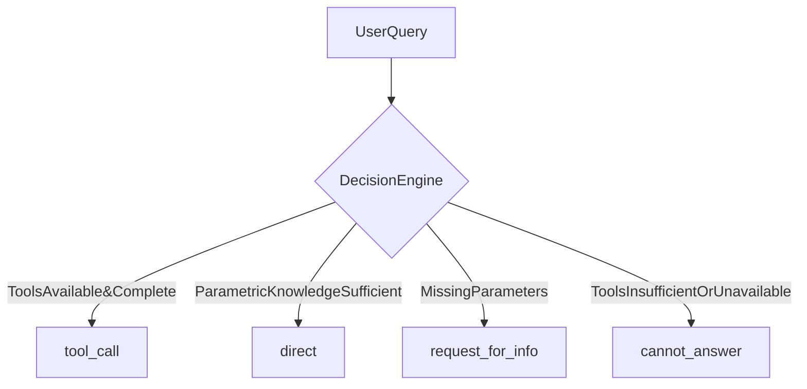
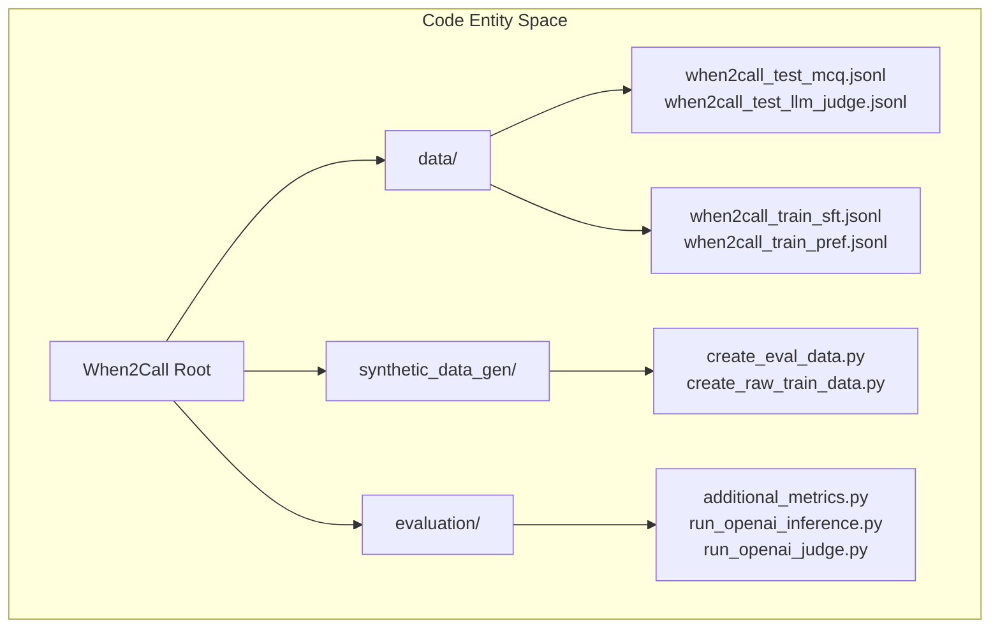

<!-- source: DeepWiki mcp.deepwiki.com · repo NVIDIA/When2Call · page 1 Overview · fetched 2026-11-09 -->

# Overview

Relevant source files

The following files were used as context for generating this wiki page:

- [README.md](README.md)
- [requirements.txt](requirements.txt)

When2Call is a benchmark, dataset, and training framework designed to evaluate and improve tool-calling decision-making in Large Models (LMs) [README.md:1-5](). While existing benchmarks focus primarily on whether an LM calls the correct tool with correct parameters when tool use is assumed, When2Call evaluates *when* an LM should invoke a tool, ask a clarifying question, answer directly, or refuse due to missing or unsupported capabilities [README.md:1-5](). 

For full details on setting up the environment, installing dependencies, and running pipelines, see [Getting Started](#1.1). For comprehensive explanations of the task design, evaluation modes, and failure modes, see [Benchmark Concepts and Task Design](#1.2).

Sources: `[README.md:1-5]()`

---

## The Four Answer Categories

When2Call structures its benchmark around four distinct decision-making categories that an LM must choose between given a user question and a set of available tools [README.md:22](). These categories represent the full spectrum of valid assistant behaviors in tool-use environments:

* `tool_call`: The query requires invoking one of the provided tools with appropriate arguments [README.md:22]().
* `direct`: The query can and should be answered directly by the model's parametric knowledge without invoking any tools [README.md:22]().
* `request_for_info`: The query appears to require tool usage, but essential parameters are missing from the prompt, requiring a follow-up clarification question [README.md:22]().
* `cannot_answer`: The query seems to require a tool call or external capability, but none of the provided tools are sufficient, or the request is out-of-scope [README.md:22]().

*Figure 1: Decision-making flow mapping natural language queries to the four When2Call answer categories.*

Sources: `[README.md:22-47]()`

---

## Repository Layout

The codebase is organized into primary directories handling data artifacts, synthetic data generation, and evaluation harnesses [README.md:10-112]():

* `data/`: Contains the test sets (`when2call_test_mcq.jsonl`, `when2call_test_llm_judge.jsonl`) and training sets (`when2call_train_sft.jsonl`, `when2call_train_pref.jsonl`) [README.md:14, 56, 80]().
* `synthetic_data_gen/`: Scripts and utilities for generating evaluation and training data from BFCL and xlam sources using OpenAI-compatible APIs.
* `evaluation/`: Evaluation pipelines including multiple-choice (MCQ) evaluation via `lm-eval` and LLM-as-a-Judge execution frameworks.

*Figure 2: Repository layout mapping top-level directories to core data files and python modules.*

Sources: `[README.md:10-112]`, `[requirements.txt:1-1]()`

---

## Child Pages

* [Getting Started](#1.1) — Installation instructions, environment variables (`OPENAI_API_KEY`), `lm_eval` setup, git-lfs configuration, and end-to-end execution flows.
* [Benchmark Concepts and Task Design](#1.2) — Detailed breakdown of the four answer categories, tool hallucination, and the distinction between MCQ and LLM-as-a-Judge evaluation modes.

Sources: `[README.md:1-112]()`

---

