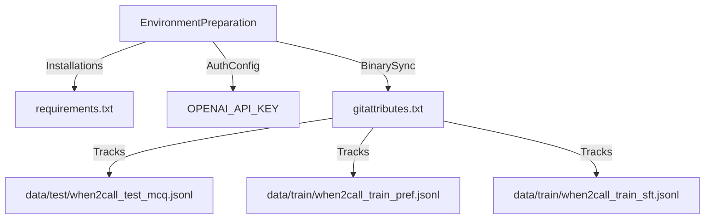
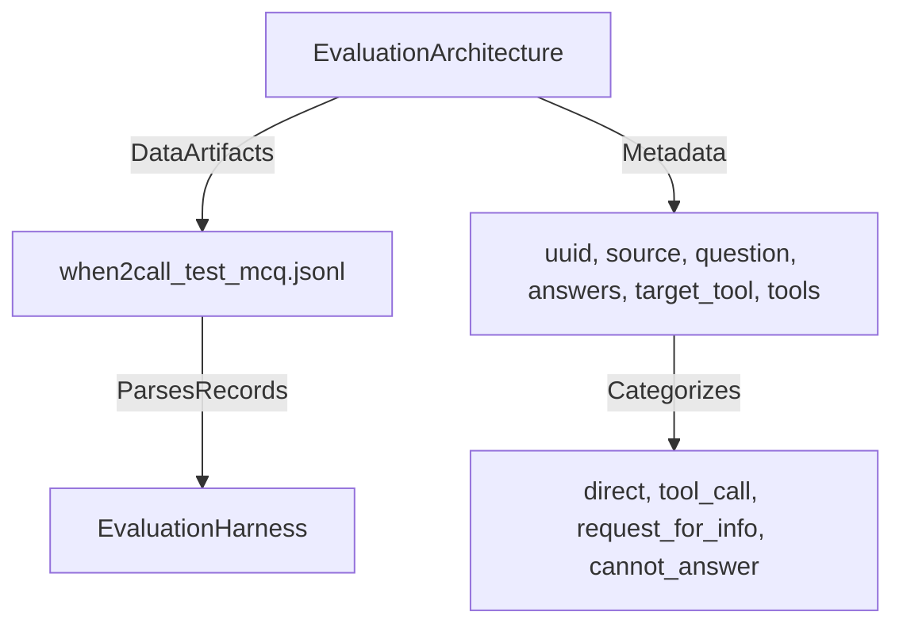

<!-- source: DeepWiki mcp.deepwiki.com · repo NVIDIA/When2Call · page 1.1 Getting Started · fetched 2026-11-09 -->

# Getting Started

<details>
<summary>Relevant source files</summary>

The following files were used as context for generating this wiki page:

- [README.md](README.md)
- [gitattributes.txt](gitattributes.txt)
- [requirements.txt](requirements.txt)

</details>


## Purpose and Scope
This page details the initial setup procedures required to prepare the development and execution environment for the **When2Call** codebase. It covers package dependency installation via `requirements.txt`, environment variable configuration (`OPENAI_API_KEY`), large file handling via Git-LFS and `gitattributes.txt`, framework integration with evaluation harnesses, and the mechanics of executing an end-to-end evaluation run.

---

## Environment and Dependency Setup

To run evaluation scripts, generate synthetic data, or execute inference pipelines, the local environment must be provisioned with the necessary Python packages and tracked data artifacts.

### 1. Python Requirements Installation
The repository specifies core package dependencies in `requirements.txt`. Currently, the primary explicit dependency is the OpenAI Python SDK version `1.75.0` [requirements.txt:1-1](). Install these dependencies using `pip`:

```bash
pip install -r requirements.txt
```

Sources: `[requirements.txt:1-1]()`

### 2. Environment Variables
Several evaluation workflows and synthetic generation pipelines interact with OpenAI-compatible LLM endpoints. You must configure your API credentials in your environment shell:

```bash
export OPENAI_API_KEY="your-api-key-here"
```

Sources: `[README.md:1-112]()`

### 3. Git-LFS and Data Tracking
The repository uses Git Large File Storage (Git-LFS) to manage large JSONL dataset files for both testing and training splits. The tracking configurations are declared in `gitattributes.txt` [gitattributes.txt:1-3](). 

Before working with the datasets, ensure Git-LFS is installed and initialized:

```bash
git lfs install
git lfs pull
```

The following files are tracked via Git-LFS under `gitattributes.txt`:
- `data/test/when2call_test_mcq.jsonl` [gitattributes.txt:1-1]()
- `data/train/when2call_train_pref.jsonl` [gitattributes.txt:2-2]()
- `data/train/when2call_train_sft.jsonl` [gitattributes.txt:3-3]()


Sources: `[gitattributes.txt:1-4]`, `[README.md:14-14]`, `[README.md:56-56]`, `[README.md:80-80]()`

---

## Benchmark Evaluation Setup

When2Call evaluates tool-calling decision-making across four distinct categories: `direct`, `tool_call`, `request_for_info`, and `cannot_answer` [README.md:22-22](). Evaluations can be performed using multiple-choice question (MCQ) frameworks or LLM-as-a-Judge pipelines [README.md:50-50]().


Sources: `[README.md:14-27]()`

---

## Typical End-to-End Run

A standard end-to-end evaluation workflow proceeds through data acquisition, environment validation, and execution of evaluation tasks.

1. **Clone and Setup**: Clone the repository and initialize Git-LFS to fetch evaluation datasets (`data/test/when2call_test_mcq.jsonl`) and training splits (`data/train/when2call_train_sft.jsonl`, `data/train/when2call_train_pref.jsonl`) [README.md:14-80]().
2. **Install Dependencies**: Execute `pip install -r requirements.txt` to install `openai==1.75.0` [requirements.txt:1-1]().
3. **Set API Keys**: Configure the `OPENAI_API_KEY` environment variable for judge or generation routines.
4. **Run Evaluation / Inference**: Execute evaluation harnesses or inference scripts against target model checkpoints using the structured test data format containing `uuid`, `source`, `question`, `answers`, `target_tool`, and `tools` [README.md:17-26]().

Sources: `[README.md:14-27]`, `[requirements.txt:1-1]`, `[gitattributes.txt:1-3]()`

---

