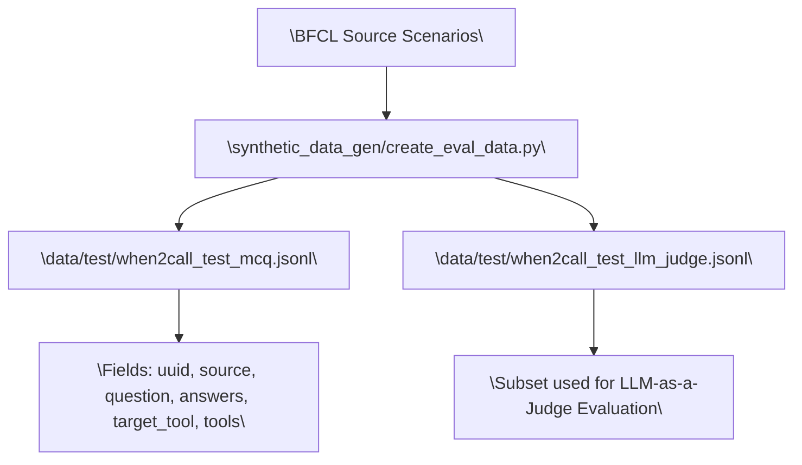

<!-- source: DeepWiki mcp.deepwiki.com · repo NVIDIA/When2Call · page 2 Datasets · fetched 2026-11-09 -->

# Datasets

<details>
<summary>Relevant source files</summary>

The following files were used as context for generating this wiki page:

- [README.md](README.md)

</details>


## Overview and Scope

The When2Call benchmark provides a comprehensive suite of data artifacts designed to evaluate and train language models on tool-calling decision-making [README.md:1-5](). The dataset bridges the gap between traditional tool execution accuracy and the complex reasoning required to determine *when* to execute a tool, *when* to request further information, *when* to admit an unanswerable query, or *when* to handle a request directly [README.md:1-5](). 

This page serves as a high-level parent overview of the test and training artifacts distributed under `data/` [README.md:14-106](). For deep technical specifications, schemas, and usage guidelines, refer to the child pages:
- [Test Sets (MCQ and LLM-Judge)](#2.1)
- [Training Sets (SFT and Preference)](#2.2)

---

## Test Sets Architecture

The evaluation test suite consists of JSON Lines (`.jsonl`) files containing standardized questions, available tool definitions, correct answer categories (`direct`, `tool_call`, `request_for_info`, `cannot_answer`), and distractor responses for multiple-choice and judge pipelines [README.md:12-48]().

Diagram showing the natural language evaluation sources mapped to concrete test artifacts and their schemas:


Sources: [README.md:14-51](), [README.md:111-112]()

For detailed record schemas, category definitions (`uuid`, `source`, `question`, `answers`, `target_tool`, `tools`), and evaluation protocols, see [Test Sets (MCQ and LLM-Judge)](#2.1).

---

## Training Sets Architecture

The training artifacts supply supervised fine-tuning (SFT) and preference optimization (RPO/DPO) data optimized for aligning models on When2Call categories [README.md:52-106](). Responses containing tool invocations utilize standardized `<TOOLCALL>` tags which adapt to target model templates [README.md:108]().

Diagram showing the natural language training data flow from raw sources into SFT and preference code structures:

```mermaid
graph TD
    NLTrain["\"Raw Training Corpus (BFCL / xlam)\""] --> BuildTrain["\"synthetic_data_gen/create_raw_train_data.py\""]
    BuildTrain --> SFTFile["\"data/train/when2call_train_sft.jsonl\""]
    BuildTrain --> PrefFile["\"data/train/when2call_train_pref.jsonl\""]
    SFTFile --> SchemaSFT["\"Fields: tools, messages\""]
    PrefFile --> SchemaPref["\"Fields: tools, messages, chosen_response, rejected_response\""]
```
Sources: [README.md:52-110]()

For detailed record structures, tool formatting wrappers, and integration guidelines for SFT and preference training, see [Training Sets (SFT and Preference)](#2.2).

---

