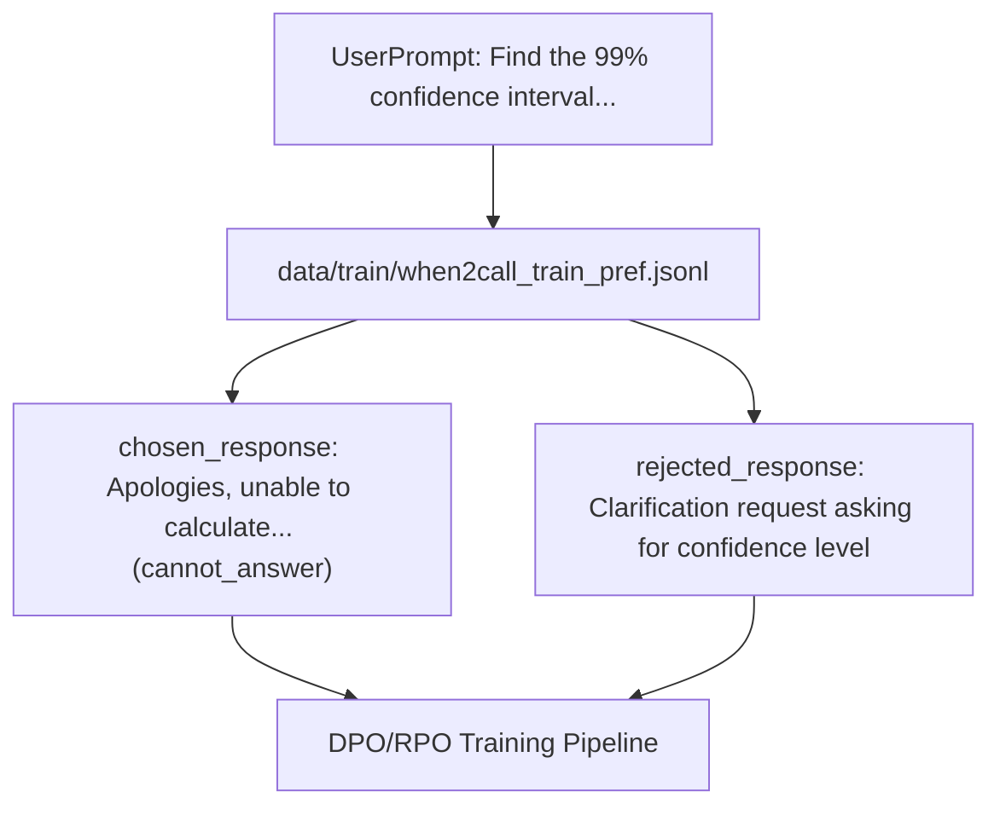
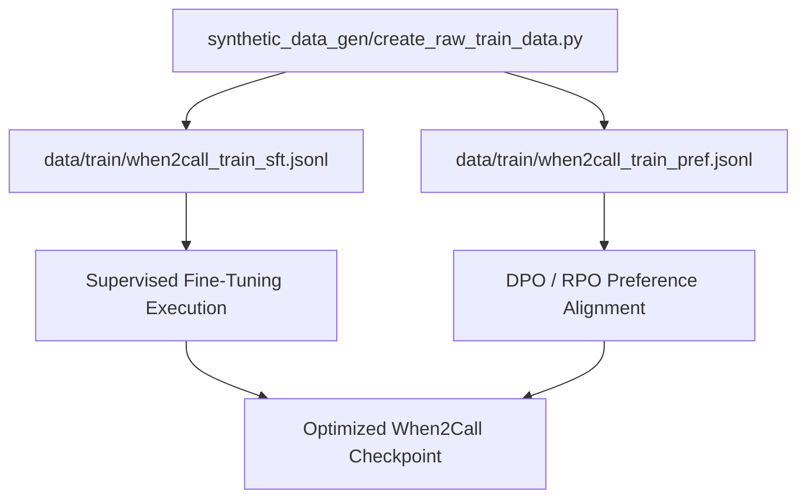

<!-- source: DeepWiki mcp.deepwiki.com · repo NVIDIA/When2Call · page 2.2 Training Sets (SFT and Preference) · fetched 2026-11-09 -->

# Training Sets (SFT and Preference)

<details>
<summary>Relevant source files</summary>

The following files were used as context for generating this wiki page:

- [data/train/when2call_train_pref.jsonl](data/train/when2call_train_pref.jsonl)
- [data/train/when2call_train_sft.jsonl](data/train/when2call_train_sft.jsonl)

</details>


## Purpose and Scope

This page details the schema, structure, and training application of the Supervised Fine-Tuning (SFT) and preference optimization datasets provided in the `When2Call` repository: `data/train/when2call_train_sft.jsonl` and `data/train/when2call_train_pref.jsonl`. These datasets train models to discern when to invoke a tool, when to ask for clarifying information (`request_for_info`), when a task is impossible (`cannot_answer`), or when to respond directly (`direct`).

Sources: `data/train/when2call_train_sft.jsonl:1-7`, `data/train/when2call_train_pref.jsonl:1-4`

---

## 1. Dataset Schemas

Both training sets are stored in JSON Lines (`.jsonl`) format. Each line represents a single training instance containing available tool definitions, conversation history, and expected assistant behaviors.

### SFT Dataset Schema (`when2call_train_sft.jsonl`)

The SFT dataset is designed for standard instruction-following and behavioral alignment tuning where the model learns the correct single-turn or multi-turn response given a set of tool declarations.

| Field | Type | Description |
| :--- | :--- | :--- |
| `tools` | `List[str]` | A list of JSON-serialized tool definitions containing name, description, and parameter properties. |
| `messages` | `List[Dict[str, str]]` | Conversation history including `user` prompts and `assistant` responses. |

```json
{
  "tools": [
    "{\"name\": \"get_stations_within_1_km\", \"description\": \"Fetch nearest EV charging stations...\", \"parameters\": {...}}"
  ],
  "messages": [
    {"role": "user", "content": "What are the trending topics in New York City today?"},
    {"role": "assistant", "content": "Apologies, but I'm unable to provide real-time information..."}
  ]
}
```

Sources: `data/train/when2call_train_sft.jsonl:1-7`

### Preference Dataset Schema (`when2call_train_pref.jsonl`)

The preference dataset is used for Reward Model training, Direct Preference Optimization (DPO), or Relative Preference Optimization (RPO). It contrasts a `chosen_response` (correct tool call, refusal, or direct answer) against a `rejected_response` (hallucinated tool, premature clarification, or incorrect response).

| Field | Type | Description |
| :--- | :--- | :--- |
| `tools` | `List[str]` | Available tool schemas for the given context. |
| `messages` | `List[Dict[str, str]]` | The user prompt and preceding conversational context. |
| `chosen_response` | `Dict[str, str]` | The preferred assistant completion (correct category behavior). |
| `rejected_response` | `Dict[str, str]` | The suboptimal assistant completion (e.g., unnecessary tool call or hallucinated argument). |

```json
{
  "tools": ["..."],
  "messages": [{"role": "user", "content": "Show me completed ICOs..."}],
  "chosen_response": {"role": "assistant", "content": "<TOOLCALL>[{\"name\": \"get_ico_calendar\", ...}]</TOOLCALL>"},
  "rejected_response": {"role": "assistant", "content": "Which language do you prefer for the response?"}
}
```

Sources: `data/train/when2call_train_pref.jsonl:1-4`

---

## 2. TOOLCALL Tags and Response Structures

When a model decides to execute a tool, When2Call relies on explicit XML-style `<TOOLCALL>` tags enclosing a JSON payload containing the tool name and extracted arguments.

```
+-----------------------------------------------------------------+
|                   "Natural Language Space"                      |
|  User query: "Convert RGB color code 255, 0, 0 to CMYK."       |
+-----------------------------------------------------------------+
                                 |
                                 v
+-----------------------------------------------------------------+
|                   "Code Entity Space"                           |
|  Dataset Record: data/train/when2call_train_pref.jsonl          |
|  Function Schema: rgb_to_cmyk(r, g, b)                          |
|  Chosen Output: <TOOLCALL>[{"name": "rgb_to_cmyk", ...}]</TOOL>|
+-----------------------------------------------------------------+
```

Sources: `data/train/when2call_train_pref.jsonl:3-3`

---

## 3. Chosen and Rejected Pair Mechanics

Preference optimization pairs highlight edge cases where models typically fail—such as invoking a tool when information is missing versus correctly issuing a `request_for_info` or `cannot_answer` response.



Sources: `data/train/when2call_train_pref.jsonl:2-2`

---

## 4. Integration with Training Pipelines

The SFT and preference datasets bridge raw synthetic data generation and model checkpoint optimization.



Sources: `data/train/when2call_train_sft.jsonl:1-7`, `data/train/when2call_train_pref.jsonl:1-4`

---

