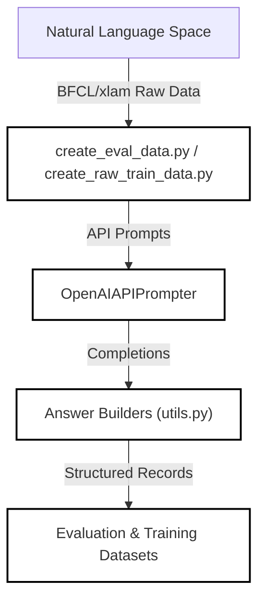
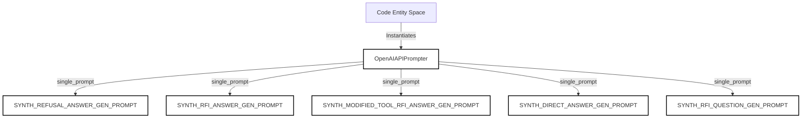

<!-- source: DeepWiki mcp.deepwiki.com · repo NVIDIA/When2Call · page 3 Synthetic Data Generation · fetched 2026-11-09 -->

# Synthetic Data Generation

Relevant source files

The following files were used as context for generating this wiki page:

- [synthetic_data_gen/create_eval_data.py](synthetic_data_gen/create_eval_data.py)
- [synthetic_data_gen/utils.py](synthetic_data_gen/utils.py)

The synthetic data generation module is responsible for constructing robust evaluation and training datasets for When2Call. By leveraging external sources such as the Berkeley Function Calling Leaderboard (BFCL) [synthetic_data_gen/create_eval_data.py:77-80]() and xlam/APIGen sources [synthetic_data_gen/utils.py:148-151](), the pipeline synthesizes model responses across the four core task categories: `tool_call`, `request_for_info` (RFI), `cannot_answer` (refusal), and `direct` answers [synthetic_data_gen/create_eval_data.py:93-156](). 

This parent page outlines the high-level architecture of the data generation pipelines. For detailed implementation mechanics, refer to the child pages linked below:
- [Evaluation Data Generation (create_eval_data.py)](#3.1)
- [Training Data Generation and Conversion](#3.2)
- [Generation Utilities and Prompting](#3.3)

---

## Architecture and Data Flow

The synthetic data generation workflow bridges natural language inputs and tool definitions with programmatic code entities like `OpenAIAPIPrompter` and evaluation record builders. 

*Sources: [synthetic_data_gen/create_eval_data.py:15-159](), [synthetic_data_gen/utils.py:29-107]()*

---

## 3.1 Evaluation Data Generation (`create_eval_data.py`)

The evaluation data generation pipeline ingests raw BFCL live simple and multiple-choice source files [synthetic_data_gen/create_eval_data.py:77-83](). For each source question, it synthesizes multi-category evaluation records containing alternative correct choices (`tool_call`, `request_for_info`, `cannot_answer`, and `direct`) [synthetic_data_gen/create_eval_data.py:93-156](). It also handles question rewriting to drop required parameters when building Request For Information (RFI) test cases [synthetic_data_gen/create_eval_data.py:114-115]().

For detailed CLI arguments, BFCL ingestion logic, and record schemas, see [Evaluation Data Generation (create_eval_data.py)](#3.1).

Sources: [synthetic_data_gen/create_eval_data.py:15-159]()

---

## 3.2 Training Data Generation and Conversion

Training data generation transforms raw xlam and APIGen source repositories into structured training records [synthetic_data_gen/utils.py:148-151](). This pipeline filters out parallel tool calls [synthetic_data_gen/utils.py:157-158](), normalizes tool parameter schemas [synthetic_data_gen/utils.py:160-171](), and converts the resulting tuples into formats suitable for Supervised Fine-Tuning (SFT) and preference optimization (RPO/DPO).

For comprehensive instructions on running the training data creation script and format conversions, see [Training Data Generation and Conversion](#3.2).

Sources: [synthetic_data_gen/utils.py:148-184]()

---

## 3.3 Generation Utilities and Prompting (`synthetic_data_gen/utils.py`)

The utilities module provides core wrapper classes and prompt helpers to interact with OpenAI-compatible LLM endpoints. The primary driver is `OpenAIAPIPrompter`, which manages API client connections, retry logic on length limit stops, and chat completion calls [synthetic_data_gen/utils.py:29-61](). Additionally, it houses specialized answer construction functions such as `create_toolcall_answer`, `create_refusal_answer`, `create_rfi_answer`, and `rewrite_question_to_exclude_param` [synthetic_data_gen/utils.py:64-126]().

*Sources: [synthetic_data_gen/utils.py:29-126](), [synthetic_data_gen/utils.py:20-26]*

For details on prompt templates and helper implementations, see [Generation Utilities and Prompting](#3.3).

Sources: [synthetic_data_gen/utils.py:29-126]()

---

