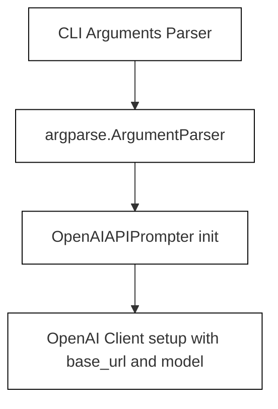
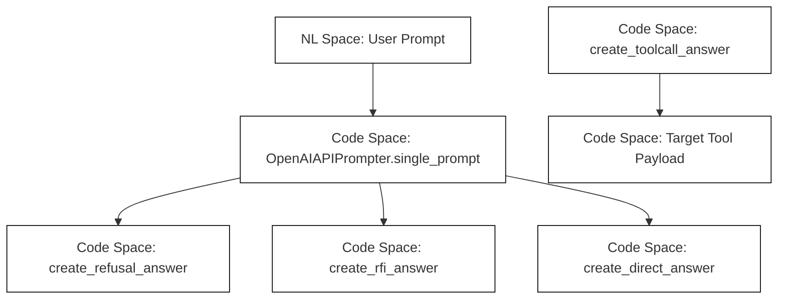
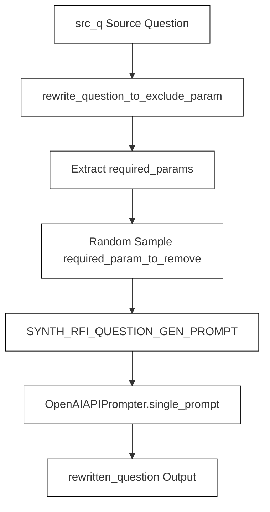

<!-- source: DeepWiki mcp.deepwiki.com · repo NVIDIA/When2Call · page 3.1 Evaluation Data Generation (create_eval_data.py) · fetched 2026-11-09 -->

# Evaluation Data Generation (create_eval_data.py)

<details>
<summary>Relevant source files</summary>

The following files were used as context for generating this wiki page:

- [synthetic_data_gen/create_eval_data.py](synthetic_data_gen/create_eval_data.py)
- [synthetic_data_gen/utils.py](synthetic_data_gen/utils.py)

</details>


This page provides full technical documentation for the evaluation data generation script located at `synthetic_data_gen/create_eval_data.py` and its supporting utility functions in `synthetic_data_gen/utils.py`. The primary purpose of this pipeline is to ingest source benchmark datasets (specifically the Berkeley Function Calling Leaderboard - BFCL), synthesize alternative answers across multiple categories (`tool_call`, `request_for_info`, `cannot_answer`, and `direct`), rewrite questions to drop required parameters for RFI testing, and produce comprehensive evaluation records.

Sources: [synthetic_data_gen/create_eval_data.py:1-159](), [synthetic_data_gen/utils.py:1-184]()

---

## 1. Command-Line Interface and Initialization

The script exposes a command-line interface via `argparse` to configure data directories, target output destinations, and the OpenAI-compatible API parameters used for synthetic text generation [synthetic_data_gen/create_eval_data.py:38-65]().

### CLI Arguments Table

| Argument | Type | Required | Description |
| :--- | :--- | :--- | :--- |
| `--bfcl_data_dir` | `str` | Yes | Path to the directory containing source BFCL data [synthetic_data_gen/create_eval_data.py:40-45]() |
| `--output_dir` | `str` | Yes | Path to the directory where generated evaluation records will be saved [synthetic_data_gen/create_eval_data.py:46-51]() |
| `--openai_api_base_url` | `str` | Yes | Base URL for the OpenAI-compatible API endpoint [synthetic_data_gen/create_eval_data.py:52-57]() |
| `--openai_api_model` | `str` | Yes | Name of the model used for synthetic data generation prompts [synthetic_data_gen/create_eval_data.py:58-63]() |

Upon parsing arguments, the script instantiates the `OpenAIAPIPrompter` class from `synthetic_data_gen/utils.py` with a fixed temperature of `0.6` and `top_p` of `0.95`, reading the API key directly from the `OPENAI_API_KEY` environment variable [synthetic_data_gen/create_eval_data.py:67-73](), [synthetic_data_gen/utils.py:29-34]().



Sources: [synthetic_data_gen/create_eval_data.py:38-73](), [synthetic_data_gen/utils.py:29-35]()

---

## 2. BFCL Ingestion and Data Loading

The pipeline processes live BFCL categories, specifically targeting `BFCL_v2_live_multiple` and `BFCL_v2_live_simple` [synthetic_data_gen/create_eval_data.py:77-78](). 

For each category:
1. Source questions are loaded from `{args.bfcl_data_dir}/{bfcl_category}.json` using `read_bfcl_source_questions()` [synthetic_data_gen/create_eval_data.py:79](), [synthetic_data_gen/create_eval_data.py:82](), [synthetic_data_gen/utils.py:128-135]().
2. Possible answers are loaded from `{args.bfcl_data_dir}/possible_answer/{bfcl_category}.json` using `read_bfcl_source_answers()` [synthetic_data_gen/create_eval_data.py:80](), [synthetic_data_gen/create_eval_data.py:83](), [synthetic_data_gen/utils.py:138-146]().
3. An assertion verifies that the counts of source questions and answers match [synthetic_data_gen/create_eval_data.py:84]().
4. Functions are normalized to lists if they are not already, and the `target_tool` is matched against the ground-truth function name [synthetic_data_gen/create_eval_data.py:86-90]().

Sources: [synthetic_data_gen/create_eval_data.py:77-90](), [synthetic_data_gen/utils.py:128-146]()

---

## 3. Per-Category Answer Synthesis

For each source record, the script synthesizes three distinct evaluation items corresponding to different ground-truth behavior categories: **Refusal (`cannot_answer`)**, **Request for Info (`request_for_info`)**, and **Tool Call (`tool_call`)** [synthetic_data_gen/create_eval_data.py:92-156]().

### Answer Construction Functions (`synthetic_data_gen/utils.py`)
- `create_toolcall_answer(user_question, possible_answer)`: Formulates a structured dictionary with the target function name and sampled argument values [synthetic_data_gen/utils.py:64-73]().
- `create_refusal_answer(user_question, openai_api_prompter)`: Prompts the model to generate a refusal response when a tool cannot be invoked [synthetic_data_gen/utils.py:76-80]().
- `create_rfi_answer(user_question, tool, openai_api_prompter)`: Generates a clarifying request for missing information [synthetic_data_gen/utils.py:83-87]().
- `create_modified_tool_rfi_answer(...)`: Generates an RFI response tailored to a rewritten question where a required parameter was dropped [synthetic_data_gen/utils.py:90-99]().
- `create_direct_answer(user_question, openai_api_prompter)`: Synthesizes a direct conversational answer addressing the user without calling tools [synthetic_data_gen/utils.py:102-106]().



Sources: [synthetic_data_gen/create_eval_data.py:92-156](), [synthetic_data_gen/utils.py:64-107]()

---

## 4. Question Rewriting to Drop Parameters

To evaluate `request_for_info` scenarios where a model must ask for missing parameters, the script inspects whether `target_tool["parameters"]["required"]` contains elements [synthetic_data_gen/create_eval_data.py:114](). 

If required parameters exist, `rewrite_question_to_exclude_param()` randomly selects one required parameter to remove and prompts the model to rewrite the user question so that it omits that specific piece of information [synthetic_data_gen/utils.py:109-126]().



Sources: [synthetic_data_gen/create_eval_data.py:113-134](), [synthetic_data_gen/utils.py:109-126]()

---

## 5. Output Record Structure

Each generated evaluation record contains metadata, the prompt text, candidate answers across all categories, target tool definitions, and parameter held-out markers [synthetic_data_gen/create_eval_data.py:93-156](). 

### Record Schema Definition

```json
{
  "uuid": "string (uuid4)",
  "source": "string (e.g., BFCL_v2_live_multiple)",
  "source_id": "string",
  "question": "string (original or rewritten question)",
  "orig_question": "string",
  "correct_answer": "string (cannot_answer | request_for_info | tool_call)",
  "answers": {
    "direct": "string",
    "tool_call": "dict",
    "request_for_info": "string",
    "cannot_answer": "string"
  },
  "target_tool": "dict or null",
  "tools": "list of JSON-serialized tool definitions",
  "orig_tools": "list of JSON-serialized tool definitions",
  "held_out_param": "string or null"
}
```

Once all records are synthesized across the selected categories, the script shuffles the `eval_data` list before serializing it to the target output directory [synthetic_data_gen/create_eval_data.py:158-159]().

Sources: [synthetic_data_gen/create_eval_data.py:93-159]()

---

