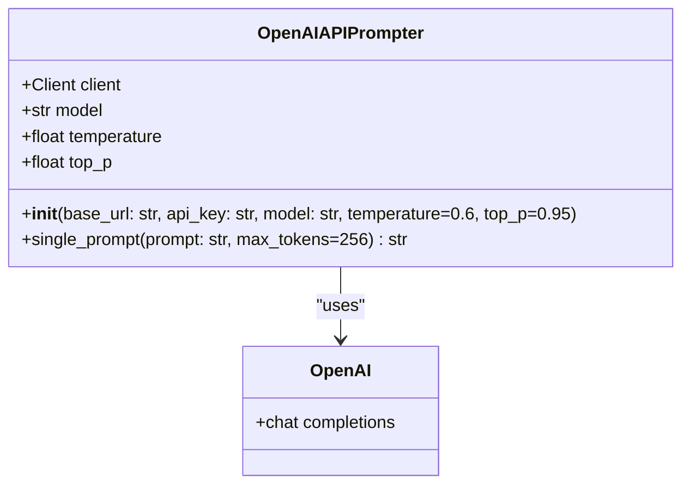
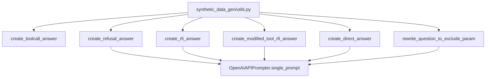
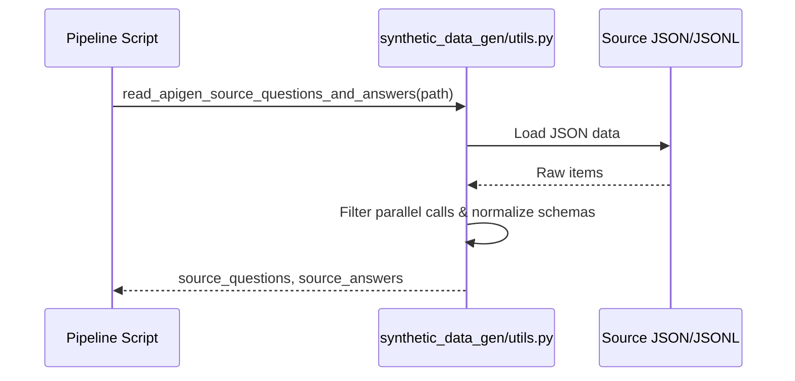

<!-- source: DeepWiki mcp.deepwiki.com · repo NVIDIA/When2Call · page 3.3 Generation Utilities and Prompting · fetched 2026-11-09 -->

# Generation Utilities and Prompting

Relevant source files

The following files were used as context for generating this wiki page:

- [synthetic_data_gen/utils.py](synthetic_data_gen/utils.py)

## Purpose and Scope
This page details the implementation of generation utilities and answer-construction helper functions located in `synthetic_data_gen/utils.py`. These utilities support synthetic data generation pipelines by interacting with OpenAI-compatible models via `OpenAIAPIPrompter` and constructing specific responses for various task categories (such as direct answers, tool calls, requests for information, and refusals).

---

## 1. OpenAIAPIPrompter Class
The `OpenAIAPIPrompter` class encapsulates communication with OpenAI-compatible chat completion endpoints. It manages client initialization, model selection, inference parameters, and token limit handling.

*Sources: `synthetic_data_gen/utils.py:29-62`*

### Implementation Details
- **`__init__`**: Initializes the underlying `OpenAI` client from the `openai` package using `base_url` and `api_key`, setting default parameters like `temperature=0.6` and `top_p=0.95` [synthetic_data_gen/utils.py:29-34]().
- **`single_prompt`**: Submits a user prompt to the chat completion endpoint. If the completion finishes with a `length` reason (indicating truncation due to token limits), it automatically retries with `max_tokens * 2`. For other finish reasons besides `stop`, it raises a `ValueError` [synthetic_data_gen/utils.py:36-61]().

---

## 2. Answer Construction and Question Rewriting Helpers
`synthetic_data_gen/utils.py` provides deterministic and prompt-driven helper functions to build answers across different synthetic evaluation categories, as well as utility readers for source datasets.

*Sources: `synthetic_data_gen/utils.py:64-126`*

### Summary of Helper Functions
- **`create_toolcall_answer(user_question, possible_answer)`**: Formulates a standard tool-call dictionary extracting function names and sampled argument values from ground truth definitions [synthetic_data_gen/utils.py:64-73]().
- **`create_refusal_answer(user_question, openai_api_prompter)`**: Uses `SYNTH_REFUSAL_ANSWER_GEN_PROMPT` to generate a response refusing a request that cannot be fulfilled [synthetic_data_gen/utils.py:76-80]().
- **`create_rfi_answer(user_question, tool, openai_api_prompter)`**: Formulates a request for information (RFI) response using `SYNTH_RFI_ANSWER_GEN_PROMPT` [synthetic_data_gen/utils.py:83-87]().
- **`create_modified_tool_rfi_answer(rewritten_question, tool, removed_param, openai_api_prompter)`**: Generates an RFI response asking for a missing parameter using `SYNTH_MODIFIED_TOOL_RFI_ANSWER_GEN_PROMPT` [synthetic_data_gen/utils.py:90-99]().
- **`create_direct_answer(user_question, openai_api_prompter)`**: Generates a direct conversational answer via `SYNTH_DIRECT_ANSWER_GEN_PROMPT` [synthetic_data_gen/utils.py:102-106]().
- **`rewrite_question_to_exclude_param(user_question, tool, openai_api_prompter)`**: Randomly selects a required parameter from a tool definition and rewrites the user question to omit it, using `SYNTH_RFI_QUESTION_GEN_PROMPT` [synthetic_data_gen/utils.py:109-125]().

---

## 3. Dataset Ingestion Utilities
Functions to ingest source data from BFCL and APIGen files are also defined within this module:

- **`read_bfcl_source_questions(questions_source_filepath)`**: Parses line-delimited JSON source questions [synthetic_data_gen/utils.py:128-135]().
- **`read_bfcl_source_answers(answers_source_filepath)`**: Parses line-delimited JSON source answers [synthetic_data_gen/utils.py:138-145]().
- **`read_apigen_source_questions_and_answers(apigen_source_filepath)`**: Loads APIGen JSON artifacts, filters out parallel tool calls, normalizes parameter and schema typing (e.g., ensuring dictionary structures and explicit required parameter lists), and returns aligned lists of questions and answers [synthetic_data_gen/utils.py:148-184]().

*Sources: `synthetic_data_gen/utils.py:128-184`*

---

