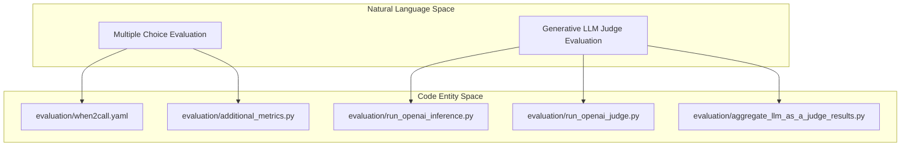
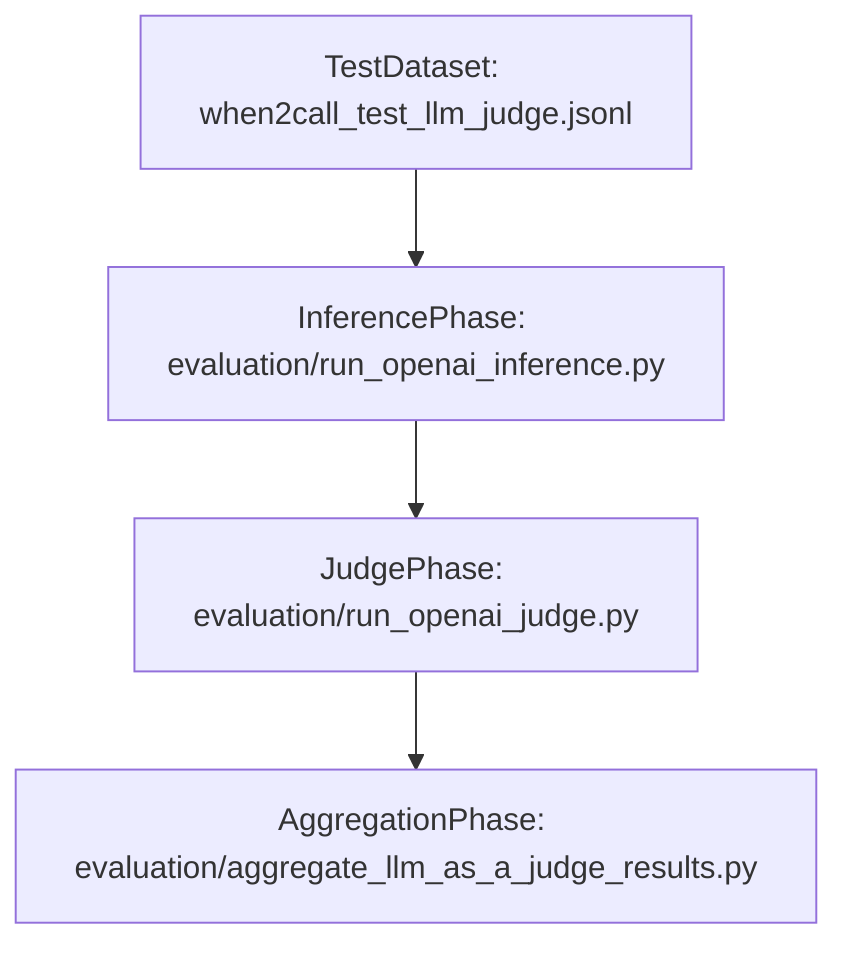

<!-- source: DeepWiki mcp.deepwiki.com · repo NVIDIA/When2Call · page 4 Evaluation · fetched 2026-11-09 -->

# Evaluation

Relevant source files

The following files were used as context for generating this wiki page:

- [README.md](README.md)

## Purpose and Scope

The **When2Call** benchmark assesses language models on their tool-calling decision-making capabilities—specifically determining when to execute a tool call, when to ask a clarifying question (`request_for_info`), when to answer directly without tools (`direct`), and when to correctly decline because the task cannot be answered (`cannot_answer`) [README.md:5-22]. To measure these capabilities comprehensively, the project implements two primary evaluation paradigms: a multiple-choice question (MCQ) evaluation harness built on top of `lm-evaluation-harness`, and a generative LLM-as-a-Judge pipeline. 

This page provides a high-level overview of both evaluation harnesses, the metrics they produce, and how they relate to the underlying dataset artifacts. For deeper technical implementation details, prompt formatting, and configuration specifics, refer to the child pages:
- [MCQ Evaluation with LM-Eval-Harness](#4.1)
- [LLM-as-a-Judge Pipeline](#4.2)

*Sources: [README.md:1-51]()*

---

## 4.1 MCQ Evaluation with LM-Eval-Harness

The MCQ evaluation harness plugs the When2Call benchmark into standard evaluation frameworks using configuration files and custom task processing scripts [README.md:5-51]. In this mode, questions from `when2call_test_mcq.jsonl` are formatted into multiple-choice prompts where models select among the four categories (`direct`, `tool_call`, `request_for_info`, and `cannot_answer`) [README.md:14-48]. 

For details on how individual model templates are configured, how documents are pre-processed into prompts, and how macro-F1 and confusion matrices are calculated, see [MCQ Evaluation with LM-Eval-Harness](#4.1).

Sources: [README.md:1-51]()

---

## 4.2 LLM-as-a-Judge Pipeline

The LLM-as-a-Judge pipeline evaluates models in a generative free-form setting using `when2call_test_llm_judge.jsonl` [README.md:14-25]. Rather than selecting from discrete multiple-choice options, models generate direct text responses or tool calls, which are subsequently scored by a stronger judge model.

*Sources: [README.md:14-25]()*

The evaluation flows through three distinct sequential stages:
1. **Model Inference**: Generates raw responses from the target model using tool schema sanitization and OpenAI-compatible endpoints [README.md:14-48].
2. **Judging**: Evaluates the generated responses against ground-truth categories using structured judge prompts.
3. **Aggregation**: Computes per-category and overall performance metrics.

For details on executing inference, configuring judge prompts, and running aggregation scripts, see [LLM-as-a-Judge Pipeline](#4.2).

Sources: [README.md:14-48]()

---

