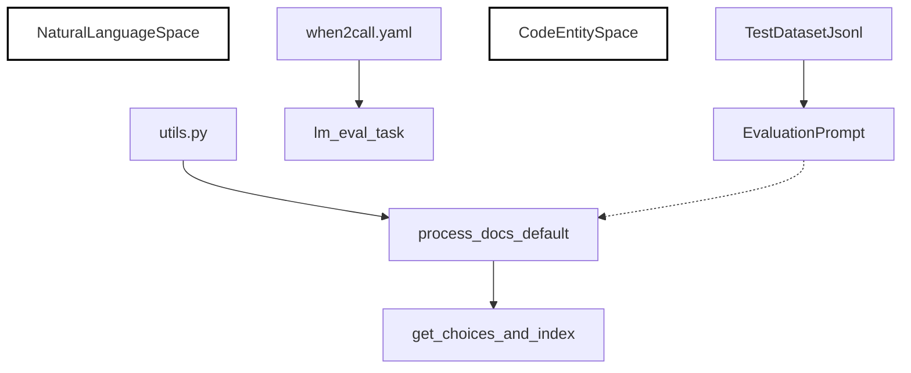
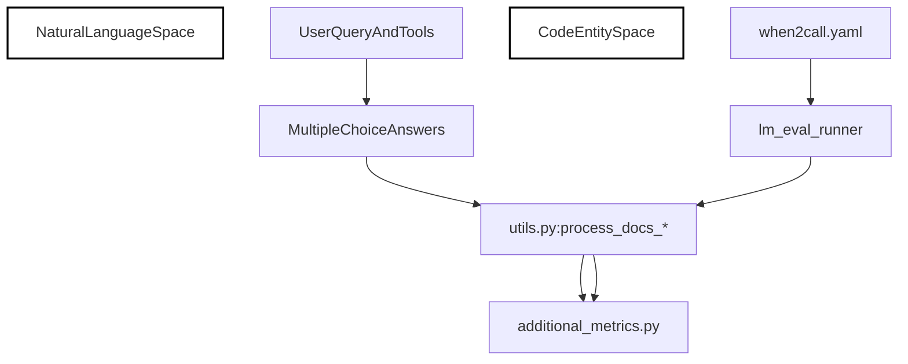

<!-- source: DeepWiki mcp.deepwiki.com · repo NVIDIA/When2Call · page 4.1 MCQ Evaluation with LM-Eval-Harness · fetched 2026-11-09 -->

# MCQ Evaluation with LM-Eval-Harness

Relevant source files

The following files were used as context for generating this wiki page:

- [evaluation/mcq/lm_eval_harness/when2call/utils.py](evaluation/mcq/lm_eval_harness/when2call/utils.py)
- [evaluation/mcq/lm_eval_harness/when2call/when2call.yaml](evaluation/mcq/lm_eval_harness/when2call/when2call.yaml)

## Purpose and Scope

The MCQ evaluation pipeline leverages the `lm-evaluation-harness` framework to evaluate tool-calling and decision-making capabilities as multiple-choice questions (MCQ). In this setup, each test case (`when2call_test_mcq.jsonl`) is converted into an evaluation document containing a prompt, a set of ordered choices, and a target answer index. 

This parent page provides a high-level summary of how the `when2call` task integrates into `lm-eval`, how configurations and document processors transform raw data into evaluation prompts, and how metrics are evaluated. For deep technical details, refer to the child pages:
- [Model-Specific Task Configs](#4.1.1)
- [Prompt Formatting and Doc Processing (utils.py)](#4.1.2)
- [Additional Metrics](#4.1.3)

---

## Task Integration and Execution Architecture

The core configuration for the base evaluation task is defined in `evaluation/mcq/lm_eval_harness/when2call/when2call.yaml` [evaluation/mcq/lm_eval_harness/when2call/when2call.yaml:1-25](). This configuration specifies the input dataset format (`output_type: multiple_choice`), hooks into document processors via `!function`, and registers multiple evaluation metrics like accuracy, normalized accuracy, and macro-F1 [evaluation/mcq/lm_eval_harness/when2call/when2call.yaml:10-25]().

The following diagram maps the conceptual evaluation workflow to the underlying code entities in the `lm-eval` harness integration:

*Sources: [evaluation/mcq/lm_eval_harness/when2call/when2call.yaml:1-25](), [evaluation/mcq/lm_eval_harness/when2call/utils.py:30-67]()*

---

## Sub-Topics Overview

### 1. Model-Specific Task Configs
Different target models require customized system instructions, special tokens, and tool formatting conventions. Instead of a single static YAML file, the repository provides task configuration variants tailored for models such as Functionary, Hermes, Llama 3.2, Qwen 2.5, and xLAM. Each config adjusts parameters like prompt templates or dataset paths to match the target architecture.
- For details, see [Model-Specific Task Configs](#4.1.1).

### 2. Prompt Formatting and Doc Processing (`utils.py`)
Raw dataset entries must be processed into structured documents that `lm-eval` can consume. The module `evaluation/mcq/lm_eval_harness/when2call/utils.py` contains choice extraction helpers (`get_choices_and_index`) and model-specific document processors (`process_docs_default`, `process_docs_llama3_2`, `process_docs_qwen2_5`, etc.) that construct model-compliant prompts and tool descriptions.
- For details, see [Prompt Formatting and Doc Processing (utils.py)](#4.1.2).

### 3. Additional Metrics
Beyond standard multiple-choice accuracy (`acc`) and normalized accuracy (`acc_norm`), the evaluation suite computes specialized metrics such as macro-F1, confusion matrices, and tool hallucination rates via custom aggregation functions.
- For details, see [Additional Metrics](#4.1.3).

---

## Evaluation Data Flow

The relationship between task execution and prompt formatting can be visualized from raw inputs to metrics calculation:

*Sources: [evaluation/mcq/lm_eval_harness/when2call/when2call.yaml:1-25](), [evaluation/mcq/lm_eval_harness/when2call/utils.py:30-175]() *

---

