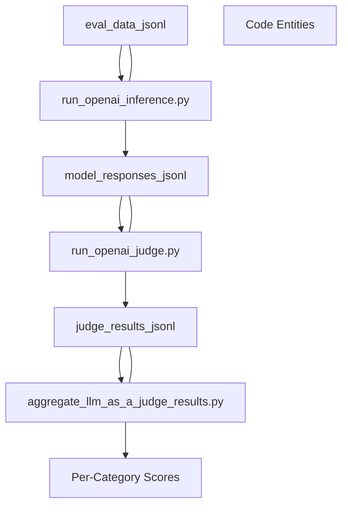
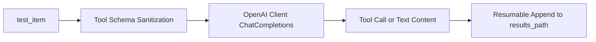
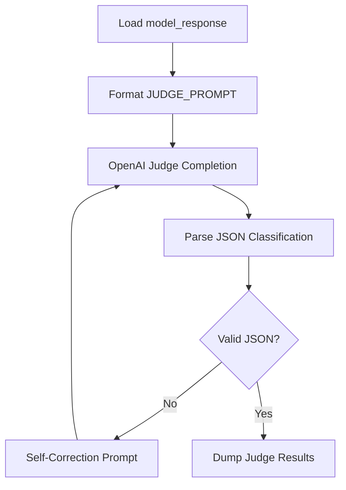

<!-- source: DeepWiki mcp.deepwiki.com · repo NVIDIA/When2Call · page 4.2 LLM-as-a-Judge Pipeline · fetched 2026-11-09 -->

# LLM-as-a-Judge Pipeline

Relevant source files

The following files were used as context for generating this wiki page:

- [evaluation/llm_as_a_judge/run_openai_inference.py](evaluation/llm_as_a_judge/run_openai_inference.py)
- [evaluation/llm_as_a_judge/run_openai_judge.py](evaluation/llm_as_a_judge/run_openai_judge.py)

The LLM-as-a-Judge evaluation pipeline provides an alternative to multi-choice question (MCQ) testing by executing model generation against a test set, classifying the behavior using a strong judge model across the four answer categories (`direct_answer`, `tool_call`, `request_for_info`, `cannot_answer`), and aggregating performance metrics. 

For details on individual child components, see:
- [Model Inference (run_openai_inference.py)](#4.2.1)
- [Judging and Aggregation](#4.2.2)

---

## 1. Pipeline Architecture and Flow

The pipeline executes in three distinct stages: generating model responses under an OpenAI-compatible interface, judging those responses against ground-truth intent using a prompt-engineered judge model, and aggregating the categorized results to evaluate behavior across categories.

Sources: [evaluation/llm_as_a_judge/run_openai_inference.py:26-102](), [evaluation/llm_as_a_judge/run_openai_judge.py:58-146]()

---

## 2. Stage 1: Model Inference

The first stage processes evaluation items from an input JSONL file, sanitizes tool schemas to fit OpenAI-compatible APIs, executes chat completions, and records model outputs with resumable file-append logic.

Sources: [evaluation/llm_as_a_judge/run_openai_inference.py:63-99]()

For deep technical details on schema manipulation, API configurations, and resumable execution, see [Model Inference (run_openai_inference.py)](#4.2.1).

---

## 3. Stages 2 & 3: Judging and Aggregation

The second stage loads model responses and applies a strict prompt template (`JUDGE_PROMPT`) to classify the behavior into one of the four When2Call answer categories. The third stage aggregates these classifications to compute category-level performance metrics.

Sources: [evaluation/llm_as_a_judge/run_openai_judge.py:90-142]()

For information on judge prompt templates, fallback mechanics, and aggregation scripts, see [Judging and Aggregation](#4.2.2).

---

