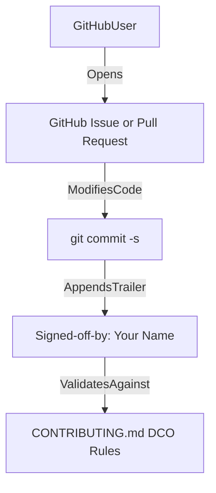
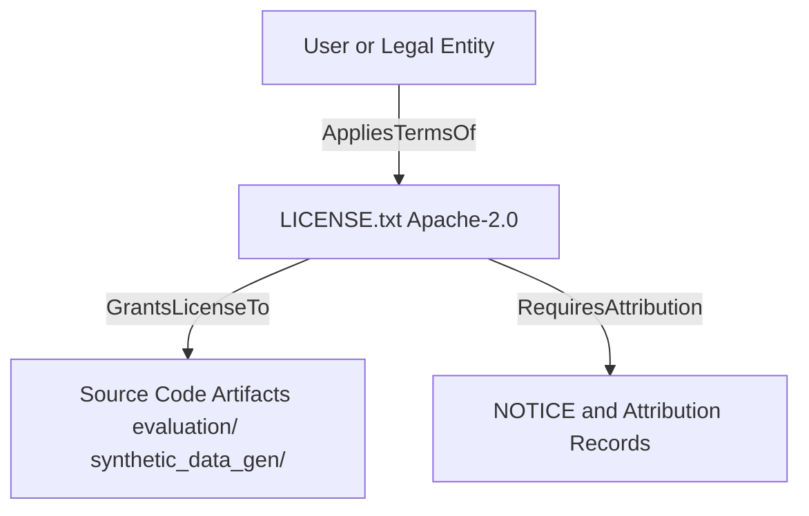

<!-- source: DeepWiki mcp.deepwiki.com · repo NVIDIA/When2Call · page 5 Project Governance · fetched 2026-11-09 -->

# Project Governance

Relevant source files

The following files were used as context for generating this wiki page:

- [CONTRIBUTING.md](CONTRIBUTING.md)
- [LICENSE.txt](LICENSE.txt)

This page outlines the project governance framework for the When2Call codebase, establishing the standards for community contributions, legal developer agreements, and licensing terms under which the software is distributed.

---

## 5.1 Contributing and DCO

The When2Call project welcomes community participation through issue tracking and pull requests on GitHub `[CONTRIBUTING.md:4-6]()`. To maintain code provenance and legal clarity, all contributions must adhere to the Developer Certificate of Origin (DCO) Version 1.1 `[CONTRIBUTING.md:9-36]()`. Contributors are required to certify that their code is original or submitted under a compatible open-source license by "signing off" on their commits using the `--signoff` (`-s`) git option, which appends a `Signed-off-by` trailer `[CONTRIBUTING.md:9-22]()`. Any pull requests containing unsigned commits cannot be accepted into the repository `[CONTRIBUTING.md:13-13]()`.

For detailed information on the pull request workflow, issue creation, and full DCO text, see [Contributing and DCO](#5.1).

*Sources: [CONTRIBUTING.md:4-50]()*

---

## 5.2 Licensing

When2Call is open-source software made available under the terms of the Apache License Version 2.0 `[LICENSE.txt:1-3]()`. This license grants users a perpetual, worldwide, non-exclusive, royalty-free copyright and patent license to reproduce, prepare derivative works of, publicly display, and distribute the software source and object forms `[LICENSE.txt:66-87]`. Redistribution of the codebase or its derivatives requires retaining proper copyright, patent, trademark, and attribution notices as defined in the license terms `[LICENSE.txt:89-122]`.

For detailed legal terms, condition clauses, and third-party dependency attributions, see [Licensing](#5.2).

*Sources: [LICENSE.txt:1-125]()*

---

