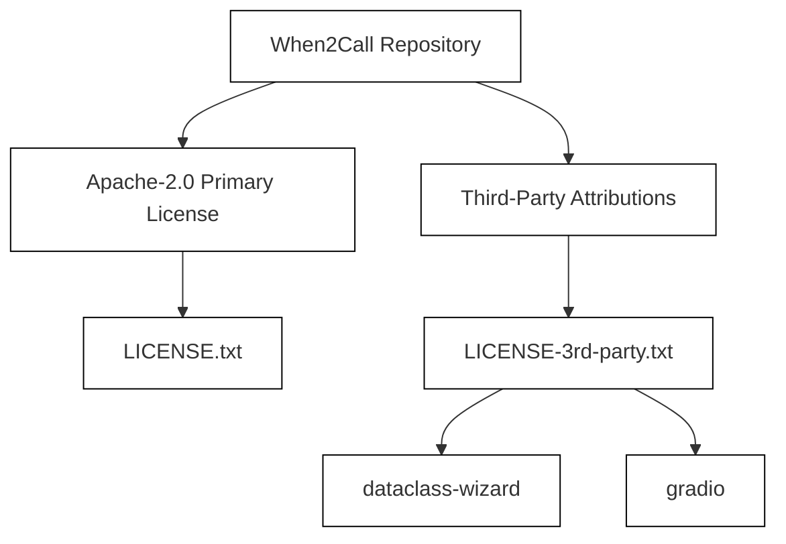

<!-- source: DeepWiki mcp.deepwiki.com · repo NVIDIA/When2Call · page 5.2 Licensing · fetched 2026-11-09 -->

# Licensing

Relevant source files

The following files were used as context for generating this wiki page:

- [LICENSE-3rd-party.txt](LICENSE-3rd-party.txt)
- [LICENSE.txt](LICENSE.txt)

## Purpose and Scope
This page details the licensing terms governing the When2Call repository and its third-party dependencies. The primary codebase is licensed under the Apache Software License Version 2.0 (Apache-2.0), which outlines permissions for use, modification, distribution, and patent grants. Additionally, third-party software packages utilized within the project maintain their respective licenses and attributions, cataloged in the repository's licensing documentation.

Sources: `[LICENSE.txt:1-125]()`, `[LICENSE-3rd-party.txt:1-136]()`

---

## Apache-2.0 Licensing Terms
The When2Call repository is provided under the terms of the Apache License, Version 2.0 (`[LICENSE.txt:1-201]()`). Key provisions of this license include:
- **Grant of Copyright License**: Permits perpetual, worldwide, non-exclusive, no-charge, royalty-free, irrevocable copyright license to reproduce, prepare derivative works of, publicly display, publicly perform, sublicense, and distribute the work (`[LICENSE.txt:66-72]()`).
- **Grant of Patent License**: Grants a perpetual, worldwide, non-exclusive, no-charge, royalty-free patent license from contributors, which terminates if patent litigation is instituted against any entity alleging infringement (`[LICENSE.txt:73-87]()`).
- **Redistribution Conditions**: Requires retaining copyright, patent, trademark, and attribution notices, providing a copy of the license with distributions, and marking any modified files prominently (`[LICENSE.txt:89-122]()`).

Sources: `[LICENSE.txt:1-125]()`

---

## Third-Party Dependencies and Attributions
The project integrates several third-party libraries and tools, each governed by open-source licenses. The repository maintains a dedicated attribution file (`[LICENSE-3rd-party.txt:1-2912]()`) documenting these packages:
- **dataclass-wizard**: Licensed under the Apache Software License 2.0 (`[LICENSE-3rd-party.txt:1-18]()`).
- **gradio**: Licensed under the Apache Software License 2.0 (`[LICENSE-3rd-party.txt:21-136]()`).

Users and contributors distributing derivative works must preserve these third-party attributions and comply with the respective license terms.

Sources: `[LICENSE-3rd-party.txt:1-136]()`

---

### Diagram: Licensing and Governance Architecture

*Figure 1: Overview of repository licensing artifacts and third-party attribution dependencies.*

Sources: `[LICENSE.txt:1-125]`, `[LICENSE-3rd-party.txt:1-136]()`

---

