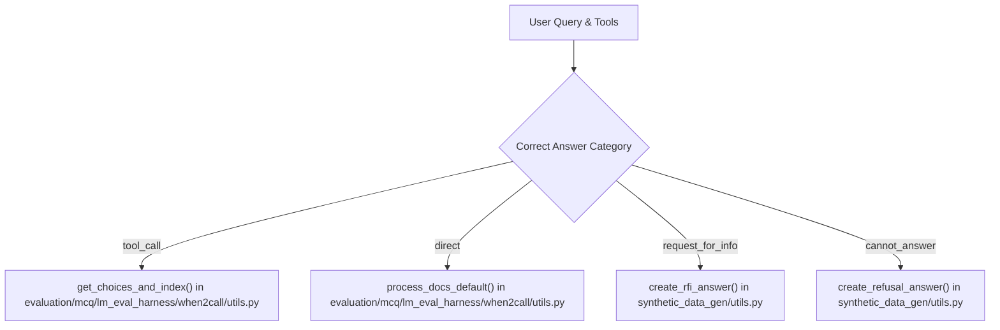
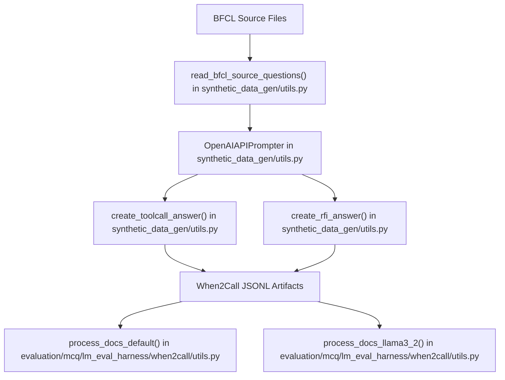

<!-- source: DeepWiki mcp.deepwiki.com · repo NVIDIA/When2Call · page 6 Glossary · fetched 2026-11-09 -->

# Glossary

Relevant source files

The following files were used as context for generating this wiki page:

- [README.md](README.md)
- [evaluation/mcq/lm_eval_harness/when2call/utils.py](evaluation/mcq/lm_eval_harness/when2call/utils.py)
- [synthetic_data_gen/utils.py](synthetic_data_gen/utils.py)

## Purpose and Scope
This glossary defines key terms, data artifacts, evaluation methodologies, and architectural concepts specific to the **When2Call** benchmark and codebase (`https://github.com/NVIDIA/When2Call`). Each entry links directly to relevant implementation files and data schemas to provide precise code-level context.

---

## 1. Benchmark Categories and Decision Types

When2Call evaluates four distinct decision-making categories for language models when presented with user queries and tool definitions:

*   **`tool_call`**: The user query can be directly and fully answered by invoking one of the provided tools with correct arguments [README.md:22].
*   **`direct`**: The user query can be answered directly through parametric knowledge without invoking any tools [README.md:22].
*   **`request_for_info`**: The user query intends to use a tool, but essential parameters are missing. The model must ask a clarifying follow-up question [README.md:22, README.md:27].
*   **`cannot_answer`**: The user query cannot be answered because the required tools are unavailable, or the request falls outside the system's capabilities [README.md:22].
*   **Tool Hallucination**: An error state where a model incorrectly generates a tool invocation when no tool is appropriate, calls a non-existent tool, or hallucinates parameter names not defined in the schema.

### Diagram: Natural Language Decision Space to Code Handlers

Sources: `README.md:22-47`, `evaluation/mcq/lm_eval_harness/when2call/utils.py:30-67`, `synthetic_data_gen/utils.py:64-107`

---

## 2. Datasets and Data Formats

*   **BFCL (Berkeley Function Calling Leaderboard)**: An external benchmark suite providing source questions and tool definitions ingested during evaluation data generation [README.md:18, synthetic_data_gen/utils.py:128-146].
*   **xlam (xLAM)**: A large-scale tool-calling dataset and model family used as a primary source for raw training data creation [synthetic_data_gen/utils.py].
*   **`when2call_test_mcq.jsonl`**: The primary test split formatted for Multiple-Choice Question evaluation, storing four candidate answers (`answers`) and the ground truth index (`correct_answer`) [README.md:14-48].
*   **`when2call_test_llm_judge.jsonl`**: A subset of the MCQ test set used for open-ended generation evaluated via the LLM-as-a-Judge pipeline [README.md:50].
*   **`when2call_train_sft.jsonl`**: Supervised Fine-Tuning dataset containing tool lists and single-turn conversation messages with ground truth assistant responses [README.md:56-75].
*   **`when2call_train_pref.jsonl`**: Preference optimization dataset (RPO/DPO) containing user questions, a `chosen_response`, and a `rejected_response` sampled from incorrect categories [README.md:80-105].

Sources: `README.md:10-106`, `synthetic_data_gen/utils.py:128-185`

---

## 3. Tags and Syntactic Markers

*   **`TOOLCALL` Tags (`<TOOLCALL> ... </TOOLCALL>`)**: Special XML-like tags used in training data artifacts to enclose structured tool call JSON objects before model-specific prompt template adaptation [README.md:108].
*   **`<tool></tool>` Tags**: Used in default prompts to encapsulate tool definitions provided to the model in `evaluation/mcq/lm_eval_harness/when2call/utils.py` [evaluation/mcq/lm_eval_harness/when2call/utils.py:20-51].

Sources: `README.md:108`, `evaluation/mcq/lm_eval_harness/when2call/utils.py:20-51`

---

## 4. Evaluation Methodologies and Harnesses

*   **MCQ (Multiple Choice Question) Evaluation**: An evaluation mode that treats When2Call as a multiple-choice task, scoring models based on perplexity or generation accuracy across the four candidate responses [README.md:5, evaluation/mcq/lm_eval_harness/when2call/utils.py:30-44].
*   **`acc-norm` (Normalized Accuracy)**: A standard metric provided by `lm-evaluation-harness` that computes length-normalized token log-likelihood across multiple-choice options.
*   **LLM-as-a-Judge**: A three-stage evaluation pipeline consisting of model inference (`run_openai_inference.py`), LLM-based judging (`run_openai_judge.py`), and result aggregation (`aggregate_llm_as_a_judge_results.py`).
*   **`lm_eval` task**: Integration of When2Call into EleutherAI's `lm-evaluation-harness` via YAML task configurations and document processing helpers [evaluation/mcq/lm_eval_harness/when2call/utils.py].

### Diagram: Synthetic Generation Pipeline to Evaluator Code Entities

Sources: `evaluation/mcq/lm_eval_harness/when2call/utils.py:30-106`, `synthetic_data_gen/utils.py:29-107`

---

## 5. Summary Table of Key Code Symbols

| Term / Concept | Code Symbol / Class | File Pointer |
| :--- | :--- | :--- |
| **OpenAI Prompter** | `OpenAIAPIPrompter` | `synthetic_data_gen/utils.py:29` |
| **Choice Extractor** | `get_choices_and_index()` | `evaluation/mcq/lm_eval_harness/when2call/utils.py:30` |
| **Default Doc Processor** | `process_docs_default()` | `evaluation/mcq/lm_eval_harness/when2call/utils.py:54` |
| **Llama 3.2 Doc Processor** | `process_docs_llama3_2()` | `evaluation/mcq/lm_eval_harness/when2call/utils.py:70` |
| **Qwen 2.5 Doc Processor** | `process_docs_qwen2_5()` | `evaluation/mcq/lm_eval_harness/when2call/utils.py:108` |
| **Nemotron Doc Processor** | `process_docs_nemotron()` | `evaluation/mcq/lm_eval_harness/when2call/utils.py:146` |
| **Tool Call Answer Builder** | `create_toolcall_answer()` | `synthetic_data_gen/utils.py:64` |
| **RFI Question Rewriter** | `rewrite_question_to_exclude_param()` | `synthetic_data_gen/utils.py:109` |

Sources: `evaluation/mcq/lm_eval_harness/when2call/utils.py:1-175`, `synthetic_data_gen/utils.py:1-185`