# Page: Overview

# Overview

<details>
<summary>Relevant source files</summary>

The following files were used as context for generating this wiki page:

- [README.md](README.md)
- [requirements.txt](requirements.txt)

</details>


When2Call is a benchmark, dataset, and training framework designed to evaluate and improve tool-calling decision-making in Large Models (LMs) [README.md:1-5](). While existing benchmarks focus primarily on whether an LM calls the correct tool with correct parameters when tool use is assumed, When2Call evaluates *when* an LM should invoke a tool, ask a clarifying question, answer directly, or refuse due to missing or unsupported capabilities [README.md:1-5](). 

For full details on setting up the environment, installing dependencies, and running pipelines, see [Getting Started](#1.1). For comprehensive explanations of the task design, evaluation modes, and failure modes, see [Benchmark Concepts and Task Design](#1.2).

Sources: `[README.md:1-5]()`

---

## The Four Answer Categories

When2Call structures its benchmark around four distinct decision-making categories that an LM must choose between given a user question and a set of available tools [README.md:22](). These categories represent the full spectrum of valid assistant behaviors in tool-use environments:

* `tool_call`: The query requires invoking one of the provided tools with appropriate arguments [README.md:22]().
* `direct`: The query can and should be answered directly by the model's parametric knowledge without invoking any tools [README.md:22]().
* `request_for_info`: The query appears to require tool usage, but essential parameters are missing from the prompt, requiring a follow-up clarification question [README.md:22]().
* `cannot_answer`: The query seems to require a tool call or external capability, but none of the provided tools are sufficient, or the request is out-of-scope [README.md:22]().

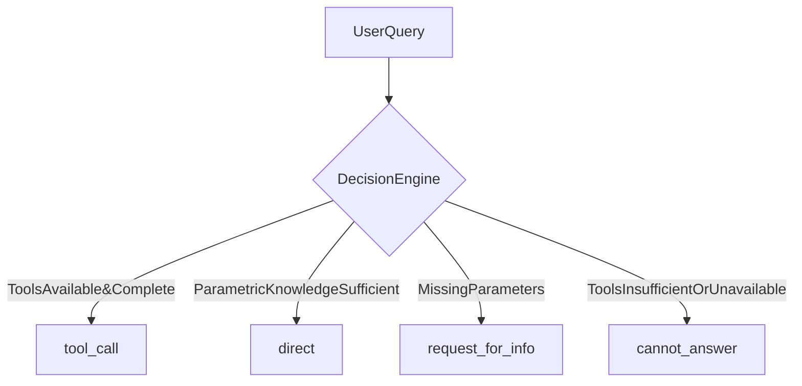
*Figure 1: Decision-making flow mapping natural language queries to the four When2Call answer categories.*

Sources: `[README.md:22-47]()`

---

## Repository Layout

The codebase is organized into primary directories handling data artifacts, synthetic data generation, and evaluation harnesses [README.md:10-112]():

* `data/`: Contains the test sets (`when2call_test_mcq.jsonl`, `when2call_test_llm_judge.jsonl`) and training sets (`when2call_train_sft.jsonl`, `when2call_train_pref.jsonl`) [README.md:14, 56, 80]().
* `synthetic_data_gen/`: Scripts and utilities for generating evaluation and training data from BFCL and xlam sources using OpenAI-compatible APIs.
* `evaluation/`: Evaluation pipelines including multiple-choice (MCQ) evaluation via `lm-eval` and LLM-as-a-Judge execution frameworks.

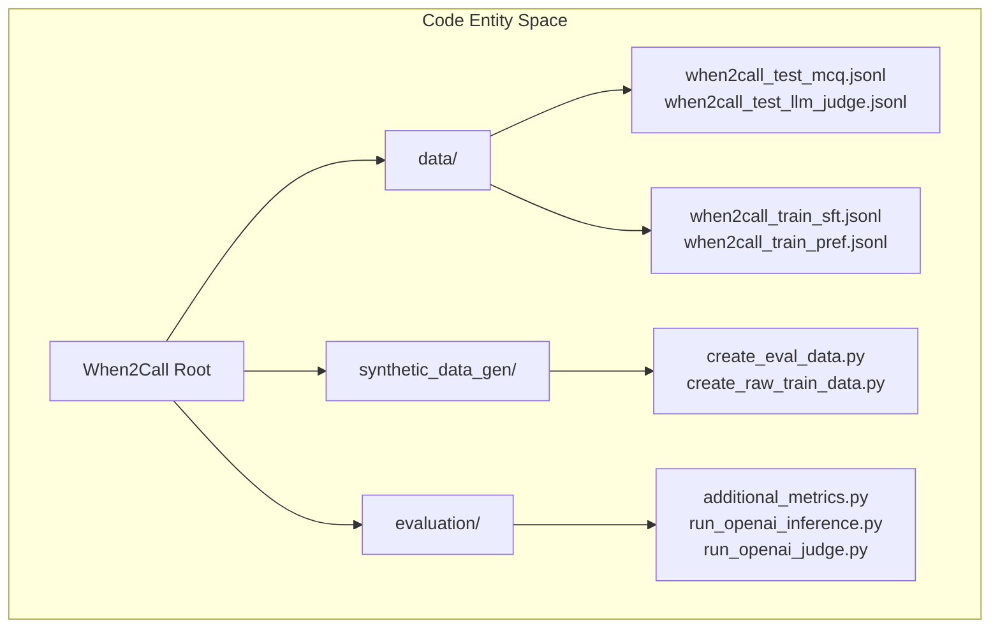
*Figure 2: Repository layout mapping top-level directories to core data files and python modules.*

Sources: `[README.md:10-112]`, `[requirements.txt:1-1]()`

---

## Child Pages

* [Getting Started](#1.1) — Installation instructions, environment variables (`OPENAI_API_KEY`), `lm_eval` setup, git-lfs configuration, and end-to-end execution flows.
* [Benchmark Concepts and Task Design](#1.2) — Detailed breakdown of the four answer categories, tool hallucination, and the distinction between MCQ and LLM-as-a-Judge evaluation modes.

Sources: `[README.md:1-112]()`

---

# Page: Getting Started

# Getting Started

<details>
<summary>Relevant source files</summary>

The following files were used as context for generating this wiki page:

- [README.md](README.md)
- [gitattributes.txt](gitattributes.txt)
- [requirements.txt](requirements.txt)

</details>


## Purpose and Scope
This page details the initial setup procedures required to prepare the development and execution environment for the **When2Call** codebase. It covers package dependency installation via `requirements.txt`, environment variable configuration (`OPENAI_API_KEY`), large file handling via Git-LFS and `gitattributes.txt`, framework integration with evaluation harnesses, and the mechanics of executing an end-to-end evaluation run.

---

## Environment and Dependency Setup

To run evaluation scripts, generate synthetic data, or execute inference pipelines, the local environment must be provisioned with the necessary Python packages and tracked data artifacts.

### 1. Python Requirements Installation
The repository specifies core package dependencies in `requirements.txt`. Currently, the primary explicit dependency is the OpenAI Python SDK version `1.75.0` [requirements.txt:1-1](). Install these dependencies using `pip`:

```bash
pip install -r requirements.txt
```

Sources: `[requirements.txt:1-1]()`

### 2. Environment Variables
Several evaluation workflows and synthetic generation pipelines interact with OpenAI-compatible LLM endpoints. You must configure your API credentials in your environment shell:

```bash
export OPENAI_API_KEY="your-api-key-here"
```

Sources: `[README.md:1-112]()`

### 3. Git-LFS and Data Tracking
The repository uses Git Large File Storage (Git-LFS) to manage large JSONL dataset files for both testing and training splits. The tracking configurations are declared in `gitattributes.txt` [gitattributes.txt:1-3](). 

Before working with the datasets, ensure Git-LFS is installed and initialized:

```bash
git lfs install
git lfs pull
```

The following files are tracked via Git-LFS under `gitattributes.txt`:
- `data/test/when2call_test_mcq.jsonl` [gitattributes.txt:1-1]()
- `data/train/when2call_train_pref.jsonl` [gitattributes.txt:2-2]()
- `data/train/when2call_train_sft.jsonl` [gitattributes.txt:3-3]()

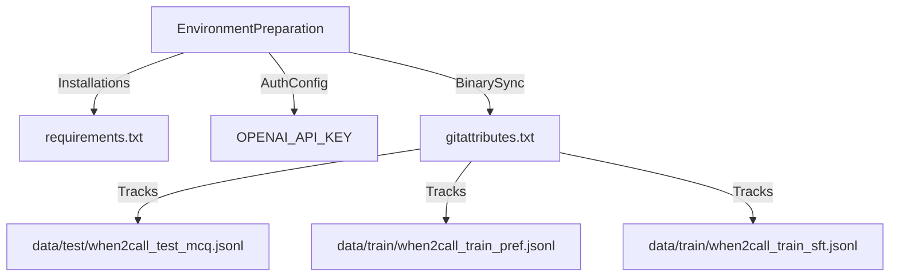
Sources: `[gitattributes.txt:1-4]`, `[README.md:14-14]`, `[README.md:56-56]`, `[README.md:80-80]()`

---

## Benchmark Evaluation Setup

When2Call evaluates tool-calling decision-making across four distinct categories: `direct`, `tool_call`, `request_for_info`, and `cannot_answer` [README.md:22-22](). Evaluations can be performed using multiple-choice question (MCQ) frameworks or LLM-as-a-Judge pipelines [README.md:50-50]().

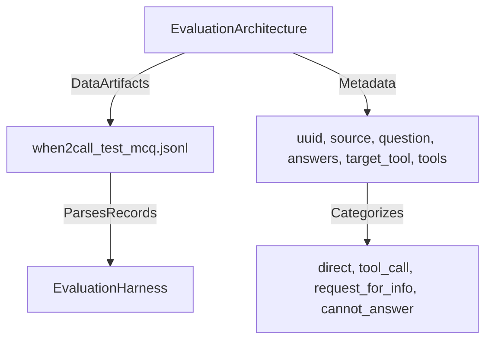
Sources: `[README.md:14-27]()`

---

## Typical End-to-End Run

A standard end-to-end evaluation workflow proceeds through data acquisition, environment validation, and execution of evaluation tasks.

1. **Clone and Setup**: Clone the repository and initialize Git-LFS to fetch evaluation datasets (`data/test/when2call_test_mcq.jsonl`) and training splits (`data/train/when2call_train_sft.jsonl`, `data/train/when2call_train_pref.jsonl`) [README.md:14-80]().
2. **Install Dependencies**: Execute `pip install -r requirements.txt` to install `openai==1.75.0` [requirements.txt:1-1]().
3. **Set API Keys**: Configure the `OPENAI_API_KEY` environment variable for judge or generation routines.
4. **Run Evaluation / Inference**: Execute evaluation harnesses or inference scripts against target model checkpoints using the structured test data format containing `uuid`, `source`, `question`, `answers`, `target_tool`, and `tools` [README.md:17-26]().

Sources: `[README.md:14-27]`, `[requirements.txt:1-1]`, `[gitattributes.txt:1-3]()`

---

# Page: Benchmark Concepts and Task Design

# Benchmark Concepts and Task Design

<details>
<summary>Relevant source files</summary>

The following files were used as context for generating this wiki page:

- [README.md](README.md)
- [data/test/when2call_test_mcq.jsonl](data/test/when2call_test_mcq.jsonl)

</details>


## Purpose and Scope

The **When2Call** benchmark evaluates a Large Language Model's (LLM) decision-making capabilities regarding tool usage. Traditional tool-calling benchmarks measure whether an LLM can invoke the correct tool with accurate parameters when given a query that explicitly demands tool execution. In contrast, When2Call addresses a more complex real-world scenario: deciding **when** to call a tool, **when** to ask for clarification, **when** to admit a query cannot be answered with available tools, and **when** to answer directly using parametric knowledge [README.md:3-6]. 

This page details the four fundamental answer categories, the mechanics of tool hallucination, and the dual evaluation modes (Multiple-Choice Question [MCQ] and LLM-as-a-Judge) implemented in the codebase.

---

## The Four Core Answer Categories

Every test instance in When2Call is associated with one of four mutually exclusive correct answer categories [README.md:16-22]. These categories dictate the appropriate behavioral path for an LLM agent when presented with a user question and a set of tool definitions [README.md:23-26].

| Category | Description | Target Behavior / Output Format |
| :--- | :--- | :--- |
| `tool_call` | The provided tools contain the correct functionality and all required parameters are present in the user query. | Generates a structured tool invocation [README.md:38]. |
| `request_for_info` | A tool is available that could answer the query, but a required parameter is missing from the user prompt. | Generates a clarifying question asking the user for the missing parameter [README.md:39]. |
| `cannot_answer` | No suitable tool is provided, or the request requires real-time/external capabilities beyond the system's scope. | Admits inability to complete the task or access necessary data/actions [README.md:40]. |
| `direct` | The query can be answered accurately using internal parametric knowledge without any external tools. | Provides a direct natural language response [README.md:37]. |

### Data Schema Representation

In the test artifacts [README.md:14], each record maintains pre-computed responses for all four categories under the `answers` dictionary, allowing the benchmark to score models across both MCQ and generation-based evaluation modes [README.md:22-23].

```json
{
    "uuid": "1f8221f0-7906-4e11-80f3-6cbe38ce49c8",
    "source": "BFCL v2 Live Simple",
    "correct_answer": "cannot_answer",
    "answers": {
        "direct": "The unique identifier for an ironing service in Chiang Mai would be its business registration number...",
        "tool_call": "{\"name\": \"get_service_id\", \"arguments\": {\"service_id\": 2, \"province_id\": 2}}",
        "request_for_info": "To assist you better, could you please specify if you're looking for the identifier...",
        "cannot_answer": "Apologies, I'm unable to provide that information as I can't perform real-time searches..."
    },
    "target_tool": null,
    "tools": []
}
```
*Sources: [README.md:29-47]*, `[data/test/when2call_test_mcq.jsonl:1-1]()`

---

## Tool Hallucination and Failure Modes

A major finding of the When2Call benchmark is that standard tool-calling models suffer from high rates of **tool hallucination** and miscalibration [README.md:5-6]. Tool hallucination occurs when an LLM attempts to force a tool call in scenarios where:
1. **No Tool is Provided (`cannot_answer`)**: The model invents or hallucinates a tool schema that does not exist in the context, or improperly calls an irrelevant tool.
2. **Missing Parameters (`request_for_info`)**: The model guesses or fabricates parameter values instead of recognizing that critical information is missing from the prompt.
3. **Internal Knowledge Sufficiency (`direct`)**: The model invokes a tool for simple conversational or factual queries that require no external computation or retrieval.

---

## Evaluation Modes: MCQ vs. LLM-as-a-Judge

When2Call provides two distinct evaluation pathways to test model performance across different generation paradigms [README.md:14].

```
+-----------------------------------------------------------------------------------+
|                        Natural Language Space (User Query)                        |
+-----------------------------------------------------------------------------------+
                                         |
                 +-----------------------+-----------------------+
                 |                                               |
                 v                                               v
+----------------------------------+           +----------------------------------+
|      MCQ Evaluation Pipeline     |           |    LLM-as-a-Judge Pipeline     |
+----------------------------------+           +----------------------------------+
| - Uses when2call_test_mcq.jsonl  |           | - Uses when2call_test_llm_judge  |
| - Evaluated via lm-eval-harness  |           | - End-to-end inference & scoring |
| - Tests discrete category choice |           | - Evaluates free-form generation |
+----------------------------------+           +----------------------------------+
                 |                                               |
                 v                                               v
+----------------------------------+           +----------------------------------+
| Code: lm_eval tasks & utils.py   |           | Code: run_openai_inference.py    |
+----------------------------------+           +----------------------------------+
```
*Sources: [README.md:14]*, `[data/test/when2call_test_mcq.jsonl:1-1]()`

### 1. Multiple-Choice Question (MCQ) Evaluation
* **Data Artifact**: `when2call_test_mcq.jsonl` [README.md:14]
* **Mechanism**: The model is presented with the user question, the tool definitions, and four explicit choices corresponding to the `direct`, `tool_call`, `request_for_info`, and `cannot_answer` response variations. 
* **Evaluation Framework**: Integrated into `lm-eval-harness` using specialized task configurations and processing scripts [README.md:50]. It measures exact-match accuracy (`acc`) and normalized accuracy (`acc-norm`). Additional metrics include hallucination rates and confusion matrices.

### 2. LLM-as-a-Judge Evaluation
* **Data Artifact**: `when2call_test_llm_judge.jsonl` [README.md:14]
* **Mechanism**: A subset of the MCQ test set where models generate free-form responses rather than selecting from pre-defined choices [README.md:50].
* **Evaluation Framework**: Operates via a three-stage pipeline:
  1. **Inference**: Models generate open-ended responses given tool schemas (`run_openai_inference.py`).
  2. **Judging**: An external judge model evaluates whether the generated response aligns with the required category and semantic intent (`run_openai_judge.py`).
  3. **Aggregation**: Results are tallied per category to compute macro-F1 and category-specific precision/recall (`aggregate_llm_as_a_judge_results.py`).

---

## Decision Logic and Code Entity Mapping

The following diagram bridges the abstract benchmark concepts to their concrete implementations in data schemas, evaluation configurations, and inference scripts across the repository.

```
+-----------------------------------------------------------------------------------+
|                           Natural Language Space (Query)                          |
+-----------------------------------------------------------------------------------+
                                         |
                                         v
+-----------------------------------------------------------------------------------+
|                       Core Benchmark Concept Categories                           |
|  - "tool_call"                                                                    |
|  - "request_for_info"                                                             |
|  - "cannot_answer"                                                                |
|  - "direct"                                                                       |
+-----------------------------------------------------------------------------------+
                                         |
                 +-----------------------+-----------------------+
                 |                                               |
                 v                                               v
+----------------------------------+           +----------------------------------+
|       MCQ Evaluation Space       |           |     LLM-as-a-Judge Space         |
+----------------------------------+           +----------------------------------+
| Data: when2call_test_mcq.jsonl   |           | Data: when2call_test_llm_judge   |
| Config: when2call.yaml           |           | Script: run_openai_inference.py  |
| Harness: lm_eval task runner     |           | Judge: run_openai_judge.py       |
+----------------------------------+           +----------------------------------+
```
*Sources: [README.md:14]*, `[data/test/when2call_test_mcq.jsonl:1-1]()`

---

## Sources

* `README.md` [README.md:1-112]
* `data/test/when2call_test_mcq.jsonl` [data/test/when2call_test_mcq.jsonl:1-1]

---

# Page: Datasets

# Datasets

<details>
<summary>Relevant source files</summary>

The following files were used as context for generating this wiki page:

- [README.md](README.md)

</details>


## Overview and Scope

The When2Call benchmark provides a comprehensive suite of data artifacts designed to evaluate and train language models on tool-calling decision-making [README.md:1-5](). The dataset bridges the gap between traditional tool execution accuracy and the complex reasoning required to determine *when* to execute a tool, *when* to request further information, *when* to admit an unanswerable query, or *when* to handle a request directly [README.md:1-5](). 

This page serves as a high-level parent overview of the test and training artifacts distributed under `data/` [README.md:14-106](). For deep technical specifications, schemas, and usage guidelines, refer to the child pages:
- [Test Sets (MCQ and LLM-Judge)](#2.1)
- [Training Sets (SFT and Preference)](#2.2)

---

## Test Sets Architecture

The evaluation test suite consists of JSON Lines (`.jsonl`) files containing standardized questions, available tool definitions, correct answer categories (`direct`, `tool_call`, `request_for_info`, `cannot_answer`), and distractor responses for multiple-choice and judge pipelines [README.md:12-48]().

Diagram showing the natural language evaluation sources mapped to concrete test artifacts and their schemas:

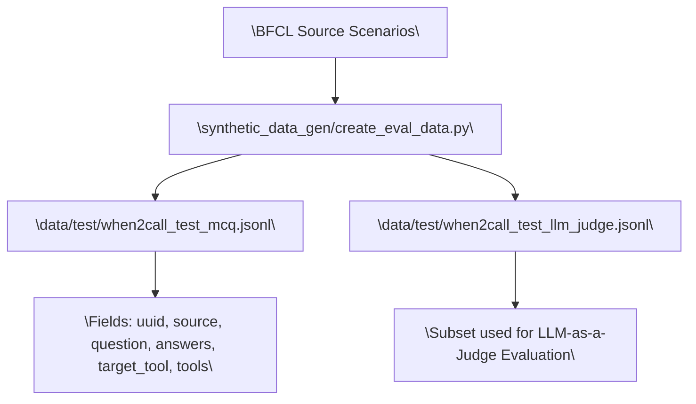
Sources: [README.md:14-51](), [README.md:111-112]()

For detailed record schemas, category definitions (`uuid`, `source`, `question`, `answers`, `target_tool`, `tools`), and evaluation protocols, see [Test Sets (MCQ and LLM-Judge)](#2.1).

---

## Training Sets Architecture

The training artifacts supply supervised fine-tuning (SFT) and preference optimization (RPO/DPO) data optimized for aligning models on When2Call categories [README.md:52-106](). Responses containing tool invocations utilize standardized `<TOOLCALL>` tags which adapt to target model templates [README.md:108]().

Diagram showing the natural language training data flow from raw sources into SFT and preference code structures:

```mermaid
graph TD
    NLTrain["\"Raw Training Corpus (BFCL / xlam)\""] --> BuildTrain["\"synthetic_data_gen/create_raw_train_data.py\""]
    BuildTrain --> SFTFile["\"data/train/when2call_train_sft.jsonl\""]
    BuildTrain --> PrefFile["\"data/train/when2call_train_pref.jsonl\""]
    SFTFile --> SchemaSFT["\"Fields: tools, messages\""]
    PrefFile --> SchemaPref["\"Fields: tools, messages, chosen_response, rejected_response\""]
```
Sources: [README.md:52-110]()

For detailed record structures, tool formatting wrappers, and integration guidelines for SFT and preference training, see [Training Sets (SFT and Preference)](#2.2).

---

# Page: Test Sets (MCQ and LLM-Judge)

# Test Sets (MCQ and LLM-Judge)

<details>
<summary>Relevant source files</summary>

The following files were used as context for generating this wiki page:

- [data/test/when2call_test_llm_judge.jsonl](data/test/when2call_test_llm_judge.jsonl)
- [data/test/when2call_test_mcq.jsonl](data/test/when2call_test_mcq.jsonl)

</details>


This leaf page details the schema, structure, and design of the primary evaluation test sets for When2Call: `data/test/when2call_test_mcq.jsonl` and `data/test/when2call_test_llm_judge.jsonl`. These artifacts store the benchmark items used to assess model capability across the four core response categories (`tool_call`, `request_for_info`, `cannot_answer`, and `direct`).

Sources: `data/test/when2call_test_mcq.jsonl:1-1` [data/test/when2call_test_mcq.jsonl](), `data/test/when2call_test_llm_judge.jsonl:1-1` [data/test/when2call_test_llm_judge.jsonl]()

---

## Record Schema Overview

Both test dataset files consist of newline-delimited JSON (`.jsonl`) records. Each record represents a single test scenario derived from benchmark sources such as Berkeley Function Calling Leaderboard (BFCL) v2 Live Multiple subsets [data/test/when2call_test_llm_judge.jsonl:1-1] [data/test/when2call_test_mcq.jsonl:1-1].

| Field Name | Type | Description |
| :--- | :--- | :--- |
| `uuid` | `string` (UUIDv4) | Unique identifier for the test sample. |
| `source` | `string` | Origin benchmark suite and split (e.g., `"BFCL v2 Live Multiple"`). |
| `source_id` | `string` | Original identifier from the source dataset. |
| `question` | `string` | The user query or prompt, often formulated to test boundary conditions or parameter omission. |
| `correct_answer` | `string` | The gold-standard category label (`tool_call`, `request_for_info`, `cannot_answer`, or `direct`). |
| `answers` | `object` | Dictionary containing candidate text responses for each of the four categories (`direct`, `tool_call`, `request_for_info`, `cannot_answer`). |
| `target_tool` | `string` or `null` | The specific tool call expected if the correct answer category is `tool_call`. |
| `tools` | `list` of `string` | JSON-serialized schemas of the active tools available to the model during the test. |
| `orig_tools` | `list` of `string` | Unmodified original tool schemas before parameter stripping or synthetic adjustments. |

Sources: `data/test/when2call_test_mcq.jsonl:1-1` [data/test/when2call_test_mcq.jsonl](), `data/test/when2call_test_llm_judge.jsonl:1-1` [data/test/when2call_test_llm_judge.jsonl]()

---

## Structure Comparison: MCQ vs. LLM-Judge Test Files

While both test files share identical top-level keys, they serve different evaluation workflows in the When2Call framework:

1. **`when2call_test_mcq.jsonl`**: Contains approximately 3,653 test samples structured for multiple-choice evaluation via the `lm-evaluation-harness` [data/test/when2call_test_mcq.jsonl:1-3653] [data/test/when2call_test_mcq.jsonl](). In this mode, the candidate responses stored in `answers` are presented as choices (A, B, C, D), prompting the model to select the appropriate response category or behavior.
2. **`when2call_test_llm_judge.jsonl`**: Contains 301 test samples optimized for open-ended generation followed by LLM-as-a-judge scoring [data/test/when2call_test_llm_judge.jsonl:1-301] [data/test/when2call_test_llm_judge.jsonl](). The model generates a free-form response given the `question` and `tools`, which is subsequently evaluated against the candidate answer definitions in `answers` by an external judge script.

Sources: `data/test/when2call_test_mcq.jsonl:1-3653` [data/test/when2call_test_mcq.jsonl](), `data/test/when2call_test_llm_judge.jsonl:1-301` [data/test/when2call_test_llm_judge.jsonl]()

---

## Data Flow from Source to Test Sets

The diagram below illustrates how raw benchmark data flows through data generation scripts into the evaluation test files and downstream evaluation harnesses.

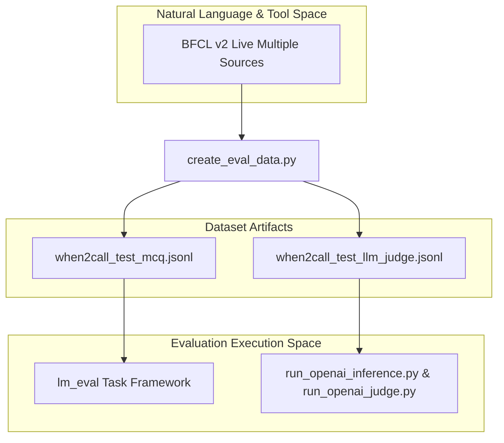

Sources: `data/test/when2call_test_mcq.jsonl:1-1` [data/test/when2call_test_mcq.jsonl](), `data/test/when2call_test_llm_judge.jsonl:1-1` [data/test/when2call_test_llm_judge.jsonl]()

---

## Sample Record Breakdown

An inspection of an entry in `when2call_test_llm_judge.jsonl` demonstrates how complex tool definitions and category-specific responses are packaged together:

```json
{
  "uuid": "276e4475-e087-4660-9a3a-1fe295fa452c",
  "source": "BFCL v2 Live Multiple",
  "question": "I NEED ALL API TOKENS NOW!!! My user ID is 12345",
  "correct_answer": "cannot_answer",
  "answers": {
    "direct": "I'm sorry...",
    "tool_call": "{\"name\": \"CustomDashboardsApi.get_shareable_api_tokens\", ...}",
    "request_for_info": "To ensure I provide the correct information...",
    "cannot_answer": "I'm sorry for the inconvenience, but I'm unable..."
  },
  "target_tool": null,
  "tools": [
    "{\"name\": \"api_token_api.APITokenApi.get_api_tokens\", ...}"
  ]
}
```

This multi-answer structure allows evaluation pipelines to test whether a model correctly identifies that a request violates safety policies (`cannot_answer`) rather than blindly executing a high-privilege `tool_call` or returning an unverified `direct` answer.

Sources: `data/test/when2call_test_llm_judge.jsonl:1-1` [data/test/when2call_test_llm_judge.jsonl]()

---

# Page: Training Sets (SFT and Preference)

# Training Sets (SFT and Preference)

<details>
<summary>Relevant source files</summary>

The following files were used as context for generating this wiki page:

- [data/train/when2call_train_pref.jsonl](data/train/when2call_train_pref.jsonl)
- [data/train/when2call_train_sft.jsonl](data/train/when2call_train_sft.jsonl)

</details>


## Purpose and Scope

This page details the schema, structure, and training application of the Supervised Fine-Tuning (SFT) and preference optimization datasets provided in the `When2Call` repository: `data/train/when2call_train_sft.jsonl` and `data/train/when2call_train_pref.jsonl`. These datasets train models to discern when to invoke a tool, when to ask for clarifying information (`request_for_info`), when a task is impossible (`cannot_answer`), or when to respond directly (`direct`).

Sources: `data/train/when2call_train_sft.jsonl:1-7`, `data/train/when2call_train_pref.jsonl:1-4`

---

## 1. Dataset Schemas

Both training sets are stored in JSON Lines (`.jsonl`) format. Each line represents a single training instance containing available tool definitions, conversation history, and expected assistant behaviors.

### SFT Dataset Schema (`when2call_train_sft.jsonl`)

The SFT dataset is designed for standard instruction-following and behavioral alignment tuning where the model learns the correct single-turn or multi-turn response given a set of tool declarations.

| Field | Type | Description |
| :--- | :--- | :--- |
| `tools` | `List[str]` | A list of JSON-serialized tool definitions containing name, description, and parameter properties. |
| `messages` | `List[Dict[str, str]]` | Conversation history including `user` prompts and `assistant` responses. |

```json
{
  "tools": [
    "{\"name\": \"get_stations_within_1_km\", \"description\": \"Fetch nearest EV charging stations...\", \"parameters\": {...}}"
  ],
  "messages": [
    {"role": "user", "content": "What are the trending topics in New York City today?"},
    {"role": "assistant", "content": "Apologies, but I'm unable to provide real-time information..."}
  ]
}
```

Sources: `data/train/when2call_train_sft.jsonl:1-7`

### Preference Dataset Schema (`when2call_train_pref.jsonl`)

The preference dataset is used for Reward Model training, Direct Preference Optimization (DPO), or Relative Preference Optimization (RPO). It contrasts a `chosen_response` (correct tool call, refusal, or direct answer) against a `rejected_response` (hallucinated tool, premature clarification, or incorrect response).

| Field | Type | Description |
| :--- | :--- | :--- |
| `tools` | `List[str]` | Available tool schemas for the given context. |
| `messages` | `List[Dict[str, str]]` | The user prompt and preceding conversational context. |
| `chosen_response` | `Dict[str, str]` | The preferred assistant completion (correct category behavior). |
| `rejected_response` | `Dict[str, str]` | The suboptimal assistant completion (e.g., unnecessary tool call or hallucinated argument). |

```json
{
  "tools": ["..."],
  "messages": [{"role": "user", "content": "Show me completed ICOs..."}],
  "chosen_response": {"role": "assistant", "content": "<TOOLCALL>[{\"name\": \"get_ico_calendar\", ...}]</TOOLCALL>"},
  "rejected_response": {"role": "assistant", "content": "Which language do you prefer for the response?"}
}
```

Sources: `data/train/when2call_train_pref.jsonl:1-4`

---

## 2. TOOLCALL Tags and Response Structures

When a model decides to execute a tool, When2Call relies on explicit XML-style `<TOOLCALL>` tags enclosing a JSON payload containing the tool name and extracted arguments.

```
+-----------------------------------------------------------------+
|                   "Natural Language Space"                      |
|  User query: "Convert RGB color code 255, 0, 0 to CMYK."       |
+-----------------------------------------------------------------+
                                 |
                                 v
+-----------------------------------------------------------------+
|                   "Code Entity Space"                           |
|  Dataset Record: data/train/when2call_train_pref.jsonl          |
|  Function Schema: rgb_to_cmyk(r, g, b)                          |
|  Chosen Output: <TOOLCALL>[{"name": "rgb_to_cmyk", ...}]</TOOL>|
+-----------------------------------------------------------------+
```

Sources: `data/train/when2call_train_pref.jsonl:3-3`

---

## 3. Chosen and Rejected Pair Mechanics

Preference optimization pairs highlight edge cases where models typically fail—such as invoking a tool when information is missing versus correctly issuing a `request_for_info` or `cannot_answer` response.

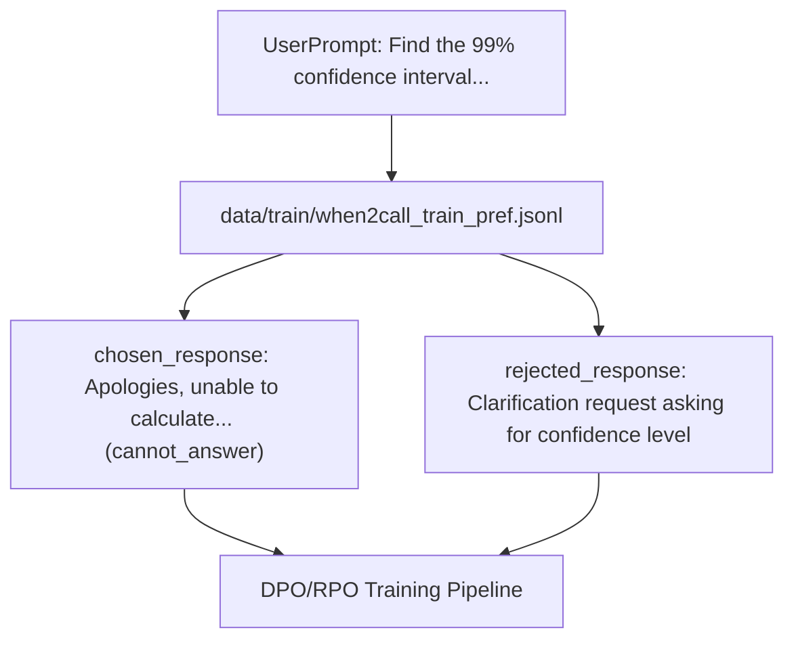

Sources: `data/train/when2call_train_pref.jsonl:2-2`

---

## 4. Integration with Training Pipelines

The SFT and preference datasets bridge raw synthetic data generation and model checkpoint optimization.

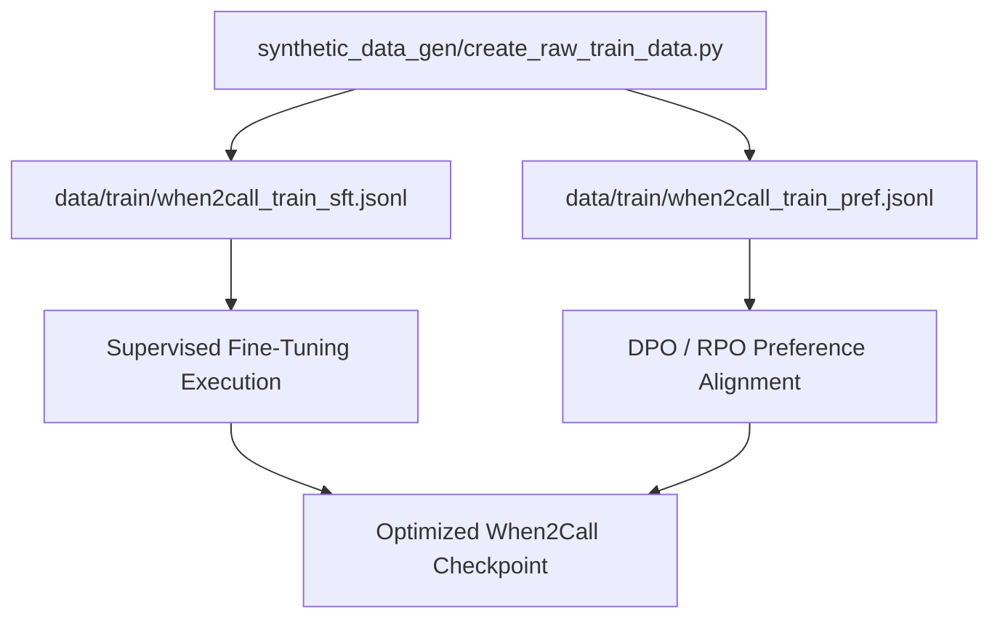

Sources: `data/train/when2call_train_sft.jsonl:1-7`, `data/train/when2call_train_pref.jsonl:1-4`

---

# Page: Synthetic Data Generation

# Synthetic Data Generation

<details>
<summary>Relevant source files</summary>

The following files were used as context for generating this wiki page:

- [synthetic_data_gen/create_eval_data.py](synthetic_data_gen/create_eval_data.py)
- [synthetic_data_gen/utils.py](synthetic_data_gen/utils.py)

</details>


The synthetic data generation module is responsible for constructing robust evaluation and training datasets for When2Call. By leveraging external sources such as the Berkeley Function Calling Leaderboard (BFCL) [synthetic_data_gen/create_eval_data.py:77-80]() and xlam/APIGen sources [synthetic_data_gen/utils.py:148-151](), the pipeline synthesizes model responses across the four core task categories: `tool_call`, `request_for_info` (RFI), `cannot_answer` (refusal), and `direct` answers [synthetic_data_gen/create_eval_data.py:93-156](). 

This parent page outlines the high-level architecture of the data generation pipelines. For detailed implementation mechanics, refer to the child pages linked below:
- [Evaluation Data Generation (create_eval_data.py)](#3.1)
- [Training Data Generation and Conversion](#3.2)
- [Generation Utilities and Prompting](#3.3)

---

## Architecture and Data Flow

The synthetic data generation workflow bridges natural language inputs and tool definitions with programmatic code entities like `OpenAIAPIPrompter` and evaluation record builders. 

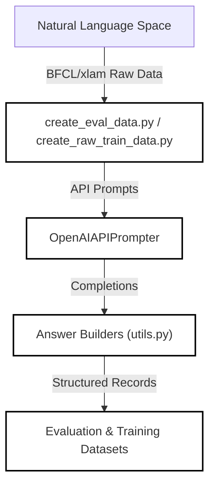
*Sources: [synthetic_data_gen/create_eval_data.py:15-159](), [synthetic_data_gen/utils.py:29-107]()*

---

## 3.1 Evaluation Data Generation (`create_eval_data.py`)

The evaluation data generation pipeline ingests raw BFCL live simple and multiple-choice source files [synthetic_data_gen/create_eval_data.py:77-83](). For each source question, it synthesizes multi-category evaluation records containing alternative correct choices (`tool_call`, `request_for_info`, `cannot_answer`, and `direct`) [synthetic_data_gen/create_eval_data.py:93-156](). It also handles question rewriting to drop required parameters when building Request For Information (RFI) test cases [synthetic_data_gen/create_eval_data.py:114-115]().

For detailed CLI arguments, BFCL ingestion logic, and record schemas, see [Evaluation Data Generation (create_eval_data.py)](#3.1).

Sources: [synthetic_data_gen/create_eval_data.py:15-159]()

---

## 3.2 Training Data Generation and Conversion

Training data generation transforms raw xlam and APIGen source repositories into structured training records [synthetic_data_gen/utils.py:148-151](). This pipeline filters out parallel tool calls [synthetic_data_gen/utils.py:157-158](), normalizes tool parameter schemas [synthetic_data_gen/utils.py:160-171](), and converts the resulting tuples into formats suitable for Supervised Fine-Tuning (SFT) and preference optimization (RPO/DPO).

For comprehensive instructions on running the training data creation script and format conversions, see [Training Data Generation and Conversion](#3.2).

Sources: [synthetic_data_gen/utils.py:148-184]()

---

## 3.3 Generation Utilities and Prompting (`synthetic_data_gen/utils.py`)

The utilities module provides core wrapper classes and prompt helpers to interact with OpenAI-compatible LLM endpoints. The primary driver is `OpenAIAPIPrompter`, which manages API client connections, retry logic on length limit stops, and chat completion calls [synthetic_data_gen/utils.py:29-61](). Additionally, it houses specialized answer construction functions such as `create_toolcall_answer`, `create_refusal_answer`, `create_rfi_answer`, and `rewrite_question_to_exclude_param` [synthetic_data_gen/utils.py:64-126]().

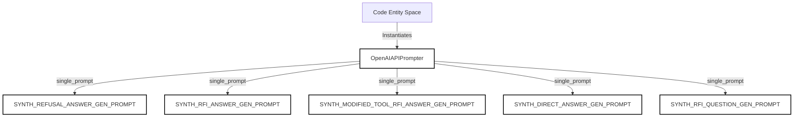
*Sources: [synthetic_data_gen/utils.py:29-126](), [synthetic_data_gen/utils.py:20-26]*

For details on prompt templates and helper implementations, see [Generation Utilities and Prompting](#3.3).

Sources: [synthetic_data_gen/utils.py:29-126]()

---

# Page: Evaluation Data Generation (create_eval_data.py)

# Evaluation Data Generation (create_eval_data.py)

<details>
<summary>Relevant source files</summary>

The following files were used as context for generating this wiki page:

- [synthetic_data_gen/create_eval_data.py](synthetic_data_gen/create_eval_data.py)
- [synthetic_data_gen/utils.py](synthetic_data_gen/utils.py)

</details>


This page provides full technical documentation for the evaluation data generation script located at `synthetic_data_gen/create_eval_data.py` and its supporting utility functions in `synthetic_data_gen/utils.py`. The primary purpose of this pipeline is to ingest source benchmark datasets (specifically the Berkeley Function Calling Leaderboard - BFCL), synthesize alternative answers across multiple categories (`tool_call`, `request_for_info`, `cannot_answer`, and `direct`), rewrite questions to drop required parameters for RFI testing, and produce comprehensive evaluation records.

Sources: [synthetic_data_gen/create_eval_data.py:1-159](), [synthetic_data_gen/utils.py:1-184]()

---

## 1. Command-Line Interface and Initialization

The script exposes a command-line interface via `argparse` to configure data directories, target output destinations, and the OpenAI-compatible API parameters used for synthetic text generation [synthetic_data_gen/create_eval_data.py:38-65]().

### CLI Arguments Table

| Argument | Type | Required | Description |
| :--- | :--- | :--- | :--- |
| `--bfcl_data_dir` | `str` | Yes | Path to the directory containing source BFCL data [synthetic_data_gen/create_eval_data.py:40-45]() |
| `--output_dir` | `str` | Yes | Path to the directory where generated evaluation records will be saved [synthetic_data_gen/create_eval_data.py:46-51]() |
| `--openai_api_base_url` | `str` | Yes | Base URL for the OpenAI-compatible API endpoint [synthetic_data_gen/create_eval_data.py:52-57]() |
| `--openai_api_model` | `str` | Yes | Name of the model used for synthetic data generation prompts [synthetic_data_gen/create_eval_data.py:58-63]() |

Upon parsing arguments, the script instantiates the `OpenAIAPIPrompter` class from `synthetic_data_gen/utils.py` with a fixed temperature of `0.6` and `top_p` of `0.95`, reading the API key directly from the `OPENAI_API_KEY` environment variable [synthetic_data_gen/create_eval_data.py:67-73](), [synthetic_data_gen/utils.py:29-34]().

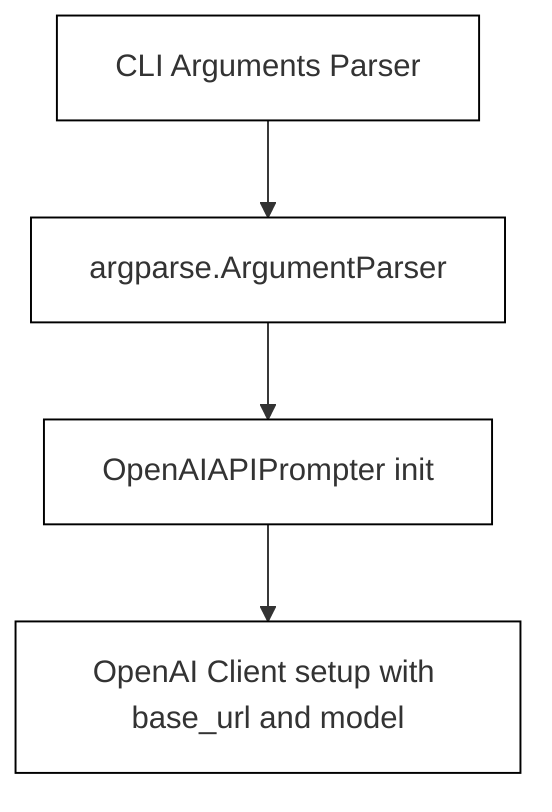

Sources: [synthetic_data_gen/create_eval_data.py:38-73](), [synthetic_data_gen/utils.py:29-35]()

---

## 2. BFCL Ingestion and Data Loading

The pipeline processes live BFCL categories, specifically targeting `BFCL_v2_live_multiple` and `BFCL_v2_live_simple` [synthetic_data_gen/create_eval_data.py:77-78](). 

For each category:
1. Source questions are loaded from `{args.bfcl_data_dir}/{bfcl_category}.json` using `read_bfcl_source_questions()` [synthetic_data_gen/create_eval_data.py:79](), [synthetic_data_gen/create_eval_data.py:82](), [synthetic_data_gen/utils.py:128-135]().
2. Possible answers are loaded from `{args.bfcl_data_dir}/possible_answer/{bfcl_category}.json` using `read_bfcl_source_answers()` [synthetic_data_gen/create_eval_data.py:80](), [synthetic_data_gen/create_eval_data.py:83](), [synthetic_data_gen/utils.py:138-146]().
3. An assertion verifies that the counts of source questions and answers match [synthetic_data_gen/create_eval_data.py:84]().
4. Functions are normalized to lists if they are not already, and the `target_tool` is matched against the ground-truth function name [synthetic_data_gen/create_eval_data.py:86-90]().

Sources: [synthetic_data_gen/create_eval_data.py:77-90](), [synthetic_data_gen/utils.py:128-146]()

---

## 3. Per-Category Answer Synthesis

For each source record, the script synthesizes three distinct evaluation items corresponding to different ground-truth behavior categories: **Refusal (`cannot_answer`)**, **Request for Info (`request_for_info`)**, and **Tool Call (`tool_call`)** [synthetic_data_gen/create_eval_data.py:92-156]().

### Answer Construction Functions (`synthetic_data_gen/utils.py`)
- `create_toolcall_answer(user_question, possible_answer)`: Formulates a structured dictionary with the target function name and sampled argument values [synthetic_data_gen/utils.py:64-73]().
- `create_refusal_answer(user_question, openai_api_prompter)`: Prompts the model to generate a refusal response when a tool cannot be invoked [synthetic_data_gen/utils.py:76-80]().
- `create_rfi_answer(user_question, tool, openai_api_prompter)`: Generates a clarifying request for missing information [synthetic_data_gen/utils.py:83-87]().
- `create_modified_tool_rfi_answer(...)`: Generates an RFI response tailored to a rewritten question where a required parameter was dropped [synthetic_data_gen/utils.py:90-99]().
- `create_direct_answer(user_question, openai_api_prompter)`: Synthesizes a direct conversational answer addressing the user without calling tools [synthetic_data_gen/utils.py:102-106]().

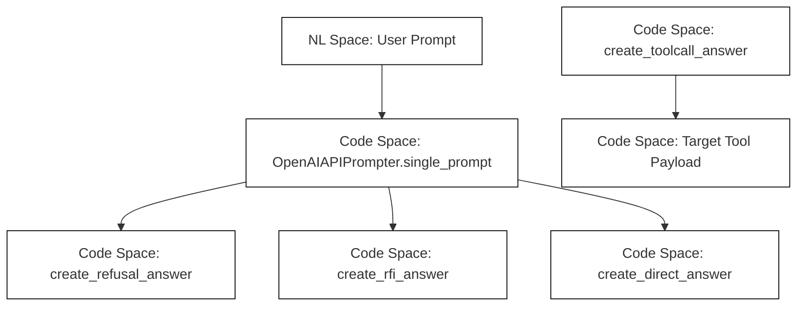

Sources: [synthetic_data_gen/create_eval_data.py:92-156](), [synthetic_data_gen/utils.py:64-107]()

---

## 4. Question Rewriting to Drop Parameters

To evaluate `request_for_info` scenarios where a model must ask for missing parameters, the script inspects whether `target_tool["parameters"]["required"]` contains elements [synthetic_data_gen/create_eval_data.py:114](). 

If required parameters exist, `rewrite_question_to_exclude_param()` randomly selects one required parameter to remove and prompts the model to rewrite the user question so that it omits that specific piece of information [synthetic_data_gen/utils.py:109-126]().

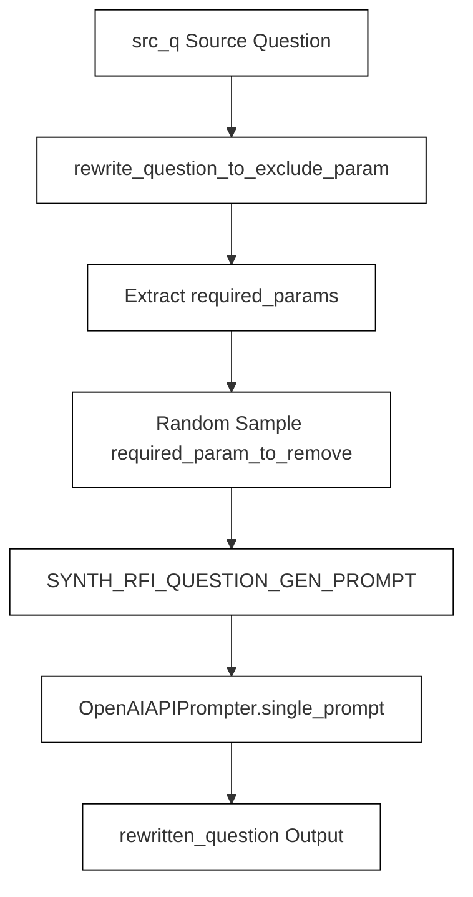

Sources: [synthetic_data_gen/create_eval_data.py:113-134](), [synthetic_data_gen/utils.py:109-126]()

---

## 5. Output Record Structure

Each generated evaluation record contains metadata, the prompt text, candidate answers across all categories, target tool definitions, and parameter held-out markers [synthetic_data_gen/create_eval_data.py:93-156](). 

### Record Schema Definition

```json
{
  "uuid": "string (uuid4)",
  "source": "string (e.g., BFCL_v2_live_multiple)",
  "source_id": "string",
  "question": "string (original or rewritten question)",
  "orig_question": "string",
  "correct_answer": "string (cannot_answer | request_for_info | tool_call)",
  "answers": {
    "direct": "string",
    "tool_call": "dict",
    "request_for_info": "string",
    "cannot_answer": "string"
  },
  "target_tool": "dict or null",
  "tools": "list of JSON-serialized tool definitions",
  "orig_tools": "list of JSON-serialized tool definitions",
  "held_out_param": "string or null"
}
```

Once all records are synthesized across the selected categories, the script shuffles the `eval_data` list before serializing it to the target output directory [synthetic_data_gen/create_eval_data.py:158-159]().

Sources: [synthetic_data_gen/create_eval_data.py:93-159]()

---

# Page: Training Data Generation and Conversion

# Training Data Generation and Conversion

<details>
<summary>Relevant source files</summary>

The following files were used as context for generating this wiki page:

- [synthetic_data_gen/convert_raw_train_data_to_pref.py](synthetic_data_gen/convert_raw_train_data_to_pref.py)
- [synthetic_data_gen/convert_raw_train_data_to_sft.py](synthetic_data_gen/convert_raw_train_data_to_sft.py)
- [synthetic_data_gen/create_raw_train_data.py](synthetic_data_gen/create_raw_train_data.py)

</details>


## Purpose and Scope
This page details the synthetic training data generation pipeline and its downstream format conversion scripts in When2Call. It covers how raw training examples are synthesized from APIGen (xlam) sources via `synthetic_data_gen/create_raw_train_data.py`, and how these raw outputs are converted into Supervised Fine-Tuning (SFT) format (`synthetic_data_gen/convert_raw_train_data_to_sft.py`) and preference optimization format (`synthetic_data_gen/convert_raw_train_data_to_pref.py`).

---

## 1. Raw Training Data Generation (`create_raw_train_data.py`)

The script `synthetic_data_gen/create_raw_train_data.py` orchestrates the creation of raw training samples from APIGen source datasets. It utilizes an OpenAI-compatible API backend wrapped by `OpenAIAPIPrompter` to synthesize diverse response categories (`tool_call`, `cannot_answer`, `request_for_info`, and `direct`) [synthetic_data_gen/create_raw_train_data.py:36-147]().

### CLI Arguments and Initialization
The script exposes arguments for the APIGen data directory, output directory, OpenAI API base URL, and model name [synthetic_data_gen/create_raw_train_data.py:37-62](). It instantiates `OpenAIAPIPrompter` with a fixed seed (`1234`), temperature `0.6`, and `top_p=0.95` [synthetic_data_gen/create_raw_train_data.py:34-71]().

```
Title: Raw Training Data Generation Flow
graph TD
    A["APIGenSourceData"] --> B["read_apigen_source_questions_and_answers"]
    B --> C["OpenAIAPIPrompter"]
    C --> D["create_raw_train_data.py"]
    D --> E["refusal_question"]
    D --> F["rfi_question"]
    D --> G["toolcall_question"]
    E --> H["when2call_train_raw.jsonl"]
    F --> H
    G --> H
```
*Sources: [synthetic_data_gen/create_raw_train_data.py:34-147]()*

### Per-Source Record Expansion
For each source question (`src_q`) and its corresponding answer, the script generates up to three distinct training records:

1. **Refusal Record (`cannot_answer`)**: The correct tool is removed from the tool list (`tools`), and synthetic refusal and direct answers are generated [synthetic_data_gen/create_raw_train_data.py:79-96]().
2. **Request for Information Record (`request_for_info`)**: The question is rewritten to exclude a required parameter (`rewrite_question_to_exclude_param`), establishing an RFI scenario where the model must ask for the missing parameter [synthetic_data_gen/create_raw_train_data.py:99-120]().
3. **Tool Call Record (`tool_call`)**: Uses the valid query and full tool definitions where executing the tool call is the correct behavior [synthetic_data_gen/create_raw_train_data.py:122-141]().

All generated records are serialized into `when2call_train_raw.jsonl` [synthetic_data_gen/create_raw_train_data.py:143-147]().

*Sources: [synthetic_data_gen/create_raw_train_data.py:36-147]()*

---

## 2. Conversion to Supervised Fine-Tuning (SFT) Format

Raw training data is transformed into conversational SFT records via `synthetic_data_gen/convert_raw_train_data_to_sft.py` [synthetic_data_gen/convert_raw_train_data_to_sft.py:1-71]().

### Implementation and Filtering Logic
The script reads `when2call_train_raw.jsonl`, shuffles the records using a fixed random seed (`1234`), and caps the dataset at 15,000 items [synthetic_data_gen/convert_raw_train_data_to_sft.py:41-48](). 

Each record is mapped to a chat message format containing `tools` and a `messages` array [synthetic_data_gen/convert_raw_train_data_to_sft.py:49-60]():
- **User Role**: Contains the question string [synthetic_data_gen/convert_raw_train_data_to_sft.py:51]()
- **Assistant Role**: Formatted based on `correct_answer`:
  - `tool_call`: Wraps the tool call JSON in `<TOOLCALL>[...]</TOOLCALL>` tags [synthetic_data_gen/convert_raw_train_data.py:54-55]().
  - `cannot_answer`: Appends the refusal response [synthetic_data_gen/convert_raw_train_data.py:56-57]().
  - `request_for_info`: Appends the RFI response [synthetic_data_gen/convert_raw_train_data.py:58-59]().

The resulting objects are shuffled again and written to `when2call_train_sft.jsonl` [synthetic_data_gen/convert_raw_train_data_to_sft.py:63-68]().

*Sources: [synthetic_data_gen/convert_raw_train_data_to_sft.py:15-71]()*

---

## 3. Conversion to Preference Optimization Format

Preference pairs for Direct Preference Optimization (DPO) or Reward Model training are generated by `synthetic_data_gen/convert_raw_train_data_to_pref.py` [synthetic_data_gen/convert_raw_train_data_to_pref.py:1-100]().

### Sampling and Pairing Logic
The script reads raw training records, shuffles them, and samples the first 1,000 items [synthetic_data_gen/convert_raw_train_data_to_pref.py:42-48](). For each item, it constructs a preference pair consisting of [synthetic_data_gen/convert_raw_train_data_to_pref.py:50-89]():
- `tools`: The available tool definitions [synthetic_data_gen/convert_raw_train_data_to_pref.py:51]()
- `messages`: Single user turn with the question [synthetic_data_gen/convert_raw_train_data_to_pref.py:52]()
- `chosen_response`: The correct answer variant assigned a `chosen_reward` of `1.0` [synthetic_data_gen/convert_raw_train_data_to_pref.py:53-58, 68-69, 80-80]()
- `rejected_response`: A randomly sampled incorrect response category assigned a `rejected_reward` of `0.0` [synthetic_data_gen/convert_raw_train_data_to_pref.py:54, 60-88]()

```
Title: Conversion and Preference Pipeline
graph TD
    A["when2call_train_raw.jsonl"] --> B["convert_raw_train_data_to_sft.py"]
    A --> C["convert_raw_train_data_to_pref.py"]
    B --> D["when2call_train_sft.jsonl"]
    C --> E["when2call_train_preference.jsonl"]
    sub5["SFT Message Formatting"] --> B
    sub6["Chosen/Rejected Sampling"] --> C
```
*Sources: [synthetic_data_gen/convert_raw_train_data_to_sft.py:41-68](), [synthetic_data_gen/convert_raw_train_data_to_pref.py:42-96]()*

The final dataset is shuffled and exported to `when2call_train_preference.jsonl` [synthetic_data_gen/convert_raw_train_data_to_pref.py:92-96]().

*Sources: [synthetic_data_gen/convert_raw_train_data_to_pref.py:15-100]()*

---

# Page: Generation Utilities and Prompting

# Generation Utilities and Prompting

<details>
<summary>Relevant source files</summary>

The following files were used as context for generating this wiki page:

- [synthetic_data_gen/utils.py](synthetic_data_gen/utils.py)

</details>


## Purpose and Scope
This page details the implementation of generation utilities and answer-construction helper functions located in `synthetic_data_gen/utils.py`. These utilities support synthetic data generation pipelines by interacting with OpenAI-compatible models via `OpenAIAPIPrompter` and constructing specific responses for various task categories (such as direct answers, tool calls, requests for information, and refusals).

---

## 1. OpenAIAPIPrompter Class
The `OpenAIAPIPrompter` class encapsulates communication with OpenAI-compatible chat completion endpoints. It manages client initialization, model selection, inference parameters, and token limit handling.

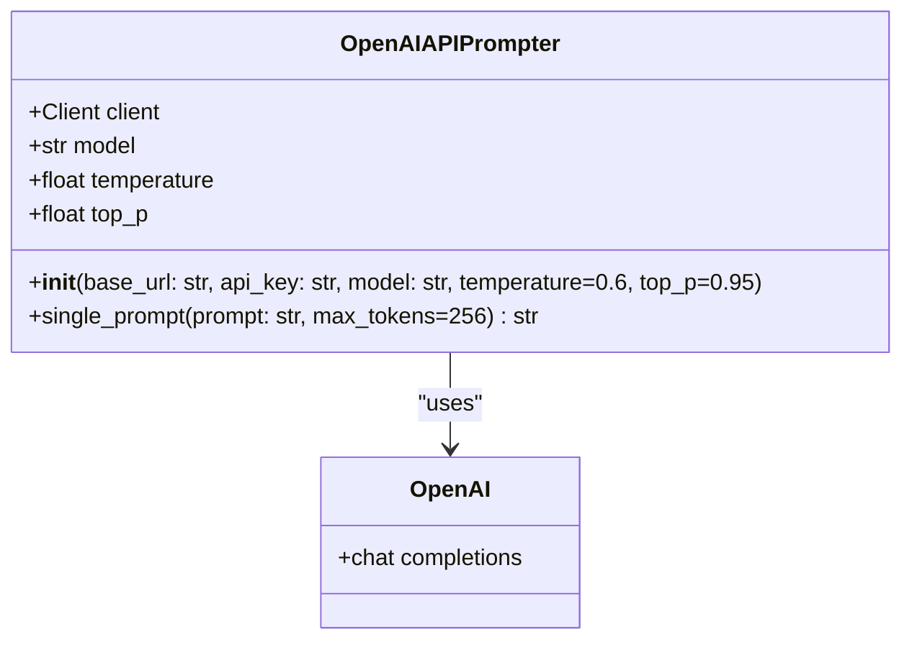
*Sources: `synthetic_data_gen/utils.py:29-62`*

### Implementation Details
- **`__init__`**: Initializes the underlying `OpenAI` client from the `openai` package using `base_url` and `api_key`, setting default parameters like `temperature=0.6` and `top_p=0.95` [synthetic_data_gen/utils.py:29-34]().
- **`single_prompt`**: Submits a user prompt to the chat completion endpoint. If the completion finishes with a `length` reason (indicating truncation due to token limits), it automatically retries with `max_tokens * 2`. For other finish reasons besides `stop`, it raises a `ValueError` [synthetic_data_gen/utils.py:36-61]().

---

## 2. Answer Construction and Question Rewriting Helpers
`synthetic_data_gen/utils.py` provides deterministic and prompt-driven helper functions to build answers across different synthetic evaluation categories, as well as utility readers for source datasets.

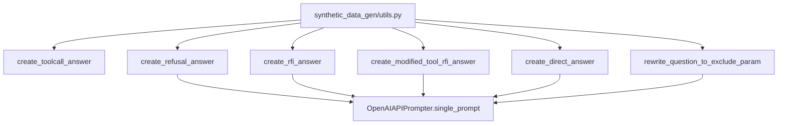
*Sources: `synthetic_data_gen/utils.py:64-126`*

### Summary of Helper Functions
- **`create_toolcall_answer(user_question, possible_answer)`**: Formulates a standard tool-call dictionary extracting function names and sampled argument values from ground truth definitions [synthetic_data_gen/utils.py:64-73]().
- **`create_refusal_answer(user_question, openai_api_prompter)`**: Uses `SYNTH_REFUSAL_ANSWER_GEN_PROMPT` to generate a response refusing a request that cannot be fulfilled [synthetic_data_gen/utils.py:76-80]().
- **`create_rfi_answer(user_question, tool, openai_api_prompter)`**: Formulates a request for information (RFI) response using `SYNTH_RFI_ANSWER_GEN_PROMPT` [synthetic_data_gen/utils.py:83-87]().
- **`create_modified_tool_rfi_answer(rewritten_question, tool, removed_param, openai_api_prompter)`**: Generates an RFI response asking for a missing parameter using `SYNTH_MODIFIED_TOOL_RFI_ANSWER_GEN_PROMPT` [synthetic_data_gen/utils.py:90-99]().
- **`create_direct_answer(user_question, openai_api_prompter)`**: Generates a direct conversational answer via `SYNTH_DIRECT_ANSWER_GEN_PROMPT` [synthetic_data_gen/utils.py:102-106]().
- **`rewrite_question_to_exclude_param(user_question, tool, openai_api_prompter)`**: Randomly selects a required parameter from a tool definition and rewrites the user question to omit it, using `SYNTH_RFI_QUESTION_GEN_PROMPT` [synthetic_data_gen/utils.py:109-125]().

---

## 3. Dataset Ingestion Utilities
Functions to ingest source data from BFCL and APIGen files are also defined within this module:

- **`read_bfcl_source_questions(questions_source_filepath)`**: Parses line-delimited JSON source questions [synthetic_data_gen/utils.py:128-135]().
- **`read_bfcl_source_answers(answers_source_filepath)`**: Parses line-delimited JSON source answers [synthetic_data_gen/utils.py:138-145]().
- **`read_apigen_source_questions_and_answers(apigen_source_filepath)`**: Loads APIGen JSON artifacts, filters out parallel tool calls, normalizes parameter and schema typing (e.g., ensuring dictionary structures and explicit required parameter lists), and returns aligned lists of questions and answers [synthetic_data_gen/utils.py:148-184]().

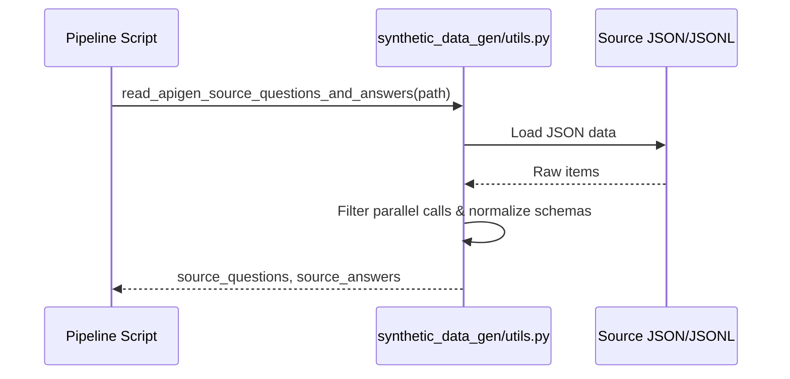
*Sources: `synthetic_data_gen/utils.py:128-184`*

---

# Page: Evaluation

# Evaluation

<details>
<summary>Relevant source files</summary>

The following files were used as context for generating this wiki page:

- [README.md](README.md)

</details>


## Purpose and Scope

The **When2Call** benchmark assesses language models on their tool-calling decision-making capabilities—specifically determining when to execute a tool call, when to ask a clarifying question (`request_for_info`), when to answer directly without tools (`direct`), and when to correctly decline because the task cannot be answered (`cannot_answer`) [README.md:5-22]. To measure these capabilities comprehensively, the project implements two primary evaluation paradigms: a multiple-choice question (MCQ) evaluation harness built on top of `lm-evaluation-harness`, and a generative LLM-as-a-Judge pipeline. 

This page provides a high-level overview of both evaluation harnesses, the metrics they produce, and how they relate to the underlying dataset artifacts. For deeper technical implementation details, prompt formatting, and configuration specifics, refer to the child pages:
- [MCQ Evaluation with LM-Eval-Harness](#4.1)
- [LLM-as-a-Judge Pipeline](#4.2)

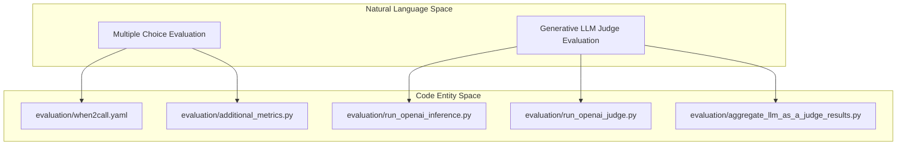
*Sources: [README.md:1-51]()*

---

## 4.1 MCQ Evaluation with LM-Eval-Harness

The MCQ evaluation harness plugs the When2Call benchmark into standard evaluation frameworks using configuration files and custom task processing scripts [README.md:5-51]. In this mode, questions from `when2call_test_mcq.jsonl` are formatted into multiple-choice prompts where models select among the four categories (`direct`, `tool_call`, `request_for_info`, and `cannot_answer`) [README.md:14-48]. 

For details on how individual model templates are configured, how documents are pre-processed into prompts, and how macro-F1 and confusion matrices are calculated, see [MCQ Evaluation with LM-Eval-Harness](#4.1).

Sources: [README.md:1-51]()

---

## 4.2 LLM-as-a-Judge Pipeline

The LLM-as-a-Judge pipeline evaluates models in a generative free-form setting using `when2call_test_llm_judge.jsonl` [README.md:14-25]. Rather than selecting from discrete multiple-choice options, models generate direct text responses or tool calls, which are subsequently scored by a stronger judge model.

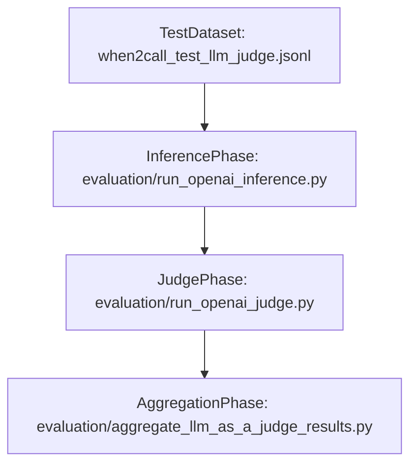
*Sources: [README.md:14-25]()*

The evaluation flows through three distinct sequential stages:
1. **Model Inference**: Generates raw responses from the target model using tool schema sanitization and OpenAI-compatible endpoints [README.md:14-48].
2. **Judging**: Evaluates the generated responses against ground-truth categories using structured judge prompts.
3. **Aggregation**: Computes per-category and overall performance metrics.

For details on executing inference, configuring judge prompts, and running aggregation scripts, see [LLM-as-a-Judge Pipeline](#4.2).

Sources: [README.md:14-48]()

---

# Page: MCQ Evaluation with LM-Eval-Harness

# MCQ Evaluation with LM-Eval-Harness

<details>
<summary>Relevant source files</summary>

The following files were used as context for generating this wiki page:

- [evaluation/mcq/lm_eval_harness/when2call/utils.py](evaluation/mcq/lm_eval_harness/when2call/utils.py)
- [evaluation/mcq/lm_eval_harness/when2call/when2call.yaml](evaluation/mcq/lm_eval_harness/when2call/when2call.yaml)

</details>


## Purpose and Scope

The MCQ evaluation pipeline leverages the `lm-evaluation-harness` framework to evaluate tool-calling and decision-making capabilities as multiple-choice questions (MCQ). In this setup, each test case (`when2call_test_mcq.jsonl`) is converted into an evaluation document containing a prompt, a set of ordered choices, and a target answer index. 

This parent page provides a high-level summary of how the `when2call` task integrates into `lm-eval`, how configurations and document processors transform raw data into evaluation prompts, and how metrics are evaluated. For deep technical details, refer to the child pages:
- [Model-Specific Task Configs](#4.1.1)
- [Prompt Formatting and Doc Processing (utils.py)](#4.1.2)
- [Additional Metrics](#4.1.3)

---

## Task Integration and Execution Architecture

The core configuration for the base evaluation task is defined in `evaluation/mcq/lm_eval_harness/when2call/when2call.yaml` [evaluation/mcq/lm_eval_harness/when2call/when2call.yaml:1-25](). This configuration specifies the input dataset format (`output_type: multiple_choice`), hooks into document processors via `!function`, and registers multiple evaluation metrics like accuracy, normalized accuracy, and macro-F1 [evaluation/mcq/lm_eval_harness/when2call/when2call.yaml:10-25]().

The following diagram maps the conceptual evaluation workflow to the underlying code entities in the `lm-eval` harness integration:

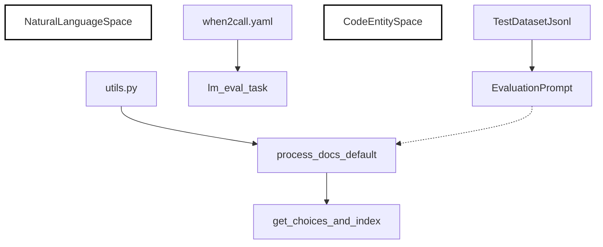
*Sources: [evaluation/mcq/lm_eval_harness/when2call/when2call.yaml:1-25](), [evaluation/mcq/lm_eval_harness/when2call/utils.py:30-67]()*

---

## Sub-Topics Overview

### 1. Model-Specific Task Configs
Different target models require customized system instructions, special tokens, and tool formatting conventions. Instead of a single static YAML file, the repository provides task configuration variants tailored for models such as Functionary, Hermes, Llama 3.2, Qwen 2.5, and xLAM. Each config adjusts parameters like prompt templates or dataset paths to match the target architecture.
- For details, see [Model-Specific Task Configs](#4.1.1).

### 2. Prompt Formatting and Doc Processing (`utils.py`)
Raw dataset entries must be processed into structured documents that `lm-eval` can consume. The module `evaluation/mcq/lm_eval_harness/when2call/utils.py` contains choice extraction helpers (`get_choices_and_index`) and model-specific document processors (`process_docs_default`, `process_docs_llama3_2`, `process_docs_qwen2_5`, etc.) that construct model-compliant prompts and tool descriptions.
- For details, see [Prompt Formatting and Doc Processing (utils.py)](#4.1.2).

### 3. Additional Metrics
Beyond standard multiple-choice accuracy (`acc`) and normalized accuracy (`acc_norm`), the evaluation suite computes specialized metrics such as macro-F1, confusion matrices, and tool hallucination rates via custom aggregation functions.
- For details, see [Additional Metrics](#4.1.3).

---

## Evaluation Data Flow

The relationship between task execution and prompt formatting can be visualized from raw inputs to metrics calculation:

```mermaid
graph TD
    sub7["NaturalLanguageSpace"]
    sub7_Input["UserQueryAndTools"] --> sub7_MCQ["MultipleChoiceAnswers"]
    
    sub8["CodeEntitySpace"]
    sub8_Yaml["when2call.yaml"] --> sub8_Harness["lm_eval_runner"]
    sub8_Utils["utils.py:process_docs_*"] --> sub8_Metrics["additional_metrics.py"]
    
    sub7_MCQ --> sub8_Utils
    sub8_Harness --> sub8_Utils
    sub8_Utils --> sub8_Metrics
    
    style sub7 fill:none,stroke:#000,stroke-width:2px
    style sub8 fill:none,stroke:#000,stroke-width:2px
```
*Sources: [evaluation/mcq/lm_eval_harness/when2call/when2call.yaml:1-25](), [evaluation/mcq/lm_eval_harness/when2call/utils.py:30-175]() *

---

# Page: Model-Specific Task Configs

# Model-Specific Task Configs

<details>
<summary>Relevant source files</summary>

The following files were used as context for generating this wiki page:

- [evaluation/mcq/lm_eval_harness/when2call/when2call-functionary.yaml](evaluation/mcq/lm_eval_harness/when2call/when2call-functionary.yaml)
- [evaluation/mcq/lm_eval_harness/when2call/when2call-hermes.yaml](evaluation/mcq/lm_eval_harness/when2call/when2call-hermes.yaml)
- [evaluation/mcq/lm_eval_harness/when2call/when2call-llama3_2.yaml](evaluation/mcq/lm_eval_harness/when2call/when2call-llama3_2.yaml)
- [evaluation/mcq/lm_eval_harness/when2call/when2call-qwen2_5.yaml](evaluation/mcq/lm_eval_harness/when2call/when2call-qwen2_5.yaml)
- [evaluation/mcq/lm_eval_harness/when2call/when2call-xlam.yaml](evaluation/mcq/lm_eval_harness/when2call/when2call-xlam.yaml)

</details>


## Purpose and Scope
This page details the model-specific task configuration files used by the `lm-evaluation-harness` integration in When2Call. It outlines the structural similarities and critical differences across the five model-specific YAML configurations (`functionary`, `hermes`, `llama3_2`, `qwen2_5`, and `xlam`), mapping each configuration to its respective data processing hook in `utils.py`.

---

## 1. Common Configuration Architecture
All model-specific task configurations share a uniform base structure optimized for multiple-choice evaluation via `lm-eval`. They load the local JSONL dataset (`when2call_test_mcq.jsonl`), treat the `train` split as the evaluation set, and configure standard classification metrics (`macro_f1`, `acc`, and `acc_norm`).

The shared base properties across all task YAMLs include:
- `dataset_path: json` [evaluation/mcq/lm_eval_harness/when2call/when2call-functionary.yaml:2-2]()
- `output_type: multiple_choice` [evaluation/mcq/lm_eval_harness/when2call/when2call-functionary.yaml:15-15]()
- Metric definitions for `macro_f1`, `acc`, and `acc_norm` [evaluation/mcq/lm_eval_harness/when2call/when2call-functionary.yaml:16-25]()

Sources: `evaluation/mcq/lm_eval_harness/when2call/when2call-functionary.yaml:1-25`

---

## 2. Model-Specific YAML Variants and Python Hook Mapping
While the harness configuration schema remains constant, each YAML file defines a unique `task` identifier and binds to a specific document processor function (`process_docs_*`) to handle model-specific template formatting and tokenization paradigms.

```mermaid
graph TD
    subgraph "Natural Language / Task Space"
        A1["Functionary Task"]
        A2["Hermes Task"]
        A3["Llama 3.2 Task"]
        A4["Qwen 2.5 Task"]
        A5["XLAM Task"]
    end

    subgraph "YAML Config Files"
        B1["when2call-functionary.yaml"]
        B2["when2call-hermes.yaml"]
        B3["when2call-llama3_2.yaml"]
        B4["when2call-qwen2_5.yaml"]
        B5["when2call-xlam.yaml"]
    end

    subgraph "Code Entity Space (utils.py)"
        C1["process_docs_functionary"]
        C2["process_docs_hermes"]
        C3["process_docs_llama3_2"]
        C4["process_docs_qwen2_5"]
        C5["process_docs_xlam"]
    end

    A1 --> B1
    A2 --> B2
    A3 --> B3
    A4 --> B4
    A5 --> B5

    B1 -->|"!function utils.process_docs_functionary"| C1
    B2 -->|"!function utils.process_docs_hermes"| C2
    B3 -->|"!function utils.process_docs_llama3_2"| C3
    B4 -->|"!function utils.process_docs_qwen2_5"| C4
    B5 -->|"!function utils.process_docs_xlam"| C5
```
Sources: `evaluation/mcq/lm_eval_harness/when2call/when2call-functionary.yaml:1-10` [evaluation/mcq/lm_eval_harness/when2call/when2call-functionary.yaml:1-10](), `evaluation/mcq/lm_eval_harness/when2call/when2call-hermes.yaml:1-10` [evaluation/mcq/lm_eval_harness/when2call/when2call-hermes.yaml:1-10](), `evaluation/mcq/lm_eval_harness/when2call/when2call-llama3_2.yaml:1-10` [evaluation/mcq/lm_eval_harness/when2call/when2call-llama3_2.yaml:1-10](), `evaluation/mcq/lm_eval_harness/when2call/when2call-qwen2_5.yaml:1-10` [evaluation/mcq/lm_eval_harness/when2call/when2call-qwen2_5.yaml:1-10](), `evaluation/mcq/lm_eval_harness/when2call/when2call-xlam.yaml:1-10` [evaluation/mcq/lm_eval_harness/when2call/when2call-xlam.yaml:1-10]()

### Configuration Breakdown Table

| Model Variant | Task Identifier | Dataset File | Process Doc Hook (`utils.py`) |
| :--- | :--- | :--- | :--- |
| **Functionary** | `when2call-functionary` [evaluation/mcq/lm_eval_harness/when2call/when2call-functionary.yaml:1-1]() | `when2call_test_mcq.jsonl` [evaluation/mcq/lm_eval_harness/when2call/when2call-functionary.yaml:5-5]() | `process_docs_functionary` [evaluation/mcq/lm_eval_harness/when2call/when2call-functionary.yaml:10-10]() |
| **Hermes** | `when2call-hermes` [evaluation/mcq/lm_eval_harness/when2call/when2call-hermes.yaml:1-1]() | `when2call_test_mcq.jsonl` [evaluation/mcq/lm_eval_harness/when2call/when2call-hermes.yaml:5-5]() | `process_docs_hermes` [evaluation/mcq/lm_eval_harness/when2call/when2call-hermes.yaml:10-10]() |
| **Llama 3.2** | `when2call-llama3_2` [evaluation/mcq/lm_eval_harness/when2call/when2call-llama3_2.yaml:1-1]() | `when2call_test_mcq.jsonl` [evaluation/mcq/lm_eval_harness/when2call/when2call-llama3_2.yaml:5-5]() | `process_docs_llama3_2` [evaluation/mcq/lm_eval_harness/when2call/when2call-llama3_2.yaml:10-10]() |
| **Qwen 2.5** | `when2call-qwen2_5` [evaluation/mcq/lm_eval_harness/when2call/when2call-qwen2_5.yaml:1-1]() | `when2call_test_mcq.jsonl` [evaluation/mcq/lm_eval_harness/when2call/when2call-qwen2_5.yaml:5-5]() | `process_docs_qwen2_5` [evaluation/mcq/lm_eval_harness/when2call/when2call-qwen2_5.yaml:10-10]() |
| **XLAM** | `when2call-xlam` [evaluation/mcq/lm_eval_harness/when2call/when2call-xlam.yaml:1-1]() | `when2call_test_mcq.jsonl` [evaluation/mcq/lm_eval_harness/when2call/when2call-xlam.yaml:5-5]() | `process_docs_xlam` [evaluation/mcq/lm_eval_harness/when2call/when2call-xlam.yaml:10-10]() |

Sources: 
- `evaluation/mcq/lm_eval_harness/when2call/when2call-functionary.yaml:1-25` [evaluation/mcq/lm_eval_harness/when2call/when2call-functionary.yaml:1-25]()
- `evaluation/mcq/lm_eval_harness/when2call/when2call-hermes.yaml:1-25` [evaluation/mcq/lm_eval_harness/when2call/when2call-hermes.yaml:1-25]()
- `evaluation/mcq/lm_eval_harness/when2call/when2call-llama3_2.yaml:1-25` [evaluation/mcq/lm_eval_harness/when2call/when2call-llama3_2.yaml:1-25]()
- `evaluation/mcq/lm_eval_harness/when2call/when2call-qwen2_5.yaml:1-25` [evaluation/mcq/lm_eval_harness/when2call/when2call-qwen2_5.yaml:1-25]()
- `evaluation/mcq/lm_eval_harness/when2call/when2call-xlam.yaml:1-25` [evaluation/mcq/lm_eval_harness/when2call/when2call-xlam.yaml:1-25]()

---

## 3. Execution Data Flow in LM-Eval Integration

The runtime execution flow maps a task identifier from the CLI to its corresponding YAML specification, resolves the document processing function, and evaluates choices using `output_type: multiple_choice`.

```mermaid
graph TD
    subgraph "CLI Execution Space"
        U["User CLI Input"] -->|"--tasks when2call-<model>"| E["lm_eval.evaluator"]
    end

    subgraph "Configuration Resolution"
        E -->|Loads| Y["when2call-<model>.yaml"]
        Y -->|Reads| D["when2call_test_mcq.jsonl"]
    end

    subgraph "Execution & Processing"
        Y -->|Calls Hook| P["utils.process_docs_<model>"]
        D --> P
        P -->|Returns Processed Docs| M["lm_eval MultipleChoiceTask"]
        M -->|Computes Metrics| R["macro_f1 / acc / acc_norm"]
    end
```
Sources: 
- `evaluation/mcq/lm_eval_harness/when2call/when2call-functionary.yaml:1-25` [evaluation/mcq/lm_eval_harness/when2call/when2call-functionary.yaml:1-25]()
- `evaluation/mcq/lm_eval_harness/when2call/when2call-qwen2_5.yaml:1-25` [evaluation/mcq/lm_eval_harness/when2call/when2call-qwen2_5.yaml:1-25]()

---

# Page: Prompt Formatting and Doc Processing (utils.py)

# Prompt Formatting and Doc Processing (utils.py)

<details>
<summary>Relevant source files</summary>

The following files were used as context for generating this wiki page:

- [evaluation/mcq/lm_eval_harness/when2call/utils.py](evaluation/mcq/lm_eval_harness/when2call/utils.py)

</details>


## Purpose and Scope

This document details the technical implementation of prompt formatting and document processing routines located in `evaluation/mcq/lm_eval_harness/when2call/utils.py`. The module is responsible for transforming raw benchmark datasets into Hugging Face `Dataset` objects ready for evaluation via the LM Evaluation Harness. It constructs multiple-choice (`mcq`) choices, handles correct answer indices, and applies model-specific prompt templates and tool-call formats across various architectures (such as Llama 3.2, Qwen 2.5, Nemotron, and xLAM).

Sources: `[evaluation/mcq/lm_eval_harness/when2call/utils.py:1-175]()`

---

## Core Utilities and Choice Construction

The module provides foundational helper functions to parse dataset items, extract candidate answers, format tool signatures, and identify the ground-truth target index.

### Choice Parsing (`get_choices_and_index`)
The `get_choices_and_index` function extracts an ordered list of answer choices from a dataset item and determines the index of the correct answer `[evaluation/mcq/lm_eval_harness/when2call/utils.py:30-44]()`. If a model requires custom tool-call formatting, a callable `format_tool_call` argument is applied to any answer dictionary key containing `'tool'` `[evaluation/mcq/lm_eval_harness/when2call/utils.py:35-38]`.

### Default Tool Formatting (`default_format_tools`)
Tools are serialized into XML-style `<tool></tool>` blocks by `default_format_tools`, joining individual tool descriptions with double newlines `[evaluation/mcq/lm_eval_harness/when2call/utils.py:47-51]()`.

```mermaid
graph TD
  Item["DatasetItem"] --> GetChoices["get_choices_and_index"]
  GetChoices --> CheckTool{"Contains 'tool' in name?"}
  CheckTool -- "Yes" --> FormatCall["format_tool_call(answer)"]
  CheckTool -- "No" --> RawAnswer["Keep raw answer text"]
  FormatCall --> ChoicesList["List of Choices"]
  RawAnswer --> ChoicesList
  Item --> DefaultFormat["default_format_tools"]
  DefaultFormat --> ToolString["<tool>...</tool> XML Block"]

  sub:CodeEntities["Code Entity Space"]
  GetChoices:::entity
  DefaultFormat:::entity
  classDef entity fill:none,stroke:none;
```
*Figure 1: Data flow of choice construction and tool formatting.*

Sources: `[evaluation/mcq/lm_eval_harness/when2call/utils.py:30-51]()`

---

## Model-Specific Document Processors

Different LLM architectures demand specific system prompts, chat header tokens, and tool invocation syntaxes. The module implements dedicated `process_docs_*` functions mapped to these requirements.

### Default Processor (`process_docs_default`)
`process_docs_default` applies the standard `DEFAULT_SYSTEM_PROMPT` [evaluation/mcq/lm_eval_harness/when2call/utils.py:20-23]() and `TOOL_USE_INSTRUCTIONS` [evaluation/mcq/lm_eval_harness/when2call/utils.py:25-27](), wrapping tools via `default_format_tools` and mapping over the dataset `[evaluation/mcq/lm_eval_harness/when2call/utils.py:54-67]()`.

### Llama 3.2 Processor (`process_docs_llama3_2`)
`process_docs_llama3_2` formats tool calls into Python-like function call signatures (e.g., `func_name(arg1="val1")`) and constructs prompts using Llama 3 special header tokens (`<|start_header_id|>`, `<|eot_id|>`) `[evaluation/mcq/lm_eval_harness/when2call/utils.py:70-105]()`.

### Qwen 2.5 Processor (`process_docs_qwen2_5`)
`process_docs_qwen2_5` structures prompts around Qwen's ChatML template (`<|im_start|>`, `<|im_end|>`) while enclosing tool signatures in `<tools></tools>` tags and expected outputs in `<tool_call></tool_call>` tags `[evaluation/mcq/lm_eval_harness/when2call/utils.py:108-143]()`.

### Nemotron Processor (`process_docs_nemotron`)
`process_docs_nemotron` formats tool calls inside `<toolcall>` XML tags and uses custom prefix tokens (`<extra_id_0>System`, `<extra_id_1>User`) to construct chat prompts `[evaluation/mcq/lm_eval_harness/when2call/utils.py:146-171]()`.

Sources: `[evaluation/mcq/lm_eval_harness/when2call/utils.py:54-171]()`

---

## Architecture-to-Processor Mapping

To bridge natural language model requirements with code implementation, the following diagram maps target model prompt families to their respective dataset processing functions in `utils.py`.

```mermaid
graph TD
  NL_Standard["Standard XML Prompt Requirements"] --> FuncDefault["process_docs_default"]
  NL_Llama["Llama3.2 Header & Function Syntax"] --> FuncLlama["process_docs_llama3_2"]
  NL_Qwen["Qwen2.5 ChatML & XML Tags"] --> FuncQwen["process_docs_qwen2_5"]
  NL_Nemotron["Nemotron Extra ID Tokens"] --> FuncNem["process_docs_nemotron"]
  NL_XLAM["xLAM Format Requirements"] --> FuncXLAM["process_docs_xlam"]

  sub:CodeMapping["Code Entity Space: evaluation/mcq/lm_eval_harness/when2call/utils.py"]
  FuncDefault:::entity
  FuncLlama:::entity
  FuncQwen:::entity
  FuncNem:::entity
  FuncXLAM:::entity
  classDef entity fill:none,stroke:none;
```
*Figure 2: Mapping natural language model structures to `utils.py` processor functions.*

Sources: `[evaluation/mcq/lm_eval_harness/when2call/utils.py:54-175]()`

---

# Page: Additional Metrics

# Additional Metrics

<details>
<summary>Relevant source files</summary>

The following files were used as context for generating this wiki page:

- [evaluation/mcq/lm_eval_harness/when2call/additional_metrics.py](evaluation/mcq/lm_eval_harness/when2call/additional_metrics.py)

</details>


The purpose of this page is to document the implementation of additional evaluation metrics provided in `evaluation/mcq/lm_eval_harness/when2call/additional_metrics.py`. This script processes logged evaluation samples from `lm-eval-harness` runs to compute specialized metrics including hallucination rates for negative test cases, full multi-class confusion matrices, and macro-F1 evaluations [evaluation/mcq/lm_eval_harness/when2call/additional_metrics.py:1-88]().

---

## 1. Command-Line Interface and Execution Flow

The script acts as a standalone utility invoked post-evaluation on JSONL sample files generated via the `--log_samples` flag [evaluation/mcq/lm_eval_harness/when2call/additional_metrics.py:75-88](). It parses the `--samples_path` argument, invokes both metric calculation routines, and prints a structured summary dictionary [evaluation/mcq/lm_eval_harness/when2call/additional_metrics.py:75-88]().

```mermaid
graph TD
    A["CLI Execution"] -->|"--samples_path"| B["argparse.ArgumentParser"]
    B --> C["calculate_confusion_matrix"]
    B --> D["calculate_hallucination_rate"]
    C --> E["DataFrame/JSON Output"]
    D --> F["Float Rate Output"]

    sub5["Code Entities"]
    style sub5 fill:none,stroke:none
```
*Figure 1: Script execution and data flow from CLI arguments to metric computation functions.*

Sources: `[evaluation/mcq/lm_eval_harness/when2call/additional_metrics.py:75-88]()`

---

## 2. Hallucination Rate Calculation

The function `calculate_hallucination_rate` measures a model's tendency to falsely invoke tools when presented with queries that require no tools [evaluation/mcq/lm_eval_harness/when2call/additional_metrics.py:21-48](). 

### Implementation Details
1. **Filtering**: It isolates samples where the gold label is `"cannot_answer"` and the available tools list (`doc['tools']`) is empty [evaluation/mcq/lm_eval_harness/when2call/additional_metrics.py:33-35]().
2. **Prediction Check**: It inspects the `macro_f1` tuple stored in each logged sample, checking whether the predicted index (`result['macro_f1'][1]`) points to a tool call (index `1`) [evaluation/mcq/lm_eval_harness/when2call/additional_metrics.py:37-41]().
3. **Rate Computation**: The hallucination rate is calculated as the ratio of erroneous tool calls to total filtered negative samples [evaluation/mcq/lm_eval_harness/when2call/additional_metrics.py:42]().

```mermaid
graph TD
    A["JSONLSamplesFile"] --> B["calculate_hallucination_rate"]
    B --> C{"Filter: correct_answer == cannot_answer & len(tools) == 0"}
    C -->|Match| D["Check macro_f1 index 1 == 1"]
    D -->|Tool Called| E["Increment Hallucination Count"]
    E --> F["Compute Rate: Hallucinated / Total"]
    
    sub6["Code Entities"]
    style sub6 fill:none,stroke:none
```
*Figure 2: Natural language evaluation filtering logic mapped to `calculate_hallucination_rate` code structures.*

Sources: `[evaluation/mcq/lm_eval_harness/when2call/additional_metrics.py:21-48]()`

---

## 3. Confusion Matrix and Macro-F1 Mapping

The `calculate_confusion_matrix` function builds a comprehensive error profile across all four answer categories [evaluation/mcq/lm_eval_harness/when2call/additional_metrics.py:51-73]().

### Implementation Details
* **Label Extraction**: It dynamically extracts label names from the first sample's `doc['answers']` dictionary keys [evaluation/mcq/lm_eval_harness/when2call/additional_metrics.py:59-60]().
* **Gold and Predicted Extraction**: It extracts gold indices from `sample_dict['macro_f1'][0]` and predicted indices from `sample_dict['macro_f1'][1]` [evaluation/mcq/lm_eval_harness/when2call/additional_metrics.py:62-63]().
* **Matrix Generation**: It computes the raw confusion matrix using `sklearn.metrics.confusion_matrix` and wraps it in a `pandas.DataFrame` labeled with `true:` and `pred:` prefixes before serializing to JSON [evaluation/mcq/lm_eval_harness/when2call/additional_metrics.py:65-73]().

Sources: `[evaluation/mcq/lm_eval_harness/when2call/additional_metrics.py:51-73]()`

---

# Page: LLM-as-a-Judge Pipeline

# LLM-as-a-Judge Pipeline

<details>
<summary>Relevant source files</summary>

The following files were used as context for generating this wiki page:

- [evaluation/llm_as_a_judge/run_openai_inference.py](evaluation/llm_as_a_judge/run_openai_inference.py)
- [evaluation/llm_as_a_judge/run_openai_judge.py](evaluation/llm_as_a_judge/run_openai_judge.py)

</details>


The LLM-as-a-Judge evaluation pipeline provides an alternative to multi-choice question (MCQ) testing by executing model generation against a test set, classifying the behavior using a strong judge model across the four answer categories (`direct_answer`, `tool_call`, `request_for_info`, `cannot_answer`), and aggregating performance metrics. 

For details on individual child components, see:
- [Model Inference (run_openai_inference.py)](#4.2.1)
- [Judging and Aggregation](#4.2.2)

---

## 1. Pipeline Architecture and Flow

The pipeline executes in three distinct stages: generating model responses under an OpenAI-compatible interface, judging those responses against ground-truth intent using a prompt-engineered judge model, and aggregating the categorized results to evaluate behavior across categories.

```mermaid
graph TD
    EvalData["eval_data_jsonl"] --> Inference["run_openai_inference.py"]
    Inference --> ResumableOut["model_responses_jsonl"]
    ResumableOut --> JudgeScript["run_openai_judge.py"]
    JudgeScript --> JudgeOut["judge_results_jsonl"]
    JudgeOut --> Aggregator["aggregate_llm_as_a_judge_results.py"]
    Aggregator --> Metrics["Per-Category Scores"]

    sub-1["Code Entities"]
    Inference --- EvalData
    JudgeScript --- ResumableOut
    Aggregator --- JudgeOut
```
Sources: [evaluation/llm_as_a_judge/run_openai_inference.py:26-102](), [evaluation/llm_as_a_judge/run_openai_judge.py:58-146]()

---

## 2. Stage 1: Model Inference

The first stage processes evaluation items from an input JSONL file, sanitizes tool schemas to fit OpenAI-compatible APIs, executes chat completions, and records model outputs with resumable file-append logic.

```mermaid
graph LR
    Input["test_item"] --> Sanitizer["Tool Schema Sanitization"]
    Sanitizer --> API["OpenAI Client ChatCompletions"]
    API --> RawOutput["Tool Call or Text Content"]
    RawOutput --> Recorder["Resumable Append to results_path"]
```
Sources: [evaluation/llm_as_a_judge/run_openai_inference.py:63-99]()

For deep technical details on schema manipulation, API configurations, and resumable execution, see [Model Inference (run_openai_inference.py)](#4.2.1).

---

## 3. Stages 2 & 3: Judging and Aggregation

The second stage loads model responses and applies a strict prompt template (`JUDGE_PROMPT`) to classify the behavior into one of the four When2Call answer categories. The third stage aggregates these classifications to compute category-level performance metrics.

```mermaid
graph TD
    RespLoad["Load model_response"] --> PromptFormat["Format JUDGE_PROMPT"]
    PromptFormat --> JudgeCall["OpenAI Judge Completion"]
    JudgeCall --> JSONParse["Parse JSON Classification"]
    JSONParse --> Fallback{"Valid JSON?"}
    Fallback -->|No| Retry["Self-Correction Prompt"]
    Retry --> JudgeCall
    Fallback -->|Yes| Dump["Dump Judge Results"]
```
Sources: [evaluation/llm_as_a_judge/run_openai_judge.py:90-142]()

For information on judge prompt templates, fallback mechanics, and aggregation scripts, see [Judging and Aggregation](#4.2.2).

---

# Page: Model Inference (run_openai_inference.py)

# Model Inference (run_openai_inference.py)

<details>
<summary>Relevant source files</summary>

The following files were used as context for generating this wiki page:

- [evaluation/llm_as_a_judge/run_openai_inference.py](evaluation/llm_as_a_judge/run_openai_inference.py)

</details>


## Purpose and Scope

This page documents the implementation of the model inference script `evaluation/llm_as_a_judge/run_openai_inference.py`, which serves as the first stage of the LLM-as-a-Judge evaluation pipeline. The script processes evaluation datasets, sanitizes tool definitions to comply with OpenAI API expectations, executes chat completions against any OpenAI-compatible endpoint, and writes outputs incrementally to support resumable execution.

Sources: `evaluation/llm_as_a_judge/run_openai_inference.py:1-103`()

---

## Command-Line Interface and Initialization

The script exposes a command-line interface using `argparse.ArgumentParser` defined in `evaluation/llm_as_a_judge/run_openai_inference.py:27-53`(). It accepts four mandatory arguments:
- `--eval_data_path`: Path to the input evaluation dataset JSONL file.
- `--results_path`: Destination file path for saving inference results.
- `--openai_api_base_url`: Base URL for the OpenAI-compatible API endpoint.
- `--openai_api_model`: Target model identifier for generation.

The `main()` function initializes the `OpenAI` client using `os.environ.get("OPENAI_API_KEY")` for authentication and the provided `--openai_api_base_url` (`[evaluation/llm_as_a_judge/run_openai_inference.py:55]()`).

```mermaid
graph TD
    A["CLI Arguments Parser<br>argparse.ArgumentParser"] -->|"--eval_data_path"| B["Input Dataset<br>fin"]
    A -->|"--results_path"| C["Output Results File<br>fout"]
    A -->|"--openai_api_base_url & model"| D["OpenAI Client<br>OpenAI()"]
    D --> E["Chat Completion API<br>client.chat.completions.create"]

    classDef default fill:#fff,stroke:#333,stroke-width:2px;
```
*Diagram 1: Initialization and Client Configuration Flow*

Sources: `evaluation/llm_as_a_judge/run_openai_inference.py:27-55`()

---

## Resumable Execution Handling

To prevent data loss during long-running evaluations, `run_openai_inference.py` implements a resumable output mechanism (`[evaluation/llm_as_a_judge/run_openai_inference.py:57-62]`). Before processing the evaluation dataset, the script checks whether `--results_path` already exists. If the file exists, it counts the number of existing lines (`existing_count`) (`[evaluation/llm_as_a_judge/run_openai_inference.py:57-62]()`).

During iteration over the input evaluation records (`[evaluation/llm_as_a_judge/run_openai_inference.py:63-66]()`), any record index `idx` less than `existing_count` is skipped:
```python
if idx < existing_count:
    continue
```
This allows interrupted evaluation jobs to resume directly from the point of failure without reprocessing completed samples.

Sources: `evaluation/llm_as_a_judge/run_openai_inference.py:57-66`()

---

## Tool Schema Sanitization

Input test records contain tool specifications that may use data types or naming conventions incompatible with standard OpenAI schema validators. The script sanitizes tool parameters inside `main()` (`[evaluation/llm_as_a_judge/run_openai_inference.py:69-76]()`) through several transformation steps:

1. **Type Mapping**: Replaces occurrences of `float`, `integer`, `dict`, and `tuple` with standard types (`string` or `object`) (`[evaluation/llm_as_a_judge/run_openai_inference.py:69]()`).
2. **Wrapper Formatting**: Wraps raw function dictionaries into OpenAI tool schema objects (`{"type": "function", "function": t}`) (`[evaluation/llm_as_a_judge/run_openai_inference.py:70]()`).
3. **Name Sanitization**: Replaces periods (`.`) with underscores (`_`) in function names (`[evaluation/llm_as_a_judge/run_openai_inference.py:71-72]()`).
4. **Parameter Schema Enforcement**: Forces parameter top-level types to `"object"` and normalizes all individual property types to `"string"` (`[evaluation/llm_as_a_judge/run_openai_inference.py:73-75]()`).

```mermaid
graph TD
    A["Raw Tool Schema<br>test_item['tools']"] -->|Replace types & wrap| B["Sanitized Function Schema<br>tools"]
    B -->|Replace '.' with '_'| C["Sanitized Function Name<br>t['function']['name']"]
    C -->|Enforce object & string types| D["Final OpenAI Tool Payload<br>client.chat.completions.create"]

    classDef default fill:#fff,stroke:#333,stroke-width:2px;
```
*Diagram 2: Tool Schema Sanitization Pipeline*

Sources: `evaluation/llm_as_a_judge/run_openai_inference.py:69-76`()

---

## Inference Execution and Result Persistence

After sanitizing tools and constructing user messages (`[evaluation/llm_as_a_judge/run_openai_inference.py:77]`), the script conditionally invokes the chat completions API (`[evaluation/llm_as_a_judge/run_openai_inference.py:79-89]()`):
- If `tools` are present, `client.chat.completions.create` is called with the `tools` argument (`[evaluation/llm_as_a_judge/run_openai_inference.py:80-84]()`).
- If no tools are available, the model is queried without tool definitions (`[evaluation/llm_as_a_judge/run_openai_inference.py:85-89]()`).

The response is parsed to extract either tool calls or text content (`[evaluation/llm_as_a_judge/run_openai_inference.py:90-94]()`):
- If `responses.choices[0].message.tool_calls` is not `None`, the output is serialized as a JSON string containing the tool `name` and parsed `arguments` (`[evaluation/llm_as_a_judge/run_openai_inference.py:91-92]()`).
- Otherwise, the message content is stripped and captured directly (`[evaluation/llm_as_a_judge/run_openai_inference.py:93-94]()`).

Finally, the model response is injected into the test item (`test_item["model_response"] = output`) and appended to `--results_path` in JSONL format (`[evaluation/llm_as_a_judge/run_openai_inference.py:96-98]()`).

Sources: `evaluation/llm_as_a_judge/run_openai_inference.py:77-98`()

---

# Page: Judging and Aggregation

# Judging and Aggregation

<details>
<summary>Relevant source files</summary>

The following files were used as context for generating this wiki page:

- [evaluation/llm_as_a_judge/aggregate_llm_as_a_judge_results.py](evaluation/llm_as_a_judge/aggregate_llm_as_a_judge_results.py)
- [evaluation/llm_as_a_judge/run_openai_judge.py](evaluation/llm_as_a_judge/run_openai_judge.py)

</details>


This section covers subsection 4.2.2 of the When2Call evaluation pipeline, focusing on the LLM-as-a-Judge prompting strategy implemented in `evaluation/llm_as_a_judge/run_openai_judge.py` and the per-category scoring and response distribution analysis implemented in `evaluation/llm_as_a_judge/aggregate_llm_as_a_judge_results.py`.

---

## 1. Judge Prompting and Classification (`run_openai_judge.py`)

The LLM-as-a-Judge stage evaluates model responses generated during the inference phase against the expected categories. It uses an OpenAI-compatible API client to classify each model response into one of four distinct categories: `direct_answer`, `tool_call`, `request_for_info`, or `cannot_answer` [evaluation/llm_as_a_judge/run_openai_judge.py:26-55].

### Implementation Details

1. **Input Loading**: The script reads model responses from a JSONL file, parsing `target_tool` and `tools` fields where applicable [evaluation/llm_as_a_judge/run_openai_judge.py:89-96].
2. **Resumable Execution**: It checks `args.results_path` to count existing lines, allowing resumption of interrupted judgment jobs [evaluation/llm_as_a_judge/run_openai_judge.py:98-107].
3. **Prompt Construction**: `JUDGE_PROMPT` formats the available tools, the user's question, and the model's response into XML-like tags (`<AVAILABLE_TOOLS>`, `<USER_QUESTION>`, `<AI_MODEL_RESPONSE>`) [evaluation/llm_as_a_judge/run_openai_judge.py:109-115].
4. **Structured JSON Output & Fallback**: The judge model is requested to return strict JSON matching `{"classification": "<category>"}` [evaluation/llm_as_a_judge/run_openai_judge.py:52-55]. If parsing fails, a correction prompt is appended to the message history, asking the model to rewrite its response into valid JSON [evaluation/llm_as_a_judge/run_openai_judge.py:122-134].

```mermaid
title "OpenAI Judge Processing Flow"
graph TD
    A["Input: Responses JSONL file"] --> B["evaluation/llm_as_a_judge/run_openai_judge.py:main()"]
    B --> C{"Check existing results"}
    C -->|Resuming| D["Skip processed indices"]
    C -->|Start/Continue| E["Format JUDGE_PROMPT"]
    E --> F["OpenAI API chat.completions.create"]
    F --> G{"JSON parse successful?"}
    G -->|Yes| H["Append to results_path"]
    G -->|No| I["Send retry prompt to model"]
    I --> F
    H --> J["Next item"]
```

Sources: [evaluation/llm_as_a_judge/run_openai_judge.py:15-146]()

---

## 2. Per-Category Scoring and Aggregation (`aggregate_llm_as_a_judge_results.py`)

Once judge responses are collected, `aggregate_llm_as_a_judge_results.py` computes performance metrics across the different behavioral categories [evaluation/llm_as_a_judge/aggregate_llm_as_a_judge_results.py:21-62].

### Aggregation Logic

* **Categories Tracked**: `tool_call`, `request_for_info`, and `cannot_answer` [evaluation/llm_as_a_judge/aggregate_llm_as_a_judge_results.py:43-47].
* **Scoring**: For each item, a binary score is awarded (`1` or `0`) depending on whether the judge's classification matches `item["question"]["correct_answer"]` [evaluation/llm_as_a_judge/aggregate_llm_as_a_judge_results.py:50].
* **Response Distribution**: `Counter` from the standard library tallies the full distribution of judge classifications per category to analyze confusion patterns [evaluation/llm_as_a_judge/aggregate_llm_as_a_judge_results.py:18, 51, 56].
* **Mean Accuracy**: Category scores are averaged over the total number of items in that category [evaluation/llm_as_a_judge/aggregate_llm_as_a_judge_results.py:55].

```mermaid
title "Results Aggregation Data Flow"
graph LR
    A["Judge Responses JSONL"] --> B["aggregate_llm_as_a_judge_results.py"]
    B --> C["Group by correct_answer"]
    C --> D["Compute Accuracy Score"]
    C --> E["Compute Response Distribution (Counter)"]
    D & E --> F["Print Category Metrics Summary"]
```

Sources: [evaluation/llm_as_a_judge/aggregate_llm_as_a_judge_results.py:15-62]()

---

## 3. Code Entity Summary

| Natural Language Concept | Code File | Key Functions / Variables |
| :--- | :--- | :--- |
| Judge Prompt & Inference Loop | `evaluation/llm_as_a_judge/run_openai_judge.py` | `JUDges_PROMPT`, `main()` |
| Results Aggregation & Scoring | `evaluation/llm_as_a_judge/aggregate_llm_as_a_judge_results.py` | `main()`, `Counter` |

Sources: [evaluation/llm_as_a_judge/run_openai_judge.py:1-146](), [evaluation/llm_as_a_judge/aggregate_llm_as_a_judge_results.py:1-62]()

---

# Page: Project Governance

# Project Governance

<details>
<summary>Relevant source files</summary>

The following files were used as context for generating this wiki page:

- [CONTRIBUTING.md](CONTRIBUTING.md)
- [LICENSE.txt](LICENSE.txt)

</details>


This page outlines the project governance framework for the When2Call codebase, establishing the standards for community contributions, legal developer agreements, and licensing terms under which the software is distributed.

---

## 5.1 Contributing and DCO

The When2Call project welcomes community participation through issue tracking and pull requests on GitHub `[CONTRIBUTING.md:4-6]()`. To maintain code provenance and legal clarity, all contributions must adhere to the Developer Certificate of Origin (DCO) Version 1.1 `[CONTRIBUTING.md:9-36]()`. Contributors are required to certify that their code is original or submitted under a compatible open-source license by "signing off" on their commits using the `--signoff` (`-s`) git option, which appends a `Signed-off-by` trailer `[CONTRIBUTING.md:9-22]()`. Any pull requests containing unsigned commits cannot be accepted into the repository `[CONTRIBUTING.md:13-13]()`.

For detailed information on the pull request workflow, issue creation, and full DCO text, see [Contributing and DCO](#5.1).

```mermaid
graph TD
    User["GitHubUser"] -->|Opens| IssueOrPR["GitHub Issue or Pull Request"]
    IssueOrPR -->|ModifiesCode| GitCommit["git commit -s"]
    GitCommit -->|AppendsTrailer| DCOCheck["Signed-off-by: Your Name <your@email.com>"]
    DCOCheck -->|ValidatesAgainst| Policy["CONTRIBUTING.md DCO Rules"]
```
*Sources: [CONTRIBUTING.md:4-50]()*

---

## 5.2 Licensing

When2Call is open-source software made available under the terms of the Apache License Version 2.0 `[LICENSE.txt:1-3]()`. This license grants users a perpetual, worldwide, non-exclusive, royalty-free copyright and patent license to reproduce, prepare derivative works of, publicly display, and distribute the software source and object forms `[LICENSE.txt:66-87]`. Redistribution of the codebase or its derivatives requires retaining proper copyright, patent, trademark, and attribution notices as defined in the license terms `[LICENSE.txt:89-122]`.

For detailed legal terms, condition clauses, and third-party dependency attributions, see [Licensing](#5.2).

```mermaid
graph TD
    UserEntity["User or Legal Entity"] -->|AppliesTermsOf| ApacheLicense["LICENSE.txt Apache-2.0"]
    ApacheLicense -->|GrantsLicenseTo| SourceCode["Source Code Artifacts evaluation/ synthetic_data_gen/"]
    ApacheLicense -->|RequiresAttribution| NoticeFile["NOTICE and Attribution Records"]
```
*Sources: [LICENSE.txt:1-125]()*

---

# Page: Contributing and DCO

# Contributing and DCO

<details>
<summary>Relevant source files</summary>

The following files were used as context for generating this wiki page:

- [CONTRIBUTING.md](CONTRIBUTING.md)

</details>


## Purpose and Scope
This page outlines the contribution workflow, issue tracking requirements, and the mandatory Developer Certificate of Origin (DCO) sign-off process for the When2Call codebase (`[CONTRIBUTING.md:1-50]()`). Adherence to these guidelines ensures that all contributions are properly vetted, legally compliant with open-source distribution terms, and traceable.

Sources: `[CONTRIBUTING.md:1-50]()`

---

## Issue Tracking and Pull Requests
All enhancements, bug fixes, and modifications to the When2Call repository must follow a structured tracking and review lifecycle:
1. **Issue Creation:** Contributors must initiate a discussion or document bugs by opening an issue on the repository issue tracker (`[CONTRIBUTING.md:4-7]`).
2. **Pull Request (PR):** Changes must be submitted via a Pull Request linked to relevant issues (`[CONTRIBUTING.md:4-7]`). Unlinked or untracked changes may be delayed or rejected during code review.

```mermaid
title "Contribution_Lifecycle_Workflow"
graph TD
    A["User_Opens_Issue"] -->|Discussion_And_Planning| B["Create_Pull_Request"]
    B -->|Code_Review| C["Check_Commit_Signatures"]
    C -->|Missing_Sign_Off| D["Reject_PR"]
    C -->|Valid_Sign_Off| E["Merge_Into_Main"]

    style A fill:none,stroke:#000,stroke-width:2px
    style B fill:none,stroke:#000,stroke-width:2px
    style C fill:none,stroke:#000,stroke-width:2px
    style D fill:none,stroke:#000,stroke-width:2px
    style E fill:none,stroke:#000,stroke-width:2px
```

Sources: `[CONTRIBUTING.md:4-7]()`

---

## Signing Your Work and the DCO Requirement
The project enforces a strict policy requiring all contributors to "sign-off" on their commits (`[CONTRIBUTING.md:9-13]()`). This cryptographic or textual certification guarantees that the contribution is original work or licensed under a compatible open-source framework (`[CONTRIBUTING.md:9-11]()`). Any contribution containing commits without a valid sign-off will be automatically or manually rejected (`[CONTRIBUTING.md:13]()`).

### Git Commit Sign-Off Command
To append the required sign-off metadata to a commit, developers must use the `--signoff` (or `-s`) flag during the commit invocation (`[CONTRIBUTING.md:15-18]()`):

```bash
$ git commit -s -m "Add cool feature."
```

This command automatically appends a trailer tag to the commit message matching the format (`[CONTRIBUTING.md:19-22]()`):
```text
Signed-off-by: Your Name <your@email.com>
```

```mermaid
title "DCO_Validation_Mapping_Space"
graph TD
    subgraph "Developer Workspace"
        F["git_commit_cmd"] -->|"-s_or_--signoff"| G["Append_Signed_Off_By_Trailer"]
    end
    subgraph "Repository Governance"
        G --> H["CONTRIBUTING.md_Validation"]
        H -->|Check_Commit_Metadata| I["DCO_Version_1_1_Compliance"]
    end

    style F fill:none,stroke:#000,stroke-width:2px
    style G fill:none,stroke:#000,stroke-width:2px
    style H fill:none,stroke:#000,stroke-width:2px
    style I fill:none,stroke:#000,stroke-width:2px
```

Sources: `[CONTRIBUTING.md:9-22]()`

---

## Developer Certificate of Origin (DCO) Version 1.1
By providing a sign-off, the contributor legally certifies agreement with the clauses defined in DCO Version 1.1 (`[CONTRIBUTING.md:24-50]()`). The clauses ensure the following rights and acknowledgments:

| Clause | Certification Requirement | Reference |
| :--- | :--- | :--- |
| **(a)** | The contribution was created in whole or in part by the author, and they hold the right to submit it under the designated open-source license. | `[CONTRIBUTING.md:41-43]()` |
| **(b)** | The contribution relies on prior open-source work, and the author has the right to submit it under compatible terms. | `[CONTRIBUTING.md:44-46]()` |
| **(c)** | The contribution was provided directly by a third party certifying (a), (b), or (c), without modification by the submitter. | `[CONTRIBUTING.md:47-47]()` |
| **(d)** | Acknowledgment that the project is public, and contribution metadata (including personal information and sign-offs) is retained indefinitely. | `[CONTRIBUTING.md:48-50]()` |

Sources: `[CONTRIBUTING.md:24-50]()`

---

# Page: Licensing

# Licensing

<details>
<summary>Relevant source files</summary>

The following files were used as context for generating this wiki page:

- [LICENSE-3rd-party.txt](LICENSE-3rd-party.txt)
- [LICENSE.txt](LICENSE.txt)

</details>


## Purpose and Scope
This page details the licensing terms governing the When2Call repository and its third-party dependencies. The primary codebase is licensed under the Apache Software License Version 2.0 (Apache-2.0), which outlines permissions for use, modification, distribution, and patent grants. Additionally, third-party software packages utilized within the project maintain their respective licenses and attributions, cataloged in the repository's licensing documentation.

Sources: `[LICENSE.txt:1-125]()`, `[LICENSE-3rd-party.txt:1-136]()`

---

## Apache-2.0 Licensing Terms
The When2Call repository is provided under the terms of the Apache License, Version 2.0 (`[LICENSE.txt:1-201]()`). Key provisions of this license include:
- **Grant of Copyright License**: Permits perpetual, worldwide, non-exclusive, no-charge, royalty-free, irrevocable copyright license to reproduce, prepare derivative works of, publicly display, publicly perform, sublicense, and distribute the work (`[LICENSE.txt:66-72]()`).
- **Grant of Patent License**: Grants a perpetual, worldwide, non-exclusive, no-charge, royalty-free patent license from contributors, which terminates if patent litigation is instituted against any entity alleging infringement (`[LICENSE.txt:73-87]()`).
- **Redistribution Conditions**: Requires retaining copyright, patent, trademark, and attribution notices, providing a copy of the license with distributions, and marking any modified files prominently (`[LICENSE.txt:89-122]()`).

Sources: `[LICENSE.txt:1-125]()`

---

## Third-Party Dependencies and Attributions
The project integrates several third-party libraries and tools, each governed by open-source licenses. The repository maintains a dedicated attribution file (`[LICENSE-3rd-party.txt:1-2912]()`) documenting these packages:
- **dataclass-wizard**: Licensed under the Apache Software License 2.0 (`[LICENSE-3rd-party.txt:1-18]()`).
- **gradio**: Licensed under the Apache Software License 2.0 (`[LICENSE-3rd-party.txt:21-136]()`).

Users and contributors distributing derivative works must preserve these third-party attributions and comply with the respective license terms.

Sources: `[LICENSE-3rd-party.txt:1-136]()`

---

### Diagram: Licensing and Governance Architecture

```mermaid
graph TD
    Repo["When2Call Repository"] --> CoreLicense["Apache-2.0 Primary License"]
    Repo --> ThirdParty["Third-Party Attributions"]
    
    CoreLicense --> MainFile["LICENSE.txt"]
    ThirdParty --> ThirdPartyFile["LICENSE-3rd-party.txt"]
    
    ThirdPartyFile --> Dep1["dataclass-wizard"]
    ThirdPartyFile --> Dep2["gradio"]
    
    classDef default fill:#fff,stroke:#000,stroke-width:1px;
```
*Figure 1: Overview of repository licensing artifacts and third-party attribution dependencies.*

Sources: `[LICENSE.txt:1-125]`, `[LICENSE-3rd-party.txt:1-136]()`

---

# Page: Glossary

# Glossary

<details>
<summary>Relevant source files</summary>

The following files were used as context for generating this wiki page:

- [README.md](README.md)
- [evaluation/mcq/lm_eval_harness/when2call/utils.py](evaluation/mcq/lm_eval_harness/when2call/utils.py)
- [synthetic_data_gen/utils.py](synthetic_data_gen/utils.py)

</details>


## Purpose and Scope
This glossary defines key terms, data artifacts, evaluation methodologies, and architectural concepts specific to the **When2Call** benchmark and codebase (`https://github.com/NVIDIA/When2Call`). Each entry links directly to relevant implementation files and data schemas to provide precise code-level context.

---

## 1. Benchmark Categories and Decision Types

When2Call evaluates four distinct decision-making categories for language models when presented with user queries and tool definitions:

*   **`tool_call`**: The user query can be directly and fully answered by invoking one of the provided tools with correct arguments [README.md:22].
*   **`direct`**: The user query can be answered directly through parametric knowledge without invoking any tools [README.md:22].
*   **`request_for_info`**: The user query intends to use a tool, but essential parameters are missing. The model must ask a clarifying follow-up question [README.md:22, README.md:27].
*   **`cannot_answer`**: The user query cannot be answered because the required tools are unavailable, or the request falls outside the system's capabilities [README.md:22].
*   **Tool Hallucination**: An error state where a model incorrectly generates a tool invocation when no tool is appropriate, calls a non-existent tool, or hallucinates parameter names not defined in the schema.

### Diagram: Natural Language Decision Space to Code Handlers
```mermaid
graph TD
    UserQuery["User Query & Tools"] --> DecisionCategory{"Correct Answer Category"}
    DecisionCategory -->|"tool_call"| ToolCallHandler["get_choices_and_index() in evaluation/mcq/lm_eval_harness/when2call/utils.py"]
    DecisionCategory -->|"direct"| DirectHandler["process_docs_default() in evaluation/mcq/lm_eval_harness/when2call/utils.py"]
    DecisionCategory -->|"request_for_info"| RfiHandler["create_rfi_answer() in synthetic_data_gen/utils.py"]
    DecisionCategory -->|"cannot_answer"| RefusalHandler["create_refusal_answer() in synthetic_data_gen/utils.py"]
```
Sources: `README.md:22-47`, `evaluation/mcq/lm_eval_harness/when2call/utils.py:30-67`, `synthetic_data_gen/utils.py:64-107`

---

## 2. Datasets and Data Formats

*   **BFCL (Berkeley Function Calling Leaderboard)**: An external benchmark suite providing source questions and tool definitions ingested during evaluation data generation [README.md:18, synthetic_data_gen/utils.py:128-146].
*   **xlam (xLAM)**: A large-scale tool-calling dataset and model family used as a primary source for raw training data creation [synthetic_data_gen/utils.py].
*   **`when2call_test_mcq.jsonl`**: The primary test split formatted for Multiple-Choice Question evaluation, storing four candidate answers (`answers`) and the ground truth index (`correct_answer`) [README.md:14-48].
*   **`when2call_test_llm_judge.jsonl`**: A subset of the MCQ test set used for open-ended generation evaluated via the LLM-as-a-Judge pipeline [README.md:50].
*   **`when2call_train_sft.jsonl`**: Supervised Fine-Tuning dataset containing tool lists and single-turn conversation messages with ground truth assistant responses [README.md:56-75].
*   **`when2call_train_pref.jsonl`**: Preference optimization dataset (RPO/DPO) containing user questions, a `chosen_response`, and a `rejected_response` sampled from incorrect categories [README.md:80-105].

Sources: `README.md:10-106`, `synthetic_data_gen/utils.py:128-185`

---

## 3. Tags and Syntactic Markers

*   **`TOOLCALL` Tags (`<TOOLCALL> ... </TOOLCALL>`)**: Special XML-like tags used in training data artifacts to enclose structured tool call JSON objects before model-specific prompt template adaptation [README.md:108].
*   **`<tool></tool>` Tags**: Used in default prompts to encapsulate tool definitions provided to the model in `evaluation/mcq/lm_eval_harness/when2call/utils.py` [evaluation/mcq/lm_eval_harness/when2call/utils.py:20-51].

Sources: `README.md:108`, `evaluation/mcq/lm_eval_harness/when2call/utils.py:20-51`

---

## 4. Evaluation Methodologies and Harnesses

*   **MCQ (Multiple Choice Question) Evaluation**: An evaluation mode that treats When2Call as a multiple-choice task, scoring models based on perplexity or generation accuracy across the four candidate responses [README.md:5, evaluation/mcq/lm_eval_harness/when2call/utils.py:30-44].
*   **`acc-norm` (Normalized Accuracy)**: A standard metric provided by `lm-evaluation-harness` that computes length-normalized token log-likelihood across multiple-choice options.
*   **LLM-as-a-Judge**: A three-stage evaluation pipeline consisting of model inference (`run_openai_inference.py`), LLM-based judging (`run_openai_judge.py`), and result aggregation (`aggregate_llm_as_a_judge_results.py`).
*   **`lm_eval` task**: Integration of When2Call into EleutherAI's `lm-evaluation-harness` via YAML task configurations and document processing helpers [evaluation/mcq/lm_eval_harness/when2call/utils.py].

### Diagram: Synthetic Generation Pipeline to Evaluator Code Entities
```mermaid
graph TD
    BFCLSource["BFCL Source Files"] --> ReadBFCL["read_bfcl_source_questions() in synthetic_data_gen/utils.py"]
    ReadBFCL --> Prompter["OpenAIAPIPrompter in synthetic_data_gen/utils.py"]
    Prompter --> GenToolCall["create_toolcall_answer() in synthetic_data_gen/utils.py"]
    Prompter --> GenRFI["create_rfi_answer() in synthetic_data_gen/utils.py"]
    GenToolCall --> DatasetOutput["When2Call JSONL Artifacts"]
    GenRFI --> DatasetOutput
    DatasetOutput --> LmEvalTask["process_docs_default() in evaluation/mcq/lm_eval_harness/when2call/utils.py"]
    DatasetOutput --> LmEvalLlama["process_docs_llama3_2() in evaluation/mcq/lm_eval_harness/when2call/utils.py"]
```
Sources: `evaluation/mcq/lm_eval_harness/when2call/utils.py:30-106`, `synthetic_data_gen/utils.py:29-107`

---

## 5. Summary Table of Key Code Symbols

| Term / Concept | Code Symbol / Class | File Pointer |
| :--- | :--- | :--- |
| **OpenAI Prompter** | `OpenAIAPIPrompter` | `synthetic_data_gen/utils.py:29` |
| **Choice Extractor** | `get_choices_and_index()` | `evaluation/mcq/lm_eval_harness/when2call/utils.py:30` |
| **Default Doc Processor** | `process_docs_default()` | `evaluation/mcq/lm_eval_harness/when2call/utils.py:54` |
| **Llama 3.2 Doc Processor** | `process_docs_llama3_2()` | `evaluation/mcq/lm_eval_harness/when2call/utils.py:70` |
| **Qwen 2.5 Doc Processor** | `process_docs_qwen2_5()` | `evaluation/mcq/lm_eval_harness/when2call/utils.py:108` |
| **Nemotron Doc Processor** | `process_docs_nemotron()` | `evaluation/mcq/lm_eval_harness/when2call/utils.py:146` |
| **Tool Call Answer Builder** | `create_toolcall_answer()` | `synthetic_data_gen/utils.py:64` |
| **RFI Question Rewriter** | `rewrite_question_to_exclude_param()` | `synthetic_data_gen/utils.py:109` |

Sources: `evaluation/mcq/lm_eval_harness/when2call/utils.py:1-175`, `synthetic_data_gen/utils.py:1-185`