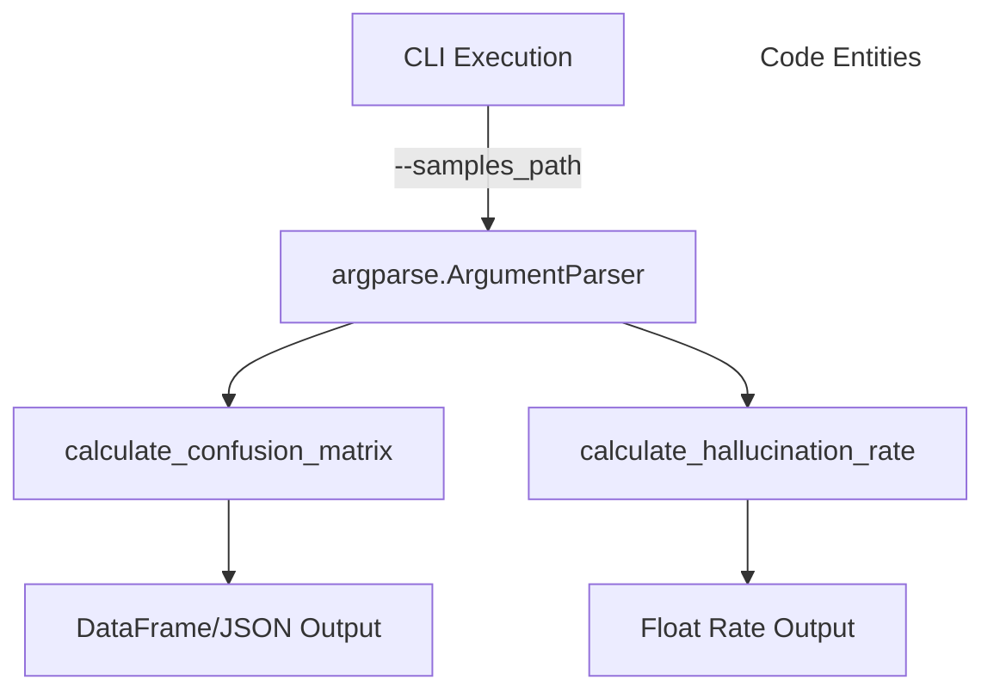
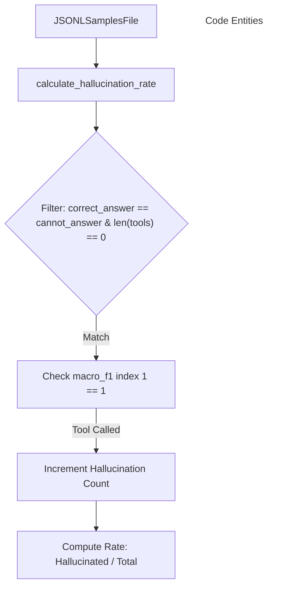

<!-- source: DeepWiki mcp.deepwiki.com · repo NVIDIA/When2Call · extra page Additional Metrics · fetched 2026-11-09 -->

# Additional Metrics

Relevant source files

The following files were used as context for generating this wiki page:

- [evaluation/mcq/lm_eval_harness/when2call/additional_metrics.py](evaluation/mcq/lm_eval_harness/when2call/additional_metrics.py)

The purpose of this page is to document the implementation of additional evaluation metrics provided in `evaluation/mcq/lm_eval_harness/when2call/additional_metrics.py`. This script processes logged evaluation samples from `lm-eval-harness` runs to compute specialized metrics including hallucination rates for negative test cases, full multi-class confusion matrices, and macro-F1 evaluations [evaluation/mcq/lm_eval_harness/when2call/additional_metrics.py:1-88]().

---

## 1. Command-Line Interface and Execution Flow

The script acts as a standalone utility invoked post-evaluation on JSONL sample files generated via the `--log_samples` flag [evaluation/mcq/lm_eval_harness/when2call/additional_metrics.py:75-88](). It parses the `--samples_path` argument, invokes both metric calculation routines, and prints a structured summary dictionary [evaluation/mcq/lm_eval_harness/when2call/additional_metrics.py:75-88]().

*Figure 1: Script execution and data flow from CLI arguments to metric computation functions.*

Sources: `[evaluation/mcq/lm_eval_harness/when2call/additional_metrics.py:75-88]()`

---

## 2. Hallucination Rate Calculation

The function `calculate_hallucination_rate` measures a model's tendency to falsely invoke tools when presented with queries that require no tools [evaluation/mcq/lm_eval_harness/when2call/additional_metrics.py:21-48](). 

### Implementation Details
1. **Filtering**: It isolates samples where the gold label is `"cannot_answer"` and the available tools list (`doc['tools']`) is empty [evaluation/mcq/lm_eval_harness/when2call/additional_metrics.py:33-35]().
2. **Prediction Check**: It inspects the `macro_f1` tuple stored in each logged sample, checking whether the predicted index (`result['macro_f1'][1]`) points to a tool call (index `1`) [evaluation/mcq/lm_eval_harness/when2call/additional_metrics.py:37-41]().
3. **Rate Computation**: The hallucination rate is calculated as the ratio of erroneous tool calls to total filtered negative samples [evaluation/mcq/lm_eval_harness/when2call/additional_metrics.py:42]().

*Figure 2: Natural language evaluation filtering logic mapped to `calculate_hallucination_rate` code structures.*

Sources: `[evaluation/mcq/lm_eval_harness/when2call/additional_metrics.py:21-48]()`

---

## 3. Confusion Matrix and Macro-F1 Mapping

The `calculate_confusion_matrix` function builds a comprehensive error profile across all four answer categories [evaluation/mcq/lm_eval_harness/when2call/additional_metrics.py:51-73]().

### Implementation Details
* **Label Extraction**: It dynamically extracts label names from the first sample's `doc['answers']` dictionary keys [evaluation/mcq/lm_eval_harness/when2call/additional_metrics.py:59-60]().
* **Gold and Predicted Extraction**: It extracts gold indices from `sample_dict['macro_f1'][0]` and predicted indices from `sample_dict['macro_f1'][1]` [evaluation/mcq/lm_eval_harness/when2call/additional_metrics.py:62-63]().
* **Matrix Generation**: It computes the raw confusion matrix using `sklearn.metrics.confusion_matrix` and wraps it in a `pandas.DataFrame` labeled with `true:` and `pred:` prefixes before serializing to JSON [evaluation/mcq/lm_eval_harness/when2call/additional_metrics.py:65-73]().

Sources: `[evaluation/mcq/lm_eval_harness/when2call/additional_metrics.py:51-73]()`

---

