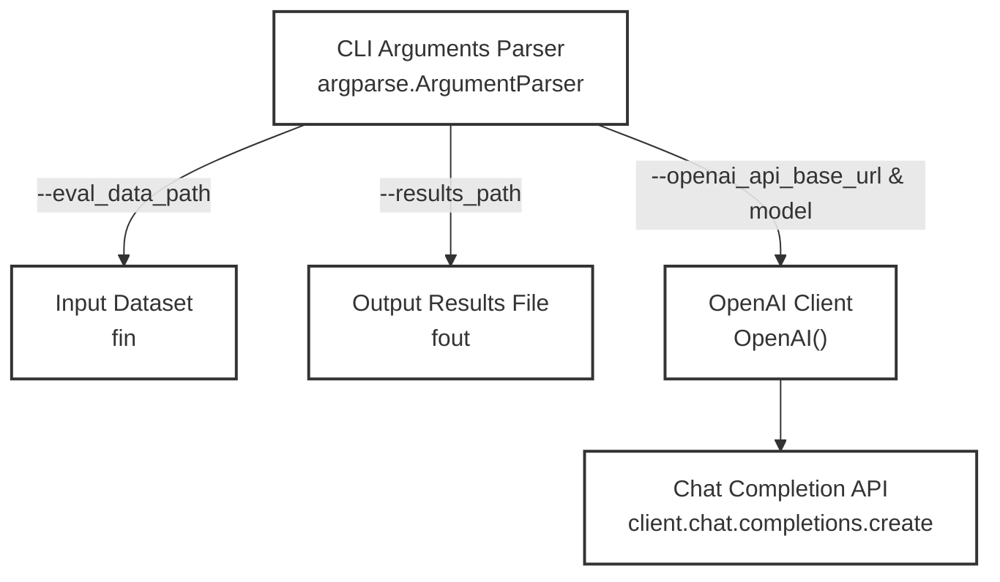
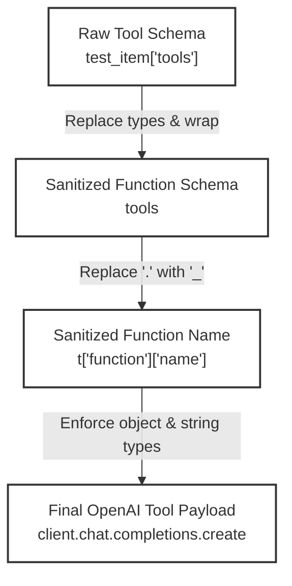

<!-- source: DeepWiki mcp.deepwiki.com · repo NVIDIA/When2Call · extra page Model Inference (run_openai_inference.py) · fetched 2026-11-09 -->

# Model Inference (run_openai_inference.py)

<details>
<summary>Relevant source files</summary>

The following files were used as context for generating this wiki page:

- [evaluation/llm_as_a_judge/run_openai_inference.py](evaluation/llm_as_a_judge/run_openai_inference.py)

</details>


## Purpose and Scope

This page documents the implementation of the model inference script `evaluation/llm_as_a_judge/run_openai_inference.py`, which serves as the first stage of the LLM-as-a-Judge evaluation pipeline. The script processes evaluation datasets, sanitizes tool definitions to comply with OpenAI API expectations, executes chat completions against any OpenAI-compatible endpoint, and writes outputs incrementally to support resumable execution.

Sources: `evaluation/llm_as_a_judge/run_openai_inference.py:1-103`()

---

## Command-Line Interface and Initialization

The script exposes a command-line interface using `argparse.ArgumentParser` defined in `evaluation/llm_as_a_judge/run_openai_inference.py:27-53`(). It accepts four mandatory arguments:
- `--eval_data_path`: Path to the input evaluation dataset JSONL file.
- `--results_path`: Destination file path for saving inference results.
- `--openai_api_base_url`: Base URL for the OpenAI-compatible API endpoint.
- `--openai_api_model`: Target model identifier for generation.

The `main()` function initializes the `OpenAI` client using `os.environ.get("OPENAI_API_KEY")` for authentication and the provided `--openai_api_base_url` (`[evaluation/llm_as_a_judge/run_openai_inference.py:55]()`).


*Diagram 1: Initialization and Client Configuration Flow*

Sources: `evaluation/llm_as_a_judge/run_openai_inference.py:27-55`()

---

## Resumable Execution Handling

To prevent data loss during long-running evaluations, `run_openai_inference.py` implements a resumable output mechanism (`[evaluation/llm_as_a_judge/run_openai_inference.py:57-62]`). Before processing the evaluation dataset, the script checks whether `--results_path` already exists. If the file exists, it counts the number of existing lines (`existing_count`) (`[evaluation/llm_as_a_judge/run_openai_inference.py:57-62]()`).

During iteration over the input evaluation records (`[evaluation/llm_as_a_judge/run_openai_inference.py:63-66]()`), any record index `idx` less than `existing_count` is skipped:
```python
if idx < existing_count:
    continue
```
This allows interrupted evaluation jobs to resume directly from the point of failure without reprocessing completed samples.

Sources: `evaluation/llm_as_a_judge/run_openai_inference.py:57-66`()

---

## Tool Schema Sanitization

Input test records contain tool specifications that may use data types or naming conventions incompatible with standard OpenAI schema validators. The script sanitizes tool parameters inside `main()` (`[evaluation/llm_as_a_judge/run_openai_inference.py:69-76]()`) through several transformation steps:

1. **Type Mapping**: Replaces occurrences of `float`, `integer`, `dict`, and `tuple` with standard types (`string` or `object`) (`[evaluation/llm_as_a_judge/run_openai_inference.py:69]()`).
2. **Wrapper Formatting**: Wraps raw function dictionaries into OpenAI tool schema objects (`{"type": "function", "function": t}`) (`[evaluation/llm_as_a_judge/run_openai_inference.py:70]()`).
3. **Name Sanitization**: Replaces periods (`.`) with underscores (`_`) in function names (`[evaluation/llm_as_a_judge/run_openai_inference.py:71-72]()`).
4. **Parameter Schema Enforcement**: Forces parameter top-level types to `"object"` and normalizes all individual property types to `"string"` (`[evaluation/llm_as_a_judge/run_openai_inference.py:73-75]()`).


*Diagram 2: Tool Schema Sanitization Pipeline*

Sources: `evaluation/llm_as_a_judge/run_openai_inference.py:69-76`()

---

## Inference Execution and Result Persistence

After sanitizing tools and constructing user messages (`[evaluation/llm_as_a_judge/run_openai_inference.py:77]`), the script conditionally invokes the chat completions API (`[evaluation/llm_as_a_judge/run_openai_inference.py:79-89]()`):
- If `tools` are present, `client.chat.completions.create` is called with the `tools` argument (`[evaluation/llm_as_a_judge/run_openai_inference.py:80-84]()`).
- If no tools are available, the model is queried without tool definitions (`[evaluation/llm_as_a_judge/run_openai_inference.py:85-89]()`).

The response is parsed to extract either tool calls or text content (`[evaluation/llm_as_a_judge/run_openai_inference.py:90-94]()`):
- If `responses.choices[0].message.tool_calls` is not `None`, the output is serialized as a JSON string containing the tool `name` and parsed `arguments` (`[evaluation/llm_as_a_judge/run_openai_inference.py:91-92]()`).
- Otherwise, the message content is stripped and captured directly (`[evaluation/llm_as_a_judge/run_openai_inference.py:93-94]()`).

Finally, the model response is injected into the test item (`test_item["model_response"] = output`) and appended to `--results_path` in JSONL format (`[evaluation/llm_as_a_judge/run_openai_inference.py:96-98]()`).

Sources: `evaluation/llm_as_a_judge/run_openai_inference.py:77-98`()

---

