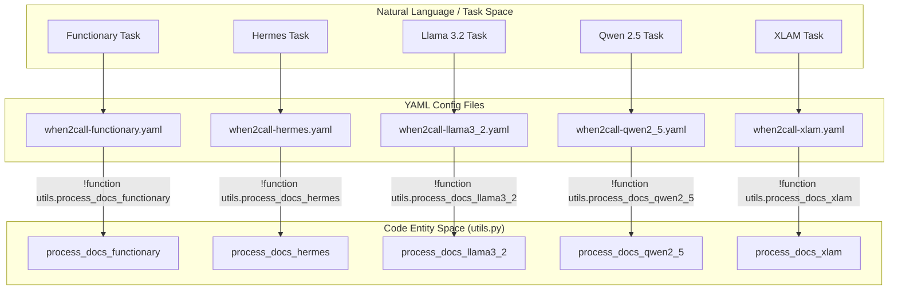
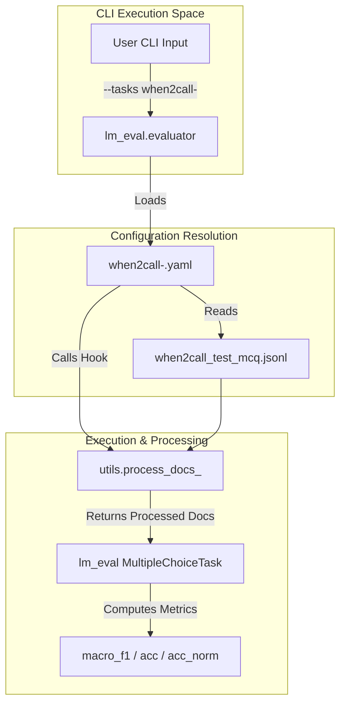

<!-- source: DeepWiki mcp.deepwiki.com · repo NVIDIA/When2Call · extra page Model-Specific Task Configs · fetched 2026-11-09 -->

# Model-Specific Task Configs

Relevant source files

The following files were used as context for generating this wiki page:

- [evaluation/mcq/lm_eval_harness/when2call/when2call-functionary.yaml](evaluation/mcq/lm_eval_harness/when2call/when2call-functionary.yaml)
- [evaluation/mcq/lm_eval_harness/when2call/when2call-hermes.yaml](evaluation/mcq/lm_eval_harness/when2call/when2call-hermes.yaml)
- [evaluation/mcq/lm_eval_harness/when2call/when2call-llama3_2.yaml](evaluation/mcq/lm_eval_harness/when2call/when2call-llama3_2.yaml)
- [evaluation/mcq/lm_eval_harness/when2call/when2call-qwen2_5.yaml](evaluation/mcq/lm_eval_harness/when2call/when2call-qwen2_5.yaml)
- [evaluation/mcq/lm_eval_harness/when2call/when2call-xlam.yaml](evaluation/mcq/lm_eval_harness/when2call/when2call-xlam.yaml)

## Purpose and Scope
This page details the model-specific task configuration files used by the `lm-evaluation-harness` integration in When2Call. It outlines the structural similarities and critical differences across the five model-specific YAML configurations (`functionary`, `hermes`, `llama3_2`, `qwen2_5`, and `xlam`), mapping each configuration to its respective data processing hook in `utils.py`.

---

## 1. Common Configuration Architecture
All model-specific task configurations share a uniform base structure optimized for multiple-choice evaluation via `lm-eval`. They load the local JSONL dataset (`when2call_test_mcq.jsonl`), treat the `train` split as the evaluation set, and configure standard classification metrics (`macro_f1`, `acc`, and `acc_norm`).

The shared base properties across all task YAMLs include:
- `dataset_path: json` [evaluation/mcq/lm_eval_harness/when2call/when2call-functionary.yaml:2-2]()
- `output_type: multiple_choice` [evaluation/mcq/lm_eval_harness/when2call/when2call-functionary.yaml:15-15]()
- Metric definitions for `macro_f1`, `acc`, and `acc_norm` [evaluation/mcq/lm_eval_harness/when2call/when2call-functionary.yaml:16-25]()

Sources: `evaluation/mcq/lm_eval_harness/when2call/when2call-functionary.yaml:1-25`

---

## 2. Model-Specific YAML Variants and Python Hook Mapping
While the harness configuration schema remains constant, each YAML file defines a unique `task` identifier and binds to a specific document processor function (`process_docs_*`) to handle model-specific template formatting and tokenization paradigms.

Sources: `evaluation/mcq/lm_eval_harness/when2call/when2call-functionary.yaml:1-10` [evaluation/mcq/lm_eval_harness/when2call/when2call-functionary.yaml:1-10](), `evaluation/mcq/lm_eval_harness/when2call/when2call-hermes.yaml:1-10` [evaluation/mcq/lm_eval_harness/when2call/when2call-hermes.yaml:1-10](), `evaluation/mcq/lm_eval_harness/when2call/when2call-llama3_2.yaml:1-10` [evaluation/mcq/lm_eval_harness/when2call/when2call-llama3_2.yaml:1-10](), `evaluation/mcq/lm_eval_harness/when2call/when2call-qwen2_5.yaml:1-10` [evaluation/mcq/lm_eval_harness/when2call/when2call-qwen2_5.yaml:1-10](), `evaluation/mcq/lm_eval_harness/when2call/when2call-xlam.yaml:1-10` [evaluation/mcq/lm_eval_harness/when2call/when2call-xlam.yaml:1-10]()

### Configuration Breakdown Table

| Model Variant | Task Identifier | Dataset File | Process Doc Hook (`utils.py`) |
| :--- | :--- | :--- | :--- |
| **Functionary** | `when2call-functionary` [evaluation/mcq/lm_eval_harness/when2call/when2call-functionary.yaml:1-1]() | `when2call_test_mcq.jsonl` [evaluation/mcq/lm_eval_harness/when2call/when2call-functionary.yaml:5-5]() | `process_docs_functionary` [evaluation/mcq/lm_eval_harness/when2call/when2call-functionary.yaml:10-10]() |
| **Hermes** | `when2call-hermes` [evaluation/mcq/lm_eval_harness/when2call/when2call-hermes.yaml:1-1]() | `when2call_test_mcq.jsonl` [evaluation/mcq/lm_eval_harness/when2call/when2call-hermes.yaml:5-5]() | `process_docs_hermes` [evaluation/mcq/lm_eval_harness/when2call/when2call-hermes.yaml:10-10]() |
| **Llama 3.2** | `when2call-llama3_2` [evaluation/mcq/lm_eval_harness/when2call/when2call-llama3_2.yaml:1-1]() | `when2call_test_mcq.jsonl` [evaluation/mcq/lm_eval_harness/when2call/when2call-llama3_2.yaml:5-5]() | `process_docs_llama3_2` [evaluation/mcq/lm_eval_harness/when2call/when2call-llama3_2.yaml:10-10]() |
| **Qwen 2.5** | `when2call-qwen2_5` [evaluation/mcq/lm_eval_harness/when2call/when2call-qwen2_5.yaml:1-1]() | `when2call_test_mcq.jsonl` [evaluation/mcq/lm_eval_harness/when2call/when2call-qwen2_5.yaml:5-5]() | `process_docs_qwen2_5` [evaluation/mcq/lm_eval_harness/when2call/when2call-qwen2_5.yaml:10-10]() |
| **XLAM** | `when2call-xlam` [evaluation/mcq/lm_eval_harness/when2call/when2call-xlam.yaml:1-1]() | `when2call_test_mcq.jsonl` [evaluation/mcq/lm_eval_harness/when2call/when2call-xlam.yaml:5-5]() | `process_docs_xlam` [evaluation/mcq/lm_eval_harness/when2call/when2call-xlam.yaml:10-10]() |

Sources: 
- `evaluation/mcq/lm_eval_harness/when2call/when2call-functionary.yaml:1-25` [evaluation/mcq/lm_eval_harness/when2call/when2call-functionary.yaml:1-25]()
- `evaluation/mcq/lm_eval_harness/when2call/when2call-hermes.yaml:1-25` [evaluation/mcq/lm_eval_harness/when2call/when2call-hermes.yaml:1-25]()
- `evaluation/mcq/lm_eval_harness/when2call/when2call-llama3_2.yaml:1-25` [evaluation/mcq/lm_eval_harness/when2call/when2call-llama3_2.yaml:1-25]()
- `evaluation/mcq/lm_eval_harness/when2call/when2call-qwen2_5.yaml:1-25` [evaluation/mcq/lm_eval_harness/when2call/when2call-qwen2_5.yaml:1-25]()
- `evaluation/mcq/lm_eval_harness/when2call/when2call-xlam.yaml:1-25` [evaluation/mcq/lm_eval_harness/when2call/when2call-xlam.yaml:1-25]()

---

## 3. Execution Data Flow in LM-Eval Integration

The runtime execution flow maps a task identifier from the CLI to its corresponding YAML specification, resolves the document processing function, and evaluates choices using `output_type: multiple_choice`.

Sources: 
- `evaluation/mcq/lm_eval_harness/when2call/when2call-functionary.yaml:1-25` [evaluation/mcq/lm_eval_harness/when2call/when2call-functionary.yaml:1-25]()
- `evaluation/mcq/lm_eval_harness/when2call/when2call-qwen2_5.yaml:1-25` [evaluation/mcq/lm_eval_harness/when2call/when2call-qwen2_5.yaml:1-25]()

---

