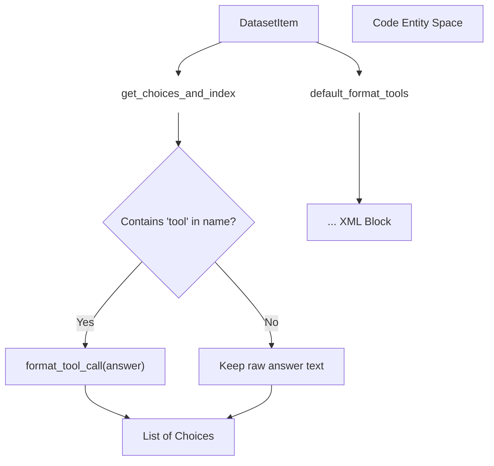
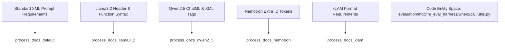

<!-- source: DeepWiki mcp.deepwiki.com · repo NVIDIA/When2Call · extra page Prompt Formatting and Doc Processing (utils.py) · fetched 2026-11-09 -->

# Prompt Formatting and Doc Processing (utils.py)

Relevant source files

The following files were used as context for generating this wiki page:

- [evaluation/mcq/lm_eval_harness/when2call/utils.py](evaluation/mcq/lm_eval_harness/when2call/utils.py)

## Purpose and Scope

This document details the technical implementation of prompt formatting and document processing routines located in `evaluation/mcq/lm_eval_harness/when2call/utils.py`. The module is responsible for transforming raw benchmark datasets into Hugging Face `Dataset` objects ready for evaluation via the LM Evaluation Harness. It constructs multiple-choice (`mcq`) choices, handles correct answer indices, and applies model-specific prompt templates and tool-call formats across various architectures (such as Llama 3.2, Qwen 2.5, Nemotron, and xLAM).

Sources: `[evaluation/mcq/lm_eval_harness/when2call/utils.py:1-175]()`

---

## Core Utilities and Choice Construction

The module provides foundational helper functions to parse dataset items, extract candidate answers, format tool signatures, and identify the ground-truth target index.

### Choice Parsing (`get_choices_and_index`)
The `get_choices_and_index` function extracts an ordered list of answer choices from a dataset item and determines the index of the correct answer `[evaluation/mcq/lm_eval_harness/when2call/utils.py:30-44]()`. If a model requires custom tool-call formatting, a callable `format_tool_call` argument is applied to any answer dictionary key containing `'tool'` `[evaluation/mcq/lm_eval_harness/when2call/utils.py:35-38]`.

### Default Tool Formatting (`default_format_tools`)
Tools are serialized into XML-style `<tool></tool>` blocks by `default_format_tools`, joining individual tool descriptions with double newlines `[evaluation/mcq/lm_eval_harness/when2call/utils.py:47-51]()`.

*Figure 1: Data flow of choice construction and tool formatting.*

Sources: `[evaluation/mcq/lm_eval_harness/when2call/utils.py:30-51]()`

---

## Model-Specific Document Processors

Different LLM architectures demand specific system prompts, chat header tokens, and tool invocation syntaxes. The module implements dedicated `process_docs_*` functions mapped to these requirements.

### Default Processor (`process_docs_default`)
`process_docs_default` applies the standard `DEFAULT_SYSTEM_PROMPT` [evaluation/mcq/lm_eval_harness/when2call/utils.py:20-23]() and `TOOL_USE_INSTRUCTIONS` [evaluation/mcq/lm_eval_harness/when2call/utils.py:25-27](), wrapping tools via `default_format_tools` and mapping over the dataset `[evaluation/mcq/lm_eval_harness/when2call/utils.py:54-67]()`.

### Llama 3.2 Processor (`process_docs_llama3_2`)
`process_docs_llama3_2` formats tool calls into Python-like function call signatures (e.g., `func_name(arg1="val1")`) and constructs prompts using Llama 3 special header tokens (`<|start_header_id|>`, `<|eot_id|>`) `[evaluation/mcq/lm_eval_harness/when2call/utils.py:70-105]()`.

### Qwen 2.5 Processor (`process_docs_qwen2_5`)
`process_docs_qwen2_5` structures prompts around Qwen's ChatML template (`<|im_start|>`, `<|im_end|>`) while enclosing tool signatures in `<tools></tools>` tags and expected outputs in `<tool_call></tool_call>` tags `[evaluation/mcq/lm_eval_harness/when2call/utils.py:108-143]()`.

### Nemotron Processor (`process_docs_nemotron`)
`process_docs_nemotron` formats tool calls inside `<toolcall>` XML tags and uses custom prefix tokens (`<extra_id_0>System`, `<extra_id_1>User`) to construct chat prompts `[evaluation/mcq/lm_eval_harness/when2call/utils.py:146-171]()`.

Sources: `[evaluation/mcq/lm_eval_harness/when2call/utils.py:54-171]()`

---

## Architecture-to-Processor Mapping

To bridge natural language model requirements with code implementation, the following diagram maps target model prompt families to their respective dataset processing functions in `utils.py`.

*Figure 2: Mapping natural language model structures to `utils.py` processor functions.*

Sources: `[evaluation/mcq/lm_eval_harness/when2call/utils.py:54-175]()`

---

