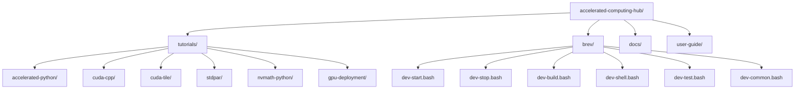
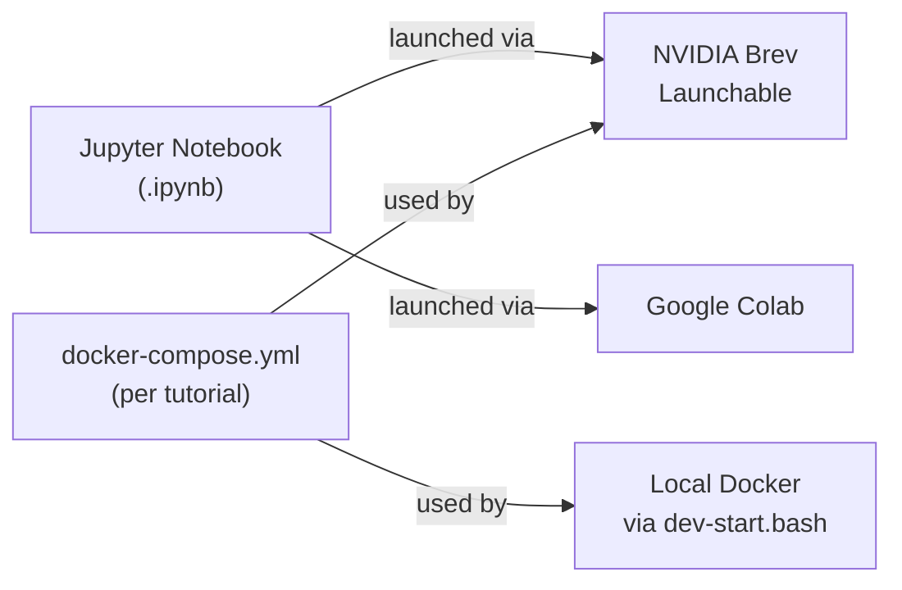
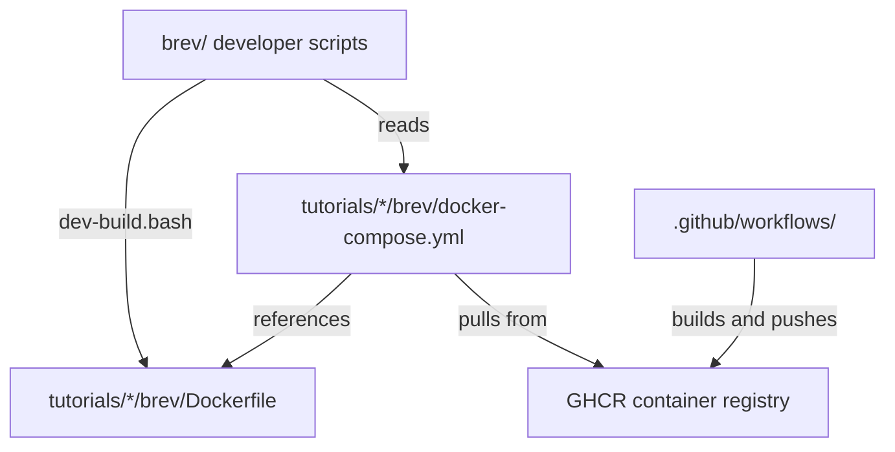

<!-- source: DeepWiki mcp.deepwiki.com · repo NVIDIA/accelerated-computing-hub · page 1 Overview · fetched 2026-10-26 -->

# Overview

Relevant source files

The following files were used as context for generating this wiki page:

- [.gitattributes](.gitattributes)
- [CONTRIBUTING.md](CONTRIBUTING.md)
- [README.md](README.md)
- [brev/dev-start.bash](brev/dev-start.bash)
- [brev/dev-stop.bash](brev/dev-stop.bash)
- [brev/dev-test.bash](brev/dev-test.bash)
- [tutorials/accelerated-python/README.md](tutorials/accelerated-python/README.md)
- [tutorials/accelerated-python/notebooks/fundamentals/07__cuda_core__devices_streams_and_memory.ipynb](tutorials/accelerated-python/notebooks/fundamentals/07__cuda_core__devices_streams_and_memory.ipynb)
- [tutorials/accelerated-python/notebooks/fundamentals/solutions/07__cuda_core__devices_streams_and_memory__SOLUTION.ipynb](tutorials/accelerated-python/notebooks/fundamentals/solutions/07__cuda_core__devices_streams_and_memory__SOLUTION.ipynb)
- [tutorials/accelerated-python/notebooks/start.ipynb](tutorials/accelerated-python/notebooks/start.ipynb)
- [tutorials/accelerated-python/notebooks/syllabi/cuda_python__cuda_core_cccl__2_hours.ipynb](tutorials/accelerated-python/notebooks/syllabi/cuda_python__cuda_core_cccl__2_hours.ipynb)
- [tutorials/cuda-cpp/README.md](tutorials/cuda-cpp/README.md)
- [tutorials/cuda-tile/README.md](tutorials/cuda-tile/README.md)
- [tutorials/stdpar/README.md](tutorials/stdpar/README.md)

This page describes the purpose, structure, and navigation of the NVIDIA Accelerated Computing Hub repository. It covers the top-level layout, the available tutorial tracks, the user guide, and the shared infrastructure that ties them together. For details on any specific system, follow the links to the relevant child pages.

---

## Purpose

The NVIDIA Accelerated Computing Hub is an open learning repository for GPU computing. It provides interactive tutorials, syllabi, user guides, and reference material targeting learners at various levels — from Python programmers adopting GPU libraries, to C++ developers writing custom CUDA kernels.

The stated goal from [README.md:3-5]() is:

> A living project where documents, examples, best practices, optimizations, and new features can become both visible and accessible to users quickly and easily.

All content is licensed for broad reuse:
- Written materials (guides, docs, presentations): **Creative Commons CC BY-NC-SA 4.0**
- Code (notebook code, coding examples): **Apache License, Version 2.0**

Sources: [README.md:1-31]()

---

## Repository Layout

The repository is organized into four top-level areas:

**Repository structure diagram**

Sources: [README.md:1-31](), [brev/dev-start.bash:1-55](), [brev/dev-stop.bash:1-44](), [brev/dev-test.bash:1-91]()

Each tutorial directory under `tutorials/` contains:

| Subdirectory | Contents |
|---|---|
| `notebooks/` | Lesson notebooks and exercise notebooks |
| `notebooks/syllabi/` | Curated subsets of notebooks for specific learning objectives |
| `notebooks/solutions/` | Solution notebooks for exercises |
| `slides/` | Lecture slide decks (stored in Git LFS) |
| `brev/` | `docker-compose.yml` and Dockerfile for the tutorial environment |

Sources: [tutorials/accelerated-python/README.md:1-63](), [tutorials/cuda-cpp/README.md:1-68](), [CONTRIBUTING.md:39-55]()

---

## Tutorial Tracks

The following tutorials are available. Each can be launched on NVIDIA Brev or run locally via Docker Compose. Most also support Google Colab.

| Tutorial | Directory | Recommended GPU | Notes |
|---|---|---|---|
| CUDA Tile Tutorial | `tutorials/cuda-tile/` | 1×B300, 1×B200, or 1×RTX Pro 6000 | Requires Blackwell GPU |
| CUDA C++ Tutorial | `tutorials/cuda-cpp/` | L40S, L4, or T4 | Needs Flexible Ports |
| Standard Parallelism Tutorial | `tutorials/stdpar/` | 4×L4, 2×L4, 2×L40S, or 1×L40S | Requires Linux 6.1.24+/6.2.11+/6.3+ for HMM |
| Accelerated Python Tutorial | `tutorials/accelerated-python/` | L40S, L4, or T4; 4×L4 or 2×L4 for distributed | Multiple syllabi available |
| nvmath-python Tutorial | `tutorials/nvmath-python/` | 4×L4, 2×L4, 2×L40S, or 1×L40S | Needs Flexible Ports |
| GPU Deployment Guide | `tutorials/gpu-deployment/` | Any NVIDIA GPU | Markdown-only, no container needed |

Sources: [README.md:11-21]()

### Syllabi (Accelerated Python)

The Accelerated Python tutorial supports three pre-defined syllabi that select a subset of its notebooks for a particular event format:

| Syllabus | Duration | Key Technologies |
|---|---|---|
| CUDA Python – CuPy, cuDF, CCCL, & Kernels | 8 hours | CuPy, cuDF, cuda-cccl, Numba |
| CUDA Python – cuda.core & CCCL | 2 hours | cuda.core, cuda-cccl |
| PyHPC – NumPy, CuPy, & mpi4py | 4 hours | NumPy, CuPy, mpi4py |

Syllabus files live at `tutorials/accelerated-python/notebooks/syllabi/`. The entry point for the tutorial is [tutorials/accelerated-python/notebooks/start.ipynb]().

Sources: [tutorials/accelerated-python/README.md:15-19](), [tutorials/accelerated-python/notebooks/start.ipynb:1-34](), [tutorials/accelerated-python/notebooks/syllabi/cuda_python__cuda_core_cccl__2_hours.ipynb:1-54]()

---

## Content and Delivery Model

**How content is delivered**

Sources: [README.md:9-21](), [brev/dev-start.bash:44-55]()

Each tutorial's `brev/docker-compose.yml` defines one or more services (typically `base`, `jupyter`, `nsight`). When launched on Brev or locally, the compose file starts a JupyterLab server with all required dependencies pre-installed in the container.

For local development, [brev/dev-start.bash]() rewrites `127.0.0.1` port bindings to `0.0.0.0` so services are reachable outside the container ([brev/dev-start.bash:48-50]()).

---

## Infrastructure Summary

The shared infrastructure layer is described in detail on page [2](#2). A brief summary:

**Infrastructure component map**

| Script | Purpose |
|---|---|
| `brev/dev-start.bash` | Start containers for a named tutorial |
| `brev/dev-stop.bash` | Stop containers for a named tutorial |
| `brev/dev-build.bash` | Build Docker images; generates Dockerfiles from HPCCM recipes if present |
| `brev/dev-shell.bash` | Open an interactive shell inside a running container |
| `brev/dev-test.bash` | Run a tutorial's test suite with the local repo mounted |
| `brev/dev-common.bash` | Shared utilities (volume creation, `ACH_UID`/`ACH_GID` export) |

Sources: [CONTRIBUTING.md:9-21](), [brev/dev-start.bash:1-55](), [brev/dev-stop.bash:1-44](), [brev/dev-test.bash:1-91]()

---

## CI/CD Summary

GitHub Actions workflows live under `.github/workflows/`. There are two main pipeline categories:

1. **Docker image lifecycle** — builds tutorial images on merge, pushes to GHCR, and tests compose files. See page [3.1](#3.1).
2. **Code quality checks** — link validation, commit signature checks, Git LFS usage, YAML linting. See page [3.2](#3.2).

---

## Accelerated Python User Guide

Separate from the tutorials, the repository also contains a **User Guide** — a standalone collection of advanced notebooks covering topics like NVIDIA Warp, distributed computing with cuPyNumeric, and developer tooling. This is documented on page [5](#5).

---

## Other Pages in This Wiki

| Page | Topic |
|---|---|
| [Infrastructure](#2) | Docker environments, entrypoints, dev scripts |
| [CI/CD Pipelines](#3) | GitHub Actions workflows |
| [Tutorials](#4) | All tutorial tracks in detail |
| [Accelerated Python User Guide](#5) | Advanced user guide notebooks |
| [GPU Deployment Guide](#6) | Brev provisioning and GPU tooling |

---

## Contributing

Contributions are governed by [CONTRIBUTING.md](). Key guidelines:

- Start significant changes with a GitHub Issue.
- Notebooks should follow the style defined in `docs/notebook_template.ipynb`.
- New modules require a `README.ipynb`, per-language subdirectories, and a `solutions/` directory.
- All commits must include a `Signed-off-by` tag; GPG-signed commits are preferred.
- PRs from forks require a maintainer to push the branch to the upstream repo before CI runs ([CONTRIBUTING.md:56-81]()).

Sources: [CONTRIBUTING.md:1-86]()

---

