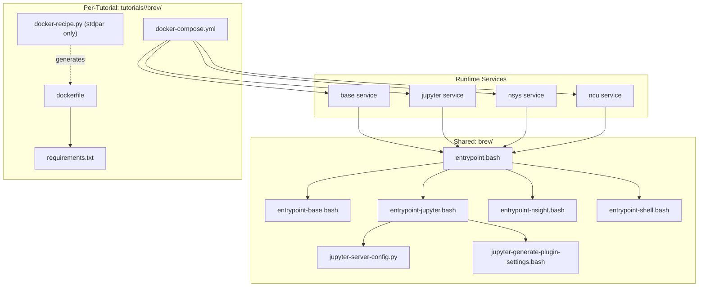
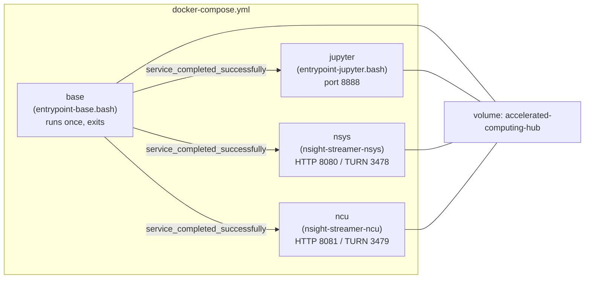
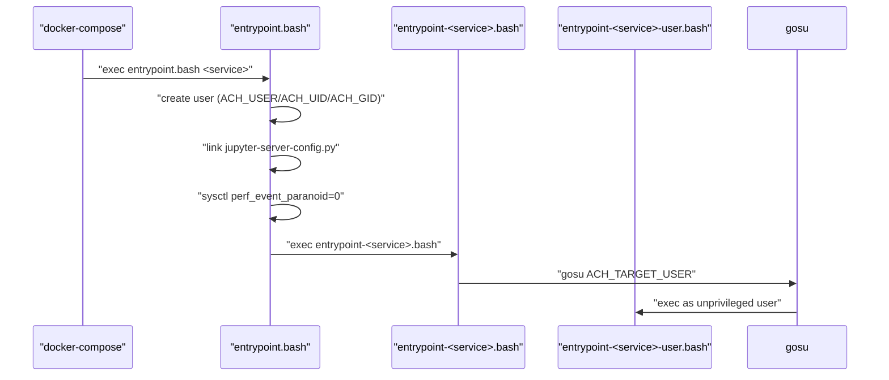
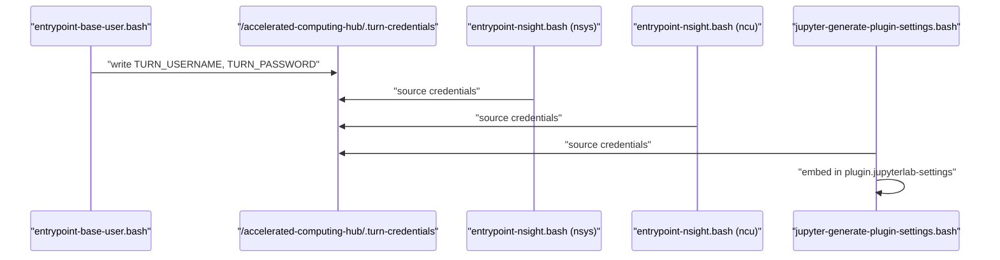

<!-- source: DeepWiki mcp.deepwiki.com · repo NVIDIA/accelerated-computing-hub · page 2 Infrastructure · fetched 2026-10-26 -->

# Infrastructure

Relevant source files

The following files were used as context for generating this wiki page:

- [brev/entrypoint-base-user.bash](brev/entrypoint-base-user.bash)
- [brev/entrypoint-base.bash](brev/entrypoint-base.bash)
- [brev/entrypoint-jupyter-user.bash](brev/entrypoint-jupyter-user.bash)
- [brev/entrypoint-jupyter.bash](brev/entrypoint-jupyter.bash)
- [brev/entrypoint-nsight.bash](brev/entrypoint-nsight.bash)
- [brev/entrypoint-shell.bash](brev/entrypoint-shell.bash)
- [brev/entrypoint.bash](brev/entrypoint.bash)
- [brev/jupyter-generate-plugin-settings.bash](brev/jupyter-generate-plugin-settings.bash)
- [brev/jupyter-server-config.py](brev/jupyter-server-config.py)
- [tutorials/accelerated-python/brev/docker-compose.yml](tutorials/accelerated-python/brev/docker-compose.yml)
- [tutorials/accelerated-python/brev/dockerfile](tutorials/accelerated-python/brev/dockerfile)
- [tutorials/cuda-cpp/brev/docker-compose.yml](tutorials/cuda-cpp/brev/docker-compose.yml)
- [tutorials/cuda-cpp/brev/dockerfile](tutorials/cuda-cpp/brev/dockerfile)
- [tutorials/cuda-tile/brev/docker-compose.yml](tutorials/cuda-tile/brev/docker-compose.yml)
- [tutorials/cuda-tile/brev/dockerfile](tutorials/cuda-tile/brev/dockerfile)
- [tutorials/nvmath-python/brev/docker-compose.yml](tutorials/nvmath-python/brev/docker-compose.yml)
- [tutorials/nvmath-python/brev/dockerfile](tutorials/nvmath-python/brev/dockerfile)
- [tutorials/stdpar/brev/docker-compose.yml](tutorials/stdpar/brev/docker-compose.yml)
- [tutorials/stdpar/brev/docker-recipe.py](tutorials/stdpar/brev/docker-recipe.py)

This page provides an overview of the shared infrastructure layer that all tutorials in the Accelerated Computing Hub repository rely on. It covers the Docker-based runtime environments, multi-service container orchestration, entrypoint scripts, and developer utilities.

For details on individual subsystems, see:
- [Tutorial Docker Environments](#2.1) — per-tutorial Dockerfiles and Compose configurations
- [Container Services and Entrypoints](#2.2) — entrypoint script chain, user management, JupyterLab configuration
- [Development Workflow Scripts](#2.3) — local developer scripts for building, starting, and testing environments

---

## Structural Overview

Each tutorial is self-contained under its `tutorials/<name>/brev/` directory and shares a common set of runtime scripts from the top-level `brev/` directory. All tutorials converge on the same multi-service container pattern.

**Infrastructure component map**

Sources: [brev/entrypoint.bash:1-91](), [brev/entrypoint-jupyter.bash:1-9](), [brev/entrypoint-base.bash:1-8](), [brev/entrypoint-nsight.bash:1-88](), [tutorials/accelerated-python/brev/docker-compose.yml:1-80]()

---

## Docker Environments

Every tutorial has a `dockerfile` under `tutorials/<name>/brev/`. Each container image:

- Sets `ACH_TUTORIAL` to identify the tutorial at runtime.
- Installs Python, GPU-relevant Python packages, Nsight Systems, and Nsight Compute.
- Copies the full repository into `/accelerated-computing-hub` and makes it world-writable.
- Sets `ENTRYPOINT` to `["/accelerated-computing-hub/brev/entrypoint.bash", "jupyter"]`.

The `stdpar` tutorial is the only exception: its Dockerfile is generated from an HPCCM recipe (`tutorials/stdpar/brev/docker-recipe.py`) rather than maintained as a static file, because it requires a complex HPC SDK toolchain.

**Tutorial image registry**

| Tutorial | Image | Base Image |
|---|---|---|
| `accelerated-python` | `ghcr.io/nvidia/accelerated-python-tutorial:latest` | `ghcr.io/nvidia/mirrors/nvidia-cuda-13.1.0-devel-ubuntu22.04` |
| `cuda-cpp` | `ghcr.io/nvidia/cuda-cpp-tutorial:latest` | `ghcr.io/nvidia/mirrors/rapidsai-devcontainers-25.10-cpp-cuda12.9` |
| `cuda-tile` | `ghcr.io/nvidia/cuda-tile-tutorial:latest` | `ghcr.io/nvidia/mirrors/nvidia-cuda-13.1.0-devel-ubuntu22.04` |
| `nvmath-python` | `ghcr.io/nvidia/nvmath-python-tutorial:latest` | `ghcr.io/nvidia/mirrors/pytorch-2.9.0-cuda12.8-cudnn9-runtime` |
| `stdpar` | `ghcr.io/nvidia/stdpar-tutorial:latest` | `nvcr.io/nvidia/nvhpc:<ver>-devel-cuda<ver>-ubuntu22.04` |

Sources: [tutorials/accelerated-python/brev/dockerfile:1-2](), [tutorials/cuda-cpp/brev/dockerfile:1-2](), [tutorials/cuda-tile/brev/dockerfile:1-2](), [tutorials/nvmath-python/brev/dockerfile:1-2](), [tutorials/stdpar/brev/docker-recipe.py:19]()

---

## Container Services

Every tutorial's `docker-compose.yml` declares four services with a consistent pattern.

**Docker Compose service topology**

| Service | Image | Restart Policy | Purpose |
|---|---|---|---|
| `base` | tutorial image | `no` | One-time setup: TURN credential generation, optional test run |
| `jupyter` | tutorial image | `unless-stopped` | JupyterLab server on port 8888 |
| `nsys` | `nvcr.io/nvidia/devtools/nsight-streamer-nsys:2026.1.1` | `unless-stopped` | Nsight Systems web UI |
| `ncu` | `nvcr.io/nvidia/devtools/nsight-streamer-ncu:2025.4.1` | `unless-stopped` | Nsight Compute web UI |

All services share:
- A named Docker volume `accelerated-computing-hub` mounted at `/accelerated-computing-hub`.
- The Docker socket bind-mount `/var/run/docker.sock`.
- GPU access via `deploy.resources.reservations.devices` with `capabilities: [gpu]`.
- `privileged: true`, `ulimits.memlock: -1`, `shm_size: 1g`.

Sources: [tutorials/accelerated-python/brev/docker-compose.yml:8-80](), [tutorials/cuda-cpp/brev/docker-compose.yml:7-78]()

---

## Entrypoint Chain

The entrypoint system is split into a root-level dispatcher and per-service scripts. All containers share the same `entrypoint.bash` from `brev/`, which is baked into every image at build time.

**Entrypoint dispatch flow**

The `SERVICE` argument in `entrypoint.bash` controls dispatch. Valid values are `base`, `jupyter`, `nsys`, `ncu`, and `shell`.

[brev/entrypoint.bash:11-91]() handles:
1. Installing `gosu` if absent.
2. Creating the target user/group from `ACH_USER`, `ACH_UID`, `ACH_GID`.
3. Linking `jupyter-server-config.py` into `~/.jupyter/`.
4. Linking `ipython-startup-add-cwd-to-path.py` into the IPython startup directory.
5. Relaxing kernel profiling restrictions (`perf_event_paranoid`, `kptr_restrict`).
6. Delegating to `/accelerated-computing-hub/brev/entrypoint-${SERVICE}.bash`.

Sources: [brev/entrypoint.bash:1-91](), [brev/entrypoint-base.bash:1-8](), [brev/entrypoint-jupyter.bash:1-9](), [brev/entrypoint-nsight.bash:1-88](), [brev/entrypoint-shell.bash:1-8]()

---

## Key Environment Variables

These variables are set in both Dockerfiles and Docker Compose files and form the convention by which all scripts identify and configure tutorial containers.

| Variable | Set In | Purpose |
|---|---|---|
| `ACH_TUTORIAL` | Dockerfile `ENV`, Compose `common-env` | Identifies the tutorial (e.g. `accelerated-python`) |
| `ACH_USER` | Compose `common-env` (default: `ach`) | Username created at container startup |
| `ACH_UID` | Compose `common-env` (default: `1000`) | UID for the created user |
| `ACH_GID` | Compose `common-env` (default: `1000`) | GID for the created user |
| `ACH_RUN_TESTS` | Compose `common-env` (optional) | If set, `entrypoint-base-user.bash` runs `tutorials/<name>/brev/test.bash` |
| `BREV_ENV_ID` | Compose `common-env` (optional) | Brev environment identifier; used to construct JupyterLab plugin URLs |
| `ACH_PORT_FORWARDS` | `jupyter` service environment | Space-separated `localport:host:remoteport` tuples for `socat` forwarding |
| `ACH_NSYS_PATH` | Dockerfile `ENV` | Absolute path to the `nsys` binary |
| `ACH_NCU_PATH` | Dockerfile `ENV` | Absolute path to the `ncu` binary |
| `TURN_PORT` | `ncu` service environment (default: `3479`) | TURN server port for Nsight Compute streamer |

Sources: [tutorials/accelerated-python/brev/dockerfile:3-20](), [tutorials/accelerated-python/brev/docker-compose.yml:21-27](), [brev/entrypoint-base-user.bash:9-22](), [brev/entrypoint-jupyter-user.bash:16-21]()

---

## JupyterLab Configuration

`brev/jupyter-server-config.py` is linked into the user's `~/.jupyter/` directory by `entrypoint.bash`. It sets:

- `ServerApp.ip = '0.0.0.0'` — binds on all interfaces inside the container.
- `ServerApp.password = ''` and `IdentityProvider.token = ''` — no authentication (access is controlled by host port binding to `127.0.0.1`).
- `ServerApp.root_dir = '/'` — allows the file browser to navigate the full filesystem.
- `ServerProxy.servers` — registers `nsys` (port 8080) and `ncu` (port 8081) as proxied services accessible from the JupyterLab launcher.

`brev/jupyter-generate-plugin-settings.bash` generates per-session settings including the JupyterLab dark theme, TURN credentials, and the `jupyterlab-nvidia-nsight` plugin configuration pointing at the Nsight streamer URL.

The `jupyter` service uses `socat` to forward ports from the `nsys` and `ncu` Docker Compose services to localhost, as `jupyter-server-proxy` only proxies to localhost targets. The forwarding spec comes from `ACH_PORT_FORWARDS`, e.g. `"8080:nsys:8080 8081:ncu:8080"`.

Sources: [brev/jupyter-server-config.py:1-52](), [brev/jupyter-generate-plugin-settings.bash:1-60](), [brev/entrypoint-jupyter-user.bash:15-22]()

---

## TURN Credential Flow

The `base` service runs once before all other services. Its user-level script (`entrypoint-base-user.bash`) generates a random TURN username and password using `openssl rand` and writes them to `/accelerated-computing-hub/.turn-credentials` on the shared volume. Subsequent services (`nsys`, `ncu`, `jupyter`) read this file to configure TURN authentication for the Nsight streamers' WebRTC connections.

Sources: [brev/entrypoint-base-user.bash:12-22](), [brev/entrypoint-nsight.bash:42-47](), [brev/jupyter-generate-plugin-settings.bash:20-38]()

---

