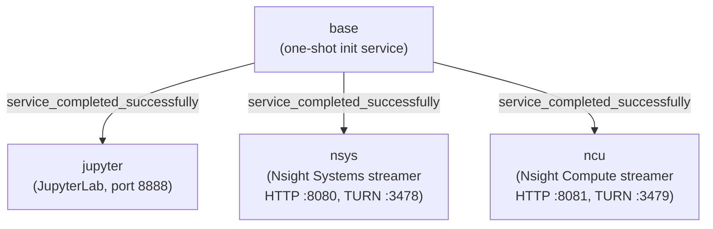
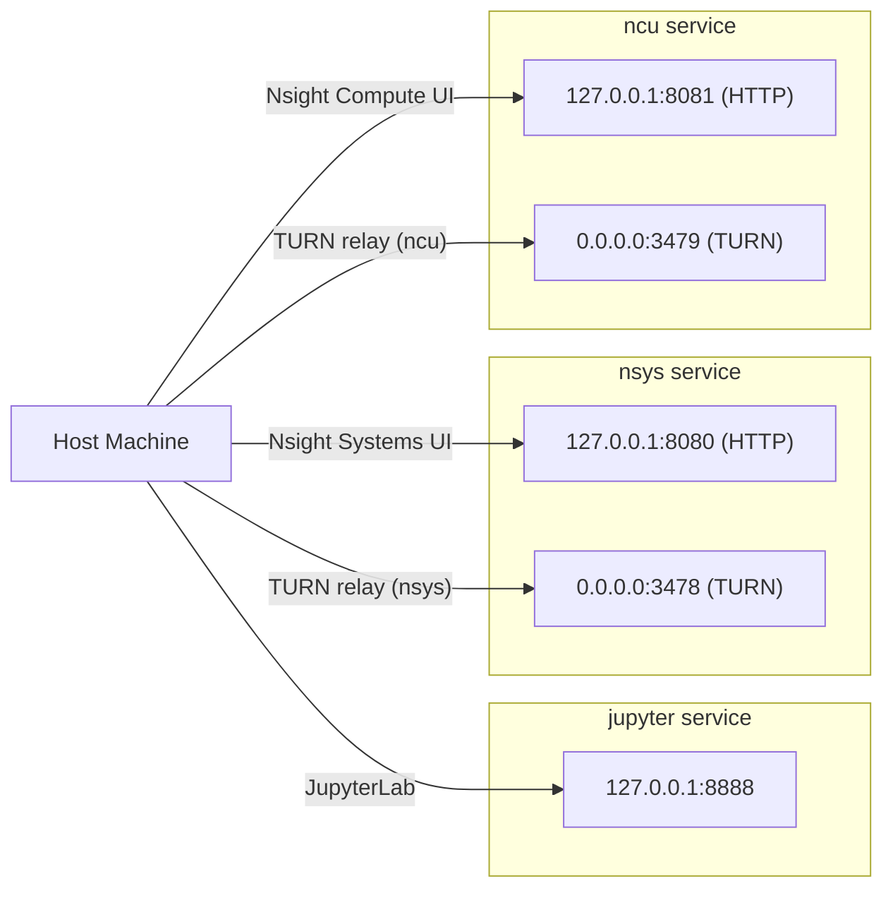

<!-- source: DeepWiki mcp.deepwiki.com · repo NVIDIA/accelerated-computing-hub · page 2.1 Tutorial Docker Environments · fetched 2026-10-26 -->

# Tutorial Docker Environments

<details>
<summary>Relevant source files</summary>

The following files were used as context for generating this wiki page:

- [brev/entrypoint.bash](brev/entrypoint.bash)
- [tutorials/accelerated-python/brev/docker-compose.yml](tutorials/accelerated-python/brev/docker-compose.yml)
- [tutorials/accelerated-python/brev/dockerfile](tutorials/accelerated-python/brev/dockerfile)
- [tutorials/cuda-cpp/brev/docker-compose.yml](tutorials/cuda-cpp/brev/docker-compose.yml)
- [tutorials/cuda-cpp/brev/dockerfile](tutorials/cuda-cpp/brev/dockerfile)
- [tutorials/cuda-tile/brev/docker-compose.yml](tutorials/cuda-tile/brev/docker-compose.yml)
- [tutorials/cuda-tile/brev/dockerfile](tutorials/cuda-tile/brev/dockerfile)
- [tutorials/nvmath-python/brev/docker-compose.yml](tutorials/nvmath-python/brev/docker-compose.yml)
- [tutorials/nvmath-python/brev/dockerfile](tutorials/nvmath-python/brev/dockerfile)
- [tutorials/stdpar/brev/docker-compose.yml](tutorials/stdpar/brev/docker-compose.yml)
- [tutorials/stdpar/brev/docker-recipe.py](tutorials/stdpar/brev/docker-recipe.py)

</details>


## Overview

This page documents the per-tutorial Docker configuration found under each `tutorials/<name>/brev/` directory. It covers base image selection, the environment variable conventions used across all tutorials, the shared Docker Compose service topology, GPU resource configuration, and the Nsight tool port assignments. It also highlights how the `stdpar` tutorial's HPCCM-based recipe differs from the plain Dockerfiles used by other tutorials.

For documentation of the entrypoint scripts that these containers execute at startup, see [Container Services and Entrypoints](#2.2). For the developer workflow scripts that build and run these environments locally, see [Development Workflow Scripts](#2.3). For how the CI/CD pipeline builds and publishes these images, see [Docker Image Build and Test Pipeline](#3.1).

---

## Directory Layout

Every tutorial follows the same layout convention inside its `brev/` subdirectory:

```
tutorials/<name>/brev/
├── dockerfile          # (or docker-recipe.py for stdpar)
├── docker-compose.yml
└── requirements.txt
```

The `stdpar` tutorial is the only one that generates its Dockerfile from a Python recipe rather than maintaining a static `dockerfile`. All others use a plain `dockerfile`.

---

## Base Image Selection

Each tutorial selects a base image tailored to its toolchain requirements. All base images are pulled from the mirrored registry `ghcr.io/nvidia/mirrors/` to avoid Docker Hub rate limits.

| Tutorial | Base Image | CUDA Version |
|---|---|---|
| `accelerated-python` | `ghcr.io/nvidia/mirrors/nvidia-cuda-13.1.0-devel-ubuntu22.04` | 13.1 |
| `cuda-cpp` | `ghcr.io/nvidia/mirrors/rapidsai-devcontainers-25.10-cpp-cuda12.9` | 12.9 |
| `cuda-tile` | `ghcr.io/nvidia/mirrors/nvidia-cuda-13.1.0-devel-ubuntu22.04` | 13.1 |
| `nvmath-python` | `ghcr.io/nvidia/mirrors/pytorch-2.9.0-cuda12.8-cudnn9-runtime` | 12.8 |
| `stdpar` | `nvcr.io/nvidia/nvhpc:24.3-devel-cuda12.3-ubuntu22.04` | 12.3 |

Sources: [tutorials/accelerated-python/brev/dockerfile:1](), [tutorials/cuda-cpp/brev/dockerfile:1](), [tutorials/cuda-tile/brev/dockerfile:1](), [tutorials/nvmath-python/brev/dockerfile:1](), [tutorials/stdpar/brev/docker-recipe.py:9-20]()

---

## Environment Variables

All tutorials set a common set of environment variables. Some variables are baked into the image via `ENV` directives; others are injected at runtime by Docker Compose.

### Build-time (`ENV` in Dockerfile)

| Variable | Purpose | Example Value |
|---|---|---|
| `ACH_TUTORIAL` | Identifies the tutorial; used by entrypoint scripts and CI | `accelerated-python` |
| `ACH_NSYS_PATH` | Absolute path to the `nsys` binary | `/opt/nvidia/nsight-systems-cli/2026.1.1/bin/nsys` |
| `ACH_NCU_PATH` | Absolute path to the `ncu` binary | `/opt/nvidia/nsight-compute/2025.4.1/ncu` |
| `PYTHON_VERSION` | Python version to install (ubuntu-based images only) | `3.12` |
| `NSIGHT_SYSTEMS_VERSION` | Nsight Systems version string | `2026.1.1` |
| `NSIGHT_COMPUTE_VERSION` | Nsight Compute version string | `2025.4.1` |
| `CUPY_CACHE_DIR` | Overrides CuPy JIT cache to a writable path | `/tmp/cupy_cache` |
| `MPLCONFIGDIR` | Overrides Matplotlib config to a writable path | `/tmp/matplotlib_cache` |
| `PIP_ROOT_USER_ACTION` | Silences pip root-user warning | `ignore` |
| `ACH_RAPIDS_VENV` | Path to the isolated RAPIDS venv (accelerated-python only) | `/opt/venvs/rapids` |

### Runtime (Docker Compose `environment` block)

| Variable | Purpose | Default |
|---|---|---|
| `ACH_USER` | Username created inside the container by the entrypoint | `ach` |
| `ACH_UID` | UID assigned to `ACH_USER` | `1000` |
| `ACH_GID` | GID assigned to `ACH_USER` | `1000` |
| `BREV_ENV_ID` | Brev platform environment ID; empty in local dev | `""` |
| `ACH_RUN_TESTS` | When set, the `base` service runs the test suite | `""` |
| `ACH_PORT_FORWARDS` | Tells the `jupyter` service which Nsight ports to proxy | `"8080:nsys:8080 8081:ncu:8080"` |
| `TURN_PORT` | Overrides the TURN listener port for the `ncu` service | `3479` |

Sources: [tutorials/accelerated-python/brev/dockerfile:3-20](), [tutorials/cuda-cpp/brev/dockerfile:3-9](), [tutorials/cuda-tile/brev/dockerfile:3-17](), [tutorials/nvmath-python/brev/dockerfile:3-6](), [tutorials/accelerated-python/brev/docker-compose.yml:21-28]()

---

## Dockerfile Build Layers

The Dockerfiles share a common layering strategy to maximize Docker build cache reuse.

**Shared build layer order (ubuntu-based images)**

```
FROM base-image
  │
  ├─ ENV  (ACH_TUTORIAL, tool versions, PATH)
  ├─ RUN  apt-get: system packages (git, gosu, curl, sudo, ...)
  ├─ RUN  sudo configuration (passwordless, env passthrough)
  ├─ RUN  Python installation (deadsnakes PPA, pip bootstrap)
  ├─ RUN  Docker-in-Docker installation
  ├─ RUN  PyTorch install (where required)
  ├─ COPY requirements.txt  → pip install  (cache-optimized layer)
  ├─ RUN  MPI install (accelerated-python only)
  ├─ RUN  Nsight Systems + Nsight Compute .deb install
  ├─ RUN  Jupyter lab extension disables
  ├─ RUN  RAPIDS venv creation (accelerated-python only)
  ├─ COPY . /accelerated-computing-hub
  ├─ RUN  chmod -R a+rwX /accelerated-computing-hub
  ├─ WORKDIR /accelerated-computing-hub/tutorials/<name>/notebooks
  └─ ENTRYPOINT ["/accelerated-computing-hub/brev/entrypoint.bash", "jupyter"]
```

The `requirements.txt` copy is deliberately placed before the full repo copy so that a change to notebook content does not invalidate the slow pip-install layer.

The `cuda-cpp` and `nvmath-python` images derive from heavier base images that already bundle Nsight tools, so they omit the Nsight `.deb` install step.

`ACH_NSYS_PATH` and `ACH_NCU_PATH` point at the tool binaries that match the specific version installed or pre-bundled in each image.

Sources: [tutorials/accelerated-python/brev/dockerfile:22-128](), [tutorials/cuda-cpp/brev/dockerfile:11-60](), [tutorials/cuda-tile/brev/dockerfile:19-87](), [tutorials/nvmath-python/brev/dockerfile:8-57]()

---

## Docker Compose Service Topology

Every tutorial's `docker-compose.yml` defines the same four services using YAML anchors to share configuration blocks.

**Docker Compose Service Topology**



Sources: [tutorials/accelerated-python/brev/docker-compose.yml:36-78](), [tutorials/cuda-cpp/brev/docker-compose.yml:35-79]()

### Services

| Service | Image | Restart | Role |
|---|---|---|---|
| `base` | tutorial image | `no` | Runs `entrypoint.bash base`; performs one-time setup; other services wait for it |
| `jupyter` | tutorial image | `unless-stopped` | Runs `entrypoint.bash jupyter`; serves JupyterLab |
| `nsys` | `nvcr.io/nvidia/devtools/nsight-streamer-nsys:2026.1.1` | `unless-stopped` | Streams Nsight Systems UI |
| `ncu` | `nvcr.io/nvidia/devtools/nsight-streamer-ncu:2025.4.1` | `unless-stopped` | Streams Nsight Compute UI |

The `nsys` and `ncu` services use separate vendor images from NVIDIA Container Registry rather than the tutorial image. The entrypoint for both is still `entrypoint.bash nsight`.

Sources: [tutorials/accelerated-python/brev/docker-compose.yml:42-78](), [tutorials/cuda-cpp/brev/docker-compose.yml:41-78]()

### GPU Configuration Block

All four services in every tutorial receive the same GPU resource block, expressed as the `gpu-config` YAML anchor:

```
privileged: true
ulimits:
  memlock: -1
  stack: 67108864
shm_size: 1g
deploy.resources.reservations.devices:
  - driver: nvidia, count: all, capabilities: [gpu]
```

`privileged: true` is required by the Nsight profiling tools. `memlock: -1` removes the locked-memory limit needed for pinned memory allocations. `shm_size: 1g` prevents shared-memory exhaustion in multi-process workloads such as MPI.

Sources: [tutorials/accelerated-python/brev/docker-compose.yml:8-20](), [tutorials/cuda-cpp/brev/docker-compose.yml:7-19]()

### Shared Volumes

Every service mounts the same two volumes:

| Mount | Purpose |
|---|---|
| `accelerated-computing-hub:/accelerated-computing-hub` | Named volume holding tutorial content; populated by the `base` service |
| `/var/run/docker.sock:/var/run/docker.sock` | Allows Docker-in-Docker for tutorials that build containers |

Sources: [tutorials/accelerated-python/brev/docker-compose.yml:28-34]()

---

## Port Assignments

**Port Map Across Services**



| Port | Protocol | Bound Address | Service | Purpose |
|---|---|---|---|---|
| `8888` | HTTP | `127.0.0.1` | `jupyter` | JupyterLab UI |
| `8080` | HTTP | `127.0.0.1` | `nsys` | Nsight Systems web UI |
| `3478` | UDP/TCP | `0.0.0.0` | `nsys` | TURN relay for WebRTC |
| `8081` | HTTP | `127.0.0.1` | `ncu` | Nsight Compute web UI |
| `3479` | UDP/TCP | `0.0.0.0` | `ncu` | TURN relay for WebRTC (overridden via `TURN_PORT=3479`) |

HTTP ports for JupyterLab and the Nsight streamers bind to `127.0.0.1` only. TURN ports bind to `0.0.0.0` because they must be reachable by the client's WebRTC stack from outside the host. The `ncu` service overrides the default TURN port (`3478`) by setting `TURN_PORT: "3479"` to avoid collision with the `nsys` service.

The `jupyter` service sets `ACH_PORT_FORWARDS: "8080:nsys:8080 8081:ncu:8080"`, which tells the entrypoint to set up reverse-proxy connections from the JupyterLab container into the Nsight streamer containers.

Sources: [tutorials/accelerated-python/brev/docker-compose.yml:58-77](), [tutorials/cuda-cpp/brev/docker-compose.yml:58-75](), [tutorials/cuda-tile/brev/docker-compose.yml:58-77]()

---

## Per-Tutorial Comparison

**Dockerfile and Image Differences Across Tutorials**

```mermaid
graph TD
    subgraph "accelerated-python"
        ap_base["ghcr.io/nvidia/mirrors/\nnvidia-cuda-13.1.0-devel-ubuntu22.04"]
        ap_extras["+ Python 3.12 (deadsnakes)\n+ PyTorch cu130\n+ Nsight Systems 2026.1.1 .deb\n+ Nsight Compute 2025.4.1 .deb\n+ OpenMPI\n+ RAPIDS venv (cuDF, cuML)\n+ Docker-in-Docker"]
        ap_base --> ap_extras
    end

    subgraph "cuda-cpp"
        cc_base["ghcr.io/nvidia/mirrors/\nrapidsai-devcontainers-25.10-cpp-cuda12.9"]
        cc_extras["+ Python packages from requirements.txt\n+ ffmpeg, git-lfs, gosu, sudo\n+ Docker-in-Docker\n(nsys/ncu bundled in base image)"]
        cc_base --> cc_extras
    end

    subgraph "cuda-tile"
        ct_base["ghcr.io/nvidia/mirrors/\nnvidia-cuda-13.1.0-devel-ubuntu22.04"]
        ct_extras["+ Python 3.12 (deadsnakes)\n+ PyTorch cu130\n+ Nsight Systems 2026.1.1 .deb\n+ Nsight Compute 2025.4.1 .deb\n(no RAPIDS venv, no MPI)"]
        ct_base --> ct_extras
    end

    subgraph "nvmath-python"
        nm_base["ghcr.io/nvidia/mirrors/\npytorch-2.9.0-cuda12.8-cudnn9-runtime"]
        nm_extras["+ Python packages from requirements.txt\n+ git-lfs, gosu, sudo\n+ Docker-in-Docker\n(PyTorch + nsys/ncu in base image)"]
        nm_base --> nm_extras
    end

    subgraph "stdpar"
        sp_base["nvcr.io/nvidia/nvhpc:\n24.3-devel-cuda12.3-ubuntu22.04"]
        sp_extras["+ GCC 13 + LLVM 18\n+ CMake 3.27.2\n+ Boost 1.75.0\n+ AdaptiveCpp\n+ range-v3, stdexec\n+ OpenMPI\n(via HPCCM docker-recipe.py)"]
        sp_base --> sp_extras
    end
```



Sources: [tutorials/accelerated-python/brev/dockerfile:1-129](), [tutorials/cuda-cpp/brev/dockerfile:1-61](), [tutorials/cuda-tile/brev/dockerfile:1-88](), [tutorials/nvmath-python/brev/dockerfile:1-57](), [tutorials/stdpar/brev/docker-recipe.py:1-157]()

### Notable Per-Tutorial Details

**`accelerated-python`**
- Installs Nsight Systems and Nsight Compute from `.deb` packages downloaded at build time using `NSIGHT_SYSTEMS_DEB_FILE` and `NSIGHT_COMPUTE_DEB_FILE` env vars. [tutorials/accelerated-python/brev/dockerfile:92-101]()
- Creates an isolated venv at `ACH_RAPIDS_VENV=/opt/venvs/rapids` containing `cudf-cu13`, `cuml-cu13`, and `ipykernel`, then registers it as a Jupyter kernel named `cudf-cu13-25.10`. [tutorials/accelerated-python/brev/dockerfile:108-119]()
- Installs OpenMPI for distributed computing exercises. [tutorials/accelerated-python/brev/dockerfile:84-90]()
- Sets `OMPI_ALLOW_RUN_AS_ROOT=1` and `OMPI_ALLOW_RUN_AS_ROOT_CONFIRM=1` for MPI-over-root-user scenarios.

**`cuda-cpp`**
- Derives from the RAPIDS devcontainers image which already bundles a complete C++ toolchain, Nsight tools, and a Python environment. The Dockerfile is therefore shorter — it only adds Python packages, a few system utilities, and Docker. [tutorials/cuda-cpp/brev/dockerfile:14-51]()
- `ACH_NSYS_PATH` and `ACH_NCU_PATH` point into `/usr/local/cuda-12.9/bin/` rather than standalone install paths. [tutorials/cuda-cpp/brev/dockerfile:4-5]()

**`cuda-tile`**
- Structurally identical to `accelerated-python` but omits the RAPIDS venv, MPI installation, and `socat`. [tutorials/cuda-tile/brev/dockerfile:1-88]()
- Sets a `default-jupyter-url` that opens `start.ipynb` directly at container launch. [tutorials/cuda-tile/brev/docker-compose.yml:7]()

**`nvmath-python`**
- Derives from the PyTorch runtime image which includes CUDA 12.8, cuDNN 9, and an existing Python environment. No Nsight tool install step is needed. [tutorials/nvmath-python/brev/dockerfile:1]()
- The `docker-compose.yml` includes `large: &large true` [tutorials/nvmath-python/brev/docker-compose.yml:7](), a metadata flag consumed by the CI discovery step to control resource allocation.

**`stdpar`**
- The only tutorial without a static `dockerfile`. Instead, `docker-recipe.py` is a Python script using the [HPCCM](https://github.com/NVIDIA/hpc-container-maker) library to programmatically generate the Dockerfile. [tutorials/stdpar/brev/docker-recipe.py:1-157]()
- The base image is the NVIDIA HPC SDK image (`nvhpc`), providing `nvfortran`, `nvc++`, and MPI.
- Additional toolchains — GCC 13, LLVM 18, Boost, CMake, AdaptiveCpp, `range-v3`, and `stdexec` — are compiled and installed from source inside the recipe. [tutorials/stdpar/brev/docker-recipe.py:75-138]()
- `ACH_NSYS_PATH` and `ACH_NCU_PATH` reference binaries within the HPC SDK directory (`/opt/nvidia/hpc_sdk/Linux_<arch>/<ver>/compilers/bin/`). [tutorials/stdpar/brev/docker-recipe.py:28-29]()
- Does **not** have a `default-jupyter-url` override in its compose file, unlike `cuda-tile` and `stdpar`. [tutorials/stdpar/brev/docker-compose.yml:7]()

---

## Entrypoint Convention

Every image declares the same `ENTRYPOINT` form:

```
ENTRYPOINT ["/accelerated-computing-hub/brev/entrypoint.bash", "jupyter"]
```

The first argument (`jupyter`) is the service name. The Docker Compose file overrides this argument per-service — for example, the `base` service passes `"base"` and the `nsys` service passes `"nsight"`. The entrypoint script at `brev/entrypoint.bash` reads `$1` to determine which service-specific script to delegate to. See [Container Services and Entrypoints](#2.2) for the full dispatch logic.

Sources: [tutorials/accelerated-python/brev/dockerfile:128](), [brev/entrypoint.bash:84-91](), [tutorials/accelerated-python/brev/docker-compose.yml:46-65]()

---

