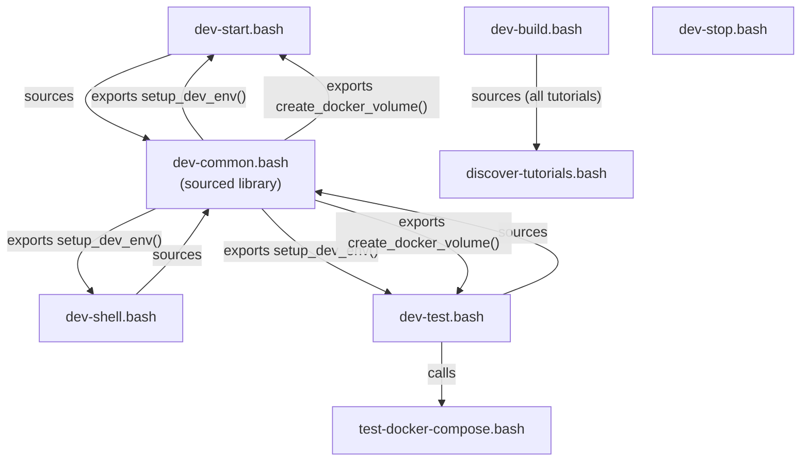
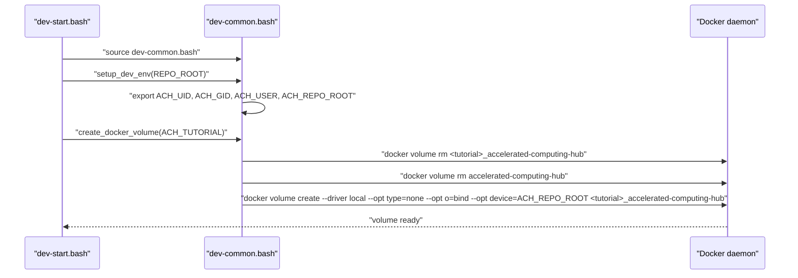
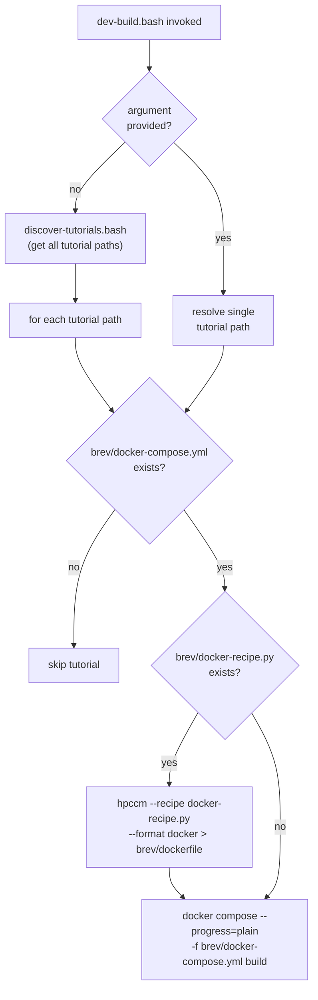
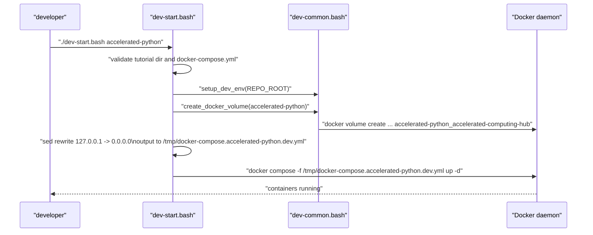
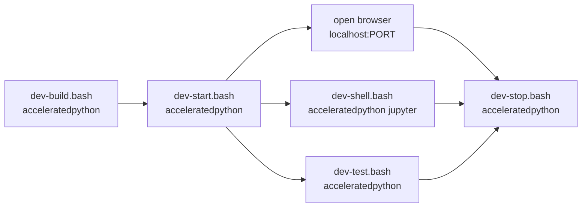

<!-- source: DeepWiki mcp.deepwiki.com · repo NVIDIA/accelerated-computing-hub · page 2.3 Development Workflow Scripts · fetched 2026-10-26 -->

# Development Workflow Scripts

<details>
<summary>Relevant source files</summary>

The following files were used as context for generating this wiki page:

- [CONTRIBUTING.md](CONTRIBUTING.md)
- [brev/.lycheeignore](brev/.lycheeignore)
- [brev/dev-build.bash](brev/dev-build.bash)
- [brev/dev-common.bash](brev/dev-common.bash)
- [brev/dev-shell.bash](brev/dev-shell.bash)
- [brev/dev-start.bash](brev/dev-start.bash)
- [brev/dev-stop.bash](brev/dev-stop.bash)
- [brev/dev-test.bash](brev/dev-test.bash)
- [brev/discover-tutorials.bash](brev/discover-tutorials.bash)
- [brev/lychee.toml](brev/lychee.toml)
- [brev/test-links.bash](brev/test-links.bash)

</details>


This page documents the developer-facing Bash scripts located in the `brev/` directory that manage tutorial environments on a local workstation. These scripts handle building images, starting and stopping containers, opening interactive shells, and running tests — all against a locally cloned copy of the repository.

This page covers only the local development tooling. For documentation on what runs *inside* the containers (entrypoints, JupyterLab, Nsight services), see [Container Services and Entrypoints](#2.2). For the Docker Compose files and Dockerfiles that these scripts operate on, see [Tutorial Docker Environments](#2.1). For the CI pipelines that use related but distinct scripts, see [CI/CD Pipelines](#3).

---

## Script Overview

All scripts live in the `brev/` directory at the root of the repository. They are designed to be run from any working directory — each script resolves `REPO_ROOT` from its own location.

| Script | Purpose | Required Arguments |
|---|---|---|
| `brev/dev-build.bash` | Build Docker images for one or all tutorials | `[tutorial-name]` (optional) |
| `brev/dev-start.bash` | Start containers for a tutorial | `<tutorial-name>` |
| `brev/dev-stop.bash` | Stop containers for a tutorial | `<tutorial-name>` |
| `brev/dev-shell.bash` | Open an interactive shell in a container service | `<tutorial-name\|compose-file> <service-name>` |
| `brev/dev-test.bash` | Run tutorial tests with local repo mounted | `<tutorial-name\|compose-file>` |
| `brev/dev-common.bash` | Shared helper library (sourced, not executed directly) | — |
| `brev/discover-tutorials.bash` | List all tutorials that have a `brev/docker-compose.yml` | — |

Sources: [brev/dev-build.bash:1-10](), [brev/dev-start.bash:1-10](), [brev/dev-stop.bash:1-10](), [brev/dev-shell.bash:1-12](), [brev/dev-test.bash:1-14](), [brev/dev-common.bash:1-13](), [brev/discover-tutorials.bash:1-10](), [CONTRIBUTING.md:9-22]()

---

## Script Relationships

**Workflow overview — which scripts call which:**



Sources: [brev/dev-build.bash:54](), [brev/dev-start.bash:41-43](), [brev/dev-shell.bash:24-25](), [brev/dev-test.bash:80-82](), [brev/dev-common.bash:15-46]()

---

## `dev-common.bash` — Shared Library

`brev/dev-common.bash` is sourced by `dev-start.bash`, `dev-shell.bash`, and `dev-test.bash`. It defines two functions:

### `setup_dev_env(REPO_ROOT)`

[brev/dev-common.bash:15-25]()

Exports four environment variables into the calling shell:

| Variable | Source | Purpose |
|---|---|---|
| `ACH_UID` | `id -u` | Host user's numeric UID, passed into Docker containers |
| `ACH_GID` | `id -g` | Host user's numeric GID |
| `ACH_USER` | `id -un` | Host username string |
| `ACH_REPO_ROOT` | Argument | Absolute path to the cloned repository |

These variables allow Docker Compose to create container users that match the host user, avoiding file permission issues when the repository is bind-mounted.

### `create_docker_volume(ACH_TUTORIAL)`

[brev/dev-common.bash:28-46]()

1. Removes any pre-existing Docker volumes named `<tutorial>_accelerated-computing-hub` or `accelerated-computing-hub` to ensure they point to the current repository path.
2. Creates a new local bind-mount Docker volume named `<tutorial>_accelerated-computing-hub` that maps to `ACH_REPO_ROOT`.

This volume is what makes the local repository visible at `/accelerated-computing-hub` inside the running containers.

**Volume creation flow:**



Sources: [brev/dev-common.bash:15-46]()

---

## `discover-tutorials.bash`

[brev/discover-tutorials.bash:1-18]()

Scans the `tutorials/` directory for subdirectories that contain a `brev/docker-compose.yml` file. Outputs one absolute path per line, sorted alphabetically. A tutorial is considered valid if and only if it has a Compose file; tutorials without one are silently skipped.

Used by `dev-build.bash` when no tutorial name is provided (build-all mode).

```
tutorials/accelerated-python
tutorials/cuda-cpp
tutorials/standard-parallelism
...
```

Sources: [brev/discover-tutorials.bash:12-17](), [brev/dev-build.bash:54-58]()

---

## `dev-build.bash`

[brev/dev-build.bash:1-75]()

Builds one or all tutorial Docker images.

**Usage:**
```bash
# Build a single tutorial
./brev/dev-build.bash accelerated-python

# Build all tutorials
./brev/dev-build.bash
```

### HPCCM Recipe Support

Before running `docker compose build`, the `build_tutorial()` function checks whether `brev/docker-recipe.py` exists in the tutorial directory [brev/dev-build.bash:32-40](). If it does:

1. Verifies `hpccm` is on `PATH`; exits with an error if not.
2. Runs `hpccm --recipe docker-recipe.py --format docker` and writes the output to `brev/dockerfile`.
3. Proceeds with `docker compose build`, which uses the freshly generated `dockerfile`.

This mechanism is currently used by the Standard Parallelism tutorial (see [4.5](#4.5) for details on that tutorial's HPCCM recipe).

**Build flow:**



Sources: [brev/dev-build.bash:17-74]()

---

## `dev-start.bash`

[brev/dev-start.bash:1-56]()

Starts the Docker Compose stack for a named tutorial in detached mode.

**Usage:**
```bash
./brev/dev-start.bash accelerated-python
```

### Port Binding Rewrite

The tutorial `docker-compose.yml` files bind ports to `127.0.0.1` by default, so they are inaccessible from outside the host when running on a remote VM or in Brev. For local development, `dev-start.bash` performs a sed substitution before launching:

[brev/dev-start.bash:50]()

```
sed 's/127\.0\.0\.1:/0.0.0.0:/g' "${DOCKER_COMPOSE}" > "${DOCKER_COMPOSE_DEV}"
```

The modified file is written to `/tmp/docker-compose.<tutorial>.dev.yml` and is what gets passed to `docker compose up`. This makes all ports accessible from the developer's machine.

### Startup Sequence



Sources: [brev/dev-start.bash:41-55]()

---

## `dev-stop.bash`

[brev/dev-stop.bash:1-44]()

Stops and removes the Docker Compose stack for a tutorial. Unlike `dev-start.bash`, it uses the original (unmodified) `docker-compose.yml` directly for `docker compose down`.

**Usage:**
```bash
./brev/dev-stop.bash accelerated-python
```

Sources: [brev/dev-stop.bash:40-43]()

---

## `dev-shell.bash`

[brev/dev-shell.bash:1-122]()

Opens an interactive `bash` shell inside a named service of a tutorial's Docker Compose stack.

**Usage:**
```bash
# By tutorial name + service name
./brev/dev-shell.bash accelerated-python jupyter

# By path to docker-compose.yml + service name
./brev/dev-shell.bash tutorials/accelerated-python/brev/docker-compose.yml jupyter
```

The script accepts either a tutorial name or a direct path to a `docker-compose.yml` file as its first argument. A path is detected by the presence of `/` in the argument string [brev/dev-shell.bash:62-87]().

Before launching the shell, any existing Docker volume for the tutorial is removed to ensure a fresh bind mount [brev/dev-shell.bash:102-107](). The shell is started with:

```
docker compose -f <compose-file> run --rm -it \
    --entrypoint "/accelerated-computing-hub/brev/entrypoint.bash" \
    <service> shell
```

[brev/dev-shell.bash:114-116]()

This invokes `entrypoint.bash` with `shell` as its argument, which drops into an interactive bash session as the host-matching user. For more on `entrypoint.bash`, see [Container Services and Entrypoints](#2.2).

Sources: [brev/dev-shell.bash:56-116]()

---

## `dev-test.bash`

[brev/dev-test.bash:1-92]()

Sets up the development environment (volume bind mount, UID/GID exports) and then delegates to `brev/test-docker-compose.bash` to execute the tutorial's test suite.

**Usage:**
```bash
./brev/dev-test.bash accelerated-python
./brev/dev-test.bash tutorials/accelerated-python/brev/docker-compose.yml
```

Like `dev-shell.bash`, the first argument can be either a tutorial name or a Compose file path. The tutorial name is extracted from the path in the latter case [brev/dev-test.bash:57-73]().

The actual test execution is delegated to `test-docker-compose.bash` [brev/dev-test.bash:91](), which is also used by the CI pipeline (see [Docker Image Build and Test Pipeline](#3.1)).

Sources: [brev/dev-test.bash:56-91]()

---

## Argument Resolution — Name vs. Path

Both `dev-shell.bash` and `dev-test.bash` accept either a tutorial name or a Compose file path. The following table summarizes the resolution logic:

| Input form | Detection rule | Example |
|---|---|---|
| Tutorial name | No `/` in argument | `accelerated-python` |
| Compose file path | Contains `/` | `tutorials/accelerated-python/brev/docker-compose.yml` |

When given a path, the tutorial name is derived by traversing up two directories from the Compose file:

```
.../tutorials/<tutorial-name>/brev/docker-compose.yml
                 ^-- basename of parent of parent
```

Sources: [brev/dev-shell.bash:62-87](), [brev/dev-test.bash:57-73]()

---

## Full Developer Workflow

**Typical local development session:**



Sources: [CONTRIBUTING.md:9-22]()

---

