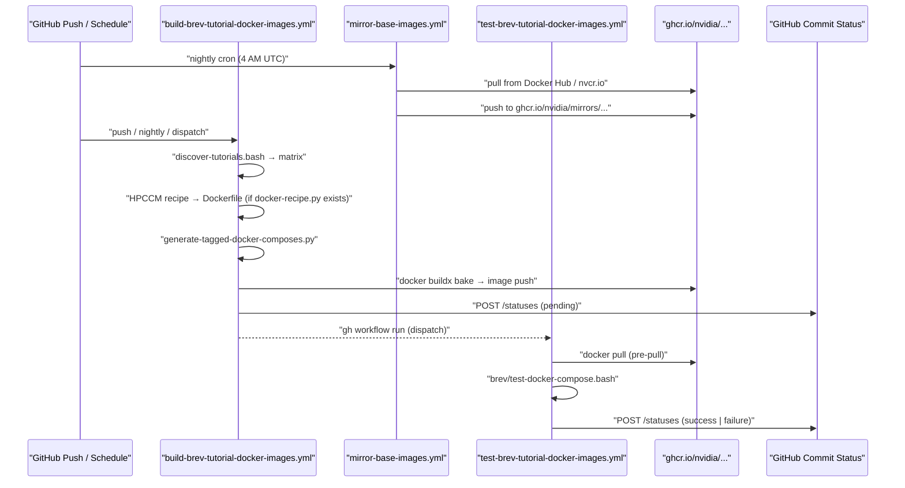
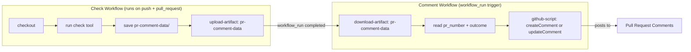

<!-- source: DeepWiki mcp.deepwiki.com · repo NVIDIA/accelerated-computing-hub · page 3 CI/CD Pipelines · fetched 2026-10-26 -->

# CI/CD Pipelines

Relevant source files

The following files were used as context for generating this wiki page:

- [.github/workflows/build-brev-tutorial-docker-images.yml](.github/workflows/build-brev-tutorial-docker-images.yml)
- [.github/workflows/mirror-base-images.yml](.github/workflows/mirror-base-images.yml)
- [.github/workflows/pr-comment-fork.yml](.github/workflows/pr-comment-fork.yml)
- [.github/workflows/pr-comment-git-lfs.yml](.github/workflows/pr-comment-git-lfs.yml)
- [.github/workflows/pr-comment-git-signatures.yml](.github/workflows/pr-comment-git-signatures.yml)
- [.github/workflows/pr-comment-links.yml](.github/workflows/pr-comment-links.yml)
- [.github/workflows/pr-comment-yaml.yml](.github/workflows/pr-comment-yaml.yml)
- [.github/workflows/test-brev-tutorial-docker-images.yml](.github/workflows/test-brev-tutorial-docker-images.yml)
- [.github/workflows/test-git-lfs.yml](.github/workflows/test-git-lfs.yml)
- [.github/workflows/test-git-signatures.yml](.github/workflows/test-git-signatures.yml)
- [.github/workflows/test-links.yml](.github/workflows/test-links.yml)
- [.github/workflows/test-yaml.yml](.github/workflows/test-yaml.yml)
- [brev/test-docker-compose.bash](brev/test-docker-compose.bash)
- [brev/test-git-lfs.bash](brev/test-git-lfs.bash)
- [brev/test-git-signatures.bash](brev/test-git-signatures.bash)

## Purpose and Scope

This page provides an overview of the GitHub Actions automation in the Accelerated Computing Hub repository. All workflow files live under `.github/workflows/`. The pipelines fall into two categories:

- **Docker image lifecycle** — building, testing, and mirroring tutorial container images. Detailed coverage is in [Docker Image Build and Test Pipeline](#3.1).
- **Code quality enforcement** — PR checks for broken links, commit signatures, Git LFS compliance, and YAML syntax. Detailed coverage is in [Code Quality and Repository Checks](#3.2).

For information about the local developer scripts that complement these pipelines (e.g. `dev-build.bash`, `dev-test.bash`), see [Development Workflow Scripts](#2.3). For the Docker environments that these pipelines build and test, see [Tutorial Docker Environments](#2.1).

---

## Workflow Inventory

| File | Name | Category | Triggers |
|---|---|---|---|
| `build-brev-tutorial-docker-images.yml` | Build and Push Brev Tutorial Docker Images | Image lifecycle | `push` to `main`/PR branches, nightly schedule, `workflow_dispatch` |
| `test-brev-tutorial-docker-images.yml` | Test Brev Tutorial Docker Images | Image lifecycle | `workflow_dispatch` only (triggered by build workflow) |
| `mirror-base-images.yml` | Mirror Base Images to GHCR | Image lifecycle | Nightly schedule, `workflow_dispatch` |
| `test-links.yml` | Test Links | Code quality | `push` to any branch, `pull_request` |
| `test-git-signatures.yml` | Test Git Signatures | Code quality | `push` to any branch, `pull_request` |
| `test-git-lfs.yml` | Test Git LFS | Code quality | `push` to any branch, `pull_request` |
| `test-yaml.yml` | Test YAML | Code quality | `push` to any branch, `pull_request` |
| `pr-comment-links.yml` | PR Comment on Link Check | PR feedback | `workflow_run` on Test Links completion |
| `pr-comment-git-signatures.yml` | PR Comment on Git Signatures Check | PR feedback | `workflow_run` on Test Git Signatures completion |
| `pr-comment-git-lfs.yml` | PR Comment on Git LFS Check | PR feedback | `workflow_run` on Test Git LFS completion |
| `pr-comment-yaml.yml` | PR Comment on YAML Check | PR feedback | `workflow_run` on Test YAML completion |
| `pr-comment-fork.yml` | PR Comment on Forks | PR feedback | `pull_request_target` opened/reopened from forks |

Sources: [.github/workflows/build-brev-tutorial-docker-images.yml:1-12](), [.github/workflows/test-brev-tutorial-docker-images.yml:1-18](), [.github/workflows/mirror-base-images.yml:1-13](), [.github/workflows/test-links.yml:1-9](), [.github/workflows/test-git-signatures.yml:1-9](), [.github/workflows/test-git-lfs.yml:1-9](), [.github/workflows/test-yaml.yml:1-9]()

---

## Pipeline Architecture

The following diagram maps all workflow files to their roles and relationships.

**Overall CI/CD Pipeline Architecture**

```mermaid
flowchart TD
    subgraph "Triggers"
        T1["push to main / PR branch"]
        T2["nightly schedule (cron)"]
        T3["workflow_dispatch"]
        T4["pull_request event"]
        T5["workflow_run (completed)"]
    end

    subgraph "Image Lifecycle Pipelines"
        BLD["`build-brev-tutorial-docker-images.yml`"]
        TST["`test-brev-tutorial-docker-images.yml`"]
        MIR["`mirror-base-images.yml`"]
    end

    subgraph "Code Quality Pipelines"
        LNK["`test-links.yml`"]
        SIG["`test-git-signatures.yml`"]
        LFS["`test-git-lfs.yml`"]
        YML["`test-yaml.yml`"]
    end

    subgraph "PR Feedback Workflows"
        PC_LNK["`pr-comment-links.yml`"]
        PC_SIG["`pr-comment-git-signatures.yml`"]
        PC_LFS["`pr-comment-git-lfs.yml`"]
        PC_YML["`pr-comment-yaml.yml`"]
        PC_FORK["`pr-comment-fork.yml`"]
    end

    subgraph "Artifacts and Registries"
        GHCR["GHCR (ghcr.io/nvidia/...)"]
        GEN["generated branch"]
        CA["GitHub Actions Artifacts"]
        CS["GitHub Commit Statuses API"]
    end

    T1 --> BLD
    T2 --> BLD
    T3 --> BLD
    T2 --> MIR
    T3 --> MIR
    T1 --> LNK
    T4 --> LNK
    T1 --> SIG
    T4 --> SIG
    T1 --> LFS
    T4 --> LFS
    T1 --> YML
    T4 --> YML
    T4 --> PC_FORK

    BLD -- "triggers via gh workflow run" --> TST
    BLD -- "pushes image" --> GHCR
    BLD -- "pushes compose files" --> GEN
    BLD -- "uploads artifact" --> CA
    BLD -- "creates pending status" --> CS
    MIR -- "pushes mirror" --> GHCR
    TST -- "downloads artifact" --> CA
    TST -- "pulls image" --> GHCR
    TST -- "updates status success/failure" --> CS

    LNK -- "uploads pr-comment-data" --> CA
    SIG -- "uploads pr-comment-data" --> CA
    LFS -- "uploads pr-comment-data" --> CA
    YML -- "uploads pr-comment-data" --> CA

    T5 --> PC_LNK
    T5 --> PC_SIG
    T5 --> PC_LFS
    T5 --> PC_YML

    PC_LNK -- "downloads pr-comment-data" --> CA
    PC_SIG -- "downloads pr-comment-data" --> CA
    PC_LFS -- "downloads pr-comment-data" --> CA
    PC_YML -- "downloads pr-comment-data" --> CA
```

Sources: [.github/workflows/build-brev-tutorial-docker-images.yml:1-264](), [.github/workflows/test-brev-tutorial-docker-images.yml:1-189](), [.github/workflows/mirror-base-images.yml:1-92](), [.github/workflows/pr-comment-links.yml:1-10](), [.github/workflows/pr-comment-git-signatures.yml:1-10](), [.github/workflows/pr-comment-git-lfs.yml:1-10](), [.github/workflows/pr-comment-yaml.yml:1-10]()

---

## Docker Image Lifecycle

The three image lifecycle workflows work together to maintain up-to-date tutorial images in GHCR and keep build times short through cached base images.

**Docker Image Lifecycle Workflow Sequence**

Sources: [.github/workflows/build-brev-tutorial-docker-images.yml:22-253](), [.github/workflows/test-brev-tutorial-docker-images.yml:31-188](), [.github/workflows/mirror-base-images.yml:34-91]()

### Key Design Decisions

**Tutorial discovery via matrix:** The `discover-tutorials` job runs `brev/discover-tutorials.bash` and emits the result as a JSON array. The `build-and-push` job consumes it via `strategy.matrix`, so each tutorial builds and pushes independently and in parallel. See [.github/workflows/build-brev-tutorial-docker-images.yml:22-53]().

**HPCCM conditional Dockerfile generation:** If a tutorial contains `brev/docker-recipe.py`, the workflow installs `hpccm` and generates a `Dockerfile` from the recipe before invoking `docker buildx bake`. Tutorials without `docker-recipe.py` supply a static `dockerfile` directly. See [.github/workflows/build-brev-tutorial-docker-images.yml:79-103]().

**Docker image tags produced per build:**

| Tag pattern | Purpose |
|---|---|
| `{branch}-git-{short_sha}` | Commit-pinned; used by test workflow |
| `{branch}-latest` | Latest build for a given branch |
| `latest` | Only on `main` branch builds |
| `buildcache-{branch}` | BuildKit cache storage in GHCR |

See [.github/workflows/build-brev-tutorial-docker-images.yml:220-228]().

**Compose artifact flow:** The build workflow uploads the commit-specific compose file as a GitHub Actions artifact named `docker-compose-{tutorial}-{branch}-git-{sha}`. The test workflow downloads this artifact by `run_id` to ensure it tests exactly the image built in that run. See [.github/workflows/build-brev-tutorial-docker-images.yml:119-124]() and [.github/workflows/test-brev-tutorial-docker-images.yml:54-60]().

**`generated` branch:** Branch-latest compose files are committed to a separate `generated` branch with retry logic to handle concurrent pushes from parallel matrix jobs. See [.github/workflows/build-brev-tutorial-docker-images.yml:126-168]().

**Cache behavior:** Nightly scheduled builds and manual `workflow_dispatch` runs with `purge_cache: true` skip `--cache-from` flags and prune the local BuildKit cache before building. All other builds attempt to reuse the branch-specific or `main` build cache from GHCR. See [.github/workflows/build-brev-tutorial-docker-images.yml:184-228]().

**Test runner:** The test job runs on `linux-amd64-gpu-l4-latest-1`, a self-hosted GPU runner. It stops DCGM services before testing so that Nsight Compute profiling inside the container is not blocked. The actual test is performed by `brev/test-docker-compose.bash`, which starts containers, checks for restart loops, tests a restart cycle, and tears down. See [.github/workflows/test-brev-tutorial-docker-images.yml:69-161]() and [brev/test-docker-compose.bash:96-277]().

**Base image mirroring:** `mirror-base-images.yml` copies a fixed set of upstream images (RAPIDS devcontainers, PyTorch, CUDA) into `ghcr.io/nvidia/mirrors/` nightly. This decouples tutorial builds from Docker Hub rate limits and upstream registry availability. The matrix is defined inline at [.github/workflows/mirror-base-images.yml:22-30]().

Sources: [.github/workflows/build-brev-tutorial-docker-images.yml:1-264](), [.github/workflows/test-brev-tutorial-docker-images.yml:1-189](), [.github/workflows/mirror-base-images.yml:1-92](), [brev/test-docker-compose.bash:1-278]()

---

## Code Quality Enforcement

Four check workflows run on every push and pull request. Each check workflow follows the same pattern: run the check, write a `pr-comment-data/` directory with the PR number and outcome, upload it as an artifact, and then a paired `pr-comment-*.yml` workflow downloads that artifact and posts a remediation comment if the check failed.

**PR Check and Comment Feedback Loop**

Sources: [.github/workflows/test-links.yml:47-60](), [.github/workflows/pr-comment-links.yml:1-94](), [.github/workflows/test-git-signatures.yml:110-128](), [.github/workflows/pr-comment-git-signatures.yml:1-110]()

### Individual Checks

| Workflow | Tool | What it checks | Paired comment workflow |
|---|---|---|---|
| `test-links.yml` | `lychee` (via `lycheeverse/lychee-action`) + `nbconvert` | Converts notebooks to Markdown, then validates all hyperlinks using `brev/lychee.toml` and `brev/.lycheeignore` | `pr-comment-links.yml` |
| `test-git-signatures.yml` | GitHub API (`github.rest.repos.getCommit`) | Every commit on the branch that is not in `origin/main` must have `verification.verified == true` | `pr-comment-git-signatures.yml` |
| `test-git-lfs.yml` | `brev/test-git-lfs.bash` | No `.gitattributes` in subdirectories; all files matching `filter=lfs` patterns in the top-level `.gitattributes` are actual LFS objects | `pr-comment-git-lfs.yml` |
| `test-yaml.yml` | `yamllint` | All YAML files pass `yamllint` with line-length checking disabled | `pr-comment-yaml.yml` |

Sources: [.github/workflows/test-links.yml:28-45](), [.github/workflows/test-git-signatures.yml:25-108](), [.github/workflows/test-git-lfs.yml:22-25](), [.github/workflows/test-yaml.yml:27-33]()

### Link Check Details

The `test-links.yml` workflow first converts all `.ipynb` files to Markdown with `jupyter nbconvert --to markdown` before running `lychee`. This ensures that links embedded in notebook cells are also validated. The `lychee` invocation uses `brev/lychee.toml` for configuration and `brev/.lycheeignore` to suppress known false positives. See [.github/workflows/test-links.yml:34-45]().

### Git Signature Check Details

The `test-git-signatures.yml` workflow skips verification when running on `main` (to avoid failing on historical unsigned commits). On any other branch it collects commits via `git rev-list origin/main..HEAD` and calls the GitHub API per commit to read the `commit.verification` object. Failed commits are collected into outputs (`unsigned_count`, `unsigned_commits`) that the paired comment workflow uses to produce a remediation message. See [.github/workflows/test-git-signatures.yml:36-108]().

A local shell equivalent is available at `brev/test-git-signatures.bash`, which uses `git verify-commit` instead of the API. See [brev/test-git-signatures.bash:71-111]().

### Git LFS Check Details

The `brev/test-git-lfs.bash` script performs two checks:

1. Searches for `.gitattributes` files more than one directory level deep (`find -mindepth 2`). Only the top-level `.gitattributes` is allowed.
2. For each file extension declared with `filter=lfs` in `.gitattributes`, finds matching files and verifies each is either listed in `git lfs ls-files` output, is an LFS pointer file, or has the `filter=lfs` git attribute set.

The script writes `error_type` and `error_files` to `$GITHUB_OUTPUT` when invoked in CI, allowing the `pr-comment-git-lfs.yml` workflow to emit a type-specific remediation comment. See [brev/test-git-lfs.bash:74-209]().

### Fork PR Handling

Because the build workflow uses self-hosted runners and cannot run on pull requests from forks (a GitHub Actions security restriction), `pr-comment-fork.yml` posts an informational comment on any PR opened from a fork. The comment instructs maintainers to follow the manual CI trigger process described in `CONTRIBUTING.md`. See [.github/workflows/pr-comment-fork.yml:1-26]().

Sources: [.github/workflows/test-links.yml:1-60](), [.github/workflows/test-git-signatures.yml:1-128](), [.github/workflows/test-git-lfs.yml:1-43](), [.github/workflows/test-yaml.yml:1-49](), [brev/test-git-lfs.bash:1-213](), [brev/test-git-signatures.bash:1-143](), [.github/workflows/pr-comment-fork.yml:1-26]()

---

## Runner Requirements

| Workflow | Runner | Notes |
|---|---|---|
| `build-and-push` job in `build-brev-tutorial-docker-images.yml` | `linux-amd64-cpu4` (self-hosted) | Requires Docker Buildx with registry cache support; not available for fork PRs |
| `discover-tutorials` job | `linux-amd64-cpu4` (self-hosted) | CPU-only discovery step |
| `test-tutorial` job in `test-brev-tutorial-docker-images.yml` | `linux-amd64-gpu-l4-latest-1` (self-hosted GPU) | Requires NVIDIA L4 GPU; DCGM is stopped before tests |
| All code quality workflows | `ubuntu-latest` (GitHub-hosted) | Standard hosted runner; no GPU or Docker registry access needed |
| `mirror-base-images.yml` | `ubuntu-latest` (GitHub-hosted) | Only needs Docker and GHCR push access |

Sources: [.github/workflows/build-brev-tutorial-docker-images.yml:23-24](), [.github/workflows/test-brev-tutorial-docker-images.yml:22-23](), [.github/workflows/mirror-base-images.yml:18](), [.github/workflows/test-links.yml:16]()

---

