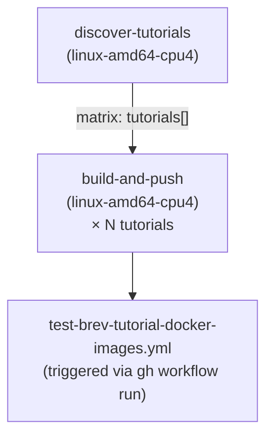
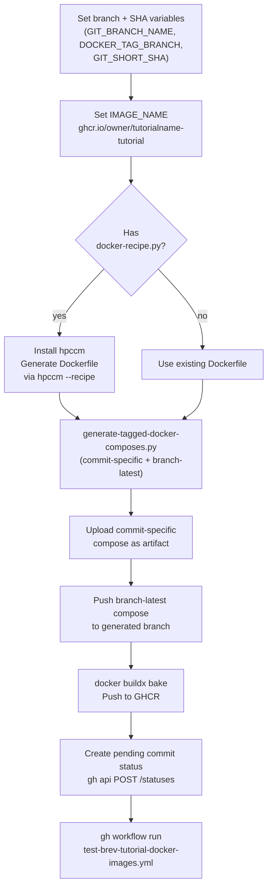
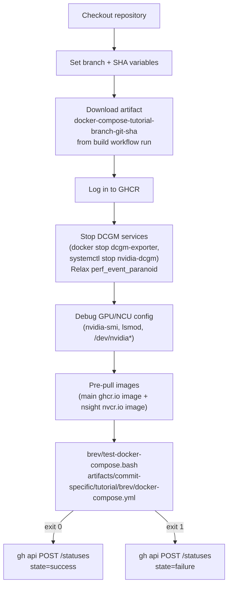
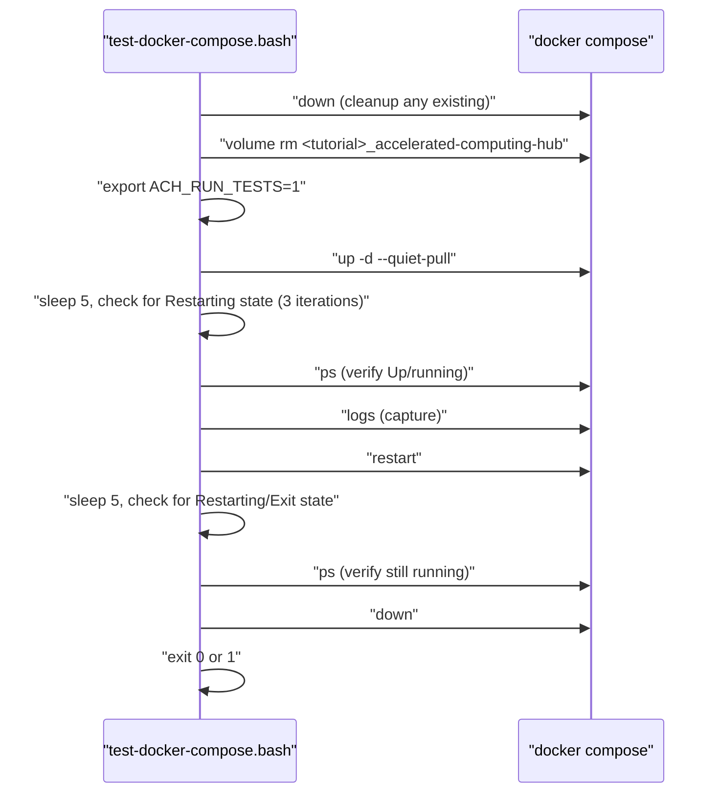
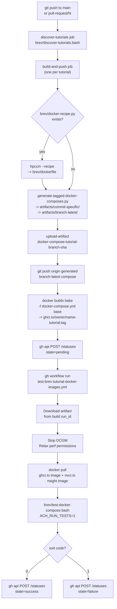

<!-- source: DeepWiki mcp.deepwiki.com · repo NVIDIA/accelerated-computing-hub · page 3.1 Docker Image Build and Test Pipeline · fetched 2026-10-26 -->

# Docker Image Build and Test Pipeline

<details>
<summary>Relevant source files</summary>

The following files were used as context for generating this wiki page:

- [.github/workflows/build-brev-tutorial-docker-images.yml](.github/workflows/build-brev-tutorial-docker-images.yml)
- [.github/workflows/mirror-base-images.yml](.github/workflows/mirror-base-images.yml)
- [.github/workflows/test-brev-tutorial-docker-images.yml](.github/workflows/test-brev-tutorial-docker-images.yml)
- [brev/test-docker-compose.bash](brev/test-docker-compose.bash)

</details>


## Purpose and Scope

This page covers the three GitHub Actions workflows responsible for the Docker image lifecycle in the Accelerated Computing Hub repository: building and pushing per-tutorial images, testing those images on GPU hardware, and mirroring upstream base images to GHCR for reliable builds.

This page is specific to the CI automation. For the local developer equivalents of these operations, see [Development Workflow Scripts](#2.3). For the Dockerfiles and Compose configurations that these workflows operate on, see [Tutorial Docker Environments](#2.1).

---

## Overview of the Three Workflows

| Workflow File | Name | Trigger | Purpose |
|---|---|---|---|
| `build-brev-tutorial-docker-images.yml` | Build and Push Brev Tutorial Docker Images | push, schedule, `workflow_dispatch` | Discover tutorials, build images, push to GHCR, trigger tests |
| `test-brev-tutorial-docker-images.yml` | Test Brev Tutorial Docker Images | `workflow_dispatch` only (called by build) | Pull built image, run container lifecycle tests on GPU runner |
| `mirror-base-images.yml` | Mirror Base Images to GHCR | schedule, `workflow_dispatch` | Re-host upstream base images on GHCR for build stability |

---

## Build and Push Workflow

### Triggers

The build workflow runs under three conditions:

- **Push** to `main` or any branch matching `pull-request/[0-9]+`
- **Nightly schedule** at 05:00 UTC (midnight EST)
- **Manual dispatch** via `workflow_dispatch`, with an optional boolean input `purge_cache`

> **Note:** `pull_request` events are intentionally not supported due to self-hosted runner constraints with fork PRs. See `CONTRIBUTING.md` for the manual PR review procedure.

Sources: [.github/workflows/build-brev-tutorial-docker-images.yml:1-20]()

### Job Structure

The build workflow has two sequential jobs.

**Workflow: build-brev-tutorial-docker-images.yml — Job Graph**



Sources: [.github/workflows/build-brev-tutorial-docker-images.yml:21-54]()

### Job 1: `discover-tutorials`

Runs `brev/discover-tutorials.bash` and captures the output as a JSON array of tutorial directory paths. This array becomes the matrix input for the `build-and-push` job.

```
tutorials=$(brev/discover-tutorials.bash | jq -R -s -c 'split("\n") | map(select(length > 0))')
```

Sources: [.github/workflows/build-brev-tutorial-docker-images.yml:22-38]()

### Job 2: `build-and-push` (matrix)

One instance of this job runs per tutorial. The steps within it are:

**Step-by-step breakdown:**



Sources: [.github/workflows/build-brev-tutorial-docker-images.yml:56-253]()

### HPCCM Dockerfile Generation

Some tutorials (notably Standard Parallelism) define their Docker environment via an HPCCM recipe file `brev/docker-recipe.py` instead of a plain `Dockerfile`. The workflow detects this:

[.github/workflows/build-brev-tutorial-docker-images.yml:79-103]()

If `HAS_HPCCM=true`, the workflow installs the `hpccm` Python package and runs:

```
hpccm --recipe <tutorial>/brev/docker-recipe.py --format docker > <tutorial>/brev/dockerfile
```

The generated `dockerfile` is then consumed by the subsequent `docker buildx bake` step. For tutorials without a recipe, the existing `dockerfile` is used directly.

Sources: [.github/workflows/build-brev-tutorial-docker-images.yml:79-103]()

### Docker Compose Artifact Generation

The script `brev/generate-tagged-docker-composes.py` is called twice per tutorial to produce two tagged variants of the Docker Compose file:

| Variant | Tag Pattern | Output Directory | Retention |
|---|---|---|---|
| Commit-specific | `<branch>-git-<short-sha>` | `artifacts/commit-specific/` | 30 days (uploaded as GitHub artifact) |
| Branch-latest | `<branch>-latest` | `artifacts/branch-latest/` | Pushed to `generated` git branch |

The `generated` branch maintains a directory structure of `<branch-name>/tutorials/<tutorial-name>/` and is updated with retry logic to handle concurrent matrix job pushes.

Sources: [.github/workflows/build-brev-tutorial-docker-images.yml:105-170]()

### Docker Image Build and Push

The image build uses `docker buildx bake` targeting the `base` service in the tutorial's `docker-compose.yml`. Images are pushed directly to GHCR (`type=registry`).

**Image tag conventions:**

| Condition | Tags applied |
|---|---|
| Any branch | `<branch-latest>`, `<branch>-git-<short-sha>` |
| `main` branch only | `latest` (additional tag) |

**Cache strategy:**

- **Normal builds** use `--cache-from` pointing to the branch-specific and `main` build caches stored in GHCR under the `buildcache-<branch>` tag.
- **Nightly scheduled builds** and manual `purge_cache` builds skip `--cache-from` entirely and clear local buildx and Docker caches beforehand.
- **Cache writes** use `mode=max` with `zstd` compression at level 3.

The build step uses `nick-fields/retry@v3` with up to 3 attempts and a 60-minute timeout per attempt.

Sources: [.github/workflows/build-brev-tutorial-docker-images.yml:172-228]()

### Test Workflow Trigger

After a successful push, the build job:
1. Posts a `pending` commit status via the GitHub API under the context `Test Brev Tutorial Docker Images / test-tutorial (tutorials/<name>)`
2. Dispatches `test-brev-tutorial-docker-images.yml` with three inputs: `tutorial`, `git_sha`, and `workflow_run_id`

Sources: [.github/workflows/build-brev-tutorial-docker-images.yml:230-253]()

---

## Test Workflow

### Trigger and Inputs

The test workflow is only triggered by `workflow_dispatch` — it is always called programmatically by the build workflow, never by a push event.

| Input | Description |
|---|---|
| `tutorial` | Tutorial name (e.g., `accelerated-python`) |
| `git_sha` | Full commit SHA, used to post final commit status |
| `workflow_run_id` | Run ID of the build job, used to download its artifact |

The test runner is `linux-amd64-gpu-l4-latest-1`, a GPU-equipped runner required to start the tutorial containers.

Sources: [.github/workflows/test-brev-tutorial-docker-images.yml:1-31]()

### Test Job Steps

**Workflow: test-brev-tutorial-docker-images.yml — Step Flow**



Sources: [.github/workflows/test-brev-tutorial-docker-images.yml:32-188]()

### DCGM Teardown

Before running tests, the workflow stops the DCGM (Data Center GPU Manager) services that run on the GPU host. DCGM holds an exclusive lock on the GPU that blocks Nsight Compute (`ncu`) profiling inside containers. The teardown sequence:

1. Stops the `dcgm-exporter` Docker container
2. Stops `dcgm-exporter`, `nvidia-dcgm`, `dcgm`, and `nv-hostengine` systemd services
3. Kills any remaining `nv-hostengine` and `dcgm` processes
4. Sets `kernel.perf_event_paranoid=2` and `kernel.kptr_restrict=0`

Sources: [.github/workflows/test-brev-tutorial-docker-images.yml:69-95]()

### `brev/test-docker-compose.bash`

The actual container test is delegated to `brev/test-docker-compose.bash`. This script accepts either a tutorial name or a path to a `docker-compose.yml` file.

**Test sequence inside `test-docker-compose.bash`:**



Key details:
- `ACH_RUN_TESTS=1` is exported before starting containers. Container entrypoints use this variable to execute notebook test suites instead of starting the full interactive server.
- The volume `<tutorial>_accelerated-computing-hub` is removed before each run to ensure a clean state.
- A restart-loop check runs three times with 5-second intervals between checks, looking for `Restarting` in `docker compose ps` output.

Sources: [brev/test-docker-compose.bash:1-277]()

---

## Base Image Mirror Workflow

### Purpose

The `mirror-base-images.yml` workflow copies upstream images from Docker Hub and NVIDIA's registry (`nvcr.io`) into GHCR. This avoids pull rate limits and registry availability failures during tutorial image builds.

Mirrored images are stored at `ghcr.io/<owner>/mirrors/<target_name>`.

### Mirrored Images

| Source Image | GHCR Target Name |
|---|---|
| `rapidsai/devcontainers:25.08-cpp-cuda12.8` | `rapidsai-devcontainers-25.08-cpp-cuda12.8` |
| `rapidsai/devcontainers:25.10-cpp-cuda12.9` | `rapidsai-devcontainers-25.10-cpp-cuda12.9` |
| `pytorch/pytorch:2.9.0-cuda12.8-cudnn9-runtime` | `pytorch-2.9.0-cuda12.8-cudnn9-runtime` |
| `nvcr.io/nvidia/cuda:13.1.0-devel-ubuntu22.04` | `nvidia-cuda-13.1.0-devel-ubuntu22.04` |

Sources: [.github/workflows/mirror-base-images.yml:22-32]()

### Schedule and Cache Behavior

- Runs nightly at 04:00 UTC (11 PM EST), one hour before the tutorial build at 05:00 UTC.
- By default, a mirror is skipped if the target image already exists in GHCR (`docker manifest inspect` succeeds).
- The `force_pull` `workflow_dispatch` input bypasses this check and re-mirrors regardless.

Sources: [.github/workflows/mirror-base-images.yml:5-14](), [.github/workflows/mirror-base-images.yml:48-84]()

---

## End-to-End Pipeline Flow

**Full pipeline: from code push to commit status**



Sources: [.github/workflows/build-brev-tutorial-docker-images.yml:1-264](), [.github/workflows/test-brev-tutorial-docker-images.yml:1-188](), [brev/test-docker-compose.bash:1-277]()

---

## Key Naming Conventions

| Symbol | Value / Pattern |
|---|---|
| Image name | `ghcr.io/<github_repository_owner>/<tutorial-name>-tutorial` |
| Branch-latest tag | `<docker-tag-branch>-latest` |
| Commit-specific tag | `<docker-tag-branch>-git-<7-char-sha>` |
| Build cache tag | `buildcache-<docker-tag-branch>` |
| `latest` tag | Applied only when `GIT_BRANCH_NAME == main` |
| Artifact name | `docker-compose-<tutorial>-<branch>-git-<short-sha>` |
| Test runner | `linux-amd64-gpu-l4-latest-1` |
| Build runner | `linux-amd64-cpu4` |
| Volume name in tests | `<tutorial>_accelerated-computing-hub` |

Branch names are sanitized for Docker tag compatibility by replacing characters outside `[a-zA-Z0-9._-]` with hyphens and lowercasing the result.

Sources: [.github/workflows/build-brev-tutorial-docker-images.yml:60-77](), [.github/workflows/test-brev-tutorial-docker-images.yml:43-52]()

---

