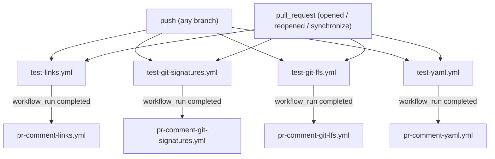
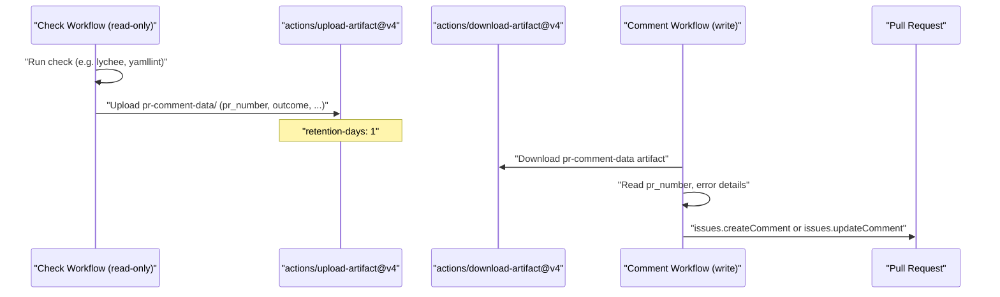
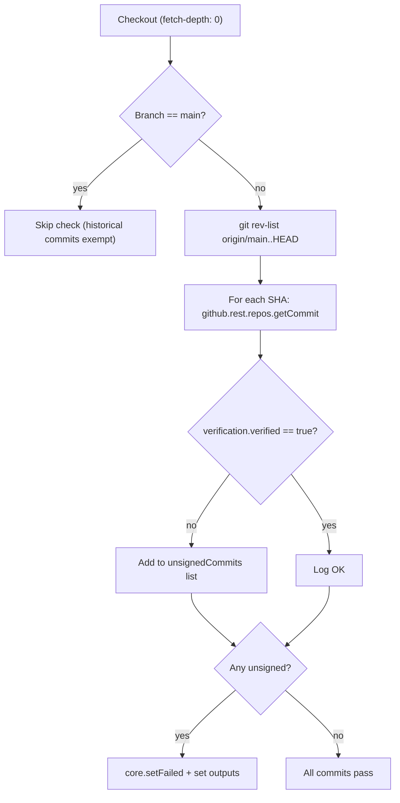
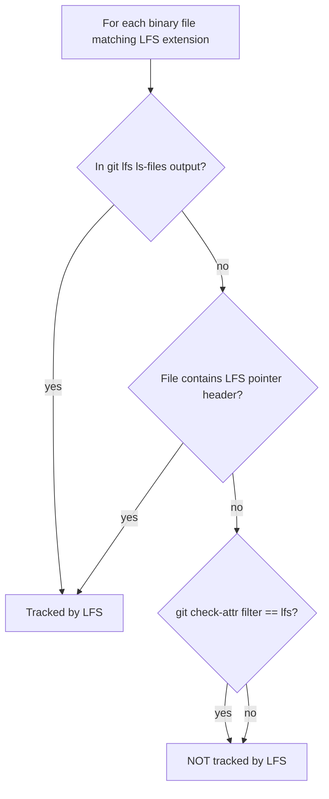
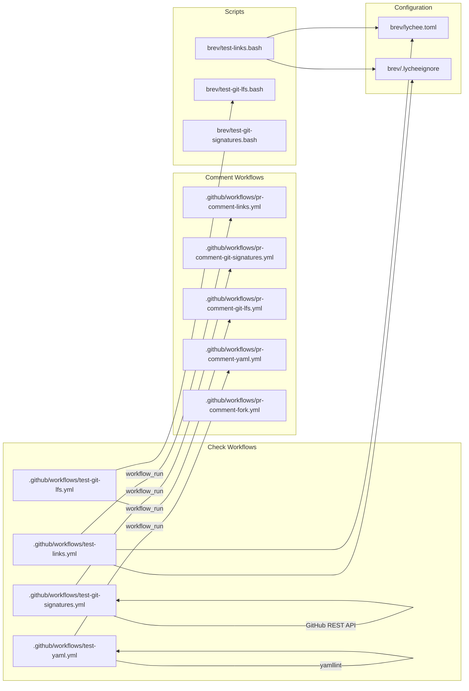

<!-- source: DeepWiki mcp.deepwiki.com · repo NVIDIA/accelerated-computing-hub · page 3.2 Code Quality and Repository Checks · fetched 2026-10-26 -->

# Code Quality and Repository Checks

<details>
<summary>Relevant source files</summary>

The following files were used as context for generating this wiki page:

- [.github/workflows/pr-comment-fork.yml](.github/workflows/pr-comment-fork.yml)
- [.github/workflows/pr-comment-git-lfs.yml](.github/workflows/pr-comment-git-lfs.yml)
- [.github/workflows/pr-comment-git-signatures.yml](.github/workflows/pr-comment-git-signatures.yml)
- [.github/workflows/pr-comment-links.yml](.github/workflows/pr-comment-links.yml)
- [.github/workflows/pr-comment-yaml.yml](.github/workflows/pr-comment-yaml.yml)
- [.github/workflows/test-git-lfs.yml](.github/workflows/test-git-lfs.yml)
- [.github/workflows/test-git-signatures.yml](.github/workflows/test-git-signatures.yml)
- [.github/workflows/test-links.yml](.github/workflows/test-links.yml)
- [.github/workflows/test-yaml.yml](.github/workflows/test-yaml.yml)
- [brev/.lycheeignore](brev/.lycheeignore)
- [brev/dev-build.bash](brev/dev-build.bash)
- [brev/discover-tutorials.bash](brev/discover-tutorials.bash)
- [brev/lychee.toml](brev/lychee.toml)
- [brev/test-git-lfs.bash](brev/test-git-lfs.bash)
- [brev/test-git-signatures.bash](brev/test-git-signatures.bash)
- [brev/test-links.bash](brev/test-links.bash)

</details>


This page documents the automated code quality checks that run on every branch push and pull request in the repository. These checks enforce link integrity, commit signing, binary file storage policy, and YAML syntax correctness. For documentation on Docker image build and test pipelines, see [3.1](#3.1).

---

## Overview

The repository defines four independent check workflows and a parallel set of PR comment workflows. The check workflows fail fast and upload artifacts; the comment workflows consume those artifacts to post actionable remediation instructions directly onto the pull request.

**Check workflows** (defined in `.github/workflows/`):

| Workflow file | Check performed | Tool used |
|---|---|---|
| `test-links.yml` | Broken hyperlinks in Markdown and notebooks | `lychee` |
| `test-git-signatures.yml` | Unsigned commits on the branch | GitHub API via `actions/github-script` |
| `test-git-lfs.yml` | Binary files not tracked by Git LFS | `brev/test-git-lfs.bash` |
| `test-yaml.yml` | YAML syntax and formatting errors | `yamllint` |

**PR comment workflows** (triggered on `workflow_run` completion):

| Workflow file | Triggered by |
|---|---|
| `pr-comment-links.yml` | `Test Links` failure |
| `pr-comment-git-signatures.yml` | `Test Git Signatures` failure |
| `pr-comment-git-lfs.yml` | `Test Git LFS` failure |
| `pr-comment-yaml.yml` | `Test YAML` failure |
| `pr-comment-fork.yml` | Any PR opened from a fork |

Sources: [.github/workflows/test-links.yml:1-61](), [.github/workflows/test-git-signatures.yml:1-127](), [.github/workflows/test-git-lfs.yml:1-43](), [.github/workflows/test-yaml.yml:1-49]()

---

## Workflow Trigger Pattern

All four check workflows share the same trigger configuration: they run on every branch push and on pull request events (`opened`, `reopened`, `synchronize`).

**Workflow trigger diagram:**



Sources: [.github/workflows/test-links.yml:3-8](), [.github/workflows/test-git-signatures.yml:3-8](), [.github/workflows/test-git-lfs.yml:3-8](), [.github/workflows/test-yaml.yml:3-8]()

---

## Artifact-Based PR Comment Pattern

Each check workflow uses a two-phase approach to post PR comments safely. Because PR comment workflows require `pull-requests: write` permission, and the check workflows run with minimal `contents: read` permission, they communicate via GitHub Actions artifacts.

**Artifact handoff diagram:**



The artifact directory `pr-comment-data/` always contains `pr_number` and `outcome`. Some workflows include additional files:

| Workflow | Extra artifact files |
|---|---|
| `test-git-signatures.yml` | `unsigned_count`, `unsigned_commits` |
| `test-git-lfs.yml` | `error_type`, `error_files` |
| `test-links.yml` | (none beyond `pr_number` and `outcome`) |
| `test-yaml.yml` | (none beyond `pr_number` and `outcome`) |

Comment workflows check for an existing bot comment before posting, updating in place rather than creating duplicates.

Sources: [.github/workflows/test-links.yml:47-60](), [.github/workflows/test-git-signatures.yml:110-127](), [.github/workflows/pr-comment-links.yml:1-94](), [.github/workflows/pr-comment-git-signatures.yml:79-110]()

---

## Link Validation (`test-links.yml`)

### How It Works

The workflow converts all Jupyter notebooks (`.ipynb`) to Markdown using `jupyter nbconvert`, then runs the `lychee` link checker across the entire repository tree.

**Steps:**
1. Install `nbconvert` via pip.
2. `find . -name "*.ipynb"` and convert each to Markdown in-place.
3. Invoke `lycheeverse/lychee-action@v2` with:
   - `--config brev/lychee.toml`
   - `--exclude-file brev/.lycheeignore`
   - Target: `'.'` (entire repository)

Sources: [.github/workflows/test-links.yml:27-44]()

### Configuration: `brev/lychee.toml`

| Setting | Value | Purpose |
|---|---|---|
| `verbose` | `"info"` | Log level |
| `timeout` | `20` | Per-request timeout in seconds |
| `max_retries` | `3` | Retry count on transient failure |
| `retry_wait_time` | `2` | Seconds between retries |
| `user_agent` | `"Mozilla/5.0 (compatible; Lychee/LinkChecker)"` | Avoids bot blocks |
| `cache` | `true` | Speeds up repeated runs |
| `max_concurrency` | `32` | Parallel network requests |
| `accept` | `200–308, 429` | HTTP status codes treated as success |

HTTP 429 (Too Many Requests) is accepted because some sites rate-limit link checkers but the links are still valid.

Sources: [brev/lychee.toml:1-29]()

### Ignore List: `brev/.lycheeignore`

Certain URLs are excluded from checking because they return non-200 codes to automated clients despite being valid. The ignore file uses URL patterns (with regex support):

| Pattern | Reason |
|---|---|
| `https://www.sciencedirect.com/...` | Academic paywall, returns 403 to bots |
| `https://dl.acm.org/...` | Academic paywall, returns 403 to bots |
| `https://opendata.cityofnewyork.us/...` | Bot protection |
| `https://medium.com/.*` | Returns 403 to automated requests |
| `https://docs.rapids.ai/.*` | Aggressive bot protection causing connection resets |
| `file://.*/no-magic-execution-space-changes.cpp` | Theoretical local file link in CUDA C++ tutorial |

Sources: [brev/.lycheeignore:1-19]()

### Local Testing

The script `brev/test-links.bash` replicates CI behavior locally. It creates a temporary copy of the repo, converts notebooks, and runs `lychee` against the specified path.

```
./brev/test-links.bash .                       # entire repo
./brev/test-links.bash tutorials/cuda-cpp      # specific tutorial
```

The script requires `lychee` and `jupyter nbconvert` on `PATH`. It loads the same `brev/lychee.toml` and `brev/.lycheeignore` configuration files.

Sources: [brev/test-links.bash:1-166]()

---

## Git Commit Signature Verification (`test-git-signatures.yml`)

### How It Works

The workflow uses `actions/github-script@v7` to query the GitHub REST API for each commit's verification status. This approach handles GPG, SSH, and web-flow (web-based) commit signatures.

**Logic flow:**



The check only runs on commits reachable from `HEAD` but not from `origin/main`. This prevents the workflow from failing on historical commits that predate the signing requirement.

Sources: [.github/workflows/test-git-signatures.yml:27-108]()

### Local Testing

`brev/test-git-signatures.bash` runs a local equivalent using `git verify-commit`. It reports three states per commit:

| Symbol | Meaning |
|---|---|
| `✓` | Signature verified by local GPG |
| `⚠` | Signature present but cannot be locally verified (valid in CI) |
| `✗` | No signature found |

The local script defaults to comparing against `origin/main` but accepts an alternate base ref as an argument.

Sources: [brev/test-git-signatures.bash:1-143]()

### Remediation (from `pr-comment-git-signatures.yml`)

When the check fails, the bot posts the following remediation steps:

```bash
# Configure signing (GPG)
git config --global commit.gpgsign true

# Or configure SSH signing (Git 2.34+)
git config --global gpg.format ssh
git config --global user.signingkey ~/.ssh/id_ed25519.pub

# Re-sign existing commits
git rebase -i origin/main --exec "git commit --amend --no-edit -S"
git push --force-with-lease
```

Sources: [.github/workflows/pr-comment-git-signatures.yml:57-77]()

---

## Git LFS Check (`test-git-lfs.yml`)

### How It Works

The workflow calls `brev/test-git-lfs.bash .` against the checked-out repository.

The script performs two checks in sequence:

**Check 1 — No subdirectory `.gitattributes` files.**
Only the top-level `.gitattributes` is permitted for LFS configuration. Any `.gitattributes` found at `mindepth 2` causes an immediate failure with `error_type=subdir_gitattributes`.

**Check 2 — All files matching LFS patterns are tracked.**
The script reads `*.ext filter=lfs ...` lines from `.gitattributes` to determine which file extensions are LFS-managed, then finds all matching files in the target path and checks each one using three methods:



Method 2 (pointer header check) handles CI environments where `git lfs fetch` has not been run and files are stored as pointer objects rather than full content.

Sources: [brev/test-git-lfs.bash:74-178]()

### Error Types and Remediation

The script writes structured output to `$GITHUB_OUTPUT` for consumption by `pr-comment-git-lfs.yml`:

| `error_type` | Meaning | Fix |
|---|---|---|
| `subdir_gitattributes` | `.gitattributes` found in subdirectory | `git rm <path/.gitattributes>` |
| `not_lfs_tracked` | File matches LFS pattern but is not tracked | `git rm --cached <file>; git add <file>` |

Sources: [brev/test-git-lfs.bash:86-97](), [brev/test-git-lfs.bash:198-208](), [.github/workflows/pr-comment-git-lfs.yml:49-87]()

---

## YAML Linting (`test-yaml.yml`)

### How It Works

The workflow installs `yamllint` and runs it against the entire repository:

```
yamllint -f github -d '{rules: {line-length: disable}}' .
```

The `-f github` flag formats output as GitHub annotations so errors appear inline in pull request diffs. The `line-length: disable` rule is applied because many YAML files in the repository (particularly GitHub Actions workflows) contain long strings that are not a meaningful quality signal.

All other default `yamllint` rules apply, including:

- Indentation consistency (spaces only, not tabs)
- Proper key-value syntax
- No trailing whitespace
- No duplicate keys

Sources: [.github/workflows/test-yaml.yml:30-33]()

### Local Testing

```bash
pip install yamllint
yamllint -d "{rules: {line-length: disable}}" .
```

Sources: [.github/workflows/pr-comment-yaml.yml:57-63]()

---

## Fork PR Handling (`pr-comment-fork.yml`)

Pull requests from forked repositories cannot trigger GitHub Actions with write permissions in the standard `pull_request` event. The `pr-comment-fork.yml` workflow uses `pull_request_target` to detect fork PRs and immediately posts a comment notifying the contributor that a maintainer must manually trigger CI.

This workflow only runs when `github.event.pull_request.head.repo.full_name != github.repository`.

Sources: [.github/workflows/pr-comment-fork.yml:1-26]()

---

## Complete Check Pipeline Diagram

The diagram below maps all workflows and their relationships to the configuration files and helper scripts they depend on.



Sources: [.github/workflows/test-links.yml:1-61](), [.github/workflows/test-git-signatures.yml:1-127](), [.github/workflows/test-git-lfs.yml:1-43](), [.github/workflows/test-yaml.yml:1-49](), [brev/lychee.toml:1-29](), [brev/.lycheeignore:1-19](), [brev/test-git-lfs.bash:1-213](), [brev/test-git-signatures.bash:1-143](), [brev/test-links.bash:1-166]()

---

