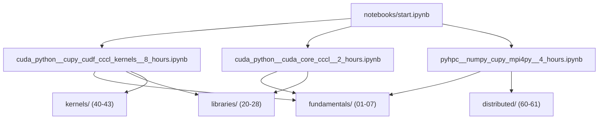
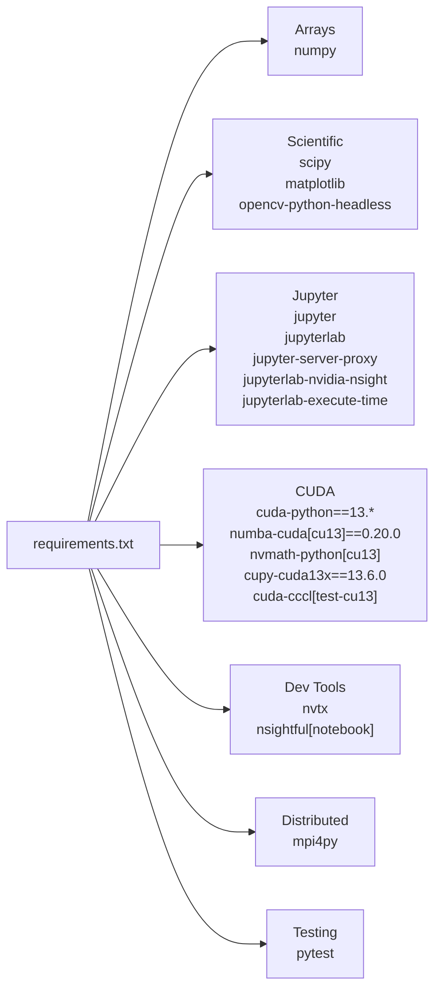
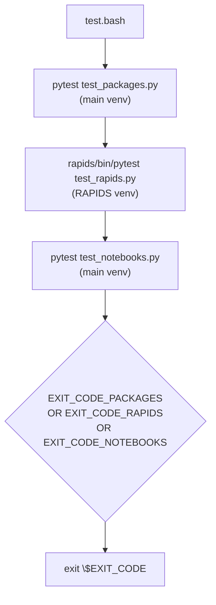
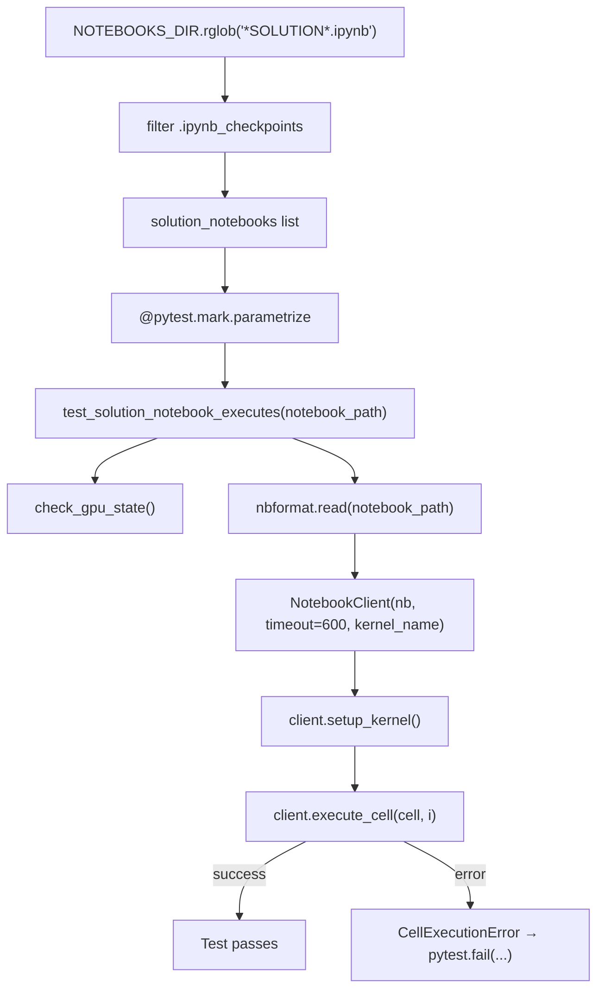

<!-- source: DeepWiki mcp.deepwiki.com · repo NVIDIA/accelerated-computing-hub · page 4.1 Accelerated Python Tutorial · fetched 2026-10-26 -->

# Accelerated Python Tutorial

<details>
<summary>Relevant source files</summary>

The following files were used as context for generating this wiki page:

- [.gitattributes](.gitattributes)
- [README.md](README.md)
- [brev/ipython-startup-add-cwd-to-path.py](brev/ipython-startup-add-cwd-to-path.py)
- [tutorials/accelerated-python/README.md](tutorials/accelerated-python/README.md)
- [tutorials/accelerated-python/brev/requirements.txt](tutorials/accelerated-python/brev/requirements.txt)
- [tutorials/accelerated-python/brev/test.bash](tutorials/accelerated-python/brev/test.bash)
- [tutorials/accelerated-python/notebooks/fundamentals/07__cuda_core__devices_streams_and_memory.ipynb](tutorials/accelerated-python/notebooks/fundamentals/07__cuda_core__devices_streams_and_memory.ipynb)
- [tutorials/accelerated-python/notebooks/fundamentals/solutions/07__cuda_core__devices_streams_and_memory__SOLUTION.ipynb](tutorials/accelerated-python/notebooks/fundamentals/solutions/07__cuda_core__devices_streams_and_memory__SOLUTION.ipynb)
- [tutorials/accelerated-python/notebooks/start.ipynb](tutorials/accelerated-python/notebooks/start.ipynb)
- [tutorials/accelerated-python/notebooks/syllabi/cuda_python__cuda_core_cccl__2_hours.ipynb](tutorials/accelerated-python/notebooks/syllabi/cuda_python__cuda_core_cccl__2_hours.ipynb)
- [tutorials/accelerated-python/test/pytest.ini](tutorials/accelerated-python/test/pytest.ini)
- [tutorials/accelerated-python/test/test_notebooks.py](tutorials/accelerated-python/test/test_notebooks.py)
- [tutorials/accelerated-python/test/test_rapids.py](tutorials/accelerated-python/test/test_rapids.py)
- [tutorials/cuda-cpp/README.md](tutorials/cuda-cpp/README.md)
- [tutorials/cuda-tile/README.md](tutorials/cuda-tile/README.md)
- [tutorials/stdpar/README.md](tutorials/stdpar/README.md)

</details>


This page documents the Accelerated Python Tutorial track located at `tutorials/accelerated-python/`. It covers the tutorial's syllabus options, notebook catalog, Python environment, and test infrastructure. For information about the GPU libraries covered in the notebook content itself, see [4.1.2](#4.1.2). For kernel authoring notebooks, see [4.1.3](#4.1.3). For the shared Docker and container infrastructure used to run the tutorial, see [2.1](#2.1) and [2.2](#2.2).

---

## Overview

The Accelerated Python Tutorial is a modular, interactive learning track covering GPU-accelerated Python from first principles through custom kernel authoring and distributed computing. Learners choose a **syllabus** that selects a focused subset of notebooks appropriate for a given time budget and learning goal.

The tutorial can be run on NVIDIA Brev or Google Colab. For single-GPU work, L40S, L4, or T4 instances are recommended. For the distributed notebooks, 4×L4 or 2×L4 instances are required.

Sources: [tutorials/accelerated-python/README.md:1-14](), [tutorials/accelerated-python/notebooks/start.ipynb:1-35]()

---

## Structure

**Repository layout:**

```
tutorials/accelerated-python/
├── brev/
│   ├── docker-compose.yml
│   ├── requirements.txt
│   └── test.bash
├── notebooks/
│   ├── start.ipynb
│   ├── syllabi/
│   │   ├── cuda_python__cupy_cudf_cccl_kernels__8_hours.ipynb
│   │   ├── cuda_python__cuda_core_cccl__2_hours.ipynb
│   │   └── pyhpc__numpy_cupy_mpi4py__4_hours.ipynb
│   ├── fundamentals/
│   ├── libraries/
│   ├── kernels/
│   └── distributed/
├── slides/
└── test/
    ├── test_notebooks.py
    ├── test_packages.py
    ├── test_rapids.py
    └── pytest.ini
```

Sources: [tutorials/accelerated-python/README.md:1-64](), [tutorials/accelerated-python/brev/test.bash:1-38]()

---

## Syllabi

The entry point notebook `notebooks/start.ipynb` directs learners to one of three syllabus notebooks, each of which links to a curated subset of the full notebook catalog.

| Syllabus Notebook | Duration | Key Technologies | GPU Requirements |
|---|---|---|---|
| `cuda_python__cupy_cudf_cccl_kernels__8_hours.ipynb` | 8 hours | CuPy, cuDF, cuda-cccl, Numba kernels | L40S, L4, or T4 |
| `cuda_python__cuda_core_cccl__2_hours.ipynb` | 2 hours | cuda.core, cuda-cccl | L40S, L4, or T4 |
| `pyhpc__numpy_cupy_mpi4py__4_hours.ipynb` | 4 hours | NumPy, CuPy, mpi4py | 4×L4, 2×L4, 2×L40S, or 1×L40S |

The 2-hour `cuda.core & CCCL` syllabus includes notebooks 00, 07, and 23 ([tutorials/accelerated-python/notebooks/syllabi/cuda_python__cuda_core_cccl__2_hours.ipynb:11-17]()).

Sources: [tutorials/accelerated-python/README.md:15-19](), [tutorials/accelerated-python/notebooks/start.ipynb:1-35](), [tutorials/accelerated-python/notebooks/syllabi/cuda_python__cuda_core_cccl__2_hours.ipynb:1-54]()

---

## Notebook Catalog

The notebooks are numbered into four groups. Each exercise notebook has a corresponding `*__SOLUTION.ipynb` in a `solutions/` subdirectory.

**Syllabus → Notebook Group relationship:**



Sources: [tutorials/accelerated-python/notebooks/start.ipynb:1-35](), [tutorials/accelerated-python/notebooks/syllabi/cuda_python__cuda_core_cccl__2_hours.ipynb:11-17](), [tutorials/accelerated-python/README.md:23-63]()

### Fundamentals (01–07)

| # | Notebook | Technologies |
|---|---|---|
| 01 | NumPy Intro: `ndarray` Basics | NumPy |
| 02 | NumPy Linear Algebra: SVD Reconstruction | NumPy |
| 03 | NumPy to CuPy: `ndarray` Basics | CuPy |
| 04 | NumPy to CuPy: SVD Reconstruction | CuPy |
| 05 | Memory Spaces: Power Iteration | CuPy |
| 06 | Asynchrony: Power Iteration | CuPy |
| 07 | CUDA Core: Devices, Streams and Memory | `cuda.core` |

Sources: [tutorials/accelerated-python/README.md:23-33]()

### Libraries (20–28)

| # | Notebook | Technologies |
|---|---|---|
| 20 | cuDF: NYC Parking Violations | `cudf` |
| 21 | cudf.pandas: NYC Parking Violations | `cudf.pandas` |
| 22 | cuML | `cuml` |
| 23 | CUDA CCCL: Customizing Algorithms | `cuda-cccl` |
| 24 | nvmath-python: Interop | `nvmath-python` |
| 25 | nvmath-python: Kernel Fusion | `nvmath-python` |
| 26 | nvmath-python: Stateful APIs | `nvmath-python` |
| 27 | nvmath-python: Scaling | `nvmath-python` |
| 28 | PyNVML | `pynvml` |

Sources: [tutorials/accelerated-python/README.md:36-47]()

### Kernels (40–43)

| # | Notebook | Technologies |
|---|---|---|
| 40 | Kernel Authoring: Copy | Numba `cuda.jit` |
| 41 | Kernel Authoring: Book Histogram | Numba `cuda.jit` |
| 42 | Kernel Authoring: Gaussian Blur | Numba `cuda.jit` |
| 43 | Kernel Authoring: Black and White | Numba `cuda.jit` |

Sources: [tutorials/accelerated-python/README.md:49-57]()

### Distributed (60–61)

| # | Notebook | Technologies |
|---|---|---|
| 60 | mpi4py | `mpi4py` |
| 61 | Dask | `dask` |

Sources: [tutorials/accelerated-python/README.md:59-63]()

---

## Python Environment

The tutorial environment is defined in `tutorials/accelerated-python/brev/requirements.txt`. RAPIDS libraries (`cudf`, `cuml`) are installed in a separate virtual environment at `/opt/venvs/rapids/` and are tested separately (see [test.bash:14-16]()).

**Package manifest by category:**



Sources: [tutorials/accelerated-python/brev/requirements.txt:1-32]()

### Key Packages

| Package | Version Constraint | Purpose |
|---|---|---|
| `cuda-python` | `== 13.*` | Low-level CUDA driver/runtime bindings (`cuda.core`) |
| `numba-cuda` | `== 0.20.0` (cu13) | Python CUDA kernel authoring via `@cuda.jit` |
| `nvmath-python` | `[cu13]` | Math library APIs: GEMM, FFT, fusion |
| `cupy-cuda13x` | `== 13.6.0` | NumPy-compatible GPU array library |
| `cuda-cccl` | `[test-cu13]` | CUDA C++ Core Libraries Python bindings |
| `nvtx` | — | NVTX range annotations for profiling |
| `nsightful` | git source | Nsight notebook integration |
| `mpi4py` | — | MPI bindings for distributed notebooks |
| `jupyter-server-proxy` | — | Proxied access to Nsight tools from JupyterLab |

Sources: [tutorials/accelerated-python/brev/requirements.txt:1-32]()

---

## Test Infrastructure

### Test Runner: `test.bash`

`tutorials/accelerated-python/brev/test.bash` orchestrates three sequential test suites and exits non-zero if any suite fails.

**Test execution flow:**



- `test_packages.py` — validates that all main-environment packages are importable and functional.
- `test_rapids.py` — validates `cudf` and `cuml` in the RAPIDS virtual environment at `/opt/venvs/rapids/`.
- `test_notebooks.py` — executes all `*SOLUTION*.ipynb` notebooks end-to-end via `nbclient`.

Sources: [tutorials/accelerated-python/brev/test.bash:1-38]()

### Notebook Test Framework: `test_notebooks.py`

`test_notebooks.py` uses `pytest` with `nbclient` to discover and execute every solution notebook.

**Key code entities:**

| Symbol | Role |
|---|---|
| `solution_notebooks` | Module-level list; discovers all `*SOLUTION*.ipynb` files recursively under `NOTEBOOKS_DIR` via `rglob`, excluding `.ipynb_checkpoints` |
| `notebook_ids` | List of relative path strings used as pytest parametrize IDs |
| `test_solution_notebook_executes` | Parametrized test function; one invocation per solution notebook |
| `NotebookClient` | `nbclient` class; executes a notebook kernel cell-by-cell with a 600-second per-cell timeout |
| `extract_cell_outputs` | Helper; extracts `stdout`, `stderr`, and `error` outputs from all executed cells for failure diagnostics |
| `check_gpu_state` | Helper; calls `nvidia-smi` to print current GPU state before each notebook test |
| `CellExecutionError` | `nbclient` exception; caught to produce a detailed `pytest.fail` message including all cell outputs and timing |

The test function sets `resources={'metadata': {'path': str(notebook_path.parent)}}` on the `NotebookClient`, ensuring that relative file paths used within notebooks resolve correctly.

**Notebook discovery and execution flow:**



Sources: [tutorials/accelerated-python/test/test_notebooks.py:1-138](), [tutorials/accelerated-python/test/pytest.ini:1-3]()

### RAPIDS Test: `test_rapids.py`

`test_rapids.py` contains two test functions:

- `test_cudf()` — creates a `cudf.DataFrame`, performs arithmetic and `groupby` operations, asserts on expected values.
- `test_cuml()` — fits a `KMeans` model from `cuml.cluster` on synthetic float32 data, asserts label count and range.

These tests run in the RAPIDS venv (`/opt/venvs/rapids/bin/pytest`) because `cudf` and `cuml` have conflicting dependencies with the main tutorial venv.

Sources: [tutorials/accelerated-python/test/test_rapids.py:1-57](), [tutorials/accelerated-python/brev/test.bash:13-16]()

### pytest Configuration

`tutorials/accelerated-python/test/pytest.ini` applies the following options to all test runs:

```
addopts = -v -s --durations=0 --durations-min=0.0
```

- `-v`: verbose output.
- `-s`: no stdout capture (important for live cell-by-cell progress from `test_notebooks.py`).
- `--durations=0 --durations-min=0.0`: report timing for every test, useful for diagnosing slow notebooks.

Sources: [tutorials/accelerated-python/test/pytest.ini:1-3]()

---

## Utility: `ipython-startup-add-cwd-to-path.py`

`brev/ipython-startup-add-cwd-to-path.py` is an IPython startup script that inserts the current working directory into `sys.path` if it is not already present. This enables notebooks to `import` local Python modules placed alongside them without additional `sys.path` manipulation inside the notebook cells.

Sources: [brev/ipython-startup-add-cwd-to-path.py:1-4]()

---

## Related Pages

| Topic | Page |
|---|---|
| NumPy / CuPy fundamentals notebooks (01–06) | [4.1.1](#4.1.1) |
| GPU library notebooks: cuDF, cuML, cuda-cccl (20–23) | [4.1.2](#4.1.2) |
| Kernel authoring notebooks: Numba, profiling (40–43) | [4.1.3](#4.1.3) |
| Docker environment and `docker-compose.yml` for this tutorial | [2.1](#2.1) |
| Container entrypoint and JupyterLab service configuration | [2.2](#2.2) |
| Developer scripts (`dev-start.bash`, `dev-build.bash`, etc.) | [2.3](#2.3) |
| CI/CD pipeline that builds and tests this tutorial's Docker image | [3.1](#3.1) |
| nvmath-python Tutorial (standalone track) | [4.4](#4.4) |

---

