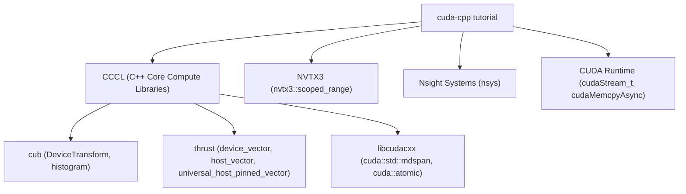

<!-- source: DeepWiki mcp.deepwiki.com · repo NVIDIA/accelerated-computing-hub · page 4.2 CUDA C++ Tutorial · fetched 2026-10-26 -->

# CUDA C++ Tutorial

<details>
<summary>Relevant source files</summary>

The following files were used as context for generating this wiki page:

- [.gitattributes](.gitattributes)
- [README.md](README.md)
- [tutorials/accelerated-python/README.md](tutorials/accelerated-python/README.md)
- [tutorials/accelerated-python/notebooks/fundamentals/06__asynchrony__power_iteration.ipynb](tutorials/accelerated-python/notebooks/fundamentals/06__asynchrony__power_iteration.ipynb)
- [tutorials/accelerated-python/notebooks/fundamentals/07__cuda_core__devices_streams_and_memory.ipynb](tutorials/accelerated-python/notebooks/fundamentals/07__cuda_core__devices_streams_and_memory.ipynb)
- [tutorials/accelerated-python/notebooks/fundamentals/solutions/06__asynchrony__power_iteration__SOLUTION.ipynb](tutorials/accelerated-python/notebooks/fundamentals/solutions/06__asynchrony__power_iteration__SOLUTION.ipynb)
- [tutorials/accelerated-python/notebooks/fundamentals/solutions/07__cuda_core__devices_streams_and_memory__SOLUTION.ipynb](tutorials/accelerated-python/notebooks/fundamentals/solutions/07__cuda_core__devices_streams_and_memory__SOLUTION.ipynb)
- [tutorials/accelerated-python/notebooks/kernels/40__kernel_authoring__copy.ipynb](tutorials/accelerated-python/notebooks/kernels/40__kernel_authoring__copy.ipynb)
- [tutorials/accelerated-python/notebooks/kernels/41__kernel_authoring__book_histogram.ipynb](tutorials/accelerated-python/notebooks/kernels/41__kernel_authoring__book_histogram.ipynb)
- [tutorials/accelerated-python/notebooks/kernels/solutions/40__kernel_authoring__copy__SOLUTION.ipynb](tutorials/accelerated-python/notebooks/kernels/solutions/40__kernel_authoring__copy__SOLUTION.ipynb)
- [tutorials/accelerated-python/notebooks/kernels/solutions/41__kernel_authoring__book_histogram__SOLUTION.ipynb](tutorials/accelerated-python/notebooks/kernels/solutions/41__kernel_authoring__book_histogram__SOLUTION.ipynb)
- [tutorials/accelerated-python/notebooks/start.ipynb](tutorials/accelerated-python/notebooks/start.ipynb)
- [tutorials/accelerated-python/notebooks/syllabi/cuda_python__cuda_core_cccl__2_hours.ipynb](tutorials/accelerated-python/notebooks/syllabi/cuda_python__cuda_core_cccl__2_hours.ipynb)
- [tutorials/cuda-cpp/README.md](tutorials/cuda-cpp/README.md)
- [tutorials/cuda-cpp/notebooks/02.02-Asynchrony/02.02.03-Exercise-Nsight.ipynb](tutorials/cuda-cpp/notebooks/02.02-Asynchrony/02.02.03-Exercise-Nsight.ipynb)
- [tutorials/cuda-cpp/notebooks/02.02-Asynchrony/02.02.04-Exercise-NVTX.ipynb](tutorials/cuda-cpp/notebooks/02.02-Asynchrony/02.02.04-Exercise-NVTX.ipynb)
- [tutorials/cuda-cpp/notebooks/02.03-Streams/02.03.02-Exercise-Async-Copy.ipynb](tutorials/cuda-cpp/notebooks/02.03-Streams/02.03.02-Exercise-Async-Copy.ipynb)
- [tutorials/cuda-cpp/notebooks/02.04-Pinned-Memory/02.04.02-Exercise-Copy-Overlap.ipynb](tutorials/cuda-cpp/notebooks/02.04-Pinned-Memory/02.04.02-Exercise-Copy-Overlap.ipynb)
- [tutorials/cuda-tile/README.md](tutorials/cuda-tile/README.md)
- [tutorials/stdpar/README.md](tutorials/stdpar/README.md)
- [tutorials/stdpar/notebooks/fortran/lab3_heat/heat.ipynb](tutorials/stdpar/notebooks/fortran/lab3_heat/heat.ipynb)

</details>


This page documents the CUDA C++ Tutorial track, located at `tutorials/cuda-cpp/`. It covers GPU programming fundamentals using modern CUDA C++, including execution spaces, memory spaces, vocabulary types, asynchrony, CUDA streams, and cooperative histogram algorithms. The tutorial is implemented as a series of Jupyter notebooks containing C++ code compiled and run via shell commands within the notebook cells.

For Python-based GPU programming content, see [Accelerated Python Tutorial](#4.1). For tile-based GPU programming with the cuTile DSL, see [CUDA Tile Tutorial](#4.3).

---

## Overview

The tutorial is titled **"Fundamentals of Accelerated Computing with Modern CUDA C++"** and is organized into two chapters:

| Chapter | Title | Focus |
|---|---|---|
| 01 | CUDA Made Easy | Parallel algorithms, execution spaces, vocabulary types, memory |
| 02 | CUDA Made Interactive | Asynchrony, CUDA streams, pinned memory, cooperative histogram |

Companion lecture slides are included in `tutorials/cuda-cpp/slides/`. Video lectures are available as a YouTube playlist referenced in `tutorials/cuda-cpp/README.md`.

Sources: [tutorials/cuda-cpp/README.md:1-32]()

---

## Notebook Series

### Chapter 01 — CUDA Made Easy: Accelerating Applications with Parallel Algorithms

| Notebook | Topic |
|---|---|
| `01.01.01` | Introduction: CUDA Made Easy |
| `01.02.01` | Execution Spaces |
| `01.02.02` | Exercise: Annotate Execution Spaces |
| `01.02.03` | Exercise: Changing Execution Space |
| `01.02.04` | Exercise: Compute Median Temperature |
| `01.03.01` | Extending Algorithms |
| `01.03.02` | Exercise: Computing Variance |
| `01.04.01` | Vocabulary Types |
| `01.04.02` | Exercise: `mdspan` |
| `01.05.01` | Serial vs Parallel |
| `01.05.02` | Exercise: Segmented Sum Optimization |
| `01.05.03` | Exercise: Segmented Mean |

Sources: [tutorials/cuda-cpp/README.md:18-32]()

### Chapter 02 — CUDA Made Interactive: Parallel GPU Simulations

| Notebook | Topic |
|---|---|
| `02.01.xx` | Introduction to Asynchrony |
| `02.02.01` | Asynchrony concepts |
| `02.02.03` | Exercise: Profile with Nsight Systems |
| `02.02.04` | Exercise: Use NVTX |
| `02.03.01` | Streams |
| `02.03.02` | Exercise: Async Copy and Streams |
| `02.04.01` | Pinned Memory |
| `02.04.02` | Exercise: Async Copy and Pinned Memory |
| `02.05.xx` | Cooperative Histogram |

Sources: [tutorials/cuda-cpp/README.md:1-90](), [tutorials/cuda-cpp/notebooks/02.02-Asynchrony/02.02.03-Exercise-Nsight.ipynb:1-30](), [tutorials/cuda-cpp/notebooks/02.02-Asynchrony/02.02.04-Exercise-NVTX.ipynb:1-30](), [tutorials/cuda-cpp/notebooks/02.03-Streams/02.03.02-Exercise-Async-Copy.ipynb:1-40](), [tutorials/cuda-cpp/notebooks/02.04-Pinned-Memory/02.04.02-Exercise-Copy-Overlap.ipynb:1-30]()

---

## Concept Map: Notebook Modules to C++ Constructs

The following diagram maps the tutorial's conceptual modules to the specific C++ types and functions introduced in each.

**Notebook module to key C++ constructs**

```mermaid
graph TD
  ExecSpaces["01.02 Execution Spaces"]
  ExtAlgo["01.03 Extending Algorithms"]
  VocabTypes["01.04 Vocabulary Types"]
  MemSpaces["01.06 Memory Spaces"]
  Async["02.02 Asynchrony"]
  Streams["02.03 Streams"]
  PinnedMem["02.04 Pinned Memory"]
  Histogram["02.05 Cooperative Histogram"]

  ExecSpaces --> dv["thrust::device_vector"]
  ExecSpaces --> hv["thrust::host_vector"]
  ExtAlgo --> cub_transform["cub::DeviceTransform::Transform"]
  VocabTypes --> mdspan["cuda::std::mdspan"]
  MemSpaces --> cudaMemcpy["cudaMemcpy"]
  Async --> nvtx3["nvtx3::scoped_range"]
  Async --> nsys["nsys (Nsight Systems)"]
  Streams --> cudaStream_t["cudaStream_t"]
  Streams --> cudaStreamCreate["cudaStreamCreate"]
  Streams --> cudaStreamSynchronize["cudaStreamSynchronize"]
  Streams --> cudaMemcpyAsync["cudaMemcpyAsync"]
  PinnedMem --> pinned["thrust::universal_host_pinned_vector"]
  Histogram --> sharedmem["cuda::atomic / shared memory"]
```



Sources: [tutorials/cuda-cpp/notebooks/02.02-Asynchrony/02.02.04-Exercise-NVTX.ipynb:37-70](), [tutorials/cuda-cpp/notebooks/02.03-Streams/02.03.02-Exercise-Async-Copy.ipynb:13-35](), [tutorials/cuda-cpp/notebooks/02.04-Pinned-Memory/02.04.02-Exercise-Copy-Overlap.ipynb:40-55]()

---

## Key Concepts

### Execution Spaces

Execution spaces control where code runs — host (CPU) or device (GPU). Notebooks in `01.02` teach learners to annotate and change execution spaces using CUDA C++ function qualifiers and CCCL algorithms like `cub::DeviceTransform::Transform`.

The shared header `Sources/ach.h` (used in Chapter 02 notebooks) provides helper utilities used across exercises.

Sources: [tutorials/cuda-cpp/notebooks/02.02-Asynchrony/02.02.04-Exercise-NVTX.ipynb:37-47]()

### Vocabulary Types

The `01.04` module introduces `cuda::std::mdspan` as a non-owning multidimensional array view type. It is used in exercises to operate on 2D grids without copying data, and appears throughout Chapter 02 exercises as the primary data layout abstraction.

Example use in notebook code:
```
cuda::std::mdspan temp_in(thrust::raw_pointer_cast(in.data()), height, width);
```

Sources: [tutorials/cuda-cpp/notebooks/02.02-Asynchrony/02.02.04-Exercise-NVTX.ipynb:43-44]()

### Asynchrony and CUDA Streams

The `02.02` and `02.03` modules explain that GPU operations are launched asynchronously. Key constructs taught:

| Construct | Purpose |
|---|---|
| `cudaStream_t` | Handle for a CUDA stream |
| `cudaStreamCreate` | Allocate a stream |
| `cudaStreamSynchronize` | Block host until stream completes |
| `cudaStreamDestroy` | Release a stream |
| `cudaMemcpyAsync` | Asynchronous device-to-host or host-to-device copy |
| `cub::DeviceTransform::Transform(..., stream)` | Submit a transform kernel to a specific stream |

The `02.02` exercises use Nsight Systems (`nsys`) to visualize execution timelines, and NVTX (`nvtx3::scoped_range`) to annotate regions in those timelines.

Sources: [tutorials/cuda-cpp/notebooks/02.02-Asynchrony/02.02.03-Exercise-Nsight.ipynb:1-20](), [tutorials/cuda-cpp/notebooks/02.03-Streams/02.03.02-Exercise-Async-Copy.ipynb:13-50]()

### Pinned Memory

The `02.04` module teaches that `cudaMemcpyAsync` only achieves true overlap between copy and compute when the host buffer is in **pinned (non-pageable) memory**. The exercise requires replacing `thrust::host_vector` with `thrust::universal_host_pinned_vector` and verifying via profiling that the copy becomes asynchronous.

Sources: [tutorials/cuda-cpp/notebooks/02.04-Pinned-Memory/02.04.02-Exercise-Copy-Overlap.ipynb:1-60]()

### Cooperative Histogram

The `02.05` module teaches cooperative GPU algorithms for histogram computation. This parallels similar content in the Accelerated Python Tutorial's kernel authoring section (see [4.1.3](#4.1.3)), but implemented entirely in CUDA C++ using CUB device-level primitives and shared memory.

---

## Shared Header: `ach.h`

Many Chapter 02 exercises depend on a shared header `Sources/ach.h` (and `Sources/nvtx3.hpp`) that abstracts initialization and computation helpers:

- `ach::init(height, width)` — initialize a simulation grid as a `thrust::device_vector<float>`
- `ach::compute(id, temp_in)` — compute one simulation step for a given element

These are included at the top of each exercise source file via `#include "ach.h"`.

Sources: [tutorials/cuda-cpp/notebooks/02.02-Asynchrony/02.02.04-Exercise-NVTX.ipynb:37-70](), [tutorials/cuda-cpp/notebooks/02.03-Streams/02.03.02-Exercise-Async-Copy.ipynb:1-50]()

---

## Library and Technology Stack

**CUDA C++ Tutorial: Technology dependency map**



Sources: [tutorials/cuda-cpp/README.md:1-32](), [tutorials/cuda-cpp/notebooks/02.02-Asynchrony/02.02.04-Exercise-NVTX.ipynb:37-70](), [tutorials/cuda-cpp/notebooks/02.03-Streams/02.03.02-Exercise-Async-Copy.ipynb:1-55]()

---

## Infrastructure and Environment

The tutorial's Docker image and Compose configuration are in `tutorials/cuda-cpp/brev/`. The shared infrastructure model follows the same conventions as other tutorials in this repository (see [Infrastructure](#2) and [Tutorial Docker Environments](#2.1)).

| Property | Value |
|---|---|
| Docker image registry | `ghcr.io/nvidia/cuda-cpp-tutorial` |
| Docker Compose file | `tutorials/cuda-cpp/brev/docker-compose.yml` |
| Recommended Brev instances | L40S, L4, or T4 |
| Recommended Brev providers | Crusoe or any provider with Flexible Ports |

Notebooks can also be opened directly in Google Colab via the badge links in `tutorials/cuda-cpp/README.md`. When run in Colab, each notebook's setup cell installs required system packages (Nsight Systems) and downloads the necessary `Sources/` headers.

Sources: [tutorials/cuda-cpp/README.md:1-16]()

---

## Relation to Other Tutorial Tracks

| Tutorial | Language | Key Similarity | Distinction |
|---|---|---|---|
| [Accelerated Python Tutorial (4.1)](#4.1) | Python | Streams, histogram, NVTX profiling | Uses `numba.cuda`, CuPy; Python syntax |
| [CUDA Tile Tutorial (4.3)](#4.3) | Python DSL | GPU kernel authoring | cuTile DSL, MLIR-based Tile IR |
| [Standard Parallelism Tutorial (4.5)](#4.5) | C++/Fortran | Parallel algorithms | Uses `std::for_each`, `do concurrent`; no CUDA-specific APIs |

---

