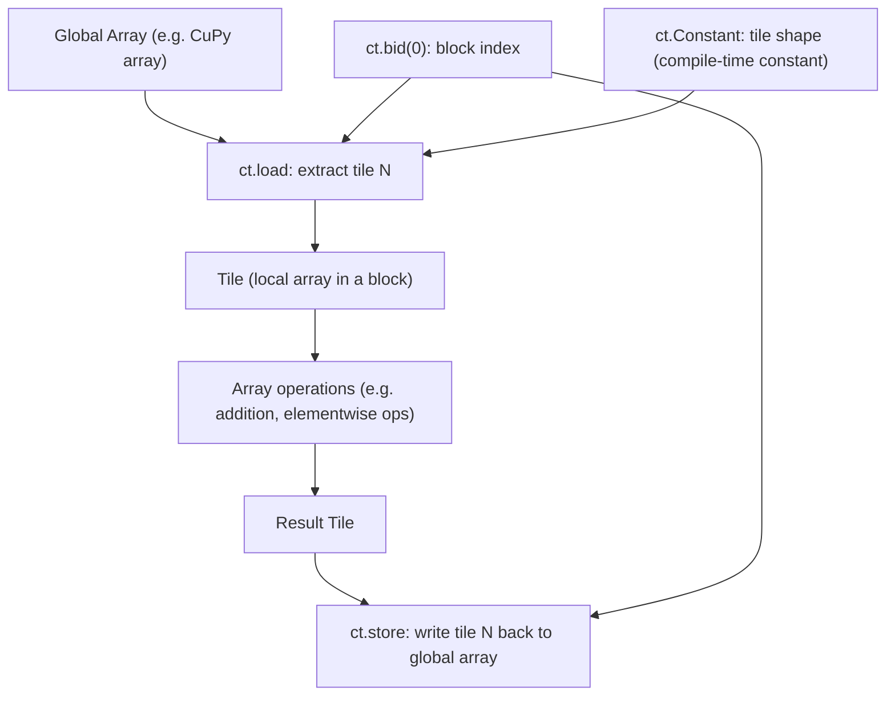
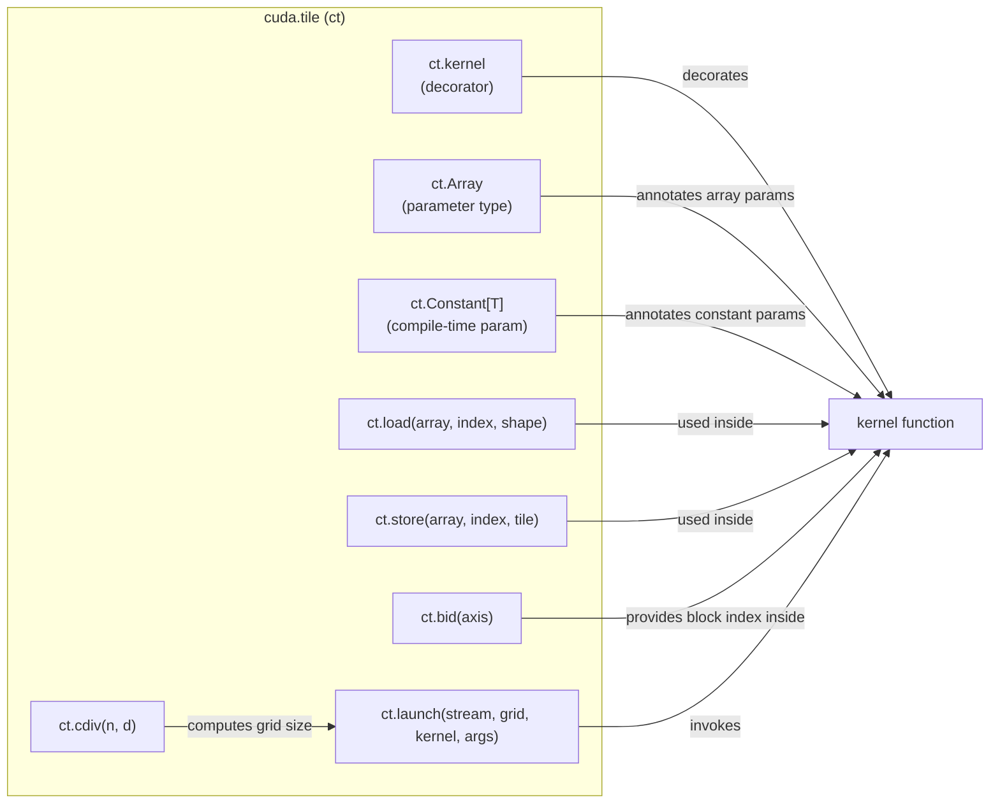
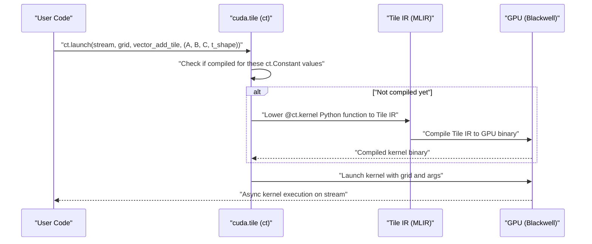
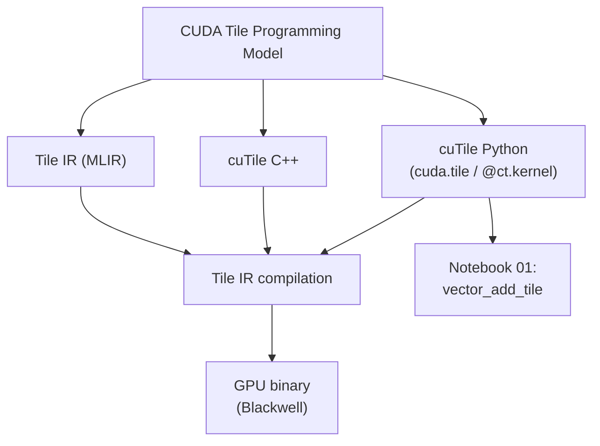

<!-- source: DeepWiki mcp.deepwiki.com · repo NVIDIA/accelerated-computing-hub · page 4.3 CUDA Tile Tutorial · fetched 2026-10-26 -->

# CUDA Tile Tutorial

<details>
<summary>Relevant source files</summary>

The following files were used as context for generating this wiki page:

- [.gitattributes](.gitattributes)
- [README.md](README.md)
- [tutorials/accelerated-python/README.md](tutorials/accelerated-python/README.md)
- [tutorials/accelerated-python/notebooks/fundamentals/07__cuda_core__devices_streams_and_memory.ipynb](tutorials/accelerated-python/notebooks/fundamentals/07__cuda_core__devices_streams_and_memory.ipynb)
- [tutorials/accelerated-python/notebooks/fundamentals/solutions/07__cuda_core__devices_streams_and_memory__SOLUTION.ipynb](tutorials/accelerated-python/notebooks/fundamentals/solutions/07__cuda_core__devices_streams_and_memory__SOLUTION.ipynb)
- [tutorials/accelerated-python/notebooks/start.ipynb](tutorials/accelerated-python/notebooks/start.ipynb)
- [tutorials/accelerated-python/notebooks/syllabi/cuda_python__cuda_core_cccl__2_hours.ipynb](tutorials/accelerated-python/notebooks/syllabi/cuda_python__cuda_core_cccl__2_hours.ipynb)
- [tutorials/cuda-cpp/README.md](tutorials/cuda-cpp/README.md)
- [tutorials/cuda-cpp/brev/requirements.txt](tutorials/cuda-cpp/brev/requirements.txt)
- [tutorials/cuda-tile/README.md](tutorials/cuda-tile/README.md)
- [tutorials/cuda-tile/brev/requirements.txt](tutorials/cuda-tile/brev/requirements.txt)
- [tutorials/cuda-tile/notebooks/01__cutile_python_intro__vector_add.ipynb](tutorials/cuda-tile/notebooks/01__cutile_python_intro__vector_add.ipynb)
- [tutorials/cuda-tile/notebooks/start.ipynb](tutorials/cuda-tile/notebooks/start.ipynb)
- [tutorials/nvmath-python/brev/requirements.txt](tutorials/nvmath-python/brev/requirements.txt)
- [tutorials/stdpar/README.md](tutorials/stdpar/README.md)
- [tutorials/stdpar/brev/requirements.txt](tutorials/stdpar/brev/requirements.txt)

</details>


This page documents the CUDA Tile tutorial track located at `tutorials/cuda-tile/`. It covers the CUDA Tile programming model, the cuTile Python DSL, Tile IR, and the `vector_add_tile` worked example. The tutorial introduces a higher-level alternative to CUDA SIMT kernel programming where the programmer operates on tiles of data rather than individual threads.

For lower-level CUDA kernel writing in Python using Numba, see the Kernel Authoring content in [4.1.3](#4.1.3). For CUDA C++ and SIMT-based kernel programming, see [4.2](#4.2).

---

## Overview

The CUDA Tile tutorial teaches a programming model where:

- Input arrays are divided into fixed-size local arrays called **tiles**.
- Tiles are processed concurrently by groups of execution resources called **blocks**.
- A **tile kernel** is executed once per block.
- Array operations within a kernel are automatically parallelized across the block.
- The framework handles parallelization, synchronization, and data movement.
- Architecture-specific details are abstracted — you express an algorithm once and the system lowers it to the right implementation for a given NVIDIA GPU architecture.

The tutorial currently contains one notebook and is under active development.

Sources: [tutorials/cuda-tile/README.md](), [tutorials/cuda-tile/notebooks/start.ipynb:1-39]()

---

## Hardware and Software Requirements

| Requirement | Value |
|---|---|
| GPU Architecture | Blackwell (B300, B200, or RTX Pro 6000) |
| NVIDIA Kernel Driver | R580 or later |
| CUDA Toolkit | 13.1 or later |
| Python Package | `cuda-tile` (via pip) |

Unlike other tutorial tracks that run on Volta/Turing/Ampere hardware, the CUDA Tile tutorial **requires a Blackwell GPU**. This restriction is noted as expected to be lifted in later releases.

Sources: [tutorials/cuda-tile/README.md](), [tutorials/cuda-tile/notebooks/01__cutile_python_intro__vector_add.ipynb:18-29]()

---

## Software Environment

The Brev environment is defined in `tutorials/cuda-tile/brev/requirements.txt`. Key packages:

| Package | Role |
|---|---|
| `cuda-tile` | cuTile Python DSL and runtime |
| `cuda-python == 13.*` | Low-level CUDA bindings (`cuda.core`) |
| `cupy-cuda13x == 13.6.0` | GPU array library; used for input data and benchmarking |
| `numba-cuda[cu13] == 0.20.0` | Numba CUDA JIT; used for SIMT comparison kernels |
| `nvmath-python[cu13]` | NVIDIA math library bindings |
| `cuda-cccl[test-cu13]` | CUDA C++ Core Libraries |
| `nvtx` | NVIDIA profiling annotations |
| `nsightful` | JupyterLab integration for Nsight tools |

Sources: [tutorials/cuda-tile/brev/requirements.txt:1-32]()

---

## Programming Model

**CUDA Tile programming model diagram**



Sources: [tutorials/cuda-tile/notebooks/01__cutile_python_intro__vector_add.ipynb:68-115]()

### Key Concepts

| Concept | Description |
|---|---|
| **Tile** | A fixed-size local array slice of a global array. Size is a compile-time constant. |
| **Block** | A group of GPU execution resources; one kernel invocation per block. |
| **Tile kernel** | A Python function decorated with `@ct.kernel`; operates on tiles rather than individual threads. |
| **Tile IR** | An MLIR-based intermediate representation that cuTile Python lowers to. |
| **`ct.Constant`** | A parameter type embedded as a literal into the compiled kernel (analogous to a C++ template parameter). Changing it triggers recompilation. |

---

## The `cuda.tile` API

The module is imported as:

```python
import cuda.tile as ct
```

[tutorials/cuda-tile/notebooks/01__cutile_python_intro__vector_add.ipynb:62-66]()

**cuTile Python API surface diagram**



Sources: [tutorials/cuda-tile/notebooks/01__cutile_python_intro__vector_add.ipynb:68-115](), [tutorials/cuda-tile/notebooks/01__cutile_python_intro__vector_add.ipynb:130-152]()

### API Reference Summary

| Symbol | Signature | Description |
|---|---|---|
| `ct.kernel` | Decorator | Marks a function as a CUDA Tile kernel. |
| `ct.Array` | Type annotation | Accepts any GPU array (CuPy, JAX, PyTorch, etc.). |
| `ct.Constant[T]` | Type annotation | Embeds the value as a compile-time literal; triggers JIT recompile on change. |
| `ct.load` | `(array, index, shape)` | Returns the tile at position `index` of dimensions `shape` from `array`. |
| `ct.store` | `(array, index, tile)` | Writes `tile` into `array` at position `index`. |
| `ct.bid` | `(axis)` | Returns the block index along the given axis. |
| `ct.launch` | `(stream, grid, kernel, args)` | Launches a kernel with a given stream, grid tuple, and argument tuple. |
| `ct.cdiv` | `(n, d)` | Ceiling integer division; used to compute grid dimensions. |

---

## Notebook: `01__cutile_python_intro__vector_add.ipynb`

Located at `tutorials/cuda-tile/notebooks/01__cutile_python_intro__vector_add.ipynb`.

This notebook introduces the CUDA Tile model using vector addition (`C[i] = A[i] + B[i]`) as the worked example.

### Structure

| Section | Content |
|---|---|
| Installing cuTile Python | pip install steps, environment check |
| Example: Vector Add | `vector_add_tile` kernel using `ct.load`, `ct.store`, and `ct.bid` |
| SIMT comparison | `vector_add_simt` using Numba `@cs.jit` for reference |
| Validation | `cp.testing.assert_array_almost_equal` against expected results |
| Benchmarking | `cupyx.profiler.benchmark` comparing CuPy, Tile, and SIMT; memory bandwidth percentage |
| Tile size tuning | Grid sweep over `t_shape` values `[16, 32, 64, 128, 256, 512, 1024]` |
| SIMT parameter tuning | Grid sweep over `items_per_thread` and `threads_per_block` |

### `vector_add_tile` Kernel

[tutorials/cuda-tile/notebooks/01__cutile_python_intro__vector_add.ipynb:97-103]()

The kernel is defined with the `@ct.kernel` decorator. `A`, `B`, `C` are annotated as `ct.Array` and `t_shape` is annotated as `ct.Constant[int]`. Inside the kernel:

1. `ct.load(A, index=(ct.bid(0),), shape=(t_shape,))` — loads the `ct.bid(0)`-th tile of size `t_shape` from `A`.
2. `ct.load(B, ...)` — same for `B`.
3. `a_tile + b_tile` — standard Python addition, parallelized across the block.
4. `ct.store(C, index=(ct.bid(0),), tile=c_tile)` — writes the result tile back.

### JIT Compilation and `ct.Constant`

Parameters annotated with `ct.Constant` are embedded as literals into the compiled kernel binary, functioning like C++ template parameters. The kernel is JIT-compiled the first time it is invoked with a given set of constant values. If a constant parameter value changes (e.g., `t_shape` changes from `1024` to `512`), the kernel must be recompiled.

[tutorials/cuda-tile/notebooks/01__cutile_python_intro__vector_add.ipynb:78-88]()

### Kernel Launch

[tutorials/cuda-tile/notebooks/01__cutile_python_intro__vector_add.ipynb:131-142]()

```
grid = (ct.cdiv(a_shape, t_shape), 1, 1)
ct.launch(cp.cuda.get_current_stream(), grid, vector_add_tile, (A, B, C, t_shape))
```

`ct.cdiv(a_shape, t_shape)` computes the number of blocks needed to cover the entire array. The CuPy current stream is passed directly to `ct.launch`.

### Kernel Compilation and Launch Flow

**JIT compilation and launch lifecycle**



Sources: [tutorials/cuda-tile/notebooks/01__cutile_python_intro__vector_add.ipynb:78-88](), [tutorials/cuda-tile/notebooks/01__cutile_python_intro__vector_add.ipynb:131-152]()

---

## Benchmarking

The notebook benchmarks `vector_add_tile` against two alternatives using `cupyx.profiler.benchmark` with 15 repetitions and 5 warmup runs.

[tutorials/cuda-tile/notebooks/01__cutile_python_intro__vector_add.ipynb:197-221]()

| Baseline | Implementation |
|---|---|
| **CuPy** | `A + B` (built-in CuPy operator) |
| **Tile** | `ct.launch(...)` with `vector_add_tile` |
| **SIMT** | Numba `@cs.jit` `vector_add_simt` |

Results are reported as mean GPU time, relative standard deviation, achieved memory bandwidth in GB/s, and percentage of peak theoretical bandwidth. Peak memory bandwidth is retrieved via `cuda.core.experimental.Device` properties (`memory_clock_rate`, `global_memory_bus_width`).

[tutorials/cuda-tile/notebooks/01__cutile_python_intro__vector_add.ipynb:165-195]()

The notebook also performs a parameter sweep over `t_shape` values for the Tile kernel and a joint sweep over `items_per_thread` × `threads_per_block` for the SIMT kernel to find optimal configurations.

[tutorials/cuda-tile/notebooks/01__cutile_python_intro__vector_add.ipynb:230-288]()

---

## Tile IR

Tile IR is an MLIR-based intermediate representation that cuTile Python lowers to. It sits between the high-level Python DSL and the final GPU binary. Tile IR is one of three entry points into the CUDA Tile system:

- **cuTile Python** — Python DSL (`cuda.tile`), the focus of this tutorial track.
- **cuTile C++** — C++ interface (mentioned in the tutorial README).
- **Tile IR** — Direct IR authoring for advanced use cases.

The Python DSL compiles to Tile IR transparently; users interacting with `@ct.kernel`-decorated functions do not need to author Tile IR directly.

Sources: [tutorials/cuda-tile/README.md](), [tutorials/cuda-tile/notebooks/01__cutile_python_intro__vector_add.ipynb:8-13](), [tutorials/cuda-tile/notebooks/start.ipynb:12-18]()

---

## Relation to Other Tutorial Tracks

| Tutorial | Kernel API | Language | Hardware |
|---|---|---|---|
| CUDA Tile (this page) | `@ct.kernel`, `ct.load`, `ct.store` | Python DSL | Blackwell only |
| CUDA C++ ([4.2](#4.2)) | `__global__` SIMT kernels | C++ | Volta/Turing/Ampere |
| Accelerated Python — Kernel Authoring ([4.1.3](#4.1.3)) | `@cuda.jit` (Numba) | Python | Volta/Turing/Ampere |



Sources: [tutorials/cuda-tile/README.md](), [tutorials/cuda-tile/notebooks/start.ipynb:12-18](), [tutorials/cuda-tile/notebooks/01__cutile_python_intro__vector_add.ipynb:8-13]()

---

