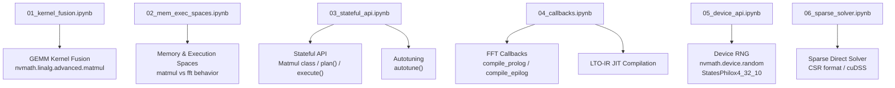
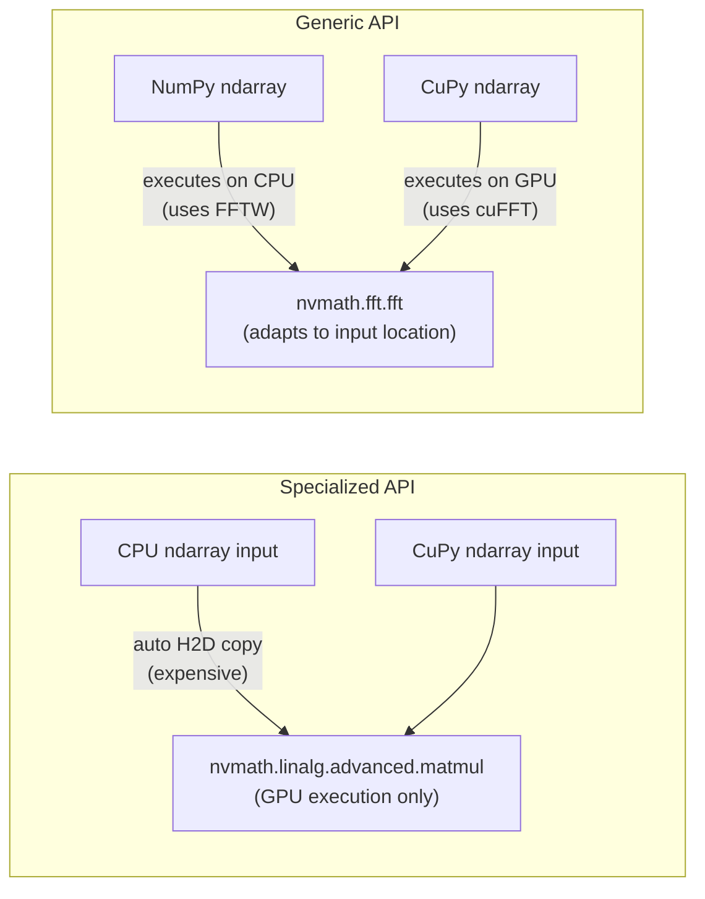
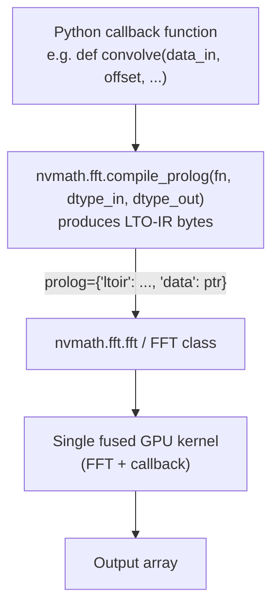
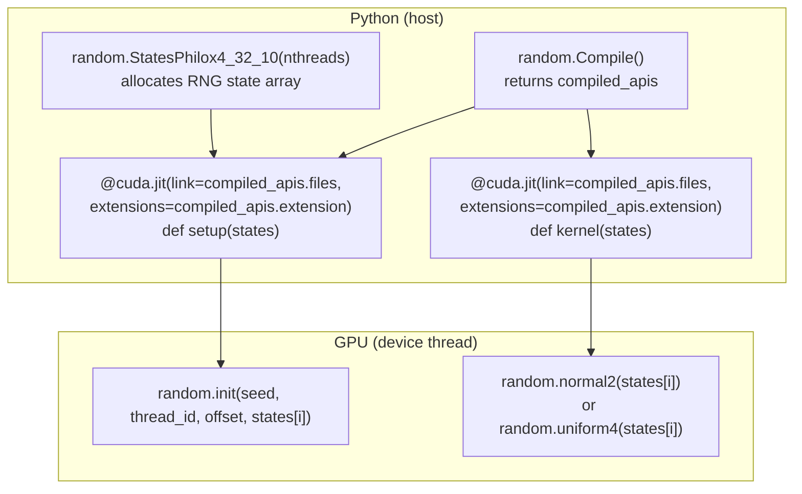
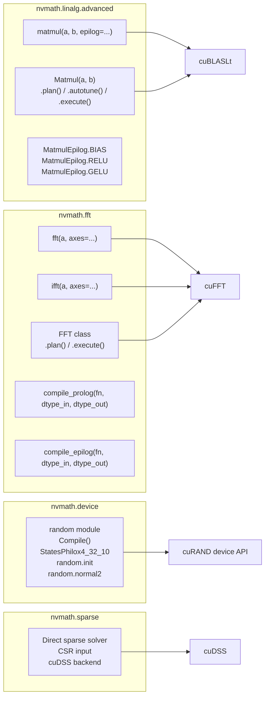

<!-- source: DeepWiki mcp.deepwiki.com · repo NVIDIA/accelerated-computing-hub · page 4.4 nvmath-python Tutorial · fetched 2026-10-26 -->

# nvmath-python Tutorial

<details>
<summary>Relevant source files</summary>

The following files were used as context for generating this wiki page:

- [Accelerated_Python_User_Guide/notebooks/Chapter_05_CUDA_Kernels_with_Numba.ipynb](Accelerated_Python_User_Guide/notebooks/Chapter_05_CUDA_Kernels_with_Numba.ipynb)
- [Accelerated_Python_User_Guide/notebooks/Chapter_06_Intro_to_nvmath-python.ipynb](Accelerated_Python_User_Guide/notebooks/Chapter_06_Intro_to_nvmath-python.ipynb)
- [Accelerated_Python_User_Guide/notebooks/Chapter_10_Developer_Tools.ipynb](Accelerated_Python_User_Guide/notebooks/Chapter_10_Developer_Tools.ipynb)
- [Accelerated_Python_User_Guide/notebooks/Chapter_11_Distributed_Computing_cuPyNumeric.ipynb](Accelerated_Python_User_Guide/notebooks/Chapter_11_Distributed_Computing_cuPyNumeric.ipynb)
- [Accelerated_Python_User_Guide/notebooks/images/chapter-06/nvmath-python.jpg](Accelerated_Python_User_Guide/notebooks/images/chapter-06/nvmath-python.jpg)
- [tutorials/accelerated-python/notebooks/libraries/images/nvdashboard.gif](tutorials/accelerated-python/notebooks/libraries/images/nvdashboard.gif)
- [tutorials/accelerated-python/notebooks/syllabi/cuda_python__cupy_cudf_cccl_kernels__8_hours.ipynb](tutorials/accelerated-python/notebooks/syllabi/cuda_python__cupy_cudf_cccl_kernels__8_hours.ipynb)
- [tutorials/cuda-cpp/notebooks/01.02-Execution-Spaces/01.02.02-Exercise-Annotate-Execution-Spaces.ipynb](tutorials/cuda-cpp/notebooks/01.02-Execution-Spaces/01.02.02-Exercise-Annotate-Execution-Spaces.ipynb)
- [tutorials/cuda-cpp/notebooks/01.02-Execution-Spaces/01.02.03-Exercise-Changing-Execution-Space.ipynb](tutorials/cuda-cpp/notebooks/01.02-Execution-Spaces/01.02.03-Exercise-Changing-Execution-Space.ipynb)
- [tutorials/cuda-cpp/notebooks/01.05-Serial-vs-Parallel/01.05.03-Exercise-Segmented-Mean.ipynb](tutorials/cuda-cpp/notebooks/01.05-Serial-vs-Parallel/01.05.03-Exercise-Segmented-Mean.ipynb)
- [tutorials/cuda-cpp/notebooks/01.06-Memory-Spaces/01.06.01-Memory-Spaces.ipynb](tutorials/cuda-cpp/notebooks/01.06-Memory-Spaces/01.06.01-Memory-Spaces.ipynb)
- [tutorials/cuda-cpp/notebooks/03.02-Kernels/03.02.01-Kernels.ipynb](tutorials/cuda-cpp/notebooks/03.02-Kernels/03.02.01-Kernels.ipynb)
- [tutorials/nvmath-python/README.md](tutorials/nvmath-python/README.md)

</details>


## Purpose and Scope

This page documents the **nvmath-python Tutorial** track located at `tutorials/nvmath-python/`. It covers the six-notebook series that teaches how to use nvmath-python, NVIDIA's Python library bridging the scientific computing ecosystem with CUDA-X math libraries.

This tutorial is focused on using nvmath-python as a standalone math operations library that works alongside array libraries like CuPy and NumPy. It is distinct from the introductory nvmath-python content in the Accelerated Python User Guide (see [Distributed Computing and Math Libraries](#5.2)) and the brief nvmath-python references within the Accelerated Python Tutorial (see [Accelerated Python Tutorial](#4.1)).

---

## What nvmath-python Is (and Is Not)

nvmath-python is **not** an array library. It does not replace NumPy, CuPy, or PyTorch. Instead, it provides high-performance mathematical operations—kernel fusion, FFT callbacks, and device-level RNG—that complement those libraries.

| Concern | Library |
|---|---|
| Array allocation and basic arithmetic | NumPy, CuPy, PyTorch |
| Benchmarking GPU code | `cupyx.profiler.benchmark` |
| High-performance GEMM with fusion | `nvmath.linalg.advanced.matmul` / `Matmul` |
| N-dimensional FFT with callbacks | `nvmath.fft.fft` / `FFT` |
| Device-level RNG in custom kernels | `nvmath.device.random` |
| Sparse direct solver | `nvmath.sparse` (backed by cuDSS) |

Sources: [tutorials/nvmath-python/README.md:1-157]()

---

## Repository Layout

```
tutorials/nvmath-python/
├── README.md
├── brev/
│   └── docker-compose.yml
├── images/
└── notebooks/
    ├── 01_kernel_fusion.ipynb
    ├── 01_kernel_fusion_SOLUTION.ipynb
    ├── 02_mem_exec_spaces.ipynb
    ├── 02_mem_exec_spaces_SOLUTION.ipynb
    ├── 03_stateful_api.ipynb
    ├── 03_stateful_api_SOLUTION.ipynb
    ├── 04_callbacks.ipynb
    ├── 04_callbacks_SOLUTION.ipynb
    ├── 05_device_api.ipynb
    ├── 05_device_api_SOLUTION.ipynb
    ├── 06_sparse_solver.ipynb
    └── 06_sparse_solver_SOLUTION.ipynb
```

Each notebook ships with a `_SOLUTION` counterpart. The tutorial can be run on NVIDIA Brev (using 4xL4, 2xL4, 2xL40S, or 1xL40S instances on Crusoe or any provider with Flexible Ports) or on Google Colab.

Sources: [tutorials/nvmath-python/README.md:27-37]()

---

## Notebook Series Overview

**Notebook-to-concept map:**



Sources: [tutorials/nvmath-python/README.md:40-139]()

---

## Notebook 01 — Kernel Fusion

**File:** `tutorials/nvmath-python/notebooks/01_kernel_fusion.ipynb`

**Core concept:** For composite matrix operations such as `D = α(A·B) + βC` (scaled GEMM), executing multiple CuPy operations requires multiple kernel launches and intermediate memory writes. `nvmath.linalg.advanced.matmul` fuses the entire expression into a single GPU kernel.

**Key APIs introduced:**

| API | Description |
|---|---|
| `nvmath.linalg.advanced.matmul(a, b)` | Stateless (function-form) GEMM |
| `cupyx.profiler.benchmark(fn, n_warmup, n_repeat)` | Benchmark utility used throughout all notebooks |

**Benchmarking approach used in all notebooks:**
- `cupyx.profiler.benchmark` wraps calls with GPU-synchronized CUDA events
- Warm-up runs eliminate cold-start JIT effects
- Minimum time across repetitions is reported

**Key insight:** Profiling with NVIDIA Nsight Systems (via the JupyterLab plugin) shows CuPy requiring multiple kernel launches for the same GEMM expression, while nvmath-python issues a single fused kernel.

Sources: [tutorials/nvmath-python/README.md:40-55]()

---

## Notebook 02 — Memory and Execution Spaces

**File:** `tutorials/nvmath-python/notebooks/02_mem_exec_spaces.ipynb`

This notebook distinguishes two orthogonal concepts:
- **Memory space** — where data is stored (host/CPU vs. device/GPU)
- **Execution space** — where computation happens (CPU vs. GPU)

### Specialized vs. Generic APIs



**Key rules:**
- `nvmath.linalg.advanced.matmul` always executes on the GPU. Passing CPU (NumPy) arrays causes an implicit, expensive host-to-device copy.
- `nvmath.fft.fft` adapts: NumPy input → CPU FFT; CuPy input → GPU FFT via cuFFT.
- nvmath-python's logging mechanism exposes the internal **specification**, **planning**, and **execution** phases, useful for diagnosing unexpected data transfers.

Sources: [tutorials/nvmath-python/README.md:57-71](), [Accelerated_Python_User_Guide/notebooks/Chapter_06_Intro_to_nvmath-python.ipynb:86-115]()

---

## Notebook 03 — Stateful API and Autotuning

**File:** `tutorials/nvmath-python/notebooks/03_stateful_api.ipynb`

### Stateless vs. Stateful API

nvmath-python provides two API styles for the same operations:

| Style | Entry Point | Cost Model |
|---|---|---|
| Stateless (function form) | `nvmath.linalg.advanced.matmul(a, b)` | Specification + planning + execution on every call |
| Stateful (class form) | `nvmath.linalg.advanced.Matmul(a, b)` | Specification + planning once; execution reused |

### Stateful API Lifecycle

```mermaid
stateDiagram-v2
    [*] --> "Matmul(a, b)": "construct"
    "Matmul(a, b)" --> "mm.plan()": "plan once"
    "mm.plan()" --> "mm.autotune()": "optional"
    "mm.plan()" --> "mm.execute()": "execute N times"
    "mm.autotune()" --> "mm.execute()": "execute N times"
    "mm.execute()" --> "mm.execute()": "repeat with same shape"
    "mm.execute()" --> "[*]": "mm.free() / context exit"
```

**Four phases of the stateful API:**

1. **Specification** — binds input tensors and configuration to the `Matmul` object
2. **Planning** — selects candidate kernels; returns a list of algorithm objects
3. **Autotuning** — benchmarks the candidates and selects the best for the given hardware
4. **Execution** — runs the chosen kernel; can be called repeatedly

**Usage pattern (context manager):**

```python
with nvmath.linalg.advanced.Matmul(a, b) as mm:
    mm.plan()
    mm.autotune()         # optional
    result = mm.execute() # reusable
```

The stateful API is critical for batch workloads where many matrices of similar shape are multiplied in sequence, because the one-time planning cost is amortized across all executions.

Sources: [tutorials/nvmath-python/README.md:74-88](), [Accelerated_Python_User_Guide/notebooks/Chapter_06_Intro_to_nvmath-python.ipynb:196-229]()

---

## Notebook 04 — FFT Callbacks

**File:** `tutorials/nvmath-python/notebooks/04_callbacks.ipynb`

### Concept: Prolog and Epilog

nvmath-python's FFT API accepts user-defined Python functions as **prolog** (pre-FFT) or **epilog** (post-FFT) callbacks. These are compiled to **LTO-IR** (Link-Time Optimization Intermediate Representation) using `nvmath.fft.compile_prolog` / `nvmath.fft.compile_epilog`, and are fused with the FFT kernel at link time.

### Compilation and Execution Flow



### Application Example: Gaussian Image Filtering

The notebook applies Gaussian blurring via FFT convolution:
1. Forward FFT of image
2. Multiply in frequency domain (prolog to IFFT)
3. Inverse FFT

### Cost Amortization

| Scenario | CuPy | nvmath-python (stateful) |
|---|---|---|
| Single image | Faster (no compilation overhead) | Slower (compile + plan cost) |
| Large batch of images | Similar | Faster (compilation amortized) |

JIT compilation overhead is a one-time cost per unique callback signature and kernel shape. For large batches, the stateful `FFT` class is the preferred approach.

Sources: [tutorials/nvmath-python/README.md:91-106](), [Accelerated_Python_User_Guide/notebooks/Chapter_06_Intro_to_nvmath-python.ipynb:342-381]()

---

## Notebook 05 — Device API

**File:** `tutorials/nvmath-python/notebooks/05_device_api.ipynb`

### Concept

nvmath-python exposes device-level APIs callable **inside Numba-CUDA kernels**. This is distinct from the host APIs: instead of calling nvmath from Python, you call it from within a GPU thread.

The primary use case shown is high-performance random number generation (RNG) inside custom kernels.

### Device API Integration with Numba-CUDA



**Key types and functions:**

| Symbol | Role |
|---|---|
| `random.Compile()` | Compiles device RNG APIs; returns `compiled_apis` with `.files` and `.extension` |
| `random.StatesPhilox4_32_10(n)` | Allocates RNG state array for `n` threads using Philox 4x32-10 algorithm |
| `random.init(seed, id, offset, state)` | Per-thread RNG state initialization (called in setup kernel) |
| `random.normal2(state)` | Samples 2 normal-distributed values per call |
| `random.uniform4(state)` | Samples 4 uniform values per call (Philox returns 4 at once) |

### Application Example: Monte Carlo GBM

The notebook simulates stock prices using Geometric Brownian Motion. The Philox4_32_10 generator produces 4 random variates per call, enabling each thread to consume variates in groups of 4 — a vectorized pattern that reduces state reads.

**Key insight:** The device RNG eliminates the need for intermediate arrays of random numbers (no separate `cp.random` allocation step), reducing memory pressure in compute-intensive loops.

Sources: [tutorials/nvmath-python/README.md:109-124](), [Accelerated_Python_User_Guide/notebooks/Chapter_06_Intro_to_nvmath-python.ipynb:403-444]()

---

## Notebook 06 — Direct Sparse Solver

**File:** `tutorials/nvmath-python/notebooks/06_sparse_solver.ipynb`

### Concept

Solves large sparse linear systems of the form `A·X = B` using a **direct** method (factorization-based), backed by NVIDIA cuDSS.

### CSR Format

The solver accepts matrices in **Compressed Sparse Row (CSR)** format — the standard GPU-friendly sparse representation:

| Component | Description |
|---|---|
| `data` | Array of non-zero values |
| `indices` | Column indices of each non-zero |
| `indptr` | Row pointer array (length `n_rows + 1`) |

### Execution Modes

| Mode | Description |
|---|---|
| GPU | All factorization and solve steps on GPU |
| Hybrid | Factorization on GPU, some analysis on CPU |

**Key insight:** Direct methods are well-suited for structured sparse systems (e.g., PDE discretizations) where iterative methods may not converge reliably.

Sources: [tutorials/nvmath-python/README.md:127-139]()

---

## API Surface Summary

The diagram below maps the primary nvmath-python Python symbols used across the tutorial to the CUDA-X libraries they wrap.



Sources: [tutorials/nvmath-python/README.md:1-157](), [Accelerated_Python_User_Guide/notebooks/Chapter_06_Intro_to_nvmath-python.ipynb:1-515]()

---

## Benchmarking Methodology

All notebooks use a consistent approach via `cupyx.profiler.benchmark`:

- **Warm-up runs** — eliminates JIT compilation and CUDA context init from measurements
- **Multiple repetitions** — provides statistical stability
- **CUDA event synchronization** — ensures GPU work completes before timing stops
- **Reported metric** — minimum time across all repetitions

For profiling at the kernel level, notebooks integrate the NVIDIA Nsight Systems JupyterLab plugin to capture GPU traces and inspect kernel launches.

Sources: [tutorials/nvmath-python/README.md:142-156]()

---

## Running the Tutorial

### NVIDIA Brev

Use Docker images published at `ghcr.io/nvidia/nvmath-python-tutorial` with the Docker Compose file at `tutorials/nvmath-python/brev/docker-compose.yml`. Recommended instance types:
- 4xL4, 2xL4, 2xL40S, or 1xL40S
- Crusoe or any provider with Flexible Ports

### Google Colab

Each notebook links to a Colab-runnable version. The Colab badge links in `tutorials/nvmath-python/README.md` point directly to `notebooks/0N_*.ipynb` and their solution counterparts.

Sources: [tutorials/nvmath-python/README.md:11-18]()

---

