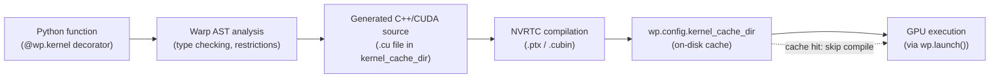
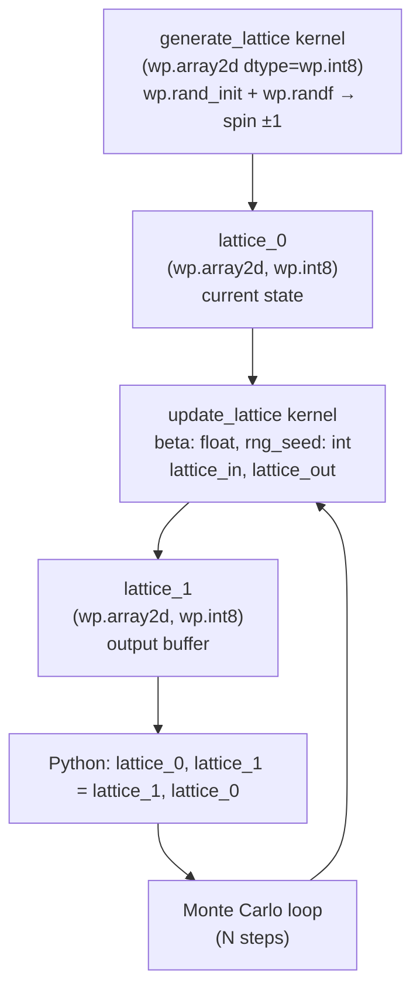
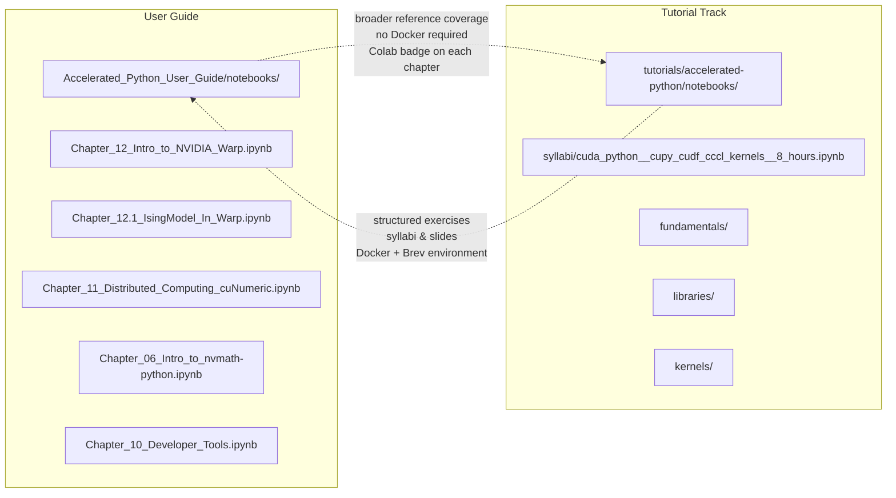

<!-- source: DeepWiki mcp.deepwiki.com · repo NVIDIA/accelerated-computing-hub · page 5 Accelerated Python User Guide · fetched 2026-10-26 -->

# Accelerated Python User Guide

<details>
<summary>Relevant source files</summary>

The following files were used as context for generating this wiki page:

- [Accelerated_Python_User_Guide/notebooks/Chapter_05_CUDA_Kernels_with_Numba.ipynb](Accelerated_Python_User_Guide/notebooks/Chapter_05_CUDA_Kernels_with_Numba.ipynb)
- [Accelerated_Python_User_Guide/notebooks/Chapter_06_Intro_to_nvmath-python.ipynb](Accelerated_Python_User_Guide/notebooks/Chapter_06_Intro_to_nvmath-python.ipynb)
- [Accelerated_Python_User_Guide/notebooks/Chapter_10_Developer_Tools.ipynb](Accelerated_Python_User_Guide/notebooks/Chapter_10_Developer_Tools.ipynb)
- [Accelerated_Python_User_Guide/notebooks/Chapter_11_Distributed_Computing_cuPyNumeric.ipynb](Accelerated_Python_User_Guide/notebooks/Chapter_11_Distributed_Computing_cuPyNumeric.ipynb)
- [Accelerated_Python_User_Guide/notebooks/Chapter_12.1_IsingModel_In_Warp.ipynb](Accelerated_Python_User_Guide/notebooks/Chapter_12.1_IsingModel_In_Warp.ipynb)
- [Accelerated_Python_User_Guide/notebooks/Chapter_12_Intro_to_NVIDIA_Warp.ipynb](Accelerated_Python_User_Guide/notebooks/Chapter_12_Intro_to_NVIDIA_Warp.ipynb)
- [Accelerated_Python_User_Guide/notebooks/README.md](Accelerated_Python_User_Guide/notebooks/README.md)
- [Accelerated_Python_User_Guide/notebooks/images/chapter-06/nvmath-python.jpg](Accelerated_Python_User_Guide/notebooks/images/chapter-06/nvmath-python.jpg)
- [Accelerated_Python_User_Guide/notebooks/images/chapter-12.1/ising_animation.gif](Accelerated_Python_User_Guide/notebooks/images/chapter-12.1/ising_animation.gif)
- [Accelerated_Python_User_Guide/notebooks/images/chapter-12/warp-compilation-pipeline.svg](Accelerated_Python_User_Guide/notebooks/images/chapter-12/warp-compilation-pipeline.svg)
- [tutorials/accelerated-python/notebooks/libraries/images/nvdashboard.gif](tutorials/accelerated-python/notebooks/libraries/images/nvdashboard.gif)
- [tutorials/accelerated-python/notebooks/syllabi/cuda_python__cupy_cudf_cccl_kernels__8_hours.ipynb](tutorials/accelerated-python/notebooks/syllabi/cuda_python__cupy_cudf_cccl_kernels__8_hours.ipynb)
- [tutorials/cuda-cpp/notebooks/01.02-Execution-Spaces/01.02.02-Exercise-Annotate-Execution-Spaces.ipynb](tutorials/cuda-cpp/notebooks/01.02-Execution-Spaces/01.02.02-Exercise-Annotate-Execution-Spaces.ipynb)
- [tutorials/cuda-cpp/notebooks/01.02-Execution-Spaces/01.02.03-Exercise-Changing-Execution-Space.ipynb](tutorials/cuda-cpp/notebooks/01.02-Execution-Spaces/01.02.03-Exercise-Changing-Execution-Space.ipynb)
- [tutorials/cuda-cpp/notebooks/01.05-Serial-vs-Parallel/01.05.03-Exercise-Segmented-Mean.ipynb](tutorials/cuda-cpp/notebooks/01.05-Serial-vs-Parallel/01.05.03-Exercise-Segmented-Mean.ipynb)
- [tutorials/cuda-cpp/notebooks/01.06-Memory-Spaces/01.06.01-Memory-Spaces.ipynb](tutorials/cuda-cpp/notebooks/01.06-Memory-Spaces/01.06.01-Memory-Spaces.ipynb)
- [tutorials/cuda-cpp/notebooks/03.02-Kernels/03.02.01-Kernels.ipynb](tutorials/cuda-cpp/notebooks/03.02-Kernels/03.02.01-Kernels.ipynb)

</details>


## Purpose and Scope

The **Accelerated Python User Guide** is a standalone, chapter-based collection of Jupyter notebooks located at `Accelerated_Python_User_Guide/notebooks/`. It covers GPU-accelerated Python programming from first principles through advanced topics including distributed computing, high-performance math libraries, developer tooling, and the NVIDIA Warp simulation framework.

This guide targets Python practitioners who want a reference-style resource they can read chapter by chapter or use selectively. Each notebook is independently runnable on Google Colab without any local Docker environment.

> **Related content:** For the structured tutorial track with exercises and syllabi, see the Accelerated Python Tutorial ([4.1](#4.1)). For detailed coverage of NVIDIA Warp chapters specifically, see [5.1](#5.1). For the distributed computing and math library chapters, see [5.2](#5.2).

Sources: [Accelerated_Python_User_Guide/notebooks/README.md:1-20]()

---

## Chapter Inventory

The guide is organized into 13 notebooks spanning foundational GPU concepts through advanced application frameworks.

| Chapter | Title | Key Libraries / Tools |
|---------|-------|----------------------|
| 1 | GPU Computing Basics | — |
| 2 | Brief Intro to CUDA | — |
| 3 | Python on the GPU | — |
| 4 | Scientific Computing with CuPy | `cupy` |
| 5 | CUDA Kernels with Numba | `numba.cuda`, `@cuda.jit` |
| 6 | Intro to nvmath-python | `nvmath.fft`, `nvmath.linalg.advanced` |
| 7 | Intro to cuDF | `cudf` |
| 8 | Intro to cuML | `cuml` |
| 9 | Intro to cuGraph | `cugraph` |
| 10 | Developer Tools | `nsys`, `ncu`, Compute Sanitizer, `nvtx` |
| 11 | Distributed Computing with cuPyNumeric | `cupynumeric`, `legate` |
| 12 | Intro to NVIDIA Warp | `warp` (`wp`) |
| 12.1 | Ising Model in NVIDIA Warp | `warp` (`wp`), `wp.kernel`, `wp.launch` |

Sources: [Accelerated_Python_User_Guide/notebooks/README.md:1-20]()

---

## Repository Location and Access

All notebooks reside in `Accelerated_Python_User_Guide/notebooks/`. Each notebook includes a Google Colab badge that links to a hosted, executable version, requiring no local installation.

**Notebook structure:**

```
Accelerated_Python_User_Guide/
└── notebooks/
    ├── Chapter_01_GPU_Computing_Basics.ipynb
    ├── Chapter_02_Brief_Intro_to_CUDA.ipynb
    ├── Chapter_03_Python_on_the_GPU.ipynb
    ├── Chapter_04_Scientific_Computing_with_CuPy.ipynb
    ├── Chapter_05_CUDA_Kernels_with_Numba.ipynb
    ├── Chapter_06_Intro_to_nvmath-python.ipynb
    ├── Chapter_07_Intro_to_cuDF.ipynb
    ├── Chapter_08_Intro_to_cuML.ipynb
    ├── Chapter_09_Intro_to_cuGraph.ipynb
    ├── Chapter_10_Developer_Tools.ipynb
    ├── Chapter_11_Distributed_Computing_cuNumeric.ipynb
    ├── Chapter_12_Intro_to_NVIDIA_Warp.ipynb
    └── Chapter_12.1_IsingModel_In_Warp.ipynb
```

Sources: [Accelerated_Python_User_Guide/notebooks/README.md:1-20]()

---

## Topic Coverage Map

The following diagram shows how chapters group by topic domain and which code-level APIs they introduce.

**Diagram: Chapter-to-API mapping**

```mermaid
graph TD
    UG["Accelerated_Python_User_Guide/notebooks/"]

    UG --> F["Foundations (Ch 1-4)"]
    UG --> K["Kernel Authoring (Ch 5)"]
    UG --> M["Math Libraries (Ch 6)"]
    UG --> R["RAPIDS (Ch 7-9)"]
    UG --> D["Developer Tools (Ch 10)"]
    UG --> DC["Distributed Computing (Ch 11)"]
    UG --> W["NVIDIA Warp (Ch 12, 12.1)"]

    F --> F1["GPU execution model"]
    F --> F2["cupy.ndarray"]
    F --> F3["host/device memory transfer"]

    K --> K1["numba.cuda / @cuda.jit"]
    K --> K2["cuda.threadIdx, cuda.blockIdx"]
    K --> K3["cuda.synchronize()"]

    M --> M1["nvmath.fft.fft / nvmath.fft.ifft"]
    M --> M2["nvmath.linalg.advanced.matmul"]
    M --> M3["nvmath.linalg.advanced.Matmul (stateful)"]
    M --> M4["nvmath.device (cuFFTDx, cuBLASDx, cuRAND)"]

    R --> R1["cudf.DataFrame"]
    R --> R2["cuml (KNeighborsClassifier, etc.)"]
    R --> R3["cugraph"]

    D --> D1["nsys profile"]
    D --> D2["ncu (Nsight Compute)"]
    D --> D3["compute-sanitizer"]
    D --> D4["nvtx.push_range / nvtx.pop_range"]

    DC --> DC1["cupynumeric as np"]
    DC --> DC2["legate driver CLI"]

    W --> W1["@wp.kernel / @wp.func"]
    W --> W2["wp.array / wp.array2d"]
    W --> W3["wp.launch()"]
    W --> W4["wp.rand_init / wp.randf"]
```



Sources: [Accelerated_Python_User_Guide/notebooks/README.md:1-20](), [Accelerated_Python_User_Guide/notebooks/Chapter_05_CUDA_Kernels_with_Numba.ipynb:1-50](), [Accelerated_Python_User_Guide/notebooks/Chapter_06_Intro_to_nvmath-python.ipynb:1-120](), [Accelerated_Python_User_Guide/notebooks/Chapter_10_Developer_Tools.ipynb:1-80](), [Accelerated_Python_User_Guide/notebooks/Chapter_11_Distributed_Computing_cuPyNumeric.ipynb:1-100](), [Accelerated_Python_User_Guide/notebooks/Chapter_12_Intro_to_NVIDIA_Warp.ipynb:1-100]()

---

## Chapters 1–4: GPU Computing Foundations

Chapters 1 through 4 establish the baseline knowledge needed for the rest of the guide:

- **Chapter 1** covers the GPU execution model: streaming multiprocessors (SMs), thread blocks, and the SIMT model.
- **Chapter 2** introduces core CUDA concepts: kernels, memory spaces (host vs. device), and the heterogeneous programming model.
- **Chapter 3** surveys Python-layer options for GPU programming and where each fits.
- **Chapter 4** focuses on `CuPy`, the NumPy-compatible GPU array library, including `cupy.ndarray`, device memory management, and explicit host↔device transfers.

---

## Chapter 5: CUDA Kernels with Numba

Chapter 5 (`Chapter_05_CUDA_Kernels_with_Numba.ipynb`) covers writing custom CUDA kernels from Python using the `numba.cuda` module.

Key APIs and concepts:

| Concept | Code |
|---------|------|
| Kernel decorator | `@cuda.jit` |
| Thread identification | `cuda.threadIdx.x`, `cuda.blockIdx.x`, `cuda.blockDim.x` |
| Convenience indexing | `cuda.grid(1)` |
| Kernel launch syntax | `foo[grid_blocks, block_threads](input, output)` |
| Synchronization | `cuda.synchronize()` |
| CuPy interop | Pass `cupy.ndarray` directly via `__cuda_array_interface__` |

The chapter recommends block sizes that are multiples of 32 (the hardware warp size), with 128–256 threads per block as a starting point. It notes that `cuda.synchronize()` must be called before reading results back on the CPU.

The chapter also shows how `numba_config.CUDA_ENABLE_PYNVJITLINK = True` enables `pynvjitlink` for LTO-IR-based compilation, required when combining Numba kernels with `nvmath.device` APIs.

Sources: [Accelerated_Python_User_Guide/notebooks/Chapter_05_CUDA_Kernels_with_Numba.ipynb:1-184]()

---

## Chapter 6: nvmath-python

Chapter 6 (`Chapter_06_Intro_to_nvmath-python.ipynb`) introduces the `nvmath` library, which exposes NVIDIA math library performance to Python.

### High-Level API Surface

| Module | Function / Class | Description |
|--------|-----------------|-------------|
| `nvmath.fft` | `fft(a, axes=...)` | N-D forward FFT (host or CUDA) |
| `nvmath.fft` | `ifft(b, axes=...)` | N-D inverse FFT |
| `nvmath.fft` | `compile_prolog(fn, ...)` | Compile Python callback to LTO-IR for fused epilog/prolog |
| `nvmath.linalg.advanced` | `matmul(a, b)` | Stateless scaled matrix multiplication |
| `nvmath.linalg.advanced` | `Matmul(a, b)` | Stateful object: plan → autotune → execute |
| `nvmath.linalg.advanced` | `MatmulEpilog.BIAS` | Fused bias epilog (also: `RELU`, `GELU`, `SIGMOID`, `TANH`) |
| `nvmath.device` | `random.Compile()` / `StatesPhilox4_32_10` | Device-side cuRAND via Numba extensions |

### Stateless vs. Stateful Matmul

The stateless API is a single function call; the stateful `Matmul` context manager amortizes planning and autotuning costs across repeated executions.

```
# Stateless (one-shot)
result = nvmath.linalg.advanced.matmul(a, b)

# Stateful (plan once, execute many times)
with nvmath.linalg.advanced.Matmul(a, b) as mm:
    mm.plan()
    result = mm.execute()
```

### FFT with LTO-IR Prolog

The `compile_prolog` function compiles a Python function to NVIDIA's LTO-IR format, which the FFT engine fuses at link time. This enables, for example, a convolution prolog on the inverse FFT without a separate kernel launch:

See [Accelerated_Python_User_Guide/notebooks/Chapter_06_Intro_to_nvmath-python.ipynb:344-381]() for the convolution prolog example.

Sources: [Accelerated_Python_User_Guide/notebooks/Chapter_06_Intro_to_nvmath-python.ipynb:1-430]()

---

## Chapters 7–9: RAPIDS Ecosystem

These chapters introduce the RAPIDS GPU data science libraries:

| Chapter | Library | Focus |
|---------|---------|-------|
| 7 | `cuDF` | GPU DataFrames, pandas-compatible API, UDFs |
| 8 | `cuML` | GPU machine learning (e.g., `KNeighborsClassifier`) |
| 9 | `cuGraph` | GPU graph analytics |

Each chapter is a self-contained introduction and mirrors the API style of its CPU counterpart (`pandas`, `scikit-learn`, `networkx`), allowing users to accelerate existing code with minimal changes.

---

## Chapter 10: Developer Tools

Chapter 10 (`Chapter_10_Developer_Tools.ipynb`) covers the NVIDIA performance and correctness toolchain.

### Tools Covered

| Tool | Purpose | Access Method |
|------|---------|---------------|
| Nsight Systems (`nsys`) | Platform-level profiling: CPU, GPU, memory, OS | CLI: `nsys profile ...` or GUI |
| Nsight Compute (`ncu`) | Kernel-level roofline and occupancy analysis | CLI or GUI |
| Compute Sanitizer | Runtime error detection: memory faults, races, leaks | CLI: `compute-sanitizer ...` |
| `nvtx` | User-defined annotations visible in profiler timelines | `nvtx.push_range()` / `nvtx.pop_range()` |

### NVTX Annotation Pattern

The chapter demonstrates marking workload phases with `nvtx.push_range` / `nvtx.pop_range` so they appear as labeled ranges in the Nsight Systems timeline. See [Accelerated_Python_User_Guide/notebooks/Chapter_10_Developer_Tools.ipynb:226-260]() for the annotated CuPy example.

### Common Correctness Pitfalls

The chapter enumerates three primary categories of GPU code errors:
1. **Memory access violations** — out-of-bounds reads/writes
2. **Memory leaks** — allocated but unreleased GPU memory
3. **Data race conditions** — concurrent reads/writes without synchronization

Sources: [Accelerated_Python_User_Guide/notebooks/Chapter_10_Developer_Tools.ipynb:1-260]()

---

## Chapter 11: Distributed Computing with cuPyNumeric

Chapter 11 (`Chapter_11_Distributed_Computing_cuPyNumeric.ipynb`) covers `cupynumeric`, a NumPy-compatible library that distributes computation across multiple GPUs and nodes via the Legate runtime.

### Key Properties

- Import as `import cupynumeric as np` — same API as NumPy
- Execution is controlled by the `legate` CLI driver, not Python's interpreter directly
- Scales from a laptop to HPC clusters (e.g., Perlmutter/NERSC) without code changes

### Execution Examples

| Scenario | Command |
|----------|---------|
| Single node, 2 GPUs | `legate --gpus 2 ./main.py` |
| Multi-node, 4 GPUs/node | `legate --gpus 4 --launcher srun --nodes 2 ./main.py` |

### Installation

```
pip install nvidia-cupynumeric       # via PyPI
conda install -c conda-forge -c legate cupynumeric  # via Conda
```

The `legate` package is installed as a dependency alongside `cupynumeric` and is required for the distributed runtime.

Sources: [Accelerated_Python_User_Guide/notebooks/Chapter_11_Distributed_Computing_cuPyNumeric.ipynb:1-210]()

---

## Chapters 12 and 12.1: NVIDIA Warp

These two chapters introduce the NVIDIA Warp framework for GPU kernel programming in Python. Chapter 12 covers the Warp fundamentals; Chapter 12.1 applies them to the 2-D Ising model simulation.

**Diagram: Warp kernel lifecycle from Python source to GPU execution**



Sources: [Accelerated_Python_User_Guide/notebooks/Chapter_12_Intro_to_NVIDIA_Warp.ipynb:429-458]()

### Chapter 12: Warp Fundamentals

**Core API elements:**

| API | Role |
|-----|------|
| `@wp.kernel` | Marks a Python function for JIT compilation as a GPU kernel |
| `@wp.func` | Marks a Python function callable from within a kernel |
| `wp.array(data, dtype=...)` | Allocates a typed GPU array from Python/NumPy data |
| `wp.array2d(dtype=...)` | 2-D typed array annotation for kernel arguments |
| `wp.launch(kernel, dim, inputs)` | Launches the kernel with the specified grid dimensions |
| `wp.tid()` | Returns the current thread index (1-D, 2-D, 3-D, or 4-D) |
| `wp.init()` | Explicitly initializes Warp (called implicitly on first use) |
| `wp.config.kernel_cache_dir` | Path to the on-disk compiled kernel cache |

**Kernel restrictions:**

- Arguments must be explicitly typed
- Cannot use `return`; threads write results into `wp.array` arguments
- Only a subset of Python language constructs are supported
- Kernels are JIT-compiled on first launch; subsequent launches use the cache

**Interoperability:**
- `wp.array(numpy_array, dtype=...)` — import from NumPy
- `wp_array.numpy()` — export to NumPy (triggers device→host copy)
- Compatible with PyTorch and JAX via zero-copy array protocols

Sources: [Accelerated_Python_User_Guide/notebooks/Chapter_12_Intro_to_NVIDIA_Warp.ipynb:24-440]()

### Chapter 12.1: Ising Model Case Study

Chapter 12.1 (`Chapter_12.1_IsingModel_In_Warp.ipynb`) demonstrates GPU-parallel implementation of the 2-D Ising model using the Metropolis-Hastings algorithm. It serves as a worked example of GPU parallelization strategy, race condition analysis, and the checkerboard decomposition pattern.

**Diagram: Warp kernel structure for Ising model simulation**



**Key kernels:**

| Kernel | Signature | Purpose |
|--------|-----------|---------|
| `generate_lattice` | `(lattice: wp.array2d(dtype=wp.int8), rng_seed: int)` | Initialize all lattice sites with random ±1 spins in parallel |
| `update_lattice` | `(beta: float, rng_seed: int, lattice_in: wp.array2d(dtype=wp.int8), lattice_out: wp.array2d(dtype=wp.int8))` | Apply one Metropolis step per site in parallel |

**Random number generation in kernels:**
Each thread initializes its own RNG state with `wp.rand_init(rng_seed, thread_offset)` where `thread_offset = i * lattice_size + j`. Acceptance decisions use `wp.randf(rng_state, 0.0, 1.0)`.

**Race condition problem and solution:**

The naive parallelization reads neighbors from `lattice_in` (read-only) and writes to `lattice_out` (write-only), which avoids write-write races but introduces a physical inaccuracy: all sites update simultaneously based on the *same* snapshot, rather than sequentially. The chapter introduces the **checkerboard decomposition** pattern as the physically correct solution, where only independent (non-neighboring) sites are updated in each parallel sweep.

See [Accelerated_Python_User_Guide/notebooks/Chapter_12.1_IsingModel_In_Warp.ipynb:512-743]() for the `update_lattice` kernel implementation and buffer-swap loop.

Sources: [Accelerated_Python_User_Guide/notebooks/Chapter_12.1_IsingModel_In_Warp.ipynb:1-850](), [Accelerated_Python_User_Guide/notebooks/Chapter_12_Intro_to_NVIDIA_Warp.ipynb:580-650]()

---

## Relationship to Other Sections

**Diagram: User Guide vs. Tutorial — code boundary**



Sources: [Accelerated_Python_User_Guide/notebooks/README.md:1-20](), [tutorials/accelerated-python/notebooks/syllabi/cuda_python__cupy_cudf_cccl_kernels__8_hours.ipynb:1-70]()

---

