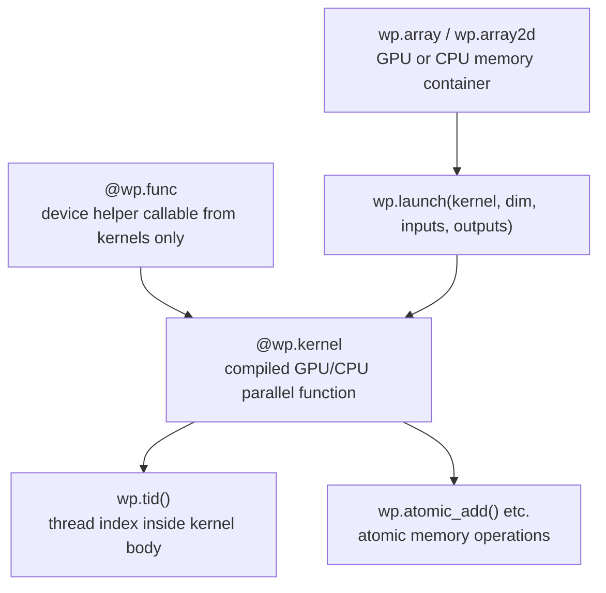
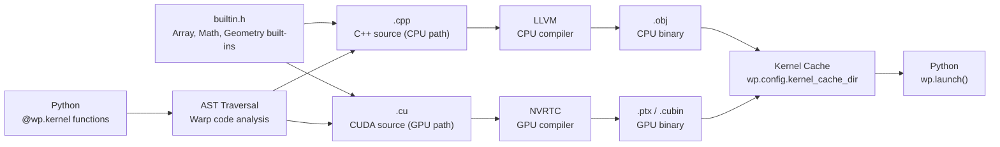
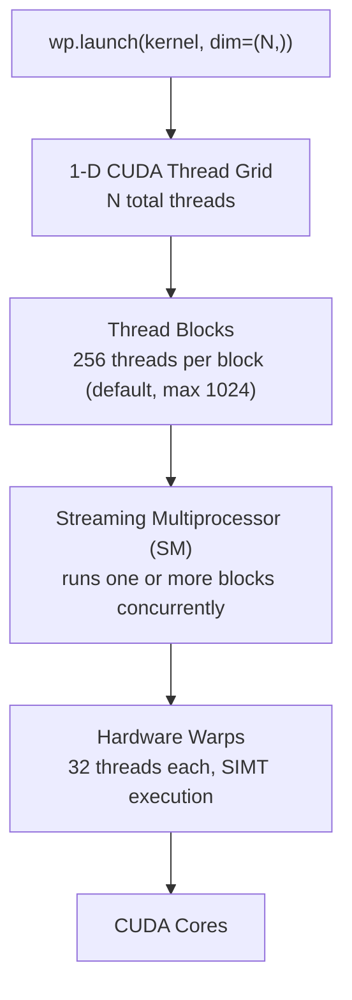
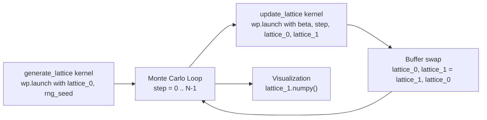
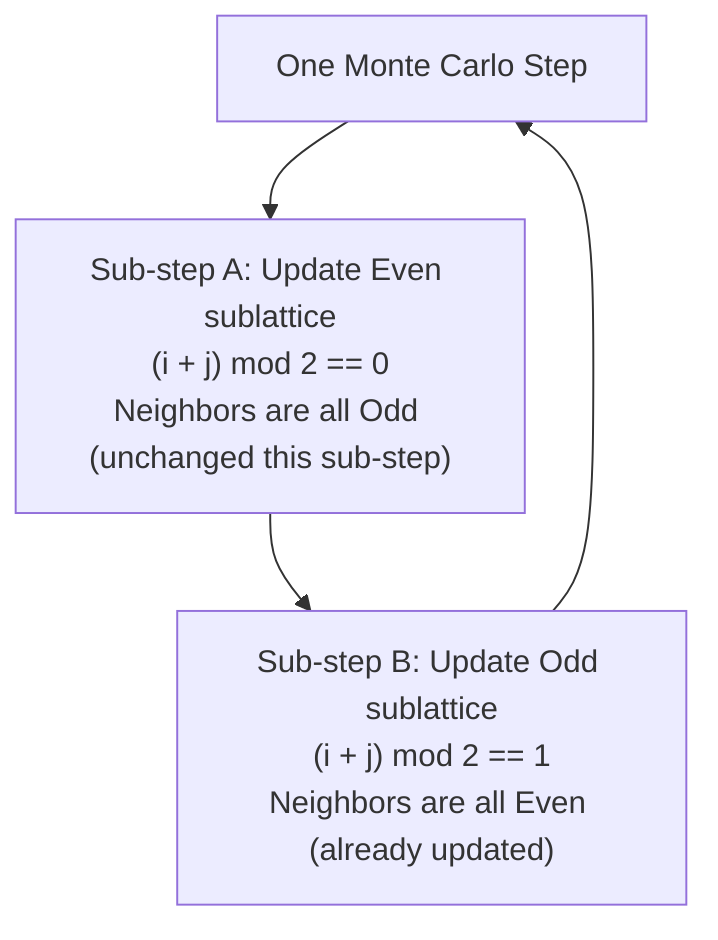

<!-- source: DeepWiki mcp.deepwiki.com · repo NVIDIA/accelerated-computing-hub · page 5.1 NVIDIA Warp · fetched 2026-10-26 -->

# NVIDIA Warp

<details>
<summary>Relevant source files</summary>

The following files were used as context for generating this wiki page:

- [Accelerated_Python_User_Guide/notebooks/Chapter_12.1_IsingModel_In_Warp.ipynb](Accelerated_Python_User_Guide/notebooks/Chapter_12.1_IsingModel_In_Warp.ipynb)
- [Accelerated_Python_User_Guide/notebooks/Chapter_12_Intro_to_NVIDIA_Warp.ipynb](Accelerated_Python_User_Guide/notebooks/Chapter_12_Intro_to_NVIDIA_Warp.ipynb)
- [Accelerated_Python_User_Guide/notebooks/README.md](Accelerated_Python_User_Guide/notebooks/README.md)
- [Accelerated_Python_User_Guide/notebooks/images/chapter-12.1/ising_animation.gif](Accelerated_Python_User_Guide/notebooks/images/chapter-12.1/ising_animation.gif)
- [Accelerated_Python_User_Guide/notebooks/images/chapter-12/warp-compilation-pipeline.svg](Accelerated_Python_User_Guide/notebooks/images/chapter-12/warp-compilation-pipeline.svg)

</details>


## Purpose and Scope

This page documents the NVIDIA Warp chapters of the Accelerated Python User Guide — Chapter 12 (Introduction to NVIDIA Warp) and Chapter 12.1 (GPU-Accelerated Ising Model Simulation) — covering the Warp programming model, JIT compilation pipeline, core APIs (`@wp.kernel`, `@wp.func`, `wp.array`, `wp.launch`), and a progressive Ising model case study.

For documentation of other User Guide chapters (distributed computing, nvmath-python, developer tools), see [5.2](#5.2). For the separate Accelerated Python tutorial track with its own Docker environment, see [4.1](#4.1).

---

## Overview

NVIDIA Warp is an open-source Python framework installed as `warp-lang` and conventionally imported as `wp`. Its central design: Python functions decorated with `@wp.kernel` are JIT-compiled to C++/CUDA at first launch, producing near-native GPU performance while remaining authored in Python.

**Key capabilities:**

| Capability | Description |
|---|---|
| JIT compilation | Python kernels compiled to native CUDA/C++ at first launch |
| Kernel-based programming | Familiar to CUDA users; written in Python |
| Built-in compiler toolchain | Bundles LLVM (CPU) and NVRTC (GPU); no separate CUDA toolkit needed |
| Reverse-mode autodiff | Every kernel has a compiled backward pass for use with PyTorch/JAX |
| Framework interoperability | Arrays interoperate with NumPy, PyTorch, and JAX |

Sources: [Accelerated_Python_User_Guide/notebooks/Chapter_12_Intro_to_NVIDIA_Warp.ipynb:28-63]()

---

## Installation and Initialization

```
pip install warp-lang
```

After installation, import and optionally initialize:

```python
import warp as wp
wp.init()  # optional; auto-called on first Warp API use
```

`wp.init()` prints detected devices (e.g., `"cpu"`, `"cuda:0"`).

| Distribution | Command |
|---|---|
| PyPI stable | `pip install warp-lang` |
| conda-forge (CUDA 12.6) | `conda install conda-forge::warp-lang=*=*cuda126*` |
| conda-forge (CUDA 11.8) | `conda install conda-forge::warp-lang=*=*cuda118*` |
| NVIDIA PyPI nightly | `pip install -U --pre warp-lang --extra-index-url=https://pypi.nvidia.com/` |

Sources: [Accelerated_Python_User_Guide/notebooks/Chapter_12_Intro_to_NVIDIA_Warp.ipynb:57-128]()

---

## Core API

Every Warp program is built from three primitives: arrays for data, kernels for computation, and `wp.launch()` for execution. Helper device functions use `@wp.func`.

**Core Warp API components:**



Sources: [Accelerated_Python_User_Guide/notebooks/Chapter_12_Intro_to_NVIDIA_Warp.ipynb:281-398]()

---

### Kernels (`@wp.kernel`)

A kernel is a Python function annotated with `@wp.kernel`. When launched via `wp.launch()`, its body executes once per thread in parallel across the specified launch dimensions.

**Constraints on kernel functions:**
- Arguments must carry explicit type annotations (Warp type annotations)
- No `return` statement — results are written to `wp.array` arguments
- Only a subset of Python constructs is permitted

**Thread indexing with `wp.tid()`:**

| Expression | Dimensionality |
|---|---|
| `i = wp.tid()` | 1-D |
| `i, j = wp.tid()` | 2-D |
| `i, j, k = wp.tid()` | 3-D |
| `i, j, k, l = wp.tid()` | 4-D |

Multi-dimensional kernels are launched by passing a tuple as `dim`, e.g. `wp.launch(kernel, dim=(rows, cols), ...)`.

**Debug output from inside kernels:**
- `wp.printf("format %d\n", arg)` — C-style formatted string output
- `print(value)` — for composite types such as `wp.vec3`, matrices

**Helper functions (`@wp.func`):**
Functions annotated with `@wp.func` are JIT-compiled device functions. They may only be called from within `@wp.kernel` or other `@wp.func` functions, never launched directly. They allow reusable logic to be extracted from kernels without overhead.

Sources: [Accelerated_Python_User_Guide/notebooks/Chapter_12_Intro_to_NVIDIA_Warp.ipynb:361-776]()

---

### Arrays (`wp.array`)

`wp.array` wraps a contiguous memory allocation on a specific device (CPU or GPU). All elements must share the same `dtype`.

**Construction functions:**

| Function | Behavior |
|---|---|
| `wp.array(data, dtype=T)` | Initialize from Python list or NumPy array |
| `wp.empty(shape, dtype=T)` | Uninitialized allocation |
| `wp.zeros(shape, dtype=T)` | Zero-filled allocation |
| `wp.ones(shape, dtype=T)` | One-filled allocation |
| `wp.full(shape, value, dtype=T)` | Constant-filled allocation |
| `wp.empty_like(arr)` | Matching shape and dtype, uninitialized |

**Scalar `dtype` options:**

| Type | Width | Description |
|---|---|---|
| `wp.bool` | 1-bit | Boolean |
| `wp.int8` | 8-bit | Signed byte |
| `wp.uint8` | 8-bit | Unsigned byte |
| `wp.int16` | 16-bit | Signed short |
| `wp.int32` | 32-bit | Signed integer |
| `wp.int64` | 64-bit | Signed long |
| `wp.float16` | 16-bit | Half-precision float |
| `wp.float32` | 32-bit | Single-precision float |
| `wp.float64` | 64-bit | Double-precision float |

Composite types such as `wp.vec3` (3-component 32-bit float vector) are also valid `dtype` values.

**Key array properties:** `array.shape`, `array.dtype`, `array.device`, `array.device.is_cuda`

**NumPy interop:** `array.numpy()` copies data to CPU and returns a NumPy array. A NumPy array can be passed directly to `wp.array(numpy_arr, dtype=T)` to create a Warp array on the GPU.

**Typed 2-D arrays in kernel signatures:** `wp.array2d(dtype=wp.int8)` annotates a 2-D array parameter in a kernel function. Elements are accessed inside the kernel as `arr[i, j]`.

Sources: [Accelerated_Python_User_Guide/notebooks/Chapter_12_Intro_to_NVIDIA_Warp.ipynb:836-994]()

---

### Launching Kernels (`wp.launch`)

```python
wp.launch(kernel, dim=(N,), inputs=[...], outputs=[...], device="cuda:0")
```

| Parameter | Description |
|---|---|
| `kernel` | The `@wp.kernel`-decorated function to execute |
| `dim` | Launch dimensions as a tuple (1-D to 4-D) |
| `inputs` | Read arguments matched to kernel signature |
| `outputs` | Write arguments matched to kernel signature |
| `device` | Target device string; defaults to `wp.get_device()` |

All arrays in `inputs` and `outputs` must reside on the same `device` as the launch. Warp internally maps multi-dimensional `dim` tuples to a flat 1-D CUDA kernel grid. Default CUDA thread block size is 256 threads.

Sources: [Accelerated_Python_User_Guide/notebooks/Chapter_12_Intro_to_NVIDIA_Warp.ipynb:312-323]()

---

## JIT Compilation Pipeline

On first launch of any kernel in a module, Warp compiles all kernels defined in that module. Subsequent launches load pre-built binaries from the kernel cache.

**Warp JIT Compilation Pipeline:**



Sources: [Accelerated_Python_User_Guide/notebooks/images/chapter-12/warp-compilation-pipeline.svg:1-1](), [Accelerated_Python_User_Guide/notebooks/Chapter_12_Intro_to_NVIDIA_Warp.ipynb:429-591]()

**Kernel cache details:**
- Location: `wp.config.kernel_cache_dir` (a configurable directory path)
- Each module version is identified by a content hash; any change in kernel source invalidates the cache for that module and triggers recompilation
- Both a **forward** and **backward** (autodiff) version of every kernel are stored
- After the first run, loading from cache eliminates recompilation overhead

The kernel cache stores both the generated `.cu`/`.cpp` source and the compiled `.ptx` or `.cubin` objects, making it straightforward to inspect the CUDA code Warp produces from a given Python kernel.

---

## GPU Execution Model

`wp.launch()` maps to the standard CUDA thread execution hierarchy:

**GPU Thread Execution Hierarchy:**



Sources: [Accelerated_Python_User_Guide/notebooks/Chapter_12_Intro_to_NVIDIA_Warp.ipynb:406-423]()

Key points:
- Thread blocks are scheduled independently across SMs in any order
- `wp.tid()` returns a logical index matching the user-specified `dim`, not a raw CUDA thread or block index
- The name "Warp" refers to the framework, not to the underlying 32-thread hardware warp (a potential source of confusion)

---

## Type System

Warp enforces strict typing because it compiles to native C++/CUDA. It does not perform implicit type conversions.

- Passing a `float` array to a kernel expecting `int` raises a `TypeError` at launch time
- Explicit casts inside kernels use Python syntax (`float(x)`, `int(x)`) or Warp-specific constructors (`wp.float32(x)`, `wp.int8(x)`)

**Generic kernels** use `typing.Any` as a type parameter. Inside such a kernel, `type(dx)(expr)` casts `expr` to the resolved type of `dx`. This allows a single kernel definition to be specialized for `wp.float16`, `wp.float32`, and `wp.float64` at launch without code duplication. See [Accelerated_Python_User_Guide/notebooks/Chapter_12_Intro_to_NVIDIA_Warp.ipynb:688-715]().

Sources: [Accelerated_Python_User_Guide/notebooks/Chapter_12_Intro_to_NVIDIA_Warp.ipynb:596-715]()

---

## Device Management

| API | Description |
|---|---|
| `wp.init()` | Initialize Warp; detects and lists CPU and CUDA devices |
| `wp.get_device()` | Returns the default device (`"cuda:0"` if GPU present, else `"cpu"`) |
| `wp.get_cuda_device_count()` | Returns the number of available CUDA-capable GPUs |
| `device="cuda:0"` | Explicit device keyword for array constructors and `wp.launch()` |
| `device="cpu"` | CPU execution (currently single-threaded for kernels) |

The default device is `"cuda:0"` when a GPU is detected; otherwise it falls back to `"cpu"`. Arrays and launches must use the same device — a mismatch raises a runtime error.

Sources: [Accelerated_Python_User_Guide/notebooks/Chapter_12_Intro_to_NVIDIA_Warp.ipynb:783-830](), [Accelerated_Python_User_Guide/notebooks/Chapter_12.1_IsingModel_In_Warp.ipynb:92-102]()

---

## Random Number Generation in Kernels

Monte Carlo simulations require each GPU thread to produce independent random values. Warp provides a stateful per-thread RNG callable directly from within kernel code:

| Function | Description |
|---|---|
| `wp.rand_init(seed, offset)` | Creates an RNG state; `seed` is shared across threads, `offset` uniquely identifies each thread |
| `wp.randf(state, low, high)` | Samples a uniform `float` from `[low, high)` |

**Standard per-thread RNG pattern** from the `generate_lattice` kernel at [Accelerated_Python_User_Guide/notebooks/Chapter_12.1_IsingModel_In_Warp.ipynb:615-624]():

```
thread_offset = i * lattice.shape[1] + j
rng_state = wp.rand_init(rng_seed, thread_offset)
random_value = wp.randf(rng_state, 0.0, 1.0)
```

Using a thread's linear index as `offset` guarantees independent random streams per thread while keeping the simulation reproducible from the same seed.

Sources: [Accelerated_Python_User_Guide/notebooks/Chapter_12.1_IsingModel_In_Warp.ipynb:563-630]()

---

## Automatic Differentiation

Warp compiles both a forward and a backward pass for every kernel. The backward pass enables reverse-mode automatic differentiation, allowing Warp simulators to be used in PyTorch or JAX gradient-based training loops. This is visible in the kernel cache, where each kernel produces both a standard CUDA source file and a corresponding `_bwd` variant.

Sources: [Accelerated_Python_User_Guide/notebooks/Chapter_12_Intro_to_NVIDIA_Warp.ipynb:519-527]()

---

## Case Study: 2-D Ising Model

Chapter 12.1 applies Warp fundamentals to a 2-D Ising model simulation. The notebook progresses through three implementations, each revealing a deeper aspect of GPU parallelism.

### Physics Background

Spins (`σ = +1` or `-1`) are placed on an `L×L` grid. The system energy is:

```
H(σ) = -J Σ σᵢ σⱼ    (nearest-neighbor pairs, J = 1)
```

The **Metropolis-Hastings** update rule for a candidate spin flip at site `(i, j)`:

1. Compute `ΔE = 2 · J · σᵢⱼ · (sum of 4 neighbors)`
2. Accept flip if `ΔE ≤ 0`; otherwise accept with probability `exp(-ΔE / T)`

Observable: magnetization `M = Σᵢ σᵢ / N`. Critical temperature for the 2-D case: `T_c ≈ 2.269` (with `J = k_B = 1`).

Sources: [Accelerated_Python_User_Guide/notebooks/Chapter_12.1_IsingModel_In_Warp.ipynb:120-196]()

---

### Implementation 1: CPU Baseline

Three plain Python functions establish correctness and provide a timing reference:

| Function | Signature | Role |
|---|---|---|
| `initialize_lattice` | `(L) -> list[list[int]]` | Returns an `L×L` nested list with random ±1 spins |
| `monte_carlo_step` | `(lattice, L, T)` | One full Metropolis sweep; sites visited in randomized order |
| `calculate_magnetization` | `(lattice, L) -> float` | Returns `Σ σᵢ / (L×L)` |

Randomized visit order in `monte_carlo_step` avoids systematic artifacts from sequential scanning. This implementation has no GPU dependency and serves as the physics reference.

Sources: [Accelerated_Python_User_Guide/notebooks/Chapter_12.1_IsingModel_In_Warp.ipynb:236-505]()

---

### Implementation 2: Naive GPU Parallelization

Launches one GPU thread per lattice site. A double-buffer strategy (two arrays `lattice_0` and `lattice_1`) prevents write-after-read hazards within a single step.

**Naive GPU implementation data flow:**



**`generate_lattice` kernel** ([Accelerated_Python_User_Guide/notebooks/Chapter_12.1_IsingModel_In_Warp.ipynb:594-629]()):
- Signature: `(lattice: wp.array2d(dtype=wp.int8), rng_seed: int)`
- Each thread calls `wp.rand_init(rng_seed, i * width + j)` then `wp.randf` to produce a spin
- Writes `wp.int8(1)` or `wp.int8(-1)` to `lattice[i, j]`

**`update_lattice` kernel** ([Accelerated_Python_User_Guide/notebooks/Chapter_12.1_IsingModel_In_Warp.ipynb:689-724]()):
- Signature: `(beta: float, rng_seed: int, lattice_in: wp.array2d(dtype=wp.int8), lattice_out: wp.array2d(dtype=wp.int8))`
- Reads from `lattice_in`, writes accepted or rejected spin to `lattice_out`
- Periodic boundary indexing: `(i - 1 + lattice_size) % lattice_size`
- Acceptance computation: `wp.exp(-2.0 * beta * wp.float32(nn_sum) * wp.float32(spin_ij))`
- Per-thread random number: `wp.randf(wp.rand_init(rng_seed, i * lattice_size + j), 0.0, 1.0)`

Sources: [Accelerated_Python_User_Guide/notebooks/Chapter_12.1_IsingModel_In_Warp.ipynb:511-743]()

---

### Race Condition Analysis

The double-buffer eliminates write-after-read conflicts (all threads read `lattice_in`, all threads write to `lattice_out`). However, a subtler algorithmic correctness issue remains.

**Problem:** All `N²` flip proposals are evaluated simultaneously from the same lattice snapshot. Sequential Metropolis-Hastings reads updated neighbor values as it proceeds through the sweep — a spin flip at site `(i, j)` immediately influences the acceptance decision at `(i+1, j)`. In the fully parallel update, this propagation is absent.

**Observable effect:** Near the critical temperature (`T ≈ 2.269`), the naive parallel scheme produces incorrect spin correlations and inaccurate thermodynamic observables. At temperatures far from `T_c` the difference is less significant.

This motivates the checkerboard decomposition.

Sources: [Accelerated_Python_User_Guide/notebooks/Chapter_12.1_IsingModel_In_Warp.ipynb:107-118](), [Accelerated_Python_User_Guide/notebooks/Chapter_12.1_IsingModel_In_Warp.ipynb:749-754]()

---

### Implementation 3: Checkerboard Decomposition

The checkerboard (bipartite) decomposition splits each Monte Carlo step into two sub-steps, alternating between the two non-interacting sublattices of the grid:

**Checkerboard update pattern:**



**Why this is correct:**
- Every site with `(i + j) % 2 == 0` has all four nearest neighbors satisfying `(i + j) % 2 == 1`, and vice versa
- Within sub-step A, no two simultaneously updated sites are adjacent — their neighbor sums are mutually unaffected
- Sub-step B reads the committed state of the even sublattice from sub-step A, faithfully replicating sequential Metropolis statistics

**Why this is efficient:**
- Each sub-step parallelizes across `N²/2` independent sites simultaneously
- No CPU-side random ordering of sites is needed, eliminating that overhead

Sources: [Accelerated_Python_User_Guide/notebooks/Chapter_12.1_IsingModel_In_Warp.ipynb:36-52]()

---

### Performance Summary

| Implementation | Physics Correct | GPU Accelerated | Key Code |
|---|---|---|---|
| CPU baseline | Yes | No | `initialize_lattice`, `monte_carlo_step` |
| Naive GPU (double-buffer) | Approximately | Yes | `generate_lattice`, `update_lattice` |
| Checkerboard GPU | Yes | Yes | Checkerboard-aware `update_lattice` variant |

Target speedup of the GPU implementations over the CPU baseline: **~10–20×** on a 256×256 lattice over 200 Monte Carlo steps.

Sources: [Accelerated_Python_User_Guide/notebooks/Chapter_12.1_IsingModel_In_Warp.ipynb:36-52]()

---

## Notebook Reference

| Notebook | Chapter | Topics |
|---|---|---|
| `Chapter_12_Intro_to_NVIDIA_Warp.ipynb` | 12 | `@wp.kernel`, `@wp.func`, `wp.array`, `wp.launch`, JIT pipeline, types, device management, NumPy interop, autodiff |
| `Chapter_12.1_IsingModel_In_Warp.ipynb` | 12.1 | `initialize_lattice`, `monte_carlo_step`, `generate_lattice` kernel, `update_lattice` kernel, race condition analysis, checkerboard decomposition |

Sources: [Accelerated_Python_User_Guide/notebooks/README.md:18-19]()

---

