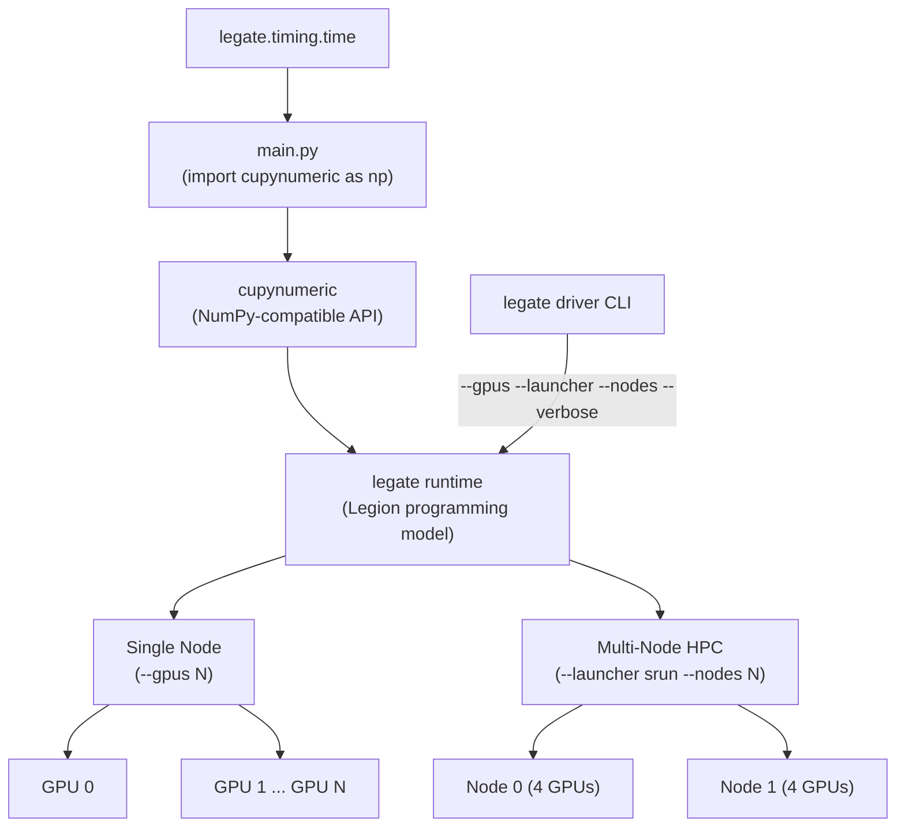
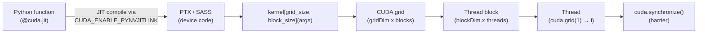
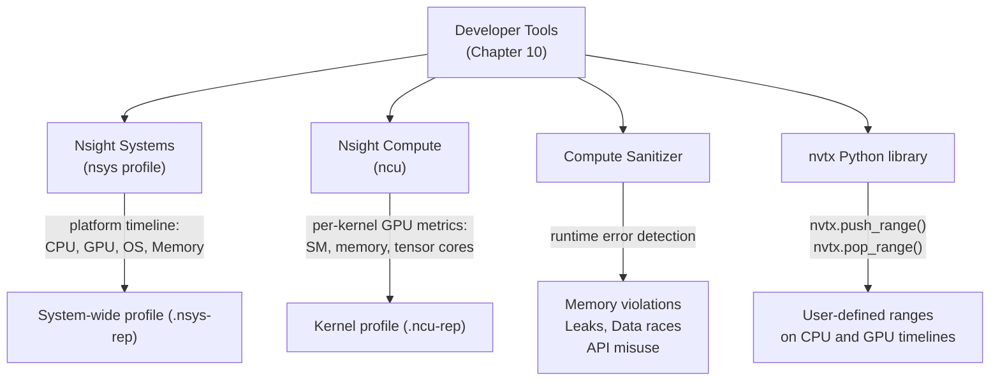

<!-- source: DeepWiki mcp.deepwiki.com · repo NVIDIA/accelerated-computing-hub · page 5.2 Distributed Computing and Math Libraries · fetched 2026-10-26 -->

# Distributed Computing and Math Libraries

Relevant source files

The following files were used as context for generating this wiki page:

- [Accelerated_Python_User_Guide/notebooks/Chapter_05_CUDA_Kernels_with_Numba.ipynb](Accelerated_Python_User_Guide/notebooks/Chapter_05_CUDA_Kernels_with_Numba.ipynb)
- [Accelerated_Python_User_Guide/notebooks/Chapter_06_Intro_to_nvmath-python.ipynb](Accelerated_Python_User_Guide/notebooks/Chapter_06_Intro_to_nvmath-python.ipynb)
- [Accelerated_Python_User_Guide/notebooks/Chapter_10_Developer_Tools.ipynb](Accelerated_Python_User_Guide/notebooks/Chapter_10_Developer_Tools.ipynb)
- [Accelerated_Python_User_Guide/notebooks/Chapter_11_Distributed_Computing_cuPyNumeric.ipynb](Accelerated_Python_User_Guide/notebooks/Chapter_11_Distributed_Computing_cuPyNumeric.ipynb)
- [Accelerated_Python_User_Guide/notebooks/images/chapter-06/nvmath-python.jpg](Accelerated_Python_User_Guide/notebooks/images/chapter-06/nvmath-python.jpg)
- [tutorials/accelerated-python/notebooks/libraries/images/nvdashboard.gif](tutorials/accelerated-python/notebooks/libraries/images/nvdashboard.gif)
- [tutorials/accelerated-python/notebooks/syllabi/cuda_python__cupy_cudf_cccl_kernels__8_hours.ipynb](tutorials/accelerated-python/notebooks/syllabi/cuda_python__cupy_cudf_cccl_kernels__8_hours.ipynb)
- [tutorials/cuda-cpp/notebooks/01.02-Execution-Spaces/01.02.02-Exercise-Annotate-Execution-Spaces.ipynb](tutorials/cuda-cpp/notebooks/01.02-Execution-Spaces/01.02.02-Exercise-Annotate-Execution-Spaces.ipynb)
- [tutorials/cuda-cpp/notebooks/01.02-Execution-Spaces/01.02.03-Exercise-Changing-Execution-Space.ipynb](tutorials/cuda-cpp/notebooks/01.02-Execution-Spaces/01.02.03-Exercise-Changing-Execution-Space.ipynb)
- [tutorials/cuda-cpp/notebooks/01.05-Serial-vs-Parallel/01.05.03-Exercise-Segmented-Mean.ipynb](tutorials/cuda-cpp/notebooks/01.05-Serial-vs-Parallel/01.05.03-Exercise-Segmented-Mean.ipynb)
- [tutorials/cuda-cpp/notebooks/01.06-Memory-Spaces/01.06.01-Memory-Spaces.ipynb](tutorials/cuda-cpp/notebooks/01.06-Memory-Spaces/01.06.01-Memory-Spaces.ipynb)
- [tutorials/cuda-cpp/notebooks/03.02-Kernels/03.02.01-Kernels.ipynb](tutorials/cuda-cpp/notebooks/03.02-Kernels/03.02.01-Kernels.ipynb)

This page documents the User Guide chapters covering multi-GPU distributed computing, high-performance math operations, custom CUDA kernel authoring, and developer tools as they appear in the Accelerated Python User Guide. The primary source notebooks are:

- `Accelerated_Python_User_Guide/notebooks/Chapter_11_Distributed_Computing_cuPyNumeric.ipynb`
- `Accelerated_Python_User_Guide/notebooks/Chapter_06_Intro_to_nvmath-python.ipynb`
- `Accelerated_Python_User_Guide/notebooks/Chapter_05_CUDA_Kernels_with_Numba.ipynb`
- `Accelerated_Python_User_Guide/notebooks/Chapter_10_Developer_Tools.ipynb`

For information about the nvmath-python tutorial track (a standalone interactive tutorial with its own Docker environment), see [4.4](#4.4). For Numba kernel authoring as part of the Accelerated Python tutorial, see [4.1.3](#4.1.3). For the NVIDIA Warp User Guide chapter, see [5.1](#5.1).

---

## Distributed Computing with cuPyNumeric

**Chapter 11** of the User Guide covers cuPyNumeric, a distributed and accelerated NumPy drop-in replacement built on the Legate runtime.

### Architecture

cuPyNumeric operates through the Legate layer, which implements the Legion programming model. The user-facing API is intentionally NumPy-compatible, allowing the same script to run on a single laptop or a multi-node HPC cluster with no code changes.

**cuPyNumeric / Legate Runtime Architecture**

Sources: [Accelerated_Python_User_Guide/notebooks/Chapter_11_Distributed_Computing_cuPyNumeric.ipynb:1-210]()

### Key Differences from NumPy

| Feature | NumPy | cuPyNumeric |
|---|---|---|
| Execution device | CPU only | CPU or GPU |
| Scale | Single process | Multi-node, multi-GPU |
| Parallelism | None (serial) | Managed by Legate |
| Code changes | — | Import swap only |

### Installation

| Method | Command |
|---|---|
| pip | `pip install nvidia-cupynumeric` |
| conda | `conda create -n legate -c conda-forge -c legate cupynumeric` |

HPC clusters requiring MPI or GASNet wrappers need additional build steps; see the Legate GASNet documentation.

Sources: [Accelerated_Python_User_Guide/notebooks/Chapter_11_Distributed_Computing_cuPyNumeric.ipynb:54-115]()

### Running with the `legate` Driver

Scripts import cuPyNumeric as `import cupynumeric as np`, making the API surface identical to NumPy. Timing uses `legate.timing.time` rather than wall-clock time because Legate tasks execute asynchronously.

The `legate` driver CLI is used to launch scripts. It accepts resource flags at the process boundary:

| Scenario | Driver Invocation |
|---|---|
| Single node, 2 GPUs | `legate --gpus 2 ./main.py` |
| Multi-node HPC (srun) | `legate --gpus 4 --launcher srun --nodes 2 ./main.py` |
| Limit output to rank 0 | Set `LEGATE_LIMIT_STDOUT=1` |

By default, `legate` duplicates output once per rank. The `--verbose` flag prints the full resolved launch invocation.

Sources: [Accelerated_Python_User_Guide/notebooks/Chapter_11_Distributed_Computing_cuPyNumeric.ipynb:157-209]()

### Matrix Multiplication Example

The matrix multiplication example in the chapter illustrates how cuPyNumeric internally handles scatter-gather, partial sums, and reduction that would otherwise need to be written explicitly. The call `np.dot(vector1, vector2)` with `import cupynumeric as np` distributes the operation automatically across the configured GPUs.

Sources: [Accelerated_Python_User_Guide/notebooks/Chapter_11_Distributed_Computing_cuPyNumeric.ipynb:211-224]()

---

## nvmath-python

**Chapter 6** of the User Guide introduces `nvmath-python`, a library that exposes NVIDIA's math libraries through a Python API.

### Module Structure

**nvmath-python API Hierarchy**

```mermaid
graph TD
    nvmath["nvmath"] --> fft_mod["nvmath.fft"]
    nvmath --> linalg_mod["nvmath.linalg.advanced"]
    nvmath --> device_mod["nvmath.device"]
    nvmath --> bindings_mod["nvmath.bindings"]

    fft_mod --> fft_fn["fft()"]
    fft_mod --> ifft_fn["ifft()"]
    fft_mod --> compile_prolog["compile_prolog()"]

    linalg_mod --> matmul_fn["matmul() (stateless)"]
    linalg_mod --> Matmul_cls["Matmul (stateful class)"]
    linalg_mod --> MatmulEpilog["MatmulEpilog enum\n(BIAS, RELU, GELU, SIGMOID, TANH)"]

    device_mod --> random_mod["random\n(cuRAND device API)"]
    device_mod --> cufftdx_mod["cuFFTDx"]
    device_mod --> cublasdx_mod["cuBLASDx"]

    bindings_mod --> cublas_b["nvmath.bindings.cublas"]
    bindings_mod --> cublaslt_b["nvmath.bindings.cublasLt"]
    bindings_mod --> cufft_b["nvmath.bindings.cufft"]
    bindings_mod --> curand_b["nvmath.bindings.curand"]
    bindings_mod --> cusolver_b["nvmath.bindings.cusolver"]
    bindings_mod --> cusolverdn_b["nvmath.bindings.cusolverDn"]
    bindings_mod --> cusparse_b["nvmath.bindings.cusparse"]
```

Sources: [Accelerated_Python_User_Guide/notebooks/Chapter_06_Intro_to_nvmath-python.ipynb:1-491]()

### Installation

The chapter installs via `pip install nvmath-python[cu12,dx,cpu]`, enabling CUDA 12 support and the device API (`dx` extra). Host-only configurations omit the `dx` extra.

Sources: [Accelerated_Python_User_Guide/notebooks/Chapter_06_Intro_to_nvmath-python.ipynb:38-53]()

### Linear Algebra: Stateless vs. Stateful API

The chapter contrasts two API styles for matrix multiplication. Both accept CuPy, NumPy, and PyTorch tensors and return results in the same framework as the input.

| API Style | Class / Function | Use Case |
|---|---|---|
| Stateless | `nvmath.linalg.advanced.matmul(a, b)` | Single-shot execution |
| Stateful | `nvmath.linalg.advanced.Matmul(a, b)` | Repeated execution; amortizes planning cost |

The stateful `Matmul` class is used as a context manager. Its lifecycle is: instantiate → `mm.plan()` → `mm.execute()`. The `plan()` call returns a list of candidate algorithms that can be inspected or configured before execution.

GPU execution is non-blocking by default; the caller must explicitly call `cp.cuda.get_current_stream().synchronize()` to wait for results.

Sources: [Accelerated_Python_User_Guide/notebooks/Chapter_06_Intro_to_nvmath-python.ipynb:150-263]()

### Epilog Fusion

Epilog operations are fused into the matrix multiplication kernel, avoiding a separate pass. Available epilogs are defined on the `MatmulEpilog` enum:

| Epilog | Description |
|---|---|
| `MatmulEpilog.RELU` | Rectified Linear Unit activation |
| `MatmulEpilog.GELU` | Gaussian Error Linear Unit |
| `MatmulEpilog.BIAS` | Adds a bias vector |
| `MatmulEpilog.SIGMOID` | Sigmoid activation |
| `MatmulEpilog.TANH` | Hyperbolic tangent |

Epilog inputs are passed as a dictionary, e.g. `epilog_inputs={"bias": bias}`. Some epilogs can be combined.

Sources: [Accelerated_Python_User_Guide/notebooks/Chapter_06_Intro_to_nvmath-python.ipynb:236-264]()

### Fast Fourier Transform

`nvmath.fft.fft()` and `nvmath.fft.ifft()` are backed by cuFFT. The `axes` parameter selects dimensions to transform; the complement dimensions are treated as a batch.

**FFT with Prolog Callback:** A Python function can be compiled to LTO-IR using `nvmath.fft.compile_prolog(fn, input_dtype, output_dtype)` and passed as a `prolog` argument to `nvmath.fft.ifft()`. This fuses the callback into the FFT kernel at link time, enabling operations like convolution as a fused kernel. The compiled prolog is passed as `{"ltoir": prolog, "data": data_ptr}`.

Sources: [Accelerated_Python_User_Guide/notebooks/Chapter_06_Intro_to_nvmath-python.ipynb:271-380]()

### Device APIs and Low-Level Bindings

`nvmath.device` exposes cuFFTDx, cuBLASDx, and cuRAND for use inside Numba CUDA kernels. Usage requires:
1. Compiling the device API with `random.Compile()` to obtain `compiled_apis.files` and `compiled_apis.extension`.
2. Decorating Numba kernels with `@cuda.jit(link=compiled_apis.files, extensions=compiled_apis.extension)`.
3. Calling functions like `random.init()` and `random.normal2()` inside the kernel body.

State objects such as `random.StatesPhilox4_32_10(nthreads)` must be allocated before the first kernel launch.

`nvmath.bindings` provides direct Python bindings to C library APIs. Function names follow a documented mapping from C to Python.

Sources: [Accelerated_Python_User_Guide/notebooks/Chapter_06_Intro_to_nvmath-python.ipynb:388-466]()

---

## CUDA Kernel Authoring with Numba

**Chapter 5** covers writing custom CUDA kernels in Python using Numba's `@cuda.jit` decorator.

### Kernel Execution Model

Sources: [Accelerated_Python_User_Guide/notebooks/Chapter_05_CUDA_Kernels_with_Numba.ipynb:1-115]()

### Key API Elements

| Construct | Purpose |
|---|---|
| `@cuda.jit` | Marks a function as a CUDA kernel (JIT-compiled on first call) |
| `numba_config.CUDA_ENABLE_PYNVJITLINK = True` | Enables the pynvjitlink backend |
| `cuda.grid(1)` | Computes the global thread index in 1D |
| `cuda.threadIdx.x` | Thread index within a block |
| `cuda.blockIdx.x` | Block index within the grid |
| `cuda.blockDim.x` | Number of threads per block |
| `cuda.gridsize(1)` | Total number of threads in the grid |
| `cuda.synchronize()` | Waits for all pending GPU work to complete |

### Thread and Block Sizing

Rules of thumb from the chapter:
- Block size should be a multiple of 32 (warp size); 128–256 is a common starting value.
- Grid size is derived from problem size: `grid = ceil((problem_size) / block_size)`.
- Exceeding 1024 threads per block causes a launch error.

### Interoperability with CuPy

CuPy arrays implement `__cuda_array_interface__`, allowing them to be passed directly to `@cuda.jit` kernels without copying. The same kernel can accept either NumPy or CuPy arrays.

Sources: [Accelerated_Python_User_Guide/notebooks/Chapter_05_CUDA_Kernels_with_Numba.ipynb:119-184]()

---

## Developer Tools

**Chapter 10** covers four categories of tools for profiling and correctness checking of CUDA Python workloads.

### Tool Overview

Sources: [Accelerated_Python_User_Guide/notebooks/Chapter_10_Developer_Tools.ipynb:1-50]()

### Nsight Systems (`nsys`)

Nsight Systems provides a time-correlated view of the entire platform. The chapter demonstrates a progressive profiling workflow on a CuPy workload.

**Recommended CLI flags for Python profiling:**

| Flag | Effect |
|---|---|
| `--gpu-metrics-device=all` | Collect GPU hardware metrics |
| `--python-sampling=true` | Sample Python call stacks |
| `--python-sampling-frequency=1000` | Sampling rate (Hz) |
| `--trace=cuda,nvtx` | Capture CUDA API calls and NVTX ranges |
| `--cpuctxsw=process-tree` | CPU context switch trace |
| `--python-functions-trace=<file.json>` | Automatically annotate specific Python functions |

**Annotation file format** (for `--python-functions-trace`): a JSON array listing modules, colors, and function names to automatically trace. This eliminates the need for manual `nvtx` instrumentation for library calls.

**Tensor core activation**: the chapter shows that setting `os.environ["CUPY_TF32"] = "1"` before launching a CuPy workload activates Tensor cores for `float32` dot products. The profiler's **SM Instructions → Tensor Active** row confirms activation.

Sources: [Accelerated_Python_User_Guide/notebooks/Chapter_10_Developer_Tools.ipynb:82-375]()

### nvtx Annotations

The `nvtx` Python module (installed via `pip install nvtx`) enables custom range markers visible on the Nsight Systems timeline.

| Function | Usage |
|---|---|
| `nvtx.push_range(label, color=...)` | Opens a named range at the current point |
| `nvtx.pop_range()` | Closes the most recently opened range |

Ranges appear as colored bands on both the CPU thread row and the CUDA HW row, with a visible offset between them reflecting GPU scheduling latency.

Sources: [Accelerated_Python_User_Guide/notebooks/Chapter_10_Developer_Tools.ipynb:199-273]()

### Nsight Compute (`ncu`)

Where Nsight Systems provides platform-wide visibility, Nsight Compute does deep per-kernel analysis. It is used for Numba kernels as well as native CUDA C++ kernels. Key configuration options from the chapter:

| Setting | Value |
|---|---|
| Activity | Profile |
| Kernel filter | Demangled base names |
| CPU call stack | Yes (Python or All) |
| Metrics set | Detailed (starting point) |

Nsight Compute replays each kernel multiple times to collect different hardware counters.

Sources: [Accelerated_Python_User_Guide/notebooks/Chapter_10_Developer_Tools.ipynb:383-415]()

### Compute Sanitizer

Compute Sanitizer is a runtime tool that detects:

| Error Category | Examples |
|---|---|
| Memory access violations | Out-of-bounds reads/writes |
| Memory leaks | Allocated but unfreed GPU memory |
| Data race conditions | Unsynchronized concurrent writes |
| Incorrect API usage | Misused CUDA API calls |

It is the recommended first step when a CUDA program produces incorrect results or crashes.

Sources: [Accelerated_Python_User_Guide/notebooks/Chapter_10_Developer_Tools.ipynb:25-48]()

### Common Pitfalls

| Symptom | Likely Cause |
|---|---|
| 0% GPU utilization | Code not GPU-enabled; wrong library versions; missing CUDA Toolkit |
| < ~15% GPU utilization | Too many GPUs for workload; excessive CPU↔GPU transfers; slow output writes |
| Memory errors | Access violations; memory leaks; unsynchronized concurrent access |

Sources: [Accelerated_Python_User_Guide/notebooks/Chapter_10_Developer_Tools.ipynb:33-47]()

---

