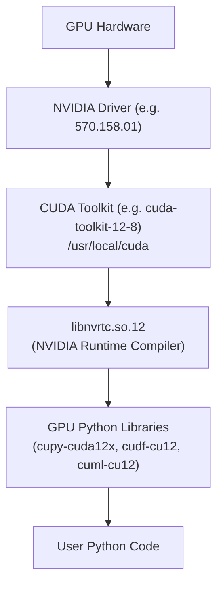
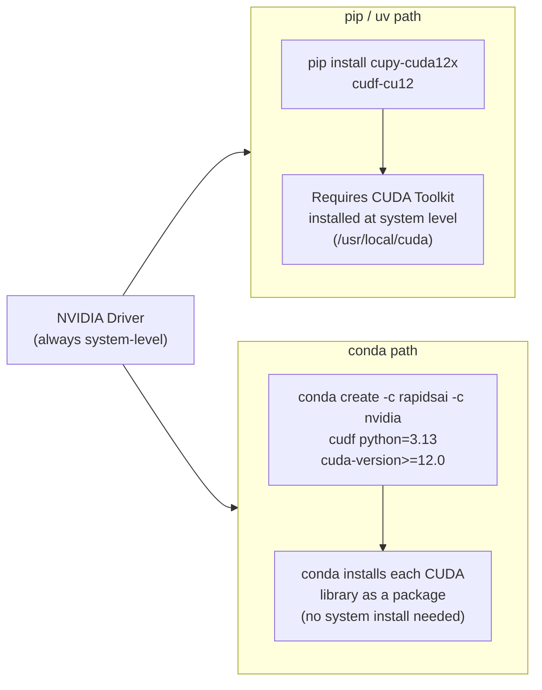
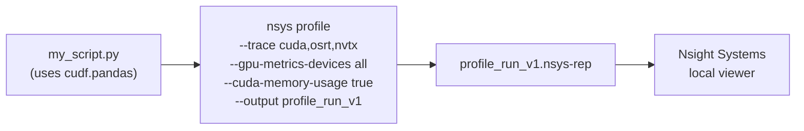
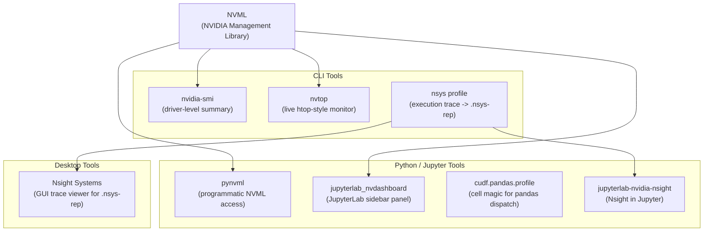

<!-- source: DeepWiki mcp.deepwiki.com · repo NVIDIA/accelerated-computing-hub · page 6 GPU Deployment Guide · fetched 2026-10-26 -->

# GPU Deployment Guide

<details>
<summary>Relevant source files</summary>

The following files were used as context for generating this wiki page:

- [tutorials/gpu-deployment/gpu-deployment-from-scratch.md](tutorials/gpu-deployment/gpu-deployment-from-scratch.md)
- [tutorials/gpu-deployment/images/brev-setup.png](tutorials/gpu-deployment/images/brev-setup.png)
- [tutorials/gpu-deployment/images/nsight-view.png](tutorials/gpu-deployment/images/nsight-view.png)
- [tutorials/gpu-deployment/images/nvdashboard.png](tutorials/gpu-deployment/images/nvdashboard.png)
- [tutorials/gpu-deployment/images/nvtop.png](tutorials/gpu-deployment/images/nvtop.png)

</details>


## Purpose and Scope

This page documents the end-to-end process of setting up a GPU computing environment from scratch: provisioning a cloud VM via NVIDIA Brev, verifying the CUDA software stack, installing GPU-accelerated Python libraries using `pip`, `uv`, and `conda`, and using monitoring and profiling tools to observe GPU behavior.

This guide is based on the standalone tutorial document at [tutorials/gpu-deployment/gpu-deployment-from-scratch.md](). It does not cover Docker-based environments used by other tutorials in this repository — for that, see [Tutorial Docker Environments](#2.1). For information on the Accelerated Python library tutorials (CuPy, cuDF, Numba, etc.) that build on a working environment, see [Accelerated Python Tutorial](#4.1).

---

## GPU Software Stack Overview

Before diving into steps, it helps to understand the layered dependency model for GPU-accelerated Python.

**Diagram: GPU software stack layers**



Sources: [tutorials/gpu-deployment/gpu-deployment-from-scratch.md:136-151]()

The key insight: `pip`-installed GPU packages (like `cupy-cuda12x`) expect CUDA libraries such as `libnvrtc.so.12` to already exist at `/usr/local/cuda` or on the system library path. `conda` packages, by contrast, can declare and install individual CUDA libraries as package dependencies directly.

---

## NVIDIA Brev VM Provisioning

The tutorial uses [NVIDIA Brev](https://brev.nvidia.com) as its cloud GPU platform. Brev provides a web portal and CLI for launching GPU VMs.

### Setup Steps

1. Sign in or register at `https://brev.nvidia.com`.
2. Ensure your account belongs to an organization (created automatically on registration).
3. Apply any credits via **Billing → Redeem Code**.
4. Under **GPUs**, select **New Instance**.
5. Choose a GPU type under \$1/hour (e.g., NVIDIA L4) and select **GCP** as the provider.
6. Name the VM and press **Deploy**.
7. Wait for status **Running** and software environment **Building** to complete.

> **Known issue:** There is a known problem running this material on AWS instances. Other providers are untested. GCP is the recommended provider.

### Connecting via `brev` CLI

The CLI method for macOS is:

```
brew install brevdev/homebrew-brev/brev
brev login --token ****
brev ls
brev shell <your-vm-name>
```

For Linux and Windows, refer to the [brev-cli install documentation](https://docs.nvidia.com/brev/latest/brev-cli.html).

Sources: [tutorials/gpu-deployment/gpu-deployment-from-scratch.md:14-51]()

---

## Verifying the GPU Software Environment

After connecting to the VM, verify what is installed before attempting to install GPU libraries.

### OS and Driver Check

```
cat /etc/os-release          # e.g., Ubuntu 22.04.5 LTS
nvidia-smi                   # shows driver, CUDA version, GPU model
nvidia-smi -L                # list all GPUs
nvidia-smi -q                # dump detailed information
```

Sample `nvidia-smi` output fields:

| Field | Example Value |
|---|---|
| Driver Version | 570.158.01 |
| CUDA Version (max supported) | 12.8 |
| GPU Model | NVIDIA L4 |
| GPU Memory | 23034 MiB |
| GPU Utilization | 0% |

Sources: [tutorials/gpu-deployment/gpu-deployment-from-scratch.md:61-84](), [tutorials/gpu-deployment/gpu-deployment-from-scratch.md:317-329]()

### Checking for CUDA Toolkit

```
ls -ld /usr/local/cuda*
```

If this directory is missing, CUDA libraries are not installed at the system level. This is the root cause of errors like `libnvrtc.so.12: cannot open shared object file: No such file or directory` when running GPU Python code.

Sources: [tutorials/gpu-deployment/gpu-deployment-from-scratch.md:136-151]()

---

## Installing GPU-Accelerated Python Libraries

The installation method determines how CUDA dependencies are resolved.

**Diagram: CUDA dependency resolution by package manager**



Sources: [tutorials/gpu-deployment/gpu-deployment-from-scratch.md:151-315]()

### pip

When using `pip`, install the CUDA Toolkit at the system level first using `apt`.

```
# Add NVIDIA apt repo
wget https://developer.download.nvidia.com/compute/cuda/repos/ubuntu2204/x86_64/cuda-keyring_1.1-1_all.deb
sudo dpkg -i cuda-keyring_1.1-1_all.deb
sudo apt-get update

# Install CUDA Toolkit matching your driver version (check nvidia-smi)
sudo apt-get -y install cuda-toolkit-12-8
```

Then install Python packages with CUDA version suffixes:

```
pip install cupy-cuda12x
pip install cudf-cu12
```

> **Note:** The CUDA version is embedded in the package name (e.g., `cudf-cu12`) due to Python packaging spec limitations. The [wheelnext](https://wheelnext.dev/) project is working on wheel variants to address this. `uv` has an experimental build supporting wheel variants today.

> **Note on custom indexes:** Some RAPIDS packages exceed PyPI size limits and require a custom index. As of the 25.10 release, `cudf` and `cuml` do not require a custom index. Use the [RAPIDS installation selector](https://docs.rapids.ai/install/) to check per-package requirements.

Sources: [tutorials/gpu-deployment/gpu-deployment-from-scratch.md:161-214]()

### uv

`uv` is a fast Python package manager from Astral. Install it with:

```
curl -LsSf https://astral.sh/uv/install.sh | sh
source ~/.bashrc
```

Create a virtual environment and install packages:

```
mkdir sandbox && cd sandbox
uv venv --python 3.12
source .venv/bin/activate
uv pip install "cudf-cu12==25.10.*"
```

> **Limitation:** `uv` uses an all-or-nothing strategy for pre-release and nightly packages. Mixing nightlies with stable packages requires explicit configuration; otherwise version conflicts can occur. See the [uv pre-release compatibility documentation](https://docs.astral.sh/uv/pip/compatibility/#pre-release-compatibility).

Sources: [tutorials/gpu-deployment/gpu-deployment-from-scratch.md:216-270]()

### conda

With `conda`, each CUDA library is a first-class conda package. There is no need to pre-install the CUDA Toolkit at the system level.

Install Miniforge first:

```
curl -L -O "https://github.com/conda-forge/miniforge/releases/latest/download/Miniforge3-$(uname)-$(uname -m).sh"
bash Miniforge3-$(uname)-$(uname -m).sh
source ~/.bashrc
```

Create an environment:

```
conda create -n rapids -c rapidsai -c conda-forge -c nvidia cudf python=3.13 'cuda-version>=12.0,<=12.9'
conda activate rapids
```

Two conda advantages over pip for GPU packages:

| Feature | Description |
|---|---|
| Packaged CUDA libraries | Each CUDA library (e.g., `libcurand`, `libcufft`) is a separate conda package; no system-level install needed |
| Virtual packages | conda can query the installed NVIDIA driver and expose the supported CUDA version to the solver, selecting the right build automatically |

> **Historical note:** conda predates Python binary wheels. It was built as a binary package manager capable of packaging compiled code (like CUDA libraries) from the start. This is why conda-forge hosts CUDA packages that are not on PyPI.

Sources: [tutorials/gpu-deployment/gpu-deployment-from-scratch.md:272-314]()

### Package Manager Comparison

| | pip | uv | conda |
|---|---|---|---|
| CUDA Toolkit required at system level | Yes | Yes | No |
| Virtual package (driver awareness) | No | No | Yes |
| Package index | PyPI + optional custom | PyPI + optional custom | conda-forge, rapidsai, nvidia channels |
| Pre-release handling | Permissive | All-or-nothing | Flexible |
| Speed | Moderate | Fast | Moderate |

---

## GPU Monitoring and Profiling Tools

### `nvidia-smi`

The primary command-line tool for GPU inspection, built on top of NVML.

```
nvidia-smi          # summary table
nvidia-smi -L       # list GPUs
nvidia-smi -q       # verbose dump of all GPU properties
```

Sources: [tutorials/gpu-deployment/gpu-deployment-from-scratch.md:317-329]()

### pynvml

`pynvml` provides Python bindings to NVML (the library that backs `nvidia-smi`).

```
pip install nvidia-ml-py   # imported as: import pynvml
```

Key API calls:

| Call | Purpose |
|---|---|
| `pynvml.nvmlInit()` | Initialize NVML session |
| `pynvml.nvmlDeviceGetCount()` | Number of installed GPUs |
| `pynvml.nvmlDeviceGetHandleByIndex(i)` | Get handle to GPU `i` |
| `pynvml.nvmlDeviceGetName(handle)` | GPU model name string |
| `pynvml.nvmlDeviceGetMemoryInfo(handle)` | Used/free memory in bytes |

> **Package name mismatch:** The PyPI package is `nvidia-ml-py` but the import name is `pynvml`.

Sources: [tutorials/gpu-deployment/gpu-deployment-from-scratch.md:331-364]()

### jupyterlab-nvdashboard

Provides a live GPU metrics panel inside JupyterLab. Install into the Python environment that JupyterLab runs from.

On a Brev VM, JupyterLab is managed by `systemd` in the system Python environment:

```
conda deactivate   # exit any conda env
deactivate         # exit any virtualenv
which python3      # confirm: /usr/bin/python3

pip install jupyterlab_nvdashboard
sudo systemctl restart jupyter
```

After restarting, the NVDashboard panel becomes available in the JupyterLab sidebar.

> **Note:** As a stretch exercise, you can register `uv` and `conda` environments as JupyterLab kernels using `ipykernel`. See the [IPython kernel installation docs](https://ipython.readthedocs.io/en/stable/install/kernel_install.html).

Sources: [tutorials/gpu-deployment/gpu-deployment-from-scratch.md:367-394]()

### nvtop

A third-party CLI tool that shows live GPU utilization similar to `htop`.

```
sudo apt install nvtop
nvtop
```

To observe a running workload:

1. Start a GPU-intensive Python process (e.g., a loop using `cupy` array operations).
2. Press `Ctrl+Z` to suspend it, then `bg` to background it.
3. Run `nvtop` to observe memory usage and utilization.
4. Press `q` to quit `nvtop`, then `fg` and `Ctrl+C` to stop the workload.

Sources: [tutorials/gpu-deployment/gpu-deployment-from-scratch.md:396-429]()

### cudf.pandas Profiler

`cudf.pandas` is a transparent pandas accelerator. It includes a Jupyter magic for profiling which pandas operations ran on GPU vs CPU.

```python
%load_ext cudf.pandas
import pandas as pd

%%cudf.pandas.profile

small_df = pd.DataFrame({"a": ["0", "1", "2"], "b": ["x", "y", "z"]})
small_df = pd.concat([small_df, small_df])
small_df.min(axis=0)
```

The `%%cudf.pandas.profile` cell magic outputs a report showing per-operation GPU/CPU dispatch decisions.

Sources: [tutorials/gpu-deployment/gpu-deployment-from-scratch.md:432-452]()

### Nsight Systems (`nsys`)

`nsys` is NVIDIA's system-wide profiler. It traces CUDA kernel launches, OS runtime events, and NVTX annotations, producing a `.nsys-rep` report file.

**Diagram: nsys profiling workflow**



Run profiling with:

```
sudo nsys profile \
  --trace cuda,osrt,nvtx \
  --gpu-metrics-devices all \
  --cuda-memory-usage true \
  --force-overwrite true \
  --output profile_run_v1 \
  $(which python) my_script.py
```

> **Privilege note:** `sudo` is needed for low-level GPU metrics. Because `sudo` can change the active `PATH`, use `$(which python)` to pass the absolute path of the Python binary from your active `uv` or `conda` environment.

Download the `.nsys-rep` file and open it with the [Nsight Systems desktop viewer](https://developer.nvidia.com/nsight-systems/get-started). A JupyterLab extension (`jupyterlab-nvidia-nsight`) is also available on PyPI.

Sources: [tutorials/gpu-deployment/gpu-deployment-from-scratch.md:454-505]()

---

## Monitoring Tools Summary



Sources: [tutorials/gpu-deployment/gpu-deployment-from-scratch.md:316-505]()

| Tool | Install | Use Case |
|---|---|---|
| `nvidia-smi` | Pre-installed | Quick GPU status, driver info |
| `pynvml` | `pip install nvidia-ml-py` | Programmatic GPU metrics in Python |
| `jupyterlab_nvdashboard` | `pip install jupyterlab_nvdashboard` | Live dashboard in JupyterLab UI |
| `nvtop` | `sudo apt install nvtop` | Interactive CLI GPU monitor |
| `cudf.pandas` profiler | via `cudf-cu12` | Per-operation GPU/CPU dispatch report |
| `nsys` | Pre-installed on many NVIDIA images | Full system execution trace |
| Nsight Systems (desktop) | Download from NVIDIA | Visualize `.nsys-rep` trace files |

---

## Applying This to Other Platforms

The same stack layers apply regardless of cloud provider. Common platforms and their starting points:

| Platform | Typical Starting Point | Gap to Close |
|---|---|---|
| Fresh Ubuntu VM (Brev/GCP/AWS/Azure) | NVIDIA Driver only | Install CUDA Toolkit + Python packages |
| Snowflake | CUDA Toolkit + some libraries | Add missing packages |
| Databricks / Coiled / Vertex AI | Varies | Check RAPIDS deployment docs per platform |
| Existing cluster | Varies | Walk through layers: driver → toolkit → packages |

The RAPIDS project maintains [platform-specific deployment guides](https://docs.rapids.ai/deployment/stable/) for Databricks, Coiled, Snowflake, AWS SageMaker, Azure Machine Learning, and Google Cloud Vertex AI.

Sources: [tutorials/gpu-deployment/gpu-deployment-from-scratch.md:508-515]()