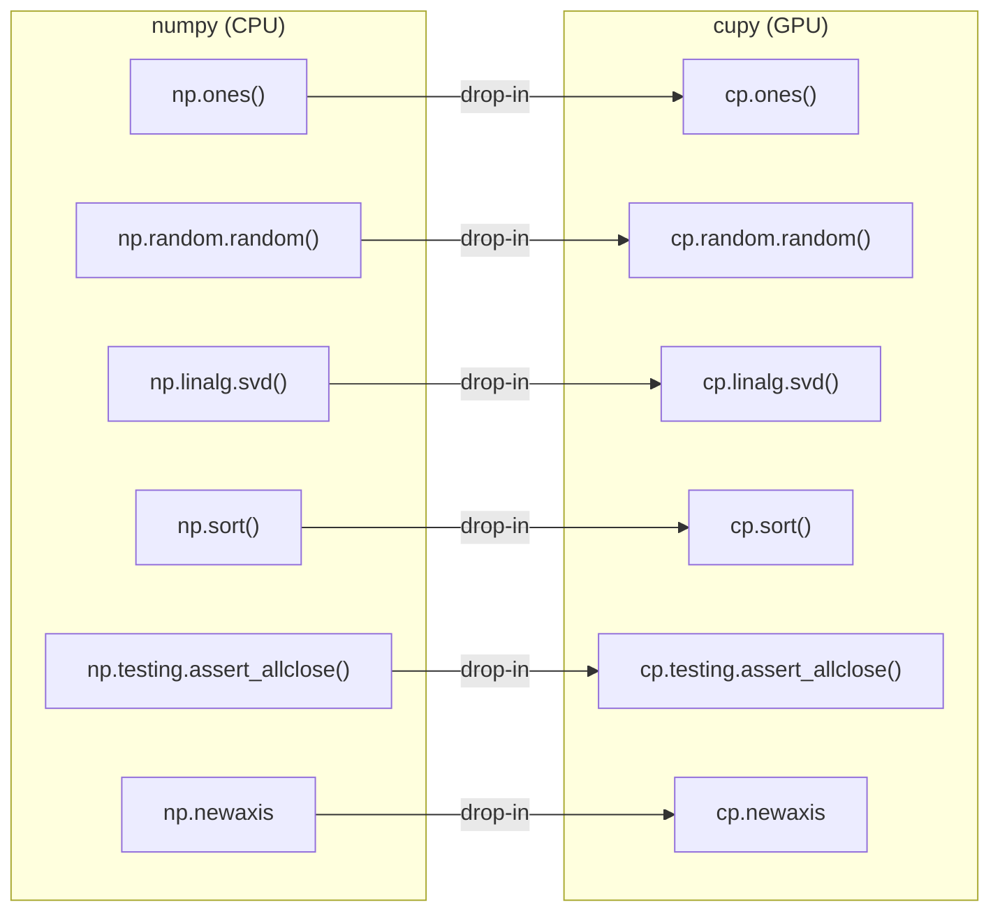
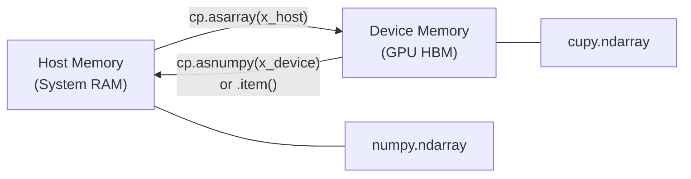
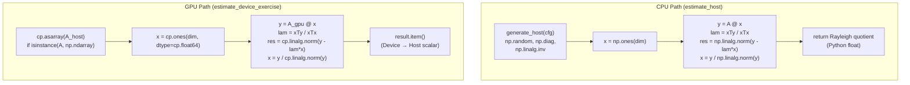
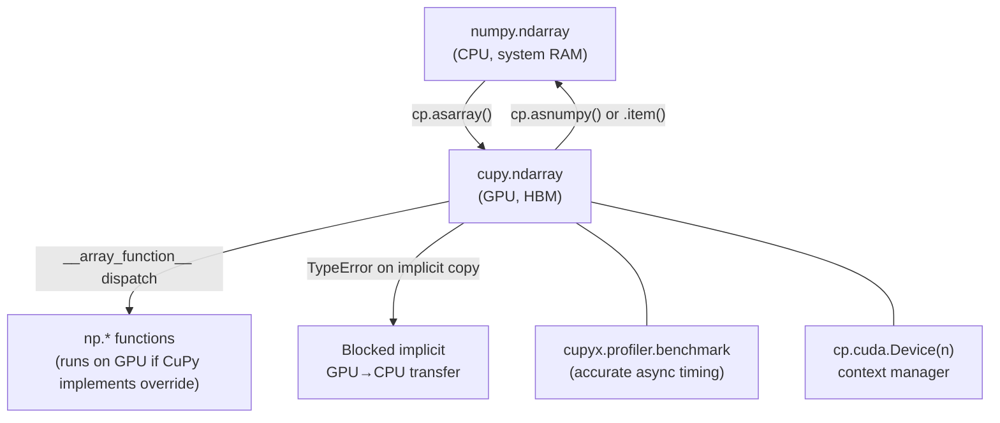

<!-- source: DeepWiki mcp.deepwiki.com · repo NVIDIA/accelerated-computing-hub · extra page Fundamentals: NumPy and CuPy · fetched 2026-10-26 -->

# Fundamentals: NumPy and CuPy

<details>
<summary>Relevant source files</summary>

The following files were used as context for generating this wiki page:

- [tutorials/accelerated-python/notebooks/fundamentals/01__numpy_intro__ndarray_basics.ipynb](tutorials/accelerated-python/notebooks/fundamentals/01__numpy_intro__ndarray_basics.ipynb)
- [tutorials/accelerated-python/notebooks/fundamentals/03__numpy_to_cupy__ndarray_basics.ipynb](tutorials/accelerated-python/notebooks/fundamentals/03__numpy_to_cupy__ndarray_basics.ipynb)
- [tutorials/accelerated-python/notebooks/fundamentals/05__memory_spaces__power_iteration.ipynb](tutorials/accelerated-python/notebooks/fundamentals/05__memory_spaces__power_iteration.ipynb)
- [tutorials/accelerated-python/notebooks/fundamentals/solutions/01__numpy_intro__ndarray_basics__SOLUTION.ipynb](tutorials/accelerated-python/notebooks/fundamentals/solutions/01__numpy_intro__ndarray_basics__SOLUTION.ipynb)
- [tutorials/accelerated-python/notebooks/fundamentals/solutions/03__numpy_to_cupy__ndarray_basics__SOLUTION.ipynb](tutorials/accelerated-python/notebooks/fundamentals/solutions/03__numpy_to_cupy__ndarray_basics__SOLUTION.ipynb)
- [tutorials/accelerated-python/notebooks/fundamentals/solutions/05__memory_spaces__power_iteration__SOLUTION.ipynb](tutorials/accelerated-python/notebooks/fundamentals/solutions/05__memory_spaces__power_iteration__SOLUTION.ipynb)

</details>


## Purpose and Scope

This page documents the fundamentals notebook series in the Accelerated Python tutorial track. It covers the NumPy `ndarray` programming model, how CuPy replicates that model on the GPU, explicit host/device memory transfer patterns, and the performance implications of implicit transfers. The worked example is the **Power Iteration** algorithm, which illustrates a full CPU-to-GPU port.

This series is the entry point to the Accelerated Python tutorial. For GPU library usage built on top of these concepts, see [GPU Libraries: cuDF, cuML, and CCCL](#4.1.2). For writing custom CUDA kernels using Numba, see [Kernel Authoring](#4.1.3). For the tutorial environment setup, see [Accelerated Python Tutorial](#4.1).

---

## Notebooks in This Series

The fundamentals series lives under `tutorials/accelerated-python/notebooks/fundamentals/`. Each notebook has a corresponding solution in the `solutions/` subdirectory.

| File | Topic |
|------|-------|
| `01__numpy_intro__ndarray_basics.ipynb` | NumPy `ndarray` structure, views, broadcasting, vectorization |
| `03__numpy_to_cupy__ndarray_basics.ipynb` | CuPy API compatibility, `cupyx.profiler.benchmark`, device management |
| `05__memory_spaces__power_iteration.ipynb` | Host/device memory, explicit transfers, Power Iteration algorithm |

Solutions:

| File | Topic |
|------|-------|
| `solutions/01__numpy_intro__ndarray_basics__SOLUTION.ipynb` | NumPy solutions |
| `solutions/03__numpy_to_cupy__ndarray_basics__SOLUTION.ipynb` | CuPy solutions |
| `solutions/05__memory_spaces__power_iteration__SOLUTION.ipynb` | Power Iteration solutions |

Sources: `tutorials/accelerated-python/notebooks/fundamentals/01__numpy_intro__ndarray_basics.ipynb`, `tutorials/accelerated-python/notebooks/fundamentals/03__numpy_to_cupy__ndarray_basics.ipynb`, `tutorials/accelerated-python/notebooks/fundamentals/05__memory_spaces__power_iteration.ipynb`

---

## Notebook 01 — NumPy `ndarray` Basics

### The `ndarray` Data Model

The `ndarray` is a fixed-size, contiguous block of memory described by four metadata fields:

| Property | Description |
|----------|-------------|
| `data` | Pointer to the raw memory buffer |
| `dtype` | Uniform element type (e.g., `float64`, `int32`) |
| `shape` | Tuple of sizes per dimension |
| `strides` | Bytes to advance per step in each dimension |

This layout is what makes vectorized operations fast and enables zero-copy **views**.

**Views vs. Copies:** Operations like `arr.reshape()` and `arr.T` return a **view** — they change only the `shape` and `strides` metadata without duplicating the underlying buffer. This makes shape changes essentially free.

Sources: `tutorials/accelerated-python/notebooks/fundamentals/01__numpy_intro__ndarray_basics.ipynb:57-76`, `tutorials/accelerated-python/notebooks/fundamentals/solutions/01__numpy_intro__ndarray_basics__SOLUTION.ipynb:57-76`

### Key API: Array Creation and Manipulation

| Function / Method | Description |
|-------------------|-------------|
| `np.arange(start, stop)` | Integer range, half-open `[start, stop)` |
| `np.linspace(start, stop, num)` | `num` evenly spaced samples over `[start, stop]` |
| `np.random.default_rng().random(size)` | Random floats in `[0.0, 1.0)` |
| `arr.reshape(new_shape)` | Returns a view with new shape; use `-1` to auto-compute one dimension |
| `arr.sort()` | In-place sort; `np.sort(arr)` returns a copy |
| `arr.nbytes` | Total bytes of the element buffer |
| `arr.ndim` / `arr.size` / `arr.shape` | Dimension count, element count, shape tuple |

Sources: `tutorials/accelerated-python/notebooks/fundamentals/01__numpy_intro__ndarray_basics.ipynb:162-176`

### Aggregations, Axes, and Broadcasting

**Aggregations** collapse dimensions. The `axis` parameter specifies which dimension is reduced:
- `np.sum(arr, axis=0)` — collapse rows, one result per column
- `np.sum(arr, axis=1)` — collapse columns, one result per row

**Broadcasting** allows arithmetic between arrays of different shapes by logically stretching dimensions of size 1 without copying memory. Two dimensions are compatible when they are equal or one of them is 1.

Example pattern (row normalization):
```
arr_sum = arr_new.sum(axis=1)              # shape: (M,)
normalized = arr_new / arr_sum[:, np.newaxis]  # broadcasts (M,) → (M,1) → (M,N)
```

**Vectorization:** NumPy functions execute in optimized C/Fortran code. A vectorized `ndarray` operation is typically ~100× faster than an equivalent Python `for` loop over the same data.

Sources: `tutorials/accelerated-python/notebooks/fundamentals/01__numpy_intro__ndarray_basics.ipynb:241-295`, `tutorials/accelerated-python/notebooks/fundamentals/solutions/01__numpy_intro__ndarray_basics__SOLUTION.ipynb:279-325`

---

## Notebook 03 — Transitioning from NumPy to CuPy

### The Zero-Friction API Model

CuPy implements the NumPy API backed by CUDA C++. The most common migration path is changing the import alias:

```python
# CPU
import numpy as np
arr = np.ones((1000, 500, 500))

# GPU — identical syntax
import cupy as cp
arr = cp.ones((1000, 500, 500))
```

The namespace is a drop-in replacement for the vast majority of operations. Arrays, constructors, linear algebra, random generation, and testing utilities all mirror their NumPy counterparts.

Sources: `tutorials/accelerated-python/notebooks/fundamentals/03__numpy_to_cupy__ndarray_basics.ipynb:22-31`

### API and Module Mapping Diagram

**Figure: NumPy → CuPy API Mapping**



Sources: `tutorials/accelerated-python/notebooks/fundamentals/03__numpy_to_cupy__ndarray_basics.ipynb`, `tutorials/accelerated-python/notebooks/fundamentals/solutions/03__numpy_to_cupy__ndarray_basics__SOLUTION.ipynb`

### NumPy Dispatch via `__array_function__`

When a `cupy.ndarray` is passed to a NumPy function that supports the `__array_function__` protocol (e.g., `np.linalg.svd`), NumPy detects the CuPy input and delegates the call to CuPy's implementation. The GPU executes the operation even though the `np.*` function was called.

This allows **device-agnostic code** — the same `np.*` call runs on CPU or GPU depending on the array's origin.

**Limitation:** Not all NumPy functions have CuPy overrides. When CuPy does not implement an override, NumPy attempts a fallback that converts the `cupy.ndarray` to a `numpy.ndarray`. CuPy **blocks this implicit conversion** by raising a `TypeError`. This is intentional: it prevents silent GPU→CPU data copies that would degrade performance.

Sources: `tutorials/accelerated-python/notebooks/fundamentals/03__numpy_to_cupy__ndarray_basics.ipynb:248-276`, `tutorials/accelerated-python/notebooks/fundamentals/solutions/03__numpy_to_cupy__ndarray_basics__SOLUTION.ipynb:383-394`

### Benchmarking with `cupyx.profiler.benchmark`

GPU kernels are **asynchronous**: the CPU enqueues work into a CUDA stream and continues without waiting. Wall-clock timing with `time.time()` will undercount GPU execution time.

The `benchmark` function from `cupyx.profiler` provides accurate timing by:
- Running warm-up iterations to eliminate cold-start overhead
- Synchronizing GPU streams before measuring
- Reporting `cpu_times` and `gpu_times` separately

```python
from cupyx.profiler import benchmark
result = benchmark(cp.sort, (arr_gpu,), n_repeat=5)
avg_ms = result.gpu_times.mean() * 1000
```

Sources: `tutorials/accelerated-python/notebooks/fundamentals/03__numpy_to_cupy__ndarray_basics.ipynb:94-110`, `tutorials/accelerated-python/notebooks/fundamentals/solutions/03__numpy_to_cupy__ndarray_basics__SOLUTION.ipynb:44-55`

### Device Management with `cp.cuda.Device`

CuPy operates on a **current device** context. On multi-GPU systems, use a `with` block to bind array creation to a specific device:

```python
with cp.cuda.Device(0):
    x_on_gpu0 = cp.random.random((100000, 1000))

print(x_on_gpu0.device)  # device(0)
```

CuPy functions require all input arrays to reside on the **same device**. Passing arrays from different devices may produce incorrect results or errors.

Sources: `tutorials/accelerated-python/notebooks/fundamentals/03__numpy_to_cupy__ndarray_basics.ipynb:282-308`

---

## Notebook 05 — Memory Spaces and Power Iteration

### Host and Device Memory Architecture

A heterogeneous compute system exposes two physically separate memory spaces:

| Space | Hardware | Accessible by |
|-------|----------|---------------|
| Host Memory | System RAM (DRAM) | CPU |
| Device Memory | HBM on the GPU | GPU |

Data must be explicitly moved between spaces. CuPy provides two primary transfer functions:

| Direction | Function | Example |
|-----------|----------|---------|
| Host → Device | `cp.asarray(x_host)` | `A_gpu = cp.asarray(A_host)` |
| Device → Host | `cp.asnumpy(x_device)` | `result = cp.asnumpy(A_gpu)` |

Alternatively, `.item()` on a 0-d CuPy array performs a Device → Host transfer and returns a Python scalar.

**Figure: Data Movement Between Memory Spaces**



Sources: `tutorials/accelerated-python/notebooks/fundamentals/05__memory_spaces__power_iteration.ipynb:20-43`

### Implicit Synchronization Pitfalls

Certain Python operations on CuPy arrays silently trigger a Device → Host transfer and force the GPU to synchronize (stall) before continuing. These are performance hazards inside hot loops:

| Operation | Effect |
|-----------|--------|
| `print(gpu_array)` | Transfers all elements to CPU for string formatting |
| `float(gpu_scalar)` or `.item()` | Transfers a single value to CPU |
| `if gpu_scalar > 0:` | Transfers the scalar for boolean evaluation |

The Power Iteration notebook uses a configurable `check_frequency` parameter in `PowerIterationConfig` to control how often convergence is checked (and thus how often implicit synchronization occurs). Setting `check_frequency=1` maximally stalls the GPU; a larger value reduces synchronization overhead.

Sources: `tutorials/accelerated-python/notebooks/fundamentals/05__memory_spaces__power_iteration.ipynb:33-43`, `tutorials/accelerated-python/notebooks/fundamentals/solutions/05__memory_spaces__power_iteration__SOLUTION.ipynb:519-523`

### Power Iteration: CPU Baseline

The Power Iteration algorithm estimates the dominant eigenvalue of a square matrix by repeatedly multiplying a vector by the matrix and normalizing.

**Steps per iteration:**

1. **Matrix-vector multiply:** `y = A @ x`
2. **Rayleigh quotient:** `λ = (x @ y) / (x @ x)`
3. **Residual:** `r = ‖y − λx‖`
4. **Normalize:** `x = y / ‖y‖`

Convergence is checked when `r < residual_threshold`.

The CPU baseline is implemented in `generate_host` and `estimate_host`:

- `generate_host` constructs a diagonalizable matrix `A = P D P⁻¹` using `np.random`, `np.diag`, and `np.linalg.inv`.
- `estimate_host` runs the iteration using `np.linalg.norm` and `@`.

Sources: `tutorials/accelerated-python/notebooks/fundamentals/05__memory_spaces__power_iteration.ipynb:44-201`

### Power Iteration: GPU Port

**Figure: Power Iteration — CPU vs GPU Implementation Flow**



Sources: `tutorials/accelerated-python/notebooks/fundamentals/solutions/05__memory_spaces__power_iteration__SOLUTION.ipynb:229-296`

The key changes from CPU to GPU implementation:

| CPU (`estimate_host`) | GPU (`estimate_device_exercise`) |
|-----------------------|----------------------------------|
| `A` already in host memory | `cp.asarray(A)` if `isinstance(A, np.ndarray)` |
| `x = np.ones(...)` | `x = cp.ones(...)` |
| `np.linalg.norm(...)` | `cp.linalg.norm(...)` |
| Returns `float` directly | Returns `result.item()` |

Sources: `tutorials/accelerated-python/notebooks/fundamentals/solutions/05__memory_spaces__power_iteration__SOLUTION.ipynb:229-296`, `tutorials/accelerated-python/notebooks/fundamentals/05__memory_spaces__power_iteration.ipynb:229-293`

### Optimizing Data Generation

In the base GPU exercise, the matrix is generated on the CPU and then transferred with `cp.asarray`. For large matrices this transfer is a bottleneck. The preferred pattern is to generate data directly in device memory using `generate_device_exercise`:

| CPU generation | GPU generation |
|----------------|----------------|
| `np.random.seed(42)` | `cp.random.seed(42)` |
| `np.random.random(size)` | `cp.random.random(size)` |
| `np.random.permutation(x)` | `cp.random.permutation(x)` |
| `np.concatenate(...)` | `cp.concatenate(...)` |
| `np.diag(...)` | `cp.diag(...)` |
| `np.linalg.inv(P)` | `cp.linalg.inv(P)` |

**Important:** `np.random` (Mersenne Twister or PCG64) and `cp.random` (XORWOW via cuRAND) produce **different number sequences** even with the same seed value. `A_host` and `A_device` will not be numerically identical. If bit-identical data is required across both devices, generate on one and transfer to the other.

Sources: `tutorials/accelerated-python/notebooks/fundamentals/solutions/05__memory_spaces__power_iteration__SOLUTION.ipynb:299-416`

### Benchmarking the Three Scenarios

The solution notebook benchmarks three configurations using `cupyx.profiler.benchmark`:

| Scenario | Function call | Input |
|----------|---------------|-------|
| CPU only | `estimate_host(A_host, cfg)` | NumPy array on host |
| GPU with transfer | `estimate_device_exercise(A_host, cfg)` | NumPy array (transferred inside) |
| GPU pure | `estimate_device_exercise(A_device, cfg)` | CuPy array on device |

Comparing "GPU with transfer" vs "GPU pure" isolates the cost of the Host → Device `cp.asarray` call.

The timing results are captured as:
- `result_cpu.cpu_times.mean() * 1000` for CPU milliseconds
- `result_transfer.gpu_times.mean() * 1000` for GPU milliseconds (including transfer)
- `result_pure.gpu_times.mean() * 1000` for GPU milliseconds (pure compute)

Sources: `tutorials/accelerated-python/notebooks/fundamentals/solutions/05__memory_spaces__power_iteration__SOLUTION.ipynb:479-505`

### CuPy API Coverage Note

Not all NumPy functions have CuPy equivalents. The solution notebook calls out that `np.linalg.eigvals` is used for verification because `cp.linalg.eigvals` is not implemented. The reference always checks the [CuPy NumPy comparison table](https://docs.cupy.dev/en/stable/reference/comparison.html) before assuming a direct port works.

Sources: `tutorials/accelerated-python/notebooks/fundamentals/05__memory_spaces__power_iteration.ipynb:408-413`

---

## Configuration: `PowerIterationConfig`

The Power Iteration algorithm is parameterized by a `dataclass` defined in both the exercise and solution notebooks:

[tutorials/accelerated-python/notebooks/fundamentals/05__memory_spaces__power_iteration.ipynb:98-106]()

| Field | Default | Purpose |
|-------|---------|---------|
| `dim` | `4096` | Matrix side length |
| `dominance` | `0.1` | Gap between dominant and next eigenvalue; smaller = slower convergence |
| `max_steps` | `400` | Maximum iterations |
| `check_frequency` | `10` | Steps between convergence checks and implicit GPU syncs |
| `progress` | `True` | Whether to print residuals (triggers implicit transfers) |
| `residual_threshold` | `1e-10` | Convergence criterion |

`check_frequency` directly controls the synchronization rate. Setting it to `1` causes a Device → Host transfer every step; setting it higher amortizes the synchronization overhead over multiple kernel launches.

Sources: `tutorials/accelerated-python/notebooks/fundamentals/05__memory_spaces__power_iteration.ipynb:87-106`

---

## Summary of Concepts



Sources: `tutorials/accelerated-python/notebooks/fundamentals/03__numpy_to_cupy__ndarray_basics.ipynb`, `tutorials/accelerated-python/notebooks/fundamentals/05__memory_spaces__power_iteration.ipynb`

---

