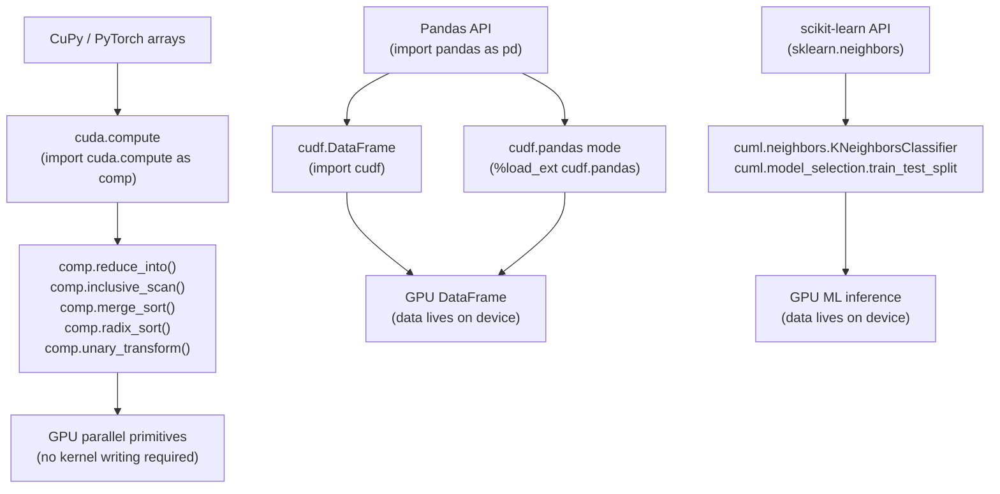
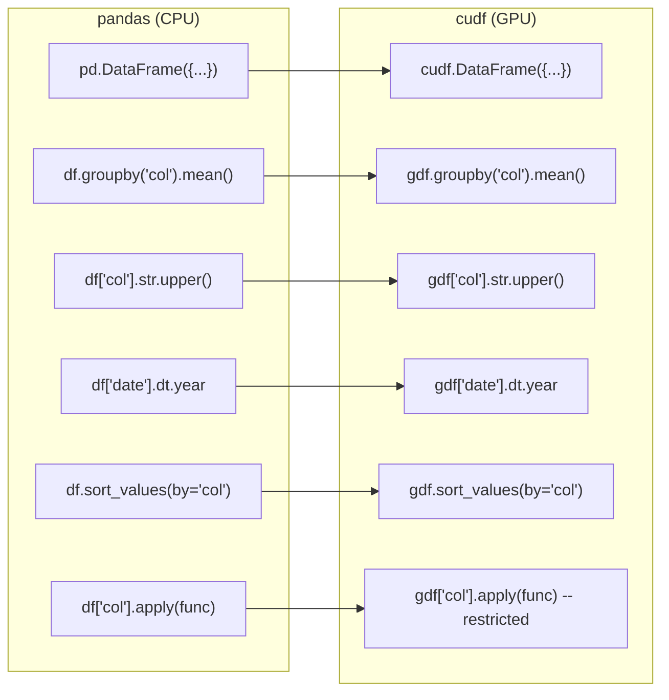
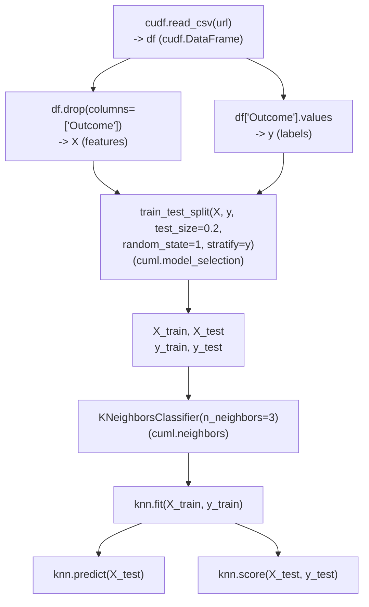
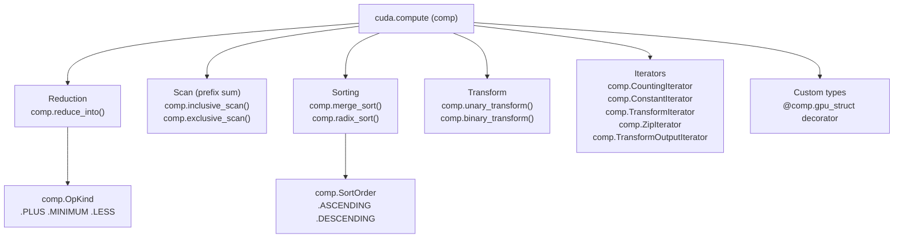
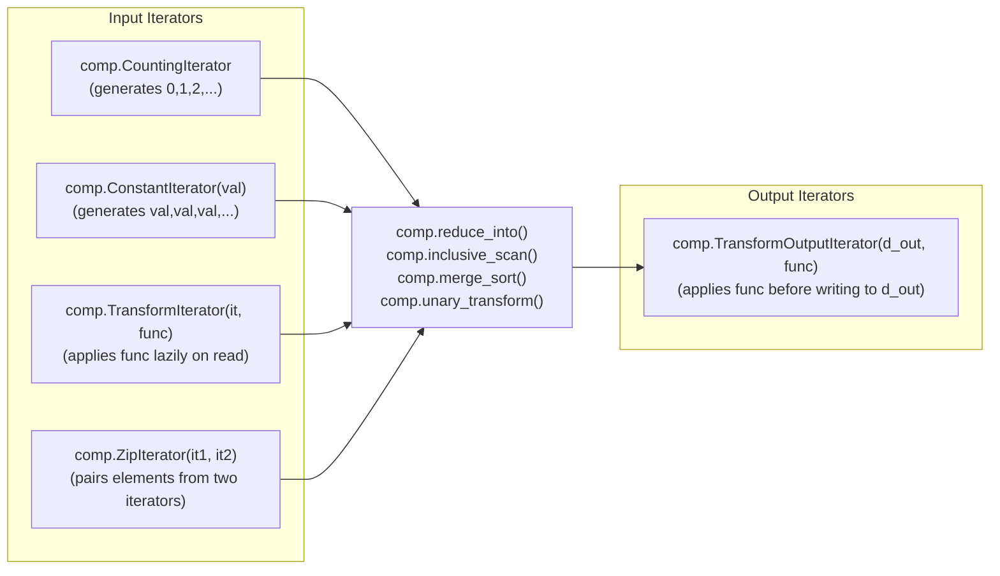

<!-- source: DeepWiki mcp.deepwiki.com · repo NVIDIA/accelerated-computing-hub · extra page GPU Libraries: cuDF, cuML, and CCCL · fetched 2026-10-26 -->

# GPU Libraries: cuDF, cuML, and CCCL

<details>
<summary>Relevant source files</summary>

The following files were used as context for generating this wiki page:

- [Accelerated_Python_User_Guide/notebooks/Chapter_cuda.cccl.parallel.ipynb](Accelerated_Python_User_Guide/notebooks/Chapter_cuda.cccl.parallel.ipynb)
- [Accelerated_Python_User_Guide/notebooks/Chapter_cuda.core.ipynb](Accelerated_Python_User_Guide/notebooks/Chapter_cuda.core.ipynb)
- [tutorials/accelerated-python/notebooks/libraries/20__cudf__nyc_parking_violations.ipynb](tutorials/accelerated-python/notebooks/libraries/20__cudf__nyc_parking_violations.ipynb)
- [tutorials/accelerated-python/notebooks/libraries/21__cudf_pandas__nyc_parking_violations.ipynb](tutorials/accelerated-python/notebooks/libraries/21__cudf_pandas__nyc_parking_violations.ipynb)
- [tutorials/accelerated-python/notebooks/libraries/22__cuml.ipynb](tutorials/accelerated-python/notebooks/libraries/22__cuml.ipynb)
- [tutorials/accelerated-python/notebooks/libraries/23__cuda_cccl__customizing_algorithms.ipynb](tutorials/accelerated-python/notebooks/libraries/23__cuda_cccl__customizing_algorithms.ipynb)
- [tutorials/accelerated-python/notebooks/libraries/solutions/20__cudf__nyc_parking_violations__SOLUTION.ipynb](tutorials/accelerated-python/notebooks/libraries/solutions/20__cudf__nyc_parking_violations__SOLUTION.ipynb)
- [tutorials/accelerated-python/notebooks/libraries/solutions/21__cudf_pandas__nyc_parking_violations__SOLUTION.ipynb](tutorials/accelerated-python/notebooks/libraries/solutions/21__cudf_pandas__nyc_parking_violations__SOLUTION.ipynb)
- [tutorials/accelerated-python/notebooks/libraries/solutions/23__cuda_cccl__customizing_algorithms__SOLUTION.ipynb](tutorials/accelerated-python/notebooks/libraries/solutions/23__cuda_cccl__customizing_algorithms__SOLUTION.ipynb)
- [tutorials/cuda-cpp/notebooks/01.04-Vocabulary-Types/01.04.01-Vocabulary-Types.ipynb](tutorials/cuda-cpp/notebooks/01.04-Vocabulary-Types/01.04.01-Vocabulary-Types.ipynb)
- [tutorials/cuda-cpp/notebooks/02.02-Asynchrony/02.02.01-Asynchrony.ipynb](tutorials/cuda-cpp/notebooks/02.02-Asynchrony/02.02.01-Asynchrony.ipynb)
- [tutorials/cuda-cpp/notebooks/03.06-Cooperative-Algorithms/03.06.02-Exercise-Cooperative-Histogram.ipynb](tutorials/cuda-cpp/notebooks/03.06-Cooperative-Algorithms/03.06.02-Exercise-Cooperative-Histogram.ipynb)

</details>


This page documents the GPU libraries notebook series within the Accelerated Python tutorial track. It covers GPU-accelerated DataFrame operations via `cuDF` and `cudf.pandas`, machine learning via `cuML`, and parallel algorithms via `cuda-cccl`. These notebooks are numbered 20–23 within the `tutorials/accelerated-python/notebooks/libraries/` directory.

For the fundamentals of GPU arrays and CuPy, see [4.1.1](#4.1.1). For writing custom CUDA kernels with Numba, see [4.1.3](#4.1.3).

---

## Notebook Overview

| Notebook File | Topic | Primary APIs |
|---|---|---|
| `20__cudf__nyc_parking_violations.ipynb` | DataFrames: Pandas → cuDF | `cudf.DataFrame`, `.apply()` |
| `21__cudf_pandas__nyc_parking_violations.ipynb` | cudf.pandas transparent mode | `%load_ext cudf.pandas`, `%%cudf.pandas.line_profile` |
| `22__cuml.ipynb` | GPU machine learning | `KNeighborsClassifier`, `train_test_split` |
| `23__cuda_cccl__customizing_algorithms.ipynb` | Parallel algorithms | `cuda.compute` module |

Sources: [tutorials/accelerated-python/notebooks/libraries/20__cudf__nyc_parking_violations.ipynb:1-50](), [tutorials/accelerated-python/notebooks/libraries/21__cudf_pandas__nyc_parking_violations.ipynb:1-30](), [tutorials/accelerated-python/notebooks/libraries/22__cuml.ipynb:1-30](), [tutorials/accelerated-python/notebooks/libraries/23__cuda_cccl__customizing_algorithms.ipynb:1-50]()

---

## Library Abstraction Levels

The following diagram positions each library by its abstraction level and use case, mapping library names to Python import paths used in the notebooks.

**Library Stack and Abstraction Levels**



Sources: [tutorials/accelerated-python/notebooks/libraries/23__cuda_cccl__customizing_algorithms.ipynb:62-100](), [tutorials/accelerated-python/notebooks/libraries/22__cuml.ipynb:1-50](), [tutorials/accelerated-python/notebooks/libraries/21__cudf_pandas__nyc_parking_violations.ipynb:1-50]()

---

## cuDF: GPU DataFrames

### Pandas API Compatibility

`cudf` is a GPU DataFrame library from the RAPIDS suite. It mirrors the `pandas` API, enabling an import-swap workflow. Most operations are drop-in compatible.

**Pandas-to-cuDF API Mapping**



Sources: [tutorials/accelerated-python/notebooks/libraries/20__cudf__nyc_parking_violations.ipynb:340-510]()

### cuDF UDF Constraints

The `.apply()` method in cuDF is significantly more restricted than in pandas. Key constraints:

- Functions passed to `.apply()` must be JIT-compilable by **Numba** for the CUDA target.
- General Python objects, `isinstance` checks, and dynamic type branching are not supported.
- Even functions that compile successfully via `.apply()` are slower than vectorized column operations due to JIT compilation overhead and kernel launch overhead.

**UDF compatibility rules:**

| Function Characteristic | pandas `.apply()` | cuDF `.apply()` |
|---|---|---|
| Pure arithmetic (`x + 10`) | ✓ | ✓ |
| `isinstance()` check | ✓ | ✗ (compilation fails) |
| String object manipulation | ✓ | Partially supported |
| Dynamic return type | ✓ | ✗ |

**Best practice:** Prefer vectorized operations (`gdf["a"] + 10`) over `.apply()` in all cases for cuDF.

Sources: [tutorials/accelerated-python/notebooks/libraries/20__cudf__nyc_parking_violations.ipynb:405-510]()

### Date Format Strictness

cuDF requires ISO-standard date format (`YYYY-MM-DD`). Pandas tolerates ambiguous formats like `11/20/2018`; `cudf.date_range("11/20/2018", ...)` will raise an error.

Sources: [tutorials/accelerated-python/notebooks/libraries/20__cudf__nyc_parking_violations.ipynb:370-402]()

### NYC Parking Violations Exercise

Notebook `20` uses the NYC Parking Violations 2022 dataset (`nyc_parking_violations_2022.parquet`) to compare Pandas and cuDF pipelines side-by-side. The exercise tasks are:

1. Load data and inspect columns with pandas.
2. Filter rows, group by `Registration State`, count, sort.
3. Replicate the pipeline with `cudf` and compare wall time using `%%time`.

Sources: [tutorials/accelerated-python/notebooks/libraries/20__cudf__nyc_parking_violations.ipynb:510-655](), [tutorials/accelerated-python/notebooks/libraries/solutions/20__cudf__nyc_parking_violations__SOLUTION.ipynb:555-655]()

---

## cudf.pandas: Transparent Acceleration

`cudf.pandas` is a pandas accelerator mode that dispatches supported operations to the GPU automatically, falling back to CPU pandas for unsupported operations. No changes to existing pandas code are required beyond loading the extension.

### Activation

```
%load_ext cudf.pandas
import pandas as pd
```

After loading the extension, `pd` refers to a proxy module that routes GPU-compatible operations to `cudf` transparently.

### Line Profiler

The `%%cudf.pandas.line_profile` cell magic reports, line by line, whether each operation ran on GPU or fell back to CPU. This is useful for identifying bottlenecks.

```
%%cudf.pandas.line_profile

small_df = pd.DataFrame(...)
small_df.min(axis=0)     # check: GPU or CPU?
small_df.min(axis=1)     # check: GPU or CPU?
counts = small_df.groupby("a").b.count()
```

Sources: [tutorials/accelerated-python/notebooks/libraries/21__cudf_pandas__nyc_parking_violations.ipynb:165-216]()

### Optimization Exercise

Notebook `21` includes an exercise that demonstrates a slow `.apply()` call using a custom Python function `is_in_march` that converts datetimes to strings and parses them manually. The exercise asks learners to replace this with the vectorized form `df["Issue Date"].dt.month == 3`.

The solution is in [tutorials/accelerated-python/notebooks/libraries/solutions/21__cudf_pandas__nyc_parking_violations__SOLUTION.ipynb:55-59]().

---

## cuML: GPU Machine Learning

`cuml` provides GPU-accelerated equivalents of scikit-learn estimators. The API is designed to be a drop-in replacement with minimal code changes.

### KNeighborsClassifier Workflow

Notebook `22` demonstrates a supervised classification pipeline on a diabetes dataset:

**cuML Workflow**



Sources: [tutorials/accelerated-python/notebooks/libraries/22__cuml.ipynb:50-175]()

### cuML vs scikit-learn

| Operation | scikit-learn import | cuML import |
|---|---|---|
| Train-test split | `sklearn.model_selection.train_test_split` | `cuml.model_selection.train_test_split` |
| K-Nearest Neighbors | `sklearn.neighbors.KNeighborsClassifier` | `cuml.neighbors.KNeighborsClassifier` |
| Fit, predict, score | `.fit()`, `.predict()`, `.score()` | Same API |

The model trains and infers on GPU. Input data is a `cudf.DataFrame`, and output predictions remain on the device.

Sources: [tutorials/accelerated-python/notebooks/libraries/22__cuml.ipynb:100-170]()

---

## cuda-cccl: Parallel Algorithms

The `cuda-cccl` Python package provides two subpackages:

| Subpackage | Import | Purpose |
|---|---|---|
| `cuda.compute` | `import cuda.compute as comp` | Device-wide parallel algorithms (reduce, scan, sort, transform) |
| `cuda.coop` | `import cuda.coop` | Block/warp-level cooperative primitives for use inside Numba kernels |

Notebook `23` focuses on `cuda.compute`.

### When to Use cuda.compute

`cuda.compute` occupies a middle layer between high-level array frameworks (CuPy, PyTorch) and raw CUDA kernels (Numba). Use it when:

- An operation cannot be expressed efficiently as CuPy/PyTorch vectorized ops.
- You need operator fusion to avoid intermediate allocations.
- You need a custom comparator or reduction operator.
- You do not want to write a full CUDA kernel.

**Algorithm Coverage in cuda.compute**



Sources: [tutorials/accelerated-python/notebooks/libraries/23__cuda_cccl__customizing_algorithms.ipynb:14-43]()

---

### Reductions with `reduce_into`

`reduce_into` collapses an input array to a single output value using a binary operation.

**Signature pattern:**
```
comp.reduce_into(d_input, d_output, op, n_elements, h_init)
```

- `d_input`: CuPy (device) array — input sequence.
- `d_output`: CuPy array of size 1 — where the result is written.
- `op`: Either a `comp.OpKind` enum value or a Python function `(a, b) -> result`.
- `n_elements`: Number of elements to reduce.
- `h_init`: NumPy (host) array of size 1 — identity value for the operation.

**Built-in operator kinds (`comp.OpKind`):**

| Enum Value | Operation |
|---|---|
| `comp.OpKind.PLUS` | Addition |
| `comp.OpKind.MINIMUM` | Minimum |
| `comp.OpKind.LESS` | Less-than (comparator) |

**Custom operator example** — sum of even values only:

```python
def sum_even_op(a, b):
    return (a if a % 2 == 0 else 0) + (b if b % 2 == 0 else 0)

comp.reduce_into(d_input, d_output, sum_even_op, len(d_input), h_init)
```

The notebook benchmarks this against a naive CuPy equivalent (`d_input[d_input % 2 == 0].sum()`) and shows significant speedup, attributed to operator fusion, no intermediate allocations, and lower Python dispatch overhead.

Sources: [tutorials/accelerated-python/notebooks/libraries/23__cuda_cccl__customizing_algorithms.ipynb:180-530]()

---

### Scan Algorithms

A **scan** (prefix sum) computes a running accumulation. Two variants:

- **Inclusive scan**: position `i` includes element `i` in its output.
- **Exclusive scan**: position `i` excludes element `i`; output is shifted right by one.

```
Input:     [3, 1, 4, 1, 5]
Inclusive: [3, 4, 8, 9, 14]
Exclusive: [0, 3, 4, 8, 9]
```

Functions: `comp.inclusive_scan()` and `comp.exclusive_scan()`.

Both accept a custom binary operator, enabling non-additive scans such as running maximum:

```python
def max_op(a, b):
    return a if a > b else b

comp.inclusive_scan(d_input, d_output, max_op, h_init, len(d_input))
```

Sources: [tutorials/accelerated-python/notebooks/libraries/23__cuda_cccl__customizing_algorithms.ipynb:539-634]()

---

### Sorting Algorithms

Two sort functions are available with different capabilities:

| Function | Algorithm | Supports custom comparator | Supports key-value pairs |
|---|---|---|---|
| `comp.merge_sort()` | Merge sort | Yes (Python function) | Yes |
| `comp.radix_sort()` | Radix sort | No (numeric order only) | Yes |

**`merge_sort` signature pattern:**
```
comp.merge_sort(d_in_keys, d_in_values, d_out_keys, d_out_values, comparator_or_OpKind, n_elements)
```
Pass `None` for values if only key sorting is needed. Arrays may be reused in-place for input and output.

**`radix_sort` signature pattern:**
```
comp.radix_sort(d_in_keys, d_out_keys, d_in_values, d_out_values, comp.SortOrder.ASCENDING, n_elements)
```

`comp.SortOrder.ASCENDING` and `comp.SortOrder.DESCENDING` control direction.

Sources: [tutorials/accelerated-python/notebooks/libraries/23__cuda_cccl__customizing_algorithms.ipynb:640-875]()

---

### Transform Algorithms

Transforms apply a function element-wise across one or two input arrays.

| Function | Arity | Description |
|---|---|---|
| `comp.unary_transform(d_in, d_out, func, n)` | Unary | `d_out[i] = func(d_in[i])` |
| `comp.binary_transform(d_in1, d_in2, d_out, func, n)` | Binary | `d_out[i] = func(d_in1[i], d_in2[i])` |

The binary transform also accepts `comp.OpKind` values directly (e.g., `comp.OpKind.PLUS` for elementwise addition).

Sources: [tutorials/accelerated-python/notebooks/libraries/23__cuda_cccl__customizing_algorithms.ipynb:882-995]()

---

### Custom Struct Types with `@comp.gpu_struct`

`cuda.compute` supports user-defined struct types as element types for arrays and iterators. The `@comp.gpu_struct` decorator declares a struct compatible with GPU execution:

```python
@comp.gpu_struct
class SumAndCount:
    sum: np.float32
    count: np.int32
```

Instances are created with positional arguments: `SumAndCount(0.0, 0)`. Struct fields are accessible as attributes within operator functions. This enables algorithms such as online aggregation (e.g., computing a running average by scanning over `SumAndCount` values).

Sources: [tutorials/accelerated-python/notebooks/libraries/23__cuda_cccl__customizing_algorithms.ipynb:1007-1100](), [tutorials/accelerated-python/notebooks/libraries/solutions/23__cuda_cccl__customizing_algorithms__SOLUTION.ipynb:125-158]()

---

### Iterators

Iterators in `cuda.compute` are lazy, zero-copy views over data that can be composed with algorithms. They avoid materializing intermediate arrays.

**Iterator Types in cuda.compute**



The capstone exercise in notebook `23` combines all of these to compute a running average:
- `comp.ZipIterator(d_input, comp.ConstantIterator(np.int32(1)))` pairs each element with count 1.
- `comp.TransformOutputIterator(d_output, compute_running_average)` divides sum by count on write.
- `comp.inclusive_scan` drives the pipeline.

Sources: [tutorials/accelerated-python/notebooks/libraries/23__cuda_cccl__customizing_algorithms.ipynb:1100-1700](), [tutorials/accelerated-python/notebooks/libraries/solutions/23__cuda_cccl__customizing_algorithms__SOLUTION.ipynb:119-158]()

---

## Performance Characteristics

| Library | GPU Data Path | CPU Fallback | Key Overhead |
|---|---|---|---|
| `cudf` direct | Data lives on device | None (explicit copy needed) | JIT compile on first `.apply()` call |
| `cudf.pandas` | Transparent dispatch | Automatic for unsupported ops | Proxy overhead; diagnose with `line_profile` |
| `cuml` | Fit/predict on device | None | Model initialization |
| `cuda.compute` | Input/output stay on device | None | First-call JIT compilation of custom ops |

Sources: [tutorials/accelerated-python/notebooks/libraries/23__cuda_cccl__customizing_algorithms.ipynb:433-530](), [tutorials/accelerated-python/notebooks/libraries/21__cudf_pandas__nyc_parking_violations.ipynb:165-260]()

---

