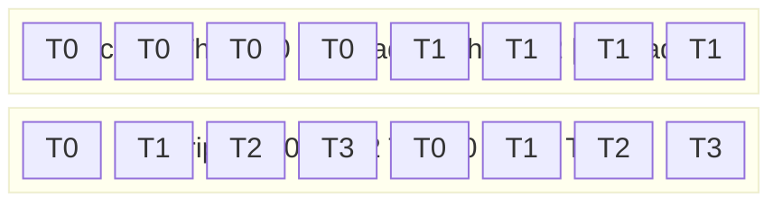
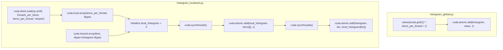
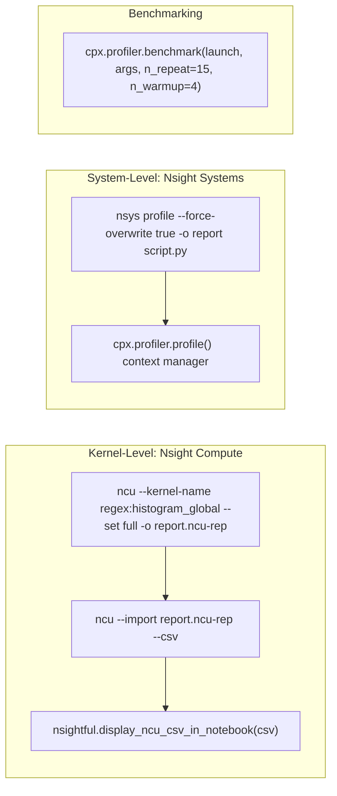

<!-- source: DeepWiki mcp.deepwiki.com · repo NVIDIA/accelerated-computing-hub · extra page Kernel Authoring · fetched 2026-10-26 -->

# Kernel Authoring

<details>
<summary>Relevant source files</summary>

The following files were used as context for generating this wiki page:

- [tutorials/accelerated-python/notebooks/fundamentals/06__asynchrony__power_iteration.ipynb](tutorials/accelerated-python/notebooks/fundamentals/06__asynchrony__power_iteration.ipynb)
- [tutorials/accelerated-python/notebooks/fundamentals/solutions/06__asynchrony__power_iteration__SOLUTION.ipynb](tutorials/accelerated-python/notebooks/fundamentals/solutions/06__asynchrony__power_iteration__SOLUTION.ipynb)
- [tutorials/accelerated-python/notebooks/kernels/40__kernel_authoring__copy.ipynb](tutorials/accelerated-python/notebooks/kernels/40__kernel_authoring__copy.ipynb)
- [tutorials/accelerated-python/notebooks/kernels/41__kernel_authoring__book_histogram.ipynb](tutorials/accelerated-python/notebooks/kernels/41__kernel_authoring__book_histogram.ipynb)
- [tutorials/accelerated-python/notebooks/kernels/solutions/40__kernel_authoring__copy__SOLUTION.ipynb](tutorials/accelerated-python/notebooks/kernels/solutions/40__kernel_authoring__copy__SOLUTION.ipynb)
- [tutorials/accelerated-python/notebooks/kernels/solutions/41__kernel_authoring__book_histogram__SOLUTION.ipynb](tutorials/accelerated-python/notebooks/kernels/solutions/41__kernel_authoring__book_histogram__SOLUTION.ipynb)
- [tutorials/cuda-cpp/notebooks/02.02-Asynchrony/02.02.03-Exercise-Nsight.ipynb](tutorials/cuda-cpp/notebooks/02.02-Asynchrony/02.02.03-Exercise-Nsight.ipynb)
- [tutorials/cuda-cpp/notebooks/02.02-Asynchrony/02.02.04-Exercise-NVTX.ipynb](tutorials/cuda-cpp/notebooks/02.02-Asynchrony/02.02.04-Exercise-NVTX.ipynb)
- [tutorials/cuda-cpp/notebooks/02.03-Streams/02.03.02-Exercise-Async-Copy.ipynb](tutorials/cuda-cpp/notebooks/02.03-Streams/02.03.02-Exercise-Async-Copy.ipynb)
- [tutorials/cuda-cpp/notebooks/02.04-Pinned-Memory/02.04.02-Exercise-Copy-Overlap.ipynb](tutorials/cuda-cpp/notebooks/02.04-Pinned-Memory/02.04.02-Exercise-Copy-Overlap.ipynb)
- [tutorials/stdpar/notebooks/fortran/lab3_heat/heat.ipynb](tutorials/stdpar/notebooks/fortran/lab3_heat/heat.ipynb)

</details>


This page documents the Kernel Authoring notebooks within the Accelerated Python tutorial track. These notebooks teach how to write custom CUDA kernels in Python using Numba's `cuda.jit` decorator, how to use advanced CUDA features such as shared memory and atomic operations, how to manage GPU asynchrony with CUDA streams, and how to profile kernels with Nsight Compute and Nsight Systems.

For background on the broader Accelerated Python tutorial environment, see [4.1](#4.1). For GPU library use without custom kernels, see [4.1.2](#4.1.2). For the fundamentals series that introduces CuPy and Power Iteration, see [4.1.1](#4.1.1).

---

## Notebook Overview

| Notebook | Location | Topics |
|---|---|---|
| `40__kernel_authoring__copy.ipynb` | `notebooks/kernels/` | `@cuda.jit`, thread indexing, blocked vs striped memory access, Nsight Compute |
| `41__kernel_authoring__book_histogram.ipynb` | `notebooks/kernels/` | Data races, `cuda.atomic.add`, shared memory, `cuda.syncthreads`, `coop.block.load` |
| `06__asynchrony__power_iteration.ipynb` | `notebooks/fundamentals/` | CUDA streams in CuPy, implicit synchronization, NVTX, Nsight Systems, pinned memory |

Solutions for the first two notebooks are in `notebooks/kernels/solutions/`. The asynchrony notebook's solution is in `notebooks/fundamentals/solutions/`.

Sources: [tutorials/accelerated-python/notebooks/kernels/40__kernel_authoring__copy.ipynb:1-30](), [tutorials/accelerated-python/notebooks/kernels/41__kernel_authoring__book_histogram.ipynb:1-55](), [tutorials/accelerated-python/notebooks/fundamentals/06__asynchrony__power_iteration.ipynb:1-50]()

---

## Notebook and Tool Relationships

**Figure: Notebooks, APIs, and Profiling Tools**

```mermaid
flowchart TD
    subgraph "notebooks/kernels/"
        N40["40__kernel_authoring__copy.ipynb"]
        N41["41__kernel_authoring__book_histogram.ipynb"]
    end
    subgraph "notebooks/fundamentals/"
        N06["06__asynchrony__power_iteration.ipynb"]
    end
    subgraph "Python APIs"
        CUDAJIT["numba.cuda.jit"]
        CUDAGRID["cuda.grid(1)"]
        ATOMICADD["cuda.atomic.add"]
        SHAREDARRAY["cuda.shared.array"]
        SYNCTHREADS["cuda.syncthreads"]
        BLOCKLOAD["cuda.coop / coop.block.load"]
        NVTX["nvtx.annotate"]
        CPXPROFILE["cupyx.profiler.profile"]
        CPXBENCHMARK["cupyx.profiler.benchmark"]
    end
    subgraph "Profiling Tools"
        NCU["ncu (Nsight Compute)"]
        NSYS["nsys (Nsight Systems)"]
        NSIGHTFUL["nsightful.display_ncu_csv_in_notebook"]
    end
    N40 --> CUDAJIT
    N40 --> CUDAGRID
    N40 --> NCU
    N40 --> NSIGHTFUL
    N40 --> CPXBENCHMARK
    N41 --> CUDAJIT
    N41 --> ATOMICADD
    N41 --> SHAREDARRAY
    N41 --> SYNCTHREADS
    N41 --> BLOCKLOAD
    N41 --> NCU
    N41 --> NSIGHTFUL
    N06 --> NVTX
    N06 --> CPXPROFILE
    N06 --> NSYS
    N06 --> NSIGHTFUL
```



Sources: [tutorials/accelerated-python/notebooks/kernels/40__kernel_authoring__copy.ipynb:29-49](), [tutorials/accelerated-python/notebooks/kernels/41__kernel_authoring__book_histogram.ipynb:29-54](), [tutorials/accelerated-python/notebooks/fundamentals/06__asynchrony__power_iteration.ipynb:33-49]()

---

## Writing CUDA Kernels with Numba

Kernels are written as regular Python functions decorated with `@cuda.jit` from the `numba` package. The decorator compiles the function to PTX for execution on the GPU.

**Kernel definition pattern:**

```
@cuda.jit
def my_kernel(src, dst):
    idx = cuda.grid(1)   # unique global thread index in 1D
    ...
```

**Launch syntax:**

```
my_kernel[blocks, threads_per_block](src, dst)
```

The number of blocks is typically derived from the data size and the chosen `threads_per_block` constant. The solution notebooks use `items_per_thread` to control how many elements each thread processes.

Sources: [tutorials/accelerated-python/notebooks/kernels/40__kernel_authoring__copy.ipynb:57-135](), [tutorials/accelerated-python/notebooks/kernels/41__kernel_authoring__book_histogram.ipynb:84-135]()

---

## Copy Kernel: Blocked vs Striped Memory Access

The copy notebook presents two layouts for how threads access memory, each with different performance characteristics.

### Blocked Access (Baseline)

Each thread copies a contiguous region. Thread `i` operates on indices `[i * items_per_thread, (i+1) * items_per_thread)`. Adjacent threads access non-adjacent memory locations within a warp, which prevents memory coalescing.

### Striped Access (Optimized)

Each thread copies items spaced `threads_per_block` apart. Thread `i` operates on indices `i, i + threads_per_block, i + 2 * threads_per_block, ...`. Adjacent threads access adjacent memory locations, enabling coalesced reads and writes.

**Figure: Blocked vs Striped Access Patterns**



The profiling section of the copy notebook uses `ncu` to collect a full performance report, then visualizes it via `nsightful.display_ncu_csv_in_notebook`. The memory workload analysis in Nsight Compute shows the difference in DRAM throughput between the two approaches.

Benchmarking uses `cpx.profiler.benchmark(launch, args, n_repeat=15, n_warmup=4)` from `cupyx`.

Sources: [tutorials/accelerated-python/notebooks/kernels/40__kernel_authoring__copy.ipynb:52-200](), [tutorials/accelerated-python/notebooks/kernels/solutions/40__kernel_authoring__copy__SOLUTION.ipynb:52-200]()

---

## Histogram Kernel: Atomics and Shared Memory

The histogram notebook (`41__kernel_authoring__book_histogram.ipynb`) builds an optimized ASCII character frequency counter over a 15 MB book corpus (`books__15m.txt`).

### Stage 1: Data Races in Global Memory

The naive implementation reads and increments a global histogram array directly. This produces incorrect results because the read–modify–write sequence is not atomic: two threads can both read the same bin value, both increment it, and write back the same incremented value, losing one update.

The problem is illustrated explicitly in the notebook with a two-thread scenario:

[tutorials/accelerated-python/notebooks/kernels/41__kernel_authoring__book_histogram.ipynb:183-202]()

### Stage 2: Fixing Races with `cuda.atomic.add`

`cuda.atomic.add(array, index, value)` performs the increment as a single indivisible operation, eliminating the race. The corrected kernel in the solution writes:

```
cuda.atomic.add(histogram, value, 1)
```

[tutorials/accelerated-python/notebooks/kernels/solutions/41__kernel_authoring__book_histogram__SOLUTION.ipynb:127-151]()

### Stage 3: Shared Memory and Cooperative Groups

Global atomic operations to a 256-bin histogram cause severe contention: many thousands of threads serialized on 256 memory locations. The solution uses per-block shared memory to reduce global atomic traffic:

1. Each block initializes a `local_histogram` in shared memory using `cuda.shared.array(bins, dtype=histogram.dtype)`.
2. Threads update `local_histogram` using `cuda.atomic.add`.
3. `cuda.syncthreads()` ensures all local updates are complete before the merge.
4. Each thread contributes one bin's local count to the global histogram using `cuda.atomic.add(histogram, bin, local_histogram[bin])`.

Data loading is separated from the histogram update and uses `coop.block.load` (from `cuda.coop`) to perform a striped block load, which requires linking the algorithm object to the kernel via `@cuda.jit(link=block_load.files)`.

[tutorials/accelerated-python/notebooks/kernels/solutions/41__kernel_authoring__book_histogram__SOLUTION.ipynb:461-527]()

**Figure: Histogram Kernel Optimization Pipeline**



Sources: [tutorials/accelerated-python/notebooks/kernels/41__kernel_authoring__book_histogram.ipynb:77-400](), [tutorials/accelerated-python/notebooks/kernels/solutions/41__kernel_authoring__book_histogram__SOLUTION.ipynb:82-528]()

### Performance Impact

| Version | Description | Typical Time |
|---|---|---|
| `histogram_global` (with atomic) | Direct global atomics | ~8.6 ms |
| `histogram_localized` (shared memory) | Per-block shared memory | ~0.71 ms |

The ~12× improvement comes from reducing global atomic contention by aggregating counts locally before writing to global memory.

Sources: [tutorials/accelerated-python/notebooks/kernels/solutions/41__kernel_authoring__book_histogram__SOLUTION.ipynb:174-187](), [tutorials/accelerated-python/notebooks/kernels/solutions/41__kernel_authoring__book_histogram__SOLUTION.ipynb:550-563]()

---

## Asynchrony, NVTX, and Profiling with Nsight Systems

The notebook `06__asynchrony__power_iteration.ipynb` revisits the Power Iteration algorithm (introduced in [4.1.1](#4.1.1)) and focuses on execution timing, implicit synchronization, and NVTX-assisted profiling.

### CUDA Streams in CuPy

All CuPy operations by default run on the default CUDA stream. GPU kernels are launched asynchronously from the host perspective, but certain operations force the host to wait for the GPU to finish (implicit synchronization):

- Accessing element values from a device array (e.g., `res.item()`)
- Printing a device array value
- `cp.asnumpy()` (by default)
- Explicit synchronization calls

[tutorials/accelerated-python/notebooks/fundamentals/06__asynchrony__power_iteration.ipynb:52-76]()

The solution demonstrates how to use separate streams and `cudaStreamSynchronize`-equivalent calls to overlap compute with data transfer, and how to use `cp.cuda.Stream` for managing CuPy-level streams.

### NVTX Annotations

`nvtx.annotate` is a context manager that places named ranges into the profiling timeline. The solution wraps each phase of the Power Iteration loop with `nvtx.annotate`:

```
with nvtx.annotate("Setup"):
    ...
with nvtx.annotate("Loop"):
    with nvtx.annotate(f"Compute & Residual {i}"):
        ...
    with nvtx.annotate(f"Copy {i}"):
        ...
```

These annotations appear as labeled segments in Nsight Systems, making it straightforward to identify which phase dominates runtime.

[tutorials/accelerated-python/notebooks/fundamentals/solutions/06__asynchrony__power_iteration__SOLUTION.ipynb:111-145]()

### Pinned Memory

Asynchronous device-to-host transfers require host memory to be page-locked (pinned). In CuPy, pinned memory allows `cp.asnumpy()` to proceed asynchronously on a non-default stream. Without pinned memory, the transfer blocks until complete even if issued on a separate stream. The notebooks reference this via `thrust::universal_host_pinned_vector` in the CUDA C++ track and equivalent CuPy constructs in the Python track.

Sources: [tutorials/accelerated-python/notebooks/fundamentals/06__asynchrony__power_iteration.ipynb:52-76](), [tutorials/accelerated-python/notebooks/fundamentals/solutions/06__asynchrony__power_iteration__SOLUTION.ipynb:77-161]()

---

## Profiling Tools

Both Nsight Compute and Nsight Systems are used in this section for different levels of analysis.

**Figure: Profiling Tool Scope**



| Tool | Purpose | Invocation |
|---|---|---|
| `ncu` | Per-kernel metrics: memory throughput, compute utilization, occupancy | CLI, then import to CSV |
| `nsys` | System-wide timeline: CPU/GPU overlap, stream activity, memory transfers | CLI, open `.nsys-rep` in Nsight Systems UI |
| `cpx.profiler.benchmark` | GPU execution time statistics over multiple runs | Python API, returns `gpu_times` |
| `cpx.profiler.profile()` | Brackets a profiling region for `nsys` | Python context manager |
| `nsightful.display_ncu_csv_in_notebook` | Renders `ncu` CSV output as an interactive widget in JupyterLab | Python API |

Sources: [tutorials/accelerated-python/notebooks/kernels/41__kernel_authoring__book_histogram.ipynb:210-240](), [tutorials/accelerated-python/notebooks/fundamentals/06__asynchrony__power_iteration.ipynb:33-49](), [tutorials/accelerated-python/notebooks/kernels/solutions/41__kernel_authoring__book_histogram__SOLUTION.ipynb:253-280]()

---

## Dependency Setup

Both kernel notebooks include a Colab guard that installs Nsight Compute, `numba-cuda`, `cuda-cccl`, `nvtx`, and `nsightful` if running outside the Brev environment:

[tutorials/accelerated-python/notebooks/kernels/40__kernel_authoring__copy.ipynb:30-49]()

[tutorials/accelerated-python/notebooks/kernels/41__kernel_authoring__book_histogram.ipynb:29-54]()

The full Python environment including these dependencies is defined in the tutorial's `requirements.txt`; see [4.1](#4.1) for environment details.

---

