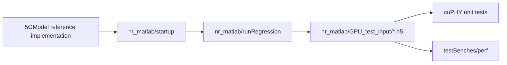
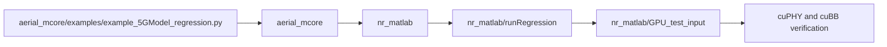

<!-- source: DeepWiki mcp.deepwiki.com · repo NVIDIA/aerial-cuda-accelerated-ran · page 1 Overview · fetched 2026-10-26 -->

# Overview

Relevant source files

The following files were used as context for generating this wiki page:

- [.dockerignore](.dockerignore)
- [5GModel/AGENTS.md](5GModel/AGENTS.md)
- [5GModel/README.md](5GModel/README.md)

## Purpose and Scope

This page introduces the NVIDIA Aerial CUDA Accelerated RAN repository as a 5G NR physical-layer reference, simulation, and testing framework. It summarizes how the MATLAB reference model, its Python interface, generated test vectors, and downstream GPU validation fit together. For subsystem detail, see [System Architecture](#1.1) and [Key Components](#1.2).

**Sources:** [5GModel/AGENTS.md:3-14]()

---

## Repository Purpose

The `5GModel` reference implementation supports waveform compliance checks against MATLAB 5G Toolbox, test-vector generation for cuPHY and cuBB verification, and receiver performance simulations based on 3GPP specifications. Its MATLAB regression workflow is `startup` followed by `runRegression`; generated test vectors are placed in `nr_matlab/GPU_test_input/`. [5GModel/AGENTS.md:5-20]() [5GModel/README.md:3-15]()

The generated `GPU_test_input/*.h5` vectors are consumed by cuPHY unit tests and the `testBenches/perf/` harness. The `aerial_mcore` Python package provides a programmatic route to generate test vectors through an example script. For more detail on subsystem relationships, see [System Architecture](#1.1); for component summaries, see [Key Components](#1.2). [5GModel/AGENTS.md:21-30]()

**Sources:** [5GModel/AGENTS.md:5-30](), [5GModel/README.md:3-15]()

---

## System Architecture

At a high level, `nr_matlab` provides the MATLAB reference workflow, while `aerial_mcore` offers a Python interface for programmatic use. The resulting test vectors connect the reference-model workflow to cuPHY and performance testing. This overview is limited to relationships documented by the repository’s 5GModel overview; see [System Architecture](#1.1) for the dedicated architecture page. [5GModel/AGENTS.md:16-30]()

### Reference Model and Validation Flow

**Sources:** [5GModel/AGENTS.md:5-20](), [5GModel/AGENTS.md:26-30](), [5GModel/README.md:9-15]()

### Python Entry Point and Test-Vector Flow

**Sources:** [5GModel/AGENTS.md:18-24](), [5GModel/AGENTS.md:26-30]()

---

## Core Components

The documented high-level components and their roles are summarized below. For expanded component coverage—including cuPHY/cuMAC, cuPHY-CP, `pyaerial`, and test-vector infrastructure—see [Key Components](#1.2). The source material provided for this page gives specific implementation detail primarily for the 5GModel workflow and its relationship to cuPHY and performance testing. [5GModel/AGENTS.md:16-30]()

| Component | Repository role |
|---|---|
| `5GModel/nr_matlab/` | MATLAB 5G NR reference implementation; its regression workflow generates test vectors. [5GModel/AGENTS.md:18-20]() |
| `5GModel/aerial_mcore/` | Python API package for programmatic test-vector generation. [5GModel/AGENTS.md:21-24]() |
| `GPU_test_input/` | Destination for generated test vectors used in cuPHY and cuBB verification. [5GModel/AGENTS.md:9-10]() [5GModel/AGENTS.md:26-30]() |
| `cuPHY` | Downstream consumer of generated vectors in unit tests. [5GModel/AGENTS.md:26-30]() |
| `testBenches/perf/` | Performance-test harness that consumes generated vectors. [5GModel/AGENTS.md:28-30]() |

**Sources:** [5GModel/AGENTS.md:16-30]()

---

## `aerial_mcore`: Python–MATLAB Interface

`aerial_mcore` is a pip-installable Python package that provides an API for programmatic use of the 5GModel workflow. The documented example for generating test vectors is `aerial_mcore/examples/example_5GModel_regression.py`; package installation and usage details are covered by the child pages. [5GModel/AGENTS.md:21-24]()

The core MATLAB regression entry point is `nr_matlab/runRegression.m`, and its generated vectors are written under `nr_matlab/GPU_test_input/`. For Python API details, see [aerial_mcore Package](#3); for the broader component overview, see [Key Components](#1.2). [5GModel/AGENTS.md:18-24]()

**Sources:** [5GModel/AGENTS.md:18-24]()

---

## Repository Layout and Build Context

The Docker build-context allowlist names top-level areas including `5GModel`, `cuPHY`, `cuPHY-CP`, `cuMAC`, `pyaerial`, `testBenches`, and `testVectors`. This establishes the repository areas included by that configuration, but does not by itself describe their build or runtime dependencies. For build details, see [Build System](#11). [.dockerignore:1-24]()

**Sources:** [.dockerignore:1-24]()

---

## Next Steps

- For subsystem relationships and data flow, see [System Architecture](#1.1).
- For concise descriptions of the major repository components, see [Key Components](#1.2).
- For environment and installation guidance, see [Environment Setup](#2.1) and [Installation](#2.2).
- For regression and test-vector workflows, see [Testing and Validation](#5).

**Sources:** [5GModel/AGENTS.md:5-30]()

---

