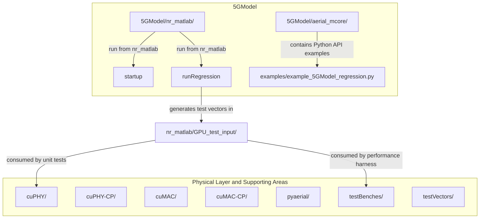
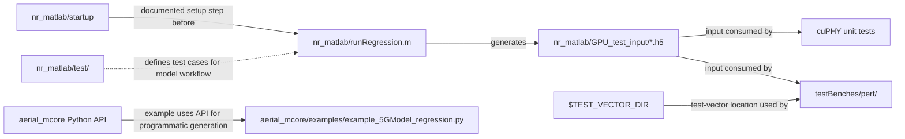

<!-- source: DeepWiki mcp.deepwiki.com · repo NVIDIA/aerial-cuda-accelerated-ran · page 1.1 System Architecture · fetched 2026-10-26 -->

# System Architecture

Relevant source files

The following files were used as context for generating this wiki page:

- [.dockerignore](.dockerignore)
- [5GModel/AGENTS.md](5GModel/AGENTS.md)

## Purpose and Scope

This page describes the high-level architecture of the NVIDIA Aerial CUDA Accelerated RAN repository, focusing on the relationship between the 5GModel reference implementation, `aerial_mcore`, physical-layer and control-plane components, `pyaerial`, and testing infrastructure. The available source details identify 5GModel’s simulation and test-vector roles, and the test vectors’ consumers; repository inclusion rules identify the major subsystem directories. They do not specify implementation-level interfaces or call sequences for every subsystem, so those are not inferred here. [5GModel/AGENTS.md:3-30](), [.dockerignore:8-20]()

Sources: [5GModel/AGENTS.md:3-30](), [.dockerignore:8-20]()

## Architectural Overview

The repository combines an offline MATLAB/Python reference-model workflow with CUDA-oriented subsystem directories and test infrastructure. 5GModel is described as a MATLAB and Python reference implementation used for waveform-compliance validation, test-vector generation, and receiver-performance simulations. Its `nr_matlab/` and `aerial_mcore/` components provide MATLAB and Python entry points, respectively. [5GModel/AGENTS.md:3-24]()

The model-generated HDF5 test vectors under `GPU_test_input/` are consumed by cuPHY unit tests and the `testBenches/perf/` harness, or by the harness using `$TEST_VECTOR_DIR`. The repository’s Docker build-context allowlist includes the 5GModel, cuPHY, cuPHY-CP, cuMAC, cuMAC-CP, pyaerial, testBenches, and testVectors areas. [5GModel/AGENTS.md:26-30](), [.dockerignore:8-20]()

### Repository-to-Code Entity Map

This diagram maps the named system areas to directory and file entities present in the source. The arrows indicate only relationships explicitly described in the available documentation. [5GModel/AGENTS.md:18-30](), [.dockerignore:10-20]()

**Diagram: System Names and Repository Entities**

Sources: [5GModel/AGENTS.md:18-30](), [.dockerignore:10-20]()

### System Boundary and Component Roles

| System area | Established role or relationship |
|---|---|
| `5GModel/nr_matlab/` | MATLAB 5G NR reference implementation. Its documented regression workflow is to run `startup` and then `runRegression` from this directory. [5GModel/AGENTS.md:18-20]() |
| `5GModel/aerial_mcore/` | Python API bindings, distributed as a pip-installable wheel. Its example regression script is `aerial_mcore/examples/example_5GModel_regression.py`. [5GModel/AGENTS.md:21-24]() |
| `GPU_test_input/` | Destination for generated HDF5 test vectors; those vectors are consumed by cuPHY unit tests and the `testBenches/perf/` harness. [5GModel/AGENTS.md:18-20](), [5GModel/AGENTS.md:26-30]() |
| `cuPHY/` | Physical-layer subsystem directory included in the Docker build context; the available documentation specifically identifies its unit tests as test-vector consumers. [.dockerignore:16-20](), [5GModel/AGENTS.md:26-30]() |
| `cuPHY-CP/`, `cuMAC/`, `cuMAC-CP/` | Subsystem directories included in the Docker build context. The available source does not describe their internal interfaces or runtime behavior. [.dockerignore:14-17]() |
| `pyaerial/` | Subsystem directory included in the Docker build context. The available source does not describe its API or implementation. [.dockerignore:18-20]() |
| `testBenches/`, `testVectors/` | Testing-related directories included in the Docker build context. `testBenches/perf/` is identified as a consumer of 5GModel-generated test vectors. [.dockerignore:18-20](), [5GModel/AGENTS.md:26-30]() |

Sources: [5GModel/AGENTS.md:18-30](), [.dockerignore:14-20]()

## 5GModel and `aerial_mcore`

The 5GModel reference implementation is intended primarily for offline testing and analysis. Its documented purposes are validating waveform compliance against the MATLAB 5G Toolbox, generating HDF5 test vectors for cuPHY and cuBB verification, and running receiver-performance simulations based on 3GPP specifications. [5GModel/AGENTS.md:3-14]()

Within `nr_matlab/`, the documented workflow is to run `startup` and then `runRegression`. The regression entry point generates test vectors in `nr_matlab/GPU_test_input/`. The source also identifies `nr_matlab/test/` as the location for test-case definitions and `nr_matlab/gNBreceiver.m` and `nr_matlab/gNBtransmitter.m` as reference receiver and transmitter implementations. [5GModel/AGENTS.md:18-20](), [5GModel/AGENTS.md:32-42]()

`aerial_mcore` provides Python API bindings and a pip-installable wheel under `aerial_mcore/aerial_pkg/dist/`. Its documented example for programmatic test-vector generation is `aerial_mcore/examples/example_5GModel_regression.py`; the package metadata files are `aerial_mcore/aerial_pkg/pyproject.toml` and `setup.py`. [5GModel/AGENTS.md:21-24](), [5GModel/AGENTS.md:32-37]()

The available source establishes that `aerial_mcore` exposes a Python API and supports programmatic test-vector generation, but does not specify the binding implementation, MATLAB engine calls, function signatures, or call sequence between Python and MATLAB. [5GModel/AGENTS.md:21-24]()

Sources: [5GModel/AGENTS.md:3-14](), [5GModel/AGENTS.md:18-24](), [5GModel/AGENTS.md:32-42]()

### Simulation and Test-Vector Flow

This diagram connects the documented workflow names to their repository entities. It shows the specified generation and consumption path; it does not imply unprovided implementation details about internal function calls. [5GModel/AGENTS.md:18-30]()

**Diagram: Reference Model to Validation Inputs**

Sources: [5GModel/AGENTS.md:18-30](), [5GModel/AGENTS.md:32-40]()

## Physical Layer, Control Plane, and Python Subsystems

The repository includes directories named `cuPHY/`, `cuPHY-CP/`, `cuMAC/`, `cuMAC-CP/`, and `pyaerial/`. The available source establishes their presence in the repository and Docker build context, but does not provide their internal component structure, APIs, or runtime interactions. [ .dockerignore:14-20]()

One explicit relationship is that 5GModel-generated HDF5 test vectors are consumed by cuPHY unit tests. The model documentation also says the vectors are generated for cuPHY and cuBB verification. No corresponding detailed data flow for `cuPHY-CP`, `cuMAC`, `cuMAC-CP`, or `pyaerial` is specified in the available files. [5GModel/AGENTS.md:8-10](), [5GModel/AGENTS.md:26-30](), [.dockerignore:14-20]()

Sources: [5GModel/AGENTS.md:8-10](), [5GModel/AGENTS.md:26-30](), [.dockerignore:14-20]()

## Testing Infrastructure and Test-Vector Contract

The model’s generated test vectors are HDF5 files located under `nr_matlab/GPU_test_input/`. The documentation describes these as inputs for cuPHY unit tests and the performance harness under `testBenches/perf/`; it also identifies `$TEST_VECTOR_DIR` as a test-vector location used by the performance harness. Missing or stale test vectors can cause cuPHY tests to skip or fail. [5GModel/AGENTS.md:18-20](), [5GModel/AGENTS.md:26-30]()

`nr_matlab/test/` contains test-case definitions, while `nr_matlab/cfg_template.yaml` is identified as the base configuration template for simulation runs. The available source does not define the HDF5 schema or enumerate individual test-harness executables. [5GModel/AGENTS.md:32-40]()

Sources: [5GModel/AGENTS.md:18-20](), [5GModel/AGENTS.md:26-40]()

## Build and Repository Packaging Boundary

The `.dockerignore` file starts by excluding all paths, then selectively allows repository files and directories. Among the allowed entries are `5GModel`, `cuPHY`, `cuPHY-CP`, `cuMAC`, `cuMAC-CP`, `pyaerial`, `testBenches`, and `testVectors`, as well as `CMakeLists.txt` and `CMakePresets.json`. This documents which named subsystem areas can enter the Docker build context, not how those components are built. [.dockerignore:1-24]()

The 5GModel documentation identifies the `aerial_mcore` package metadata files and wheel distribution directory, but the available source does not provide build commands or describe CMake targets. [5GModel/AGENTS.md:21-24](), [5GModel/AGENTS.md:32-37]()

Sources: [.dockerignore:1-24](), [5GModel/AGENTS.md:21-24](), [5GModel/AGENTS.md:32-37]()

---

