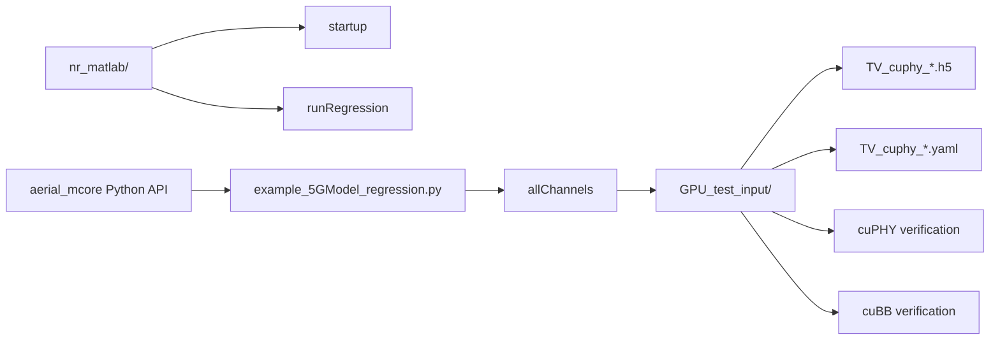
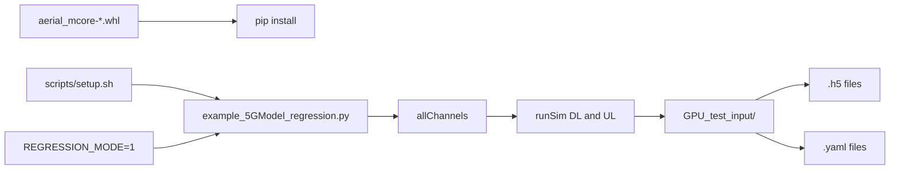
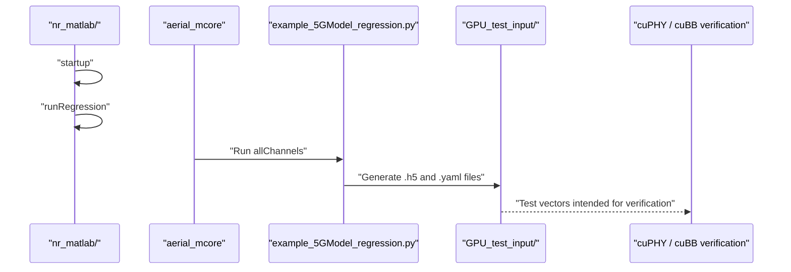

<!-- source: DeepWiki mcp.deepwiki.com · repo NVIDIA/aerial-cuda-accelerated-ran · page 1.2 Key Components · fetched 2026-10-26 -->

# Key Components

Relevant source files

The following files were used as context for generating this wiki page:

- [5GModel/README.md](5GModel/README.md)
- [5GModel/aerial_mcore/QuickStart.md](5GModel/aerial_mcore/QuickStart.md)

## Purpose and Scope

This page summarizes the components and data flow that can be documented from the supplied repository files. Those files describe `5GModel`, its `nr_matlab` regression entry points, the `aerial_mcore` Python interface, and the generation of test-vector files for `cuPHY` and `cuBB`. They do not provide implementation details for `cuMAC`, `cuPHY-CP`, `pyaerial`, or the internal structure of `nr_matlab`; those details are therefore not inferred here. [5GModel/README.md:1-15](), [5GModel/aerial_mcore/QuickStart.md:1-3]()

Sources: [5GModel/README.md:1-15](), [5GModel/aerial_mcore/QuickStart.md:1-3]()

---

## Component Architecture Overview

The supplied files show two ways to access the 5GModel regression and test-vector workflow: MATLAB entry points in `nr_matlab` (`startup`, `runRegression`) and a Python-facing route through `aerial_mcore`. The Python quick start runs `example_5GModel_regression.py allChannels` and lists generated files in `GPU_test_input/`. The 5GModel README identifies waveform compliance, test-vector generation for `cuPHY` and `cuBB` verification, and receiver performance simulation as regression purposes. [5GModel/README.md:3-15](), [5GModel/aerial_mcore/QuickStart.md:1-22]()

**Diagram: Documented component names mapped to workflow entities**

Sources: [5GModel/README.md:3-15](), [5GModel/aerial_mcore/QuickStart.md:1-22](), [5GModel/aerial_mcore/QuickStart.md:55-68]()

Sources: [5GModel/README.md:3-15](), [5GModel/aerial_mcore/QuickStart.md:1-22]()

---

## 5GModel and aerial_mcore

### 5GModel and `nr_matlab` Simulation Core

The 5GModel README lists three purposes for regression: waveform compliance testing against MATLAB 5GToolBox, test-vector generation for `cuPHY` and `cuBB` verification, and receiver performance simulation based on the 3GPP specification. It documents running `startup` followed by `runRegression` from the `nr_matlab` directory. The supplied file does not describe the internal MATLAB functions or signal-processing implementation. [5GModel/README.md:3-13]()

The README names `GPU_test_input` under the `nr_matlab` directory as the location of generated test vectors. [5GModel/README.md:10-15]()

Sources: [5GModel/README.md:3-15]()

### `aerial_mcore` Python Package

The quick start describes `aerial_mcore` as Python API bindings to the Aerial 5GModel and demonstrates using the bindings to generate Aerial test-vector `.h5` files. It installs a wheel from `5GModel/aerial_mcore/aerial_pkg/dist/`, then runs the example script from `5GModel/aerial_mcore/examples`. [5GModel/aerial_mcore/QuickStart.md:1-20]()

The example command `python3 ./example_5GModel_regression.py allChannels` is preceded by sourcing `../scripts/setup.sh` and setting `REGRESSION_MODE=1`. The quick start’s sample output reports downlink and uplink `runSim` tests, channel allocations, and successful detections for PUSCH, PRACH, and PUCCH UCI. These are example output details, not a specification of the package’s full API. [5GModel/aerial_mcore/QuickStart.md:15-22](), [5GModel/aerial_mcore/QuickStart.md:31-51]()

**Diagram: Python example path from code entities to generated test vectors**

Sources: [5GModel/aerial_mcore/QuickStart.md:9-22](), [5GModel/aerial_mcore/QuickStart.md:31-68]()

Sources: [5GModel/aerial_mcore/QuickStart.md:1-22]()

---

## Physical Layer Components (`cuPHY` and `cuMAC`)

The 5GModel README identifies `cuPHY` and `cuBB` as verification targets for generated test vectors. The supplied files do not describe `cuPHY` library internals, `cuMAC`, or interactions between those systems, so no implementation or orchestration details are asserted here. [5GModel/README.md:5-7]()

Sources: [5GModel/README.md:5-7]()

---

## cuPHY-CP Control Plane

The supplied files do not document `cuPHY-CP`, its control-plane responsibilities, or its interfaces. The available evidence only identifies `cuPHY` as a test-vector verification target. [5GModel/README.md:5-7]()

Sources: [5GModel/README.md:5-7]()

---

## Machine Learning Bindings (`pyaerial`)

The supplied files do not document `pyaerial`, its bindings, or ML models. The Python interface described in the available quick start is `aerial_mcore`, which is presented as bindings to the Aerial 5GModel. [5GModel/aerial_mcore/QuickStart.md:1-3]()

Sources: [5GModel/aerial_mcore/QuickStart.md:1-3]()

---

## Test Vector System

### Generation and Output

The 5GModel README says regression generates test vectors for `cuPHY` and `cuBB` verification and places them in `nr_matlab/GPU_test_input`. [5GModel/README.md:5-15]()

The Python quick start lists generated `.h5` and `.yaml` files under `GPU_test_input/`. Its examples include files named `TV_cuphy_...h5` and paired `TV_cuphy_...yaml` files, as well as templates with names such as `template_UL_PUSCH_gNB_CUPHY_s0p0.h5` and `template_UL_gNB_FAPI_s0.h5`. The supplied files do not specify the full schema or field-level contents of these formats. [5GModel/aerial_mcore/QuickStart.md:55-68]()

| Observed filename pattern | What the supplied files establish |
|---|---|
| `TV_cuphy_*.h5` | An example of a generated test-vector file listed in `GPU_test_input/`. [5GModel/aerial_mcore/QuickStart.md:55-63]() |
| `TV_cuphy_*.yaml` | An example YAML file listed alongside a `TV_cuphy_*.h5` file. [5GModel/aerial_mcore/QuickStart.md:59-63]() |
| `template_UL_PUSCH_*.h5` | An example uplink PUSCH template file listed in the output directory. [5GModel/aerial_mcore/QuickStart.md:64-66]() |
| `template_UL_gNB_FAPI_*.h5` | An example uplink gNB FAPI template file listed in the output directory. [5GModel/aerial_mcore/QuickStart.md:67-68]() |

Sources: [5GModel/README.md:5-15](), [5GModel/aerial_mcore/QuickStart.md:55-68]()

### Validation Workflow

The documented workflow is to run regression from MATLAB or invoke the Python example, then inspect the generated files. The README associates regression with waveform compliance, test-vector generation, and receiver performance simulation; the quick start demonstrates the Python route and output directory. The supplied material does not describe the specific test-vector loading or comparison code used by `cuPHY` or `cuBB`. [5GModel/README.md:3-15](), [5GModel/aerial_mcore/QuickStart.md:15-22]()

**Diagram: Regression entry points and documented output**

Sources: [5GModel/README.md:3-15](), [5GModel/aerial_mcore/QuickStart.md:15-22](), [5GModel/aerial_mcore/QuickStart.md:55-68]()

Sources: [5GModel/README.md:3-15](), [5GModel/aerial_mcore/QuickStart.md:15-22]()

---

## Build and Deployment Tools

The quick start demonstrates installing `aerial_mcore` from a wheel matching `aerial_mcore-*.whl` in the package’s `dist/` directory. It also instructs users to source `../scripts/setup.sh` before running the example and set `REGRESSION_MODE=1`. These instructions establish the documented quick-start setup, not a complete build or deployment process. [5GModel/aerial_mcore/QuickStart.md:9-20]()

Sources: [5GModel/aerial_mcore/QuickStart.md:9-20]()

---

