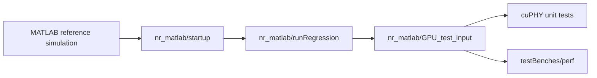
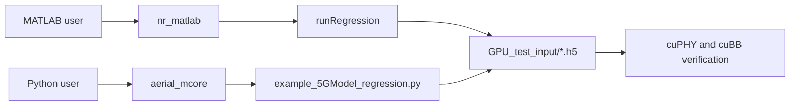

<!-- source: DeepWiki mcp.deepwiki.com · repo NVIDIA/aerial-cuda-accelerated-ran · page 10 5GModel MATLAB Simulation Core · fetched 2026-10-26 -->

# 5GModel MATLAB Simulation Core

Relevant source files

The following files were used as context for generating this wiki page:

- [5GModel/AGENTS.md](5GModel/AGENTS.md)
- [5GModel/CLAUDE.md](5GModel/CLAUDE.md)
- [5GModel/README.md](5GModel/README.md)

## Purpose and Scope

5GModel is an offline MATLAB and Python reference implementation of the 5G NR physical layer. It supports waveform-compliance validation against the MATLAB 5G Toolbox, generation of test vectors for cuPHY and cuBB verification, and receiver-performance simulations based on 3GPP specifications. This page summarizes the model’s role and connections; detailed implementation topics are covered by the child pages below. [5GModel/AGENTS.md:3-14]()

Sources: [5GModel/AGENTS.md:3-14]()

## System Overview

The MATLAB reference implementation is in `nr_matlab/`. It can be run directly from MATLAB, or used programmatically through the `aerial_mcore` Python bindings. Regression-generated test vectors are written under `nr_matlab/GPU_test_input/` and are consumed by cuPHY unit tests and the testBenches performance harness. [5GModel/AGENTS.md:18-30]()

**From Simulation Workflow to Code Entities**

Sources: [5GModel/AGENTS.md:18-30](), [5GModel/README.md:9-15]()

The direct MATLAB workflow is to change to `nr_matlab/`, run `startup`, and then run `runRegression`. The Python route uses `aerial_mcore` to generate test vectors programmatically; its example and installation flow are documented in the package’s `QuickStart.md`. [5GModel/README.md:9-15](), [5GModel/AGENTS.md:21-24]()

**From Model Interfaces to Code Entities**

Sources: [5GModel/AGENTS.md:18-30]()

For details, see [nr_matlab Structure and Configuration](#10.1), [Channel Models and Signal Processing](#10.2), and [Physical Channel Implementations](#10.3).

## nr_matlab Structure and Configuration

`nr_matlab/` contains the MATLAB reference implementation and its regression entry point. The documented execution flow starts with `startup` and invokes `runRegression` to generate test vectors and verify waveform compliance. [5GModel/AGENTS.md:18-20](), [5GModel/README.md:9-15]()

For details on directory layout, startup, regression, YAML templates, and configuration functions, see [nr_matlab Structure and Configuration](#10.1).

Sources: [5GModel/AGENTS.md:18-20](), [5GModel/README.md:9-15]()

## Channel Models and Signal Processing

The reference model supports receiver-performance simulations based on 3GPP specifications. Specific channel models, signal-processing components, and related utilities are covered by the child page. [5GModel/AGENTS.md:9-14]()

For details, see [Channel Models and Signal Processing](#10.2).

Sources: [5GModel/AGENTS.md:9-14]()

## Physical Channel Implementations

The MATLAB physical-layer reference provides expected behavior for validation workflows. Its generated test vectors support cuPHY and cuBB verification; cuPHY unit tests and the testBenches performance harness consume vectors from `nr_matlab/GPU_test_input/`. [5GModel/AGENTS.md:8-11](), [5GModel/AGENTS.md:26-30]()

For details on the implemented physical channels and related directories, see [Physical Channel Implementations](#10.3).

Sources: [5GModel/AGENTS.md:8-11](), [5GModel/AGENTS.md:26-30]()

## Test Vectors and Validation

Regression runs generate H5 test vectors in `nr_matlab/GPU_test_input/`. These vectors are used for cuPHY and cuBB verification and by cuPHY unit tests and the testBenches performance harness. Stale or missing vectors can cause cuPHY tests to skip or fail. [5GModel/AGENTS.md:8-11](), [5GModel/AGENTS.md:26-30](), [5GModel/README.md:15-15]()

Sources: [5GModel/AGENTS.md:8-11](), [5GModel/AGENTS.md:26-30](), [5GModel/README.md:15-15]()

---

