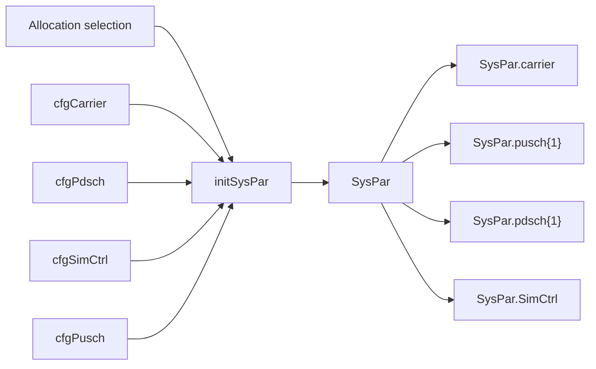
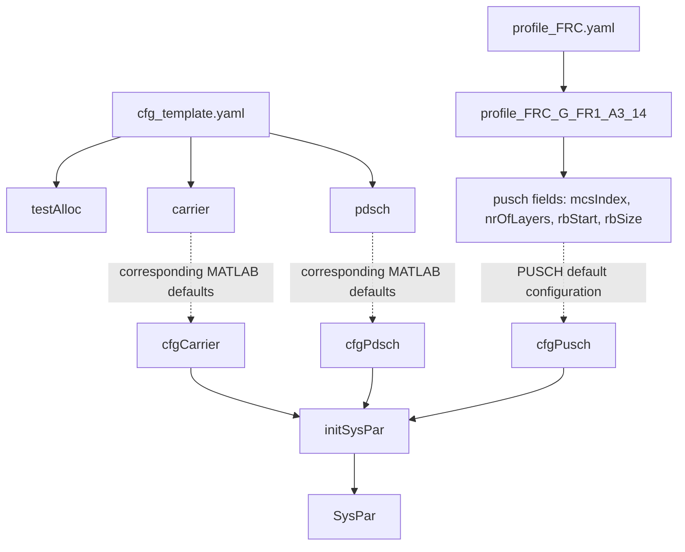
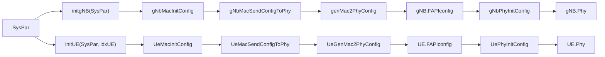

<!-- source: DeepWiki mcp.deepwiki.com · repo NVIDIA/aerial-cuda-accelerated-ran · page 10.1 nr_matlab Structure and Configuration · fetched 2026-10-26 -->

# nr_matlab Structure and Configuration

Relevant source files

The following files were used as context for generating this wiki page:

- [5GModel/nr_matlab/cfg/profiles/profile_FRC.yaml](5GModel/nr_matlab/cfg/profiles/profile_FRC.yaml)
- [5GModel/nr_matlab/cfg_template.yaml](5GModel/nr_matlab/cfg_template.yaml)
- [5GModel/nr_matlab/config/cfgCarrier.m](5GModel/nr_matlab/config/cfgCarrier.m)
- [5GModel/nr_matlab/config/cfgPdsch.m](5GModel/nr_matlab/config/cfgPdsch.m)
- [5GModel/nr_matlab/config/cfgPusch.m](5GModel/nr_matlab/config/cfgPusch.m)
- [5GModel/nr_matlab/config/cfgSimCtrl.m](5GModel/nr_matlab/config/cfgSimCtrl.m)
- [5GModel/nr_matlab/config/initSysPar.m](5GModel/nr_matlab/config/initSysPar.m)
- [5GModel/nr_matlab/config/initUE.m](5GModel/nr_matlab/config/initUE.m)
- [5GModel/nr_matlab/config/initgNB.m](5GModel/nr_matlab/config/initgNB.m)

## Purpose and scope

This page documents the configuration layer of `5GModel/nr_matlab`: the MATLAB functions that build the `SysPar` simulation configuration, initialize gNB and UE state, and the YAML template and FRC profile files. The available source excerpts do not include `startup.m` or `runRegression.m`, so their behavior is not described here. [5GModel/nr_matlab/config/initSysPar.m:16-27]()

Sources: [5GModel/nr_matlab/config/initSysPar.m:16-27]()

## Configuration directory and entrypoint context

The referenced files show two configuration locations: MATLAB configuration functions under `config/`, and YAML inputs at the `nr_matlab` root and under `cfg/profiles/`. `initSysPar` is the MATLAB configuration assembly function in the supplied sources; it creates `SysPar` by combining defaults from channel-specific and simulation-control configuration functions. [5GModel/nr_matlab/config/initSysPar.m:16-27]()

| Location | Role shown by the supplied files |
|---|---|
| `config/` | MATLAB functions including `initSysPar`, `cfgCarrier`, `cfgPusch`, `cfgPdsch`, `cfgSimCtrl`, `initUE`, and `initgNB`. [5GModel/nr_matlab/config/initSysPar.m:16-16]() [5GModel/nr_matlab/config/cfgCarrier.m:16-16]() [5GModel/nr_matlab/config/cfgPusch.m:16-16]() [5GModel/nr_matlab/config/cfgPdsch.m:16-16]() [5GModel/nr_matlab/config/cfgSimCtrl.m:16-16]() [5GModel/nr_matlab/config/initUE.m:16-16]() [5GModel/nr_matlab/config/initgNB.m:16-16]() |
| `cfg_template.yaml` | Root-level YAML configuration containing `testAlloc`, `carrier`, and channel sections such as `ssb`, `pdcch`, and `pdsch`. [5GModel/nr_matlab/cfg_template.yaml:16-18]() [5GModel/nr_matlab/cfg_template.yaml:40-40]() [5GModel/nr_matlab/cfg_template.yaml:64-64]() [5GModel/nr_matlab/cfg_template.yaml:99-100]() |
| `cfg/profiles/profile_FRC.yaml` | YAML definitions of FRC PUSCH profiles, including MCS, layer count, DMRS positions, and resource allocation fields. [5GModel/nr_matlab/cfg/profiles/profile_FRC.yaml:16-30]() |

Sources: [5GModel/nr_matlab/config/initSysPar.m:16-27](), [5GModel/nr_matlab/config/cfgCarrier.m:16-16](), [5GModel/nr_matlab/config/cfgPusch.m:16-16](), [5GModel/nr_matlab/config/cfgPdsch.m:16-16](), [5GModel/nr_matlab/config/cfgSimCtrl.m:16-16](), [5GModel/nr_matlab/config/initUE.m:16-16](), [5GModel/nr_matlab/config/initgNB.m:16-16](), [5GModel/nr_matlab/cfg_template.yaml:16-18](), [5GModel/nr_matlab/cfg/profiles/profile_FRC.yaml:16-30]()

## Configuration assembly: `initSysPar`

`initSysPar(varargin)` returns the central `SysPar` structure. Its function comment describes `SysPar` as containing simulation control, network configuration, allocation settings, and channel configuration. With no input argument, it creates a default `testAlloc` enabling downlink, SSB, PDCCH, PDSCH, and CSI-RS while disabling uplink, PRACH, PUCCH, PUSCH, SRS, and beamforming weights. With an allocation argument, it copies each recognized allocation field and defaults any missing field to zero. [5GModel/nr_matlab/config/initSysPar.m:16-27]() [5GModel/nr_matlab/config/initSysPar.m:30-101]()

After setting `SysPar.testAlloc`, the function assembles carrier, SSB, PDCCH, PDSCH, CSI-RS, PRACH, PUCCH, SRS, beamforming-weight, channel, interference-channel, simulation-control, RF-impairment, and PUSCH configuration. The channel and allocation configurations are stored in cell arrays where shown; `carrier` and `SimCtrl` are stored as structures. [5GModel/nr_matlab/config/initSysPar.m:101-145]()

| `SysPar` field | Configuration provider | Notes |
|---|---|---|
| `testAlloc` | Input/default logic in `initSysPar` | Selects enabled allocation categories. [5GModel/nr_matlab/config/initSysPar.m:30-101]() |
| `carrier` | `cfgCarrier()` | Radio carrier, antenna, and TDD defaults. [5GModel/nr_matlab/config/initSysPar.m:103-104]() |
| `ssb`, `pdcch`, `pdsch`, `csirs`, `prach`, `pucch`, `srs`, `bfw` | Corresponding `cfg*` functions | Each is initialized in `initSysPar`; the provider calls are visible at their listed lines. [5GModel/nr_matlab/config/initSysPar.m:106-128]() |
| `Chan`, `Interf_Chan` | `cfgChan()` and `cfgInterferenceChan()` | Channel and interference-channel entries are initialized as first elements of cell arrays. [5GModel/nr_matlab/config/initSysPar.m:130-133]() |
| `SimCtrl` | `cfgSimCtrl()` | Simulation control structure. [5GModel/nr_matlab/config/initSysPar.m:138-139]() |
| `RF` | `cfgRF()` | RF-impairment configuration. [5GModel/nr_matlab/config/initSysPar.m:141-142]() |
| `pusch` | `cfgPusch(SysPar.SimCtrl)` | PUSCH defaults receive simulation-control parameters. [5GModel/nr_matlab/config/initSysPar.m:144-145]() |

### Diagram: Configuration inputs mapped to code entities

Sources: [5GModel/nr_matlab/config/initSysPar.m:30-45](), [5GModel/nr_matlab/config/initSysPar.m:101-145](), [5GModel/nr_matlab/config/cfgCarrier.m:16-39](), [5GModel/nr_matlab/config/cfgPusch.m:16-16](), [5GModel/nr_matlab/config/cfgPdsch.m:16-16](), [5GModel/nr_matlab/config/cfgSimCtrl.m:16-16]()

## YAML configuration templates

### `cfg_template.yaml`

`cfg_template.yaml` organizes the visible configuration under top-level keys including `testAlloc`, `carrier`, `ssb`, `pdcch`, `pdsch`, `csirs`, `prach`, `pucch`, and `srs`. `testAlloc` enables DL, SSB, PDCCH, PDSCH, and CSI-RS in the shown template, with UL, PRACH, PUCCH, PUSCH, SRS, and BFW disabled. [5GModel/nr_matlab/cfg_template.yaml:16-18]()

The `carrier` section includes carrier frequency, duplex mode, cyclic-prefix type, numerology `mu`, grid start and size, cell ID, gNB/UE antenna counts, fronthaul port counts, and TDD parameters. The shown TDD `SlotConfig` is an explicit sequence of slot-symbol values. [5GModel/nr_matlab/cfg_template.yaml:18-39]()

The visible channel sections hold channel-specific parameters. For example, `pdsch` includes bandwidth-part parameters, MCS, layer and port configuration, DMRS settings, resource allocation, RB and symbol placement, beamforming-related fields, and payload-related fields. [5GModel/nr_matlab/cfg_template.yaml:99-148]()

### `profile_FRC.yaml`

`profile_FRC.yaml` identifies its entries as FRC configurations defined in TS 38.141 and labels the shown group as 100 MHz, 30 kHz SCS. Each profile has a PUSCH list with fields such as `mcsIndex`, `mcsTable`, `nrOfLayers`, `DmrsSymbPos`, `rbStart`, `rbSize`, `StartSymbolIndex`, and `NrOfSymbols`. [5GModel/nr_matlab/cfg/profiles/profile_FRC.yaml:16-30]()

The visible names include `profile_FRC_G_FR1_A3_14`, `profile_FRC_G_FR1_A4_14`, and `profile_FRC_G_FR1_A5_14` for one layer, plus `profile_FRC_G_FR1_A3_28` and `profile_FRC_G_FR1_A4_28` for two layers. The shown profiles vary the MCS and layer count while specifying the resource allocation and DMRS symbol positions. [5GModel/nr_matlab/cfg/profiles/profile_FRC.yaml:19-30]() [5GModel/nr_matlab/cfg/profiles/profile_FRC.yaml:32-56]() [5GModel/nr_matlab/cfg/profiles/profile_FRC.yaml:58-82]()

### Diagram: YAML names and MATLAB configuration entities

Sources: [5GModel/nr_matlab/cfg_template.yaml:16-39](), [5GModel/nr_matlab/cfg_template.yaml:99-148](), [5GModel/nr_matlab/cfg/profiles/profile_FRC.yaml:16-30](), [5GModel/nr_matlab/config/cfgCarrier.m:16-39](), [5GModel/nr_matlab/config/cfgPdsch.m:16-50](), [5GModel/nr_matlab/config/cfgPusch.m:16-54](), [5GModel/nr_matlab/config/initSysPar.m:103-145]()

Sources: [5GModel/nr_matlab/cfg_template.yaml:16-39](), [5GModel/nr_matlab/cfg_template.yaml:99-148](), [5GModel/nr_matlab/cfg/profiles/profile_FRC.yaml:16-30](), [5GModel/nr_matlab/cfg/profiles/profile_FRC.yaml:32-82]()

## Core `config/` functions

### `cfgCarrier`

`cfgCarrier` returns a MATLAB structure with carrier defaults: a 3.5 GHz carrier frequency, TDD duplexing, normal cyclic prefix, numerology `mu = 1`, a 273-PRB grid, cell ID 41, and four antennas at both gNB and UE. It also sets gNB SRS antenna and DL/UL fronthaul-port counts, the 7.5 kHz frequency shift, starting SFN, and DMRS type-A position. [5GModel/nr_matlab/config/cfgCarrier.m:16-32]()

For TDD, it defines all-DL and all-UL symbol vectors plus a special-slot vector, then concatenates them into `carrier.SlotConfig`; the period is set to 2.5 ms. [5GModel/nr_matlab/config/cfgCarrier.m:34-39]()

Sources: [5GModel/nr_matlab/config/cfgCarrier.m:16-39]()

### `cfgPusch`

`cfgPusch(SimCtrl)` returns PUSCH parameters. Its defaults include BWP size and start, RNTI, MCS index/table, redundancy version, new-data indicator, HARQ process ID, scrambling identifiers, layer and port configuration, DMRS settings, resource allocation, RB allocation, frequency-hopping controls, and symbol allocation. The default RB allocation is `rbStart = 120`, `rbSize = 100`; the shown symbol allocation begins at symbol zero and spans eight symbols. [5GModel/nr_matlab/config/cfgPusch.m:16-54]()

The function also initializes LBRM fields and beamforming fields, plus UCI-on-PUSCH parameters such as HARQ-ACK and CSI payload/bit-length values. For CSI Part 2 sizing, it reads `MAX_NUM_CSI1_PRM` and `MAX_NUM_CSI2_REPORTS` from `SimCtrl` and uses them to size the associated arrays. [5GModel/nr_matlab/config/cfgPusch.m:56-89]() [5GModel/nr_matlab/config/cfgPusch.m:91-105]()

Sources: [5GModel/nr_matlab/config/cfgPusch.m:16-105]()

### `cfgPdsch`

`cfgPdsch` supplies PDSCH defaults, including BWP dimensions, RNTI, codeword count, MCS parameters, redundancy version, data scrambling ID, number of layers and port indices, DMRS configuration, and resource allocation. The default RB bitmap is represented as 36 byte-like entries, and the default allocation is `rbStart = 120`, `rbSize = 100`, beginning at symbol 2 for 10 symbols. [5GModel/nr_matlab/config/cfgPdsch.m:16-50]()

It additionally sets beamforming and power-control fields, transport-block CRC flags, test-model controls, LBRM parameters, and empty remapping and payload fields. [5GModel/nr_matlab/config/cfgPdsch.m:51-70]()

Sources: [5GModel/nr_matlab/config/cfgPdsch.m:16-70]()

### `cfgSimCtrl`

`cfgSimCtrl` creates the simulation controller structure. The visible fields include release number, UE/frame/slot run counts, time-domain and cell-search toggles, PRACH false-alarm testing, HARQ controls, PUCCH payload mode, plotting and diagnostic toggles, SRS channel-estimation buffer size, and codebook/dynamic beamforming flags. [5GModel/nr_matlab/config/cfgSimCtrl.m:16-53]()

It also defines test-vector generation controls under `SimCtrl.genTV`, ORAN compression and fixed-point settings, cuPHY BFP/fixed-point controls, and algorithm-selection parameters for measurement, equalization, LDPC decoding, channel estimation, and related receiver behavior. [5GModel/nr_matlab/config/cfgSimCtrl.m:55-125]()

Sources: [5GModel/nr_matlab/config/cfgSimCtrl.m:16-53](), [5GModel/nr_matlab/config/cfgSimCtrl.m:55-125]()

## gNB and UE initialization

### `initgNB`

`initgNB(SysPar)` builds the gNB-side `Mac`, `FAPIconfig`, and `Phy` structures. Its top-level flow calls `gNbMacInitConfig`, converts the MAC configuration through `gNbMacSendConfigToPhy`, then creates the PHY configuration with `gNbPhyInitConfig`. It also attaches `SysPar.Chan_DL` and `SysPar.Chan_UL` to the resulting PHY structure. [5GModel/nr_matlab/config/initgNB.m:16-38]()

`gNbMacInitConfig` copies carrier and channel configuration from `SysPar`, loads tables, resolves PRACH time-frequency locations using `findPreambleTfLoc`, takes transmit and receive allocations from `SysPar.SimCtrl.gNB`, and initializes carrier frame/slot counters. It calculates SSB symbol locations with `findSsbSymIdx`, sets `L_max`, and initializes the SSB block index. [5GModel/nr_matlab/config/initgNB.m:41-85]()

`gNbMacSendConfigToPhy` creates FAPI-oriented configuration groups by calling `genMac2PhyConfig` for carrier, cell, TDD, SSB, PDCCH, PDSCH, CSI-RS, PRACH, PUCCH, PUSCH, and SRS. The visible `genMac2PhyConfig` cases map carrier fields such as bandwidth, frequency, grid size, antenna counts, and fronthaul ports; map cell identity and duplex information; and validate/map TDD period and slot configuration. [5GModel/nr_matlab/config/initgNB.m:88-145]()

### `initUE`

`initUE(SysPar, idxUE)` builds a UE-specific `Mac`, `FAPIconfig`, and `Phy` structure. Its top-level flow calls `UeMacInitConfig`, `UeMacSendConfigToPhy`, and `UePhyInitConfig`, then stores the UE index and these structures in the returned `UE`. [5GModel/nr_matlab/config/initUE.m:16-37]()

`UeMacInitConfig` copies the carrier and loads tables, then reads the selected UE’s transmit allocation. It dispatches allocation entries by type to PRACH, PUCCH, PUSCH, or SRS settings; PRACH locations are resolved with `findPreambleTfLoc`, while PUSCH entries receive a gNB PUSCH index and HARQ state structure. It separately reads receive allocations and collects SSB, PDCCH, PDSCH, and CSI-RS configuration. The function initializes frame/slot counters and derives SSB symbol locations. [5GModel/nr_matlab/config/initUE.m:39-91]() [5GModel/nr_matlab/config/initUE.m:93-153]()

`UeMacSendConfigToPhy` calls `UeGenMac2PhyConfig` for carrier, cell, TDD, SSB, PDCCH, PDSCH, CSI-RS, PRACH, PUCCH, PUSCH, and SRS configuration groups. The visible carrier conversion maps carrier values into fields including bandwidth, frequency, grid size, UE transmit/receive antenna counts, frequency shift, numerology, and DMRS type-A position. [5GModel/nr_matlab/config/initUE.m:156-174]() [5GModel/nr_matlab/config/initUE.m:177-211]()

### Diagram: `SysPar` to gNB/UE FAPI and PHY configuration

Sources: [5GModel/nr_matlab/config/initgNB.m:16-38](), [5GModel/nr_matlab/config/initgNB.m:41-56](), [5GModel/nr_matlab/config/initgNB.m:88-145](), [5GModel/nr_matlab/config/initUE.m:16-37](), [5GModel/nr_matlab/config/initUE.m:39-91](), [5GModel/nr_matlab/config/initUE.m:156-211]()

Sources: [5GModel/nr_matlab/config/initgNB.m:16-38](), [5GModel/nr_matlab/config/initgNB.m:41-85](), [5GModel/nr_matlab/config/initgNB.m:88-145](), [5GModel/nr_matlab/config/initUE.m:16-37](), [5GModel/nr_matlab/config/initUE.m:39-153](), [5GModel/nr_matlab/config/initUE.m:156-211]()

---

