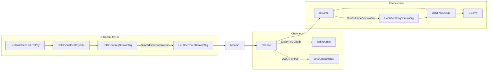
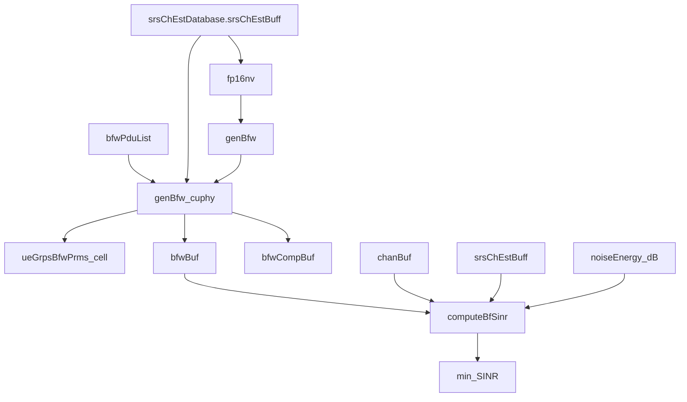
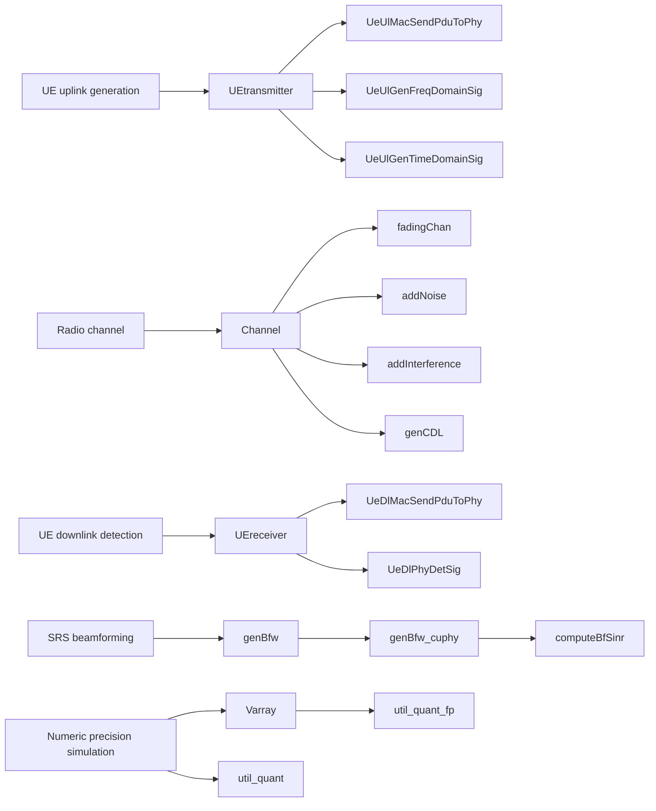

<!-- source: DeepWiki mcp.deepwiki.com · repo NVIDIA/aerial-cuda-accelerated-ran · page 10.2 Channel Models and Signal Processing · fetched 2026-10-26 -->

# Channel Models and Signal Processing

Relevant source files

The following files were used as context for generating this wiki page:

- [5GModel/nr_matlab/UEreceiver.m](5GModel/nr_matlab/UEreceiver.m)
- [5GModel/nr_matlab/UEtransmitter.m](5GModel/nr_matlab/UEtransmitter.m)
- [5GModel/nr_matlab/Varray/Varray.m](5GModel/nr_matlab/Varray/Varray.m)
- [5GModel/nr_matlab/Varray/util_quant.m](5GModel/nr_matlab/Varray/util_quant.m)
- [5GModel/nr_matlab/Varray/util_quant_fp.m](5GModel/nr_matlab/Varray/util_quant_fp.m)
- [5GModel/nr_matlab/bfw/computeBfSinr.m](5GModel/nr_matlab/bfw/computeBfSinr.m)
- [5GModel/nr_matlab/bfw/genBfw.m](5GModel/nr_matlab/bfw/genBfw.m)
- [5GModel/nr_matlab/channel/Channel.m](5GModel/nr_matlab/channel/Channel.m)
- [5GModel/nr_matlab/channel/addInterference.m](5GModel/nr_matlab/channel/addInterference.m)
- [5GModel/nr_matlab/channel/addNoise.m](5GModel/nr_matlab/channel/addNoise.m)
- [5GModel/nr_matlab/channel/fadingChan.m](5GModel/nr_matlab/channel/fadingChan.m)
- [5GModel/nr_matlab/channel/genCDL.m](5GModel/nr_matlab/channel/genCDL.m)
- [5GModel/nr_matlab/channel/genSlsChan.m](5GModel/nr_matlab/channel/genSlsChan.m)
- [5GModel/nr_matlab/channel/genTDL.m](5GModel/nr_matlab/channel/genTDL.m)

## Purpose and scope

This page describes channel simulation, noise and interference injection, UE transmit/receive orchestration, beamforming-weight generation and SINR evaluation, and the `Varray` numeric-quantization utilities in `5GModel/nr_matlab`. The available implementation details cover the shown portions of these files; channel cases or helper functions beyond those excerpts are not inferred here. [5GModel/nr_matlab/channel/Channel.m:16-121]()

Sources: [5GModel/nr_matlab/channel/Channel.m:16-121]()

## 1. System Architecture and Data Flow

The code connects UE MAC allocation handling to PHY signal generation and detection, with `Channel` providing channel processing for sample arrays. The UE entry points receive and return a UE structure containing `Mac`, `Phy`, and `FAPIpdu` state. [5GModel/nr_matlab/UEtransmitter.m:16-47](), [5GModel/nr_matlab/UEreceiver.m:16-52](), [5GModel/nr_matlab/channel/Channel.m:16-33]()

### 1.1. UE Transceiver Logic

`UEtransmitter` obtains the UE’s `Mac` and `Phy`, creates uplink PDUs, generates frequency-domain signal data, and optionally generates time-domain signal data when `SimCtrl.timeDomainSim` is enabled. It then writes the updated MAC, PDU, and PHY state back into `UE`. [5GModel/nr_matlab/UEtransmitter.m:16-47]()

`UeUlMacSendPduToPhy` processes the current uplink allocation list and supports `prach`, `pucch`, `pusch`, and `srs` allocation types. It builds corresponding PDUs through `UeUlGenMac2PhyPdu`; PRACH and SRS are gated by timing/configuration conditions, while the final PUSCH allocation is marked with `lastPuschPdu`. It updates the carrier time index unless UL/DL co-simulation is enabled. [5GModel/nr_matlab/UEtransmitter.m:50-157]()

`UEreceiver` obtains a downlink PDU from `UeDlMacSendPduToPhy`. When time-domain simulation is enabled, it can run `cellSearch` and calls `UeDlGenFreqDomainSig`; it then calls `UeDlPhyDetSig` with both `rxSamp` and `rxSamp_noNoise`. [5GModel/nr_matlab/UEreceiver.m:16-52]()

The shown downlink allocation builder handles `ssb`, `pdcch`, `pdsch`, and `csirs` allocations. It creates PDUs through `UeDlGenMac2PhyPdu`, assigns per-type PDU indices, marks the last PDU for applicable allocation types, and updates the carrier time index. [5GModel/nr_matlab/UEreceiver.m:55-170]()

Sources: [5GModel/nr_matlab/UEtransmitter.m:16-157](), [5GModel/nr_matlab/UEreceiver.m:16-170]()

### 1.2. Signal Processing Flow Diagram

Title: UE And Channel Code-Entity Flow

The diagram identifies the orchestration functions and data names used by the transmitter, channel, and receiver. The transmitter’s time-domain generation is conditional; the receiver’s frequency-domain conversion is also conditional, while `UeDlPhyDetSig` is called with the received samples and the no-noise sample input. [5GModel/nr_matlab/UEtransmitter.m:31-45](), [5GModel/nr_matlab/UEreceiver.m:33-50](), [5GModel/nr_matlab/channel/Channel.m:16-37](), [5GModel/nr_matlab/channel/Channel.m:88-98]()

Sources: [5GModel/nr_matlab/UEtransmitter.m:31-45](), [5GModel/nr_matlab/UEreceiver.m:33-50](), [5GModel/nr_matlab/channel/Channel.m:16-37](), [5GModel/nr_matlab/channel/Channel.m:88-98]()

## 2. Channel Models

`Channel(txSamp, Chan, SimCtrl, carrier)` returns received samples and an updated `Chan` structure. It computes `currentTime` from `SimCtrl.global_idxSlot` and the carrier numerology, initializes an output array sized by the input sample count and `Chan.Nout`, and branches on `Chan.type`. [5GModel/nr_matlab/channel/Channel.m:16-34]()

### 2.1. Implementation Details

The visible `AWGN` and `P2P` branch applies `Chan.chanMatrix` and `Chan.gain`. In time-domain mode it can also store a frequency-domain channel matrix when genie-channel collection is enabled. In frequency-domain mode, the implementation handles input dimensions differently for single- and multiple-input antenna data, rejects nonzero delay or CFO, and returns from that branch. [5GModel/nr_matlab/channel/Channel.m:35-69]()

The visible TDL branch recognizes `TDL` and several named TDL channel types. In time-domain mode, `model_source` selects between MATLAB 5G Toolbox processing, Sionna (which is rejected for time-domain fading in this branch), and the custom `fadingChan` implementation. For the MATLAB Toolbox path, optional genie-channel collection uses path gains and path filters to form a frequency-domain channel estimate. [5GModel/nr_matlab/channel/Channel.m:70-98]()

For frequency-domain TDL processing, the shown code rejects the MATLAB 5G Toolbox path and supports Sionna conversion through TensorFlow/Python tensors. It can retain the returned frequency-domain channel matrix for genie-channel use. [5GModel/nr_matlab/channel/Channel.m:99-116]()

The visible beginning of the CDL case shows a MATLAB 5G Toolbox time-domain path and optional genie-channel handling. The remaining CDL behavior is outside the provided excerpt and is not described here. [5GModel/nr_matlab/channel/Channel.m:117-121]()

Sources: [5GModel/nr_matlab/channel/Channel.m:16-121]()

### 2.2. Fading Channel Generation

`fadingChan` applies a pre-generated channel filter in batches. It transposes input samples, reads `Nin`, `Nout`, `NbatchSamp`, and `lenFir` from `Chan`, computes the starting batch from `currentTime`, and loops over input/output antenna pairs and sample batches. For each batch it selects the corresponding FIR coefficients from `Chan.chanMatrix`, applies MATLAB `filter` while carrying filter state between batches, accumulates output contributions, and transposes the result back. [5GModel/nr_matlab/channel/fadingChan.m:16-57]()

`genCDL` selects a delay and cluster-parameter set for the configured CDL profile, or uses customized DPA/PCP values. It derives path delays, average path gains, and angular parameters; quantizes delays to FIR tap indices; normalizes the path-power profile; and establishes a quasi-static batch time sequence. The shown code also prepares ray coupling indices and antenna locations/polarization angles before entering the cluster/ray coefficient-generation loops. [5GModel/nr_matlab/channel/genCDL.m:16-148]()

The repository file list includes `genTDL.m` and `genSlsChan.m`, but their contents were not supplied. Their algorithmic behavior and call relationships are therefore not specified on this page.

Sources: [5GModel/nr_matlab/channel/fadingChan.m:16-57](), [5GModel/nr_matlab/channel/genCDL.m:16-148]()

### 2.3. Noise and Interference

`addNoise(txSamp, SNR)` generates complex Gaussian noise with the input array’s dimensions, scales it according to the supplied SNR, and adds it to the input samples. [5GModel/nr_matlab/channel/addNoise.m:16-22]()

`addInterference` iterates over `Chan_UL_interference`. For each interferer it creates complex white samples sized to the received signal, using either time-domain or frequency-domain dimensions and scaling based on `SIR` and the number of interferers. It passes those samples through `Channel`, adds the resulting signal to `rxSamp`, and copies a generated frequency-domain channel matrix into `interfChanMatrix_FD_oneSlot` when available. [5GModel/nr_matlab/channel/addInterference.m:16-37]()

Sources: [5GModel/nr_matlab/channel/addNoise.m:16-22](), [5GModel/nr_matlab/channel/addInterference.m:16-37]()

## 3. Beamforming Weight Generation (`bfw/`)

`genBfw` is the top-level beamforming entry point shown here. It reads `srsChEstBuff` from `srsChEstDatabase`, applies `fp16nv` separately to the real and imaginary parts of each SRS estimate using `SimCtrl.fp16AlgoSel`, then calls `genBfw_cuphy`. When the configured test-vector conditions are met, it calls `saveTV_bfw` with the generated parameters, SRS database, and beamforming buffers. [5GModel/nr_matlab/bfw/genBfw.m:16-39]()

### 3.1. Key Functions

`genBfw_cuphy` converts each beamforming PDU into a parameter structure. The visible fields include PRB start and size, receive antenna count, beamforming layer count, compression bit width, beta, PRB-group size, and mappings from beamforming layers to UE indices and UE antenna/layer indices. [5GModel/nr_matlab/bfw/genBfw.m:42-105]()

The function allocates per-UE-group beamforming buffers using the number of PRB groups, receive antennas, and layers. It also allocates a compressed buffer when `compressBitWidth` is positive. The shown excerpt then begins assembling an MU-MIMO channel matrix `H` for each PRB group using SRS channel-estimate data and the layer mappings. [5GModel/nr_matlab/bfw/genBfw.m:107-164]()

`computeBfSinr` constructs the MU-MIMO channel matrix for each PRB group from `chanBuf` and SRS channel-estimate buffer metadata, applies the beamforming matrix with `H * bfw`, and computes per-layer signal and interference energy. It converts the signal-to-interference-plus-noise ratio to dB and returns the minimum SINR observed across groups and layers. [5GModel/nr_matlab/bfw/computeBfSinr.m:16-90]()

### 3.2. BFW Calculation and Evaluation Diagram

Title: SRS-To-BFW-And-SINR Code-Entity Flow

This diagram connects the SRS database and PDU inputs to beamforming parameter/buffer generation, then to `computeBfSinr`, which consumes the weight buffer, channel buffer, SRS estimates, and noise energy. [5GModel/nr_matlab/bfw/genBfw.m:16-39](), [5GModel/nr_matlab/bfw/genBfw.m:42-164](), [5GModel/nr_matlab/bfw/computeBfSinr.m:16-90]()

Sources: [5GModel/nr_matlab/bfw/genBfw.m:16-39](), [5GModel/nr_matlab/bfw/genBfw.m:42-164](), [5GModel/nr_matlab/bfw/computeBfSinr.m:16-90]()

## 4. `Varray` Quantization Utilities

`Varray` wraps a value and a format selector in its `value` and `fp` properties. Its constructor defaults to format `0` when no format flag is supplied and warns that the default is FP64. The constructor supports FP64, FP32, TF32, FP16, BF16, FP8 E4M3, and FP8 E5M2 selectors. [5GModel/nr_matlab/Varray/Varray.m:16-47]()

### 4.1. Quantization Formats and Helpers

For FP64, the constructor converts input to `double`; FP32 uses `single` and stores the result as `double`; the other shown floating-point formats call `util_quant_fp` with the relevant exponent and mantissa widths. [5GModel/nr_matlab/Varray/Varray.m:24-47]()

`util_quant_fp` accepts exponent and mantissa widths. It reshapes the input into a vector, separates real and imaginary components for complex input, computes normal and subnormal ranges, and rounds values to the representable spacing. Values outside the largest normal range become positive or negative infinity; values below the smallest subnormal magnitude become zero. It then restores the input shape and, for complex values, recombines the real and imaginary portions. [5GModel/nr_matlab/Varray/util_quant_fp.m:40-91]()

The separate `util_quant` function selects among MATLAB `double`, `single`, `half`, and `vfp16` paths using its own format-selector numbering; its `fp16nv` branch handles real and complex data and explicitly applies range and step-size rules before returning a double array. It is distinct from the selector mapping in the `Varray` constructor. [5GModel/nr_matlab/Varray/util_quant.m:16-83]()

Sources: [5GModel/nr_matlab/Varray/Varray.m:16-47](), [5GModel/nr_matlab/Varray/util_quant_fp.m:40-91](), [5GModel/nr_matlab/Varray/util_quant.m:16-83]()

### 4.2. Operator Overloading

`getValue` returns the wrapped value as `double`. Arithmetic overloads such as `plus`, `minus`, `times`, and `mtimes` extract operand values, perform the MATLAB operation, and construct a new `Varray` using the first operand’s format flag. The shown `pagemtimes` overload similarly wraps the result. [5GModel/nr_matlab/Varray/Varray.m:49-100]()

The class also overloads division, square root, logarithms, real/imaginary extraction, rounding operations, `diag`, and `tril`. Its `chol`, `ldl`, `forward_sub`, and `backward_sub` methods delegate to named utility functions. [5GModel/nr_matlab/Varray/Varray.m:103-195]()

Sources: [5GModel/nr_matlab/Varray/Varray.m:49-100](), [5GModel/nr_matlab/Varray/Varray.m:103-195]()

## 5. Natural-Language-to-Code Entity Mapping

The diagram maps the concepts described on this page to code identifiers. It is intended as a lookup aid: the function and property labels match names used in the implementation. [5GModel/nr_matlab/channel/Channel.m:16-37](), [5GModel/nr_matlab/UEtransmitter.m:16-45](), [5GModel/nr_matlab/UEreceiver.m:16-50](), [5GModel/nr_matlab/bfw/genBfw.m:16-39](), [5GModel/nr_matlab/Varray/Varray.m:16-47]()

Title: Signal-Processing Concepts And MATLAB Entities

The mappings connect UE processing to `UEtransmitter` and `UEreceiver`, radio-channel behavior to `Channel` and its visible helpers, beamforming to `genBfw` and `computeBfSinr`, and numeric precision handling to `Varray` and quantization helpers. [5GModel/nr_matlab/UEtransmitter.m:16-45](), [5GModel/nr_matlab/UEreceiver.m:16-50](), [5GModel/nr_matlab/channel/Channel.m:16-37](), [5GModel/nr_matlab/channel/fadingChan.m:16-57](), [5GModel/nr_matlab/channel/addNoise.m:16-22](), [5GModel/nr_matlab/channel/addInterference.m:16-37](), [5GModel/nr_matlab/channel/genCDL.m:16-148](), [5GModel/nr_matlab/bfw/genBfw.m:16-39](), [5GModel/nr_matlab/bfw/computeBfSinr.m:16-90](), [5GModel/nr_matlab/Varray/Varray.m:16-47](), [5GModel/nr_matlab/Varray/util_quant_fp.m:40-91](), [5GModel/nr_matlab/Varray/util_quant.m:16-83]()

Sources: [5GModel/nr_matlab/UEtransmitter.m:16-45](), [5GModel/nr_matlab/UEreceiver.m:16-50](), [5GModel/nr_matlab/channel/Channel.m:16-37](), [5GModel/nr_matlab/channel/fadingChan.m:16-57](), [5GModel/nr_matlab/channel/addNoise.m:16-22](), [5GModel/nr_matlab/channel/addInterference.m:16-37](), [5GModel/nr_matlab/channel/genCDL.m:16-148](), [5GModel/nr_matlab/bfw/genBfw.m:16-39](), [5GModel/nr_matlab/bfw/computeBfSinr.m:16-90](), [5GModel/nr_matlab/Varray/Varray.m:16-47](), [5GModel/nr_matlab/Varray/util_quant_fp.m:40-91](), [5GModel/nr_matlab/Varray/util_quant.m:16-83]()

---

