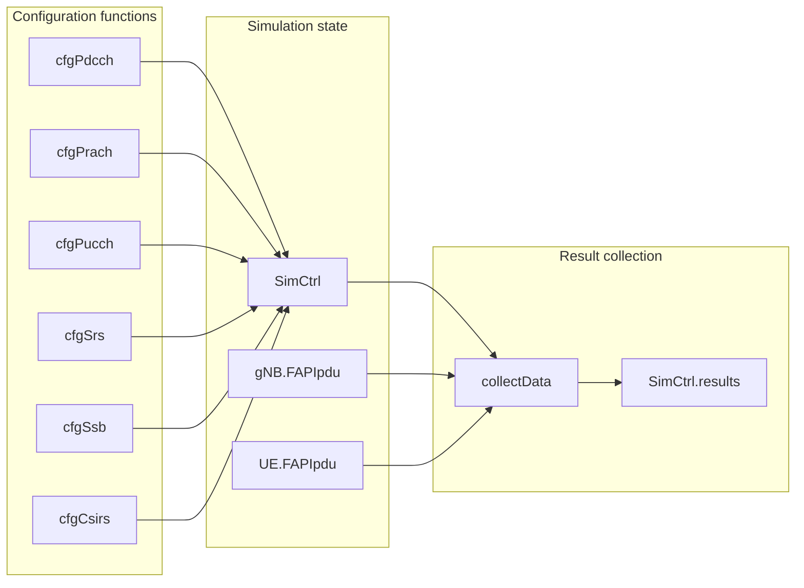
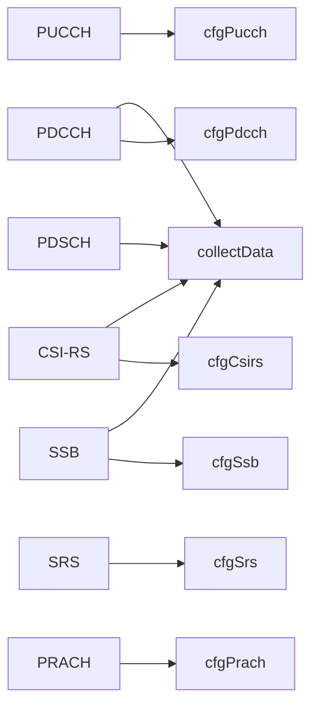

<!-- source: DeepWiki mcp.deepwiki.com · repo NVIDIA/aerial-cuda-accelerated-ran · page 10.3 Physical Channel Implementations · fetched 2026-10-26 -->

# Physical Channel Implementations

Relevant source files

The following files were used as context for generating this wiki page:

- [5GModel/nr_matlab/collectData.m](5GModel/nr_matlab/collectData.m)
- [5GModel/nr_matlab/config/cfgCsirs.m](5GModel/nr_matlab/config/cfgCsirs.m)
- [5GModel/nr_matlab/config/cfgPdcch.m](5GModel/nr_matlab/config/cfgPdcch.m)
- [5GModel/nr_matlab/config/cfgPrach.m](5GModel/nr_matlab/config/cfgPrach.m)
- [5GModel/nr_matlab/config/cfgPucch.m](5GModel/nr_matlab/config/cfgPucch.m)
- [5GModel/nr_matlab/config/cfgSrs.m](5GModel/nr_matlab/config/cfgSrs.m)
- [5GModel/nr_matlab/config/cfgSsb.m](5GModel/nr_matlab/config/cfgSsb.m)

## Purpose and scope

This page documents the physical-channel configuration and result-collection code visible in `5GModel/nr_matlab`. The supplied files define configuration structures for PDCCH, PRACH, PUCCH, SRS, SSB, and CSI-RS, and show how `collectData` reads gNB and UE FAPI PDUs to update channel result counters. The page also covers PUSCH, PDSCH, `fhComp`, `refGen`, `standalone`, and `test` as areas in the requested scope; their implementations are not shown in the supplied file contents, so their behavior is not detailed here.

Sources: [5GModel/nr_matlab/collectData.m:16-16](), [5GModel/nr_matlab/config/cfgPdcch.m:16-16](), [5GModel/nr_matlab/config/cfgPrach.m:16-16](), [5GModel/nr_matlab/config/cfgPucch.m:16-16](), [5GModel/nr_matlab/config/cfgSrs.m:16-16](), [5GModel/nr_matlab/config/cfgSsb.m:16-16](), [5GModel/nr_matlab/config/cfgCsirs.m:16-16]()

## Architecture and Data Flow

The visible implementation separates channel parameters into MATLAB configuration functions, which return structures, from `collectData`, which consumes gNB/UE `FAPIpdu` structures and updates `SimCtrl.results`. The supplied code does not show the channel waveform-generation functions or an export path for test vectors.

Sources: [5GModel/nr_matlab/collectData.m:16-37](), [5GModel/nr_matlab/config/cfgPdcch.m:16-56](), [5GModel/nr_matlab/config/cfgPrach.m:16-36](), [5GModel/nr_matlab/config/cfgPucch.m:16-69](), [5GModel/nr_matlab/config/cfgSrs.m:16-50](), [5GModel/nr_matlab/config/cfgSsb.m:16-56](), [5GModel/nr_matlab/config/cfgCsirs.m:16-39]()

### Configuration to result collection

The configuration functions assign channel-specific fields to structures. Separately, `collectData` examines gNB PDUs by their `type`; for several types, it finds the matching UE PDU and updates per-UE result counters when UE reception is enabled.

**Configuration and result-collection flow**

Sources: [5GModel/nr_matlab/collectData.m:16-37](), [5GModel/nr_matlab/config/cfgPdcch.m:16-56](), [5GModel/nr_matlab/config/cfgPrach.m:16-36](), [5GModel/nr_matlab/config/cfgPucch.m:16-69](), [5GModel/nr_matlab/config/cfgSrs.m:16-50](), [5GModel/nr_matlab/config/cfgSsb.m:16-56](), [5GModel/nr_matlab/config/cfgCsirs.m:16-39]()

## Channel Implementations

### Uplink Shared Channel (PUSCH)

The supplied contents do not include `cfgPusch` or PUSCH processing code, so PUSCH configuration fields and processing behavior cannot be described from this source set.

Sources: [5GModel/nr_matlab/collectData.m:16-37]()

### Downlink Shared Channel (PDSCH)

The supplied contents do not include `cfgPdsch` or PDSCH processing code. The available result-collection code does show that, for a gNB PDU with type `pdsch`, `collectData` searches the associated UE’s FAPI PDUs for a PDSCH entry and accumulates transport-block and code-block counts and errors from `pdschOutput` when UE reception is enabled. It raises an error if no matching UE PDSCH PDU is found.

Sources: [5GModel/nr_matlab/collectData.m:116-138]()

### Control Channels (PDCCH and PUCCH)

`cfgPdcch` returns a PDCCH structure with bandwidth-part settings, CORESET and CCE-to-REG mapping parameters, DCI count, and test-model and common-search-space flags. It creates one DCI structure per configured `numDlDci`; each DCI includes an RNTI, scrambling fields, aggregation level, CCE index, payload size, beamforming fields, and a generated payload. The defaults shown set `numDlDci` to 1 and `PayloadSizeBits` to 45. [5GModel/nr_matlab/config/cfgPdcch.m:16-56]()

`cfgPucch` returns a PUCCH structure with format, resource allocation, hopping, scrambling, DMRS, beamforming, and UCI-related fields. The visible defaults include `FormatType = 0`, frequency hopping enabled, and zero HARQ, SR, and CSI Part 1 bit lengths. The comments document constraints on those bit lengths, including their combined maximum. [5GModel/nr_matlab/config/cfgPucch.m:16-55]()

For PDCCH result collection, `collectData` processes each gNB PDCCH PDU’s `idxUE` list when UE reception is enabled. It finds PDCCH PDUs for each UE, then increments per-UE PDCCH totals and error counts for each DCI using `pdcchOutput.err`. It errors if no UE PDCCH PDU is found. [5GModel/nr_matlab/collectData.m:67-97]()

Sources: [5GModel/nr_matlab/config/cfgPdcch.m:16-56](), [5GModel/nr_matlab/config/cfgPucch.m:16-69](), [5GModel/nr_matlab/collectData.m:67-97]()

### Sounding and Reference Signals (SRS and CSI-RS)

`cfgSrs` returns parameters for an SRS resource, including antenna-port and symbol counts, resource configuration, comb size and offset, cyclic shift, frequency placement and hopping, resource type, beamforming fields, and channel-estimation granularity (`prgSize`). The shown defaults set one antenna port, one symbol, and a comb size of 4. [5GModel/nr_matlab/config/cfgSrs.m:16-49]()

`cfgCsirs` returns CSI-RS parameters including BWP and RB allocation, CSI type, row, frequency-domain configuration, symbol locations, CDM type, frequency density, scrambling ID, and power-control offsets. It also sets beamforming interface and beam-index fields. The comments identify CSI types for TRS, NZP CSI-RS, and ZP CSI-RS, and enumerate CDM-type meanings. [5GModel/nr_matlab/config/cfgCsirs.m:16-38]()

For a gNB CSI-RS PDU, `collectData` searches each indicated UE’s FAPI PDUs for a `csirs` entry and errors if one is absent. Further CSI-RS result-handling lines are not included in the supplied excerpt, so that behavior is not described here. [5GModel/nr_matlab/collectData.m:140-154]()

Sources: [5GModel/nr_matlab/config/cfgSrs.m:16-49](), [5GModel/nr_matlab/config/cfgCsirs.m:16-38](), [5GModel/nr_matlab/collectData.m:140-154]()

### Initial Access (PRACH and SSB)

`cfgPrach` returns PRACH configuration fields for the configuration index, restricted set, root sequence, zero-correlation zone, frequency allocation, repetition combining, preamble and SSB indices, beamforming, and power scaling. [5GModel/nr_matlab/config/cfgPrach.m:16-35]()

`cfgSsb` returns SSB configuration fields for subcarrier and Point-A offsets, periodicity, case type, half-frame index, beamforming, PSS power ratio, and MIB payload. With `cfgTx` enabled, the shown structure supplies `L_max`, symbol indices in the frame, and an SSB bitmap. [5GModel/nr_matlab/config/cfgSsb.m:16-54]()

For SSB result collection, `collectData` converts the gNB `bchPayload` to bits, locates the UE’s SSB PDU, and compares the received `pbch_payload` against the transmitted payload. When sample capture is enabled, it uses the UE PDU’s `errFlag` instead. It increments the UE’s SSB total and error counters and errors if no UE SSB PDU is found. [5GModel/nr_matlab/collectData.m:38-65]()

Sources: [5GModel/nr_matlab/config/cfgPrach.m:16-35](), [5GModel/nr_matlab/config/cfgSsb.m:16-54](), [5GModel/nr_matlab/collectData.m:38-65]()

## Performance Collection

`collectData(SimCtrl, UE, gNB, SysPar, Chan_DL, Chan_UL)` is documented as collecting UE and gNB data at the end of each frame for performance analysis. The shown body reads the carrier and slot/frame/subframe indices, counts gNB PDUs, and dispatches on each PDU’s `type`. For SSB, PDCCH, and PDSCH it updates per-UE result structures when `SimCtrl.enableUeRx` is true; the excerpt also begins the CSI-RS case. [5GModel/nr_matlab/collectData.m:16-37]()

| gNB PDU type | Visible collection behavior |
|---|---|
| `ssb` | Compares transmitted BCH payload bits with the UE PBCH payload, or uses the captured UE `errFlag`; updates SSB totals and errors. [5GModel/nr_matlab/collectData.m:38-65]() |
| `pdcch` | Finds UE PDCCH PDUs and accumulates DCI totals and errors from `pdcchOutput.err`. [5GModel/nr_matlab/collectData.m:67-97]() |
| `pdsch` | Finds the UE PDSCH PDU and accumulates transport-block and code-block totals and errors from `pdschOutput`. [5GModel/nr_matlab/collectData.m:116-138]() |
| `csirs` | Finds the UE CSI-RS PDU; the supplied excerpt ends before the remaining result handling. [5GModel/nr_matlab/collectData.m:140-154]() |

Sources: [5GModel/nr_matlab/collectData.m:16-154]()

## Configuration Entities and Code Mapping

The following mapping connects the channel names to the configuration functions present in the supplied files. PUSCH and PDSCH are included in the page scope, but their configuration functions were not supplied.

Sources: [5GModel/nr_matlab/config/cfgPdcch.m:16-56](), [5GModel/nr_matlab/config/cfgPrach.m:16-36](), [5GModel/nr_matlab/config/cfgPucch.m:16-69](), [5GModel/nr_matlab/config/cfgSrs.m:16-50](), [5GModel/nr_matlab/config/cfgSsb.m:16-56](), [5GModel/nr_matlab/config/cfgCsirs.m:16-39]()

| Channel | Configuration function shown | Example fields visible in the supplied contents |
|---|---|---|
| PUSCH | Not supplied | Not documented here |
| PDSCH | Not supplied | Not documented here |
| PDCCH | `cfgPdcch` | `CceRegMappingType`, `RegBundleSize`, `DCI.Payload` |
| PUCCH | `cfgPucch` | `FormatType`, `freqHopFlag`, `BitLenHarq` |
| SRS | `cfgSrs` | `combSize`, `cyclicShift`, `frequencyHopping` |
| CSI-RS | `cfgCsirs` | `CSIType`, `Row`, `CDMType`, `FreqDensity` |
| PRACH | `cfgPrach` | `rootSequenceIndex`, `zeroCorrelationZone`, `prmbIdx` |
| SSB | `cfgSsb` | `ssbSubcarrierOffset`, `ssbBitMap`, `caseType` |

**Physical-channel names mapped to MATLAB entities**

Sources: [5GModel/nr_matlab/config/cfgPdcch.m:16-56](), [5GModel/nr_matlab/config/cfgPucch.m:16-69](), [5GModel/nr_matlab/config/cfgSrs.m:16-50](), [5GModel/nr_matlab/config/cfgCsirs.m:16-39](), [5GModel/nr_matlab/config/cfgPrach.m:16-36](), [5GModel/nr_matlab/config/cfgSsb.m:16-56](), [5GModel/nr_matlab/collectData.m:38-154]()

## Implementation Details for Test Vector Generation

The supplied files establish that the channel configuration functions return MATLAB structures and that `collectData` consumes FAPI PDUs and records selected reception outcomes. They do not show bit-level channel processing, resource-grid generation, beamforming execution, HDF5 export, or the contents of `fhComp`, `refGen`, `standalone`, and `test`; those implementation details are therefore outside the evidence available for this page. [5GModel/nr_matlab/collectData.m:16-37]()

Sources: [5GModel/nr_matlab/collectData.m:16-37](), [5GModel/nr_matlab/config/cfgPdcch.m:16-56](), [5GModel/nr_matlab/config/cfgPrach.m:16-36](), [5GModel/nr_matlab/config/cfgPucch.m:16-69](), [5GModel/nr_matlab/config/cfgSrs.m:16-50](), [5GModel/nr_matlab/config/cfgSsb.m:16-56](), [5GModel/nr_matlab/config/cfgCsirs.m:16-39]()

---

