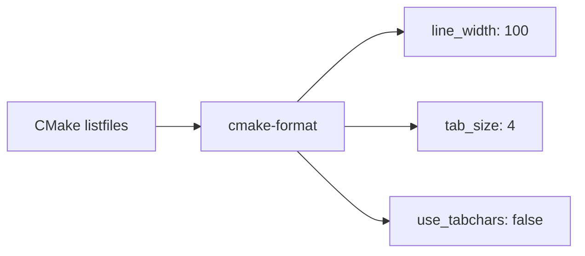

<!-- source: DeepWiki mcp.deepwiki.com · repo NVIDIA/aerial-cuda-accelerated-ran · page 11 Build System · fetched 2026-10-26 -->

# Build System

Relevant source files

The following files were used as context for generating this wiki page:

- [.cmake-format.yaml](.cmake-format.yaml)
- [5GModel/aerial_mcore/scripts/build_pkg.sh](5GModel/aerial_mcore/scripts/build_pkg.sh)

## Purpose and Scope

This page gives a high-level view of the build-related infrastructure documented by the available repository files. The package build entry point is `5GModel/aerial_mcore/scripts/build_pkg.sh`; a separate `.cmake-format.yaml` file configures formatting for CMake files. [5GModel/aerial_mcore/scripts/build_pkg.sh:18-35]() [.cmake-format.yaml:15-25]()

For package build details, see [Building the Package](#11.1). For CI/CD workflows, see [CI/CD Pipeline](#11.2). For container builds and deployment, see [Docker Deployment](#11.3).

**Sources:** [5GModel/aerial_mcore/scripts/build_pkg.sh:18-35]() [.cmake-format.yaml:15-25]()

---

## Build System Architecture

The provided package-build script resolves its project root, enters the `aerial_pkg` directory, removes any existing `dist` directory, and runs `python3 -m build`. The repository also contains a CMake formatting configuration; it specifies formatting behavior, not the CMake compilation targets or build commands. [5GModel/aerial_mcore/scripts/build_pkg.sh:21-32]() [.cmake-format.yaml:15-25]()

### Build Components

**Diagram: Package build flow from script entry point to build command**

Sources: [5GModel/aerial_mcore/scripts/build_pkg.sh:21-32]()

**Diagram: CMake formatting configuration entities**

Sources: [.cmake-format.yaml:15-32]()

**Sources:** [5GModel/aerial_mcore/scripts/build_pkg.sh:21-32]() [.cmake-format.yaml:15-32]()

---

## Python Package Build System

`build_pkg.sh` is the package build entry point shown in the available files. It switches to the project root, enters `aerial_pkg`, clears `dist`, and invokes `python3 -m build`. For package metadata, versioning, and artifact details, see [Building the Package](#11.1). [5GModel/aerial_mcore/scripts/build_pkg.sh:21-32]()

**Sources:** [5GModel/aerial_mcore/scripts/build_pkg.sh:21-32]()

---

## CMake Build System

The available CMake-related file is `.cmake-format.yaml`, which configures formatting options such as line width, indentation size, and space-based indentation. It does not describe compilation targets or the build process, so those details are covered by the dedicated child page where applicable. [.cmake-format.yaml:15-32]()

**Sources:** [.cmake-format.yaml:15-32]()

---

## Build Modes and Environment Variables

The provided build script does not show build-mode or version environment-variable handling. Consult [Building the Package](#11.1) for package build configuration details. [5GModel/aerial_mcore/scripts/build_pkg.sh:18-32]()

**Sources:** [5GModel/aerial_mcore/scripts/build_pkg.sh:18-32]()

---

## Build-Release Automation

The supplied files do not document a release automation script or CI/CD invocation. For the repository’s CI/CD workflows, see [CI/CD Pipeline](#11.2).

**Sources:** [5GModel/aerial_mcore/scripts/build_pkg.sh:18-35]()

---

## Build System Integration

The package script provides a focused build path for the Python package, while the CMake formatting configuration governs how CMake files are formatted. The broader integration of package builds, CI/CD, and Docker deployment is described in the child pages: [Building the Package](#11.1), [CI/CD Pipeline](#11.2), and [Docker Deployment](#11.3). [5GModel/aerial_mcore/scripts/build_pkg.sh:21-32]() [.cmake-format.yaml:15-32]()

**Sources:** [5GModel/aerial_mcore/scripts/build_pkg.sh:21-32]() [.cmake-format.yaml:15-32]()

---

