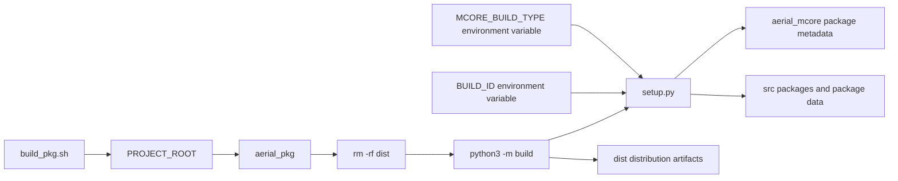
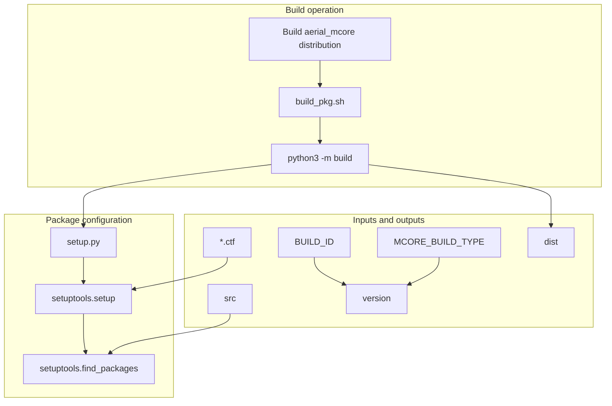
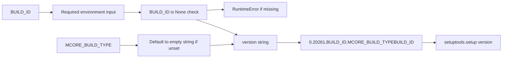

<!-- source: DeepWiki mcp.deepwiki.com · repo NVIDIA/aerial-cuda-accelerated-ran · page 11.1 Building the Package · fetched 2026-10-26 -->

# Building the Package

Relevant source files

The following files were used as context for generating this wiki page:

- [.cmake-format.yaml](.cmake-format.yaml)
- [5GModel/aerial_mcore/aerial_pkg/setup.py](5GModel/aerial_mcore/aerial_pkg/setup.py)
- [5GModel/aerial_mcore/scripts/build_pkg.sh](5GModel/aerial_mcore/scripts/build_pkg.sh)

## Purpose and Scope

This page describes the package-building behavior shown in the available `aerial_mcore` files: how `setup.py` defines package metadata and computes its version, and how `build_pkg.sh` invokes the Python build frontend. It also identifies what can and cannot be established here about CMake-based cuPHY/cuMAC builds and `cubb_scripts` install profiles. [5GModel/aerial_mcore/aerial_pkg/setup.py:16-44](), [5GModel/aerial_mcore/scripts/build_pkg.sh:18-35]()

**Sources:** [5GModel/aerial_mcore/aerial_pkg/setup.py:16-44](), [5GModel/aerial_mcore/scripts/build_pkg.sh:18-35]()

## Build System Architecture

The documented Python package build has two main code entities: `build_pkg.sh`, which cleans the package distribution directory and runs `python3 -m build`, and `setup.py`, which declares the `aerial_mcore` package and its version. The shown files do not include `pyproject.toml`, so the build backend and PEP 517 configuration cannot be confirmed from the available source. [5GModel/aerial_mcore/scripts/build_pkg.sh:21-32](), [5GModel/aerial_mcore/aerial_pkg/setup.py:16-44]()

### Build Process Flow

**Diagram: `build_pkg.sh` to `setup.py` package build**

`build_pkg.sh` resolves its own path, sets `PROJECT_ROOT` to the parent of the scripts directory, changes to `aerial_pkg`, removes any existing `dist/`, and invokes `python3 -m build`. `setup.py` reads the versioning environment variables and passes package metadata, package discovery, and package-data settings to `setuptools.setup()`. [5GModel/aerial_mcore/scripts/build_pkg.sh:21-32](), [5GModel/aerial_mcore/aerial_pkg/setup.py:20-44]()

**Sources:** [5GModel/aerial_mcore/scripts/build_pkg.sh:21-32](), [5GModel/aerial_mcore/aerial_pkg/setup.py:20-44]()

### Natural-Language-to-Code Mapping

**Diagram: package-build concepts and their code entities**

This mapping connects the user-facing package build to the script, setup function, environment inputs, source-package discovery, package-data patterns, and build output directory named in the provided files. The script explicitly clears `dist/` before starting the build; the provided setup configuration includes `*.ctf` and `VERSION_aerial.py` as package data. [5GModel/aerial_mcore/scripts/build_pkg.sh:28-32](), [5GModel/aerial_mcore/aerial_pkg/setup.py:20-44]()

**Sources:** [5GModel/aerial_mcore/scripts/build_pkg.sh:28-32](), [5GModel/aerial_mcore/aerial_pkg/setup.py:20-44]()

## Package Setup Configuration (`setup.py`)

`setup.py` imports `setuptools` and uses `setuptools.setup()` to define the package. It names the distribution `aerial_mcore`, describes it as “Aerial 5GModel Python bindings,” maps packages to the `src` directory, and discovers packages beneath `src` with `setuptools.find_packages(where="src")`. [5GModel/aerial_mcore/aerial_pkg/setup.py:16-18](), [5GModel/aerial_mcore/aerial_pkg/setup.py:33-44]()

| Setting | Configured value | Effect |
|---|---|---|
| `name` | `aerial_mcore` | Names the package distribution. [5GModel/aerial_mcore/aerial_pkg/setup.py:33-37]() |
| `version` | Computed from environment variables | Supplies the package version. [5GModel/aerial_mcore/aerial_pkg/setup.py:20-31]() |
| `package_dir` | `{"": "src"}` | Uses `src` as the package root. [5GModel/aerial_mcore/aerial_pkg/setup.py:38]() |
| `packages` | `setuptools.find_packages(where="src")` | Discovers packages under `src`. [5GModel/aerial_mcore/aerial_pkg/setup.py:39]() |
| `include_package_data` | `True` | Enables inclusion of package data. [5GModel/aerial_mcore/aerial_pkg/setup.py:40]() |
| `package_data` | `*.ctf`, `VERSION_aerial.py` | Lists additional package-data patterns. [5GModel/aerial_mcore/aerial_pkg/setup.py:41]() |
| `python_requires` | `>=3.8` | Declares the minimum Python version. [5GModel/aerial_mcore/aerial_pkg/setup.py:42]() |
| `zip_safe` | `False` | Marks the package as not zip-safe. [5GModel/aerial_mcore/aerial_pkg/setup.py:43]() |

**Sources:** [5GModel/aerial_mcore/aerial_pkg/setup.py:33-44]()

## Versioning Scheme

`setup.py` requires the `BUILD_ID` environment variable. If it is absent, setup raises `RuntimeError` and does not proceed to the package configuration. `MCORE_BUILD_TYPE` is optional in the shown implementation: if unset, it is replaced with an empty string. [5GModel/aerial_mcore/aerial_pkg/setup.py:20-28]()

The version string is assembled as `0.20261.{BUILD_ID}.{MCORE_BUILD_TYPE}{BUILD_ID}`. Consequently, the build identifier appears twice in the resulting string: once as the segment after `0.20261` and once after the build-type text. [5GModel/aerial_mcore/aerial_pkg/setup.py:29-31]()

### Version Inputs and Computation

**Diagram: environment variables to `setup.py` version**

**Sources:** [5GModel/aerial_mcore/aerial_pkg/setup.py:20-35]()

## Build Process Execution

`build_pkg.sh` enables `set -e`, so a failing command terminates the script. It resolves the script path with `readlink -f`, derives `SCRIPT_DIR` and `PROJECT_ROOT`, changes to the project root, enters `aerial_pkg`, removes the existing `dist` directory, runs `python3 -m build`, and returns from the package directory. [5GModel/aerial_mcore/scripts/build_pkg.sh:18-32]()

The script invokes the Python build frontend but does not itself specify command-line options for selecting a wheel-only build. The supplied files therefore support describing the generated output as distribution artifacts under `dist/`, but do not establish exact artifact filenames or the build frontend’s configuration. [5GModel/aerial_mcore/scripts/build_pkg.sh:28-32]()

**Sources:** [5GModel/aerial_mcore/scripts/build_pkg.sh:18-32]()

## CMake-Based Builds (cuPHY/cuMAC)

The supplied files do not include cuPHY or cuMAC `CMakeLists.txt` files, `CMakePresets.json` files, or build instructions for those components. They therefore do not establish CMake targets, preset names, build options, CUDA configuration, or the relationship between those native builds and the `aerial_mcore` package build. [5GModel/aerial_mcore/scripts/build_pkg.sh:18-35](), [5GModel/aerial_mcore/aerial_pkg/setup.py:16-44]()

The repository also includes `.cmake-format.yaml`, which configures CMake formatting behavior rather than describing a cuPHY/cuMAC build. The available portion sets a 100-character formatting line width, four-space indentation, Unix line endings, and canonical command casing. [ .cmake-format.yaml:15-41](), [ .cmake-format.yaml:87-95]().

**Sources:** [.cmake-format.yaml:15-41](), [.cmake-format.yaml:87-95]()

## `cubb_scripts` Install Profiles

No `cubb_scripts` files or install-profile definitions are included in the provided source material. The profile names, installation actions, dependencies, and any interaction with CMake or `aerial_mcore` cannot be documented from the available files. The only package installation-related configuration established here is the `setuptools` metadata in `setup.py`; `build_pkg.sh` builds the package distribution and does not show an installation command. [5GModel/aerial_mcore/aerial_pkg/setup.py:33-44](), [5GModel/aerial_mcore/scripts/build_pkg.sh:28-32]()

**Sources:** [5GModel/aerial_mcore/aerial_pkg/setup.py:33-44](), [5GModel/aerial_mcore/scripts/build_pkg.sh:28-32]()

---

